# UCB《计算机视觉与计算摄影学｜CS 194-26 Computer Vision and Computational Photography 2022》中英字 p09 -P09-9-Data-driven Methods Faces-9_26.zh_en -BV1w7UfBdELA_p9-

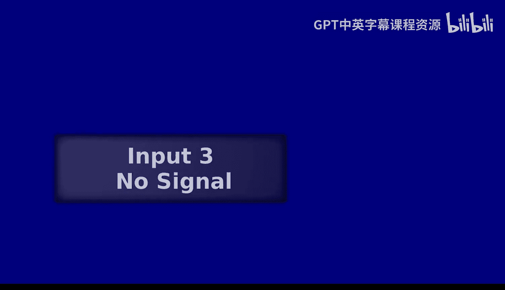

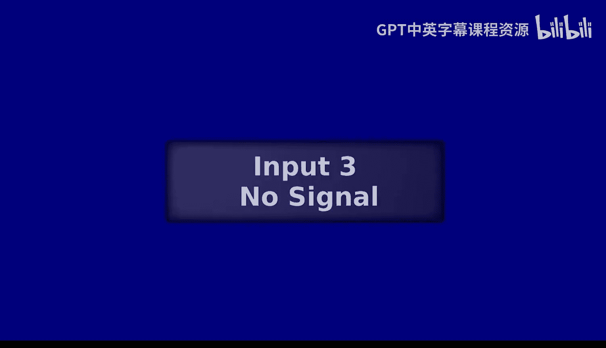

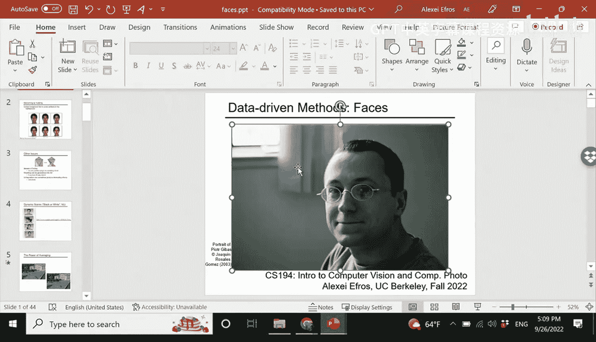

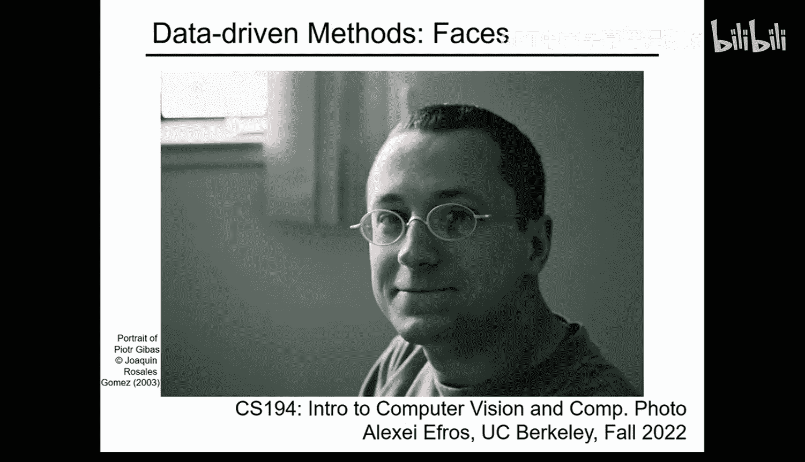

Yeah。

Maybe。我这。All right， folks。Hello。Hello， I trust。Your time with Andrew has been a productive 1。

 I see that you guys。Did。Did well on their projects。So， I'm back。Let it to aFO this morning。

And thought， okay， now it's time to relieve And for a bit。So， I'm going to continue for。

A few lectures。Let's start。Okay， so just a reminder。No laptops。And。And we start。嗯。

Last time you guys were talking about morphing。Just to make some final little bits and pieces as you're working on your morphing project。

啊。Make sure that you visualize your results。Much easier to see what's going wrong if you visualize。嗯。

Often。You get better results。If your background for your photos is similar。

One thing that you can do is you can actually you know take everybody's picture in front of a wide background or some uniform background。

 and then you don't get to have weird triangles in the background morphing in weird ways， okay。

 another thing that sometimes helps。Is you。You put。Vertices at the corners of your image。

 So basically make sure that the background has its own triangles and the foregrounds。

 your faces have a have other triangles。 So having four corners that basically can define the background。

 if your background is uniform then。You know， it will， it will work well。 Okay。

 some issues that could come up as you're working on your morphing。

Anyone had something like this happen。Where the， the thing falls on itself。O。What this means。

 usually。Is that you're trying to more things。That are not actually two dimensional vers。

There are three dimensional words。 Okay， so you are morphing something like something on this side to something on this side。

 right， So you basically。The， the 3D geometry of the world， like the nose。

And the mouth are changing places， because of 3D。Okay。

 that's not good because that means that your morph cannot be approximated well by a 2D thing。 Now。

 there are things called 3D warped morphs where you can actually do meshing in 3D and then everything will work out。

 But for 2D， it's not gonna work。 Okay， so just when you're doing the morphing。 make sure。That。

You don't have features。Jumping across from each other。 Okay， basically， make sure that your， your。

 what your morphine could be approximated by a 2 D transformation。That you。

 you don't have this flipping。 The flipping suggests that it's not a 3D transformation。

 It's a 3D transformation。Okay。Everyone clear on that。And， finally。

This is one of those things that we talk about in this class。

 which is actually quite an old technology。Maring was first。Sn。In。A video in the 80s。

 a music video by Michael Jackson and made a big splash。 So this is a technology that's。Allld then。

 and， and， and， and。Has a， has a good history。 But in yet， you know， it's。

 it's still you in use today。Okay， you can click on the video。At your leisure。 Okay， but today。

 we're going to talk about。Data， we are going to talk about getting。啊。Away from just having， okay。

 you know， one face， another face， that's worth through faces。

 We're going to start getting into this idea of using data driven methods。

Using lots and lots of images in this case， of faces。To teach us。Or teach the computer something。

That the computer wouldn't know if it just had one phase or couple of faces。 Okay。

 the power in numbers。So， for that。We'll start with the simplest way to use lots of data。

And the simplest way is。Average。When you guys are going to have your midterm。

I guarantee the one number you always want to know。 What is the one number。

Not the standard deviation。 That's the second number。 What's the first number。The average， right。

 The average， because standard deviation is not really。Well， I guess if， if， if。

 if one grades on a curve， then， then you， you're right。 the sit ratio is more important。

 But in absolute grading， it's the average。Even though， of course。

 it could be that the distribution is nowhere near Gaussian and that you have like bymod。

 Everybody was either a genius or an idiot right， and there is absolutely nothing at heaven。

 That's perfectly possible too。 and still the average is really powerful technique right's it's the first sufficient statistics in statistics。

 right the one number that will give you the most information。 So we'll start with that。😡。

And we'll start with just going down to Sprwl hole。 believe it or not。

 even though we are the the liberal bastion here， there is a security camera pointing at Spough hole。

And we got access to it。And so what we can do is we can have a frame for that。

 and we have another frame， and we have another frame， and we have another frame。

 and we can have a whole bunch of frames。Of， you know， have things happening in， in Spra Plaza。Now。

 what is going to happen。If we just take these frames， they are now in a， you know，3DRA。嗯。

Average them。Across time。 So all of the time axis， we just average all of the pixel values。

 RGB at all the X Y positions， We just average them over time。 What do you think is gonna。

 what is going to look like。谁问？a met。A max。MME， SS。喂hy。呀。Okay， let's， let's think， let's say that I。

 I average like1000 frames， not like 5 or 10。 I like a large number， large enough number。empty。

 is completely empty。 Just gray。把我的。Exactly， exactly。It erases the people。 It removes the people。

Except。Somebody who is cut in class and just sit there for a whole hour。

And they ended up part of the background， right。But， but everyone else， I mean， look， this。

 this is very eerie， right， So it's not， it's。It， you would， yeah， if you have just。

 if you average just a few things， it will be kind of messy。

 But the nice thing about law of large numbers， on average， at any point here。99% of the time。

 you're going to see the red brick。Only maybe 1% of the time。

 there will be somebody who is going to be passing over that red brick， and including it。

So the average is going to be very heavily towards the red brick。 Now。

 if you want to make it even less messy， you going do instead of average what are you gonna to do。

Yeah， medium， right， Mediium is basically the same thing。

 but more robustly it kind of throwroze away the outliers。 Okay。

 But the thing is that even average works perfectly fine。Right， so this is the。

 this is the number one concept that that we are going to appreciate。Is that。You can take。You can。

 you can analyze a lot of your signal by just looking at。Considering the mean。

The D C component in the double E terms， if you like。Of that signal。

 because that signal is going to tell you。Basically， this the the the， the。The common thing， the。

 the stationary the we sometimes we call it back backing plate。The background that is not changing。

 And these two guys just ended up being part of the background。Because they were there for too long。

 But anything that changes。Okay， is going to be removed away。Okay。

 now you don't need to do this with a computer at all。You can also do it with just a camera。

Because guess what a camera does。It does exactly the same thing with light。

 It averages light over time。Just make the exposure high， long exposure。You're gonna to average。

The scene。With in in photo space。 So you don't even need to， you know， get frames。

 pixels averaging the pixels， you don't need to do any of that。

 It just happens for you If you just set your， set your camera to have a very long exposure。

 This is a particularly long one，8 hour exposure of， of I think， Fifth Avenue in New York City。

And it's kind of， it's kind of amazing， right， It's amazing。😊，Because it's。It's。

It's midday in Manhattan。 And there is basically no one， right， complete aptiness。Right。

 because you are getting。The， the stationary thinks。Any questions。Why is the greed here。

So much brighter than than the red and the yellow。 Any ideas。Yeah， I think that's what they do。

 right in the， in the avenues， the， the green is mostly on and then， and then。

The streets are much more rare， yeah。哭。嗯。The idea of。Averaging images。

Goes all the way back to Sir Francis Galton。Who was quite a character。 He， he was a。

A cousin of Darwin， a great inventor， did a lot of great things。

 including coming up with the first weather map， also did some weird things and not so great things。

 you know it， but。For our purposes。What he did was he wrote a paper in nature。In the 19th century。

Averaging photographs of individuals。 his idea was。To figure out。The average， the features。

That would， that would the facial features。That would tell you if you're a criminal or not。

So he had a very natural， you know， very， you know，19th century scientific mind。 You know， he says。

 okay， we'll get some bunch of criminals。B of noncris， kind of like today now with deep learning。

 you know， training set。Criminals， not criminals。Average the criminals， A the look， noncminals。

 and then see。What， you know， the difference between them， okay。Inter enough， back then， it's 1878。

What the way he did this is that he didn't actually take a bunch of photos and average them。

 He would basically just have the same photo plate。 He would sit one sitter。

 expose it for a little bit。 And then put a different person in， expose it a little bit more。

 And so again， he would basically， he was averaging it。In， in with photos， okay。

And he got a composite image like this。Now， to be sure， as a proper scientist， he wrote in the。

 in the Nature paper that the total， the whole thing did not work at all。

 He couldn't tell the criminals apart from， you know， upstanding citizens， in fact， he noticed。

That all of them， the criminals and the noncals kind of looked better as an average。Okay， and。

 and you can， you can see that here。嗯。Since that time。

 people have been using image averages for many， many tasks。In art， especially， I'm。

partialial to this， to this work from 19785。60 passengers of the second class of the metro between 9 and 11 AM in Paris。

 Okay， and so basically， this is， this， this guy was walking around in the metro and just shooting all the passengers。

 This is。啊。I， I just's way of basically thinking about。呃。Cubism。But with a camera。 So what。

 what she did was she wanted to capture a building from all sides at the same time。

So she actually walked around and， you know， averaged all the views in a single photo。

 which I think is very， very cool。😊，嗯开。But really， the， the king of， of averaging is Jason Sullivan。

 now a professor in University of Chicago。 And his really is more of a critique， critique of the。Of。

 of contemporary culture。So what he did， he just Googled。Good typical terms， like， for example。

 the graduate。Or kids with Santa。And just average the Google results。 Now， he。

 he cleaned it up a little bit。 We， we actually try to do it the same thing。

 as he did a little bit of cleanup。 but it's really cool how kind of social norms。😊，阿比尔。

In these averages。Right。Like the fact that， you know， most Santas are right handed or right。

 you know， need。Right， because the kid mostly looks like he on the right hand。

Another thing that I didn't know， But apparently， it's a thing。

When you take a picture of the newlyweds。The groom is on the right， and the bride is on the left。

Turns out it's not random。 It this， there is a rule。And the data shows this。O。And so this is。

 this is， this is， this， I， I found this to be very cool because this is exactly the kind of。😊。

In a visual data mining that， that， that。Everybody talks about， but it's actually pretty hard to do。

 But here you have。You have an example of that。 something that we。Social norms that。

 that get evidence in the pixels。Okay。Now， kind of a natural question here。I。Why is。

 why is it so blurry。What makes these， these images are， I mean， you can tell what it is。

 but they are kind of worried， why。The high variance of what。It， yeah， different thing。 But。

 in this case， for example， I mean， the Santa is always Santa。 So what why is the Santa blurry。

 Shouldn't it be basically more or less the same Santa。Yeah， I mean， Jasonson basically just。

You know， got retrieved 100 images from Google and just put them on top of each other， right？

 sometimes the， you know， the Santa is a little bit up。

 sometimes the Santa is a little bit to the left。 So the the Santa is， even if it's the same Santa。

Right， it's not going to be completely correctly aligned。O。This is。

 this is turns out to be extremely important， the alignment。And。Antonio Traba demonstrated as we。

 we started with this in the beginning of plus what you can do once you can actually get alignment。

 So here is Antonio's。Data set where he labeled all the keyboards in， in the M T offices， okay。

And so now every keyboard is this little rectangle。 Okay。

 so now you could do take all these images and just average them together and you'll get a mess because these keyboards are everywhere。

Or you can align the keyboards。 How could you align the keyboards。😡，啊。Well， I mean。

 they are not even project transformation。 Well， I guess some of them are。I。

 I was always almost thinking like basically just， you know， assume it's a rectangle。 But okay。

 maybe maybe some rotation， maybe， maybe a rotation and maybe a little bit of scale。

 But you basically， there's four points。 You need to align those four points to be the same thing。

 And once you do。对的啊。It's pretty cool， right， The keyboard is actually quite sharp。😊，But more。

 there is something more exciting than that。 The keyboard， the sharp， but then。

The context around the keyboard。Is also brought into sharper focus。

 The fact that right above the keyboard， there is a monitor。And right below the keyboard。

 there is an edge of the table。Is revealed in this average image。In a way that it wouldn't have been。

If you just take an average。So the alignment， the story here is the alignment of some features。

Allows the rest of the image to， to also get aligned。Okay， allows us to understand more of the image。

 So you don't need to align every single point on the image。

 Just aligning one thing turns out it is already quite helpful at aligning other things。Questions。

Yeses。W。Here。Yeah， it's true， I。I was。I was wondering about this。 And I had an answer。But I forgot I。

 it， it might have to do with aliasing。Right。啊。Because。Because youre， you， you know。

 you're warping some of these images。 And if the warp is somehow not anti alias properly。

 you could have something like that。 I don't know。 Yeah， I used to know， and I forgot。But I can。

 I can， I can。 I can try to remember at some point， yeah。But， but good question there。 Why。

 why are they not。Why is it not， I mean。The thing is。You're averaging very few images。 I think here。

 this is all the images that are being averaged。So the more images you get。

 the less of these things are going to happen。 So it's， it actually。

 some of it could really truly be just noise。Yeah yeah。Other questions？Sorry。O。So。

When we are talking about computing means in the visual space。

There is going to be two things that are going to be very important。

1 we already alluded to is that we want to have alignment。Of our objects that were computing。

And second is that the object must span a subspace。Given those two requirements。

Cool things might emerge。 One is subpopulation means。And the other is deviation from the meat。

And both are going to be useful for you， not just in the academic sense of the word， as they say。

 but very applied as you progress with your project and want to do something cool。

So you want to pay attention。Okay， alignment， I think everybody is on on board with this already。

 but just to make sure you have an image。You split you turn the image into a vector。

 and then that's what you're going to be averaging。 So you have another image。

 and then you turn that antenna a vector。 and then the average is basically you just take half of this vector half of that vector at the mark。

 right， That's just how linear algebra works， right。But。If。😡。

The objects depicted on those images are not in alignment。For example。

 here you have a house that's a little bit up and here you have a now house that's a little bit down。

Then what happens。Is that instead of， instead of averaging。

A pixel that's the roof of the house with a pixel。 That's another roof of another house。

So apples to apple is averaging。Now， you will be averaging the roof of a house。With， you know。

 a piece of the sky， because there is， there is a misalignment。And that's where you get the blurring。

You get the blurring because you are not doing apples to apples。averaging anymore。

 You're not averaging things that are should be average。Your averaging。You know。

 the chimney with the guy。So you get half chimney high sky。 What is that nobody knows。 It's not， not。

 not defined。同该。So， this is why。Alignment is very important because alignment allows you to do apples to apples。

Averaging。Right， you don't。 You don't average。You know， your spreadsheet of all your per purchases。

Across， you know， across school year without actually making sure that you're averaging， you know。

 your， your sandwiches across the year to， your school bags across the year， right， you。

 you don't want to average them。Together， for example， right， the same thing here。

 you need to make sure that your items that you're averaging are actually the same item。Questions。

Yes。To。Maybe other points might be a misalign， so would you like to apply some work？Well， so what。

 what we showed here。And this's kind of a cool result。Is that just aligning some things。

Brings others near them also in in a more or less O alignment。Why， because visual world is smooth。

 If visual world wasn't smooth， then yeah， then you basically have to basically align every single point。

But because the visual world is smooth， you can get this kind of just aligning few sparse points。

Will get you。A lot of what you need where you need to be。

 So then alignment is not as hideously horrendously hard thing as it could have been。呀。Any。function。

可以在。Well， when you should mention Project 1 was all about that。And。

TheI believe the next project on Panorama's teaching is going to be again about that， except。

The type of transformations is going to be。In fact。When one of the greats of computer vision。

 Professor Takekeyo Caraddia at Carnegie Mel University， was asked by a first year graduate student。

😊，Professor Kanay， what are the three most important things in computer vision。

Professor Kennaji said alignment， alignment， alignment。So。

It turns out that alignment is actually absolutely critical， not just for， you know， averaging。

 but also for understanding。Because if you can find something that's basically apples to apples。

You're already more than halfwa to our words understanding what it is。

 because if I can align this chair with some chair in my database where it says chair and maybe even has a price and a link to Amazon。

 Suddenly， I know where I can buy this one， too， right。收。Think of alignment as like， your pointer。

Once you have a pointer between your data， your data is not independent anymore。You， the the。

 you know， computer vision， part of computer vision is， is or half of it， really。

 is patterning  recognitionition。 That's why our conference called CBPR。

 Comp vision and patterning  recognitionition。 What is patterning  recognitionition。

 recognizing patterns。To recognize patterns， you need to align them。 You say， what is a pattern。

 pattern is something that happens over and over and over again。

 So you need to find when something happens over and over。 And that's alignment。 So we'll。

 we'll be back at alignment， you know， throughout this class。O， in fact。

You are doing alignment between two images， two faces for this project。But。

There is absolutely no reason to stop at， too。嗯，可。In fact。

 it makes perfectly reasonable sense to say， what if I want to。Computer average face。

Of this particular data set， this is a data set of Danish computer computer vision scientists。嗯。

And I want to have an average Danish computer vision scientist。Let's say。 Okay， now。

 you could just average the images。But it's going to be blurry。

 It's going to be kind of like a Jason Sullivan kind of thing。 You know。

 you're gonna to see something， but it's not gonna to be nice。So I now want to actually align them。

Good well enough。So that I can compute an apples to apple's average。O。What am I going to do。

I'm going to basically do the same thing you guys are already doing for a pair of images。With one。

Little。Exception。So for a pair of images， what you are doing is you're clicking on nose to nose。

 ear to ear， you know， mouth to mouth， right。For two images。 And then maybe for another two images。

 you're gonna to do it some， some other different key points。But here。

I'm just gonna say I want all the key points to be standardized。

So I can basically label all the images in the same way。

So maybe I' will start with the left eye will be key point number one。

 right eye going to be key point number two。Et cetera， et cetera， et cetera。 So all the key points。

I will number them， and they will always be。The same， the same number， in fact， I think。We give you。

 we give you this particular key point。Lay out and numbering in the， in the， in the homework。 But。

 but you can do whatever you want。 The key is that they need to be the same。

And the nice thing about these Danish computer vision scientists is that actually。

 they did the work and they， they labeled themselves and they labeled themselves in a consistent way。

😊，Okay， so now what you have。Is you have an image。Not particularly Danish。

 but computer vision scientists， nonetheless。And。In addition to the image， you now have a vector。

Of in this case， it's 43 points。So how long is that vector？43。Times 2， right， because it's X， Y。

RightEvery， every point is an X Y coordinate。Right。Okay， so now。You have two pieces of information。

You have。The images。And you have。The。The shape， what， what， what Anjo called just last week。

Talked about。The shape and the appearance。 Well， it's the same thing。 It's the。

 you have the appearance。 And then the keyoids represent the shape。

 except now the shape is standardized across。Across the。All the images， okay？

So now you have your appearance vector and your appearance vector is your basically just RGB image。

 right。And we can make it into a bacterial。Whatever， you know。

 height width and and times 3 RGB channels。And the shape vector。

 which is going to be 43 coordinates X Y。 So that's 43 times two dimensions。没该。This information。

Gives us。It gives us annotation。So we know for every single face in my database。

The coordinate of the nose。Right， it's maybe you know， key point number 7。

 and I can go into any person。 look at key point number 7 and will give me X。

 Y location of where that person's node is。 Okay， so it gives an attention。

 but it also provides alignment。Because now。I can， for example。

 shift the images so that the nose is always at the same point。And， for example。

 average them that way。 And then I will have no centered。Averages。

 or I can have ear center averages or corner of mouth center averages。 whatever you want。

 you can easily do it。 In fact， I I encourage you to。

 to play around with just centering on any of any one particular point。😊，And then。And then doing it。

啊。What you， what if you want to actually align them。For all the points altogether。我 do对。有。Yeah。

 so you do exactly the same thing。As we did with for a pair of images。

 except now you repeat it for the entire data set。😡，You first compute an average shape。Wow。

 that's pretty easy。 You take all of the vector from all your database。 You have 100。People。

 for example， you have 100 vector like this。 You average them。

 You will get the average nose position， average ear position， average other ear position。

 etc cetera。 So now you have an average。Average vector of key points。 an average shape vector。

And then you just go to all of the images in your database and workp them。Into that average vector。

No。We are ready to， actually， what。Average the pixels。 Remember from last lecture。

 you first average the geometry。 You then average the pixels。 You don't do it at the same time。

 You first the geometry， then the pixels， geometry， then the pixels。 The only difference here。Is you。

 you average the geometry across the entire day。Instead of just for two images。W。

Before we see the result。Or you want to see the results first。I want to see the results。 hopefully。

 next slide， yes， it is。 Okay， now。We have our Danish。Danish colleagues。We war to the mean shape。

And then we average pixels。Dm row， please。Yeah。Galton was onto something。I mean， he's kind of cute。

 right。I mean， it's definitely a hymn， right？ I mean， look at the distribution of male to females。

 It's definitely him。But。You know， he could， He could be a minor Hollywood actor。嗯。

I think it's like a really good mapping between。Really pretty male。

 like mask features and That's right。 That's right。's there' is definitely。

 it's not just all male male， but it's definitely weighted the word male。 But there is also some。

 you know， what makes， what makes this average so kind of a good looking。It's a bit softer， softer。

 Yeah， Why is it soft， Maybe maybe maybe。走吧。But like not too much that。Okay。

 so think about it in terms of triangles。 So we have a。

 maybe we have like a couple triangles on on the cheek， right。And across all of these subjects。

 you're going to average。Those strangles。 And imagine that they have some acne or I have some facial hair or some have some mole hair。

 some pimples。 What is going happen to all of them。They're going average out and again。

 because all the pimples are going to be in different places。 So it's just like the spraough Plaza。

 They're going average out， right。So， this。This。You know， this， this， this person looks。Handsome。

 because we have this。Bile， you know， evolutionary bias towards people with clean skin。

 because that means you， you know， you， you， you don't overeat and you're， you're exercising。

 And maybe you， you know， you're gonna live long。 Who knows。 But。

 but average is basically just doing that for you。 It's basically like a Photoshop filter for free。

 Okay， so。It's the answer to Galton's question。 Why are they looking so good is basically that that they。

 it's a way to trick our evolutionary visual system into thinking that they are more healthy， right。

 but， but indeed， it's。What else is true about this？That make。Sysymmetric， again， the same thing。

Averages are going to be symmetric because， you know， low of large numbers， everything。

 you average a whole bunch of points。 you get a Gaussian。 Gaussian is going to be symmetric。

 The same reason here， all the， all of the noises are， are going to be zero mean。

 so you get a symmetric thing。周。😡，Don't get too surprised when you get some result like this。

 This is to be expected。Nothing， nothing。Nothing to crazy， okay。Now， this is one thing。

 this alignment。Is very， very important， right， with the right alignment， you get something。

 you know， that looks surprisingly good。What is the background？You want to have。Yeah。

 because then then it's the same thing as what you know in in the two version case。

 because different， different backgrounds is just going to get you， get you the noise here and here。

Here you， basically kind of。You， you will get。You'll basically start paying attention to the foreground because the background is。

 is all the same。 So it will still work if you have different backgrounds。 but then you'll get。

let's say if you have black background and white background， it will average the gray background。

 and then it might actually bleed into the person because maybe there will be similar grays or something like this。

 Where with a uniform background， it's kind of it's going be nicely separating the person from the background。

Questions。Okay， so alignment is important。But that's not the only thing that's important。Objects。

 mass span。A linear subspace。嗯，该。What does that mean。It means that。The average。

Between your two vectors。My must actually exist。It should be。It should be a valid thing。Right。

It's no use taking an average between a laptop and a backpack。Because the average does not exist。

Because。In our visual world， this is not a linear subspace。O。That all of these methods only work if。

The average is actually a valid。OK。This， for example， is not。Right。

Because an average between those two pictures is not going to be yellow。

It's not a linear service page。This is going to be like half green， half red。

 And that's not not valid。 Does not actually exist。Right， so traffic lights。

 not linear your subspaces。Webcams of my hometown， also not really a linear sub spaces， mostly。

 but this kind of half ice， half water thing。It doesn't really exist。Lucky for us。

Faces are one of very few things that actually。Are mostly， almost always。Linear subspaces， okay。

Why is that。😡，哎你。Any ideas， Any。Biology major， maybe。Why are faces。Linear self spaces。

And backpack and laptop or not。What is the difference between。Backpack and laptop and。

 and different phases。Thinking back to your biology。there small differences。Major retainment of like。

Features over time。And why is that。嗯。Yeah， because， because what happens when， you know。

 when the chromosomes， Papa chromosome and mamacroos are meat。It's， it's going to be just averaging。

 right， It's not quite averaging。 You cut some of that， some of that， But it's basically。

 theyre lined。 Youre basically。GEvol likes smooth things。 It likes smooth transitions， in fact。

It's you will be hard pressed to find anything in biology that's not smooth。

And so because this is a biological process。Any two faces。There its， you。

 you should be able to find a face that lives between them。For the simple， for the reason that well。

 if those two people get married， there is a very high chance that。

That average is going to actually be there offspring， right。So it's actually。

 it's because it's a biological phenomenon that。We actually can fill a soft space with our face。And。

 and it's kind of nice。 Now， that this part is， is kind of。We get this for free because of biology。

 What is nice is it turns out that that subspace could be made linear。😊，If you do the alignment。

 So if you do the alignment， just like we talked about before。

 it turns out that you can model the human face subspace linearly。

So you really truly just take two vectors， average them 15%，50%。And it still looks like a face。

 If things are aligned， If theyre not aligned， then， you know， all bes are wrong。嗯该。

So faces are mostly a subspace。What are exceptions， What are things that are not。A subspace。

Even for faces。But a third of you have him。Yeah， glasses could not have half glasses。Masks。

 same thing， right， is's either on or off， cannot average mask cannot average glasses， beards。

 kind of weird averageaging beards。 you will see when you。

 if you try to do more thing of bearded to non- bearded people， it looks weird。

Because the average doesn't quite exist。 So there are still exceptions， you know， earrings， you know。

 any kind of， you know， yeah， there are things that are not。Not quite fit substrate。

 but on the whole。It's not bad， okay。So。Now， that we got。

The two requirements are alignment and spanning a subspace。What we can do is we can actually。

Analyze the data in various ways。And the various ways is we can。

 we can do what they the same kind of song and dance that they do when they analyze， you know。

 Democratic votes versus Republican votes。 you know， they go to be say， oh， you know。

 that many college kids voted for X。 that many soccer moms。 that many blue collar workers。 that many。

 right， they they define some sub subpopulation and they report a number for that subpopulation。

Right。You know， do all college kids vote the same no？It's still an average。

 It' still have have all of the caveats of an overall average。

But it's a sufficient statistic for that subpopulation as actually tells you if you were to use one number。

 The average is not a bad number to use。Okay， and so now kind of dividing it into a little subpulation。

 you can get a little tiny， little bit more information。嗯，给。

And so the cool thing is that you can actually play around and define your own subpopulations。

 You know， average child， average happy male， average， whatever sad female。

 average candy eating professor， right， Anything you want to come up with， you can。

 if you have enough data。😊，You can actually construct this subpulation， computeamine。Okay。

 so this is what they did by doing it basically across， across different countries in the world。

I think using Google search again， right， again。These are averages。You know， not。

 there is no one person that looks like that， right。But they provide some information。

 especially in relationships to each other。That， you know， might be useful。Same thing for。

 for for women。嗯该。So what is that useful information。Let's get back to our sprawl Plaza example。啊，该。

We can talk about not just the mean。But we could talk about deviations from that mean。OK。So this is。

 this is our one frame of spproul placid。 Let's say this is image X。Any questions。Imagejects。

This is our average。Average image called mean x， mean X hat。OK。

The average lost all the people walking except those two dudes， right， Everybody else has gone。

What if we weren to only get the stuff that was moving。Subtract one from the other da。

This is one of the oldest algorithms of the computers called background subtraction。

Your computer background。And you subtract it。 This is still how a lot of the old school surveillance cameras。

Work like these motion detectors。 They basically， they build an average background。

 and they subtract it from every frame。 And then when they see enough。No zero pixels say， no， okay。

 something is moving。Okay， and so here you get to see。Somebody's oh somebody has some question。

 I'm gonna be back。Anyone。I can hear some muring。Some hard burning question， yeah。杨龙。2。Maybe they're。

 they're trying to get into the class and figure out all the all the information。

But you guys don't tell them。嗯。So this pixels， I mean， they， they don't look like。

They don't like actual。Humans， but， you know， the fact that they're on means that there is something there。

And then you can， you know， you can， you can do various things。 You can enhance them。 You can。

 you know， find clusters of them。 and， and， and then you can actually detect them。 Okay。

 so this is actually one of the simplest ways of。You know， if you have a stand。

 if you have a station and camera， track people and and do some sort of video processing。 Okay。

 so deviation from the mean。Is actually carrys useful signal， right， because， you know the average。

And then you say， well， something that's out of the ordering， out of the average。Must be interesting。

Or could potentially be interesting。Okay， so。What。What does it mean。In a more general case。

Let's get back to our vector space。We have。We are going to average the digits 3 from our Mmuns data set。

Okay， so this is your average free。 This is the if we just average all the threes， all there。

 whatever 10000 threes in the data。And this is a particular thing， that。We are looking at right now。

 okay。What is subtracting one from the other going to tell us。有。What is that information？Yeah， it。

 it's going to tell us what is special about this three that makes it different from the average case。

 right， It's deviation from the meat。Well， let's actually do it。Right， it's vectors。

 so we can just subtract to vectors。So this is our Delta X。

This is the deelta that makes this guy special。😊，Compared to the average case。O。Now。

 once we have the Delta。We can。 We can do various things。We can morph， for example。

 we can actually span the whole line between the average and the particular three。

 and we can make it like a little movie。Wping slowly an average three into this particular three。

 right， because。We are assuming a linear subspace。 We are assuming everything along this。

This ray is a valid digit3， so we can just produce a whole bunch of them and， and have a video。But。

 we can do more。We maybe can even extrapolate。 How would do we extrapolate。

And you talked about expolation a little bit， right。How do you do it in this case。

Yeah means you just take this guy and add a little bit more of this deelta X。Right。

 you know the direction。 Just add a little bit more。Because。This thing。

 this three is an average three plus the delta。It just increased。1。7 Dlta。And you get a free。

 That's even more。Individual than the original than the， than the the original one。O。This。

Very simple trick。Is how you guys are going do category caricatures。

So a caricature is nothing else but taking what makes somebody。Different from the average， you know。

Ronald Reagan had a longer nose than than normal people。 So when they do a caricature of a Reagan。

 they would just make his long nose even longer。 Obama had larger ears。

 so they make the movement larger。 That's what caricature is do all the time。Here。

 this is what's going to happen。You extrapolate things， and then the things that are more。

 more out of the ordinary get extrapolated more。 and you see them exaggerate。Now， this。

This is a little bit。Kind of magical looking。What happens if I put like。3 or5 here。

What's going to happen。Is continue extrapolating。 I it going like rotate the tree like this way or something。

What's gonna to happen。嗯。Very， very dark。So just， just to make sure that everybody is on。

 on board what this image represents。 This is an image。Where gray is 0。White is a positive number。

 and black is a negative number。 So this is what happens when youre。

 when you're displaying an image that has both positive and negatives in， in things like Python。

Because we don't know how to display negative photons。It basically， just。Scals everything up。

 And so for these kind of images， gray is actually 0。So basically。

 this image has some positives where you add ink。And negative， very subtracting。O。呀。

I think if you extrapolate extremely far。En of。That's right。That's right。Why wouldn't you。

 Why wouldn't you。Have this three kind of rotating more and more and more like this。 But you know。

 becoming it more and more coersive。Because that's， that's what it seems like it， right。

 Like compared to the average， this thing is a little bit， little bit more cursive。 So like。

 wouldn't you want to of continue doing that。Yes it。The。

When you make the weight of the delta extremely large。

 that just corresponds to the individual pixel dos instead。Exactly。

 because here we're assuming this linear relationship。 this， this is just a subtraction。

 This is a linear subspace assumption。Where is。If the transformation is indeed this kind of rotation。

That is not a linear transformation。 at least it's not a linear transformation in pixels。So， here。

The linear assumption is just an approximation of really what's probably happening。

So it's going to be working for a little bit， just like most linear things， like， you know。

 Taylor is expansion。 It's actually pretty good at short intervals。But eventually。

 it's going to fail。The same thing with all of your extrapolations， as well。

Because we're assuming linearity， which is not usually a perfectly correct assumption。Eventually。

 it will fail。So don't extrapolate too far because it's not meant for this。

 It's meant to do a little bit。It's meant to be this， this， this Tayloror expansion， you know。

 the linear term。And for that， it's doing pretty well。嗯该。那我。I think。We are ready。

Do ox should it get back to faces？Because I think we have all that we need。To。Lalay on with face。

 yes。Yes， yes。 if you put key pointss， key points on the， on the edge， yes。呃，的水啊。Yeah， I well。

 it's still。I think it still wouldn't be， it would。It would go farther。

 I think it's not going be exactly the same thing still， because。

It will not know how that you're gonna go go in circles， right。

But it will definitely get you farther。 Yes， yes。 So， you know， yeah。

 correspondence definitely makes things better。Okay， now we are ready for， for。

For to put it all together。Alignment。Subpulation means。Deviation from the mean。

And we are cooking with faces。Let's say， we have a face。I claim that you don't need a fancy。

 stable diffusion organ or whatnot。To make your face look happy or sad or even old or young。

All一 need。Is a nice。Linear subspace。And some data。To know where you need to go， so。

Given a single an input phase。The argument is that you should be able to move it towards words。

Various directions。In face space。So you can make a sad using applying a sad vector。

Or happy applying a happy vector。 What would happy vector look like， Well， in appearance。

 I don't know what the happy vector would look like。 But in shape。

 the happy vector would be actually just， you know。

 these key points were just farther away from each other， right。

 That's probably already going to get you quite a bit happier there， right。😊，So。

 so it's not that crazy that you could。You could have。

Manipulation of your shape and appearance parameters。To change a particular phase in various ways。

And this is exactly what we're going to be doing。So here is the face。 This is our current face。

Let's say we want to make it more feminine。What do we do。Well。

 we have one subpopulation labeled of all the males in the database。We have another subpopulation。

 all the females and the， okay。What we need is we need a vector。Pointing towards more feminine。

How can we get that vector。Yeah， so you have these two images。

 You don't even need the rest of the data anymore。 You have these two average images。

 You can subtract them because they're already aligned。 It's， it's a valid operation。

 You subtract them。And you have the vector。off。You know， making things more feminine。

And you just apply this vector。To your original image。F呢。O。I mean， it's not great。

 but it's something。It's， it's not， it's not super bad for how simple the approach is。 It is really。

You know， vector algebra。Once you think of a vectors as transformations。

You can just take whatever transformation。Apply to your new， your current image。And if your。

 if your vector space is a good one。It should do something reasonable。Okay。

And that's basically the story first appeared in this old paper by a couple of psychologists。嗯。

And that's what they did。 They， they labeled a whole bunch of。Males and females。

 lots and lots of key points。And then they basically。Applied this。

 and you can apply it both into the shape space and appearance space。

 right so you can apply it just a shape space， just an appearance space。Or both at the same time。

 or well， first shaped then appearance。Right， and here is one way to。

To kind of push things toward the more feminine side。Heres。Going both ways。Here is aging。

Making things。Making person older， again， in shape。In appearance。Both together， you can see that。

In shape。It。It doesn't change the hair coloror， but the hair line gets updated， right。

 because hairline is， of course。In， in the， in the shape vector。But here， the hairline is updated。

 and also， there is a little bit of gray in the hair at the same time。Right。Questions。So again。

 you know， especially here， you can see like if you push it too far， it's going to break。 again。

 the linear assumption is going to be， is' going to break at some point。Right。

You're starting to get some greenish weirdness here。So you can't push it too far。 but。

 but for a while， it's going to be okay。Okay， any questions。Yes。这边费。Your friends。

Data set because they're like a nice。都是。T that are like。给稍们。Well， I mean。

 the shape and the the shape and appearance are， in， in fact。

 disentangling them kind of by construction。But there is going to be a lot of other things that are correlated that are not going to get disentangled。

And that's， yeah， that。There is going to be a lot of these entangled things in there。 And。

 and disentangangleling in them is actually a， you know， active area of research， for sure。Yeah。

 you're gonna， you know， lots of correlations。 and some of them are just spurious correlation。 But。

 you know， that's how life is。呀。对全子。Do we need to shift the shape into that shared shape and then shift color and then back？

Original。Yeah， you do everything in the common shape the。

You don't do anything with pixels unless they are in correspondence。 The correspondence comes first。

 That's why you always do shape first。And then， and then and then， and then appearance。

 So I think here， when they just do color。They still do the alignment and shape。

 But it's just that they don't actually do anything with that shape vector。

 The shape vector is just an average。Right， they don't。 They don't actually， you know。

 change that in any way。 But yeah， you can。Apples need to be always with apples。

 So pixels should always be in correspondence before you do anything。

 That's why you deal with shape first， and then you do appearance， yes。OK。So， the last thing。

We're back to。Back to our subspace。And then one could wonder， you know， how do you。

How is there a good way to represent。This linear subspace。How can we really figure out。

A mathematical way to represent anything that could live in the subspace。Well， actually， it's not。

It's not that hard。Because this is。We're back to our old friend， the basis。

We can basically say that if we have a few。Basis images like the basis screen。

If we have enough of them。Depending on the dimensionality of your space。

Everything else could be defined。As just a linear combination of these basic basic shapes， okay。

So that's basically the， the， the， the notion of， of linearity， right that you have。

A bunch of your excs。And any future， you know， digit3。

Could would be defined simply by a mixture of coefficients alpha。A vector of alphas。

Multiplying the basis。Should be able to give you。Any， any three。

 that means that you are really completely covering the subspace。嗯，可以。And amazingly enough。

 this is also true for faces。Okay， so again， for faces。

 this is slightly different notation because I'm stealing slides from a different paper。

 but it's a cool paper with cool video。 So you will like it。😊，So they have the shape vector S here。

 And here they call the appearance vector text shirt。 So it's T， okay。

And what they are going to say is that。Theyre going to represent。Both of these。Vectctorors。

By a linear combination of some basis。啊，给。And the basis。Could be， basically。So here actually。

 the shape is in in 3D。 So it's like a 3D scans instead of just key points， but it's very similar。

 And the the appearance is， is， again， RGB images。The point here is that if you have。Let's say。

200 people。嗯该。And you separate them into shape and appearance。The argument is。

 and this is an amazing argument。That you take any new face like me， for example。

And you can represent。The pixels。Of my face。Just by picking the right set of alphas and beta and betas。

Based on the basic steps。 In fact， that's what this paper did。 They scanned 200 Germans。

They build a model with this 200 Germans。With 200 bases。Any other face， more or less。

 could be represented as a linear combination of these 200 Germans。

This is really impressive and kind of tells you how much。How， you know。How boring our face space is。

 really。Right， you， we have 8 million people， billion，8 billion people on earth。 and， and really。

200 is enough to basically span all of us。嗯，该。So all you need for any new phase。

Is two vectors at 200 dimensional vectors of alphas，200 dimensional vectors of beta。400 numbers。

 And I know what you look like。And of crazy， right。Now， there is。

A little bit of a trick here that I'm not saying。Is， you know how many， how many bases， you know。

 how many of the Germans do you need， How many base vectors do you need， right。What should they be。

You know， maybe some are more important than others。And also。

 do they actually need to be actual faces。Do the basis vectors need to be actual phases。 Well。

 it turns out that。No， they don't need to be。 And then there is an actual。Approach that。Calculates。

A list of the best bases， given any data set。And youve probably already heard of this approach。

 it's called principle component analysis。😡，This is basically what PCA does。BC is fine。

Instead of saying， okay， here is my 200 Germans。 It's going to find me the best。The best vectors in。

You know，200 German space。That are sorted。By importance。They represent the first。

Basis vector is the the the one that captures the most。mount of data。

 The second principle component is the most of the residual， et cetera， et cetera， et cetera。

 So you get them sorted by。How well they represent the data。O。收。You can think of PCA。

As the same kind of idea of， you know， linear combination of faces。

 except here instead of real human faces， it comes up with a set of。Most efficient basiss。Okay。

 I'm going to skip there。 I'm going to show you some of the examples。 These are called eigenfaces。

Technical term。The first eigen face is this。This first person principle component。

 What does it look like。It's the mean。Right， again， the mean of the distribution， right。

 it makes sense。 Well， okay， technically， some PC A， you're supposed to subtract the mean。

 but if you don't subtract it， it' gonna to look like a mean。And then， it starts， basically。

It disentangles the faces in。 and this is only appearance。 I'm not showing the the the， the， the。

 the the the， the。The shape here。嗯。Okay， some are easier to say than others。

What is what is this guy coding for。Beer， what does this one above it codes for。嗯。

I think it's lighting。 I think it's like lighting from the left versus lighting from the right。Right。

啊。What else is here。What about this one。Very， yeah， collarer of the hair。 Is it black or white。

 right。So these things are kind of natural。嗯，对。And these are the shape ones that look just weird。

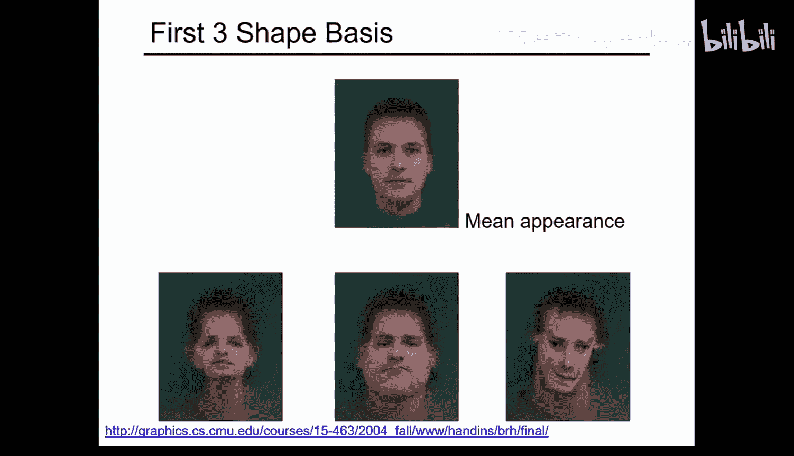

2。Blah， blah， blah， finally。Let's see if we can。Play the video。

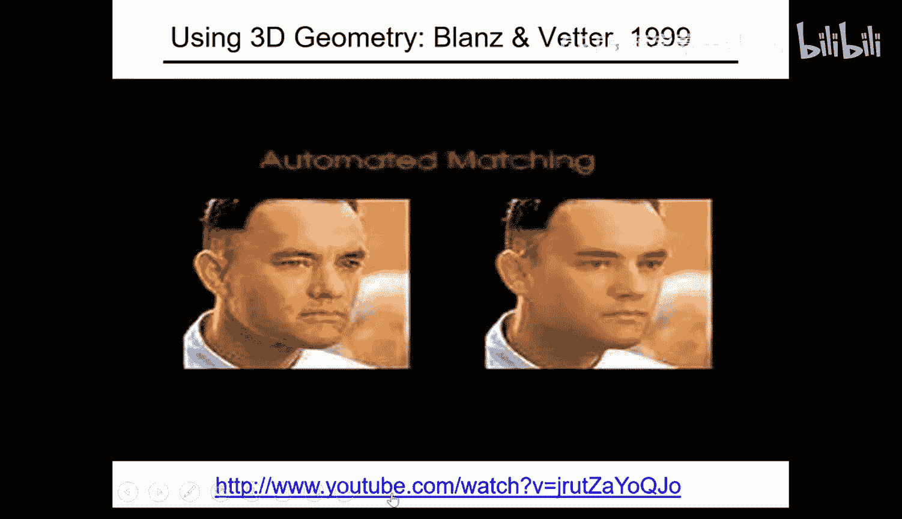

I hope it works because it's totallyly cool。

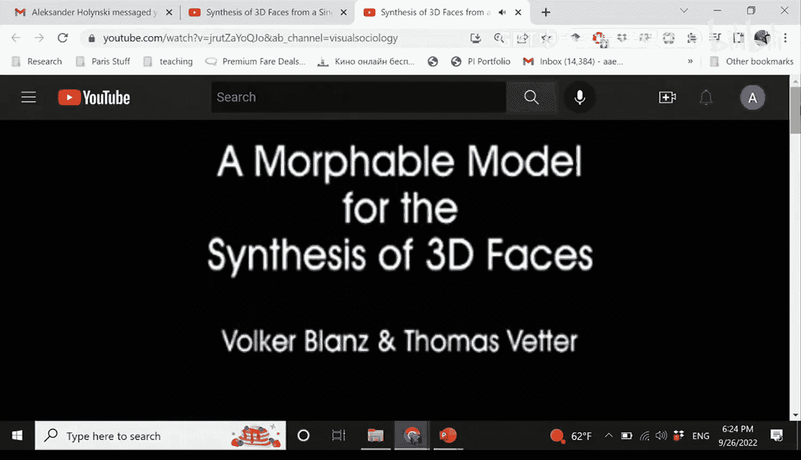

And I hope that。阅读人物。

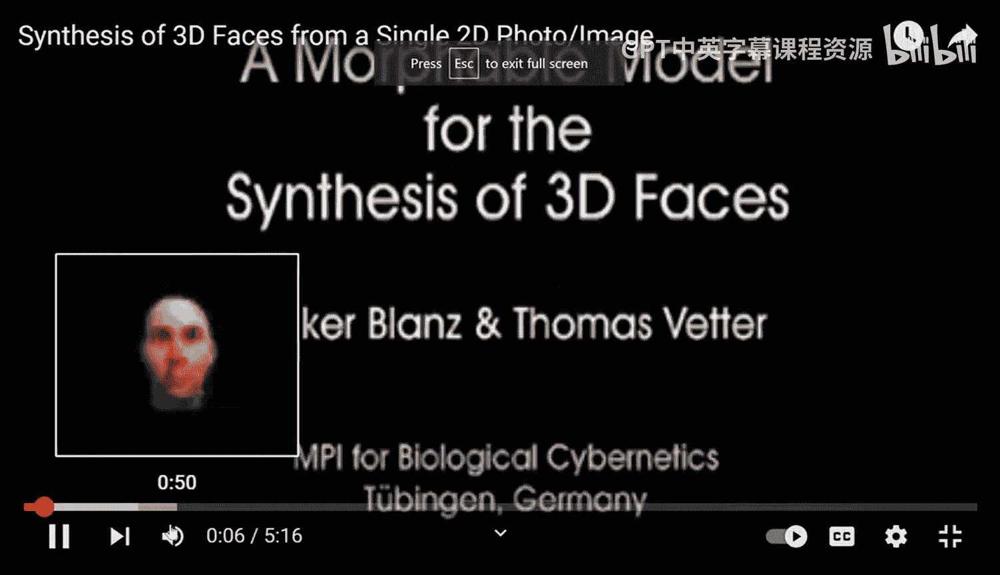

Oh no。

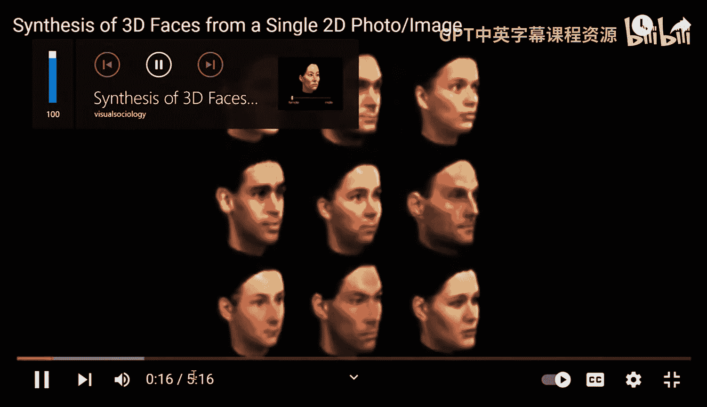

Okay， I can narrate it for you。

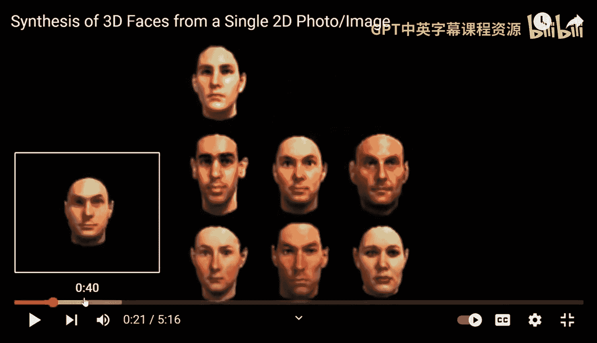

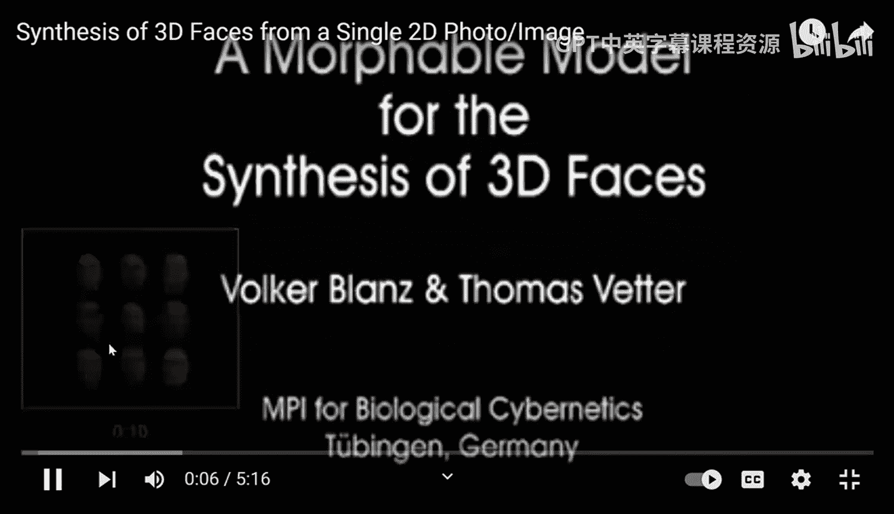

So basically， they take a whole， you know， 200 Germans。They scan them。And they create a model。

 a single PCA model。That can。呃。You manipulate。All the subspace of faces。Given those 200 ger， okay。

Can we kill the lights by the way， So you can， you can move it around。 Oh， Thank you。

 You can move it around。You can change expression。Right， it's， it's a small space。Right。

 it's a smooth space because， you know， faces， faces are smooth。But this is not。

 this is not the cool thing。 The cool thing is。You can now do the caricatures。The way we describe。

So this is our original image。And you're subtracting that delta and pushing it towards the caricature。

The difference between the average and the individual。Here you go。Making things more female。Now。

 here it's a little bit better because they actually have 3D。 So you get a little bit extra。 But now。

 it's， it's still pretty cool。 This is a paper from 98， I believe。 So it's really old stuff。

As long as you have label data。You can do all of these things。All you need is a subpopulation mean。

Now， the cool thing is， remember how I said that any one of us can be represented by a vector of alphas and builders。

 That's what they're going to do now。😊，Right， this is Tom Hanks。 Is that right。So， you take。

Your model。And with a little bit of luck， you find the parameters instead set of parameters。That。

 that represent Tom Hanks。A little bit optimization。 I think they there some help， human help。

我给 this。Look this。Almost there。 Almost there。O。Now， you have the model。 Now you can do things。

You can move it around。And you can。But where is the cool stuff， The cool stuff is when。

They make him old。哦， yeah。反店。Mh。😊，So， you know。

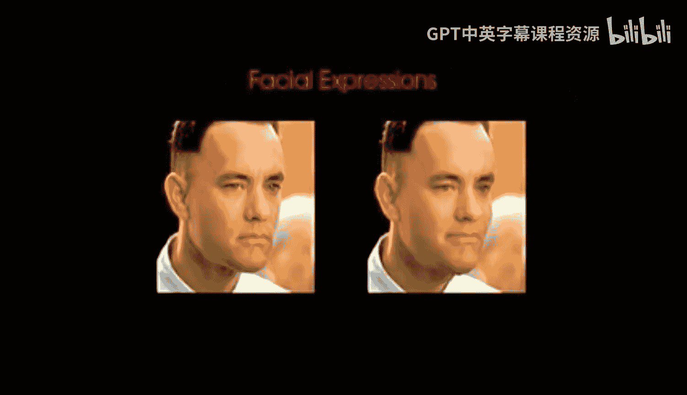

It's maybe not the top visual effects things， but for something20 year old technology。

 it's pretty cool。

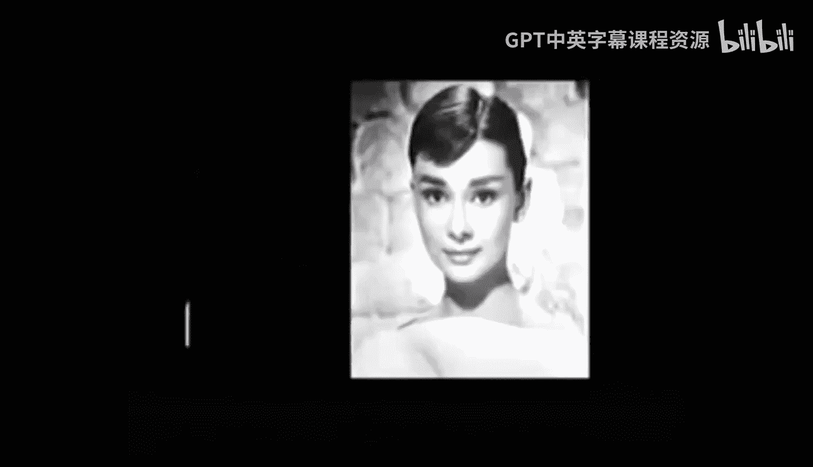

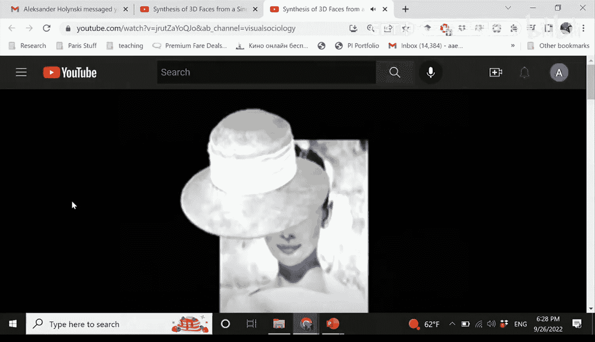

All right。Finally， I'm a little bit becurrent， but I was told that it's not going to be all final games。

 There is a pop quiz。😊。

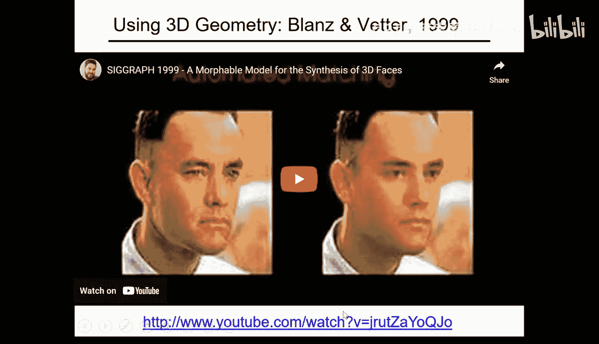

Yeah， it's easy。 even I could solve it。 and I wasn't in class。Go to this thing。

 If you have forgotten your computer。I actually have paper。Quizzies， anyone needs a paper quiz。

Hopefully not。 but if anyone needs。Come and get it。So， you have。Whatever。

 whatever 10 minutes or whatever。And you said， and。If you're DSP， then you can have 15 minutes more。

Can I get a favor example？Where are you。

