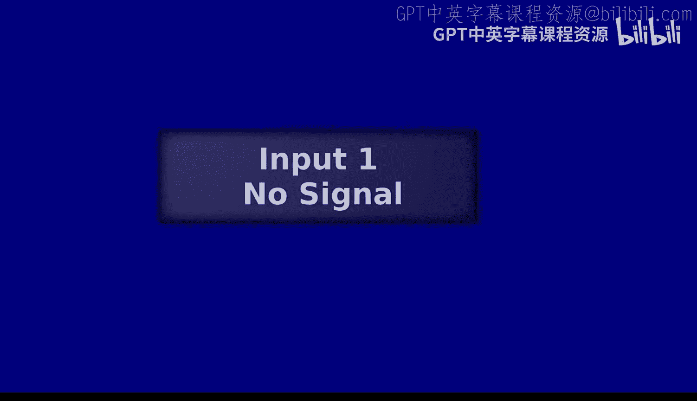
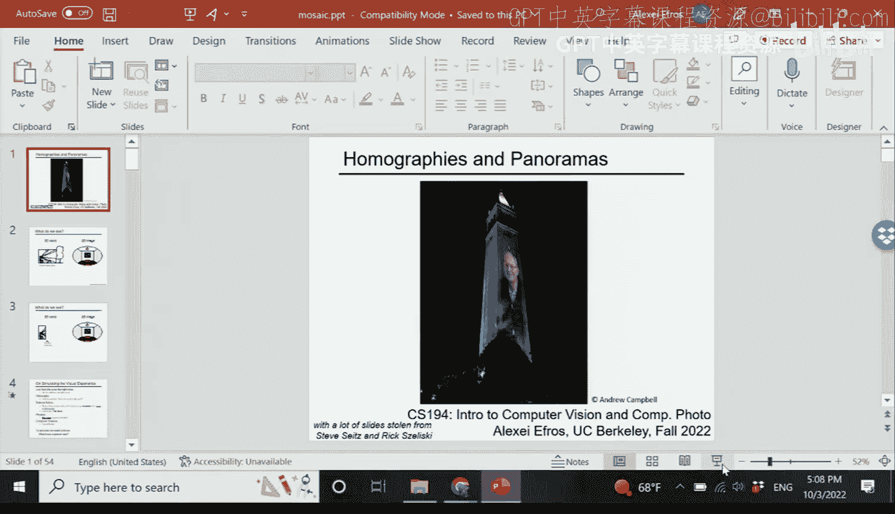
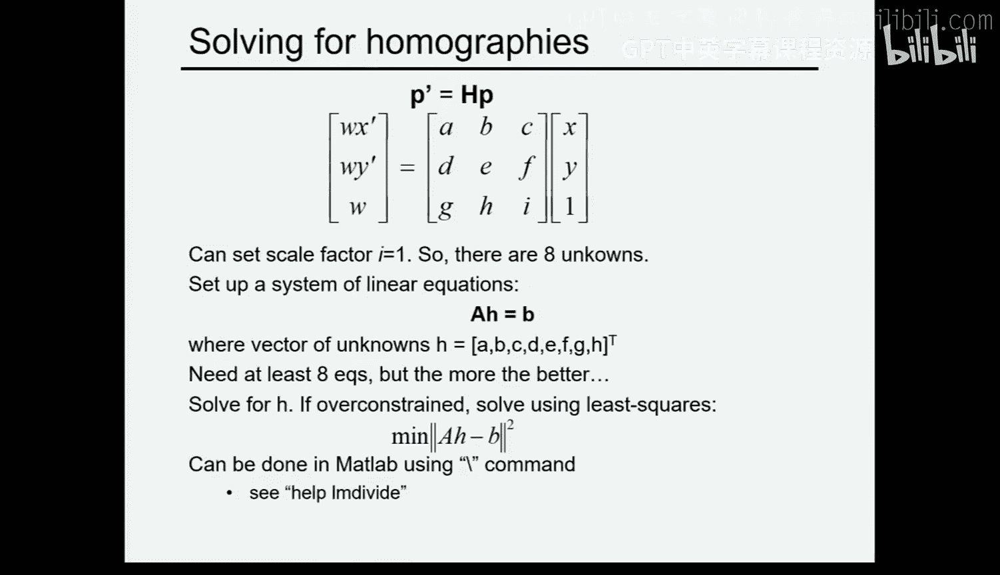
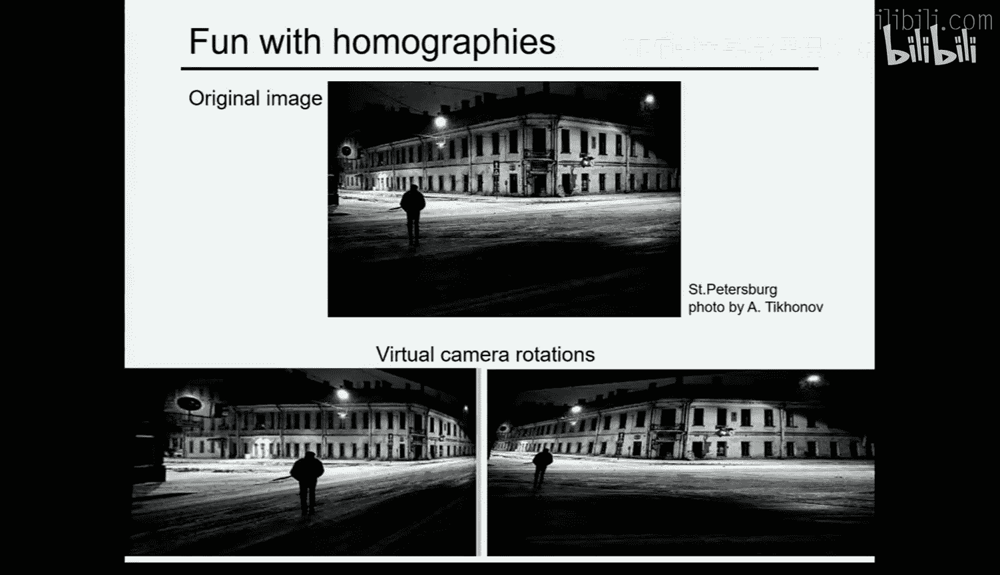
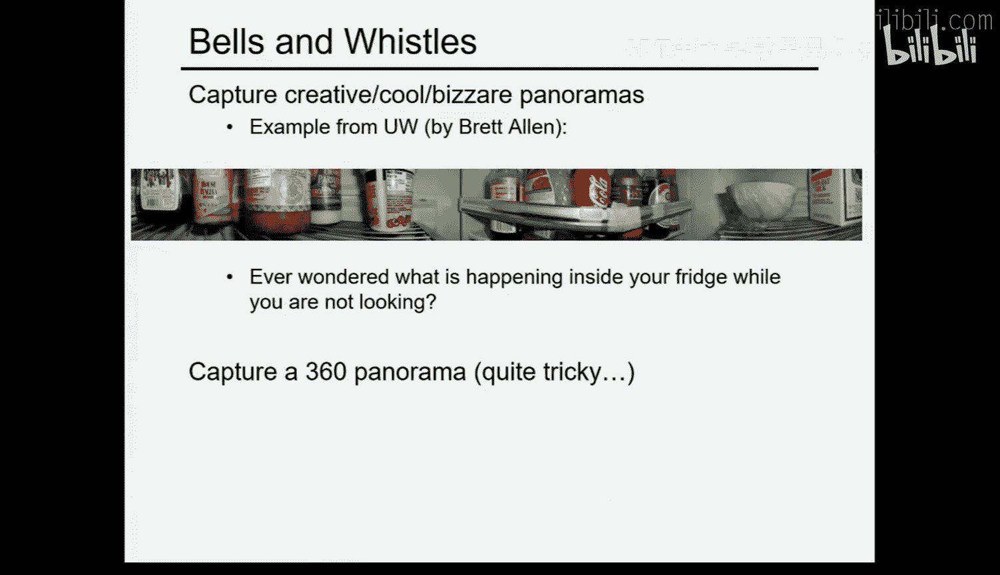
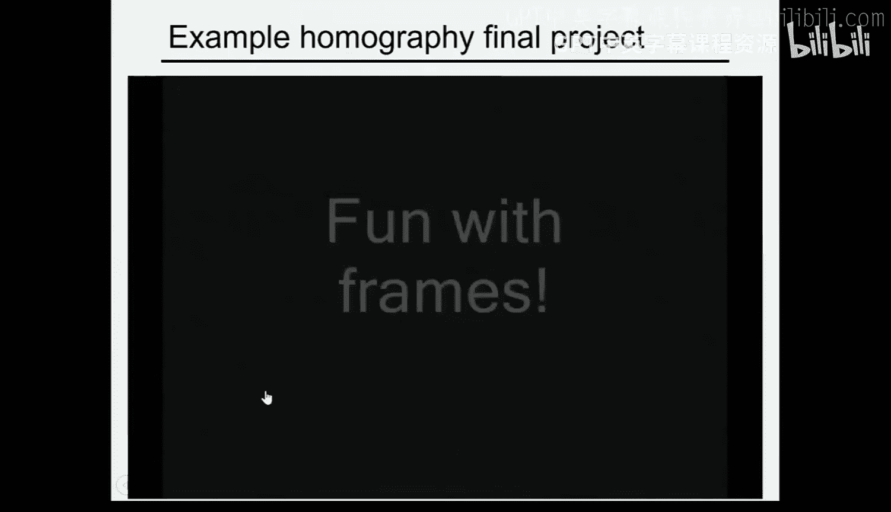
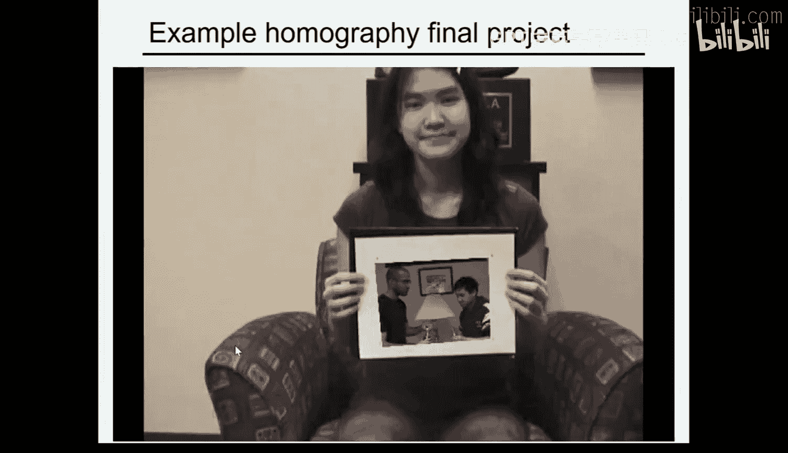
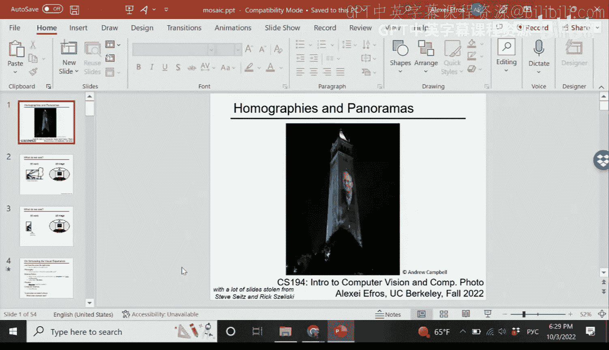
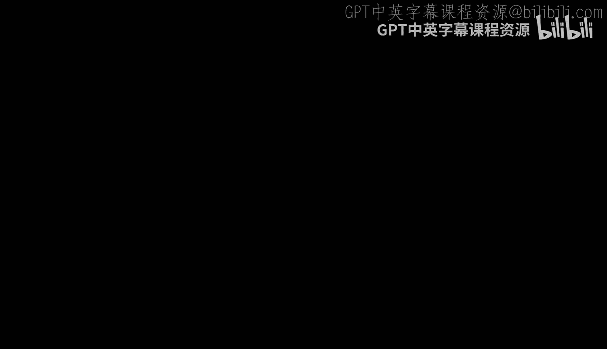
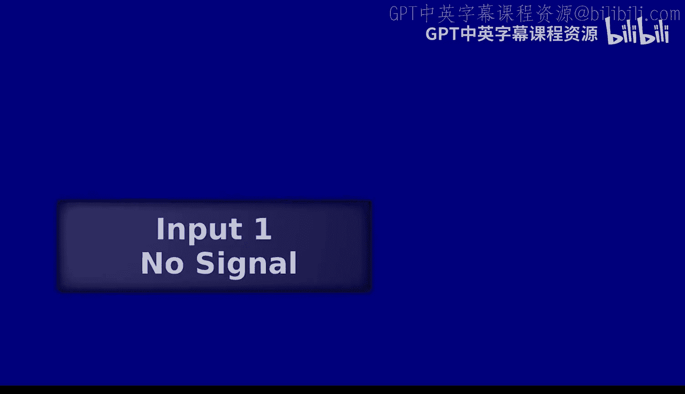

# UCB《计算机视觉与计算摄影学｜CS 194-26 Computer Vision and Computational Photography 2022》中英字 p11 -P11-11-Homographies and Mosaics-10_03.zh_en -BV1w7UfBdELA_p11-

Alright。This。Sound。All right， folks。We begin。Laptops down。So we。

 can we get just maybe these lights off？Is there some intermediate version？All right。

 because this is too sleep inducing。And the other one is。Linery， okay， well， let's。

 let's pull it full。 let's do it full， full light for now。 And then if。Give people。 All right， folks。

We need to start coming in on time。 Otherwise， I will be forced。To take severe actions。

 And you know what that is。62 quiz at the very beginning of class。I。

 I don't want to do it as much as you。 So just letting you know。All right， okay。

These people would have missed the quiz。All right。So， today。While you guys are busily finishing。

The current project。We are。Moving forward and talking about the next one。呃。

So you should still pay attention。Okay， homography is in panoramas。Okay， last time。We talked about。

This。This weird machine that， that is sits inside our eye and any other camera that takes the beautiful。

 marvelous， rich 3D world and ping。😊，Squiishes it into two dimensions。The projection。Right？

We have the 3D world， and we have the 2D， very flat projection。And we talked about。The fact that。

At least we could think of a。A thought experiment。We could cut the room where this guy is sitting。

Put in a backdrop painted with that picture。And if you do everything， right。

You should not be able to tell the difference。Unless you， you know， stand up and move or something。

 Yes， does that makes sense， everybody on board。Okay， so this should make you worried。

They should make you scared。And， indeed。You know， this has been。

Kind of the premise of at least a century worth of scifi movies。But not only that。Okay。

 sos this idea。哦。Just eating。Our eyes， the right data。And nobody will know the difference。

Is an extremely powerful one。There is one particular， you know。Silicon Valley Mogul。

 who has bet his whole company on it， right。But。But actually。

 this goes back to kind of a very ancient philosophical question， right， The question is， you know。

 does the world really exist， How do we know it really exists， Right？ all。

 All we are seeing is what what we are observing from our sensors。And we can act。On that observation。

 But how do we know this observation is actually correct， right？

 And this goes to there is some beautiful philosophy。 If you're interested， I can。

 I can provide pointers to， to， to， to that。 And， of course， science fiction。

 maybe the best story is。😊，Is the 1 I link here on slow glass called light of other days。

And the premise there is basically， that you can。You can grow glass that for which。Light passes very。

 very slowly。And so the idea is that you take this glass and you charge it up for like half a year in front of Niagara Falls。

 And then you sell it。 And then people put it in their window frames。 And then for， for half a year。

 they get。The Niagara Falls playing back those photos。Right， notice this is not like just a camera。

 right， because。It plays back with from all possible angles， because it is really all the photos。

 not just the one pinhole photos， but all the photos。Nice， nice little， you know。

 three pageger short story。 If you're into scifi， I highly recommend this。😊，And， of course。

 the matrix is， well， I guess it's not really the latest anymore there have been。Gazili and others。

 But， you know， this is one， one of the more famous ones， right。And， you know， and the physicists。

 they actually argue that something like slow glass might be possible。

They actually can slow downlight， you know， a fraction of a mini， mini microsecond。And， of course。

 in computer science， we call it very virtual reality。 right， the same idea that if you get。

 if you feed the your sensors， in our case， the eyes， the right data。

We might not be able to tell the difference， right。Right， the whole idea that you can just， you know。

 replace the reality with a couple of screens in your， in your headset， right， is because。

The eyes have no way really to， almost no way。To get， to get back the， the information about 3D。我的是。

啊。I'm sorry。 This is， this is really。Yeah weirdir， okay。So what we want to know then。

Is we want to have a theory about what are the set of things。That a human is able to perceive。

If we want to simulate it， we need to first to kind of analyze it。Okay， and this is where。

We come to this concept of the planleoptic function。

First proposed by Ted Adelson and and Bergen in the 80s， although there is actually。

EA Russian book from the 30s called Light Fieldels， which is， which is a precursor to that。

But basically， the kind of the question here is， can we just enumerate。

Everything that we could ever see。In our work。Okay。So we'll build this up。Step by step。

 Let's start with the same guy we had before。One guy close one eye。 He's sitting somewhere。

 Hes not moving。 Okay， so a stationary observer。O。What are the all everything that that station observer currency。

Well。Basically， at this point。Let's say that we， for now。

 we we don't even worry about color in gray scale。We basically。What， what that person is seeing is。

At most。A pencil of race。 Remember， the pencil of race。

 all race coming from a through a single point in 3D space。Right。

 so what is the pencil of race that this dude is seeing right at this moment。

Which pencil of raise is he see。There are， you know， pencils of raised everywhere here。啊。Well， okay。

 I mean， it's'， he's maybe seeing a little bit less than a pencil of bras。Maybe truncated pencil。

 So he's not seeing all of the， you know， because like the rays that are going back。I mean。

They go through the skull。 So it's not really， not， not really getting that much。 But， you know。

 like， for example， the pencil of race that I'm seeing from my left eye。It's about 180，90 degrees。

 It's kind of basically a hemisphere。嗯。What is that pencil race， Which one is it。有。

Through the pinhole or the， you know， the， the the， the， the， the opening， right， the， the。The。

 the iris。Of， of my left eye， exactly， exactly。 That's this。

 that's the pencil raised we're talking about。The same thing for this guy。

 It's the pencil raised going through his eye， okay。If we were to。Basically， para tries。

All of those raiseds。😡，So a single viewpoint and a single time。You know。

 averaged over all the wavelength。 so we don't care about about choley， right。What is this， Well。

 it's actually just two parameters， right？😡，All the all the race。And， you know， race， we can。

 we can just record the the。The amount of light that is coming in， so。The planoptic function。

 actually， what it returns。Is just， you know， light， intensity of light。 How many photos。Right， well。

 it's how many photons are coming through every single。Direction。

 every single ray within that pencil and kind of the nice。

 nicest way to enumerate those is just with the， with a spherical coordinates， right， because。😊。

This is naturally a sphere。 So basically all the pencil of race is is is you have basically all the directions on a sphere。

 So spherical coordinates are the most natural way to to enumerate every single array。

 Okay so this thing。Is a two dimensional function。You give the。

The theta and pi of a particular array。And it gets you how much light is coming in。

From the environment into that person。Okay。What data structure？

Can we use to represent this this function at this point。や。Yeah， no， for that whole thing。 Yeah。

2 dimensional array。 It's a 2D array， in fact。You know， you could also make it。A Cartesian， you know。

 you can use it。 You can represent it with X， Y coordinates Su。 It just， you know。

 you need to do some transformation to go from， from。From spherical to Caresian。

 But it's not as nice， but you can do it， right， So this is just an image。At this point。All of this。

Every single every single ray of light， the whole pencil of race。Is just an image。Now。

I'm kind of assuming even more。I'm assuming that this guy has like a transparent skull。

 So I'm actually assuming that you can see all this fear。Of race， front and back。In reality。

 that's not， of course， going to be true because， you know， we have some occlusions。

 but we'll not really worry about the satity okay。But notice that basically。

 even if I parametermetize all the races， the entire pencil of race。It's still just two dimensions。

Right， it's a two dimensional array。 It's an hch。The parts are good。Questions。OK。Now， let's add。

Add some more fun。Well， we can add color back， or we can basically。Prameterrized by wavelength。 Yeah。

 question。No， no， no， no， no， no it。Remember in what is it algebra 2 or something you were kind of convering from Cardian coordinate to spherical coordinates？

Or maybe you were rights。It's， it's， it's， it's， it's the same thing right here。Here you don't。

You are not like， okay。Maybe I know what the difference is。 So in like spherical coordinates。

 you can also， like if you represent points in spherical coordinates。

 it's actually three dimensional。Theta phi and R the distance。

But here we have spherical coordinates for race。Right， rays， we don't need the R。 They just go。

 So we can just kind of assume just basically a unit sphere， right， because for rays。

 that's a nice thing about light。We don't care how far it has come， how far it has gone。

 how long it took for it to reach us。We， we don't have that。

 We don't need to know how much that light has traveled。 Did it。

 Did it come from the sun or did it come from this light， right？ And so in this case， really。

 the only thing that we care about is the direction。I see some photon coming at me。

I just need to know which direction。 And in that sense， it's still a two dimensional thing。 Okay。

 sounds good。 Good good question。 Thank you。Any other questions？O。So， now， we can add。

It as a function of Waling。 Now， it's a three dimensional array。Because now we can have， you know。

Color， and we can。If we are lazy， we can， you know， we can。We can， you know。

 we can only use like RGB or maybe only， yeah， only three。Terms， because。Because humans don't see it。

 but we， we couldn't have all。You know， whatever 440 until you know。800 okay， but so far， so good。

 okay。Now。This is just。At the given。Boyant。In time。But。As this dude is sitting there， you know。

 things are happening。 The birds are chapinging， the sun is going down， you know。

 undergraduates walking around。RightSo if we want to really capture more of his experience。

We need to have another variable。And that other variable is time。Right。

So now we have a four dimensional function。That can index over time。 So now it's not just an image。

 It's a video。It's a caller video。That represents all the rays that are coming in。Do this dudes I。24。

7 from all directions。All of them are being represented by this。Okay， so far so good。Okay。

 this is really。Maybe somebody could。Email them， and say。That they're。I's much working。たいです。Okay。

What is missing？If we want to represent the entire world。What is the main thing that's missing， yeah。

That's right。 The， the dude right now can only stay in one place the origin。 If he stands up。

 if he walks around， if he goes to the cafeedteria。This function is not representing。

So now we need to add position。😡，Okay， how do we do it？In the stupidest possible way。We just add。X，Y。

 Z。All the possible in by all the possible。X， Y， Z locations of the center of projection。Of the。

 of the pinhole。To basically。Capture every possible possession where this guy could be。Okay。So。

See from it's an intensity of light。Seen from any viewpoint over time as a function of wavelength。ok。

So this is now。Dip pig function。Okay， and this is， this is a pretty amazing function， right。

 Because if you imagine that you， you know， this function， you know。😊，7 parameters。 It's pretty huge。

 But imagine if you had access to it。You can reconstruct every possible view at any moment of time from every position in any wave。

It contains。Every single photograph that has ever been taken。Every single movie。It has。

 it has everything that ever and anyone has ever seen in their life or that they will see。Right。

It completely captures。Our overall。Reality。And what's amazing is this， does it。Just with light。

So how many of you guys have taken graphics 1，801，84。Please， note。

There is nothing here about geometry。There is no surfaces。No shapes。Nothing， this is completely。

Gometry 3， solid3。 It does not care about what is in the world at all。

 It's basically just a way to explain our visual existence。Just with the light coming into our eyes。

It's a very weird and kind of cool way to think about the visual world。You just。😡。

Record all the race from all directions。And if you have that。You have everything。Okay， now。

 in practice， of course。This is a ginormous function。This function is absolutely incredibly blu。

Right。But。😡，First。It's， it's a good way to， to wrap your head about this idea of thinking about what。

 how you parameterize light。And second。It could actually be， you know。Often compressed well enough。

那就跟呢。You could actually do something cool with it。Like we will talk about later on in the chorus。

 We will talk about nerves， which are basically a way to kind of compress this planoptic function。

Question。Okay， well， there is actually。啊。There is actually a。Something that that that， that you guys。

Are quite familiar with， that actually uses。This idea of a planleoptic function。Right。

 this idea that basically all you're doing is yourre。

You're basically capturing it at regular intervals。You're capturing an entire panorama of light。

Puttting it all together。And then you have a representation of all the rays that that you need。You。

 you， you use this。 This is a product that you use pretty often。 What is it。

A completely light based representation of the world。

Sample at regular intervals that you can look up and you can basically see the light as it。

 as it was in that point， yeah。Google Street View， exactly。 That is exactly。A very sparse。

Two dimensional。Sampling of the light。Actually， the story goes even earlier to what's what was called Quick time VR。

Which was kind of a precursal to street view。 And that was the idea was like you take。

 you want to have a representation。 You have a VR representation of this auditorium。

 You take you take your camera， you know， with a。You know， panoramic lens。

 and you just take pictures every， you know， half a meter， every step。 take pictures。Of everything。

 maybe at multiple elevations。And once you do that。Any of you that you need。Well。

 there's going to be a pretty close view that you already capture。

 And then you do a little bit of interpolation。你K。Now， Google Street U doesn't even do that。

 doesn't even do interpolation that much。 Really， it just jumps between the different views。

 and it's still kind of useful， right？ And Google Street U， actually， the， the stops between the。

 the， the， the cameras is， iss not。 it's a couple of meters or something， right。

 So it's not even that dense。And still， it's actually a very useful thing。 So， yeah。

We actually are using the idea open optic function。Sample per function， you know， in， in。

 in products now。Now， it's huge， but it's not that huge， right， I mean。You only do it on the roads。

 You do it only in 2 D。 So that that helps。 But， you know， it's actually。

 it's actually not that crazy。Questions。Everyone happy。O。Now。

That we have understanding about what are all now know right， that。

 that the pleoptic function actually captures everything。If it's dense enough。And if you have。

 you know， if you have time， if you have like this really， there is nothing left。This is it。Right。

This is if you can， if you represent this， you represent everything。 There is nothing left。

 There is truly nothing left。Anything anyone wants to come you know， dispute。

What if you have two eyes？Is this still everything。啊。有。

What do you mean you can see the location of everything。 Can you be a little bit more specific。In 3D。

 So how how can you reconstruct 3D。You could。 you could， you know， you could。 I mean。

 it will take you some work。But the point is that we humans don't cannot do it either。Right。This is。

 this is not really。Trying to represent the true 3D。 In fact， there is no 3D here。

 There is nothing here。 There is really just race。But the point is that that's what we are seeing。

What about two eyes。 Anyone wants to answer。Yeah， it just move， move it over by， you know， by this。

 this amount。 and it's still covered by this， by this function， exactly。

 So you don't need to do anything special for binocular vision。

You don't need to do anything special or， you know， rotating and translaating。 It's all in there。

Okay， any other question？ This is， this is kind of a little bit mind bendy。

 So please make sure that we understand it before we go back to。Two normal images again。Okay。

Everyone's happy。Okay。O。Now。Let's go back。And think about。Okay。

 what is it that actually is only stored in an image。So we know what is， what is。What we can， what。

 what we can do with if we had everything。Now， let's get back and say， you know。

 what is the information that's encoded in just this one image。Well。

 we talked about an image is basically at maximum。 It's a pencil of race。Going through this point。

 the center of projection， the pinhole。嗯该。But。You know。Of course。

 there are some constraints because not all of those rays are going to be visible， right， because。

 you know， the eyes have， have a field of view。But。😡。

What I want you to kind of to realize is to notice。That even if you have。

 if you take all of that pencil of race， the entire one， if you somehow had a transparent call。

It would still be just one image。 It would still be a two dimensional structure。You know。

 Fe de and Phi。Indexed by two variables。And this。This is the kind of the fundamental idea of。

 of the spherical panoramas。Okay， a spherical panorama is basically just。Like a normal image。

Except it pretends that you have transparent calls。

 So you're actually getting the entire sphere of light captured。The entire。The。

 the entire pencil of race captured in a single image。Right， this is the panorama。 This is a sphere。

With index by theta5。And notice。对。😡，This is， as I said， it's an image。

 So what I can do is just unroll it just like you would underroll a globe。It's just an image， right。

 It has two dimensions， Well， plus plus color， right， It is really a two dimensional。 fundamentally。

 It's a two dimensional structure。Okay， and this is kind of a。孩尔 do。You know， to kind of to。

 to realize， But it's， it's really true。 It's a two dimensional， just theta5。

It's hard because they look just so cool。 Let's see if we can actually play with them。😊，So this is。

 this is one from。From。呃， from。ItTime Square。 is going run。Not going run。 Oh， no， okay。Soorrry。

used to。Used to move a little bit。Less。Less crazy。But the point here is。You see this。As a。

 as a complete view， it feels so cool。 It feels like， my God， you're there， right。😊。

But this is really just an image。 I'm just playing you an image。From， from different viewpoints。

It's a sphere。 And I'm just playing you that sphere。Right。How do I know， How do I know it's a here。

How do I know there is just the two damage， Because because there is nothing here。

That can tell me that。You know， this guy is closer than those people。Right。Again。

 we don't know how far the light has traveled。 So we really don't know which。I this。

 this is gonna go， which。Which is closer and which is further。Okay。

 this is really just a pencil of eyes。But， it looks。It looks so good。Right。

 it looks so amazingly good。 Look at this。And you can play around with it。

 And I think you can also change。How did you They used to be able to change。嗯。能。

Like you zoom in and out and stuff。 But anyway， it really， it really。Feels。Very cool。But。

It's only an image。Now， what， how can you really kind of immediately break the illusion。

And realizes this is just an image。What should you be able to do。Move exactly。 Just take a step。

And the illusion is broken， right， because all of this only works。

When you have the same center of projection。When you are in the same pencil of the race。

Within the pencil of race。Oh， look， it's finally more cool。Within the same pencil of race。

 it's kind of like your， you move around your head。And。There is nothing。

There is nothing that's changing。 You' just， it's still just rays coming into your eye。

 You're moving around your eye， but it's basically all the same stuff。As soon as you move。

World becomes 3D。Movement is what gets you 3D。 and we'll， we'll show。 We'll see this later， but。

The reason why I can get away with basically just representing this 3D world。As a single image。

 is because I don't。 I'm not allowed to move here。I'm only allowed to rotate。So fundamentally。

 rotation and translation are very， very different beasts。When it comes to projection。

Rotation is basically free。Translation， very， very complicated。Questions。Yeah no。Yeses。No。No， I。

 the projection is just， it's kind of like， do you project into the。

 the plane of the camera up scooter。Or the film in your camera or the kind of the curvy back。

Back of your eyeball。Doess matter。It's all about， are you in the same pencil of arrays or are you it's a different pencil of arrays As soon as you go to a different pencil of arrays。

All bets are off。 and well， we'll， we'll， we'll see why。O。All right。So。😡，An image。Is basically。

Just a subset。Of race from our pencil。That are actually， you know， have been captured by our。

By our film， our recording device。And remember， again， that。

This recording device is usually actually， at the other end。From the pinhole。 But for simplicity。

 we can just imagine that it's in front because it just makes。

 makes all the pictures and all the all the math much nicer。

 So you can imagine this being kind of a transparent sheet that basically just records。Records the。

 the photons as they arrive from， arrive from different ray。 Okay。

 so this is our projection equation， right， so this is the center of projection。 And this is。

 this is how we produce an image。 So this is an image。That。That captured。These particular forays。Now。

 it could have also captured other array， too if it just was wider。 You know， if， if。

 if if the the image was wider， then this guy would， for example， also be captured。

So it's still there。 It's just that it's you know， out out of bounds， essentially。么开。😊。

So notice that the pencil will raised that。Contains。Basically， all photos， all views。哦。😮。

All the possible ways you can rotate your camera。Right。

 it's a superet of all the pictures you could take。With the same center of projection， right。

 So if I take my camera。I can rotate it if I keep it， wheresmic。Les right here， right。

 If I keep rotating it。Keeping the， the， the camera at the same place。

The pencil of rays basically captures every one of them。 It's。

 it's a super containing all the photos I could have taken。Without moving the camera center。So。

 first a good。Questions。O。So， for example。Here is a real camera。You know。It， it view。

 it looks this way。But I could also， then create。A different view。 A different rotation。

A synthetic camera。Right。If I have all the pencil of ray。

 it doesn't really even matter if the camera。Was an actual true camera that I snapped a picture that I actually snapped。

Or I can just recreate， synthesize， and you view。From my pencil of race。Right。So， in this case。

If I have this image。That I taken in with my camera。 and I want to create， you know。

 a slightly rotated version。Well， all I need to do is just copy over the pixels。😡，Along those rays。

 from one projection plane。To a different projection plan。That's all I have to do。So， basically。

 synthesizing。Any kind of rotation。From any given camera。I just need to， you know。

 copy over the pixels in the right places， and I can get any other ir。Now， again。That's a little bit。

 you know， I'm。Waving my hands a little bit， because， for example。

These rays were not captured on the in the in the real camera。 So these rays actually。

 we don't know what their， what their values are because。Because those images are finite。 That's O。

 Well， well， we'll not worry about them for that。 But the race that we do know。

 the race that we did capture。We should be able to， always。Transfer them to any novel view。

Is that clear。Yeses。Good question。 Good question。 I will。Yes， so。One way to do this。Is indeed。

To essentially have write out all of the projection math。And basically， put it this way。

 So we have some object up there。 We have camera 1， projection plane 1。

RightThat's one way to see this object。 There is projection plane2 another way to see this object。

So what we can do is we can project。We can take。You know， we can take image from projection plane 1。

Un projectjected into the ray。And then project it back onto projection plane2。

 and that will get us what we need。So we basically do an unprojection and then a reprojection。

To map the race from。This particular rate， for example， from P P1 to P P2。And in which case。

 then you need to actually know。The death， you know， how they basically calibration of。

 of where those planes are and orientations and distance and all that stuff。But。😡，Luckily。There is。

Another way。We， we actually don't need。To know the 3D geometry。Of these two cameras。I mean。

 we could go through it， but it turns out that it actually cancels out。Because。We can just。

Relate those two planes。Bio transformation， a 2D transformation。 It's a 2D verb。

That can map from P P1 to P， P2。 So this is a very， very nice。😊，Fortunate property。Of projections。

That every single projection。That shares the same center of projection。

 That shares that basically that deals with the same center of pencil of race。Every pair of images。

That's have the same center of projection。Are related。By a two dimensional verp。

And which kind of work is it， Which transformation is it， We have a whole bunch of those。

 Any guesses。Yeah， the one we didn't use yet。 all just the back to make sure。

Translation doesn't quite work。A fine， and not quiet。Persspective projection。 look at this。

We have our eight unknowns， but it is actually。The transformation that can map。爱你。

Any image to any other image， assuming that they share the same central projection。

And there are other cases as well。 We'll talk about the later。W。O。O。So， this transformation。

When we talk about it as a relating two images。嗯。Sharing the same standard of projection is called a homoography。

Okay， it's a mapping between any two projection planes。With the same center of projection。

And this is the equation for homomography。O。It is。It maps。All points。In project plane 1。

To the corresponding points。In projection plane， you know， P prime。

The chmography is a 3 by the matrix。It has。How many unknowns。啊。😮，韩文意。8，8 unknowns。

What about the9 one。So，8 or 9。Okay， but there are nine numbers in that matrix。ItThe scalar。 It's a。

 it's the same kind of weight kind of thing， right， It's。

 it's a scalar that that that that is not an unknown。 So we need 9 numbers。

 but only eight of them are actually unknown。The other one， you could just set to one and and， and。

Things will be O。Okay。😊，O。So， but really， it's just， you know， regular matrix multiply。

You feed it at X， Y， X， Y 1， because it's a homogeneous coordinates。And now it comes。X prime。

 y prime。 And then there is this W vector。 And then you have to divide by W to actually get back to coordinates。

 But hopefully， you guys already talked about homogeneous coordinates。

 So you know how to deal with this thing。O。And that's it。Yes。This is the relationship。So。

What is this useful for。Here is one，1 example。Here is a。Famous corridor in Oxford UK。

 where a lot of early computer revision was done。And let's say that I want to see how that。

 what would look， what would this picture look like if I rotate my camera。To point down。

Onto the ground， that's my goal。Okay。So， here is my。Camera here。 This is the center of projection。

 This is the projection plane。This is the actual geometry of the scene that， you know， nobody。

 of course， knows about。Now， I just want to rotate。This。This camera down。This is the result。O。啊。

It's actually， you know， just applying a homomography to this image。Can get you。And novel view。O。那我。

This looks a little bit a little bit tiny bit weird。

So I wanted to just look at this and maybe a reason about why it looks weird and maybe why it's okay that it looks weird。

I can also show you what happens if I look。I think， right。So this is another view。

So this is looking down。And this is looking right。So do you believe me that these guys are actual legit photographs。

From。That we synthesized from， from their available race。有。So， yeah， so one， one issue， exactly。

 one issue。Is that if you can see。If you can see the top of this image。The tiles get kind of blurry。

 right。And they get that kind of blurry， because， of course。You know， in theory。

 the pencil of ray is absolutely dense everywhere。In practice， though。The staff that go， you know。

 the， the， the， the density of rays looking at the very end of the corridor。

 there is going to be a very few rays for like big splotes of of the area。

And so when you rotate the camera， the sampling is going to be all wrong， right。

 So it's going to be a little bit blurry。That's okay。 That's fine， right？

 I mean it's still the correct。 It's correct data， correct photons。

 It's just that you're sampling a little bit blurry， okay。What about， what about this。

 this black point area right here。What is that。Yeah， exactly。 These are。

These are things that really should have been， like， somewhere here。

They're just not in the original photograph。 So if they're not in the original photograph。

 you can transform them all the way all all you want， but。If there is nothing there。

 it will just send you a 0 there。 So that's also not too surprising。

There is something a little bit weird。In this photo that actually bugged me for， for。

 for many months until I figure it out。Maybe here， it's even more weird。Can somebody tell me， like。

 what is。What is this weird thing about it。2。也。Right， it's in the center of the image， yeah。

That's exactly。 she took me several months， and you just saw it right away。 Are you a photographer。啊。

Okay， yes， this is exactly what happens。 This is a perfectly reasonable image。But。Look at this。

The image is not at the center。Because at the center， there is nothing。 like。

 if I really truly just look down。You know， there will only be。

There will only be stuff that I never seen before， right， because I don't actually know how the the。

 the ground looks right underneath my feet， right。So I don't actually have any information there。

 It's always going to be black。What I have is have information a little bit higher up。So， in fact。

 what happens is that。The center of the image is somewhere here。

But it's good black because I don't see it anything。

 And what we are actually seeing is just kind of this shifted version away from the center。

And what happens when we do， when we look at the projection， We talked about projections before。The。

 the distortion， the projector distortion increases as you go towards the periphery of the image。

 It's least in the center， and it's the most as a periphery。And so these very weird， distorted lines。

Are there because。Because there is this。There is this shift。 and it's basically just。It's， it's。

 it's， it's basically as if the image was cropped from the， from the， from the periphery。

 Does that make sense。It's a kind of a subtle point， but， but。

Made me feel so much better once second。Okay。Okay， so how do we actually do this？

 How do we compute the herography。就。To， to， to， to create this function well。In this particular case。

 it's very easy because in this particular case， we can use some moral knowledge。

We look at this and say啊。These look like standard issue， British square tiles。

So if I want my camera to look straight down。If I'm looking straight down。

 then the square tile should actually be square。That's how， how the projection works。

 The projection distortion is not there if your camera。

Projection plane is parallel to the actual plane there that you're im。

 So I now I need to rotate my camera such that the the new camera's projection plane is parallel to the ground floor。

Well。So what I basically want is， I want。These particular four points， and I pick four points。

 I want them to be a square。So that's basically what what we did。Click on four points。

Why  four points， by the way。Why not3， Why not 5。这gan。You need any of the equations。

 So y four points。Very good。 exactly four points， because then I have。8。88 measurements。 And I have。

 I can， I can solve for my8 parameters。I click on my four points and then I say， well， okay。

 what I want is why I want this point to be at 0，0， this point to be 0，1，1，1，1，0， for example。

 doesn't really matter， okay。😡，And I solve。For a homography that transforms。Pooin speed。

In the poem speech prime。And once I do that。I can transform the full image。

 It's basically just like your， your， your face transformations with triangles， except instead。

 now we're playing around not with a fine transformation， but with a projector transformation。

 So now instead of three points， you need four points。Other than that， basically the same deal。Oh。

 okay， you need to worry a little bit more about the homogeneous coordinates。

 So a little bit tiny bit extra deal， but really。Not that， not that different， yes。Yes。To me。

 like the。need to move。Several feet can look straight down。Remember what I said just before。We don't。

 We are not allowed to do that。 We cannot do that。 So the camera cannot move。

So what is actually happening？Is that what you're seeing as is。

 is an image that's a little bit shifted up。Right。Its it's the image is in the periphery or the valid part of the image is in the periphery。

 But the camera is exactly where it should be。 If， if you move the camera， that's it， just， you know。

 the computer explodes， okay。Have to， have to keep the center of projection in the same place。

 But what happens is that what you're seeing is a little bit shifted， yes。嗯开。Okay， so。Actually。

 I'm not sure probably you guys already heard this from Anju because you kind of needed this for the previous assignment。

Did Andrew talk about Lee squares？哦，没啊。Oh maybe not because you don't need this。 Okay， okay， let'。

 let's just do it。 just， you know， just for fun。I mean。

 this is something that you guys should already totally be familiar with linear algebra。 But again。

 I know how these things are。You know， theres so much information in your algebra class。

 And only like just a few things are actually super useful。

 And you they never tell you which one they are。 But least squares is one of those。So。

If we have a whole bunch， okay， this is like data science in one slide， right。

 If you have a whole bunch of data points。Like， you know， we。

 we record everyone's height and weight in the class， right。And then， we basically want to predict。

And you kid comes to class and w want to predict their， their， their， their height from their weight。

 for example， right。So what we can do is we can essentially。Come up with a predictor， just a line。

That says。You know， given。Given the。You know， given P， I want to predict P prime。 Okay， so if I want。

 if I have person's height， I want to predict their weight， for example， okay。

And our model is very simple1。 It's a linear one， right。P times x 1 plus x 2 equals p prime。

 So two parameters。X1 and x 2。 And we want to find x 1 and x2。And once we find X1 N2。

 then we can predict this for any， any new kid that comes to class， okay。

How many P P primes do we need to solve this problem。2， right， because we have two parameters。

 We have。2，2 parameters to sofur x x 1 and x 2。So we really only need two kids。I don't know。 me and。

And， and this lady right here。Done， right。I mean， we can do it。Right， here is two equations。Okay。

 we can also write them in in matrix form。 How do I write it in the matrix form。What is。So啊。

So what is our unknowns， Our unknowns are X 1 and X 2。Right。So what do I put， What do I put here。P1。

1， P2。One， what I put here。We want prime。P 2 prime。Yep， and then。You know， solve it。You know。

 pretty standard stuff， right。But it's not going to do very well， because。Maybe the two Ps that you。

 two P pairs that you picked are actually not very representative。Right。And it's， you know。

 we are kind of。We love data， you know data scientists。You know。

 we don't want to just throw away all this other data。 We have like， you know。

200 people in the class， right。So instead， we can just say， oh， just， just put。

 we're gonna use all of them。 All 200 people screw that。 We're just gonna。Add more。

More rows to the matrix。And， and hopefully， we can get a better solution。We still have only。

Two parameters， X 1 and x2。So this system is over constrained。😡。

But the idea of these squares is it will hopefully find。A solution。

That's going to make most of the happy， most of the points happy。And in what sense。

 in the least square sense。So here is all the points in class。 This is your height。

 and this is your weight。This is our one line， our linear predictor。And what this guy does。

Is it minimizes。The error between the prediction。And the actual thing squared。 So it minimizes。

The sum of these squared errors of these points。Hope believe this。A good refresher for everyone， yes。

And how do you compute this beast。Tur out that's pretty well known。There are the normal equations。

 Go to your linear algebra， but textbook。And the nice thing is， really。In， in Matlab or Python it。

There' is like a back slash operator or whatever does this for you。But you can always just go。

 code this up。Okay， any questions。OK。So， basically。That's what we are going to be using here。O。

We are going to be。Finding。A set of。Corresponding points， P and P prime。Minimum is4。

 but as we will see later。The more， the better。And then we're going to basically be solving。

For all unknowns。In the homoography matrix。Which is a vector H with all this8 parameters。O。And then。

 we just。So would。

And we get our approximate homomography。And then we can do things like this。So， here is。Again。

 an input image。And this are。Virtual camera rotations that I did。And here again， I basically just。

Picked a couple of these windows， assumed that they were square。2 windows next to each other。

 assumed that those two things were square。 And then I was able to rotate。 Here， I'm rotating。

The the camera to the right。Right。And here I'm rotating the camera to the left。So， this。This。

 it's also called rectification。So I pick a plane。In the image。

 And I rectify my image to be parallel to the plane。 So I'm basically making the， the， the。

The synthetic projection plane to be parallel to to a given plane in this image。 In this case。

 the plane is the left side of that。Of that， of that， the building。

 And this is the right side of that building。Okay。Again， notice the weird。Crazy distortions。

 like this distortion right here。Right， that sign over there is now very， very distorted。And again。

 it's distorted because not because this is wrong。 This is completely correct。

It just at the center of the image is not here， like you would think。

 The center of this image is somewhere here。Right， so this is like really， really in the periphery。

 So once you kind of figure this out， you realize， okay， this is actually looks perfectly reasonable。

Coions。Everyone content。 Everyone ready to do this for homework。Yeah， question。

好。嗯。I think we already talked about this in the beginning of class， right。Do we talk about this？

Piero de la Francesca， no。I missed this。 This is my favorite。You know， so。

This is a little slide detour。But with a happy ending， the slightly tour is。Usually。

People on this side of campus。Make fun of us。You know， we are geeky。 We haven't read as many books。

 We haven't gone to as many museums。 I mean， we try。 Let me tell you。 But， you know， still。

 there is a little bit of looking down on us， right。嗯。Around in this building， actually。

 where art history is， is， is， I believe， in this building。They worry about things like this。

 They worry about， okay， Fiero de Francesco's great painting， they look at the pattern on。You know。

 back then the Italians， the Iranian that they got into the perspective。

 They figured out the perspective equations and they were just putting it everywhere。

 They were so excited about it。啊。An actual dissertation thesis。

Was to reconstruct the pattern on the marble floor from this painting。嗯，可。And。The thing is。

This is a job for like two seconds for homography。And this， it took some poor dude。5 years。

 And they only got halfway done。This is somebody's dissertation。I believe。啊。And， you know。

 and this is what they could get， whereas。A little bit of linear algebra and a couple of clicking points。

Is good enough to actually do this。 Okay， so these kind of rectifications。Taking some。

 some plane or surface and seeing how it would look like rectified to be parallel to the imaging plane are actually super。

 super useful in practice in art history， but also in， in， in， you know。

 satellite imagery and all this other stuff。 Okay， so this is actually super， super useful。😊。

Here is another example。Where， well， they got a little bit better。 But， you know， again。

A few few years。啊。But。There is more cool things that we can do。Then， just。Reecttification。

 using hographies。We could now use basically the same approach and the same formulation of a homomography。

To stitch together。panorammic images。Why is it the same， Because think about it。

 So you come in and you want to take a panorama of this， of this room， right。

 What are you gonna to do， You're fixing your center of projection to be in the same spot。

And then you're gonna click， click， click， click， click， right。 So what am I capturing。

I'm capturing many multiple samples of the same center the same pencil array。

 I'm basically gathering more and more data for the same pencil array。Right。So， this kind of。

Samples where I don't move the camera。 I just rotate it。Is exactly what we need。

 Because what are they related or any pair of them are related by what。啊。😮。

4 but what's the transformation。Projected hamography。 theyre related by this age。

So if they're related by this age。I can connect them together。And I can actually create a new。

 synthetic。Image。😡，And map them all to this new synthetic image。 And that's going to be the panorama。

And so that's going to be what you guys are going to be doing for the coming project。

 You're going to be taking pictures。And then stitch shaking them together。And。A panorama like this。

OK。啊。You know， there's many reasons why a panorama is a cool thing。You know。

 a typical image is actually a very narrow field of view。Humans have a very wide field of view。

But Pan， we can do even more。And， you know， naive stuff， of course， does not work。

 So if I just take two images and I try to basically put them next to each other in Photoshop。

 it's not going to work。 Why is it not going to work。Because they are not related by translation。

They are not related by rotationation。 They are not related by a fine。 They're related by。Projection。

 projective transformation， homography like this。嗯，可以。So。What where。

What we are basically going to do then do。Take a bunch of pictures。And just project。All of them。

On to this new synthetic mosaic projection plane。 So a new synthetic projection plane。

Where you basically map all of your images onto。Usually， you do it just one at a time。

 You start with one， and then just add another and then another。 In fact， what I do is I。

 I take the center one， and I basically just。Make a big canvas with a center over that。

 And then I warp all the other non center ones onto the same canvas。 And just。

 you just need to make sure your canvas is big enough。 so it can。Contain everything。 Okay。

 but that's basically it。 And every one of them， just another homoography。嗯，可以。

How do you compute those hographies。How do you actually。Get those somegraphies computed。

You need to be。 you need to start clicking again， just like in the previous assignment。

We will need to have some correspondences， exactly， at least4， at least。

 but 4 is not going to give you very good results。You need to have quite a bit more spread over the entire image。

 to get you good results。O。What if it doesn't give you good results。

 even if you have lots and lots of points。What probably happened。啊。

 what's let's little bit of a debugging yeah。Exactly， you probably slipped somehow。 and you have。

You have， you have moved instead of just rotating， or you're taking。

A picture panorama of somebody very close， close by， in which case is's just really。

 really hard without like a tripod。 It's really， really hard not to move because。Well。

 I don't even know where the center of projection in this cell phone is。So。

You need to try not to move， but also try to pick， take， pick the panors of something。

 that's a little bit farther away so that， even if you move a little bit。

 it's not gonna to complete the screw up。嗯K。O。No。Just to drive home the point。What happens。

If you did not listen to me。And you moved。What is going to happen。Well。

 let's see what's going to happen。So， here is two。Two cameras。 And they are。

They are translated against each other。 There is what we call parallax。 We'll get that later。

 So this is projection plane 1。 This is projection plane 2。Now。

 we are trying to transform them from one to the other。What this means or we。

 we transform them onto some， you know， common， common coordinate system。For example。

 this synthetic imaging plane。 But look what happens。This image。It's seeing this point。

 this ray seeing that point。 And that point is red。It says， okay， that's fine。 I'm going take。

I recorded this pixel as red here。It intersects the， this， this synthetic project plane here。

 I'm just going to take this red， and I'm going to move it and， and color this point， red。So。

 far so good。But look what happened here。Here is a point that is green， because it comes from。

The place in in my geometrymeter， This is my， you know， this is my scene。It comes from a。

The place in the scene that's actually great。So now I'm going need to take this green point and put it here。

 Oh， but I already have the red one there， conflict。This is what happens。😡，Because。As you move。

Things start becoming 3D。Right， things start becoming 3D because actually the same place。

 you're imaging two different things。 It's like if you look with your two eyes。

 take a stick a finger out and look with their left eye and then with the right eye。

The finger has moved against the background。Right。There is a difference between the background and the finger。

With a single eye， with a single eye， there is no difference。 your。

 your finger could have been painted on the background。 Nobody would have noticed。With two eyes。

Your finger is moving against， against the background。This is what's happening。Certainly。

The depth starts to matter。And you realize that actually， this whole trick is just not gonna work。

Okay， this is why it's super important。2。Not translate your camera。Except in one case。

 there is one exception， one any beanie exception。 when you can translate your camera all you want。

Anyone can guess from this picture， what is this one exception。Where you can stitch。

Spch panoramas to your hearts content。 and everything is gonna be great， even if you translate。😊，呀啊。

没是。Which is what。If it's plainer。If it's planer， in fact。

 it doesn't have to be even the same orientation plane as long as it's planar。

As long as it's plainer。Things still work out。 And check this out。

 It's actually they work out for a very neat way。So here is， here is。

 let's say you are taking a picture。Of a picture of a painting or a photograph on the wall。

 So it's completely plainer， okay。So you have， you took picture from this corner， P P1。

 You took picture from this corner， P P2。Now。What is the relationship between P P1 P and P P2， Well。

 I don't know。 Let's find out。 What's the relationship between P1 and P， P3。It's a projection。

 It's a homomography because they share the same center of projection。

 What's the relationship between P P3 and P P2。It's a projection。

 They share the same center of projection。我。The nice thing about projections is that they are closed under multiplication。

 So if you have a projection followed by a projection， still a projection。 It's still a comography。😊。

And so the relationship between P P1 and P P2 is also a homoography。So， we are still fine。

In this particular case。O可以。This is why you could do tricks like this。

 If you want to take a picture of your whiteboard， you can totally just stitch together panorama。

Moving your camera and everything's fine because your whiteboard is plainer。

This also kind of works if you're taking a panorama of something that's really。

 really far away because you can basically， at that point， it's kind of like， okay， you know。

 I could assume it's plainer because it's so far away。Questions。有。The which number would change。

You know， it will change， but then you normalize it out。It， it's all going to work out。

 It's all going to work out。有。Good question。 In fact， I think maybe on Wednesday， Ill。

 I'll mention this， too。 You don't have to your your， your projection surface。Could be anything。

 It could be a sphere。 It could be a plane， It could be anything。

 Planins are just nice and easy for for now。 So that's why we， for the homework。We。

 we tell you to do the planes， but you can， you can do cylinders。 You can do spheres。

 you can do whatever。Or you can do planes and then unwp them to something nicer afterwards。Yes。

 absolutely， absolutely。 Yeah。 But， and also， like if you， if you do it on a plane， then the。The big。

 the best you can do is like， you know，1 hundred and 80 right。

 you cannot do more whereas for something like a cylinder or a sphere， you can do full， full pan。

 absolutely， but。There is， it gets a little bit more hairy with， with， with。

With sphereers and cylinders。 So we're doing this for simplicity。啊 question。

What else do I have to entertain you with？ Well， this is just example that you can you can have manual hographies。

 These street artists are。Are actually。You know。Essentially。

 all they are doing is they are doing hographies， just that theyre doing them in their head。

Or if you go to London。And you go to the。这个。嗯。呃。The National， National Gallery。

And you find the ambassadors by， by Holbain。There is a weird little thing down there below。

 Can anyone tell me what that little thing is down below。Yeah。What you do is you， you。

 come to the painting。And what you do is you go towards the right end of it。

 and you look at the painting from this angle。Oh， no， I had this。I got a picture。 Oh anyway， you can。

 you can do the homomography and figure it out it， it looks like a skull。

 So this is kind of basically a couple of rich guys。 They have everything， music， wine， knowledge。

 everything， but they shouldn't forget。Deaf is waiting。But so that they can kind of forget。

He does a little homoography field。You need to work。Toge there。Okay， so this is。I is a sport。

I guess it is port。So。You need to capture your photographs yourself， hopefully。啊。

Computer homgraphies。Unward image。Particip make mistakes。With blending。

I think we already talked about the blending， right， the the lapplaceian blending， for example。

Here are some。Hute examples from previous。Previous approach previous。Previous years。Some more。

Somebody， you know， wanted to do a panorama of the inside of their fridge just to see what they were。

 what it was doing while they were sleeping。

嗯。Oh and the homography。This， I think I， I already played this before， right in the beginning。

 But now， now you should， you should watch it again to。

Do she。Do she。That it's now you can do it yourself。It's nothing but hographies。

Hmography is a little bit of cleverness of kind of。Laying out your shots。

All right。Good luck。And good luck with your homework tonight。 And I'll see you on Wednesday。😊。

Is't it tonight？Isn't it tonight， No Oh， I don't actually know the， the GS Is will。

It's our next meeting。I don't know。 I don't think so。 I don't think so， but。Oh， okay， me。😮，Well。

 into me。It's definitely more than a week。But。

