# UCB《计算机视觉与计算摄影学｜CS 194-26 Computer Vision and Computational Photography 2022》中英字 p13 -P13-13-Automatic Image Alignment + Optical Flow-10_10.zh_en -BV1w7UfBdELA_p13-

没。Hooks。Let's do this thing。Lapps ups down。嗯。We are continuing our quest。

For automatic image alignment。Last time we talked about how to find interest points。

Now， we're going。

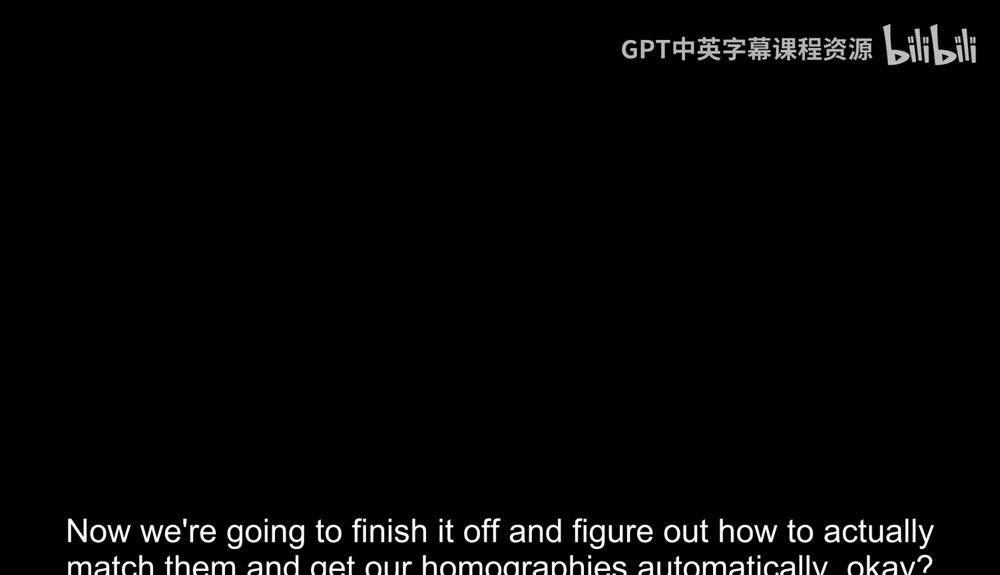

Finish it off。And figure out how to actually match them。And get our hographies automatically。

Okay， so that。You don't have to click on point。 How many people are clicking on pairs of points。Okay。

 those who are not clicking， you need to be clicking。 but don't you worry hopes on the way。

After you collect your， your heart's content。Part B， we will dispense with the clickings。 Okay。

 so how do we， how do we match the points that we have detected。 So we， we ran our interest points。

 We found corners。 We found corners independently in each image。 Now。

 we actually need to find correspondences。Which corner goes to which which corner， which， you know。

Corner of a left eye goes to corner of a left eye another very image， for example， right。

And then we want to do this automatically。 So how do we do this。

嗯，可以。What we need to do is we need to。Somehow， have a signature。For every。

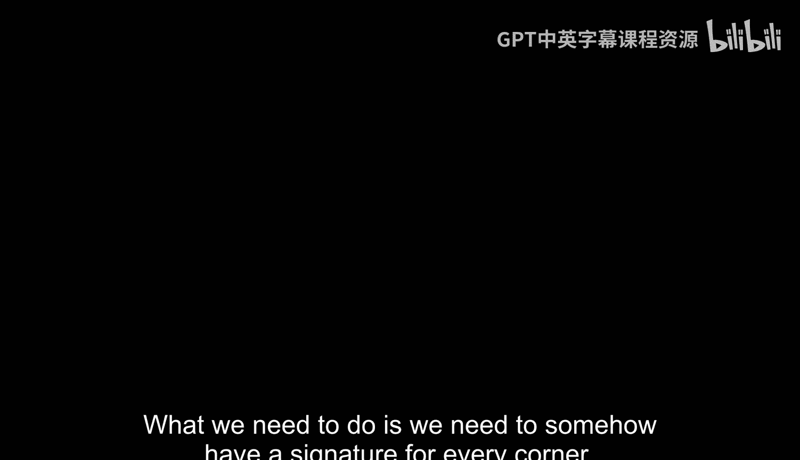

For every corner， for every interest point， we need to describe it somehow， right， in language。

 we say， oh， that， that corner is the left， left corner of the eye。 Okay。

 that's a textual description。We want a visual description。

Somehow， we need to describe every corner point， every interest point。

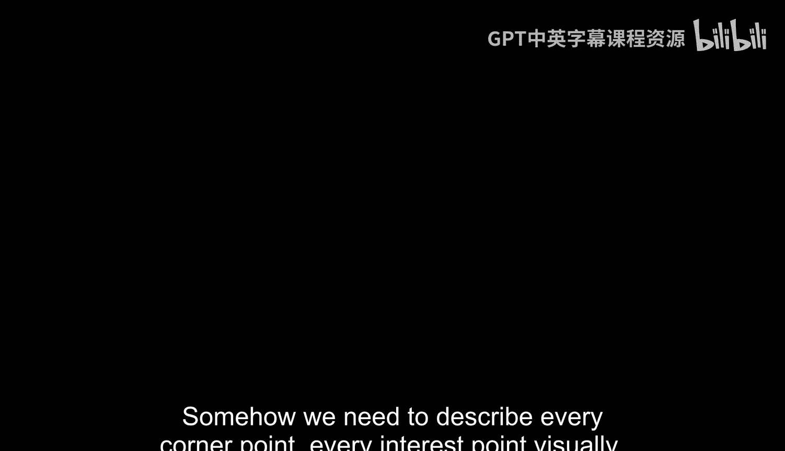

Visually， what does it look like locally in its neighborhood。

And the descriptor we are looking for needs to have two properties。Property number one。Actually， no。

 property number two， I， I think more important。 Pro number two is it needss to be distinctive。

Right， you need to find。This particular corner， you need to find it in the other image。

 You need to be able to find it in the other image。

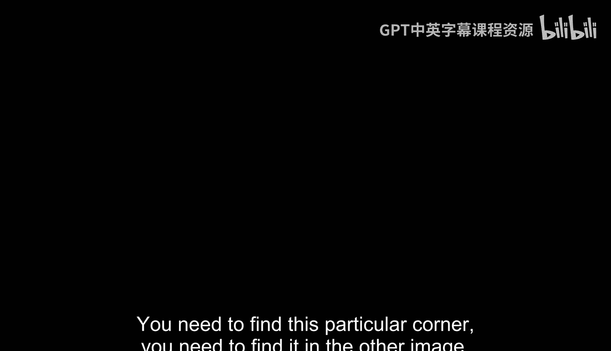

Because if you cannot find it， if it looks like every other corner point。What uses that， right。

If you are， let's say you have a。Let's say you have a picket fence and you're making a panorama with picket fence。

Are you gonna click on one of those fence balls。To find correspondences。Yes or no。啊。😮，No， I， I mean。

 there are many points。But still， you have a thicket picket fans。 The fans maybe has like 20 poles。

 They all look exactly identical。 Becket fans。If you click on one of them here。It will。

 It will be very hard for you to find where that point is in the second image。Right。

 you have to count poles and you have to say， well， actually， you know， the wide， the， the the， the。

 the viewpoint of the first camera is a little bit wider than the other one。 It's really。

 really hard to find。A correspondence when things look very similar。Same thing for texture。 You know。

 all of these little wood planks。 They look very similar， so。These are not very distinctive。

distinctive key points。 Okay， so we want something that is distinctive。That we can find again。

 in the other image。Like， I don't know My face， for example， Pretty distinctive， You know。

 hard to find somebody like that。Okay， so that's a very distinctive point。But。

Needs to also be invariant。So what does that mean， It means that。The description。

 visual description of a corner point here in one image。

Needs to be very similar to the description in the other image。Even though， you know， I shifted。

 I maybe erodated a little bit。 The illumination is a little bit different。 The， the， you know。

 the exposure is a little bit different。 A lot of things could happen。Right， and so we need。

 we need our descriptors to be able to kind of not worry too much about the little changes and still find the。

 the the point that won't。

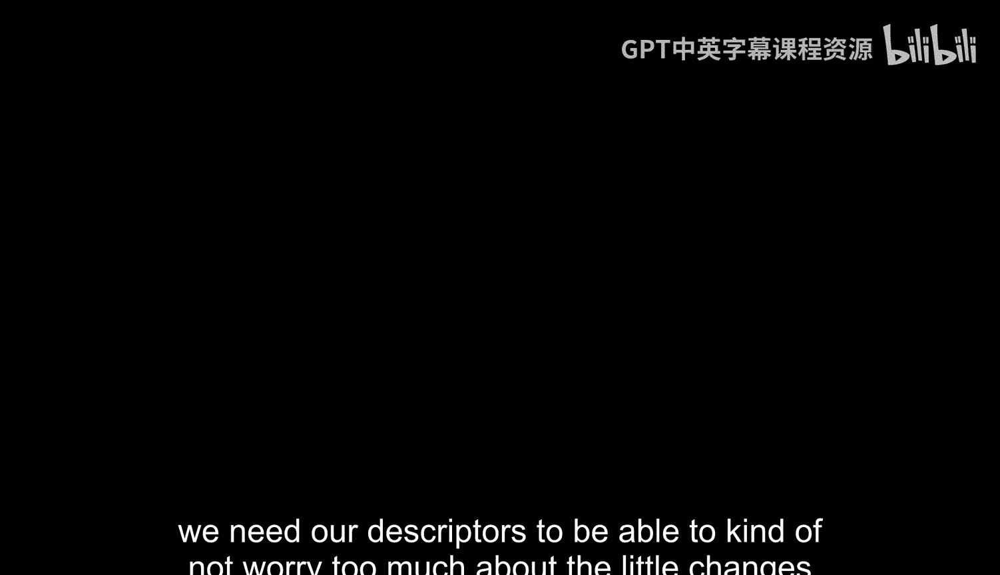

Does that make sense。So we have these two， two things that are actually fighting against each other。

 We want our descriptors to be distinctive。But also， invari。Okay， so in a sense， actually。

 this is very similar to how we wanted our corners to be。 The corners are also。

 we want to be distinctive。You know， corners are better than lines， better than empty space。

 but we also want them to be invariant to things like rotation， right， So the same stories， again。

 here， except。Here尔。We wanted to be。Discriminative and distinctive on a higher level and a level over。

 over a patch that we can compare to each other。 Okay， so it's the same story， but。You know， more。

 more sophisticated， okay。So。There is a gazillion and a half feature descriptors out there。

Probably sift is the most common one that people have heard of Probably even now。

 We are not going talk about sift。 We're going to talk about the simplest feature descriptor so that your homework。

 your project is going to be easier to do。 This is really truly the simplest descriptor there is。

And it still works pretty well。 Okay， because it has。

All the few things that are actually really important for， for a good feature descriptor to have。

 okay。So mops is multi scale oriented patches。And， basically。The idea is。

 we start with our Harris corners。 That's the initialization。

We， we detect corners first using our multi scale hair is corner detector。

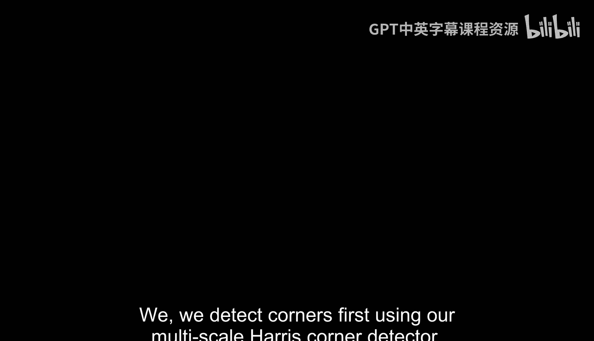

Okay。And。You know， those corners will have our orientation from our blurred gradient。

They are going to be multiy scale， like we talked about before。 And it's going to be， you know。

 geometrically invariant to rotation， as we also discussed before。 So those are。

 that's what we start with。And then， we are going to plop。On top of that corner。

 centered on that corner。We are gonna to plot。A descriptor。

 And this descriptor is really just going to be。8 by 8 pixel patch。O。With a few slide。

Ts to make it more， more invariant。 But frankly， it's really as simple as that we just plop an 8 by 8 patch around our each each of our interest points。

 And that's going to be our descripture。

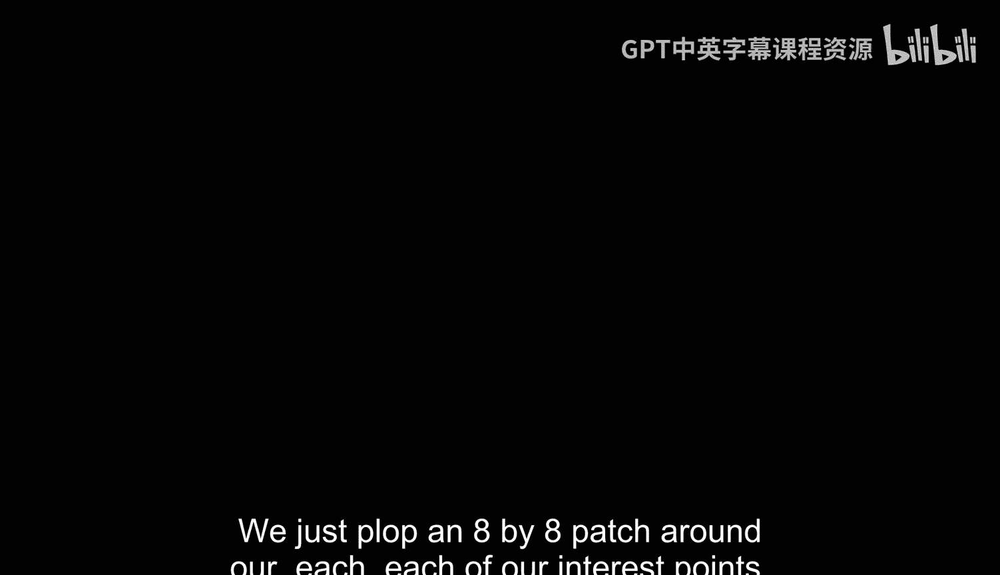

嗯可。And this is， this is the paper where they proposed this。 So here is。Representation。

Of our descriptor， okay。The center is going to be a particular interest point。

Okay， so for every interest point， we are going to do one of those。

 So if you detected 500 interest points， we are going to have 500 descriptors。

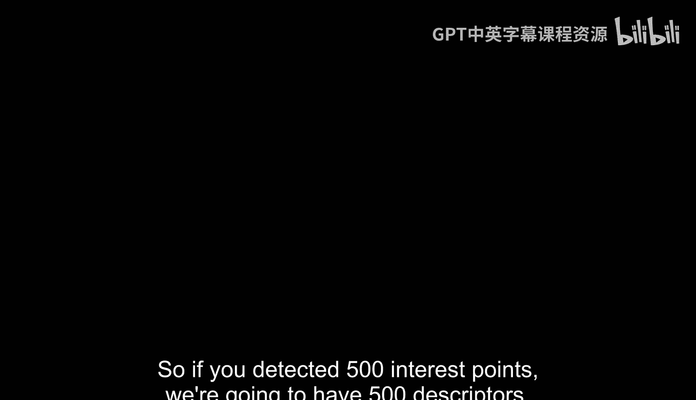

So let's pick one of them。 This one， for example。That descriptor。It has information。From the。

Interest point from the Harris detector。 It， its， it has information about X， Y， the position。S。

 the scale， right？ Because remember， we， we ran it over in on a pyramid。 and then we pick the， the。

 the stronger scale。Plus， we also have the orientation， okay。And the orientation is， basically。The。

 you know， the strongest。The strongest orientation at that particular point， a blurred gradient。

 So basically， where does the gradient point。 And that's basically just a。

You know。Some， some， we need an origin。 So this is as good as it is for an origin。 Okay， so that。

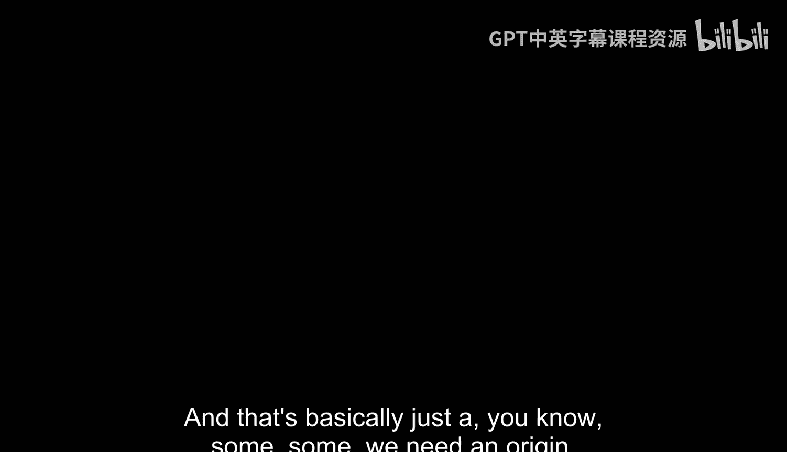

Provides a a coordinate frame。With this is the center。 and then。

You have this kind of coordinate frame。And then we just， basically just。Draw a rectangle。

In the correct orientation。Senter this point。And that is going to be our describe descriptor。

 We're going to describe。Model all the pixels that happen around this center point。

 And that is going to be our descriptor。So if it's my left eye。

 it's going to be something that has a little bit of the eye， a little bit of the skin。

 If it's the top of the peak， it's going to be just the the very top of a peak。Questions。啊，盖。

And we are going to do it for all of our interest points because they。

 they are going be at multiple scales。 We are going to have multiple scales of this。Of this。

 of these boxes， okay。Large and small ones， depending on the scale of the， of the。

 of the co detector。O。Now， the main part， the most important part。Is how do you actually store it。

 So you need to represent it in the computer。 And this is where actually all the。

 all the Jews comes in here。Okay， so this descriptor。So， you take。You take your box， okay。And。

The books。Is。Going to be。Five times。The scale of your corner detector。

 Let's say that we have a scale， which is one， basically， the first scale。Then， it's going to be。啊。

Maybe not wait a minute here。哦 no no， that that's right thats that's right。So basically。

 we have an 40 by 40 sized representation。That we are going to decode。Represent。By an8 by 8。Btch。

Okay， that patch。Is going to normalize by orientation。Okay， so this way。

 we are basically rotating it。 So it points that way。 Okay， normal orientation。It's going to be。

Down sampled。 So this is 4D by 4D。 This is， this is going to be 8 by 8。OK。So basically。

 it's an8 by age batch， and it's sampled at five times。Five times the scale。Okay。

 so if the scale is one， this is going to be 40 by 40。应该。And on top of that。

 we are going to normalize it。By。What's called bias gain normalization。Basically。

 it's very simple you。Divide by the mean。Sorry， you subtract the mean and you divide by the variance。

Okay， that little thing over here。So you subtract the mean。Brightness of the patchch。

 and a divide by the variance。OK。Why do we want to do this。债务。那。3 things that we are doing where。

Sub samplingling， this is8，40 by 40。 We are making it 8 by 8。We're dividing the subtracting the mean。

Dividing it by the ver。Why are we doing this steps。They're all serving actually the same function。

 more or less。What is that function。有。The effect of noise。 I you know， I。

 I don't like the word noise。I know the machine learning。 people love it。But， you know， the。

 the quote， I forgot when they say this， but it was some， some。Early 20th century。Classic。

 who said one man's noise is another man's signal。 right， there。

 there is no such thing as really noise。So you character state your statement without the evil n word。

Increasing invariance in our descriptor， right， we want。To be invariant across。

Two different images that maybe have slightly different lighting， slightly different exposures。

Slightly different rotations。

All of these things， we， we want to kind of to be robust to that， invariant to that。

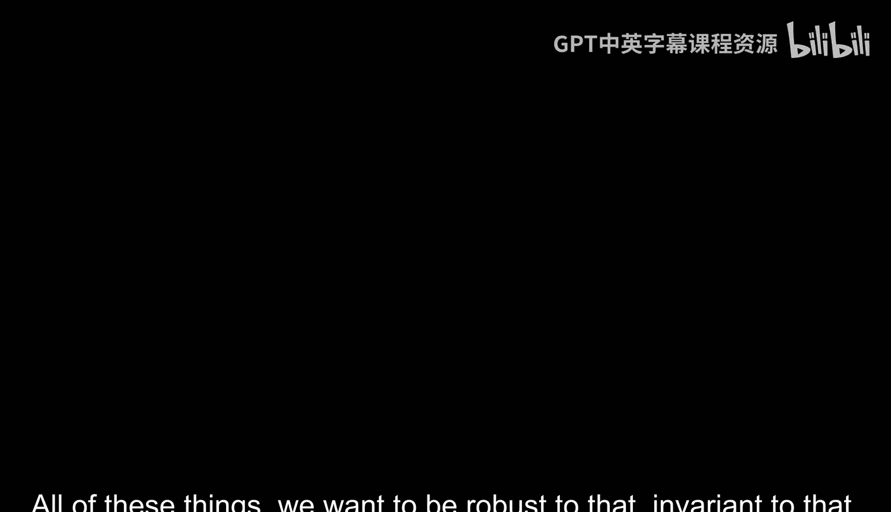

So what do we do？Well， subtracting the mean is a very easy thing to do。

 Let's say that you have a little bit higher exposure on one image than the other。

 So one image is going to be brighter than the other， right？ So subtracting the mean。

Kind of gets rid of some of that。You know， in in， in unfairness and then dividing by the variance will get rid of of。

 of， of more of it。 Okay， so youre basically kind of normalizing， normalizing your。

 your patches so that kind of you reduce。The effect of illumination。

What about the subsling going from。40 pixels to 8 pixels。

It seems like very counterinitive thing to do。 Like， we're getting rid of good quality signal。

Why is this actually。The most important thing， like， if you don't do this。

 your thing just not gonna work at all。Anyone。I mean， you， you had the right idea。 to also to。

You know， reduce。To increase in variance。 But in what way。There is a little bit of randomness， maybe。

 but that， that's not like a factor of5 randomness， right。

 That's maybe like a factor of two randomness。Anything else。What kind of transformations。

Are going to undergo between the two images。有。Well， actually， all of them are linear。

 but I think you're on the right path。Yeah。And， and why do we want to do that。

And why do we not care about high frequency？ I mean， sometimes we do actually， you know。

 sometimes the five frequencies all where all the， all the juice is。有。Exactly。

 remember what we are doing。 Like， let's step back。 We have two images。Right。

 we are trying to match to the points in two images。Those images are not。The same。And， in fact。

 they are not related by a translation。 This assumes that the patch is just translate it to a different place。

 and it's the same patch。 But it's not because if， if it was so simple。

 we wouldn't have to do all of this stuff， right。The patches are actually related by。

Perspective projection， right， just like the whole image。So it's actually a kind of annoying。

 complicated relationship。Which we don't know， which we're trying to find out。 We don't know it。

 right， so。The patches。Are not going to look exactly the same at the pixel level， right。

 They are actually going to look different because。They are undergoing a homography。

 a prospective projection， okay。So what we want to do is we want to， essentially。

Get rid of all of this perspective effects。 We're gonna say， you know。This is a small enough patch。

The prospective effects for such a small patch are probably going to be very small。

So they're probably all going to be sitting in the high frequencies。

So if we just get rid of the Phi frequencies， if we only look at the low frequencies。

 we can basically throw away all of these nasty perspective effects and just assume that it's just a translation。

That's basically the idea。Does， does that make sense。This is a very key point。Where， basically。

Making this hand wy assumptions that。The stuff we are actually looking for is sitting in the high frequencies and the patch is small。

 So if we just match on the low frequencies， we can， we can keep the translation assumption。

 It'll be fine， yes。Exactly， or， or maybe， maybe all the information is only at the high frequencies。

 And， and we get rid of it。 And there is just a flat patch。You can't make sure。 And this is why。

We are going have a lot and a lot of points that are going be crappy。

And this is the main difference between the， the manual thing that you guys are doing now and the automatic thing that we are going to be doing after。

 which is we have to deal with a lot of false positives with a lot of outliers。

 And so we'll have multiple ways of deal with outliers。 for right now， all we need to do is to get。

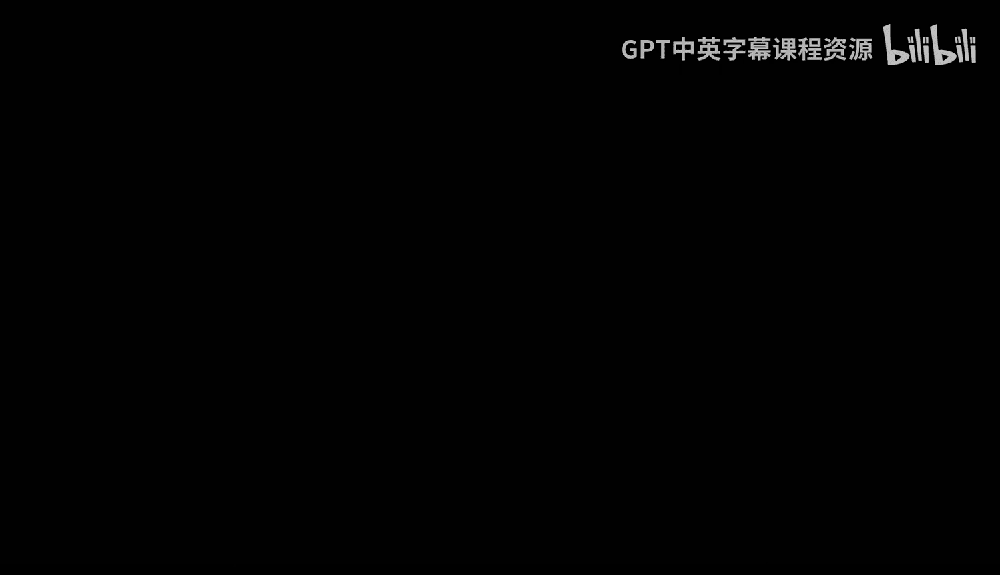

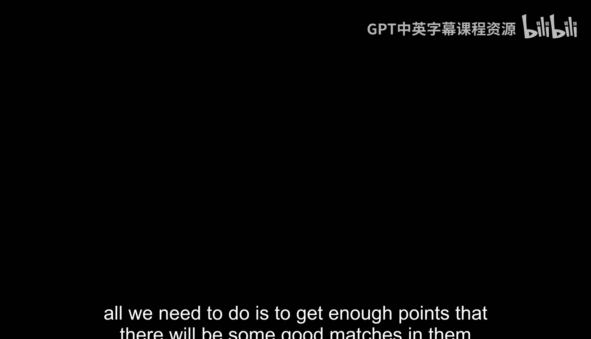

Get enough points that there will be some good matches in them and not worry too much about about outliers。

 Does that make sense。Other questions。Yeses。Where does any of this come from， Who knows， You know。

 that they， they tried 50。 It was too much。 They tried 30。 It was too little。 you know。

This thing works。 Okay， I， I tried it myself。That's right。 Well， it's 40 for a given given scale。

 if you have like a。If， if you have like， a coarser scale， then it's like， you know，80。Or you know。

1 hundred 20， etc ce。Yeah， I mean， this is， this is a constant， But they， you know。

 they tried a bunch of them。 you know， hyperpara。 the young kids say nowadays。呃。的。

The good news for you guys， for the homework。😊，I'll make it easier。I'll make it much easier。

You don't have to worry about scale。And you don't have to worry about rotation。Why is that。Anyone。

 anyone。No， why。We are O without worrying about scale and rotationation。有。And。

 and we are not zooming in and out。 Yes， that's right。

 So this method is actually applicable to a whole bunch of other things like structure for motion。

 we'll talk about later。For our particular application of panorama teachinging。

The scale is basically going to be more or less the same because we are not like zooming in and out。

And the orientation， I do very much encourage you not to take pictures like this。 You can。 It。

 you know， the math will still work。 But then， you know。

 then you will would need to actually deal with a scale。 But if you're careful and you。

And you take your pictures kind of a leveled。Should be O。Okay， so。In， in the。

 in what you are going to do， no scale and no， no。No worry about orientation， okay。So。Now。

We have for every single corner。 we have a little8 by8 patch。 And， you know。

 you just put it in the vector somewhere store it， and that。So you have X， Y position， and then。

This normalized。Vectctor of。8 squared。Brightness， okay。Now， finally， this is。

 this is all done one image at a time。 Now， finally。We are ready to match。Now， finally。

 we get to see two images。At a time。 And we say， okay。Find me a homomography。 Okay。

 and now we are basically ready to do automatically what you guys are doing manually right now， Okay。

 so。😊，Here's two images。In red， I show you。The Harrisris corner points that I have detected using the Harris algorithm。

嗯该。Down below。For every。Red point。I。Computed the mop feature。Little 8 by8 patch。

 And I'm displayed it here。 So this is a whole bunch of8 by8 patches ordered by the ordering of those points。

 This is for image number one。 This is for image number  two， okay。What do we need now。

 We need to find correspondences。 We need to find。For every point on the left image。

What is matching point on the right image。Okay， so for every patch here。We want to find。

A patch that looks like it。In the other。Ideas。How do we do this。I mean， the。

 what's the simplest idea， the baseline idea。有。And。Find the， the best match。With SSZ or something。

 right， just。For everyone here。Do a loop。Find the best match。 today， That's your match。

And the second one and the third one and the third one，4 or， etc cetera， eta。 This is not actually。

Such a bad idea。Pick best batch for every patch。 Find the most similar patch Call nearest neighbors in the machine learning。

 Pretty good algorithm。 Okay， you can speed it up。😊，You can， you can do some hashing。

 You can do some， you know， K D trees， approximate nearest neighbor techniques。

 or you can do vector quantic clustering。In， in， in， in computer vision， it's called visual work。

 So basically， you cluster all the patches and。

Like， maybe like。10000。啊。

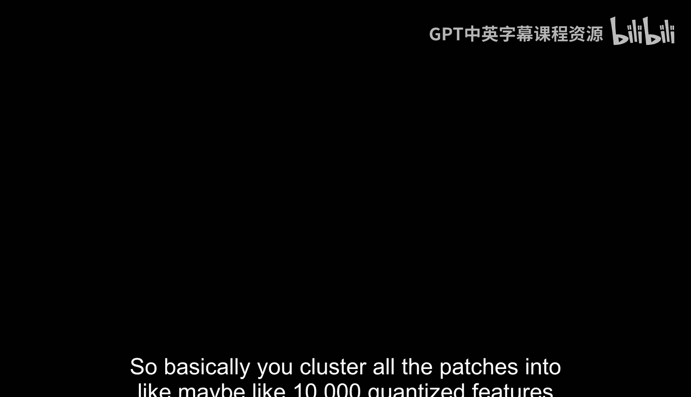

Quantized features called visual words。 And then you basically， you find which visual word you are。

 and then you find similar visual words another， another image， okay。This is all reasonable。嗯。But。

But it's， it's， it's， it's a little bit problematic。

Because we are going to have a lot of ourliers here。Right， so here， basically right now。

 our algorithm is that for every image here， every patch here， we need to find the best match here。

 So， right。But look at those patches。 Look， look at those points， actually。Do you see a problem here。

Are all of those points going to have a pair？ Are they all going to have a match。What do you think。

No， right。 In fact， most of them。Because the overlap between those two images just the central portion。

 So all these points are not gonna have matches。 All these points are not gonna have matches。 Okay。

 but what are they going to do， they might actually steal matches from something good。Right。

So is this is dangerous。So we need to somehow deal with outliers。O。So how do we deal with outliers。

Called outlier rejection。One very simple way。Is to only match only call matches。

When they are close enough， right， So right now， our baseline algorithm was。For every patch here。

Search all of them here and find the best match。 And that's your match。

 But what if your best match is still really crappy。Right， at some point， you should say， no， no。

 I would rather just not， not do a match， right， I would rather give up， okay。And so this is。

 this is called outlier rejection。You couldn't do it very simply。啊。Just look at SSD and say， okay。

 if the， if， if the。Only accept this as a match。If the sum of square difference。

 if the error is lower than some threshold。And if it's not lower than the threshold， that's。

 that's an outlier。Sounds good。 How do we pick a threshold。We maybe we do some， you know。

 empirical research。 We actually label some points with undergrads or grad students。

 and we actually have some correct matches and some incorrect matches。 We plot them by。

The one minus the sum of squared differences error。 The correct matches are solid line， the。

 the incorrect matches are。Broken line。And then， we become very sad。Because。Look at this。

 no matter where we put our threshold。Right， we are always， even if we put a threshold here。

We are still going to get a bunch of incorrect matches， right。

So the incorrect matches and the correct matches。 There is definitely this， the small the error。

 the higher the chance that it's the correct match。

But the incorrect matches actually also sometimes have very low error。So， that's。That's not。

That's not great。 That's not great。Any， any ideas。About how can we make it this little bit better。So。

 remember， our method is。We are going to。We are going to， for every。1 here。

 we're going find the best match here if it's better than some。Some， some threshold。 we keep。哎。

呃 crop I'm not sure I understand。一。Oh， in the graph， you mean。I think。

 I think there is not really any area where， right， we want something that has。

Has a lot of these and， and none of these。 And I don't think anywhere on the graph。

 there is an area like this。O。OI， So you're assuming that Icy。Okay， this。

 that might work for this image somewhat。 but sometimes， you know， the， the geometry is more complex。

 So it might not be like a coherent area in the image。嗯开。So that might not actually be very。Very。

Work very well。 But notice， like there is one thing that is kind of weird here。This is a not。

 This is a kind of an unfair thing， right？ It's kind of like when getting married， you know， these。

 these patches are proposing marriage。These ones don't really get a say。Right。That's not very fair。

How could we make it a little bit more fair。啊。Yeah， yeah。 ask the other direction。

 too and see maybe symmetry will， will， will solve the trick， right。And， and， and indeed， it does。

 right。So。I only call it a match。If。I'm your nearest neighbor， but you are also my nearest neighbor。

You know， these happy marriages that， you know。Yeah， happy love， right。Unfortunately。

Ladies and gentlemen。This thing is very rare。 And we， if we do this。There will be。😊，Very。

 very few matches， unfortunately， somehow。So this， this， this。

 this sometimes people do this actually， it， it does work。 It， it gets rid of a huge。

 huge amount of outliers。 That's true。But。There is an even better trick。

And an even better trick is due to， to David Lowwe， the inventor of the Sift algorithm。 And it's。

 in in， in fact， the technical term for it is David Low's trick。

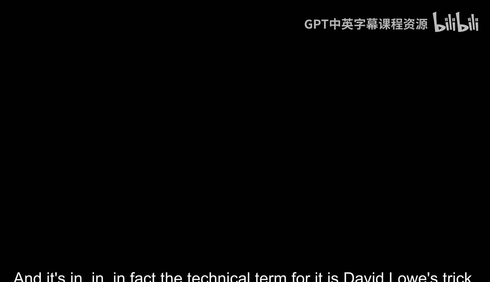

And， and the trick is。Very reminiscent of。A method that。Grandma of my。Of my。Friend from Soviet Union。

Was telling her how to， how to pick a husband。 So this friend of mine she didn't know whom。

Whom she was wanted to marry。 There was a couple of， couple of She didn't quite know。

 And the grandma said， you know。If you can't decide which one of the two。

Probably both are the wrong idea。And this is actually a very deep， deep wisdom here。Right。That。

 if you have。If it's hard to tell apart a good match from a bad match。Chances are。

 both are actually bad matches。

Okay， so how do we apply this， this grainy wisdom to our problem setting here。

 Who wants to propose an algorithm， yes。

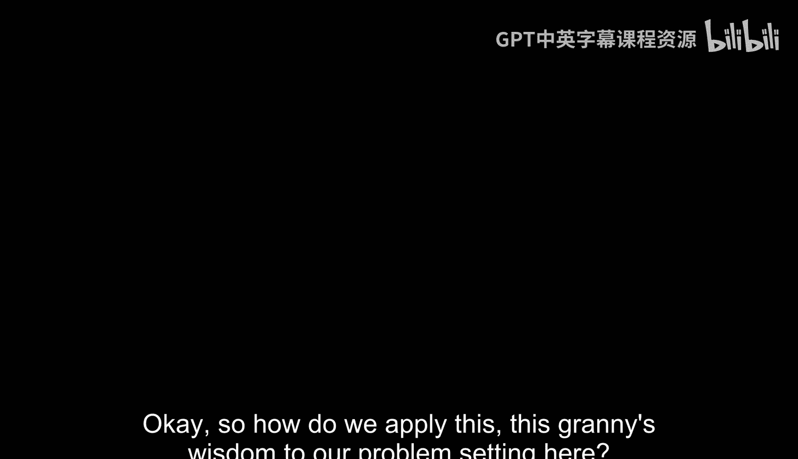

Exactly， the ratio between the first and the second nearest neighbor。 That is a David Lowwe trick。

Okay， you take the first year' neighbor。 You take the second year's neighbor。

 You look at the ratio between them。If it's kind of close enough， theyre both wrong。 Okay。

 and indeed， Gany's wisdom is computationally correct because， look what happened to our， to our。

 to our two curves now with this trick。 So now we have first years neighbor over second year neighbor square error。

Correct matches。And correct match。So look at this for a quite some time until about 03。

You're basically just getting the correct matches and essentially， no incorrect match。Okay。

 so this is the trick that you guys。Will be using in your project， okay。对。对。Soviet grandmother Chi。

 O， very， very effective。There is a generalization， but we don't even need to do that。 This is。

 this is， this is basically going get us where we need to be。Any questions？Yeah。

A stable marriage problem。You could do that， too。But you don't need to。And， in fact。

It's not going to be very good。Because， you know， the problem with stable marriage。

 how many people remember Hungarian algorithm， stable marriage problem from， yeah。

Why is our setting not a good match for the stable marriage problem。Exactly， those theorists。

 they believe that everyone's going to find a match。 No， no， no， no。The real world is not like this。

Okay， so。David Lows trick， much better in practice。Okay。So， now。We have。

 the red points are my original corner points that I， I started out with。The blue points are， yeah。

 David Low strike points。The matches that passed the David Low test at some threshold value。唔该。

Are we ready to roll？Yes， we should just run。

You guys have the compute age function。 We just throw all of these pairs into compute H。

 and we get our homomography。

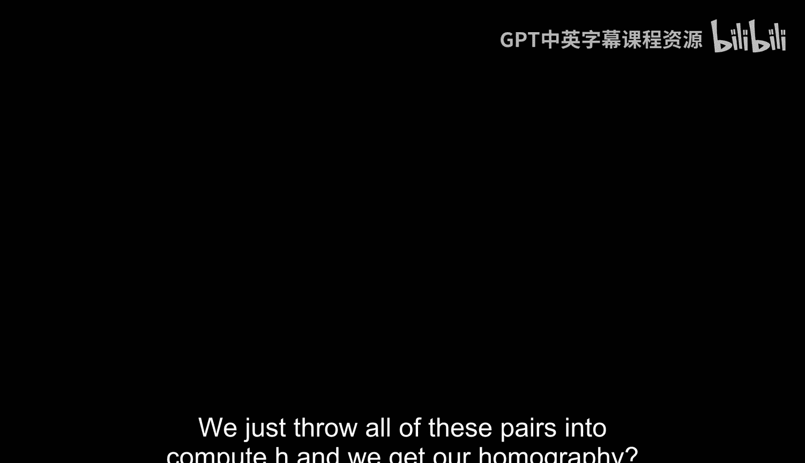

有呢有呢。Little bit more careful to look at some of these points。What happens？ Let me tell you。

 Let me ask you this。 What happens。In your current implementationbilation。 So you have a bunch of。

 you made a bunch of corresponds。You compute and do。

 you send them to compute your homomography using least squares。

 What happens if one of your correspondences is like really， really bad。Just like， you know。

 runs off the image， whatever。 What happens then。So what's going to happen with your hoography。

 Imography going to be。Just as good， a little bit bad or really， really horrible。Horrible， why。

And yeah。So， basically， least squares。Is not robust to outliers。At that algorithm， like， you have。

 you have one， one point that has like a gazillion。AVal error。

 And it completely changes your whole fit。This course is just not a robust algorithm。Okay。

 it really expects to have every point to be an inlayer。你可以。So， if you look here。Do you see。

 Do you know why I can immediately tell that this is going to be a disaster。呀。Yeah。

 there is there is a point right there， right there。Two of them， actually， right， I mean。

 they're definitely not having any matches。 They think they do。

 They're going to go there in the hamography， and they're going to completely make a pig's breakfast out of it。

O。So at this point， you should be kind of sad。You know， half the class is gone。We。

 more than half the class is gone， we've。You know， gotten better and better points where gotten almost perfect matches。

And we are basically where we started with， because。

You know， any amount of outliers。Is。Is going to be。Pastrophic。For competing。

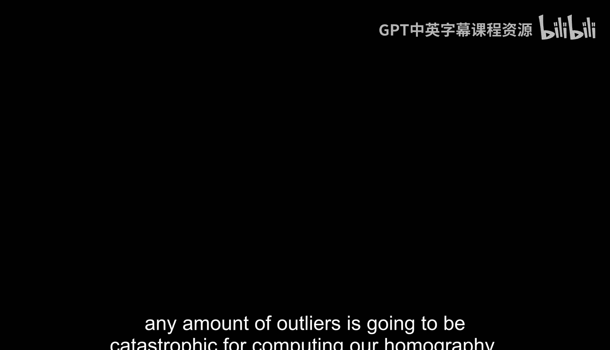

Okay， so this is really the low point of the class。But don't you worry。

 because there is still some time。嗯，可以。啊。And so this， this， in this class today， we have。

 we have two things that I wanted to remember，2， two of the most brilliant。😊，You know。

 ideas in all of computer vision。 One is Soviet grandma， you know， David Lowtch。And the second one。

Is the following thing called ransack， a magical algorithm， okay。So here is the idea。

The idea of ransack is， let's say you have a bunch of matches。嗯可以。And。嗯，Some of them are。

ButCo matches， and some of them are incorrect matches。How do you tease out the correct matches？

 So now you're not looking at them separately as， as patches， right， We are looking at them as。

 as actually now pairs。And we are trying to judge correct pairs and incorrect pairs。So， for example。

 this is a2 D case。 This is like from homework one。

So this is one correspondence another correspondence。Maybe a third correspondence。fourth。Fith。

And then， there is a couple。That are actually wrong。O。So。For here， there is another。Soviet quote。

 this one actually all the way from Leo Tolstoy。Let's see。 who remembers who， who has。

 who has read on the cardanula。Yay， one person last， last year was 01， just one or anyone else，2。

Wonderful。Oh， there was like maybe3。 Okay， okay， good。Now， do you remember the first sentence？

 How does it start。Exactly， that's going to be our trick for this thing。

We' are going to change from families now to correspondences。All happy correspondences。Are the same。

The wrong correspondences。Are no， are all going to be different。

 And that is going to be our trick that we're going to use。 We are going to try to find。

Clus of consistent correspondences。 We're going to find correspondences that are consistent。

And hopefully， the consistent ones is going to be correct。 And then in the。

 and the bad ones are not gonna to be consistent because that would be just too too much chance for them to be also consistent。

 Okay， so here it is。 We have career expenses。3。There we have some that are consistent。

 pointing the same way。 And there have a two that are， well， they're kind of somewhat consistent。

 but not quite。 there are a little bit。A little bit different。 Okay。

 but what we are going to do is we're going to do the following。Very simple operation。O。

How do we find those bad matches， Okay， right， we， we don't know。 These are the matches。

 We don't know which ones are good， Which ones are bad。 So here is what we are gonna do。

We're going to pick。1。Correspondence at random。ok。😊，按。Basically。

 compute a transformation based on that correspondence。Okay， so for， for this transformation。

 since it's a translation， one correspondence is basically enough， right， one correspondence。

 two unknowns。 That's enough for us。So we think， okay， according to this correspondence。

 the transformation is going to be to the right and up， right。Now。We compute the correspondence。 We。

 we compute the transformation， and then we go back and check。How many other correspondences agree。

With that transformation。And look at this。These four agree。And these two do not。可。Great。

We'll write it down。 We'll write down， you know， this transformation。How many agreement。

 How many disagreement agreements will call our inliers。 disagreeagment will call outliers。Now。

 we're going to take another correspondence to random。 Let's say this one。Go to repeat the process。

 How many agree。Okay， maybe this one agrees， possibly。These do not。

We' are also going to write this down。O。And then。We are going to find。The transformation that has。

 overall。The most mild number of inliers that basically has more。

 more other correspondences agrees with it。 And that's going to be our correct average transformation。

O。That's basically， the。The， the idea， it's called ran ransack， random sample consensus。

It's amazingly powerful algorithm。😊，Here is the algorithm 4 actually doing hographies。

 So we have a loop。We start with。Selecting random。Set of pairs。I say four feature pairs， Y 4。2。

For homomography， right， Because homomography requires8 unknowns。 that means we need to have four。

Crespondences。 So the minimum is 4。 So we need。Enough to get ourselves to computer transformation。

 So in this for homomography， it has to be for。 So we randomly pick。4 correspondences， okay。

And let's say half of our correspondences are wrong。 So， you know。

 chances are this is going to be wrong， but we' are going to persevere。Okay， then。

We' are going to assume that these four form a correct。Homography。

We are going compute that homomography。 This is the exact computation。 Only these squares here。

 It's4， you know，4 correspondences，8 unknowns。And then。

For all the other correspondences that we have in our bag。

We' are going to compute how many of them are in layersars。

 How many of them agree with this homoography， right， Well， what were going do is we're basically。

 we have a bunch of correspondences be。PI to P I prime。And we are going to， you know。

 push them through a homomography。Look at their distance。And that distance should be very。

 very small。 That distance should be lower than Epsilon in， in， in， in when I did this， I did it。

 I think less than a pixel。 Okay， you can do pixel and a half or something， but really very small。

 okay。So we' are going to compute how many。We don't even need to know who what they are。

 But how many other correspondences agree with that one。O。Then we are going to go back。

 pick another random quadruplet。 do this again。 Pick another random quadruplet。 do it again。

 Pick another one。At the very end。What we are going to be doing is we are going to be。

Look through which had the largest number of inliers。And that's the transformation that。

 that is the winner。Okay， the one that after so many different random versions。

Had the the highest number of inliers， the smallest number of outliers。Is the correct one。Now。

 if you want to be to clean things up， then you can， you know。

 take all of the inliers and recompute your homoography using least squares with using all of them。

 So that's going to give you a little tiny， extra boost， this little extra bit of precision because。

 you know， this one was just， just four points。 This is actually going to be you know， better。 okay。

But even that is not really necessary。 That will just give you a little bit better。 Okay， in fact。

 a lot of the， this is such a robust algorithm when。

I。When I。呃。When I first coded this up。

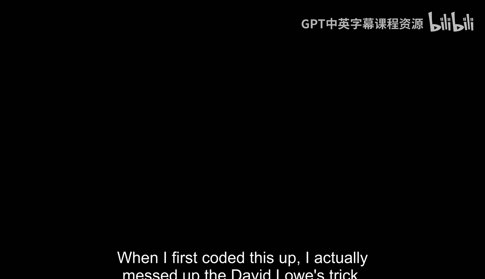

I actually messed up the David Low trick。Instead of less than， I made greater than。

So I threw away most of the good correspondences。 I kept only the bad ones。And then I was like。

 why is ransack taking， So why does it take， you know， 20000 iterations to get me the right answer。

And it turns out it was， you know， it's just that 90% of the data was garbage。

 and it still found the correct one。Because of anarma。But， but， but in general， I think， you know。

 maybe。

A few hundred， maybe 1 thousand iteration should be enough to， for if you do everything else， right。

 to get you the right。

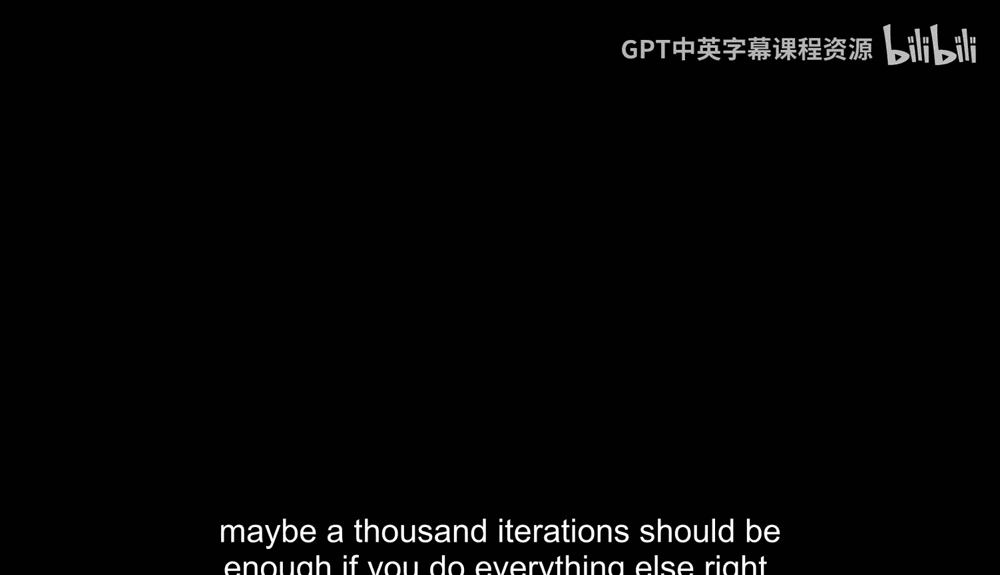

to get you the right。Okay。啊。Another little note。This。This epsilon thing。The less than epsilon。

Is very， very important。There is it， you know， there is maybe some。For those of us。

 at least who are like， you know， like continual domain， don't want discrete stuff。why。

 why do I need to do this kind of thing， Why do I need to do this count？

 Why don't I just sum up all of these errors。And then just have a whole bunch of errors there。 And。

 and the， the， the， the thing with the least amount of error is the winner。That's not going to work。

This non nonlinearity here is very， very important because you're actually， you want to count。

You want to count who are the inliers and who are the outliers。

 You don't want to get polluted by the amount of outlying that a particular outlier is doing。

 That's the problem with least squares。 Lee squares gets screwed because the outlier could be arbitrary far。

By doing this discritization here。You kind of forget about。How far that playerer is。

You just say that's an inlier， That's an outlier， bindr。So that's actually also very important。

Question。Hopefully， now you are ready to basically implement this whole thing。Yes。Second。

If you have 200， Yeah， you could just， yeah， you could just loop through all of them。 absolutelysute。

 absolutely， yeah。But， you know， usually， usually there is more。 yeah。 but yeah。

 you could also just do。But you don't need it because this， this thing is gonna。Yeah。嗰啲啊。

Other questions。Yes。You know， when。When。I don't know。 The number， you pick a。

 you pick a high enough number that is like， it should be， should be good by now。😀Yeah。😊，yeah。

 there is， there， there is no stopping， at least I。I don't。 I don't know of a stopping condition。

 That's good。I think you just。Set a large number of iterations。

 and just hope it will figure itself out。And就是。Other questions。All right。Great。And there you go。

 This is your reward。So。Red are their initial points。

 Blue are David Lows trick and yellow are the ransack in liars。

And the land second layersars are perfect。 and you run your homomography from them。

 and you get a very nice homomography and you stitch together and you get a nice panorama。

 and then you。😊。

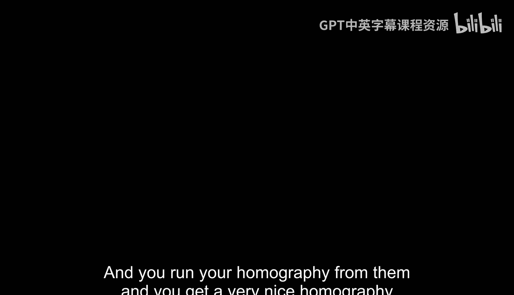

Go to the next dimension and repeat the whole shebang all over again。Okay。上这个。All right。You know。

 I'm going to skip this。Because that's actually， we didn't even talk about it that much。

You can read it in。And David Lows。Book。嗯。Because I wanted to。Have the rest of the lecture。

To mention a very related。呃。A family of transformations。With very related math。嗯。周。😡。

All of this kind of alignment that we talked about so far。It's all very nice， and it works actually。

 surprisingly well。But there is an， there is a but。 And The but is that you have to know。

Or have a good model of the transformation。So， for example， for， for， for hagraphies， for。

 for panorous teaching， we know that the homoography is the correct model。

The chmography actually exactly relates。A pair of images， if。

If it if you're just rotating the camera， okay？A lot of the time。

Though we don't have that information。For， especially this is true for video。You know。

 you have somebody walking around， You have a car， You have some， you know。

 something swinging around。

The， the type of motion， the type of transformation that that is happening。In the video。

Is actually not some any one particular。

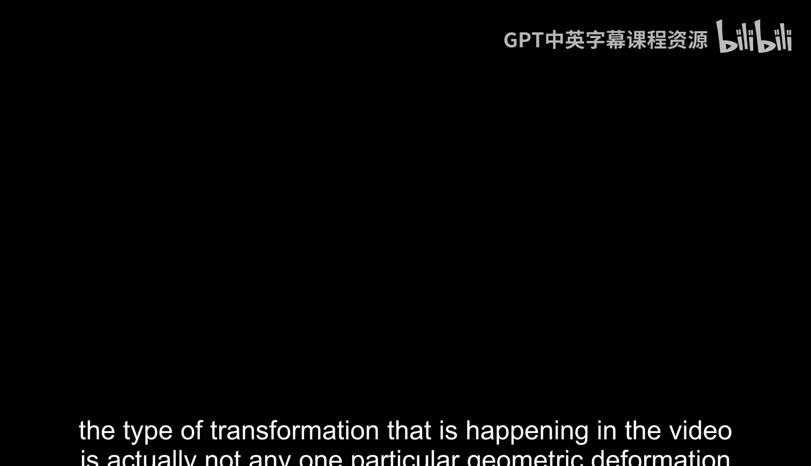

Gmetric information， like an a fine or or a homomography or whatever。Okay， it's。

 it's some sort of a vector field。Where every pixel is going somewhere。But together。

 they may not actually have kind of， a global representation。嗯，该。But we still want to。Meeasure。

That flow。This vector field。And this is called the optical flow problem。 Okay。

 the optical flow problem。Is basically。You're looking。 and this is usually。E its we discuss it in in。

 in terms of video。It's usually when you have， you have a frame of video。

And you have all the pixels in this video。 And then we want to say。

 where do all these pixels go in the following frame。

Well， we can。Draw a little vector for every pixel where that pixel is going。

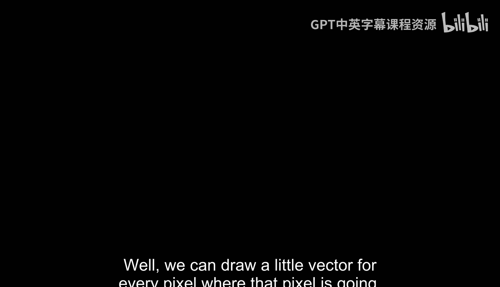

And that creates a vector field。O。Now， the vector field is not quite dense because for things like this。

We don't know where the pixels are going， because all the pixels look the same。

 So there is no features。 So there is no way to tell。Where everything is going。

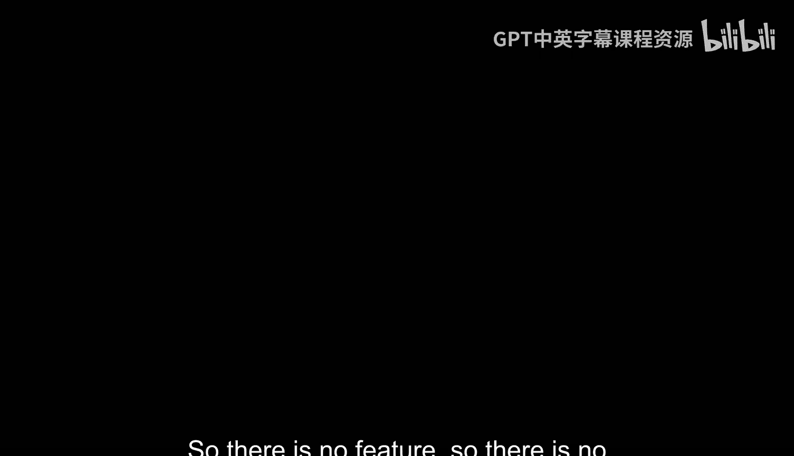

But for many of the pixels。That。You know， our coronary。We could tell where they're going。

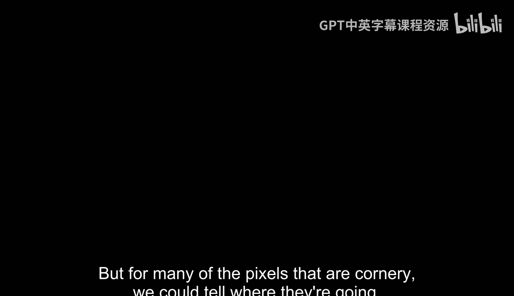

And so the collection， the all the， the， the。The the vector field of all of those two dimensional vectors。

Telling us where。All the pixels are going to go in the next frame。

This is called the optical flow problem。5该。And， of course。

 the problem in this optical flow problem is that you want to recover this。Given a pair of these。O可。

所以看。Frame T， frame T plus one， let's say。 and you need to know。When， what went where。Tons of。

 tons of applications for various things。sell driving cars， video games with， you know。

 human interfaces。 Also， optical flow is something that is。Very。

 very develops very early in evolution。 Basically， even frogs have optical flow。

 That's how they catch flies。 like， you know， there is little optical flow。 It。

 it detects optical flow over the fly， and it sticks its st out at predicting where it's gonna be and。

Yeah。It doesn't， doesn't even happen in your visual cortex。

 It happens on the way to your visual cortex in this area called L G。 N。 So it's like really。

 really medieval brain， like a primal， you know， goes。Kin of connects you with your。

 your froggy or your toads， you know， ancestors。你看。And， you know， also very， very important for very。

 very special effects。

Where you to。Track， track objects in the video。 and then maybe。Put stuff on them。 Okay， so awake。

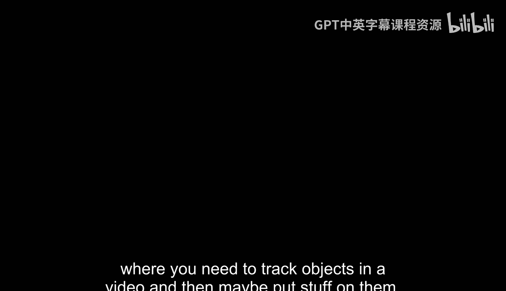

VR AR kind of applications， O。So。😡，The task， the problem juvenation is。We have the first frame， H。

And we have， in this particular case， the frame only has。4， four pixels。

And then we have this second frame， I。And。The pixels have moved， okay。And we need to estimate。

Where all the pixels have moved， the flow field， the optical flow field。OK。So。啊。

So we need to solve fundamentally correspondence problem， right， We need to find。

The correspondence between。The points in the first frame and the points in the second frame。O。

So essentially， what we need to do is given a pixel in age。

We need to look for nearby pixels of the same color。In I。 And if we find it。

 that's the correspondence。 We have our vector。 We plop it down， and we move on。应该。So。This。Tells us。

The two assumptions of the problem。The first assumption is that。The point couldn't have gotten far。

Right， why。It's the next frame。 You know， it's 30 frames per second。 You know。

 the world doesn't move that fast， right， So it's a very reasonable assumption that the point should really be in the neighborhood。

 It shouldn't have gone really far。 So that's very easy good because it's kind of reduces our。

 our search base。 Okay， so the point is nearby。

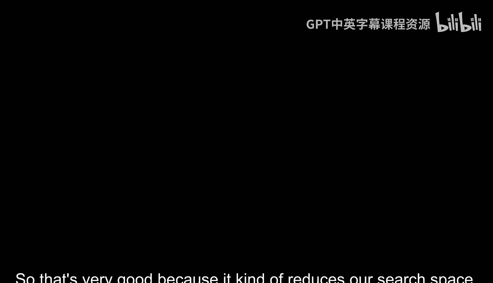

Otherwise known as small， small motions。Points do not move very far。Between the。And， second。

Is that the point is the same color， okay。And this is what's called the color constancy assumption。

 This one is a little more iffy。 but the assumption is that basically， the point。

In the frame H looks the same as the point in frame I。Okay， why is this a little bit iffy assumption。

有。Shadow， somebody turns off the lights。 Youre， you're walking into the， you know， outside。

 and then the， the exposure settings on your camera change。 Yeah， it， you know， things happen。

But on the whole。It's a kind of mostly O assumption。Colllor questions。O。

So this is the optical flow pro。Let's， let's now do some math。Okay， how do we solve this problem。啊。

So we have we have our point。 Let's pick one point for now， this point X， Y。

It underwent some displacement U。 And now it's， it's in a。It's in the next frame， I。

Under the guise of x plus U， Y plus V。 Okay， now， color constancy， Or if you have a gray scale video。

 brightest constancy。How do you specify that assumption， that constraint。

 the brightness constancy constraint。Using this notation。有。Yeah， H of X， Y should be equal to the。

I X plus U by plus3， exactly。偶尔。You can make it。Fancy to make it a 0。 Okay， this is going to be our。

Driver， that's going to get us home。 Theres this brightest contancy assumption。

 So even though it's a little bit iffy， this is really what， what makes this old thing work。

 because this is basically fundamentally the idea of a correspondence that something is the same。

 right， so。We are going to keep this assumption。 going to be very important。

And now we are going to do basically very small things。Similar things to what we did before。We say。

 okay， small version， you say， Okay， so that means that you and V are very small。

 maybe less than one pixel。 Okay， great。 Then we can use our Taylor series trick。😊，And decompose age。

Sorry， I inter。Indeed。First， first terms of the Taylor series， which is。I X， Y， and then。Bll。

In x times u partial and y times v。O。😊，So， now。Now， we have。This simplification。And now we can plug。

 start with our brightness constancy assumption。And instead of this。X plus U， Y plus E， nonsense。

 we plug in。The stuff from the Taylor series。Rearrange some terms。And yet。With something。

Something like this。Okay， we basically。Essentially， we're going to say that。The derivative and T。

 What is derivative in T， derivative of T is basically just the difference between the two frames。

 right， I of X， Y minus H of X， Y。 That's your derivative in T。Nothing， nothing magical there， right。

And then you basically just have the gradient in x times U， gradient in y times T。

 separate the terms。In the limit as you and we go to 0， this becomes exact。And now。And now。

 what we need to do。Is we need to actually solve。What are we solving for here？

That's always good to to wake up the wait a minute。 What are we solving for here。😊，U and V， right。

 the displacement， right， We want to find U and V。How many unknowns。And how many equations。

How many unknowns。2， how many equations。啊哦。No good。 one equation to unknowns。Right。

This is why this is hard。What this constraint means， basically。

Is that we cannot solve this for one particular point。 We cannot figure out both。

Both dimensions of that displacement vector。Just for one point， okay。It basically。

 the component of the flow in the direction。In， in the gradient direction is determined and the the come。

 the flow parallel to the edge is unknown。It's very much。Like。This。

This visual illusion with that the barbershops usually have， right。This is basically。

Exactly playing on the fact that we can't really tell。How which way。The motion is actually going。

 We can only measure one。Dimenssion of that motion。Let's， let's look at this again。

So let's say that we have this， this， this line and it's moving to the right。Moving to the right。

 Now， let's say that you're not looking at the whole line。 You're looking at the small peep P。

 peep window。And what you're seeing is you seeing this。And then you're seeing this。

 Where is the line moving。Upend to the， up and to the right， right。Well， but actually。

 it could be moving up into the right。 But you know that in this case， actually， it's moving。

It's just moving right。O。But what we， the only thing we can see is we can see the motion。

Perpendicular to the line。Motion parallel to the line。 That part of the vector， we。

 we don't have access to。O。So this is called the aperture problem。

The aperture of the little little hole that prevents us from seeing the other context that would figure。

 help us figure it all out。嗯该。So how do we solve the aperture problem。Make your aperture bigger。

 Look at the context。And in this case。What we basically do is we say， you know what。

We can get more equations by just assuming that。The flow field is smooth is。

 and that the pixel going that way， its neighbor pixels are probably also going to go more or less to the same direction。

你开。So we' are basically going to assume smoothness。And。Take a little window。

And compute all the stuff within a window and then solve for the entire window。

 So instead of this one equation， now， we can have a whole bunch equation of a bunch of points all。

 all in the same patch。You know， 3 by 3 patch or 5 by 5 patch， whatever。

 I think 5 by 5 is like the standard one that people use。 Okay， so now we have。

2 equations，2，2 unknowns。 But we have like 25 equations。 Great。 This is fantastic。 Now we can。

 we can solve this thing， right。😊。

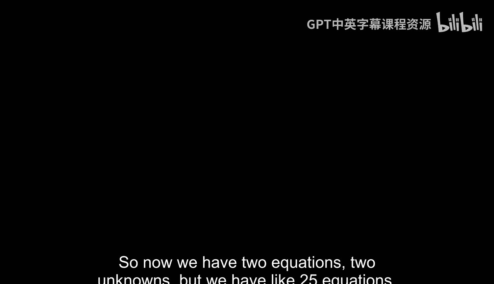

I wonder if it's RGB， it's even better， right？How do we solve it。Well， we can basically list squares。

 right， Now， this is called the Lucas cannaati method。

 but it's basically just really just you write out of least squares。You。

 you write out your E squares formulation。And this is the equation that you get。O。You solve this。

Matrix equation。And this is the least square solution to get your U and V for these guys。Now， this。

Should look familiar。Anyone recognizes this， this， this friend of ours。What is this？

It's the second moment matrix。 It popped up here again because it's actually what we're trying to solve here is。

 is very similar things。 So remember， the temporal aspect of the problem is all here。 The， the。

 the I T， the difference between the frames is's all here here。It's just the。The single image stuff。

 the appearance of a single image。And it' basically serves a very similar role。

 It's telling us whether。Whether we can compute。The flow。

 and how do we know if we can compute the flow。If the area is like a corner。

Because that's when we can solve that problem， okay。So if you look at the conditions。

For when this thing is solvable。A transpose8 needs to be invertible。It should not be too small。

 due to noise。What does it mean， It means that the eigenvalues。Lambda 1。

 Lada 2 should not be too small。 They should both be large。 Okay， and it should be well conditioned。

Look at this。 These are all the same conditions that we have for making sure that this is a corner。

 okay。This makes a lot of sense。 It basically makes sense because it says， look。

 if my window that I'm looking at。If that window is。

Has enough info information in in multiple directions。

 I should be able to find where it goes in the next frame because I have enough information。

 Then I can solve this。 If it doesn't， if it's a flat thing or if it's a boundary。

 this is under constraint， and I cannot solve this， okay。

So it's indeed exactly the same information that we need here to solve this problem。

 But it turns out that。This same equation。The same matrix。Is can can fit this equation。

 and you just solve it with these squares， and you get your。UV。And。And life is good， okay。

So here are some examples of the kind of points where we can compute optical flow。

And the kind of points where we can， right， corner we can。 This thing。

 we cannot because it could be anywhere。And there you have an aperture problem。 You can compute flow。

But only in one direction。Perpendicular and the other direction， The other dimension is unknown。你该。

And so here is another example of how。How these， these second moment matrices look。

 If they look like a line， you have this kind of a crater that's not good。If it's flat。

 it's also no good。 This our friend， the little。Little whole donut thing， right。

 That's what we were looking for。 That's when you can really compute optical flow。 So again。

Kick interest points。And optical flow turns out to have a lot of similar math。And now。

 you basically just solve。For。Okay， I'm gonna skip。Solve for， for， for U。 The only problem。

 if you remember。Is we made this silly assumption the very beginning that the U V is very small。

Les than a pixel。Now， in real life， that's not gonna happen。In real life。啊。Less than a pixel is not。

The actual movement is more than that。So what are we going to do？What are I going to do it。 Oh， O。

 this is actually sorry。 This is， this is an example of。Computing， optical flow。

But what we are going be doing。Is we're going to basically throw it into a pyramid once again， right。

 And so we are going to solve for optical flow at the co level。Wp the image。

 according to the optical flow。 So again。Wp again， So again， Warp again。

 and then solve finally for the final thing。 And that is how we are going to。

Solve for our multiy scale optical flow。 Okay， this is a method that is still being used in practice。

 and， and you can try it。 Now， you know all the details。Okay， I think I have。One question。

 two questions， Any questions。Yes。Well， you basically， you couldn't do the the stupidest way。

 which is basically every， every pixel has has a vector and you just throw send it that way。

Remember when we talked about inverse， inverse mapping， though。

You probably basically just do it the inverse morph morphing。

And it includes some sort of a smoothness constraint。 right， So the you get some smoothness in there。

 So that's， that's how you do。But we already use the smoothness constraint once。

 so it makes sense to use again。Alright， see you next week。Oh no， Wednesday。 sorry。

 See you Wednesday。啊哼。😊，No， no， because once you do least squares， if it has even one outlier。

 it it will， it will poison the well。 It will it will poison everything。 So， so you just have to。

 you can only do least squares。

When you know that everything is an inlier。

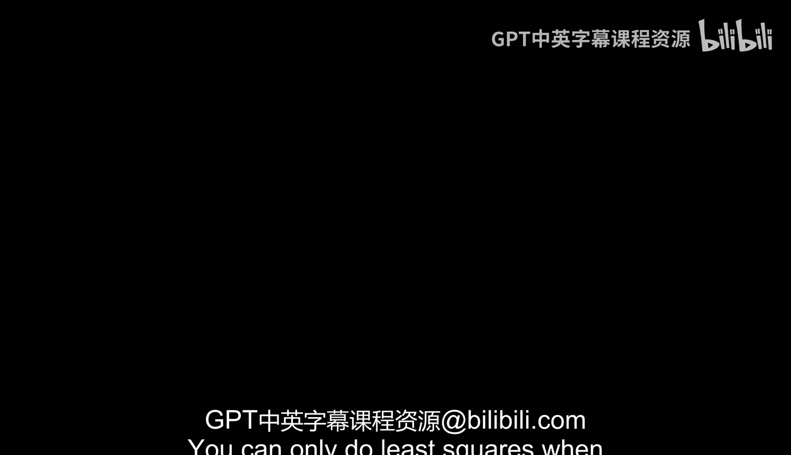

Like once we do these squares doest not give us an。

