# UCB《计算机视觉与计算摄影学｜CS 194-26 Computer Vision and Computational Photography 2022》中英字 p14 -P14-14-Visual Texture (in human and machine)-10_12.zh_en -BV1w7UfBdELA_p14-

Okay， so。ACouple of minutes。 It's a pretty quick quiz。If you need， we have a few paper copies here。

A low stress quiz， hopefully。As much as quizzes can be stress。Mhmm。😊，うん。Alright， look at this。Still。

 some latecomrs。We have some paper versions up on the front。Nope。Alright， talks。60 seconds。

 And we're gonna start。啊。不是。Right here。Alright， folks。Hopefully， everyone's done。Yes。Last。

 last minute。 Last chance。啊。😮，I have some paper ones。 Do you want a paper one。Here。Allright， okay。

 good。Okay。Today。We are starting a new topic。We are going to。Well。

 we're going to start talking about。嗯。Learning and deep learning in in particular。

 But we are going to start。From a different angle， we're gonna start from afar。

 We're gonna start from the motivation for deep learning。

 And I know that a lot of you have taken you know 1，82 or 189。

 And so you should be already familiar with a lot of the concepts。

 but probably or maybe you're not familiar with some of the motivation。Okay。

 so this is going to be the motivation。 It's one of the motivations。

 It's the one that I particularly like。 And the motivation is texture。嗯可。So what is texture。

Teecture is a type of visual data。All right， folks。All right。啊。😮，Sorry。Tectture is， is。

 is a type of visual signal that's repeated spatial。 It's a repeated signal。 It's something that is。

The explore is a pattern。 Okay， so these three examples are all examples of texture。Raddishes， rocks。

 yogurt， right。And one way to think about texture is when you see something that is。Not。Not。

one particular thing。 But there is many of the same when you talk about， you know， a bunch of rocks。

 a bunch of reddishes， you know， I guess a bunch of yogurt。 that's。

 that's a sign that you probably are dealing with texture， okay。And。Thatcher is actually a very。啊。

Very prominent in， in real visual data。 Okay， Ted Adelson， the the greatson of the， of the。

 of the pyramids， for example， he talks about visual world being dis split into two parts。

The stuff and the things。 Okay， and basically， texture is the stuff， right， T is。

Whatever remains after you named the， you know， the cars and the trucks and the pedestrians， right。

 And so you can see in this， in this image， for example。

 a lot of what we are looking at is actually texture。啊。For example， the， the the。

 the reflection of the， not the reflection， but the the shadow from the trees up on the river。

 this mass of greenery here， right， you cannot talk about every individual piece of， of， of grass。

 It's just grass， right， or it's just leaves。 It's， it's that stuff， okay。So why， why do。

 why are we interested in this。Okay， and， and textures are materials also。

 So why are we interested in this， Well， because。In a sense。Texure is like big data in a miniature。

 In a sense， it's like you have in a single image。You have a lot of what we now tend to call big data。

Right， you have many patterns that happen in the same place。 Okay， and that's kind of。

This leads to the， the field of texture analysis。 and the texture analysis is basically a big question that that texture analysis wants to answer is the following。

You have a couple of samples of texture。😡，And， you know， there is a。

one possibility is that they are drone。 Oh Oh no no。To bit automatic。

That they are drawn from the same infinite texture up in the sky， right。

And the question we want to answer is， are they actually drawn from the same texture sample or not。

Okay， and this question actually is， is very hard work。It's a very hard question。

 If you can look at this， this example。Samples of texture here。How do you answer this question？

 If you compare these images with， you know， SSD， L 2。

 whatever distance metric that we all know and love， they're all going to be very， very different。

 right？ because the， you know， the rock， the the bricks are different。 The placement is different。

 The shifts are different。 and a lot of things are different。And yet。

There is something about it that says， it's the same thing。 It's the same texture， right。So this is。

 is a fundamental。Fundamental problem that will lead us to things like object recognition and categorization and all that stuff。

 It' actually this very problem， something that on the pixel level looks very different。And yet。

 somehow。We know that it's drawn from the same distribution。 Okay。

 so this is going to be the problem that we are going to start with attacking。

 And then we'll see how that problem turns out to be。Other problems， too。Now。

 when we talk about texture， we cannot skip。Talking about Bella Yulish。

Beli Eish is a Hungarian psychologist。Who。Who really， you know， he definedian。Several fields in， in。

 in， in visual perception。 Unfortunately， he died， you know， a decade ago， but。You know。

 late 20th century， a psychologist， you can see his， he's depicted behind。

The pattern that is a random dot stereogram。 And that's probably because do I have a picture。 No。

 I don't have a picture。 You've probably seen this before。 It's very famous。

 You have two random dot images， and then you try to kind of。Focus your eyes。

 And then you are gonna see a 3D object from those random images。 Anyone seen this before。Anyway。

 that's what he's most famous for。 But that's not really his， his key contribution。

 And his key contribution is really starting to think about sexual analysis from a scientific point of view。

啊。Before， you know， I cannot skip this wonderful anecdote about， about Bly Eish that I think kind of。

Illustrates a lot about what science is about。 So today。

 we'll have two wonderful scientific anec dootes。 The first one is about Dliioche。He。

 he was born in Budapest in Hungary。He went to a mathematics high school in Buapest。He was。

When he was finishing the high school， his father asked him。 So， Ba。

 what do you want to do after school？ And Ba， you wish said well， I I， I。

 I want to be a mathematician。 I'm good at math。 I think I could be a good mathematician。

 And his father said， yes， okay， this is good for a Hungarian mathematician。 Yes， very respectable。

 but。Are you any good。I why I think I'm pretty good Okay。

 but are you at least the best in your class， Because， you know。

 if you're not the best in your class in mathematics， it's gonna be hired and hard。And then Ba said。

 well， I'm pretty good， but I'm not as good as Johnny。 Johnny is just really， really awesome。😊。

And then his father said， well， you know， B， if you， if you're not even the best in your class。

Maybe you should go do something else。 And， and Bell listened to his father。

 He became a electrical engineer。 Then he went off to America。

 and then he started getting interested in psychology。 and then he became became one of the。

 you know， great major psychologists of the 20th century。 And， of course。

 the the punchline of the story is Bella is， is that Johnny was。John Vanon Neuman。

 who just happened to be in the same class。So imagine if John Vanon Neuan just happened to be a year younger year older。

 you know， we would probably have one more。You know， good Hungarian mathematician。

But we wouldn't have Di Yuish， the great inventor of texture。 So I think sometimes。You know。

 sometimes randomness is actually good for us。 and sometimes。

 sometimes something that that feels like a failure may， may turn out to be a success。Okay。

 so what is it that Jewishish actually did。 So what he was really interested in。Was。Figuring out。

When do patterns。Feel recognizable and jump out at you。 And when it's theyre very hard to recognize。

 So in this pattern， in this， in this image， there is a a set。 There is。

 There is a area that is just jumps out at you。 At least it jumps out at me。 It's this area， right。

This little area is very different from the rest。 You see that。OK。

Even though it's basically it's the same two lines。

 except that they are made it into cross versus making it in in the like a gamma symbol。 Okay。

 now there is another region。That is different in this image。And it's， it's， it's very hard to tell。

 So I actually had to put a little box so I could notice it。Do you see the difference？

 It's very subtle。It's little teas instead of gammas， right。But this。

Unless you're really staring at it。It just does not jump out of you。Even though， you know。

 the same amount of ink is being spent on on， on this one versus this one versus that。

 But this one somehow feels different。 It， it， it jumps out whereas this one does not。 Okay。

 And so Eish was really interested in what is， what is going on here。Okay。

 and so he did a number of the psychophyical experiments。Where he would， So you can do it， too。

 You can look at this focus on this dot here and then see as fast as you can。

 One thing that's not like the others。As fast as you can， can you see it where。This one， right。

This one is just different from everyone else。 You do it basically instantaneously。

 Like as soon as you look at it， boom， it just jumps out， right。

Let's do it again with a different figure。 Are you ready。Same thing。

 Who is the first one to to find it。啊。😮，喂。All right。 This one， right。This one is different。

But do you feel like this is work。Like， I can feel like a double nested loop running in my brain。

 right， I like really have to go like line by line， right， It just doesn't jump out。Okay。

 and so Eish was really intrigued by this because， again。The amount of ink is exactly the same。Right。

 so it's not like one is bigger than another。 So what's going on。O。And so。He proposed。

This idea that human vision operates in two regimes。Okay。

 there is the preattive regime and the attemptedtive regime。

Preatemptive regime is this instantaneous parallel feet forward。Within 100 milliseconds or something。

 okay。That just。Jumps out at you。 And it's independent of the size of the， of the。

 of the data stream。 like it just no matter how big the thing is like。The。

 the right thing is just going jump up， okay。Attemptive vision。Is a much more laborious， it's。

You know， it's， you need to turn on your attention。And it basically happens much slower。

It includes multiple scades moving around your and it's， it's， it's。' it's serial。

 You you are really just scanning the data。Scanning the data laboriously， attentively。

 consciously processing it， okay。So for those of you who read。thinking fast and slow。

This is very much connected with the system 1 and system 2 of of Hanan's book。

 But this is actually watch earlier。嗯开。So he basically。Divided the， the， the。

 the perception into these two。These two， these two areas。And。Basically。His argument was that。

A lot of what。A lot of the kind of the first impression， the quick vision that that we are doing。

Is in the preattentive phase。So。A lot of what we see。Happens very， very fast。

Without us even kind of consciously thinking about it。嗯该。And soon enough， he got。

He got some confirmation from Simon Thorpe and colleagues。Who showed。That。There is an amazing。

 amazingly powerful experiments that can be shown that humans。😊。

The amazing task that humans can do at a very short。Period of time。 So in this particular experiment。

They。They showed humans a series of images， one after the other。Very， very fast。1 50 milliseconds。

 It's really boom。 It's gone。 It's really， really fast， okay。And their task was a binary task。

 So really， the limit was like how fast you can press the button。Then the task was very simple。

 Is there an animal in this image or not， the animal could be anywhere， really， Okay， so the task is。

 is there an animal yes or not， okay。And。Amazingly。People were really good at this task。And when you。

 when， often when they， they interrogated them and they asked to say。

 where is the animal They couldn't。 They couldn't show。They knew there was an animal。

 but they couldn't actually pinpoint it until they actually like scanned it and actually found it。

 But they had。 they could make the decision， okay。嗯。And， and so this， this was。

 this was pretty impressive。嗯，可以。And so。Basically what。

 what what Eish conjectured was that there are certain patterns。That are discriminated statistically。

On， on， theyre not being looked at you know， every pixel at a time。 They。

 they're discriminated on the。On， on the basis of some summary statistics。

 you basically look at kind of the average of some features。And you're able to make a decision。

And his argument was that。Things are preattentive if they have the same first and second order statistics of some texture features。

 He called them texts。 Okay， and only different in their third and fourth order statistics。 Okay。

 now this is turns out not to be quite correct。 And also。

 it's not clear what those texture features are。 But just for historical you know， appreciation。

 I just kind of give you a little bit of a feel for what this means。 So here's， here's two textures。

 And hopefully you can see a very strong boundary between them。

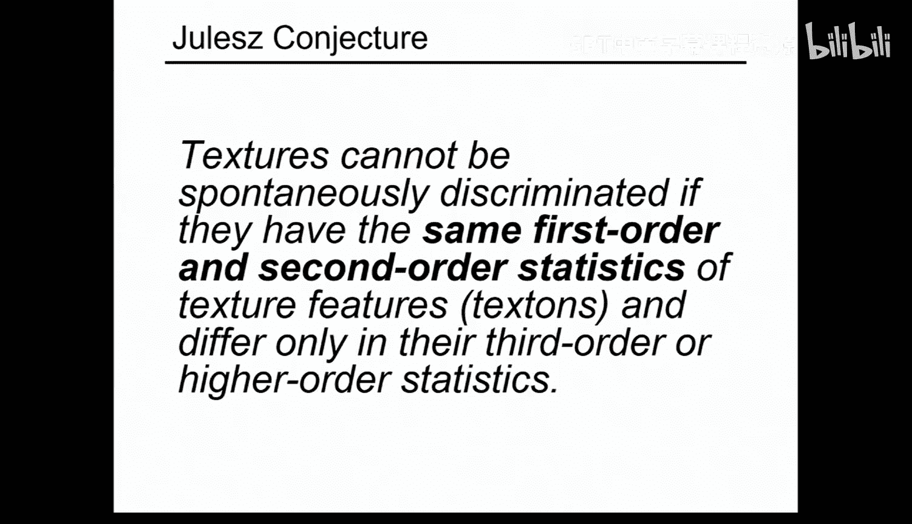

And。They differ。In their first order statistics， they're basically， they differ in。In how much。

Area is taken of by， by the。You know， the， the， the。

 the features in the first one versus the second one。 So here it's 5% white here is 20% wide。 Okay。

 and it's very， very easy to， for us to。To distinguish， right。

So this is first order statistics being different。Now， what about second order statistics。

Something like this here， the first total statistics are exactly the same。😡。

But what's different is the second order statistics。 It's a relative。

 It's pair wise Staistic of pairs of， of features are different Here。

 they are basically equidistant and here they are run。And again。

We humans can very clearly perceive a boundary between them。And Yulicia's argument was。

 and I should really have the figure with the third order statistics。

 is that by the time you get to the third order statistics。

 humans are not really able to tell the difference that it becomes， it becomes too hard。可。Now。

 that's not actually completely true， but it's， it's close enough to being true to be。

 to be an interesting finding。Okay， but I think， fundamentally。

What you want to remember about Englishish。Is he really kind of。Was the first to say that， you know。

 vision has a strong statistical component。It's not really kind of counting every pixel。

 detecting every blob， detecting every pedestrian or every animal。A lot of worship。

 what vision is doing。Is computing some statistical。You know， average is some。

 some statistics of some data。And looking at at the kind of the， the。

 the statistical properties of the data。 Okay， so summarizing the data in in。

 in terms of some statistics。

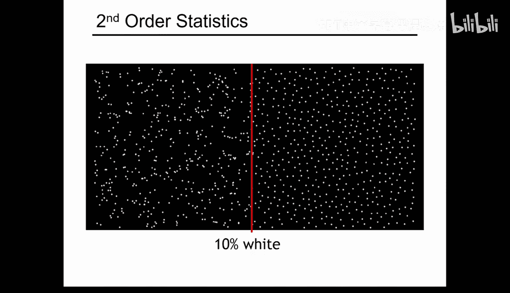

O。So， of course， the， the big question was， what is that statistical unit that he called textile Ton。

 right， What， what is it actually is， Because he doesn really didn't。 He didn't provide an answer。

 In fact， he never never really used any real images in his research。

 He painted all everything by by hand。嗯该。So， for that。It might be useful。To go to。

For another leg of our historical scientific journey。

And ask what was happening around the same time in neuroscience。Okay， so Eish was in psychology。

 I mean， he was in double E。 and then he kind of migrated to psychology。

 kind of really found his way at around the same time。

The neuroscientists were busy figuring out what is it that we are。Seeing。

Once we get visual data into the roads and cones。Right， what is the Oh， any questions on on。On yish。

 so far。Geting excited that forget to ask questions。All good。All right。Yes， so what remember。

 there are the rods。 There are the cones here。 And then there is a whole bunch of wiring and a whole bunch of cells。

 And those cells are computing something。So what is it that they're computing。

 It was the question that the neuroscientists were very， very interested in in figuring out。

 And they got， you know， they kind of figured out what the what。

 what the cells in the retina were doing。 So there was。三。😡，These bipolar cells。

 and they were also connected to these horizontal cells。 So the bipolar cells were feeding forward。

 The horizontal cells were connecting nearby neighborhoods。 And then there was the bigger ones。

 the the ganglion cells。

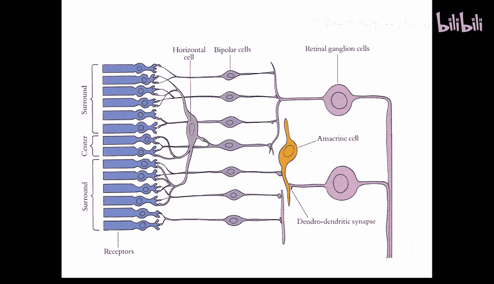

And， and so what they were。What they were doing， they wanted to see what。

 what those cells were doing。 And so they used what's called single cell recording。 They would。

 they would find a cell。 They would stick an electrode。

 and they would basically listen in to how that cell was firing。What was the pattern of the firing。

 And usually， they would actually connect it to a loudspeaker so they could hear it as they are doing it instead of looking somewhere。

 they， they， they listen to it。O。So that's， that's how they were working， okay。And。

And they did the same thing in the visual cortex。 they figured out what their， you know。

 the cells in the retina。 and they say， okay， now let's do the visual cortex。

Show some stimulus to the eye， usually anesthesized cats they were using。

 and then see which cells were。We're firing for the different patterns， okay。And so， what they found。

Is。That。There was。There was this interesting structure。To， to a lot of the cells。

 the early cells in the retina， as especially， you shine a little bit of light。Well。

 it kind of fires， but not that much。You shine more light。And fires more。OK。You shine more light。

And it goes down again。So。And you， you shine even more。

 And basically basically like just doesn't fire at all。So what do you think this thing is doing？

What does this sell。Most sensitive to。杨。it is differences， but it's。

 it's particular kind of differences。 It's， it's spots。It's basically looking for spots。

 It's looking for differences。 That's true。 But there are differences that is in circles。

So it's basically a spot detector， or they came up with a slightly more fancy name on center of surround。

O。And you can see that， you know， making it bigger is just not， not going to help。Okay， but actually。

 the the absolute worst thing you can do for a spot detector。Is， is like shine。

 shine just in the around and nothing in the center。 So that's kind of。

 that will basically just shut it， shut it off completely。嗯开。And so this， this， this。

Offf on center of their own cells。There are basically。Looking for spots， this is the kind of。啊。

Horizontal slice of what they were looking for。 They really like stuff in the center。To be high。

 these things they would like to be low。That should start to be familiar， maybe， right。

Little bit like a gradient deal， you know， partial you know， partial derivative。 if。

 if you just look at one of them， okay。嗯。They also find the opposite cells。

 The off center on surrounds because basically exactly the negative of those cells。 They also exist。

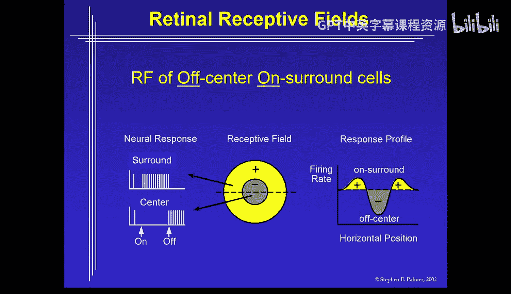

O。😊，And so those were basically these， these， the ganglion cells were basically doing that。 And。

 and the theory was that these horizontal cells and these the， the， the。

I guess these ones in this were kind of similar。 these were discrete and this continues。

 but basically。These， the， the horizontal cells give you the。The wide negative lobe and the。

 the other ones give you the positive lobe， right？ And so this is kind of one possible way that this thing could potentially be implemented in hardware。

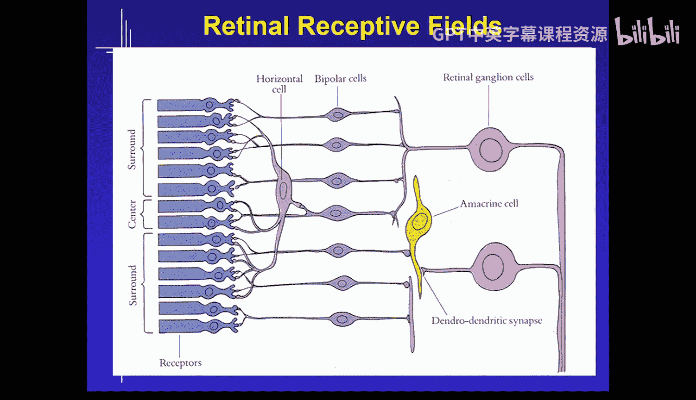

Is you have your bipolar cell。It gets feeds from the center of the， of the blob。Okay。

 that's where you get your little Gaussian。And then the horizontal cells are looking at the the， the。

 the surround。And it's being negated。 It's giving you the， the down step。

And then you get them together， and you get。Our dear friend。There a blessing of。Okay。

 so there was the pleasure of Ga since。 They didn't just come up out of thin air。You know， this。

 this was all kind of connected。

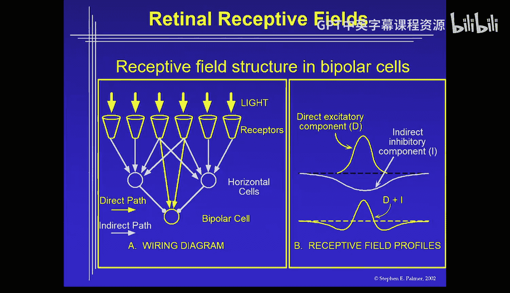

你开。So， that's basically。That was kind of why。Why， you know。

 Laplian of Gaussian or a difference of Gaussian has been。 I'm okay。

 it these things actually have did happen kind of in parallel。 But once they knew about each other。

 they got excited because， oh， you know， similar things are coming out that that sounds good in science。

 when two different branches discover similar things that's usually a good sign。你开。And， you know。

One thing， probably good to mention here。Is the idea of a receptive field。 Okay。

 so what is a receptive field。A receptive field is， basically。

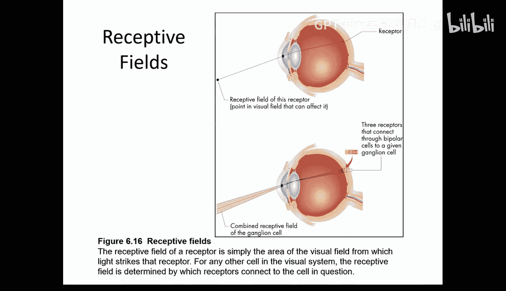

I think it's easiest to， to think about it in this diagram。So， a receptive field is。How many。

Receptors， rods or cones。Are feeding to a particular cell。O。So the。

 the receptive field of this horizontal cell。Is4。Right。The reive self of this bipopolar cell is what。

啊。3 or 6。It's 6 because you need to go all the way to essentially the receptors。

 essentially the pixels。 right， So there is the receptive field of any in any cell。

 anywhere in the visual cortex。You have to basically go all the way down and see how many receptors。

Ever get connected to that cell。 Okay， so the farther down you go。The larger the recepts。

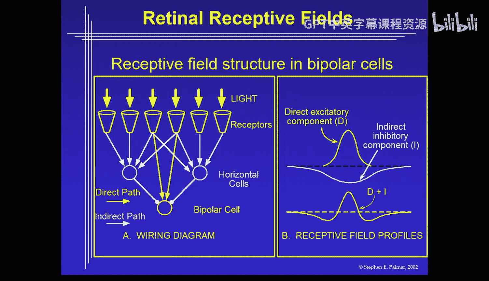

The receptive sites， okay。AndSo here you can see the receptive fields。

Of the receptive field of a one receptor is very tiny。Essentially， like just a pixel。

 But a receptive field of like a ganglion cell is actually， you know， quite a bit bigger。

 So because it sees larger area。And the farther down in the visual cortex， you go。

 the bigger and bigger receptive fields are going to be。 And you go to something like V 4。

 And the receptive field is basically going to be almost the whole image。Okay。

 because they just gets connected to everything， okay。Any questions？So what is the receptive field。

Of。Of， I don't know。The lapplian of Gaussian filter and from your homework， whatever。

Do homeworkmark ago。What is the receptive field then？嗯。What a receptive field of any。

Any filter that you' are convolving with。呀。Yeah， size of the kernel。 Ex。

 that is exactly the receptive field。If you're applying it to the original image。Now， later。

 we are going to see how we can。You know， applied convolutions to convolutions to convolution convolutions。

 And then it becomes more tricky。 But so far， we have only applied convolutions to， to images。

 And then it is really just the size of your kernel。Very good。Other questions。O， so what happens。

What happens why， once we leave the eye？ So here are our two eyes， This is the visual panorama。

There is actually some split。 Half of the eye goes one way to one hemisphere。

 halflf of the eye goes other， except if you're albino like me， in which case。

 you don't have the split。 I don't know why。 but eventually you go through this L GN。

 the latter genetic nucleus， where this is like the pre brain。

 This is where the optical flow happens。 This is where the f frogs basically just have that。

 But then we are better than frogs。 So we also got the visual cortex。Visual cord is right here。

 right in the back。And the radiocorus actually has multiple layers there。 The first layer is V1。

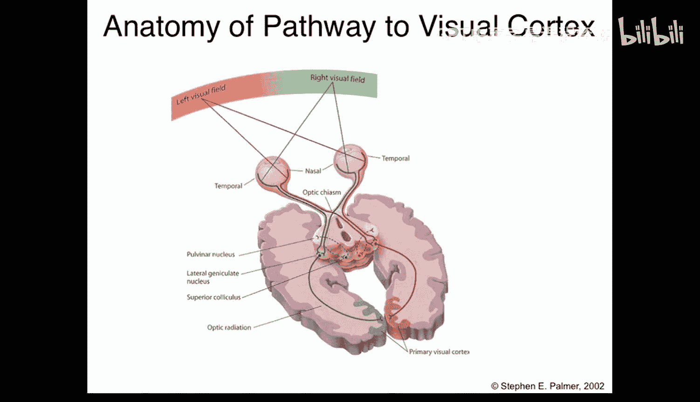

Okay。And this is the first。First station where the signal from the。

 the visual cor from the from the optic nerve arrives to the to， to the brain， okay。

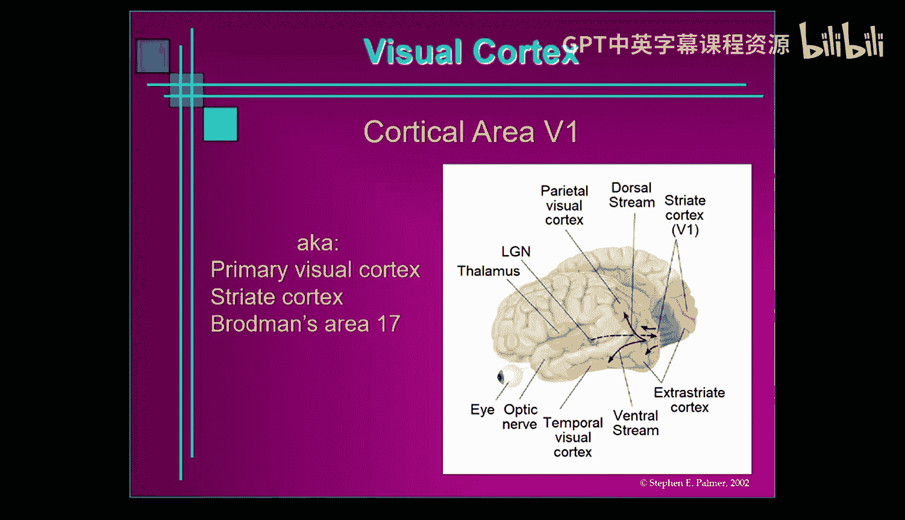

And。And nobody knew what was going on there。So。We knew that the， the。

 the spot detectors the on on center offs around。 and what you know。

 vice versa were happening in the， in the， in the retina and also in L GN。But once it gets to V1。

 once it gets into the visual cortex。Nobody had a clue。And， and this is the story， another。You know。

 great scientific anecdote。 This is the story of， of how of these two gentlemen。

W a Nobel Prize in about 20 minutes。Figuring out。What the visual cortex， what the V1。

 at least of the visual cortex was doing， okay。So。Hubil and Vi。

 they were very interested to see what was going on。

 They would decide they're going to use single cell recordings， just like in the in the I and L G N。

 So they would。😊，Show。A stimulus to an anesthesized cat。 They would pick a cell。

 They would listen in， and they were basically looking for the cell to get excited。

Because then they could think， oh， okay， this is a solid that detects spots， for example。And。

 you know， moved it around。And it wasn't really doing anything。And， and this is where。

I think kind of another lesson comes in。When they were， you know， if you get some weird data。

You could just say， oh， this is a wrong sell or this is something weird。 And anyway。

 it's really late。 It's like 10 PM it's time to go home。Or you can say， oh， wait a minute。

 Let's stay half an hour longer and try to figure out what's， what's this weirdness。

And if you stay hour half for an hour longer， sometimes you win the Nobel Pri。 Okay。

 so I'm not going to tell you。What happened。I will try to， try to have your guess。

 and I will have actual。

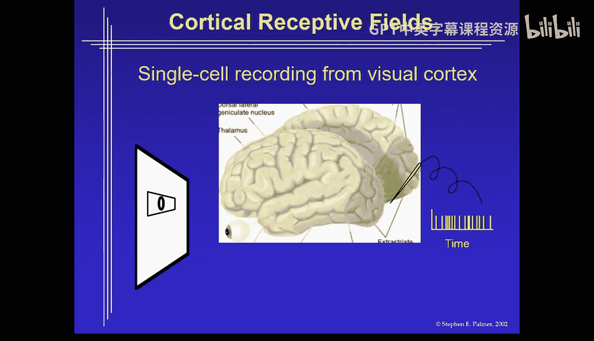

You can have the actual video。From。Hubbo， I think。Telling us the story。Now。

 is this going to actually work。It' not gonna to work。

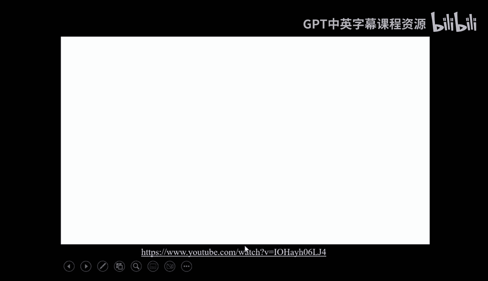

嗯，一该是根呢。We can do this。The research。说了一类。🎼you can。Okay， let's， let's see if it works。 I I sorry it's。

I don't know how to make the sound work in。嗯可以。The researchers actually listen。

Individual nerve cells， firing and the。theized。They presented it with different visual images。

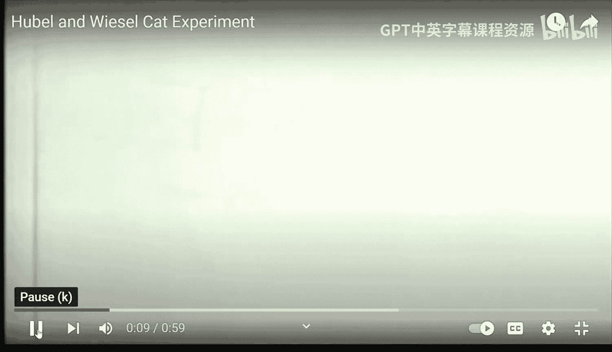

When we started。こしトの。50s。We set up our first experiments。They didn't go well， because。

Make the cells fire at all。 We'd shine lights all over the screen。And nothing seemed to work。

Rather by。Day， we were shining。コスパ？Either white spots or black spots。OnTo the screen。

 And we found that the。Back do。To be working。Anyone guessed what it was。呀。No， not movement。

It's that line。 We found it。Was the process of slipping the piece of glass into the projector。W。

Swept the line。Very faint， precise。A line across the retina。And every time we did that。

 we'd get a response。So， that。

哇。

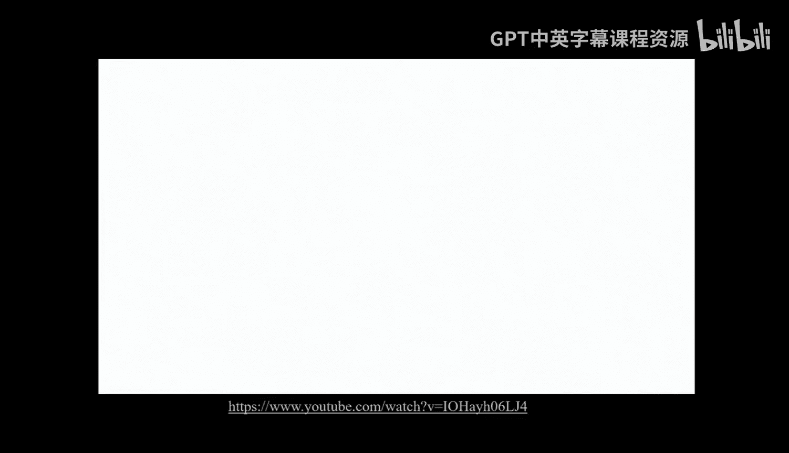

仕上げやがった。no no， not Joe Galen and my sorry。No， no， Jack is great。 Jack is great。

 but just not for today。Where did it go。helello。O。觉得。😔，哦，对。I have to present again， I see。

But now I need to go back to。There we go。

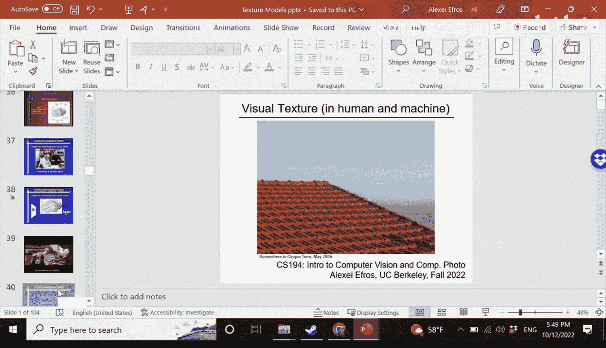

Okay， so， right。 So basically。What we saw， what， what they discovered yeah。I don't wantna。 Ands here。

 So I don't want to upset her。 but yeah， yeah。It actually doesn't hurt。 We， we don't have any。No。

 I look， that's， that's why they do， you know， when they do they do like like brain surgery。

 they don't， they don't anesthesize you。Because it there is no。

 there is no pain receptors in the brain。 They did anessthesize the cat so that the eyes would move。

But no， they， they put the cat back together。 So it's， it's they。They， they。

 they don't actually have to sacrifice the yet。At least that's， that's what I was told。Yeah， any。

 any other questions。Right， so， so， so basically， that was just an amazing。Amazing piece of luck。

 right， They basically had their nobel Pri that very evening， because what they， they， they realized。

😊，Something was weird。 And instead of going home and say， okay， you know。

 we'll find another cell tomorrow。They they， they， they， you know， they debugged， essentially， right。

 They debugged until they realized it was that。That edge of the of the， of the plate。And it was。

 it was particularly lucky because。It's only particular orientation。

 So that cell only fired when it was， when it was was swept with this angle。

 If it was like this angle， it didn't fire。收。😡，Great work in science。 What are the two ingredients。

First one is luck。But the second one is just as big。It's noticing when you're lucky。Not letting luck。

 you know， run away from you。So this is， this is science for you guys。It's， it's really。

 there is a huge amount of luck involved。And really。

 your only job is to be attentive and notice when you are getting lucky。 Don't walk past。

 That is the worst thing you can do is you get lucky and you don't even notice it。O。So they did。

 They got their Nobel Prize。They discovered。 and after that， it was all just smooth sailing。 right。

 after that evening， that's it。They have， you know， they discovered the simple cells。

 the complex cells and the hyper complex cells in V1。 And what are they。

 They are cells that are sensitive to liness。 They are line detectors。 They， they basically。

 they're like spots， but oriented。

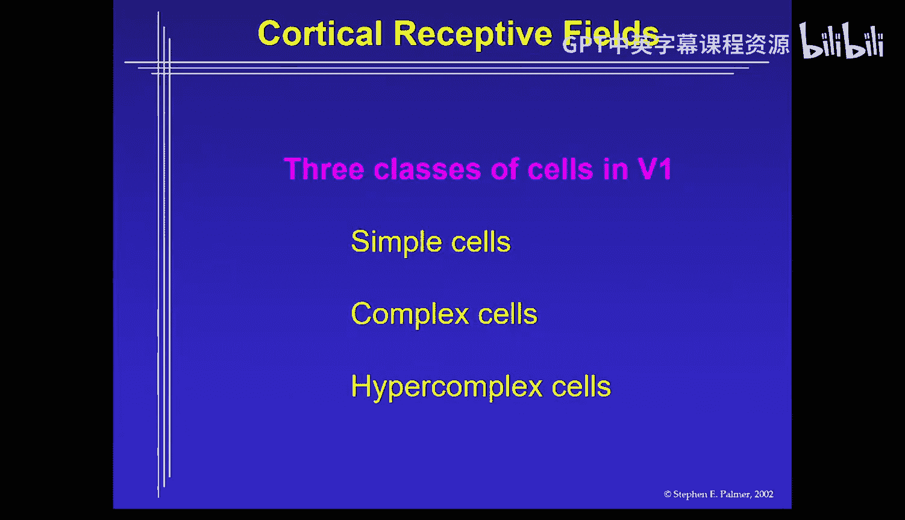

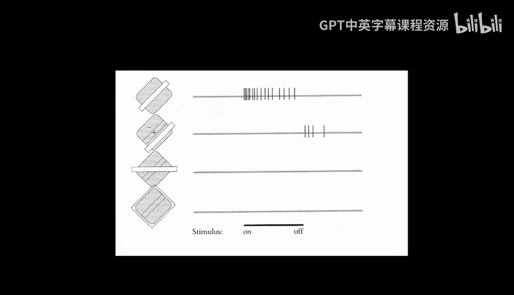

So here is a couple of， couple of simple cells。 So there is a line detector。Right， so it basically。

 it's essentially the same kind of thing。 But instead of being circular。

 it's a linear of a particular orientation。 And you have the negative of that。

And you also have edge detectors。 Okay， the edge detectors don't need you to be aligned that they。

 they basically just looking for。Kind of one， you know， a derivative change， right， But again。

 oriented in one and linear and the other questions。Any questions，There。No， no， no， no， this is。

 this is already in the brain。 This is visual visual cortex is right here。

This is the first level layer。 The one is the first layer of the visual cortex。

 There's a bunch of layers there。 And this is the very first one。In fact。

 what happens in like V 2 and V 4， Nobody actually still doesn't know。Okay， but。

 but this was figured out in the 50s。嗯该。How is it made， Well， again， we don't actually know。

 but kind of a。A natural wiring diagram would be something like， well。

 we already have ganglion cells。 We have our spot detectors。 Why don't we connect them in a line。😊。

Okay， and sum them up。 And there you have your， your simple cell made up of a whole bunch of spot detectors。

Bed in the particular geometry。 in this case， I。Why line。Why not a circle？ Why not a curve。 Why line。

 so some。No， some people flow there， anyone。You guys from the back。

 I want to hear somebody from the back， but I don't see you。 So you just shout， yeah。So个ま的。Okay。

 but what about， why not the circle， Why not the half， like what， what is it about a line。

This is evolution or this is discovered by evolution。 So think about what。Like。

 what is evolution1 to understand， E wants to understand the natural world。有。然。They don't。They don't。

I mean， I know on campus most of the trees are kind of crooked， but。I mean。

 lines occur a lot in nature because of gravity， right。

 because there is only two really stable positions。 If we have gravity。

 It's either your right straight up or you fall down。 Everything else is， you know， not， not away。

 right， No， no， There is actually quite a lot of lines。 the horizon。Right， is a line。 No。

 there's there's quite a bit of lines in nature， in fact。They are。Ecologically plentiful。

 as they say。开有。That's true。 That's true。 But I think what you said that a line is basically approximation of a local approximation of a curve is also a valid。

 the valid argument， yes。

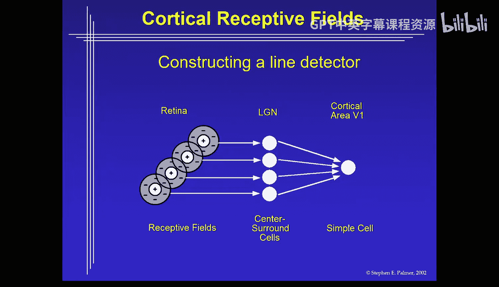

收。😡，So again， where， where we have our dear friend， the Gaussian and the derivatives of the Gaussian。

 and we can make these things。 We can make line detectors。From our Gaussians， right， And this is。

 we already talked about it。 I already explained this。

 We have basically take a Gaussian in one direction。

 one direction and derivative a Gaussian in another direction。And you get an edge detector。

You get Gaussian in one direction and second derivative of Gaussian in the other direction。

You get a line detector， okay。You want to do a little bit of different orientations。

Sicker rotation matrix in front of it， you get it at different orientations。And that's where you get。

Very biologically inspired。What we call filterbank。Of the type of filters。

That are processing information in V1。 So we have different orientations of edges。

 different orientations of lines。We don't need to do the positive and negative because basically。

 you know， you， you get both and it just， you look at the the plus sign or negative sign。嗯。You also。

 we know that。These different oriented cells。They all happen like on top of each other。

 So for any at， at any。呃。Was it called。What's it called the， the the， the， the。

The area that the cell sees is called。啊。Receptive field。 thank you。 Good。 My god。Yeah。

 need to get some neurons there so。For a given receptive field。

There is a set of cells sitting on top of each other looking at the same receptive field。

 and they are looking at the different orientations and also different scales。

 And this is called a hyper columnlum。 Hyper columnm is a column of cells all looking at the same receptive field。

你该。And so， altogether。We can actually model a hyper column。Something like this。

A whole bunch of oriented cells。Different orientations， different scales。And。

 and all looking at the same place。你看。And。What are they going to be doing。How do we actually compute。

 Give it an image。What is the response of all these cells to to an image， What is this。Convolution。

 of course， you， you knew this is gonna to come up。 It's not for nothing， right， convolutions。

 exactly。 Now， some， some filter banks also add the the the spot filters in as well just for good measure because this is。

 you know， there theyre still， theyre still around， okay。And then， yeah， then you can actually model。

How much what is， what is being perceived by the human visual system。By。Daking， taking your image。

这ing啊。A particular filter。Convolving it with the image。And， you know， you get something like a。

 you know， kind of vertical gradient kind of result。

 And then you can do it for the next image and the next image and the next image and the next image boom。

 boom， boom， boom， and you can do it at different scales。And that's， basically。That's basically。

 the model。Of what。Are those。Elements that Eish was talking about in texture。

 What are the kind of features that are being computed， at least， at least in in。

 in the very beginning in V1。But， we know that。Preatemptive vision happens very， very fast。

And so if we actually look at how fast it takes the signal to go from here all the way to visual cortex。

It's actually， you know， we are already close to the limit。 So I。

 it's probably that pre attentive vision does not happen。That far into the brain。

 It probably happens pretty early， okay。So。😡，Now， how can we represent texture with this newfound knowledge。

About what features are being computed。完。People have tried various different approaches。

 And the cool thing is actually， a lot of them work surprisingly well。😊。

So the very simplest approach。啊。Is basically， you know， the undergrads after the midterm approach。

Every time， like， you don't care about the histogram。 You don't care about corosis。

 You don't care like， you want to do the mean and the standard deviation， right。

Because it's thick you know， its， these are the sufficient statistics， right。

 for a lot of distributions。 So that's the same idea。

 Let's look at the mean and standard deviation of these filter responses。OK。

So here is a very simple texture discrimination task。We have three textures， A， B， and C。

We have a little baby Hiler bank。Okay， we convolved。

There filters in this filter bank with all the images。And what we did is we basically here。

 I'm not even doing the standard deviation。 where I just computing the mean。The average response。呃。

Absolute valued， because otherwise， it would be 0， right， because they're。There is 0 mean。

 So absolute value or squared average response of running。These。Filters on these three images。 Okay。

 and now this is， this is your， your other quiz。Not great at this time。There is three， essentially。

 these are， these are histograms。 You can think of it as a one dimensional histogram， right。

 So this is the set of filters， and this is the set of responses。Of those filters to。

 to the images A， B or C。So look at 1，2，3， look at A， B and C。 And I want you to match up ABC with 1。

2，3。So。Let's start with one。 Which image do you think one， the histogram 1 should correspond with。BY。

Very strong， very strong signal for the vertical， Pret much zero signal for a horizontal。 Very good。

 What about2。C， right， because there is still a little bit of vertical signal， But actually。

 a lot of it is a little bit tilted， which is exactly what happens here。O。And。3， well， by， you know。

 by pigeonhole principle， it has to be a， but it's basically， you know。

 there is not really that much signal。 There is a little bit of horizontalness。

That actually goes comes from， from。Gavity。Things fallen down， right？

 So there is a little bit more horizontal。 In fact， you will notice this is actually a good。Trick。

 you can， you can play with， right。You啊 you run。You run either a Fourier transform on an image or you compute these filter banks on an image。

On just any images。 or you take a whole bunch of them and you average them。

And you will see that there is a lot of energy in the horizontal and almost as much in the vertical and much less between those。

Our natural world loves for verticals in horizontal。Because of gravity。O。😊，要。嗯。And， I mean。

 this is on average， right？ So yeah， So for any one particular thing， but。But this， you can see now。

 this might explain how you can tell。If there is。You know， I don't know。

 a deer in the forest versus just a forest。The the， the Simon Thor experiments。 it just basically。

 you see， wait a minute， you know， there's。You know， there's a little bit of horizontal。

Signal there that that maybe is more than it should be in a normal forest。 Okay。

 there might be something there， right， So again， you're not here。

 You're just looking at these core statistics， but those statistics actually could already tell you。

A little bit of what's going on。And that's really kind of the you's contribution to say。

 you know what。maybe a bunch of what's happening is really happening on this stupid， low tary level。

You're not finding the horse or whatever the， the， the， the deer。

 You're really just looking at little changes in the statistics。Other questions。All right。O。受啊。Right。

 so this， this could be thought of a single orientation histogram， as we already said。 But you know。

 we can try to do more。 We can try to get， you know， that was really just a very， very coarse thing。

 Maybe we could get a little bit more juice out of the statistics。

 We can think about marginal histograms。Basically， histogram。

 every filter gets a histogram instead of just an average， you know， mean。Okay。

 so this is actually also a type of。Pyramid related to wavelelets of those， if people remember those。

 But this is。Kind of a smoothie scale filter decomposition。 So this is our filter bank。

 This is the image。 And basically， you can look at。The images produced by。

Convolving this filters with this image。And then， what you can do。

Is you can basically just compute a histogram of every one of these images。Okay， and then this。

 the concatenation of all of these histograms is actually also a pretty powerful。Descriptor。你K。嗯。

Idea 3。Is we can。So far， though， all of these hisogram。

 all these filters are kind of come averaged separately or histogram separately。

 There is no talk about pair wise connections。 So this is like first order statistics。

 What about second order statistics， What about higher order statistics， computing。

Pairwise information between different vectors。And so here we。

 we can do histograms of joint responses。🤧Okay， and。The way that that， that this is done is you。

You compute。You compute your features at every point using your filter bank。 So， for example。

This particular patch。There is some set of responses to all of those。

All of the filters have a response。 So you basically have like a vector of responses。

 If you have like 38 filters， and you have 38 dimensional vector。

And then what you can do is you can just cluster these， these vectors。You know。

 vector quantize those vectors。Hope， people remember K means。Algorithm is basically that， right。

 You just vector quantize your data into a set of tokens， a set of。A clusters。

And the clusters would actually represent different。Different kind of a。Parts of the visual field。

 the kind of the texts。 and then。Every image is just a collection of these textiles， okay。In fact。

A lot of the 2000s。Was spanned in computer vision。With methods like this。

And they were called the bag of wordss methods。 And the。

 the reason for bag of words is because it was related to the bag of words methods in natural language processing and and retrieval。

 where if you want to。Understand an image。 sorry， Well， if you want to understand a document。

What you do。Is you just compute a histogram of all the words in this document and and do the what's called the warordle。

 They call it Wordle now he is， right。And that kind of tells you what the document is about， right？

 Look at this。 There is sensory。 There is brain visual perception。 There is， of course。

 Hu Vias okay that that that that nails it， right， compared to something like this， right。

 China trades surplus， Com， export， input， etctera， right。So that's that， that the bag of words。

Which is basically just histograming。Just histogram statistics of your data。

Was extremely powerful in language。And people thought， oh， we can do the same for vision。Except。

We don't have words， right。Language is easier。 Like NLP people have it easier， right。

 It's just all discrete， It's human defined， It's segmented。 Everything's great。 We just have pixels。

So we need to create words。Well， we can create words by， by clustering byqueuing it， right？

 And this is the idea of a bag of words， of visual words。

Where we kind find a histogram of a whole bunch of these。Of this visual work patterns。

Something like this。 And then。Then we are back to our histogram。 And then we can say。

 this is probably a human because， you know， there is a lot of eye。 There is a lot of skin。

 not that much bicycle。 You know， whereas this is actually a lot of bicycle and not much eye。

 you know。Again。Very simple， not sophisticated。 This is really like。Beag of words type approach is。

 is really just looking at statistics。But the cool thing is that it's so powerful in language。

 And it was actually also。😊，Surprisingly powerful in in。 Okay， so there's another。Example of， okay。

 oh， so what do you do， You know， you， you take， you， you collect all of your。

Vectctors and the vectors， you know， you can use filters。 if you want to be very， you know。

 biologically inspired， you could also just take patches of images。

 that that's also works actuallyly。Then， then you， you know， vicu it， you know。

 using K meanss or something into clusters。And then you represent your data with all these clusters using whatever filter bank responses。

 image patches， maybe even， you know， Sive descriptors or or our friends， mobs descriptors doesn't。

 you know， doesn't really matter。And then。You have your histogram。Now。

 that earlier figure had a very optimistic scenario of like eyes and。

 and saddles and stuff like this。In reality， you don't， you don't get settles and eyes。

 You get something like this。 You get。Essentially， things that are not that different from。

Your V1 Hu and vasel detectors。Which is kind of another kind of cool thing。 You start。

 you start with like just patches of images。 And what you get is you get these kind of oriented bars。

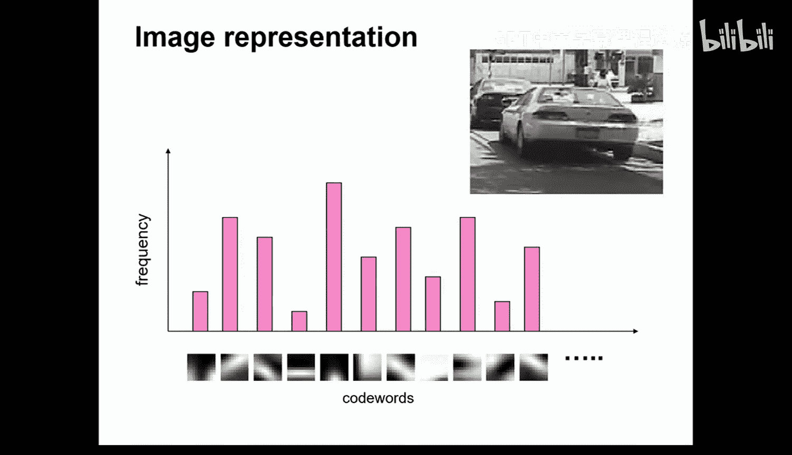

O。And then you can， you can do detection on it。 So this is。

 this is a paper actually out of Berkeley early， I think，2001 or something where they basically。

 they wanted to kind of。Repeat that study of Simon Thorpe with。

 with humans and see if we can get the computers to do something similar。

 So here the task is a little bit harder than the animal no animal task。

 The task here is to classify an image。Into these kind of classes， Beach， mountain， forest， city。

 street， farm， et cetera。but really， really fast。And have the humans do it and then have the computers do it。

 Okay， and the way that the computers were going to do it。Is with just histogram of。

 of these texttons。 So heres a bunch of cluster texts。Given a new image。

 you compute a histogram of you。OrOf these， of these visual words。

And then you find the closest histogram from your data set of。Essentially。

 training images that you have seen before。And the closest image you just steal their label。That's。

Really， really dumb， right， Very， very simple。嗯。But the cool thing is。These are the human responses。

 I think actually， I wasn't。 I participated in the study。This is chance。And this is， oh， no， sorry。

 sorry。 This is the texture model。And this is humans at 37 milliseconds。

 humans at 50 milliseconds and humans at 69 milliseconds。And so you can see that， actually。

Humans at 50 milliseconds。Are actually pretty similar to our very dumb， very stupid detection model。

O。And。And so， and O。You know。None of it was very good。 Like， look， there's 10 classes， chances。

 chances 10%。 So， you know， definitely one could do better。 but it's such a simple statistic。

 It's kind of amazing。 And 50 milliseconds is really， really short time。 It's like done。 right。

 So it's kind of amazing' work at all。😊。

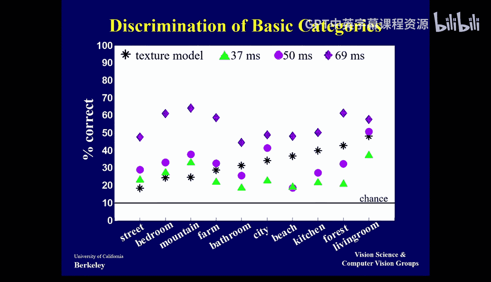

OK。😊，嗯。And。In a way。A lot of what you hear about computer vision。Cool results。

With all of the fancy smanancy semantic segmentation， convolutional neural networks， transformers。

 blah， blah， blah。A lot of it is， actually。Can be done。位置。Very simple。Texture， like approaches。嗯。

This is this is。This is a data set from early 2000， I think， from Microsoft， Cambridge。

 where they labeled every image with。Different regions。And then the task was what they called。

Seecen recognition or object recognition。But in reality。

 what they did was really just texture recognition。 It was basically the same kind of text on。

Kind of nearest neighbor thing。But。Instead of doing it on the whole scene， And。

 they would do it on an area of damage。

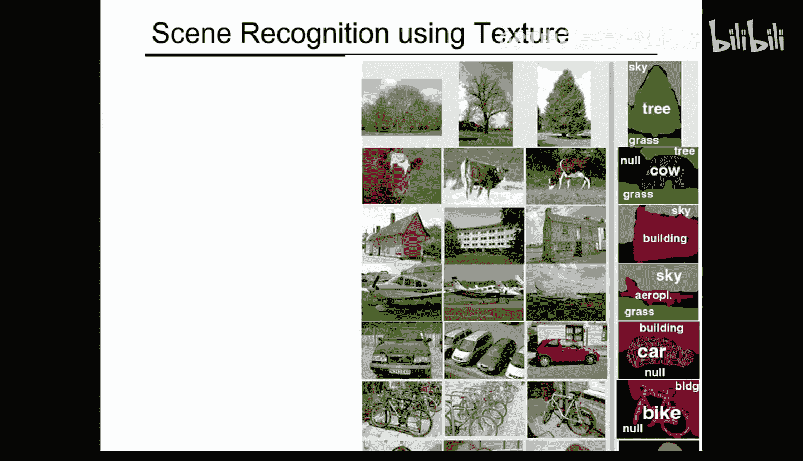

And I have a video。And。It's amazing。How contemporary and cool it looks。 Look at this， cow。Also cow。

 grass。Grass。2001 people。Like， vision is solved。Okay， next time you see these results like in 2022。

 be a little bit suspicious because， look。It's， it doesn't know what the cow is。 It's about cow。

 cow texture。 Does it know that there's one cow or three cows。 No， it doesn't。

 It's looking at statistics。

Let's see some more。Okayで。It doesn't know a bicycle。 It just needs。

 it's looking for some spoke histograms， right， like it， really， see。It's the。

 the operator is actually segmenting the bicycles for you。It's really。

 it's like a little little point is still a bicycle。Right。收。I think it's important to realize that。

This pre attentive texture。Processing， proposed by Eish。Is。Yes是。Very， very powerful。

Simple statistics。Are extremely powerful。In making kind of。Quick decisions。

And you don't want to read too much into them。It's basically。

A lot of data and some very simple features can get you a lot of。

 of the kind of effect that looks very magical。😊，O。So whenever you see a result like this。

What I do is I always show， know， three bicycles in a row。 and I asked them。

 can you tell me how many bicycles there are。And I think even， even now。

Most of the methods will not be able to tell you。To separate the three bicycles。

 because that's a much harder problem。 That's。That's an attentive problem。

 That's not a preattentive problem。

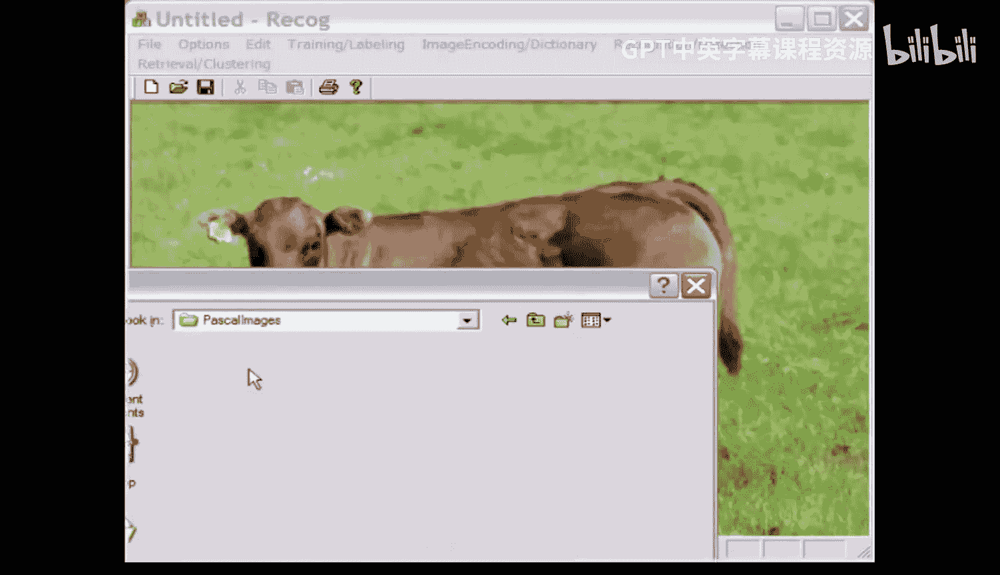

But but realizing that there are bicycles in the image，50 milliseconds， Any human can do it。嗯该。

Questions。有。

Let's go back。 I， I， Yeah， I kind of rash over that。So。You take for every image in your dataset。

 Let's say you have an image， you have like 300 scene images for every image in the data set。有。

Take the image and represent it as a histogram。Of these visual words， of these textstones， these。

 these cluster centers， right。So， I have。That much of number one， that much of number two。

 that much of number 3， then much of number4， etc cea， right。And you use it for all of your data。Now。

 at this time， you get a new image， never seen it before。😡，And you to know what label it is。 Is it。

 iss it a bathroom or a bathroom， right。So again， you represent it as a histogram number of core occurrences in this image。

And then what you do is you need to find the closest histogram to this one。

You're basically just looking for the nearest histogram。Okay， from your data set of like 300 images。

O。And， frankly。L 2 distance is actually not a bad metric， but if you want to be， you know， official。

 the chi square distance or the， you know， cur equilibriumleular divergence is really how you're supposed to compare histogram。

 so you can do that。Find the closest histogram。It's probably this one。Steal its label。

 it's a bedroom done。Very simple。 Does that answer your question。有啊。えワい？Right， so what you do is。

Is you do what。What， what they do in language。Like， if you write a dictionary， how。

 how do you get a set of all the universal set of all the English words。

You just get a whole bunch of books and write down every word that happens in them。Right。

 the same thing here。You take a whole bunch of images。Usually， like100000 is actually enough。

 And you just， you know， vector quantize all of them。 And that gives you a pretty good。

Universal dictionary。 Yeah， yeah doesn't need to be actually that much。 But， of course。

 the more the better， yeah。Other questions。好 good。Look at this。 Yeah right。Qu身子 yeah。Yes。Yes。

 another interesting。Connection， yes。In fact， a lot of the excitement。

About the Huan visualas result was that they looked。Surprisingly similar to， to the Fourier basiss。

 Ex another one of these kind of interesting， interesting connections。Right， right， right， right。

 right。 Yeah， and there is one more connection if we have time。

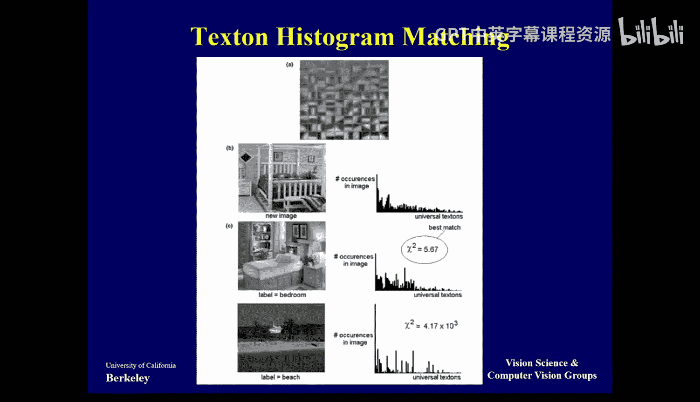

I think we have time for one more connection。Yes， we do。Finally。From our very local。

Brun old thousand right here in Evans Hall。Comes another piece of data。

Which starts with a very different premise， but arrives at a very similar result。嗯开。And basically。

 what。What he was interested in with， with David Field。What they were interested in。Is to find。

A way to represent。The visual signal。啊。With。A set of dictionary elements， visual words。

But what they really wanted to do is they wanted to have。They wanted them to be like。

 a linear combination。Essentially， like， like， like Fourier transform， right， So basically。

A linear combination of basis vectors， okay。So this is essentially what they wanted to do， they。

Given an image。Well， they did it in batches。They want every patch to be represented by as a linear combination of some。

Dictionary element from their dictionary。Multipliied by the。Their coefficients， the weights， right。

 But what they wanted to do because they didn't quite want to have， you know， Fourier transforms。

 They wanted this to be sparse， right， So they wanted this， this， this。

 the vector of coefficients alpha。To be sparse。 So essentially， wanted。So like in the text on world。

 the sparsity is basically one。 It's like， it's one hot， right， you get。Only one。Every， every。

 every batch in the in every image gets to be on the one cluster。应该。In Fourier transformers。

 it's like， it's a linear combination of everything Here， they want to do something in between。

 They want to say， okay， I want to have a sparse representation。 So I can。

 I can sum up a few of the dictionary elements， but not too many。嗯，可。So basically。

 what they wanted is they wanted to have a representation of the image。

Such that it's as close to the original as possible。But。With a prior on the sparseness of this。

 of this vector alpha。 So basically， I want to represent the image with my dictionary。Of elements。

 But I want the dictionary to be sparse。 I want。Every or every patch to be explained by just a few of the dictionary elements。

 not all of them， like in Fourier transform and not just one。

 like what we talked about in in be words， but a small number。O。And， you know。

 it turns out this is an optimization problem。 Again， they feed a whole bunch of images of scenes。

 They ran this optimization。

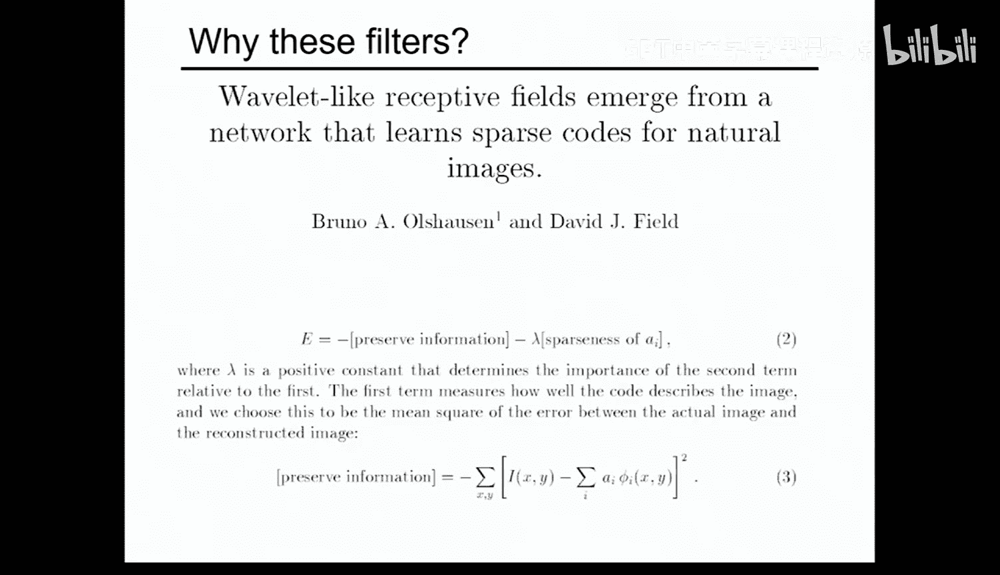

And what they get back to the。Amazingly enough。Once again。It looks familiar。

 It looks just like the Hu and weasel findings。What did what they found is the oriented。

Orreiented simple and complex cells。啊。That seem to be a good representation。For our visual world now。

Of course。If we。If we run this。Not on real images， but on some。

Noise images or some other random images。 What do you think is going to happen。Any ideas。

Go to be different， yeah。No， just just white noise。 Just run white noise images。For example。

Not natural images。😡，Yeah， they， they will not have this pattern。

 So the thing about this pattern that seems to be occurring。In。If you， you know， visual words。

 if you cluster patches， if you have filters of， of， of V1。

 or if you do this kind of a constraint optimization。

 the reason that you get very similar patterns is because they're all representing the statistics of our visual world。

V1。Cells。Just like these things adapted over， over evolution to best represent the visual world that we are seeing。

 And this is why。They are the way they are。 They are the way they are， because of the data。

So in a sense， they are fundamentally， they are learned。

They are learned by nature or by optimization to be the way they are to best code the visual world that we inhibit。

And this is a， this is a very interesting， very important point。Especially for the next lecture。

 when we're going start。Talking about neural networks。Because。

That basically is where we're going to start with and just push this farther and say， okay。😡。

You know， we can learn， We can understand， try to compute statistics of just the layer。

 the first layer， essentially the texture layer， the first statistics of the visual world。

But we can go farther。 We can。 We can go up and， and do it for higher level representations as well。

 We can learn those as well。 And that， that is basically what， what， what。

 what neural networks ended up being one final。Piece of information。啊。

Cond ofvolutional neural networks。 What is the first。The first， for those who know。

 what is like the oldest paper。For on neural networks。Convolution neural networks。 Anyone know。我的呀。

Alex Nat， that's 2014。 No， no， no， no。Lnneette is not a bad idea。 Leonette is what，1989。

Lette is Alex basically exactly the same as Alex next， But what for， for Mmun' digits。And， you know。

30 years earlier。 But there is an earlier paper than that。Neocogninaron。Neocarron， actually。

 early in the 80s。Didn't really run that well， but。It was。 It was directly influenced by。

Bfuble and we， the idea of neocondron was。This cool studies of new Hubo and dieas。

 these oriented cells。They explain V1。 What's going to happen in V 2。 What's going happen in V 4。

 Well， let's just keep building that structure up and see what happens。 That was Necogniron。

 It was directly influenced by， by， by neuroscience。And。I would say indirectly by psychology。

 through Eish。And that's really why we get to neural networks。 Okay， so it's all connected。

We'll see you next week。If you game lead。We still have a few quizzes， if。If you are so inclined。

Just out of the goodness of our。