# UCB《计算机视觉与计算摄影学｜CS 194-26 Computer Vision and Computational Photography 2022》中英字 p15 -P15-15-Feature Learning with Neural Networks-10_17.zh_en -BV1w7UfBdELA_p15-

有 와요。I没 you guys。I。不要 tell you。That it's worth that。 You stayed。Because I have。A very favorite。

Version of back prop that I'm going to describe today。But if you did not get it today， you will have。

Intuition on it。Okay， but to start things off。We have the Project  one winner。でげ。😊，This is Jenny。

Is Jan here？啊。在家各位。Okay， well， hopefully。If you're her friend， tell her to show up next。Lixture。

 and hopefully， this chocolate will still be there。😊，This is Jenny's project website。😊。

I think this is very nice visualization and very nice results。😊，Allright， so congrat to Jens。

And I hope you guys had fun time voting for Project 2。😊，It's not this we're gonna result。

 reveal the results next class。But I thought that there were so many creative ones。😊。

Here' are some highlights。 I thought that this was really cute。😊，This was fun。嗯。I also found this。哈。

😊，It's really well。That is Noji from my profile website。😊，Okay， so。We're gonna announce this next。

 So next， next class。 So if you're the winner， it would be nice if you're here so that you get the chocolate。

😊，Okay， how are things going。

Okay， good， al right。Okay， today is a interesting class because you basically get this like learning。

 We're finally getting the neural networks。😊。

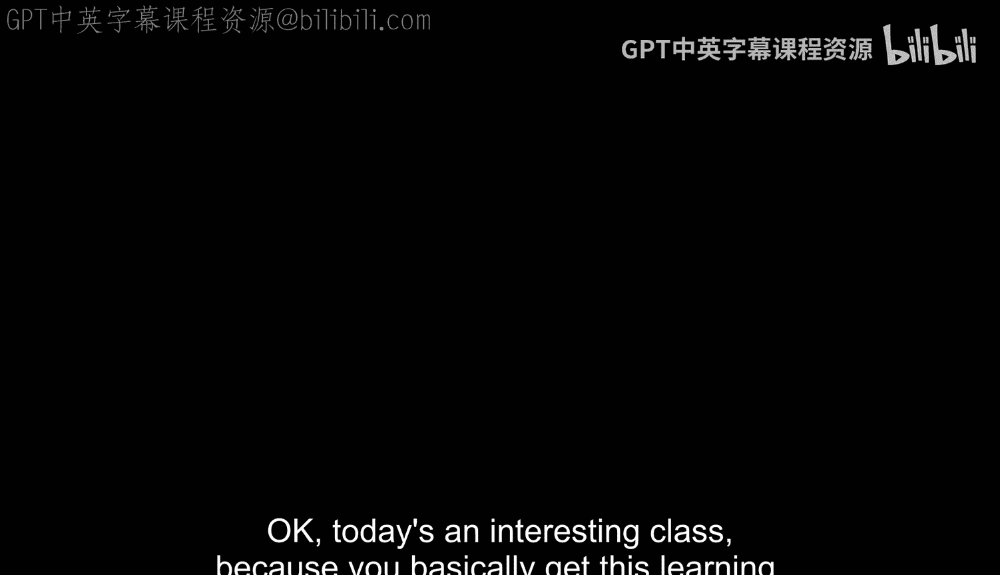

So last lecture， Professor Ephros taught to about。😊，Handcrafting these features， feature detectors。

Okay， and then there was a edge detector in cat。And how you can use these。To look at the response。

 So this is like your edge detector， right， So this is just visualization。

 So if these are your kernels， you can run it on your image。

 You can get these heat map responses from them。😊，Okay， so the story so far。

Is that you handcrafted these things。 You know， vertical edges are important。

 Different edges are important。 So we're going to handcraft these things because they are， you know。

 biologically motivated。 image representation。 You can probe it。 You can see these things。

 So let's handcraft them。😊，And then use it for recognition。 So， for example， last week or last。

 we talked about bag of wars。😊，Visual words， you know， we said about how， you know。

 there was a detector that was really looking at the texture of the cow to do the texture detection。

Okay， so。Basically， you could be doing this kind of response。 like edge responses。

 And you can kind of， you know， do these bag of boards。

 if you see lots of vertical lines and lots of horizontal lines。 And if the ratio is this。

 it might be a table。😊，Okay， you see you can handcraft these things。But it's not really complex。

Actually， go beyond。And learn these filters。On its own。 And furthermore。

 not just through a single linear layer， a single filter。 like this is a single filter。😊，Right。

 but instead， do like multiple。Of layers of representation。 How can we do this learning。

 So that's really， And then that's really the idea that we're gonna talk about the next three lectures。

 And here are some visualizations of the learned features from a convolution on neural network。

 So we'll describe how to see these。 But I just wantna right now， it's not gonna make sense。

 But this is like the first level of features。 So this is very similar to this。😊。

These filter banks that you see over here。 So it's like learning similar types of edges。

 Convolutional neural networks also learn edges in the beginning。

But you can see that it's going to learn these intermediate features that start to look like parts or pieces of eyes and stuff like this and patterns。

 So these are things we can't do with hand design features， so。😊，So today。

 it's really about how do we learn。Okay， and the key in any kind of learning is that you need a path。

And what do you think our task is。What， what do I， What is my task。I could be doing many tasks。可是。喂喂。

😊，Wai， wait。 No， there's something more simple like。啊，没。Thats well， it's more simple。

 It task is objective。Findine corners。Something more innate and simple， like super simple Ob for us。

Like。You know， like， what if I just kept on walking over here。You know， and then fell off。Like。

 the core task。what， what do we do。No no， like， what do we do， Like， I wake up in the morning。

 I eat breakfast， wife。😊，this survive。Yes， this is real。 Like my objective is not to die。Right。

 not to。Not。 I don't like painful things， yes。So it could be object detection so that I know that when there's a knife or something。

 I don't walk into it。😊，Okay， but that's like。That's an intermediate task。

In order to achieve the final task， which is to survive and be happy or whatever this objective is。

 Okay， we're all minimizing an objective function。 It's hard to describe。 That's the point。

 It's important point， because we're gonna tell you all of these tasks。😊。

Where I tell you all of these guys。 Look at this image。 What is it， It's a cat。

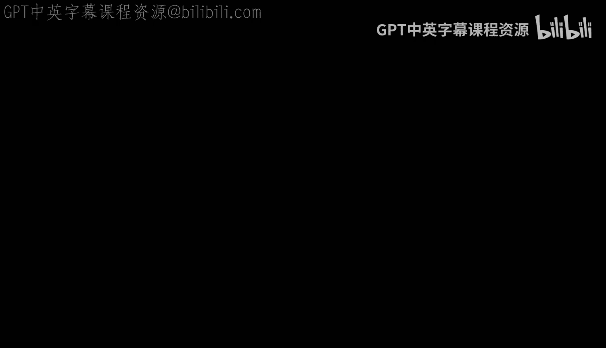

But like， this is。This is a very some， some， some， some subsets of the tasks that we can do。😊。

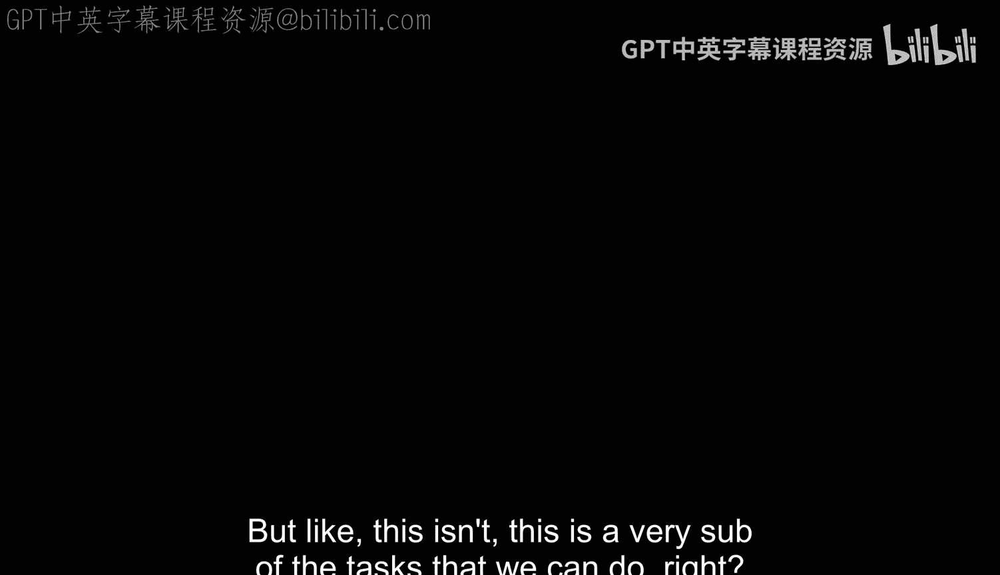

Right。Like， certainly， we want our networks to be able to do this because well， we want our。😊。

Artificial systems to be able to do what we do。We can certainly classify images。

 So that is a valid task。 Okay， but I want you to know that this is not the like end goal。😊。

Right， the end goal in life is not to detect cats， although that's a good life， but。

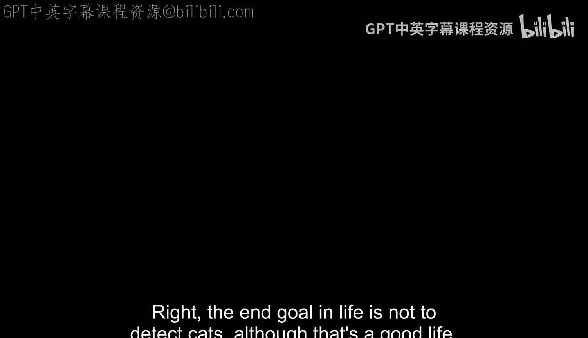

You need an objective。 This is a real deep question。 For example， in like reinforcement and learning。

 It's also unclear， right， specifying the objective。

 you must have heard about all these things about clip， You know， make a clip。

 and then they're gonna make so many clips that we're gonna get drowned in clips。 And， you know。

 humanity is gonna die like all these kind of things。😊，You need。A good task。

 And how do we define a good task。Maybe a good task is the one where you don't need people to like label every single thing。

 You know what I mean。 So it's kind of really related in that sense， but。Yeah。

 it's really important when you look at these things。

 you think about what was the objective in which was minimized and is that objective。

 like the right objective or a useful objective， It's only as good as bad objective。😊，Anyway。

So one of the tasks is image classification。😊，Other thing is like detection。

 So you w to be able to localize it。Okay， another thing you can do is to identify key points。

 So that's what you're going to do in your project 5。Where is the eye， Where is the left， eye。

 left ear and stuff like this。Another one is like these segmentation。 So basically。

 we come up with these tasks。 Okay， and these can have useful applications。

 but it's all tasks that we come up with for people to do， for machines to do。😊，O， so。

Let's just go over image classification。Which is the most basic kind of it's not most basic。 I mean。

 it's a classification algorithm。 Is it。You ought to learn a function that given an image that can say it's category。

 Okay， so it's basic。All right。So how does this work in the statistical learning framework。Okay。

 you always have。An input。Okay， in an outfit， what is the output here。What's the output。Label， yeah。

 and an inputet is。Images， pixels， yeah， or like， you know， codebook， some feature representation。

 maybe like， do the gbbor， do bag of wordss， some like distribution of how many words in each image or something like this。

😊，Okay， we're going to learn this function F。And let's learn some two terms that。

 So training set is labeled examples。 So it has inputot in out of pairs。The test。

Is you've never ever seen the X before。 And you're evaluating on this。Now， there's a validation set。

 Who can tell me the difference between validation set and the test set。Exactly。

 so validation set is the one where you can hyper parameter tuning。 Okay。

 the test set is the one where you're not supposed to touch it。 If you go into the real world。😊。

I mean， this is for making。The， you know。If you want to actually measure how well you're doing。

 you want to take away how much you you did the hyperparameter tuning。

 And so if you got to see what it was， then you can see on it。Okay。

 so you have to make sure that you're always seeing your value on validation set， So， for example。

Later， you're gonna do something like go to kgel and then upload your model。

 And then the project 5 is like， who gets highest on kgel。😊。

Okay， so one way in which you can cheat。

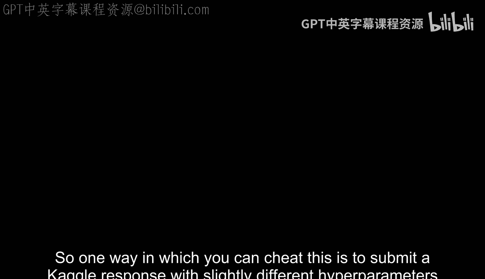

Is to submit a cago response with slightly different hyperparameters every five minutes。Right。

 I'm gonna change the learning rate。 Let's see what kgo。 What score I got on the kgo。

 I'm gonna change another learning rate。 I'm gonna send it to kgo and see what score I get。

 I be like， oh， that one was better。 So I'm just gonna keep that in tuning。 That's cheating。😊。

That's called cheating because that means you're basically kind of trying your stuff on the pest set and trying to get it maximum by having advantage to it。

 You really w to be you do that on your validation set。

 This is why we give you a separate or you have to create your own validation set that is separate where you try things and don't。

I be the test that。 And then I don't think you can in your project 5。

 I think you can only upload like one time， once a day or something like this。

 or there's something to prevent this。Okay， so you w to make sure that whenever you're writing papers。

 you're not tuning on your test set。It happens more often than you think。O。So what happens？

 So you're gonna have a training image。 You're gonna compute image features。

You're going have humans features。 You're going to have labels。 You're going to learn。

And at test time， you apply your learn model and then get a prediction。Okay。

So we already did this in the last lecture。Which is you do bagleboards。

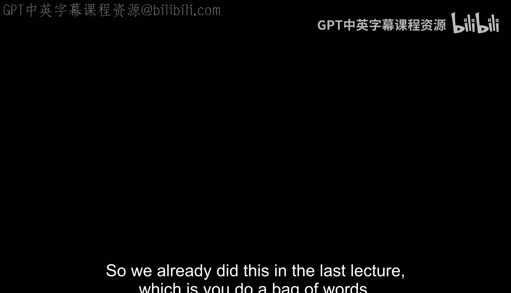

Remember， you can have all of these features you can。😊，Acro you can。

 So suppose you have like four templates。 You do cross correlation on all the pixels。

 or you do convolution on it。 You count how many times it hit。Right， it may get into histogram。Right。

 that's a feature representation。And then you send this in。 So this is like。Over here。

 if you had four things， it's 4 by one vector。And you're like， if I see lots of eyes。

 it must be human or something like this。 That's what the classifier thinks。Any questions。So。

 this point。So this is kind of recap of last time what we talked about。Well， it's like a picture。

 If we were to put it in this classification thing， Another nice。

 very powerful classifier is out of nearest neighbor。 So you have lots of training data。

 Each data is labeled。 So squares and the circles。😊，Okay， you're gonna be like。

 here is the test example in this coordinated frame。 This is 2D。

 but it's some feature in dimensional representation space。😊，And you're like。

 which one am I closest to。Okay， so all you need is。Feature of this X。

 which is already in this feature form and dimensional。

 And all you have to do is look at the distance and be like， you know what。

 the closest neighbor of me is an apple。 So I'm， I'm also an apple， or maybe you'll take like。

 you know， kid years neighbors and rankt or something like this。😊，So this is nice。

 but there is a problem about this that it is。It's a little bit slow。

Another problem of nearests neighbors。Could you think about。呀。The same。一。Exactly。

 you have to test is you have to save all the points。Another idea。Like， what if this point was like。

4000 dimensional vector。So， yeah。Yes， yes， yes。 This is gets smaller。

 Everything is closer in high dimensional space or like curs sub dimensionality。 It's， it。

 it's a high dimensional thing。 It's wacky。😊，嗯。So， so all of those issues。 But it's very powerful。

 It's not nonlinear in a sense that。

When you figure out what is this decision boundary for every single test example。

 is's gonna look like a boonnoi。 You remember the bonoi thing， right。

 Like if you're in the Bonoy of this or it's like post office， which post office you're closest to。

 that kind of decision boundary is not a linear line。 So this is not linear。😊。

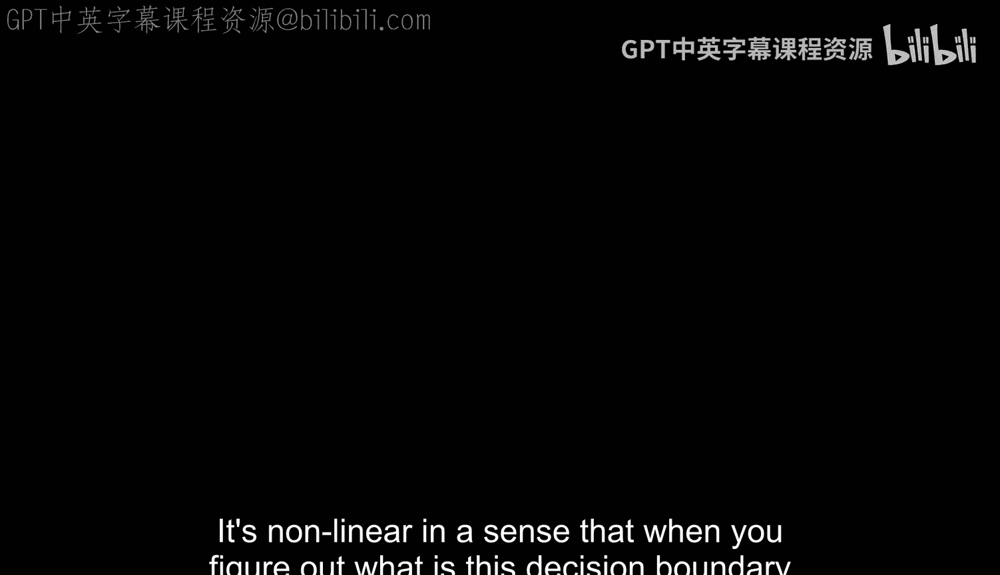

Okay， but no training is required。 So that is nice。Okay， but in this class。

 we're going to talk about binary classification or linear function that separates these classes。😊。

And we're gonna do something like that。 The W X plus B， this is the equation of the。Line。And。

We learned probably in。

Yeah， this side is positive and that side is negative， Usually。 I mean， you。

 you can compete the sign on this by passing it through your W X on the V。

 And then when you look at the sign， if you're positive， you're blue， you're negative， you're red。😊。

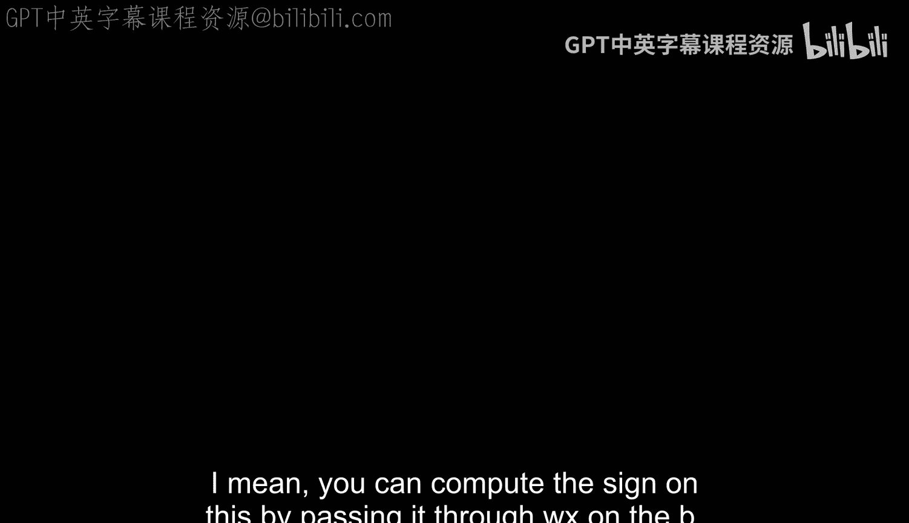

Okay。😊，Here is another way to visualize。This is very important， but this is just rewriting it。 Okay。

 so。X is a victor。You're going to take a do product。Well here， you know。

 we're writing the dot product。 like this is input。 It gets every single one it gets multiied W1， W。

 WC。Okay，你 get thumb。And this is the sign function。And then that's the output， -1 or one。

 in this case。Any questions。Okay， all good。Good， okay。

Alright， I' will discuss this later。 So don't worry about it。 Okay， so this is very， very。

 very loosely inspired by human neurons。 And so what happens is that this is our cell。

 and there's nucleus in the center of the cell in neurons。😊。

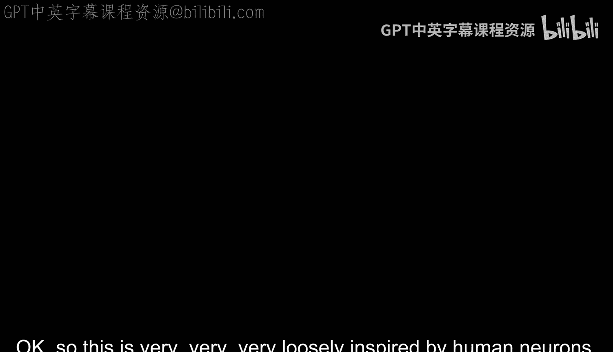

And neurons has dendrites， which is kind of touching other， other synapses。

 Like there's a synapse here。 And so these are electromagnetic signals that electric signals that gets once the nucleus gets enough connection。

 it's gonna have like， emit the signal。 and the signal gets passed through the sine axon into synapses the other。

😊，Other neurons。 And it like excites all of these things。 So it's kind of loosely inspired。😊，拜的。

Okay， it's very loose because in real human systems， these neurons aren't like stacked， you know。

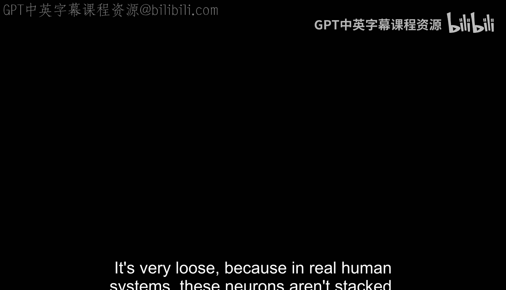

Like these， these neurons are very like left to right， right。

 But like real neurons are like many neurons touching each other in many complex ways。

 Activation is not nonlinear。 There's many different things but。

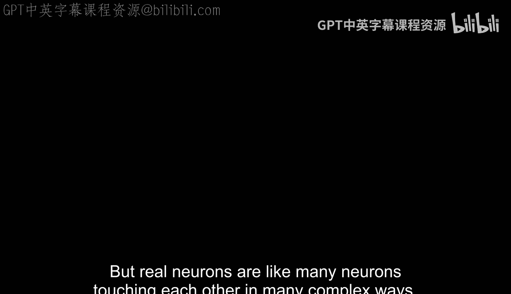

Anyway， this is where the inspiration is from。And so this is why we call it。

we call it perceptrons or like， you know， neural networks。O。

So let's just recall that what we're going to do is take the sign。 And the sign is basically。

 if it's anything positive， it'll give you one， if anything negative itll give you -1。😊，Okay。

 and so that is the。Arbitrary decision boundary that we decide decision boundary。

 according to this W and X。And this is an algorithm called Perceptron that I just wanted you to bear with me and just go through it。

 And later， we were going to see it。😊，In a more principled way。 But this is an example， but the。Okay。

 so what's you going to do。Is you get the setup， right， You get lots of。

 lots of examples of x's with the -1 or plus1 labeled。Okay。

 and then we're going to initialize do randomly。And for multiple examples for every single training example。

 you're going to classify with this current weights， W， X。posB。The bias is in there。

 I will describe later， but。呃。Wx。Okay， maybe I should describe it right now here。

 Let me just do this。Okay， here we go。You know that the light is not so great。嗯。Okay。

Can everybody seek， can you hear。you think did。 Wait， light on is better， right， actually， you guys。

 oh， okay， so we're all good。Okay， so let's say this is like an dimensional like。10 dimensions， okay。

You can add an extra dimension， like one。It's just like a homogeneous coordinate system。Right。

 then you can have。These ws。W say in plus1 is exactly the same as the bias bias。

Right now you can write instead of doing W X。Pluss B。You can just do Wx。By making this。You know。

 n plus one dimension。It's exactly the same reason why we did homogeneous coordinates amazing because。

 you know， because homogeneous coordinates does exactly the same thing because you want to write everything as matrix multiplication。

😊，Right， the annoying thing is this is that plus you can't write as matrix multiplication。 Anyway。

 So this is same as youre a good old W X plus B。😊，And you're gonna look at samples where you were wrong。

 Okay， you said it's -1。 but it was supposed to be plus1。 So then you have to update your W。

 which is your model。 That's how you're learning。 And the way in which you do it is by this thing。

 which is why minus y。Prime， which is going to come up many times， and。I will show you。

 but let's is do an example。So what if it were supposed to be。I mean， okay。

 what if if why was supposed to be ground truth was supposed to be。1。

But then you said that it was -1。What is this， Y minus minus Y minus y prime。right， okay。

 so you said something。 That's what you said。 You said it was negative。 Okay。

 it was in a negative zone。 Okay， now you're gonna update your W to be like plus direction。

 It's plus 2， right，2 x。😊，So you're basically， you have to have me positive。

 So now this loss encourages your weights in a positive direction to have said。😊。

Positive for this particular example。 And the same thing goes。If， its supposed to be -1。

 And then if you said it was one。对。It's -2。Meaning that you want to change this。In a negative way。

 So here's the thing。 So if y is1 then-1， response is negative and it will be increased next time that you talk about you。

 you see this again。😊，And then the-1 and1， the response is initially positive。😊。

And it'll be decreased。 I mean， basically， it's saying， if you make a this mistake。

There's something that tells you， oh， you should have gone that way。 Okay。

 and this thing is basically pointing you in that direction。 and you're taking a step。Okay。

 and this is a very， you know how we talk about gradients a lot in this class。

 And I always say that it's about like。😊，Visualize the hill。 like， you know。

 you go to Berkeley Hills and do maximum gradient ascent， right， the direction you decide。

 it's same as learning。 You have some objective。😊，Okay， and the objective is like your hill。 Okay。

 and depending on how you formulate it， you want to minimize your loss or you want to maximize reward。

 You usually do the loss version， which is had we basically minimize reward and minimize loss。

 So you basically try to go to the lowest part。Okay， so basically， when learning。

 it's like starting from top of the hill， go to the lowest spot as as soon as possible。

That's the intuition that I want to come across from this。And。You know。

 these are some things that if you take 1，89。Or 1，82， they will teach you more in theory。

 But here is this class。 You know， you're gonna use this to predict a detector。

 So you're gonna use it。You know， there's not， but I just want you to get this intuition because you're gonna be using these tools。

O。Quest， questions or thoughts。Okay。嗯。There's some。Not so great about this particular s function。

What what， what， what， what is that is not so great about this sign function。It's not differentiable。

 It's very pointy。 We don't really like these things。So instead of using the sign function。

 you can use the function。😊，To use the signaligoid function， which look like this。Okay。And。

When you use the sigmoid function。What is another implicit assumption that you're making。

Or what's the nice property of this sigmoid function。What happened to the Y。

 What was the Y range of the sign。N getative amount one in here。

It's 0 to1 and something that always output something within 0 to1 sounds like a。😊，Yes。

 it's a probability。 So it has this probabilistic。Interpretation。And， therefore。Earlier。

 we were just I this happens often in machine learning。

 Like the model and the loss depends on how you formulated it。

 And so when I was talking about with the sine function， the model that used the s。

 the ground truth is either -1 or one。😊，Okay， but if you use this model， what is the ground truth。

The， the， the， the domain of the ground truth or the range of the ground truth。1 to 0。 Yes， exactly。

 So those things are gonna s switch depending on what model you're using。 But you know。

 don't want to get tripped up by it。 Basically， it depends on the model。😊，O。😊，So。

It gives you this probabilistic interpretation， so。What is the probability that the label is one。

According to all the tools that we have， what is this， How can we compute this。Say it in terms of。

 like。W and X and the sigmoid。What's the probability that why is the good one。那个。Yeah， yeah。

 I hear somebody。 You're right。Oh yeah， think more them。That be exercise。 Okay， yes。Alright。

 so then what is the。Probably that it's 0。1 is this。 Okay， good。 alright。So。

So these are the tools that you're going to use。 Okay， so。So we need an objective， like I said。

 right， So on the right， on the top， this， this line is wrong because it we classifiedify the blue one。

 So you w to make sure that it moves in that way。 Well we did this example with the perceptron。😊，But。

What， how can we make it more concrete， You know， that I just kind of gave it to you。

 That's the preceptron algorithm。 But how can you devise this in the way how you do it is by constructing something called the loss function。

 So the loss function is how far am I from the true labels， A K， A ground truth。

 which is like the labels。

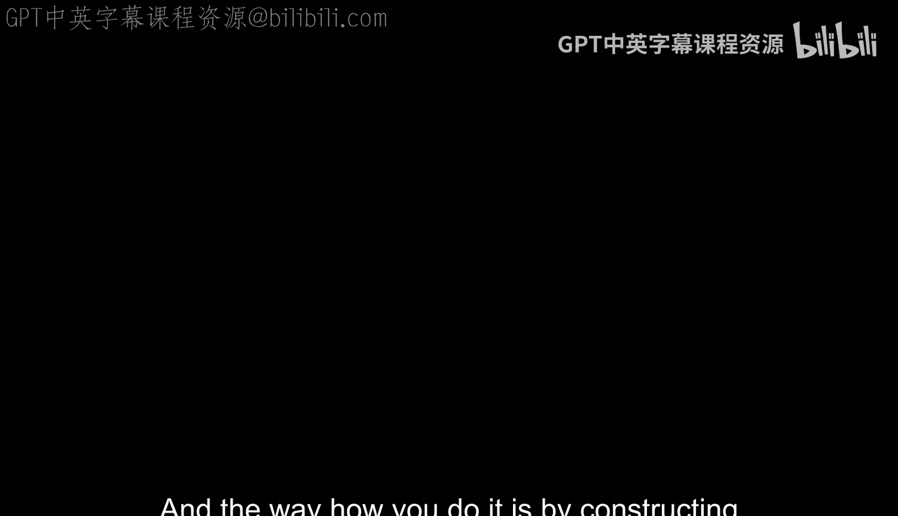

And， I wanted。It's。The particular form of the loss function。There's not that many， but。

Here we are doing all of these examples with supervised learning。

 meaning that you definitely know what the correct label is for the task that you're training。

 Then you can come up with these loss functions。 An interesting question is。

 what if you don't have any supervision。 What would be the intermediate task that you're gonna make it solve that you can formulate as a loss function。

 And that's the kind of research that's called unsupervised learning or more like selfsupervised learning。

😊，That。Maybe later， we will touch on， but I just want to introduce the concept。O。So。

Objective function is something like an energy or a loss that you want to formulate for every single pair。

 You're going to compute some。Function L。O。😊，A possible losses is a quadratic loss。So。

This is the one that you're going to implement in your。Homework， Project 5， you're gonna do。Actually。

 you're gonna do couple。 You're gonna do both this and。The log loss， actually， but。I II just I okay。

Okay， and then the next one is this log likelihood loss。Which is， again， the probability one。

 But let's talk about the quadraticossphers。I want you to really imagine the lost landscape。😊，Okay。

 so。F X I minus Y， I is basically the error that you made residual。 Like it was supposed to be one。

 But you said it's 0。5。Okay， so the things inside is the error， and you're squaring it。

So it looks like your favorite。You know， a simple quadratic function like this。Okay。

 and this is your error。Y minus y。Prime。Or F O x minus。Okay。

 why prime minus y when I prime is often used for the prediction。And then you're squaring that。

 So that's what it would look like。So， in this kind of boss。嗯。

What is different from the perceptron one， which was that if you were wrong， it's always， you know。

 plus or -2 in one direction。 basically plus or -1。

 So it basically gives you the direction in what's your has update。

 But what's the difference with the quadratic loss。It's， it's defiable。 Yes。

 and then it's related to it。 But what's the other like kind of nice property。😊，Conve。はいオッケー。Exactly。

 so the more you were wrong， the more stronger direction that you're gonna get。

 if you look at the derivative of this thing， the derivative of around here is quite flat， right。

 And then over here is quite steep。 So this is kind of why it's。

 it's kind of like the hiking example， you're like， if you're top of the hill。

 It's like very easy to walk around it。 But suppose you're walking somewhere。 that's like flat。😊。

Kind of hard to walk around it。 You don't really know which direction is the most minimal one。Okay。

 and you don't have， you don't get to see really like long distance。 So that's what happens。And。

The log likelihood lost。啊。Is the one where you're maximizing the likelihood， Okay。

 which means you have a likelihood function， which is like your probability density function or probability mass function。

 like with a， with a binary question， it's a Bernoulli distribution。😊，And， you know。

 we're not gonna get into deep in this class， but basically， it's going to be like。

The probability of the correct class multiply by the log probability of what the what your network said。

 And so that's kind of what I'm writing over here。 So maximizing log likelihood means。

For every single example， there are K different choices。Okay， K is 2 in the binary case。

 It could be 0 or1。Or-1 or one。Or class 0， class 1， Okay， and then why I is the ground truth。

 So it's gonna be either one or 0。 And so basically on the class， that is the correct one， right。

 because you can compute2， to probability for this in the log likelihood in in the binary case。😊。

Right， like with the previous， previous slide， you had previous slide。You know how to compute。

Both the probability that the y is1 and probability that y is 0。Okay， you're gonna。

The correct one， which is suppose the answer was。

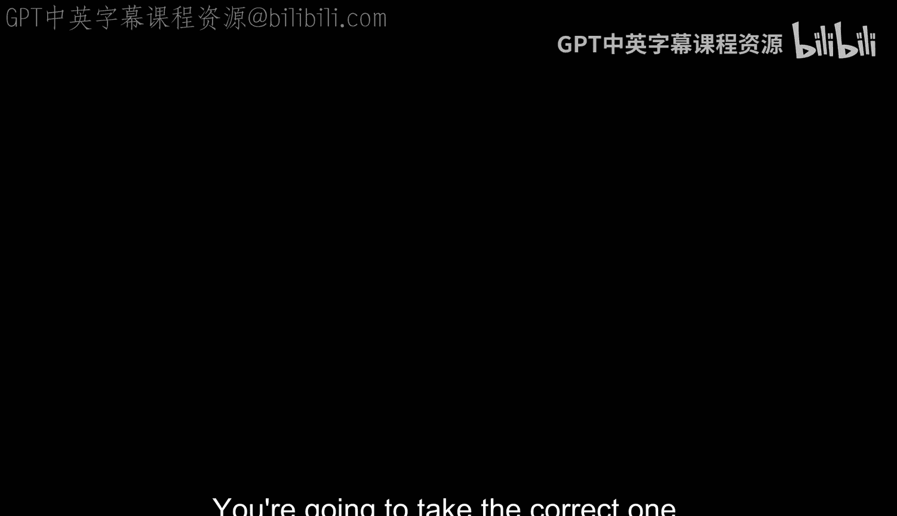

1， then you w to make sure that this thing is equal equally one。

So that's kind of what I'm writing here。With a big minus in missing。 that's missing。

Big minus that's missing in class， okay。嗯。Because呃。I read this example later， but。

What is the log of 0。So， okay， suppose， suppose you're supposed suppose the real class is one。 Okay。

 and then you look at probability that the class is equal to 1 and X I。 And what if that was 0。

 meaning you're completely wrong。Is that， is that how big log is or like the log 0。Right。

It's gonna be a big， big number， right， because of the log function。Or or minus log function。

 And so basically， you w to make sure So log of1 is 0。 Okay。

 so wherever you have the correct probability， you want to get to 0 because you're making sure you want to make sure。

😊，That your。Loss is small。O。All right。We， we have another picture on this。

 So let's walk through the examples because you're like， we just talked about the binary case。

 So how does this work for multi class case。Okay， so let's do that example where there's multiple classes。

So when there's multiple classes， you basically have another set of dos。 So it's a vector。😊，Okay。

 so now you can say the， the， the vector， the sets of W。 if you put it all together。

 is kind of like a matrix。Of end dimension of Victor by3。It doesn't really matter。

 You don't have to think about it that way。 But basically。

 you're gonna have a different weight saying， this is how much I I， I'm like a cat detector。

 dog detector， hippo detector， okay。Siri wants you to say that again。

Okay， and so this is why it's a 3 by F matrix。 When you stick this together。😊。

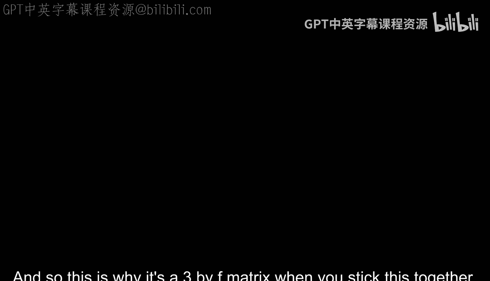

Okay， so that's kind of what it's going to look like。 Okay， here's the plus one trick。For the bias。

 right， Okay， so W X。Is equal to some number。Okay， and so it's basically like the score of that class。

Okay， and you're going to send this through something。 You， we want to make this into probability。

And so we're gonna send it into a function that's gonna squash everything between 0 and1。

 And so that it sounds to1。😊。

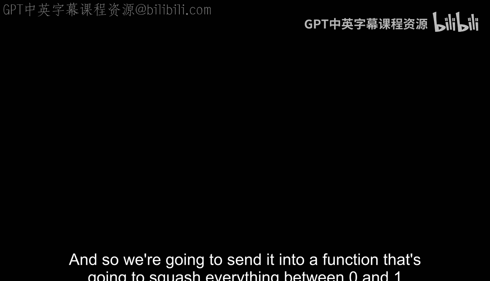

Okay， so that transformation。Do you know。If you know， yes， it's called soft masks。

It's a generalization of the signaloid function to。😊，Multiple class cases。Okay， so basically。

 it's passing through some weighted exponential exponential。 And you're gonna divide this， right。

 The thing in the bottom， Why do you have to do that。😊，おそ別よ。s the thing on above。Oh， oh yeah。

 no no no it is also between 01。 Yes， it does that too， actually， all together。

 But it also makes sure that it sums you that all all of this things sum to。Okay。

 and then the loss is， basically， you w to maximize the log likelihood of the correct one。

Which is supposed to be a cat。 Okay， so this is very bad right now。Right， it's saying it's not cat。

 It's a dog。Right， and so that's what the negative log X looks like。Right， and then this is why。

 yeah， I was quite。 okay。 So when you have the correct class  one and this is max to output that one。

 right， it's never gonna be bigger than one。 So that's as low as you can get it 0。😊。

Right you wanna be always up the lowest part of this hill， which is 0。

So when you look at this cap probability， I am going to look what the network said and the network that gives you very。

 very， very， very high loss。Okay。And达们。It's a good exercise to write out the。The loss of the。

Log loss and then see what the derivative looks like。 But we're not going to do that in this glass。O。

嗯，You could do something like that。 later。 Maybe we'll see。 Okay， so let's visualize。

 This is a visual cloth。Okay， you probably heard that before in 1。

89 or or some of your machine learning class。 If you took any and it's okay。 if you did it。

Let's look at the visualization of the weight matrix。 Okay， so the nice thing is， okay， well。

 so there here， there is no gboa filter or bag ofvos or anything like this。 The impetus pixels。 Okay。

 and the W is like a pixel that says like， you know， applies to every single pixel。😊。

So ignoring the biases， or let's take out the biases。

 the last row of the matrix and just visualize this because this is going to have the same dimension of N by N。

 if we didn't do any feature transformations on the image。😊。

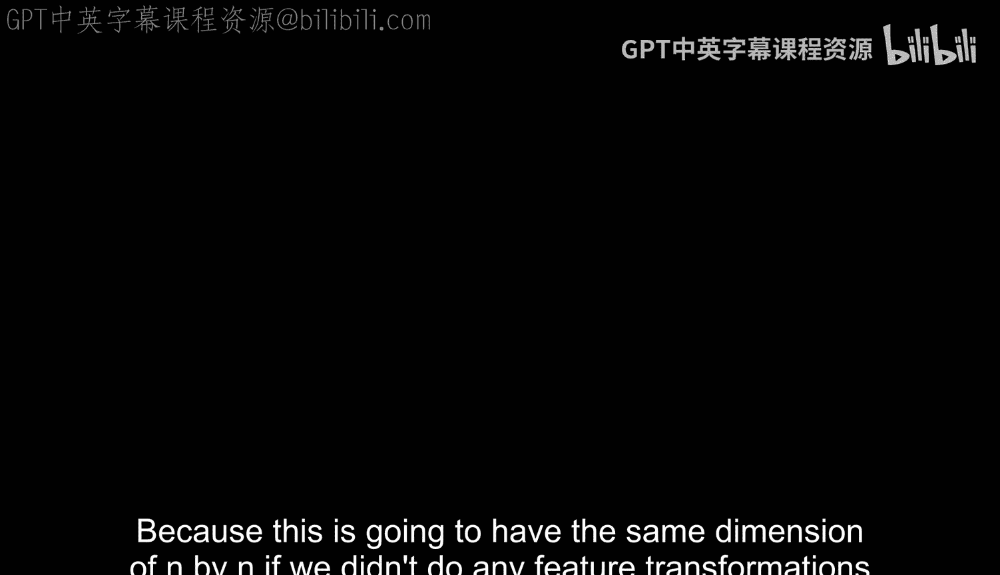

That does that make sense of like this， this is a visualization。By。

 this is basically one big image template that you're gonna apply。O。

So what do you think this weight is， this， this， What do you think this。What do you think is the。

Clth or which weight is this one of which cloth， deer or plane。Oh， how can you tell that it's ship。야。

 cause 누 야。Okay， so that's a real big bias， right， If you have like， like a。

If you have like a shift that is on a graph， this won't work。What is， is I overfitting。这个。Okay。

 how I guess I can't eat。 and I'm hungry， okay。2。So。Is is linger your classifier enough。O嗯。

What other issues can you think about， I just said one。 It won。

 It will make mistake if the ship was on top of a grass。Can you come up with something for a horse。

 Why is this bad？ Oh， it's a dog。 It's also， Why is this bad。What is， what does it look like。嗯。

What did it look like。Okay， I guess it doesn't look like anything。に and。It doesn't。 Okay。

 maybe this is a low frequency， high frequency。 It looks like a dog face to me。 And it's like。

 it won't be able to detect the dog That is。😊，Cured up for something。Okay， so okay。

 horse is really clear。I mean， at least to me， it seems like there's a standing horse， right。

 that's almost like looking left。 What if the horse was like sitting， This it won't work。O。

So why is this linear classifiers not enough。嗯，So。That's the visual visual argument。 Clearly。

 there are many different template versions of this class。 And therefore， a single one is not enough。

 That's kind of like super over generalizing something is going to be something。Okay。

 and you might think about this that in， in terms of。In terms of geometric view point。

It might be some space like this。Where with a single line。

 you cannot identify the blue lines and the green lines。Right。

 because there's no line that goes through them。Okay， but if you had。

 if you knew what the classes were and if you were able to design this feature transform。

 you can apply this transformation。 And also， there are other transformations that in the in this。😊。

Transform space。 These things are linearly separable。O。And now you can do linear classifier。

 which corresponds to a nu linear classifier in the original view。😊，有。😮。

And so the whole point is you kind of want to learn。

This sets of transformations that allow things to be linearly separable。😊，Meaning。

 the point is that things are not going to be linearly separable。

 Most things are not gonna be linearly separable。In the pixel space。

 But if you are able to chain many of these transformations， Eventually， they're linearly separable。

 That's kind of how we think about things that we can tell a difference。😊，It goes through many。

 many processing。Okay， so this is why what we want to do。 So with a single preceptron and precept。

 I we're using the word perceptron here in the sense that it's just W X plus V。😊，With a single line。

 you， that's all you're gonna get。 But then if you nest multiple linear classifiers。

Or multi layer perceptrons or M LPs。 Maybe you can do this learning。O。😊。

And the whole idea is to replace this feature computation。😊，And。Okay， and then。

 so the deep recognition pipeline is the one where you do multiple layers of neural network。

 And then you train all the layers jointly。😊，Okay。And then you're going to hear。

 you must have heard about these things like back prop。

 which we're gonna give a very visual intuitive in explanation soon to get there。O， so。

This is our model， multi layer perceptrons。Oh okay， before， before that。

 we have to talk about nonlinearities。Okay， so to do this image classification。

 now we're going to do this。Now， tell me what are the learnable parameters in this picture。Ws。X is。

 X， X is input， X 1， X2 or the intermediate output。O。All right。Okay。

 so to make a nonlinear classifier out of perceptrons， you have to have a nonlinearity in between。

Okay， so one really connected layer is written as a linear。Function。Going through a linear function。

 And that could be a sigmoid。Or that could be something like， really。Neuralia is very， very simple。

 You should be asking。Oh， that just like， just cuts off everything negative。

 and it's linear after the positive one。 Why does that work， That was actually a lot of the question。

 why。People came up with this later。 And the reason is because， you know， on the positive side。

 it's just the linear function。 So the derivative is very， very simple。

 This allows the derivative to pass through the network very easily。😊。

But it's still nonlinear because， you know， you have this -1。嗯。O给。

And then you have to be able to compute derivatives。 This is why we don't like the sine function。

 because sine function is not differentiable。😊，And then the Z function， you can do sub derivatives。

 If you remember from your cult class being up this elbow。

 you can put any derivatives that's like in between one and， you know， flat。 You just use the font。😊。

Okay， so is any question。Good。Okay， so why do we need to class？ Why do we need non nonlinearities。

Okay， if you know this， don't say anything cause I want to make sure。

That we cover this because you need to think about this if you don't know this。 So， so so， okay。

 so that's a linear classifier。 This is a two layer neural network with the linearity。

 really nonlinearity。😊，Okay， that's a3 layer in neural network。What is the form of the。

To toulate your neural network without the activation function。What does S SCC go do。

Somebody who don't know or。Or， or or yeah， this is asked。 You can say。 tell me what is this。

 Everybody， Everybody S is equal to。😊。

Okay， I hear a murmur， which is W2 W1 X。

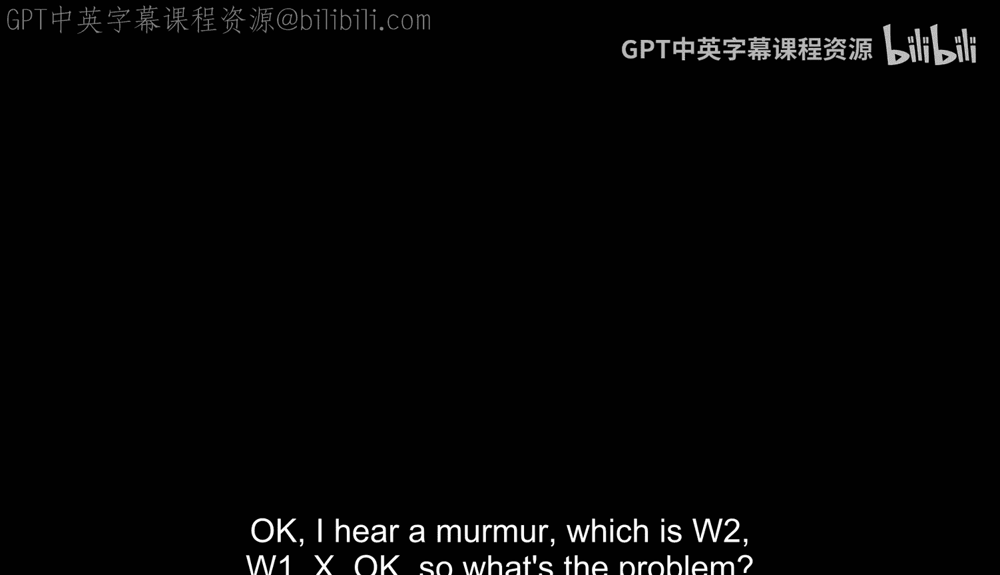

Okay， so what's the problem。What is the problem with this。That an important question。

 You should pay attention。 It's a hint， yes。It's so。Exactly。

 W D multiply but W1 is yet another W matrix。 You can write it。

 And so you didn't do anything going linear。So this is why you cannot forget the activation function and make sure you know this。

😊，It's a hint to something。O， so。Now， we're going talk about how to， how to。Train this network。Okay。

 so again， we said you need a task。 Okay， and like， I wish survival was easy to formulate in a loss。

 but survival is quite difficult to formulate as a loss。 It's also probably， it's also non。

 it's also not differentiable。Okay， so here is the picture that I've been talking about。

 So this is your lost platform， okay。But whatever else that you say or W。

 you're gonna give this some kind of platform。 You want to walk down on this lost landscape。

And then there's this all these things。 Okay， so what we're going to do is。

All of these approaches are trained by gradient descent。 If you take numerical analysis。

 which is my favorite type of class， you're gonna learn all of these fancy ways in which you can do optimization。

 when News algorithm how or like second order all of these， you know， living Bar， Mar。

 all these fancy stuff to get to that solution very quickly。 And in those classes。

 they probably don't even teach about gradient descent because like why would you use gradient descent to optimize your function in optimization。

 It's the simplest thing you can do。 Well， it's the simplest algorithm that is used to train these networks。

😊，And really， the idea。Is， I mean， the one that we've been talking about the entire dime。

 which is like， slowly take a step on the direction of the hill。 So it's kind of like， you know。

 walk to the highest spot in Berkeley Hills。😊，stochastic， So we do the S G D instead of G D。

 What the stochastic gradient descent and the gradient descent。😊。

Who can tell me what the difference is。Oh okay， I see this hand off then。 Okay， okay， okay， let's go。

😊，Yes， okay。 so so basically， gradient descent means enumerate the entire set of your all of your examples。

 Okay， accumulate all the mistakes that you've made。

 Now calculate all the gradients and take one step。😊，So can gradient in this sense says， no。

 I'm not gonna wait for the entire thing。 I'm just gonna look at a small section。

 small sample and then do it。 It's really interesting because it comes up from like practical reasons why you do this。

😊，Because。If you waited for the entire thing to see， it takes a first of all。

 like O N time to first of all， first look at through all of your examples。

 and then you take a single step， right， which is kind of very， very slow。

 And so this is why from practical purposes， it's kind of makes sense to do this by looking at small amount of batches and quickly update。

 But that's also a nice thing because the stochasticity of which batches that you picked kind of gives you like noise right。

 because sometimes you were like oh， you were in a batch where you were always right right So then you're okay。

 And sometimes in a batch where you know， you're half and half or whatever。

 And the problem with stochastic problem with gradient descent is that it can get easily。

 really stuck in local mini。😊，嗯。And soity of this SGD kind of allows you to。一 know。

Just so that you don't get stuck。 It's also not deterministic。 And so that's kind of what we do。

 But okay， al right。So。I guess we can start with the chain rule， first。But I kind of。

 I do want to go back to this picture before I talk about it。To make sure that we really， really。

 really， really understand what we're learning， okay。The W is our parameters。

And after going through all of these things， we're gonna get the lot。Okay， the loss comes back。

I made this much error。 I need to minimize that error。 I am going to somehow update the W。

 and then also update W2 and also update W1。 And now we're gonna talk about how to do this。

 which is back prop。 But it's really just chain rule。So what is the derivative。Of this thing。

 And like。High school kc notition， like a prime not。If prime of。ZX。第fi。O。So this is your familiar。Ja。

 hopefully this is familiar to you。So let's just rewrite this into these intermediate output。

 So I'm gonna make the output of G to Z Z output of F S Y。😊，Okay， so the same chain， right。

 the outfit。Of H of x can be written in a graph like node like this。All right。Everyone， good。

 cause X goes to G first。Right， and then goes to Z。 G output of the G is called Z。 Now。

 Z goes into S。And then now， it becomes right。O。😊，And this whole thing。Is it。Right。

 so there's black box function， which is like layers and layers of these different functions。

 But if you break it down into pieces， it kind of looks like this。😊，Okay。否认。The chain rule。

Can also be written in this formula for this， this notation where you want to compute the derivative of the y。

With respect to X。田三方给没有。Kind of geometrical inter interpretation of this。Like。

 what does D buy over D X even mean。What does。What does the， I mean。

 the D over the x is just the gradient。 So what does the gradient mean。呀。

Exactly， exactly。 So it's basically asking， if I change the this much， how much does why， why change。

 it's very important to kind of understand the basics of what to read about this， okay。😊。

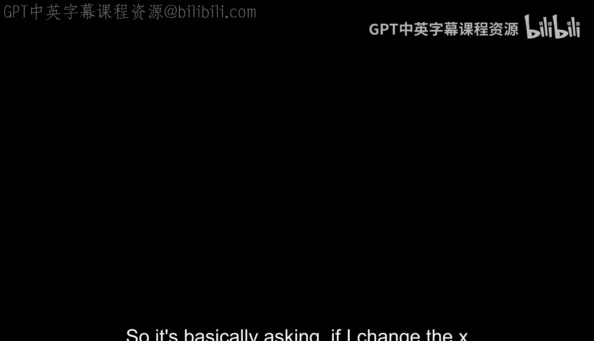

So。What is this。Do I over D， over D X is equal to it。No no no生一てんだ。Oh I think it's a Dy over D X。

The first thing here is gonna be。D I， okay， the bottom。Z Z。 And then that's this thing over here。

And then， here。Okay， good。And。I think it's worth really spending time in this because usually it's kind of talked about as chain rule。

Okay， but I think it's really important to be able to like stare at this and understand this， right。

 Okay， so basically， this is exactly the same as this F prime of G X。

 which is D Y over D Z multiplied by D Z over D X。😊，Right， like again， I said。

 it's how much the output of Y changes according if you change pertuf Z。And how much does Z。

 Z change if you change x。Okay， so with this， you are almost there with the backdrop。

So I have back in two slides。O。Again， the thing that we're learning is W in the layer， right。

 So what do we need for training the Ws。Tell me the derivative format。 like。

 what do we need to train W。 So we want to do gradient descent on the Ws。

 So what is the the over the term that I need in order to train this network。Yes， D L over D W。

 So I need D L over D W， but that's every single layer。O。And。Okay， and so now you can use chain rule。

 just like we kind of talked about with the black box examples。 And that's how things come up to be。

Okay， so the first one， W 3 is very， it's the easiest one to think about， because if you only。

 if you only consider the hidden layer two on， that's just a linear neural network， or linear。😊。

Lan your line。And so you can compute the。 You can directly do。D L over D Y and D I over D W3。

And then you need to separate this because there's an whole linearity in between。

 This is why it's not， you know。

Okay。And then then by teen year old。

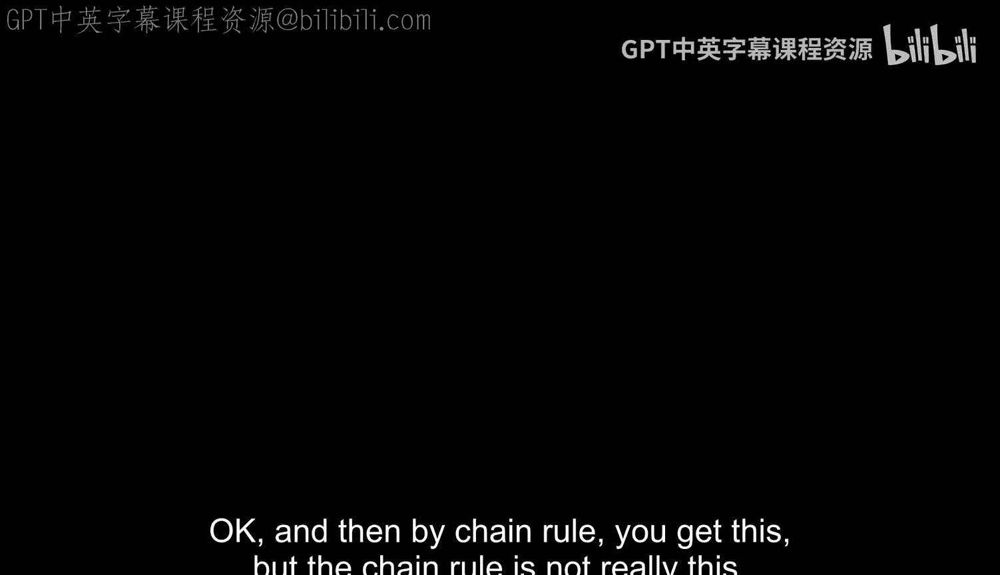

You get this。 but I， I， the chain rule is not really this。 So by chain rule。

You are seeing something here for the next 1。 I think it makes sense of the D X squared。 No。

 that's a D， X X layer 2 over D W 2。😊，So internalize this one， what does this mean？

This means how much the x2 output changed， according to if you change w a little bit。

 that's how much the X2 changes。Okay， but I， I give you this in。

 intuition or you will come back and look at it， okay。So I think I， I really like this inition。

 And here's this。 here， here's how it goes。😊，The way you're gonna think about back or neural network in general is that you're going to be a manager。

Okay， and you're in charge of listening to， say four neurons or however many subordinates that you have。

You get。Attention to them。Okay， you're like， this is， this one is reliable。 This 1。

 I'm not gonna pay so much attention to this  one。 Okay， I'm gonna listen to。 Okay。

 you usually do run them。😊，And you， you're gonna be like， okay， you know what。 My team says why。Then。

Like， a bus comes you。And tells you a feedback of what you should have done。You're like。

 not why instead should of been Y prime or Y star。Okay， so somebody comes up。

 comes to you and tells you that that's not the right thing to do or tells you the loss。

 or we lost this much because of your thing。Okay， and so that's the loss function， okay。Now。

 you're gonna to yell at from the top on。 And now you're gonna be like， okay。

 talk to your team and be like。一楼。You basically adjust how much you should have listened to each neuron。

 depending on what the loss was。 Okay， the loss was losses that way。 I like， okay。

 I listen to you a lot。 I'm not gonna listen to you so much anymore because we made a lot of losses。

 Okay， oh if I actually listened to you。 we would have had this positive。

 So maybe I will listen to you more。 Okay， so I'm going to take a small step changes as to how much I'm gonna listen to each person。

 Okay， I'm also yelling at each of my subordinate at the same time。😊。

And so each neuron passes the frustration。Waited by how much they were listening to。Okay。

 so I have some loss。 and I'm like， I got this much lost。 and I really listened to you a lot。

 and we got this much lost。Okay， now this persons。Takes， you know。

 the loss weighted by how much I was listened to。 if that was like 。9。 I like。

 that's a lot of the loss。And then。😊，This now out， this is， another outfit。

 And there's another manager below here。 And then yells at that manager。 Look。

 this is the loss that I got yelled at。So that's really。

 And then you repeat down the chain of report。And that's really bankrupt。嗯。

Which who can can tell which one is， which step is the yellow or D W。D L over D W。is。D L。

 how much your loss changes over D W any layer。Which step is this one。4。😡，Yeah。

 how about D L over D X。Well， it's not the really deal over D X。 Oh yeah， yeah，s deal over D X。 Yeah。

 what's the deal over D X。Yeah不 of it。Oh no， so this is 3。 This is step 3。

 You adjust how much you have you should have listened to each neuro。Right because this is manager。

 right So D L over D W is step 3。 D L over D X is step 4。Okay， here's more pictures， okay。受。And then。

 in the abstraction case， let's look at the， let's look at the arbitrary layer in the middle。

 the W L。Okay， you need， you need to compute this。 Okay， we talked about the chain rule， right。

 The chain rule。 You can also expand this all the way out。 But at the end of the day。

 you all you want is D L over the X。😊，L plus one， which means amount of loss that came from your immediate output because X L plus one is the。

 you know， there's W X plus V。 And then this is the next layer output。But basically， this is like。

Original was weighted by how much your。Bosses were listen to， Okay， and then you're gonna multiply。

 Basically， this is the the frustration that gets mounted through the chain。

 And then you're gonna multiply it。 that's， that's what you're gonna。 And then this is like current。

That's basically how much you listen to each person that this is easy to compute in each layer。嗯。呃。

D X over DW， which is how much your output would have changed， given the W。嗯。And。

This is the things that get passed down。 This is the loss from previous。

 And then this is how much I was listened to。Any questions。No。

Or or shaking hands doesnt because it doesn't make any sense or shaking head because it makes sense。

 Okay， good。

O， so。Hopefully， this gives you some intuition as to what the back prop is doing。😊。

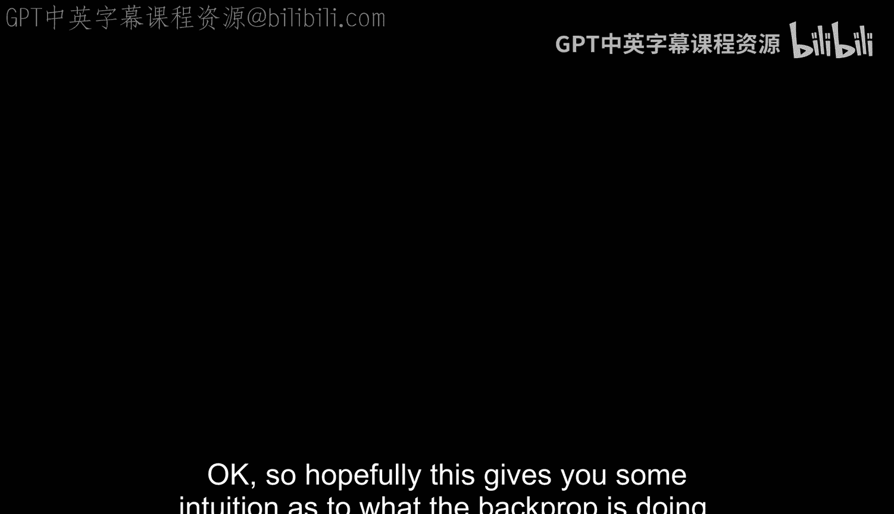

有。Okay， W X for Z， yeah， so。要。W has the different neurons in each layer are motivated to learn different things。

Thenhan each other。So this is okay good， So this is a neuron and layer。 This is sets of neurons。啊，没。

And this is a vi。 actually， Yeah， you mean， why is it different。

2。Yeah， yeah。 it will be different。 Yes， it's because if I， if I wasn't listened to。

 why should I get the blame。

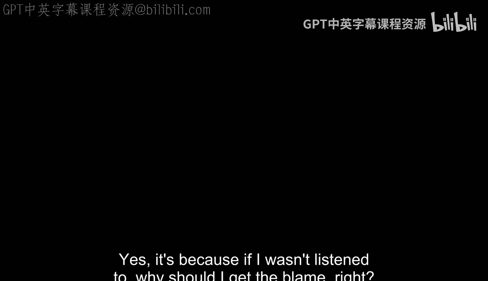

Right。This is why。I is that your question， Like， so basically。

 these are neurons and every single one gets passed down a lot。要。12。It's a great question。

 I think the analog is more like each of these people are trying to detect the dog， but theyre。

 they're kind of。Taking a different subtask or like breaking it up。I think so， for， so， for example。

It's like one person might be looking for corners because dogs have lots of corners and cats don't or something like this。

 Then maybe maybe this guy specializes in like left corner or like that that one specializes in right corner。

 or so like each one has a different specification。 So you wanna kind of like， you basically allow。

 allows you to hedge your be。Like， it's a good question。 And then if there's only one neuron。

You basically only have one key signal， and you have to decide one or not。Right。

 but now you actually have four different like features。 and you can kind of see。

 you can do more complicated things。 Does that make sense。So， that's kind of like a。It's， it's。

 it's kind of。嗯。I know I don't want it's because that might be the best answer that minimizes the loss。

 That's a really good question。 So， so， so it's a good question。 You should think about this。

 which is， why would these Ws properly find different parts。😊，Or， you know。

 figure out to do the right things in order to get the right answer。

And the right reason is because if you hedge your bets。Your probability of being correct is the。

 is highest。And this is actually really， really， okay， you have any。Yeah， so。

 so does the different initializations happen。 But even if the initialization is different。

 the network can be like， you know what， I am always only looking for blue things in order to tell it's a boat or not。

😊，Right， which actually happened with the linear case。 You know what I mean。

 And so that's not a very good training network。 And the answer is good answer it's a really good question because it can happen。

 And that's actually called overfitting when you're kind of focused on very particular things because your training data only have boats on the water。

😊，Right， or you're gonna to remember that easy because whenever I see blue instantly， I can just say。

 both， and I'm always correct。 if your're training yet is really not complex。

So that's like a failure mode。 In a sense， this is a kind of like。

 how do you get these Ws to behave Well， It's kind of like a dark magic in a sense。

 because it depends on your training data。 You might。

 you want to make sure your training data is diverse。

 You want to make sure your loss function is accurate， like correct and things like this。😊。

And then there's if， if， if your W is like super big。

 it's very easy to get stuck and stuff like that。 So。

 so a neural network that's not really trained well is gonna have these kind of。泡不里。Yeah。

 and so you w to make sure everybody learns well and everybody functions well。 And yeah。

 so it's kind of interesting to think about like， if this was your organization And if you're training your organization with this gradient step。

 is that a really good thing to do because it sounds like it's gonna get stuck really。

 And that's kind of a lot of the questions that the had when like deep learning started working and。

😊，Yeah， now it's kind of empirical。 but yeah。Okay， good。other， other question。Oops， is different。

Okay， so let's do a quick case study with Mnt。아엠 this。😀嗯。😊，I say that because it's a very good。

 You should try to do this for your homework， but you should not take the M performance as to mean anything because it's very heavily overfited。

 It's a very， it's a toy。 Okay， toy。😊，Okay， so basically。

 Mnes has 60 k images with a ground truth labels，0 to 9 is 100 digit。 Egen is 28 by 28。

 black and white。 Okay， you have a test。😊，What's， what can you say about this setup。What did I。

 What did we say There are different splits。 Did we talk about different splits。What does this miss。

Oh that's have validation said bad。Okay， but， but really， okay， it doesn't have a validation set。

 Okay， because this is earliest stuff。 So when you're working on this。

 hopefully everybody comes up with their validation set。

 But the fact that there is no official validation set possible that people have people kind of over over know hypert on this。

😊，So it just did the same thing。 This is really similar to the linear classifier example that you were saying。

 And so we're gonna have， we have 10。😊，So we have 10 Ws。We're going to linearize the image。

 so it's 28 by 28。Okay， it's a victor。Okay， it visualizes an image here still， but it's 28 by 28。

 and you have 10 sheets of this。 Okay， and you're gonna multiply every single sheet with the image。

 and every single pixel basically says， if I'm a digit one detector， you know。

 do I trust this particular employee neuron to see if they they saw it or not or something like this。

 And then。😊，in the end， you get 10， and you take the class with the maximum number。Okay。

 so here is like a visualization of the weight。So。Magnitude is the the the intensity is the magnitude of the weight。

 and the black or white represents the sign， okay。嗯。So， you know， after training a little bit。

 you might see things like this。And over over training， you see like， okay， I'm going back。

 This is initialization。 And you do one gradient step。

1 gradient step on S G step on S step1 S G step。 And slowly， you're gonna have these weight emerge。

 and they look like， they look like digits。😊，嗯。It's the same story。 Like， you know。

 why is this wrong， I mean， it's not very good， because we just saw with the ship and the deers and stuff。

 right， It's only going to remember one type of a digit。Right， like this is the template。

 And if the template， like， you know， this is your basically average 7。 And if your're。

 if somebodys7 was kind of more slanted that way or something， this is gonna have a problem。Okay。

 so that's not。 So single layer is equivalent to having a rigid template for each shape。

 which we already also saw。😊，Right。And so you won't be able to detect all these different variation。

Yeah。Exactly， exactly。 But then you got to learn that automatically。要。Okay。Good， so that's really。

The picture。We're good timing。 So because what we have so far is this exactly。😊，Single pixel。Like。

 you're gonna learn a very dense template that is applied on the entire image。

 And then you're gonna decide what to do。 Okay， that's super simple， yeah。😊。

It's a good good the one layer。 There's actually the you， you still are taking the。It depends。 So。

 so here it's just a wall layer。 We didn't really talk about it。 But if it went through a sigmoid。

 if you pass it， that's an all linear。 So it， it already kind of is there。I'm trying to。

 if it's too class， you could have done it without a nonlinearity。

 but the sign is also a nonlinearity。Okay， in a sense。 So there's always kind of in the end。

 there's always some kind of an lonely year。😊，So basically。

 we didn't learn better if it was nested is what you're asking。Oh， no， no， not nested。

 but like with or without the nonlinearity。 And the answer is it's kind of hard to abstract away the nonlinearity because if it's a single layer。

 you're immediately going to the classification and the classification in it the function to。😊。

Assigned scores is kind of mal nonlinearity。And if you don't do it， it's not gonna， you know。

Work really well in a sense that like， hold on， hold on。

 hold on in a sense that like over here before the no nonlinearity was like kind of these like funky numbers that it's hard to。

 hard to tell。 Like before you turn it into a probability distribution。 like it's 437。

 So then now you have to threshold。 know， if it's above 100， it's good。

 And then that's not gonna really work that well。😊，Okay， but just a quick next week。

 Professor Es is gonna be back。And what we're going talk about is that this whole SSD is not so great。

How can we break up these feature detectors to a smaller， spatial。Reason。And then the convolution。

And so that's what's going to talk about next week。 And so that's it。

