# UCB《计算机视觉与计算摄影学｜CS 194-26 Computer Vision and Computational Photography 2022》中英字 p17 -P17-17-Convolutional Neural Networks II-10_24.zh_en -BV1w7UfBdELA_p17-

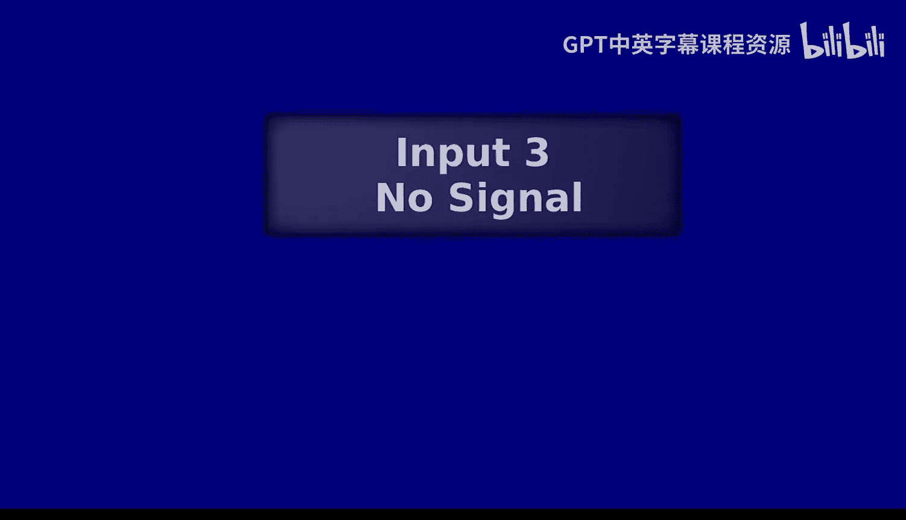

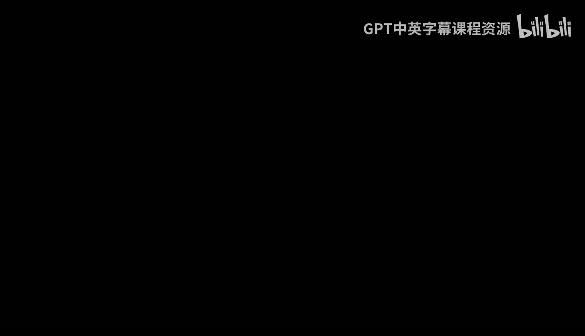

Folks。Let us start。Laptops down。Look at that。Projects due。Project due tonight， right， Is that right。

All right。Good to see。How many people are done？Wonderful。Good， because the next one is。Ready to go。

But。I believe that's the last one we have。呀。All right， folks。Let's do it。O。啊。So， we're continuing。

To talk about covens。Very relevant to the last project。Indeed。

I think Angel already talked to you about。The task that you want to do。Okay。And the task is to。

Autoomaically。Dtect key points。So far， we have。We have clicked on the key points by our little hands。

We have detected the key points automatically for the particular case of homomography。

And now we are going to have an automatic way to detect key points。Basically， anywhere we want。

 Wellow， anywhere on a， on a particular class of images， faces。Humans， etc cetera， okay。And。So far。

 I believe what Andrew was talking about is a。This kind of setup where image comes in。😡。

You have a convolutional neural network and the colal neural network。Is going to spit out。A vector。

Containing the X， Y positions of all the key points that we care about。 You know， the now， smile。

 whatever， right。Yes。😊，And then you're basically going to compare it with the ground truth。😡。

1 D vector。And you want to minimize that value， right， And you're optimizing your。Your network。

For your prediction to be as close as possible in L2 sense to the reality。Yes。Well。呃。That's not。

Sorry， this。This is not really what。What happens in state of the art system。你开。And。The reason。

Why this is not what happens in the city of our system is because regression。

Is not a very good objective in general。Okay， and we will see this over and over， actually。啊。

So in particular case， when you're， let's say you're detect trying to detect key points on the whole body。

 So you want the arm and the leg and whatnot， right。If you look at things locally。You know。

 there is some uncertainty， actually， even if you look at things， you know。

 with a large enough receptive field， there is still some uncertainty。 You know。

 this is probably a lag， but maybe it could be like the the soccer Bowl or something， right。

This is probably an arm， but it could also be a leg， right。And their regression objective。

Is forcing us to make one choice。😡，We can't。You know， we can't。Kind of wave our hands and say， well。

90% that，10% that， right So this is the main problem with the regression story is that。

It requires you to commit。It requires to say。This is definitely， you know。The feet of the person。

 100%。O。And that turns out to be。And not a very good thing。嗯K。Early commitment is a problem。And。

And if we look at。What we have been doing for other tasks。 So you know this is our task。

 this is you know project whatever5 part one， right so we're spitting out a vector。😡，With our。

 you know， key point。K。1， X Y， key。2 XY， et cetera， et cetera， right？1。One decision per key point。

Let's compare this with Inet。So what is does the image net？😡，Clification network spits out。Right。

 it spits out a1 D vector the same way。 But what is。

What is that one defect vector represent for a given image。 So if I give you an image。

Like a grizzly bear。What is the 1 D vector going to tell you？Second again。Probability off。Right。

 so it's a probability distribution， right， So ideally。

 we want to be one for grizzly bear and absolutely truly0 for everything else。

Is that happening in practice， no？In practice， it's some kind of a you know。

 amorphous shape undulating as it goes， hopefully with a grizzly beer。Ha。At the top of it， right。

But the point here。Is that。It basically gives every class a chance。To give a little bit of weight。

Do the final solution。Okay， so it's not making a forced， you know。

 it's not making a con categorical decision。 It's giving it a little bit of probabilistic wiggle root。

Which will come in handy when we want to do it， Maybe we want to do it over a video。

 and we maybe want to smooth it or whatever， right。And it's also good。If。

If you have multiple possibilities and you want to preserve both of them。Or you know all of them。

 Okay， so this in general， works much better。And this is kind of a。

 one could call it a classification loss。啊。So how it works， I think And already talked to you about。

 So we have a vector of outputs， right， This is basically like a histogram。

 You can think of it of all the possible classes。 And then your ground truth， let's say。

 is a clownfish。 and then you know， your loss。Basically， should be error。 And so the loss should be。

L。If the prediction is corresponds to the ground truth and it should be high。If。The prediction。

 let's say， does not respond to the ground。For example， if there is a greaizzly bear。

 a new predicted crownfish， clownfish， what we want is we want。Beenalized groundfish。😡。

And also to penalize grizzly bear because they should be higher。唔该。And。Indeed。

This cross entropy loss that I think Anjo already talked to you about basically does that。

 It is exactly trying to do that。 It's basically trying to compare these two distributions。 Well。

 this a distribution。 and this is really like the one hot vector。

 but it's basically trying to evaluate how close these two things are。

 and it's basically capturing the probability of class given the data。😡，唔该。So。When we do regression。

Basically， it's a regression loss when we do classification。

We want to do something like grosscentip it。唔该。But now。Back to our problem for Project5。We have。

So we do want to have this。Ability to have。A distribution over our solutions。

And the way we want to do it is we went basically for every key point。So we have， however。

 many key points we have here。 we want to have。A possibility of saying。

This is where that key point is。 So we want to have a probability distribution。

Over all of the pixels。Right。福尔。That key point。 And you can see that most of the key points are actually pretty。

 pretty certain where they should be。Except this guy。Right。This guy is。Confuse a little bit。Right。

This guy thinks that， well， it's probably this is the leg。But it's also， maybe it's the。

Maybe it's the upperboard。Right。ok。And I think the same thing for the soccer Bowl。

It's also a little bit stumpy。This confusion is actually good。This confusion allows it to。

 to not force it to go into one direction， but to have， to have weight in both possibilities。

And it's actually， it gets you it's， it's， it's。It learns better this way。

 because allowing for some possibility， which is legitimate。 Like if you squint， you know。

 this could be like a really ginormous sock， right， Like I dude with like a very big sock， maybe。

With enough blur will look like that， right， So it's not。

 it's not an unreasonable thing to have some probability that this could be a leg。

the could be a food， okay。So。Here。We're basically doing the same kind of thing we did for。

 for image equi classificationification。So， for every。For every output。In this case， the output is。

 you know K we have K key points。 So every output is one key point for every output。

 instead of giving it a single X， Y。We want to give it a distribution of X， Y。

 How do we give it a distribution。Well， we could just have X Y over the entire image。Right。

Does that make sense？So， now。Now things are a little bit trickier。😡，Because now， for every key point。

Our output is not two numbers， X and y。Our output。Is an image。Of。Probability density。

It's literally an image that looks like this。 if you plot it with some things being high and other things being low。

But it's a different it's a different data structure now， right。Instead of being two numbers in。

 in a one dimensional vector。Now we need to spit out the whole image。😡，O。So。

This is the right thing to do。 It gives us。This multiple。It， it gives the no model multiple chances。

 It it， it gives the model a chance to not commit to a per particular answer， but。

The outputs output space now explodes。Instead of two dimensional， two， two dimensions of， of。

 of output， we have， you know， x by y。Denssias of output。And。Much of today。

 we' are going discuss how， how do we force。Networks to output。Instead of vectors。

 how do we want them to output whole images？Questions。Everyone on board。呀。

Everyone agrees that this is a good dissideerrata to have multiple。

Multiple possibilities is a good thing instead of forcing a single one。呀。Alright， then let's see how。

 how are we gonna do it。这 do。O。So。😡，Instead of a single vector。We need to produce a per pixel。

Prediction。Okay， so we need to produce an image。 So instead of this。

 which is what we talked about before。😡，The image comes in。A vector comes out。😡。

We want something like this。O。So， we want something that。In comes the image。Out comes another image。

O。Now， this is actually a very， very generic。Machinery。Now。

 the outputs could be many different things。 And we'll talk about a bunch of different ones。

 for example。Now， the output could be a depth prediction， so。OurGB image comes in。

And the output could be at every pixel， how far。Away is that pixel from the camera。An actual depth。

You know， you can train it with one of those， you know， sensors that you can now get。Pretty cheaply。

 you train it with that。And then you can basically have， you can walk around with your phone。

 and it can predict。Deepth for you， you know， more or less。啊。Or instead of depth。

 you can predict normals。A little bit better， because absolute depth is something that even humans are not very good at。

 But normals， you know， which。Which orientation is a particular surface facing。

 Theyre kind of easier。 So basically， instead of predicting an actual， you know。

 how many meters away you predict。Actually， two vectors。That form。

A normal to the imaginary surface that you have here。 So basically。This should go this way。

 This should go that way， etca。你该。The same thing it's just。😡，The output is now， basically。Do images。

For。Well， I mean， it's normalized by it。 But yeah， so you can represent this with two images。

For the normal。Something like this。You can do what's called semantic segmentation。

A very popular task。😡，I really don't understand why。

I put it in quotes because there is nothing semantic about it。 And it's not really a segmentation。

But the idea is。That you're given an image。You're producing a kind of a full scholar map。

Where every caller corresponds to a particular。啊。Particular object， object class。

 And we saw this earlier。20 years ago， I showed you that this was already done basically using texture recognition。

 I'm not quite sure that this is any better。But。啊，有。It's。It's， it's， it's， it's still a task that。

 you know， a lot of people， for some reason， really care about。嗯。Oh yeah。

 and this is just me complaining。About。啊。About why this is a weird task。 but whatever， it looks cool。

啊，沃尔。Much， much more useful。Something that is similar to what you're doing in Project 5。

 But here it's done for the whole。For the whole human body， you're basically。

Comes images come in or a video comes in， and then you're spitting out。

Key points for all of the all of the key points on the human pose。

 and you can do it for multiple people And， and you have the probabilistic representation that is then being laid out in this kind of thing。

 Okay， and this is a code called open pose。 It's freely available。

 and its surprisingly works surprisingly well。 So you you can just just run it。 and it will will。

Okay。嗯。And in general， you can actually think of many different kind of generic。Scenaars。

 we call this。Image to image translation problems at Berkeley。Some kind of an image comes in。

And you're spitting out a different image。应该。So this is kind of a very generic class of problems。😡。

And， you know， we want to essentially solve all of it。应该。So how do we do this？😡，啊。How would的 way。

Trick our network。To spit out an image。Rather than， you know， a single number of it。Well。

 there is a couple of bad wayss， wrong ways， in a correct way。Let's start with the wrong way。

One wrong way。Is you just。You know， just stack convolutions and never do any sort of pooling， right。

 remember that in Com， there is convolutions and pool and cavion and pulling and pulling just makes it narrow and narrow and narrow and narrow。

 right。So in this case， we don't need narrow， narrow， narrow， right， We want to stay the same。

So why not just get rid of all the pools？😡，Just have a whole bunch of convolutions and be done with it。

Opinions。Yea or nay。杨。Who can remember。Yeah， why do you need shrinkage？Good question。啊。

So why is it inefficient， Can you tell me more。A lot of competition。 So how。

How many of these things do we need？Let's do it， let's do the math。O。

Let's say that we have a  three by three convolutions。Okay， have a receptive field of。

2 n plus one pixels。How many convolutions？啊。Until。You know， until our receptive field。Is larger than。

 say，200 pixels， right。Remember， receptive field is how much of the of the war of， of the image。

A particular pixel or a particular neuron can see。And in the end， really。

 we wanted to see basically the whole image， right。

 because we want the whole context to be available for computation。 So we do need it to really。

 at the end， we really wanted to be able to have a receptive field。

 That's pretty much the whole image。So then it's natural to ask how many convolutions if we never do pooling。

How many coals do we need to stack until。Our little receptive field that starts out to be 3 by 3 becomes 200 by 200。

啊。😀Yes。😊，So it's a lot， right， so。It's。It's。You know， you have。You know， you have a lot of。A lot of。

 a lot of parameters。You have a lot of memory。It just， it's impossible to do， okay。Not， not going to。

 So either。You know。Either you， you don't have enough space and you have fewer convolutions。

 in which case your receptive field is going to be small。 And so that your。

 your model is not going to know， you know where the hat and where the torso is。Or you're just。

 it's going to be too huge。Okay该这 this是 why。Although this is really the most natural way to do this。

 but it just unwiely， It's just not possible to do， okay。Okay。Idea number 2。

Ready for idea number  two。Okay， DNA Peru actually is， is， is not unreasonable。Which is。

Sliding window。Right。We have already done the sliding window story， kind of like a convolution。Right。

 except now what we can do is we can basically just have a different。 You know。

 we can slide the whole CNN。Over the image。Every CNN is producing a vector。

 and then we basically the stack vectors into。You know， in the right order。 and we get an image。

Right。Perfect。Yay or na。喂。Because。Right， I mean， they could be separate。 You， you know。

 maybe you don't need to put them all in the same batch。But， yeah。Well。

 the windows are actually pretty big。The windowss are actually， you know。

 the receptive field is real。 I mean， here， the receptive field is drawn a little bit smaller。

 but actually in a usual CNN， by the end of it， the receptive field is basically the entire image。

So you will have that information in multiple windows。But。😡，Yeah， it's there is no sharing， right。So。

 indeed。Indeed。he是 heres这个。Let's look at a particular， you know， filter in the first layer， some。

 some little lonely gaor filter that's being computed。 I dont know。 somewhere here， right。

 at this particular。Pooy and an image。With this setup。This ga bo。Needs to be computed。

For a whole bunch of windows that are being slid around， right。In fact， we know exactly how many。

And it's a lot of windows。 So a lot of the， the same computation。Needs to be repeated。

It's the same convolution。 the same gaor is going to be multiplied by the same input。

For a whole bunch of networks。Okay， so there is a huge amount of wasted repeated computation。And so。

This is just going to be too slow。唔该。Does that make sense？唔该。

So what is actually being done in practice？Well， so the big issue here。

Is that we have kind of two competing desires。So we want to have a large receptive field to figure out what we are looking at。

 right， a small receptive field is going to going to throw away a lot of the power of neural networks because the nice thing about neural networks。

Is that， you know， compared to like a texture processing or all this， you know。

Simple convolutional filters that we talked about before。The texture is very local。

 So you can only get kind of local information。With the con network， your， your。

 your receptive field is getting bigger and bigger and bigger。

 And so you're seeing more and more of the image。 So we want to preserve that large receptive field property。

 So we can actually compute given。All of the data that we're seeing。唔该。But at the same time。

We want to， you know， not waste a lot of time or memory while we do that。你该。And these。

 these things are obviously in double conflict。So something's got to give。Okay， and so。

The classic way。To address this。Is to。Basically， get rid of the last fully connected layers。Okay。

So make it all convolutional all for， just like our stupid idea， number one。O。But。

Because our stupid idea， number one， requires 100。undred layers。Because the， the otherwise。

 the receptive field is not， is not growing fast enough。

What we' are going to do is we are going to still have some。Down sampling。

 because the downs is how you increase your receptive field efficiently。Right。

 convolution and increases your feel deive feel linearly。 You know， with every convolution。

 you get like one more layer， one more like boundary。With with down sampling。

 you double yourceptive field by by two every time you downsamp by  two。It's very efficient。

 It's like， you know， Gaussian pyramid， right。So what we're going to be doing。

Is we are going to downs samplele as we can evolve。Like normal。Except at some point。

We are going to stop that。 And we're going to say， okay， now let's go back， back up。

So that we can actually reconstruct the full image。应该。So this is called an encoder decoder family。Of。

 of representations。We first downs sampleled towards the middle。And then armmsple from the middle。

How do we dons sample？Same way as always， convolutions and pullinging。How do we ups sampleble？我我大开报。

O。Okay， so。啊。What。😡，What we talked about before。Is。

The standard network has these fully connected layers at the very end， right。

 the three fully connected layers。 But recall that those guys。You know， any。Any fully connected。

 any kind of one by one thing。WCould would be rewritten as a one by one convolution， okay。

So these guys could also be just rewrittenous convolutions。😡，And then。You know。

 one very simple way to think about what we want to do。Is we could just， you know。

Make the put bigger。And then suddenly， this is， this is， this still has some。Spaceial representation。

 okay。So one thing you can do is you can just take your standard convolutional neural network。

You know， give it a larger input and then。You know， the output will。

 instead sort of being one by one。 It's going to be like 10 by 10。嗯该以。Alternatively。

 you can just cut this off and just keep it here。😡，There's， there' is a lot of。

A lot of possibilities， okay。Now， the only trick is how do you assemble the cos。O。

And so there is a very simple solution。You just assemble and then just do a convolution。😡。

And the convolution will basically figure out how to do it。O。So， you have your input。

And the output needs to be bigger。factoract of2。So。You do some upseling。😡。

And then you just do a convolution。 and the convolution kind of makes everything happy and make everyone work with each other。

 okay。So， the upseling。You know， there is。The silliest way to assemble is called bed of nails。

Which you can kind of imagine why it's bed of nails。SoYou just have the spikes surrounded by zeros。

Don't do that。 That is。That is， that is not。That's not good。You could just do nearest neighbor。

 which is basically every two by two blog。 Just copy the input from the。From the input image。

 it's a little bit better。But。The best thing is our good old friend by linear interpolation。

You're basically just upseling an image just like we always did， just like we talked about it before。

 right？😡，You know， upemble the image。And we know how to do that， by linear interpretationpo。With。

Inverse morphping， just like we did before， it's all familiar territory。Bilinual interpretation。

And we can get our up。OK。And then we。Give it to a convolutional layer。

 and it kind of figures everything out。你该。So now let's put it all together。We have our input image。

We have our you know， convolution and pull down sampling encoder。And then。

We have our up sample and convolution。Dder。And we get our outputward image。嗯该。

That's basically a very standard kind of family。Of approaches that。That that that。

 that do what we want。And， you know， the。The details are。Are up to you， in a sense， right。

 here is basically， it's there is a lot of art rather than science in this thing。 right， So do you。

 do you go all the way to like a one by one thing。Sometimes you do， although usually people don't。

 Usually people still have a some very small， but still like a spatial image in the middle。 Okay。

 so they don't go all the way down to one by one， but you can。啊。

Sometimes you don't need to go all the way to the same size。As the input。For example， in Project 5。

 when you're detecting key points。Maybe you you decide， you know， I don't need that much precision。

 I don't need to be exactly at pixels。 Maybe two by two pixel is is good enough。

 So that way you can save， you can save some training and some compute by not going all the way to the original size。

😡，Also possible。 So there is a lot of， a lot of you know variations on the theme that you can like。

 you know， like， like the baroque。Brow composers like Bach， you know。

 Bach would only only arrive just the chord you need to play。

 and then the the performers would just play whatever chord they actually felt like that evening。

So it's kind of the same thing here。Okay， so don't get too attached to any particular。Numbers here。开。

O。Question。Yeses。Very good point。Let's。Let's， let's hold this thought for a little bit。

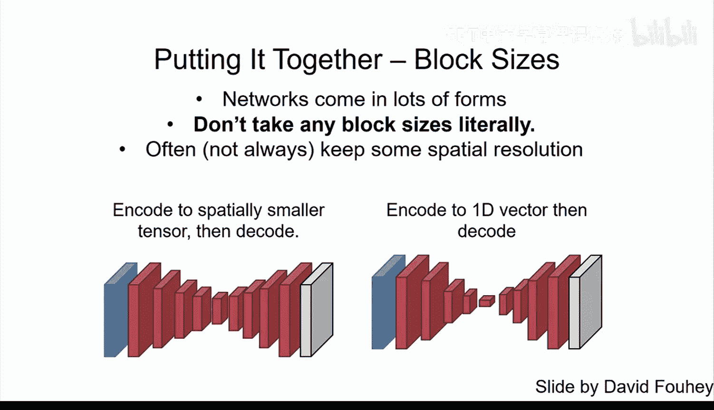

嗯。For a lot of tasks。This is fine。For the tasks of。Finding your key points。

It's fine to lose some information。 You're basically， essentially， remember。

 you are going from a lot of information， a whole image of like a person or a face to essentially。

Like a key point with a little Gaussian mumbo jumbo or some sort of like a。Very low frequency thing。

Right， the your probability distribution， you kind of expect it to be a low frequency affair， right？

 So it's okay if you're， you know， you're gonna to lose some， some information， right。

 So the application to Project 5。You know， you don't actually need to ass sampleble that much even。

Right， you're basically just because what you're producing is you're producing some sort of a course。

啊。Heat map。O。😊，And so， the goal here。Is that for every image。You're going to produce。K heat maps。

Although。And just as K plus one， because you want to have a single heat map for the background。Okay该。

And。And so you' basically just。You know， your target。Is this block？And your。

 what you want to do is you basically want to put a Gaussian。At the X， around the X， Y location。

Where you expect。You know， where the ground truth point should be， right。So。Essentially， you know。

 the ground truth target set is。For every keep point in K。

The ground truth is an image that's basically empty。

 except there is a Gaussian centered at at the key point location。

 And then the standard deviation of the Gaussian is you know， up to you to play around to see where。

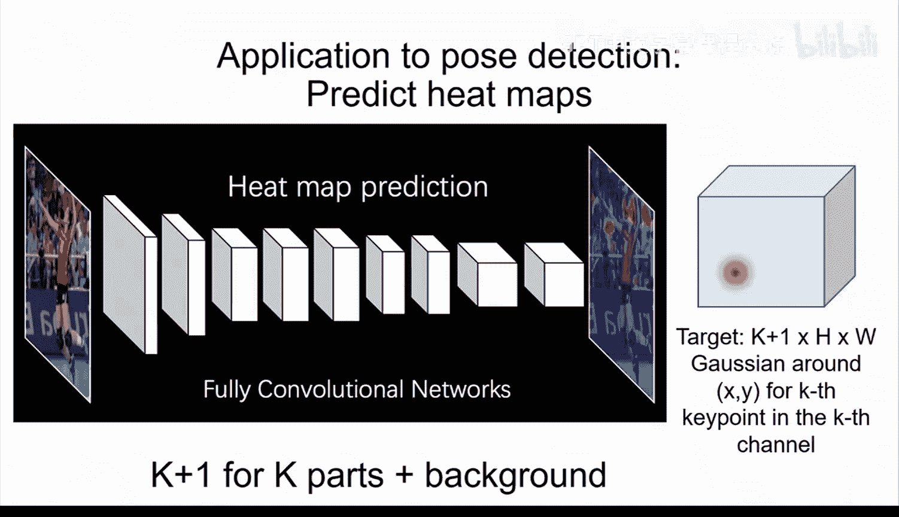

You know， how much uncertainty you want。唔开。And we're the Gaussian， you could actually just。

You can actually just train it with， with with L 2 loss。Basically。

 just compare the Gaussian being spit up by the network。With the ground truth， Gaussian。

L 2 is perfectly fine here。Okay， alternatively。You can actually do a。Entropy loss。And there。

 instead of a Gaussian。You just give it a single one point。

At the correct position and zero is everywhere else。And then you do some sort of like。

 or maybe you put a box or something。 And then you do the， the。Entropy， entropy loss。

And then that also works。 Okay， I'm actually not sure which one works better。

 Andrew is the expert on this。 And so she says， experiment， so。唔该。Sounds good。

Everyone's ready for the next project。Did， tell you we are going to have a kggle competition。Yeah。呀。

An answer high1。 the last one。So， you know？呀。All right。Very good。No。Returning back to your question。

Let's say you want to do this silly good for nothing。 semantic segmentation task。Okay该。

When you do something like that。What's going to happen is something like this。

The boundaries of the semantic。Classes are going to be kind of nasty and blurry。

 Theyre basically not very good boundaries。 You're going be losing a lot of this boundary information。

Right。Why are you losing this boundary information。有。So remember， high frequency。

 medium frequency and low frequencies。 So which frequencies are getting lost here。

High frequencies are getting lost exactly because remember， the whole Gaussian pyramid thing。

 when you downs sampleample， you're basically you're blurring， you're throwing away high frequencies。

 Either you're throwing them away or you're screwing yourself up and you get eliasing， right， but。

In any case， the high frequency are are are not， not the correct ones。

 They are not getting those high frequencies。 No wonder that what you get is you get these blurry low frequency blobs。

Right。So。Right。Where are we losing those high frequencies。A，B，C， D， or E， Where。

 Where are we losing the high frequencies。啊。See， right。

 this is where we are losing all these high frequencies。All right。So what do we do。What do we do。

Well。We think back。就。To what we learned about pyramids。We learned about Gaussian pyramids， of course。

 but we also learned about Laplaceian pramids。Right。

 an idea of a laplastian pyramid is that we can kind of separate。

Information of the different frequency bands。So maybe we can kind of learn from that。And。Preserve。

The missing地。Right， because what we really want。Is the low frequencies are the frequencies that I need to know about the head of the cyclists and the feet of the cyclists。

 The low frequencies are the ones that looking globally。

 The low frequencies are the things that are looking at that need the large receptive field。Right。

 the high frequencies are really in charge of， you know， your boundaries getting sharp。Right。

 so they don't really need to look about at the whole thing。O。

So if we could only somehow send instead of throwing the away the high frequencies。

 somehow send them forward until we need them。Does that make sense。So how， how would we do that。

No no no no no。Simple。Tell me what to do。No no， that's just the。See， this is， you know。

 we don't want to be like psychologists， right， psychologists， when they。

 they explain things by giving it a name。But that's not explaining。 They're just a name。 You know。

 or you have the， right， Like， that doesn't mean anything， right。

 So tell me what the blue actually means。Plug it。 How do you plug it。Well， okay。

So something like this。So it's not really that we are taking the residue。

 We could actually take that whole thing。And just copy it over either another channel of the corresponding。

Layer of the pyramid on the way up， right， So these is the same layer。

And just take this thing and just copy it over。Right。So the subsling is going to go this way。

 and the actually raw data is just going to go here。 and it's going to be just， you know， another。

Another。Another layer。Another channel， essentially。

From which the convolution can draw to do whatever it needs to do。Right。

 so it's actually a very neat， simple idea。 You basically say。Convolutions will gonna。

 they're gonna handle it all。 right， All we need is we need the convolutions。

To get the the information that it needs。We just furnish it the information。

That it hopefully might need。And then， you know， it may or may not not use it。

 but whatever whatever it is， the information is there。 And then when it's computing its thing。

 it's actually going to be using。And we are going do it at every layer， okay。So。外身。Yeah， questions。

 no。Yeah。高还。Question。Every otherly， what do you mean every other layer。Well， remember， this。

 this is like a convolutional layer。 So we are basically sending it after a convolution。Right。

 we are sending it after a convolution。And we are sending it to。To the， the。

 the beginning of the block。For the this convolution to use。

 So we're basically doing it at every layer， It's just that some layers are convolution and some layers are upsembling and down samplingling。

But we are doing it for every block。No， they are the same size。 So this layer is exactly the size。

 the same size as this layer。But then you have to， then， then it's。Then if it's， how。

 how do you do it， then if you downs sampleample it。

 then you're going to throw away high resolution information already。If you ups sampleble it， then。

 you know， like the nice thing here is that there is no upsling or dam sampling。

 It's exactly the same size。 So this convolution can just use it as if it's just normal data。

Like from this convolution's point of view， this guy is。

 is no different than any of these other ones。 The fact that it comes from here doesn't really matter。

So this is a very nice story because it's kind of separating， right。

 The low frequencies go through this bottleneck。While the high frequencies are bypassing it。

 that's why it's called the skip connection because the high frequencies are bypassing it。

And going directly to where theyre needed。Now， here， of course， not just the high frequencies。

 Everything is being bypassed， but remember。The low frequencies are the stuff that needs a high high receptive field。

 So low frequencies really do need to see the whole image。

 The high frequencies are the things that don't really need to see the whole image。

 So that's why it's really the high frequency information is the information that's actually being used。

Be useful， okay。Questions。Yes匙。It's more complicated。 It's more complicated。 The。

 the whole high frequency， low frequency story is a little bit of a handwa explanation。 Yes， but。

 but fundamentally。What this thing provides is it provides high frequency。

 So these things are providing。High frequencies that were being lost。 So in that sense。

It is the the skip connections are carrying information that in the end， are the high frequencies。

Right。Because we know that the outputs have more high frequencies with the skip connections than without。

Other questions。嗯。So basically， have this guy actually also have the original image here。嗯。

I don't know。 I don't know。I guess it's already。I guess the。The simple answer is。

 I'm sure somebody tried it， and it didn't work。嗯。I can imagine that original image。 Like。

 if this is， you know， what's called an out encoder where your， your goal is to re。

Replate the original image。 then， of course， it's very useful。

 But if your goal is like key point detection that。

 then probably the original image is just in a very different space。

 It's maybe just not going to be very useful， right。So kind of having some， you know， filter bank。

Even just the first first level of filter bank applied to the image kind of brings it in in the domain。

 So that's my， my feeling about why this， this would make sense。Right， and then you。

 if you want the original image， then you have， you want to do like the whole R， G and B。 And its。

 I don't know。 Yeah， it becomes complicated。该。O。So， that is。That is that story。

This is very related to a super popular architecture， called the unit。

That is basically implementing this。 Okay， you can see it has a very nice， beautiful。

Pyramid like structure。 So we like it。And。Also， little bragging thing that this。

This paper was published in a some super， super unknown conference that nobody ever reads。

And nobody heard about this unit。 And then we were the first ones to use it in our P to picks work。

 And then suddenly， and it exploded it。 Now， everybody's using the units。So。

The after of unit is very helpful， thankful to us because we， we got him famous。There you go。

Some our indirect claim to him。嗯，该。And now that you have the， the skip connections。

 you can see that you get a much better representation， you get。You know， sharp boundaries。

Everything' is good。Now， here is a question。Compare this to the。

 the idea number one where you actually， if you could have 100 layers。Without down sampling。

Could you do better than this。Or this is basically as good as you can。Like。

 if you could have a a network with no down sampling at all。Could you do better。Who thinks yes。

One person who thinks no。three people。 I see。People are really appreciating the call， not， not。

 not making a firm decision。He having a histogram of outputs。Well， I don't know the answer， but my。

 my， my suspicion will be that you could do better because you're still by， by down sampling。

 you are losing some information by separating high frequencies from low frequencies。 you are。

 There could be a way that。The particular。The particular boundary effect on this wheel really depends whether。

 you know， whether the driver is smiling or not， right， It could be that you have very。

 very high range。Connection that that actually needs to be enforced。 And by downsling。

 you are losing that， so。I think it's still an approximation of what could have been。

 But since we can't have what could have been， thats， that's fine。你可。Okay， so。啊。What else can we do。

Once we have this。Machinery， image in， image out。Well， one thing we can do is we can do。

Cute things like colorization。OK。But can it take a grayscale image？And spit out。The colorer version。

 okay， so。We take。A gray scale image。 And we spit out。Usually， we do it in LA A B space。

 So A And B channels， the chromatistic channels。Of the image。Very nice to train this。

 How do you train this system。呀。Exactly， exactly。 here， you don't need any humans to label anything。

 You just take a。Gziion images from the Internet split them into luminance and prominance。

And just train a network to go from luminous to criminalminants。Okay。

 this is an example of what we call self supervision， self supervised learning。No humans involved。

 the data， you just predict data that you already have。And then这个。You can have。A cool little。啊啊。

Cool little polarization thing。嗯。The same thing。With regression and classification。

So when we did this in the very beginning， we thought， okay， let's do regression。Kind of makes sense。

 You know， it's an RGB kind of thing。 Col。 Let's just regress to the right color。Okay该。

And we get something that wasn't really very colorful， kind of spiia tone。

compareare this to the ground truth。Right， not very careful。那可以。And we were we were thinking。

 why is this。Why is this so。Not colorful。Any ideas。啊。Exactly。

 this is another reason why regression is bad by forcing yourself to have a single answer。

Just like when I asked you a question， I forced you to have an answer。

And the right answer in this case is hedge your bets and basically not have an answer， right？

So if you' are forced to have one answer。Then you're gonna say something that's basically， you know。

 neither here nor there。Right， and this is exactly this is exactly what happens。 So if you have。

 if you have a， you know。A bird that could have blue。Blue breast， or it could have red breast。嗯。

The regression loss was it going to do。If it's， if it's 50% that，50% that， what is it going to do。

Split the difference。 Do something that's in the middle， right。

 Line interpolation between those two answers and what sits in the in the very middle of the color space。

 gray。Right， so by splitting the difference， you're always going to get the gray。

 You're always going to get the boring mode of the distribution。 And basically， right， this is why。

Often， regression is not a good idea， especially when。

When your distribution is not like a un modelal Gaussian。 So here， the distribution is a。

 is a bi model thing， right， It has。Something like this， two peaks， right， blue。And red， right。

And there。Splitting the difference is exactly the wrong thing to do because you're not going to make either of them happy。

O。So， again。What we want to do here is to go from regression。To classification， okay。

So what we did here is we divided our color space into little baby clusters。Right， we basically。

 you know， it's a two dimensional space。 A And B。 We turned it into like 300 little cells。

And every one of those cells is a class。And then。We just had a standard。Clification loss。

Producing a probability distribution over the cells。And here you can see what happens here。

 So here is our。inputput image。And this is。The distribution of possible colors。O。

So you can see that there is now。

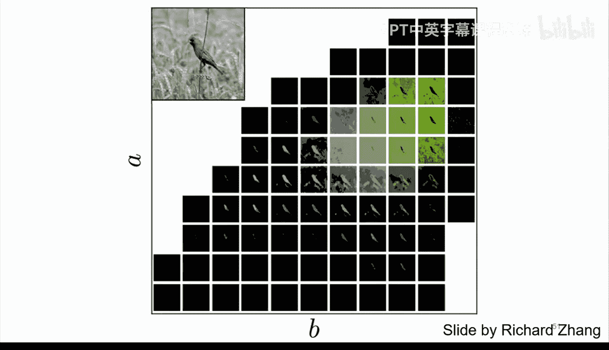

Multiple versions。 So here is the， the blue bird is here， and the red bird is also there。

 So both modes of the distribution。

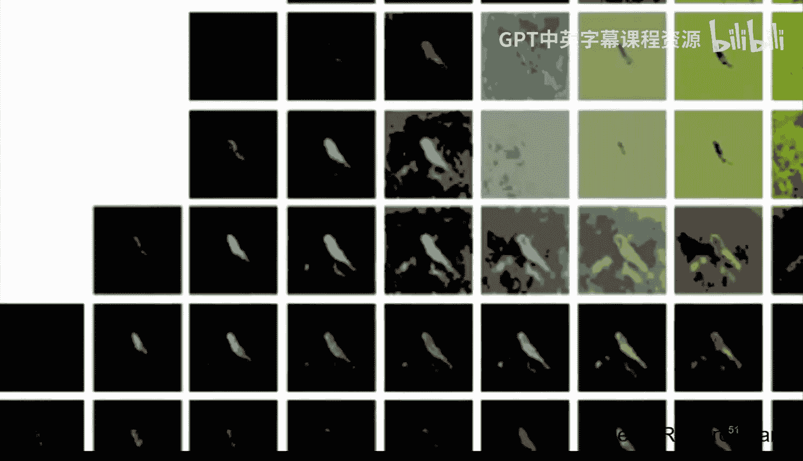

Are now represented。And then you can see in which one is higher or whatever。

 or maybe you produce both outputs， something like this， right， But you。

 you preserve both of those modes。Just like in the key point thing where you have both possibilities for a key point。

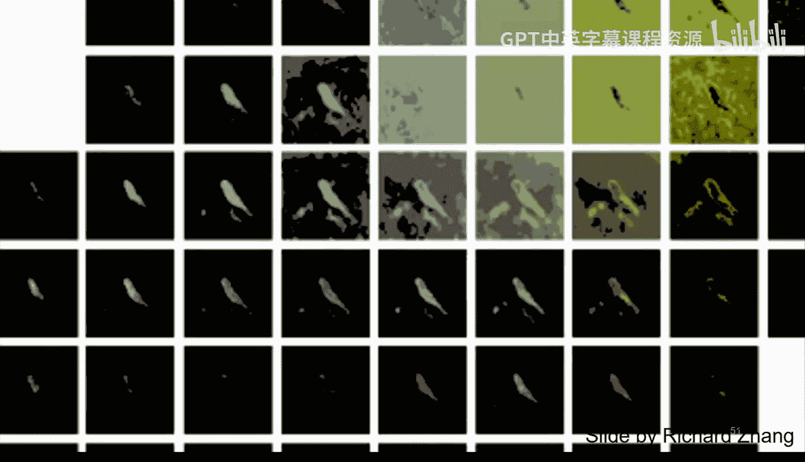

O。And so the result was much more colorful， even if。

It was actually quite different from the ground truth。Right。

 but one argues that this is still better because， you know， it's colorful。Questions。嗯改。Although。

 sometimes。This desire for color， fullness。And of plays bad tricks with us。Right， so here the， the。

 the， the wall is indeed white。But it really wanted it to， you know， to be something。 And so。

You get some weird。Weird artifacts， okay。And。And so there was a lot of kind of。Trying to figure out。

 how do we。How do we get。A loss on these image to image translation problems。

Which is going to make the image look natural。Right， because。You know。

 this thing is just not natural， right。And for different tasks， people came up with different ideas。

 and they were all kind of different。And。And we were thinking， you know。

 it would be really nice to have a kind kind of a universal loss。😊，Like a universal way to tell。

Does this look like a real image or not？😡，你该。So， in fact。We do have。A way to do that。Right。

 and in the polarization paper， we actually use that way。We just ask humans， you know。

 Amazon mechanicalical Tu。We basically showed some images that were colorized by our algorithm。

And also showed just normal real photos。😡，And then we asked the Turkers to tell。

If they could tell which one of the two images， which one was real， which one was。Aut， you know。

 colorized automatic。And if the Turks had trouble。慰问。Make sense。O。But that gets really expensive。

 really fast。listister。Studies are very expensive。And also。It's。You know。

 it's kind of hard to back prop through humans。Okay， so this is good for evaluation。

 But if our algorithm is not as not very good。It's not quite clear what to do。How to improve it。

Right， because， yeah， we cannot back for humans。OkayK。So this is where a very cool idea comes from。

Which basically， the idea is， is， is very simple。 fundamentally， the idea is。

Instead of Turkers telling， trying to tell apart real images from fake images。

Why don't you just have another network。Do that。That's it。😡。

We replace cis with another separate network。That is a classification network。

And its goal is to tell。Which images are real？Which images are produced by a computer。And now。

We have a very clean objective。 Our objective is to fool this guy。We want this guy to be confused。

Okay， and this is the idea of generative adversarial networks， yes。Okay， fundamentally。

 the idea is very， very simple。来走。Here were going to talk about it in the conditional case。

We have our image to image translation problem。We have an image， input image， say， you know。

 gray scale。 We want to produce a color image。What we are doing is， we are adding。Another network。

 what we call a discriminator。 So this is a G generator。 This is D discriminator。

And the discriminator is looking at the output。And its task is to produce a binary output。

Real orphan。O。So a generator is trying to synthesize fake images that would fool discriminator。

And distributor is trying to， you know， identify the fake。

So the generator and discriminator they are fighting with each other。 Its。

 that's why it's called adversarial。 There isver adversity between the two networks。

 They are fighting against each other。Okay。So。What is， what is， what is it。

What is it trying to optimize， So the discriminator。Is basically trying to find， trying to。Output。

A high score。A true score for anything produced by the generator。 So D of G of x。

Should be as high as possible。Should be fake。Where is。An actual。

 true real image should be as low as possible。Okay， D of Y should be as low as possible。

And we are basically， just want to。Find the best D that can do that can optimize this， okay。Okay。

 that's what G wants to do。 What does G want to do。Well， the G wants the full D。

So G wants to minimize to find such G， such that。This guy is minimized。

The same equation is minimized。So one is maximizing， the other is minimizing。你该。So， you have this。

Minni max problem。Where they are fighting against each other。Now， these are hard problems to solve。

 And this is why Gs are still。Considered very hard。 And。

 and people are even moving away from them nowadays， because this is just a very hard。

Very hard thing to， to， to。To soft。 And at least right now， we're still kind of。You know。

 not haven't figured out completely how to solve it， right， So ideally。By the time， by a convergence。

Converence happens when， when basically， when D loses。When the discriminator is basically a chance。

Then you know you're one。Now， Gs in existence right now ever have that happen。Right。But。😡。

Even though they never have this happen， somehow， the images still look pretty good sometimes。

 So not clear why。嗯。But kind of a nice thing about this is that you can really think of。

Of this discriminator as kind of a learned loss function。So instead of like a classification loss。

 regression loss， whatever loss you can think of。The discriminator kind of provides you a tailored loss just made for your particular problem。

 It's like， it's， it's a learned loss for the particular task。

And I think that's kind of what makes it powerful。你该。

So you're basically learning the right metric for success。For your given problem。

 for your given data。O。Questions。Well， remember， it's， it， it's not really binary。

's some number between 0 and one， right。But then you， you know， you basically。As you go。

 because you're back proping， because you're， you're changing those two things， right， you know。

 they the。They're just， I， I show them here as two， two things， the G and the D。 But actually。

 they are just chained together。 and you're backing from the very end all the way to the very beginning。

And so， the generator knows。In a sense， what the discriminator was looking at that it when it made the decision。

And so the discriminator is like， it's like watching the generator。

 the the generator is watching the discriminator think you say， oh， he picked on this pixel。 Okay。

 I better fix that pixel。Right。So， so you actually do get quite a bit of information。

Discriminator to the general。应该。Oh， and， you know， I forgot about。Actually， make it conditional。啊。

In the story so far。啊。This is perfectly legal。So let's imagine that your generator just randomly spits out pictures of cats。

系。By former student Ju Yan， a big fan of cats。 So he would always put cats in。

So let's say that this is his cat。 So let's say the generator spits out pictures of cats over the time。

 This is a real picture of a real Juan's cat。 Okay， I met this cat。 It's a real cat。So。

 so the discriminator should say， yeah， this is real。Right。8。😡，I mean， it's real。

 but it has nothing to do with the input。So it's not a very good solution。

So what do we need to do to make sure this doesn't happen。呀。Exactly。

 the discriminator should really see both。The input and the output。

And it's what it needs to decide is， is this the correct， Is this a realistic output for this input。

And that's what makes a full conditional。 Again。 You add this thing in， and。And life is good again。

Okay， and then， and then eventually。They're right。唔该。And then you just， just run this thing。

You can write on colorization。You跟。Download a whole bunch of Google Street View images and satellite images。

 And then you can basically translate from Google Street View。To satellite。

Or maybe cooler you can take from satellite to produce， you know。

 Google Street view exactly the same code， right？ Remember。

 because the the loss function is being learned， it basically learns。For each problem。

 it's basically fits parameter。 So the code is exactly the same。

 and you don't need to do anything different。 You can go from facade labels to actual。Images of。

You know， facades。Something like this。You can go from day to night。

You can go from thermal imaging to RGB。You can even， you know。take a bunch of edge detection。

 basically around canage detection。And go from edges to。Do the original images。Now you'd say， okay。

 why would you want to do that， Well， because at test time now， once you train this thing。

You can have children's sketches。And you push in the say tension angleng sketches and you kind of hope that the sketches are close enough to Ken edges and you get something like this。

Not not bad， right。Again， same code， no change。And so we， you know， we put this thing on， on Gitthub。

 This was a long time。 Well， this is like 55 years ago。 We put this big to big thing on。

 on Github and kind of forgot about it。 And then。Crazy things started to happen on， on Twitter。

Somebody made this little interface。 And then for a while。

 there was this edges to cats phenomena where everybody was。Drawing cats。

 And then people started drawing other things that are not cats。 And they're just gonna。

When the little bit crazy。But。Kin of what was， what I was happy about is that some， you know。

 real artists were got also interested。 in particular this guy， Scott Eaton from London。

 He used our software。To he collected his own photo data， and he made this really， I think。Awesome。

 creative。 Can we， Can we turn off the lights a little partially at least， So you basically。

 he draws the outlines， and then he uses his own train data to create this。😊，Impossible sculptures。

 right？ And it's kind of amazing that it's， you know。

 it's all it's doing is just trying to make things look natural， right。

Even though it's completely impossible， you know， you get the right shading。 you get the right。

 like at least locally， things are looking。Surprisingly correct。Right， and， and so he， I mean。

 a lot of it is， of course， kind of。You know， it's the， you know， the software is really the tool。

 It's also his， his sketches and his imagination that is doing the work。

 But I'm just really impressed with the， with the kind of kind of sculpture。Sculpture， like。

Patterns that， that emerge from。From this。From this， reasonably simple software。Okay。

 like a little bit like the Casso， maybe。So it's yeah。

 and it just this this thing goes on for a long time， but you guys can play around with it。

 but it's it's really cool。

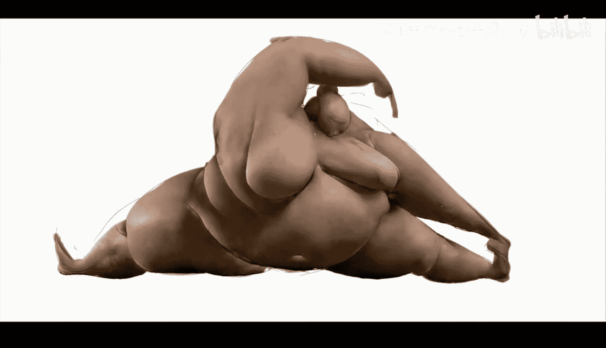

We did our own little thing with it， this actually was originally a project in this class by an undergraduate student。

And so what she did was she。She did the。Essentially， project 5， but for the full image。Okay， I like。

 She just used the open pose。 The open pose was already existing。Okay， so you go from the。

From the frames of a video。To the pose of a person， okay。And then what she did。

Is that she trained P to pick model to go from the pose。Back to her son。Okay， okay， now the。

What's the big deal here， Just do in go in a circle now， right。啊。That's what you do for training。

 for testing。You flip it and do it for different people。 So you taken in one video。You train， you。

 you analyze that。 You take the motion from that。 and you put the target。啊。You， you put it for。

 for the target。 You put the video of Caroline。 Okay， and so here's。

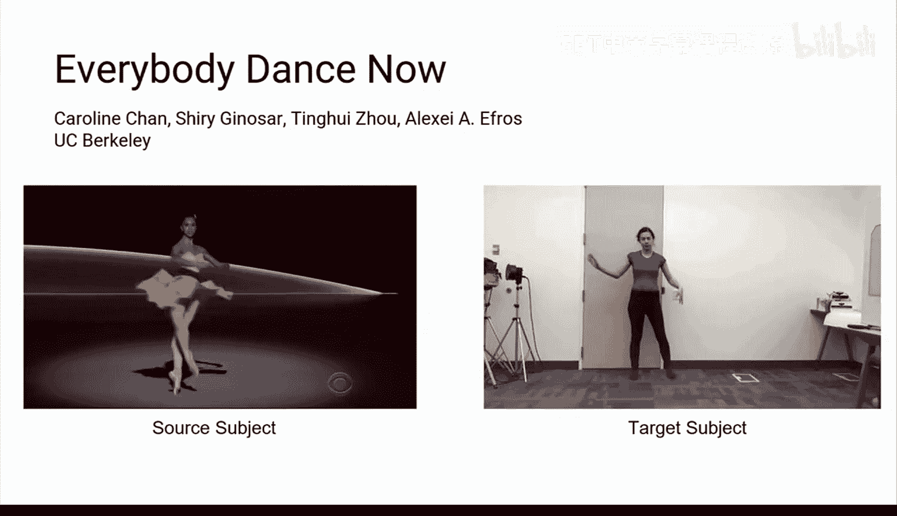

Here is an example。This is Carolcarline， and this is my graduate student Jinghu。Not。An actual dancer。

 Caroline is actually a professional dancer。 Thoya is。Clearly enough。

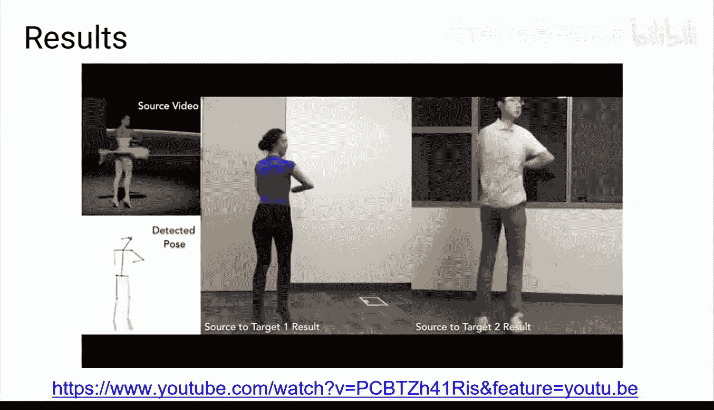

There we go。All right。So I expect your projects to be you know， better than this because， you know。

 this is five years ago。 so， you know。O。Okay， we have a little bit。 Yeah， perfect。

 We have a five minutes to。

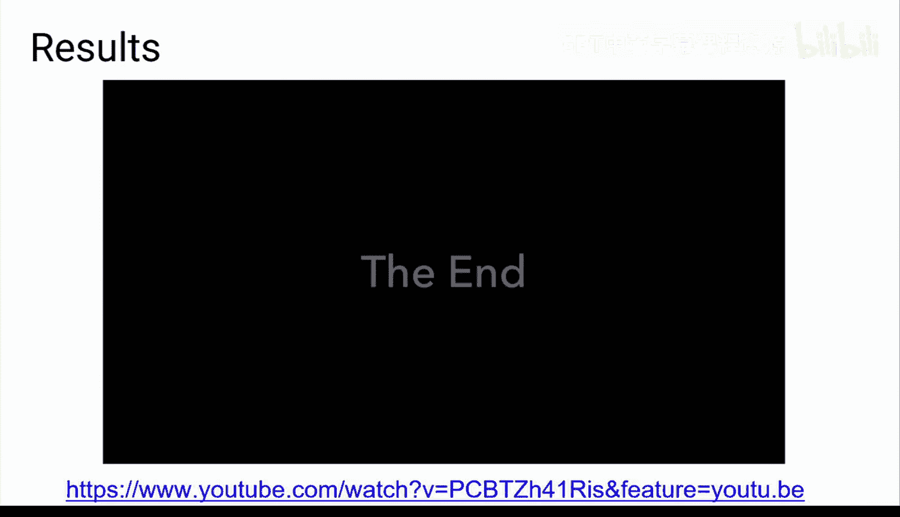

To mention。To mention a little。Side project， side thing。That I think Angie did not cover。

 But this is a very important topic。收。😡，You think that， you know， you need huge amount of data。

To train convolutional neural networks。Which is true。 You do。But， maybe not as huge。As as you think。

Right， and this is the idea of transfer learning。Because the idea is。That。Somehow。The representation。

 even you cut off the， you know， the last layers of a network。 and just look at。Their representation。

Somewhere， you know， the the the。You know， the， the first fully connected layer， for example。

 that 2024，1024 dimensional vector。That representation。Is kind of tells you a lot of the。

 a lot of the interesting information。 Okay， so what is shown here is。A two dimensional projection。我。

Features。From the first layer， pool1。Over network trained on imagenet。O。

And what are the different colors， The different colors are。Class of dogs， birds， invertebrates。

 vehicles。Building， et cetera。 Okay， So this is basically。

 you take thousand classes of imagenet and you separate them into these super categories like。

You know， buildings and vehicles and whatever， right。And you can see that that at。

 at the lowest levels。It's just a mess。 there is no structure。 It's all noise。Now。

 let's look at the same thing。By the end of the network。O。Look what's happening here。😡，In particular。

 look at。Look at vehicles。 I guess these are vehicles。Right。Look at dogs。They're all groups together。

In this high dimensional space， somehow all the dogs are next to each other。

 All the vehicles are next to each other。This is crazy， because。When we train the network。

 it does not know that。A train and a plane are actually related to each other。

 There is no information like this， right， It's， it's a one hot vector， One is a plane。

 The other is a train。 There is no information。In the training signal， that says。

That a train and a plane are somehow more related than a train and a dog。And yet。Somehow magically。

 And I still kind of am at this。It's able to figure this out。And it's able to group similar things。

 thematically similar things。Next to each other。Even though the task that it's trying to solve is actually quite different。

😡，So what this means is that these are these embeddings， these features。Actually， could be very。

 very powerful in general。O。Another reason to think that。Is。

If you do nearest neighbors in that feature space。You take an image and you find the nearest neighbor images from your data based on these you know。

 high level features from the network。What you get is you get things that are not only the same class。

 not only the same category。But they actually look surprisingly good。Right。Like， it's not。

 it's not just flour。 It's， it's the same color of flour， right， It's not just a pumpkin。

 It's a pumpkin with a similar， you know， picture carved out， right。

So this tells us there is something really powerful going on here。唔该。And so， the idea is。

Taking a network， trained on some task， whatever that is。It could be that you forget about the task。

 You just keep that representation。And that representation could actually be useful for a whole bunch of other things。

So you， you can train on it one thing。And then you can， you can test it on。

 You can use it for a whole bunch of other things as well， because。It seems like within the network。

 it learns a whole bunch of useful mid level properties。唔该。And so from this。That's where we。

 we have this idea of fine tuning， right。So instead of training a whole thing end to end with your gazillion images。

Os。What we can do is we can take a pretrain network。 Let's say， a network train on image net。嗯该。

And just， you know， replace。The last couple of layers。And fine tune it。

For the problem that you want to do。 So， for example， even for your keep point detection problem。

 instead of starting with an empty network， you could start with a network trained on imagenet。

 for example。And then。Maybe just fine tune， you know。

 train the lastly or everything else being fixed。Or maybe if you have a little bit more compute。

 you know， you train a few layers there， okay。

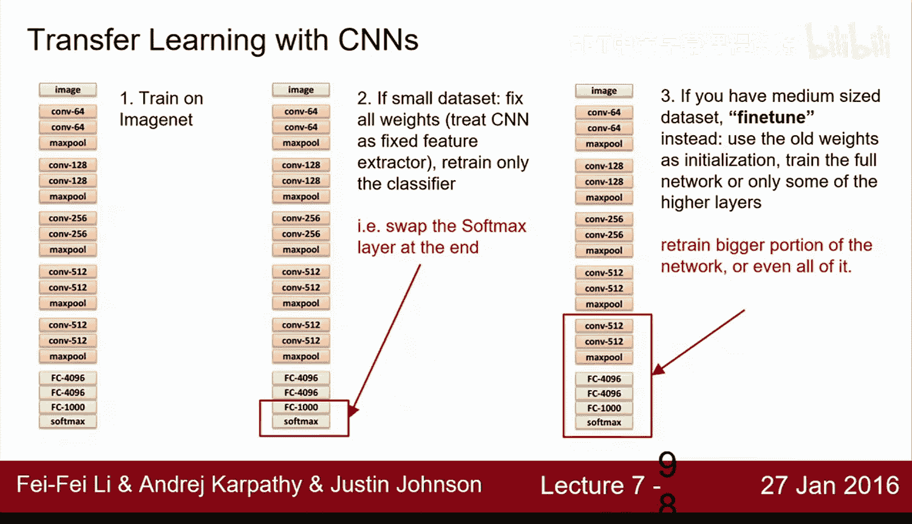

Or if you have a whole bunch of compute， you can still， you know， you can train all the way back。

 but you're still starting with a starting point that actually is useful。Okay。

 and so this thing is becoming more and more。The people across the bay call it foundation that。

