# UCB《计算机视觉与计算摄影学｜CS 194-26 Computer Vision and Computational Photography 2022》中英字 p20 -P20-20-3D Vision Calibration, Stereo-11_2.zh_en -BV1w7UfBdELA_p20-

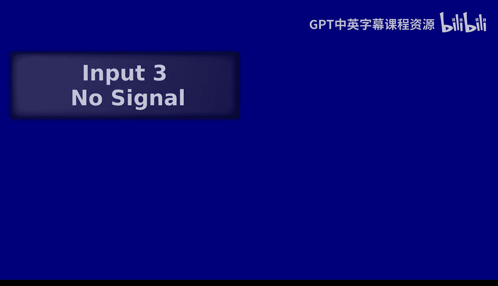

啊。Okay， hello， how are you。I hope you guys had a happy Halloween。Was it fun。

Maybe people are sick from it。Okay， I went to Tel Aviv。For like， a week。Yeah， that was interesting。

It was for a conference called European Conference， European Conference of Comp Viion。哎喂。Okay。

 so today is an exciting day because we are going to get to talk about 3D vision。

 which I am super excited about。😊，But before that。Like midterm is coming up。Okay， it's going to be。

November 16 Wednesday， when is that。 So that is the next， next Wednesday。😊，And the stuff that。

In the midterm is up to。The next Wednesday， which means the stuff that I'm going to talk about today is going to be on the midterm。

I repeat this stuff is gonna be on the midterm。 So I hope you pay attention to this。

November 9 is also when Project 5 is due。Yeah。嗯。The format of the midterm is going to be very similar to like the pop quizzes that we've been doing。

And in general， the idea is that if you did your project， they should be easy。

 except for these 3D questions， because you haven't done any projects on them yet。Any questions。Okay。

 and the final project， you should start thinking about this， too， oops。

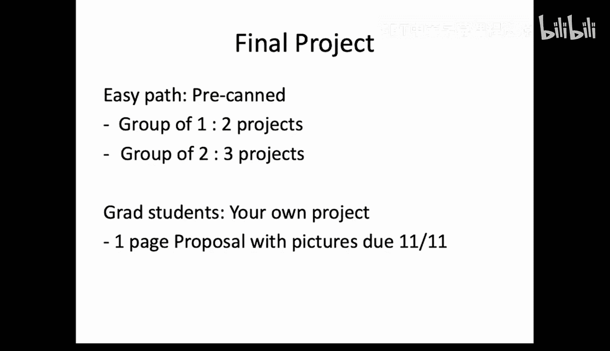

要。

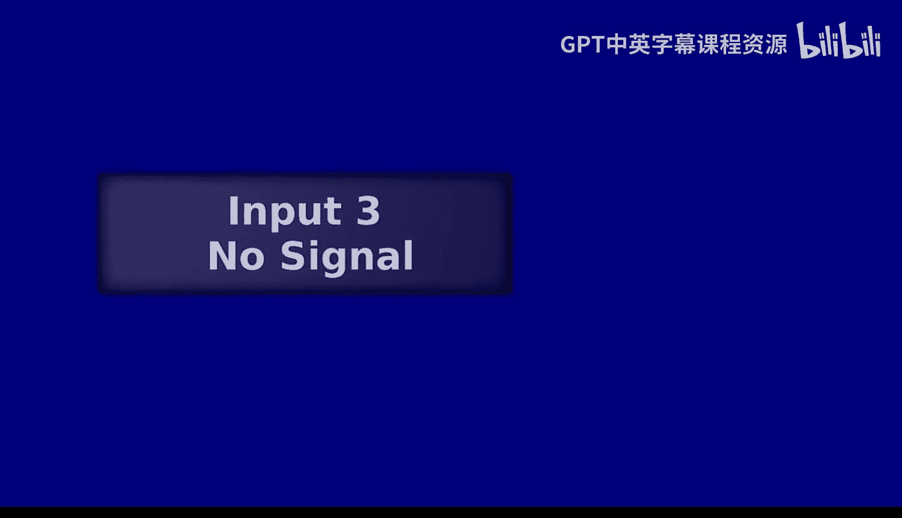

So this class has no practice。itll be all pop quizzes that you get treat the pop quizzes love the practice。

😊，It's gonna be like that。Okay， we're not gonna make you。 You can also bring like， double sided。啊。

note。To在 course。😊，Like， it shouldn't。 It's not gonna be something like derive this math。You know。

 it's not like we have a very math centric class heavy anyway， it's going to be more conceptual。

 You know， like true or false questions， like， which is the output of the vertical convolution。

 like stuff like that we did in pop quiz。😊，Okay， the final project。

 everybody needs to do the final project。 If you're only taking 1，94， which is the most of you。

 you can do the precount project。 Okay， and if you can be a group of one or two。

 and then you have to do that many projects if you're more than one person。😊。

If you' grad students taking this class at 2，94， you have to do your own project。

 And the one page proposals with pictures is due November 11。😊。

That's the Friday after Project 5 is due Monday， Wednesday。 and then go to Piazza for this idea。

 If you're taking 1，94， you can still do a custom project。😊，But you need to。

 you need to submit this proposal。 and it's a lot more work。O。😊，Good。

And then we can chat after class about。You know， these projects。Today， I gotta run， actually。

 but I will come back the Monday before the midterm， and then we can chat。O。Any logistic questions。

Good， good on piazza， yes。Yeah， you have to do two precount projects。And theyre on the website。

 you can pick。yeah yeah， yeah， yeah， yeah， yeah， yeah， yeah， yeah， yeah， yeah yeah， I can't here。

 Good to see the question。😊，I don't think so。I don't think so。 Just submit。As far as I know。

 I don't think so。Good question。Okay， alright， step into。Now。

 we are ready to break out of 2D onto to 3D， which is the real world。😊，Okay， so enough images。

 We want the， the polyoptic function we haven't talked about it。

 I will do that later when we talk about nerves。😊，啊。you did talk about it。Oh， okay， that's good。

 Okay， great。 Okay， then we want the real 3D scene walkthroughs。😊。

The camera rotation and camera translation。😊，3D is super cool。

 This is a really cool article that I like from New York Times。

 where you can like scroll through the artists then。 and you can also see like the hurricane。😊。

They three captured the situation so that you can kind of feel like there。 It's like a， you know。

 it's like a new way of doing journalism。I think they're just like really cool， you know。

 And it's also like the space in which we live in。 If you're into video games。

 This is how video games are also made。 If you're into Pixar movie。

 any like creative format of movies like V F X， These are all using all of these techniques。😊。

It really comes from here。You know， like Pixar。 later。

 we're gonna cover nerves in the end of the class。Which is a new technology that you can capture very photoreistic。

 It really estimates the polyoptic function。😊，Here is like a cool VFX effect。

 So it's not just about getting a 3D reconstruction。

 But if you wna do any of these cool visual effects， you need to understand 3D。😊，What the。

That's another like this one is done by hand right now。 You know， the artists are doing it by hand。

 But obviously， if you can run it。 if you need to understand what's in front what's behind in order to do all these cool things。

 my research， as I discussed a little bit ago， is about reconstructing the 3D world。

 especially the dynamic world from images。 So I do things like humans。

 This is like markless motion capture， estimating the， you know。

 appearance of the people from an image， using this extracted information about the human body to in robotics。

😊。

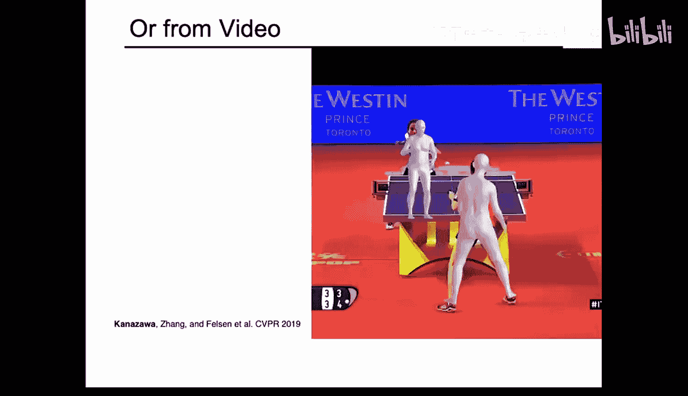

Not just people， but also animals。 And these are super fun cause you can like reconstruct them and reprint them。

 That would be a cool final project。 if you can do something like this， There's another thing。

 This is like a generative model where you combine 3G with the  two degenerative model like diffusion models。

 So you can like fly into the scene。😊，We recently made this thing called Nerf Studio。

 Some of your classmates are actually contributors in this。

 And I encourage you to play around with it， which allows you to really explore。

 You can take lots of pictures， and it estimates a panoptic function in which you can like fly through the scene。

😊，And generate， cool stuff。So， for example， this is the video。😊，Of the redwood， you know。

 Groove that。I took a video of。And then this is a reconstruction。With  nerves。

 and you can fly through and like， set these really cool camera path。😊，や so coolスタ。

So we're gonna understand where these things are coming from。O。All right。So， all the cool stuff。

Hes gonna come back on this。 Lots of。D details technical technical stuff that we're going to talk about today。

So。Everything in 3D mostly comes from multiple views。So as you can see。

 if you only have a single image。You can't tell how far away the P1 and P2 is。Okay。

 like how far what is their depth。Unless you have a prior knowledge about the world。

 like machine learning， that's actually what we use in humans because you actually do it from a single image。

 and it's not impossible。 Maybe I will cover that later， but。In general， from3 to C through E。

 you have to have multiple views。Okay， and how many views do we have。2， we have two eyes。

 So that's already multiple views。But actually， we also move around。

And we constantly get multiple views about the world。And in fact。

 even if you do these learning based approaches， my philosophy is that you learn about the 3D world from multiple observations。

 You walk around and look around the world。 You know， you look around and you're like， oh。

 that's what it looks like you're like kind of putting all of these things together。

 You learn a model of the world。 And that's how you do it。😊，Okay， and so it's a very。

 we need to really understand what is the ambiguity in 3D。Okay， so you can take these cool stuff。

 right。So the effect is， really。This。So give me this image of a person who is surfing。Okay。

 there are multiple 3D interpretations。Suppose you pretend that the camera is here and that the person is there。

You can actually render a same image by explaining this。好。Ha by explaining this surfboard。

To be close to the camera。But like， really tiny。Get like a floating stuff。 It's just like this， this。

 this thing， you know， right， like they're not at the same height。

 but it looks like they are because， you know， one is very， very tall very， very far away。

 And then this person is like， you know， not as tall as that one and much smaller in comparison。

 but much closer to the camera。😊，Probably this pumpkinump is what's happening。 Pump is very close。

You know， and then the people are far away。Okay， so the surfboard could be tiny and close to the camera。

 What's the other possible， like extreme 3D interpretations then。😊，Like。

 what other surfboard would render the same image。Yeah， Lars。But super far away。

And how many do you think there are。Solutions like this。Infinite， exactly。

 So anything along this line。Will generate this image。Actually， in fact。

 this is a reconstruction from one of our paper called Poa。 And so anything along these lines。

 we can actually render and it will give you exactly the same 2D projection。

 So this is why it's super ambiguous。😊，呃嗯。I'm gonna come back to this later。 but remember that， like。

Need， you need a different camera center。 I'm gonna we're gonna revisit this idea。

 But recall in homomography， You can pretend that the world is on this， like flat plane。😊。

That's basically how you did the homomography。 That's not you assume That's why you can do it。 Okay。

 if you assume that everything is from here， then you can have， you know， same。Points over here。

Into images， except。If the real world isn't flat and actually has different depth。Then。

These de pointss are not gonna be the same。 I mean， like this is gonna look green。

 and that's gonna look red。Okay， because it's not on a single plane。 I'm gonna revisit this。

 There's a better figure that I just made。嗯。O。All right。So in multi geometry。

 there are certain stuff，3 very important things。 So first thing is structure。 So what is structure。

 structure just means3D shape，3D model，3D coordinates， like the actual value in the 3D space。😊，Okay。

 if it's a point。Okay， and the structure is often so solved by you have these observations in the image。

 like where the red is in the image。 And now you do this thing called triangulation to figure out that a depth。

Well， we'll cover all of these things。The other aspect is that of correspondence， right。

 There's this， you know that the red， all the pictures here like are corresponding points。😊。

That's really the other side of the coin。So you know that。All of these points。Our red is yeah。Yeah。

 here are color of corresponding points。And then there is such a thing called motion。

 Motion is the relationship between different camera。Okay， so I'm just saying there's a 3D point。

 There's a relationship between different cameras This is motion and the correspondence within these images。

 So these are the key kind of。If you know some of them， you can get the other kind of situation。

 Often you want the structure。 If you have the motion and correspondences， you can get the structure。

 but if you have the structure in motion， it will also give you correspondences。

 So it's a chicken and the egg problem， okay。And this is why it's a very hard problem。

 But here are the components。O。So， today。Yeah， we're going to talk about stereo。

But let's go dive into it。 everything。 We gonna cover a lot of things， okay。So， stereo is。

The depth that you can perceive by looking from two views。 and you can see two eyes is fine。😊，O。😊。

And we need to think about two things。Which is， how do we know the camera pose and then image correspondences。

😊，Am I going to do camera pose to today， It's going to be。呀呀呀。Okay， all right。问。We'll， we'll get。

 okay， So stereo vision is equipped in us。 So We have two cameras。 It can also be a single camera。

 but moving around the world。 gives us two observations。😊，Okay， all right。So。

We need to know about the camera。 Camera is very important， you know， and in humans。

 how do you think we know the camera。Like when you look at。

 when you look at the move from here and then you look at the picture from here。 or like， right now。

 you're like， you're gonna move your head。Like。You actually know the camera。But you。

 you understand the relative distance rotation between like the first view。In like。

 the thickened view。Because you picked it。Right and you're moving， you have ego motion。

 You actually know with your proprioception how much you've moved your head and stuff like this。

 But if you get a bunch of pictures， you have no idea。How these things came from。 So we're very like。

This is hard because you don't know anything about these stuff。Okay。

And so we're gonna get into the camera。 So I think Alyosha covered this。About extrins and intrinsics。

 But we're gonna get into the details。Okay， so。In order to talk about 3D。

 we have to talk about different coordinate frames。Okay， coordinate things are just。Perspectives。

 okay， I can pretend that I am at the origin。I'm the center of the world。

 And I like perceive you guys。 I'm facing this way。 That's my like X Z。

 Each one of you can have your own。😊，You know， coordinate frame。

 you are of the origin and you can see it。 Okay， so then suppose there's like a point over here。Like。

 from my perspective， that's like， you know。Mus x。Some Z， positive Z or whatever coordinate like。

 you know， conventions that I decide from your perspective， that's different number， right。

 But it's the same point。Okay， so it's very important。 This is very important。

 So there is this such a thing called the world。 We're gonna define it arbitrarily often。

 I'm just gonna say I'm because right now over here is the origin。 And then camera。😊，Ca不。

Does camera live in 3D or 2D。3D， exactly。 So camera is like youre you。

And you can perceive this from your own course your own perspective。呃，Cord。Okay。

 so there's such a thing called world coordinate and camera coordinate。

But the world and camera is still 2D。 So what is the final coordinate frame。

If you're gonna go to take a picture。Like。You're gonna describe things in the world called an X frame。

Camera coordinateor frame is like， in your perspective， what is this point。Now。

 everything is 3D still， right， You still need to project it。

 And so there's such a thing called image coordinates。Okay， so basically。

 you have a point in the world like this P G。That's like， my I'm the world。 I'm the origin。

 this point。Okay， now there's a camera coordinate system， which is from if you are the camera。

 from your perspective， like， you know， what is the value of this thing。

 And this is just the transformation。What kind of transformation is this。Like。Yes， rigidard， Ri。

 Ri Ri， Trans or rigid。입く用そ。Similarity， because you can scale the whole whole thing。Okay。

 and then this is like camera coordinate and seeing from your perspective。

 because each of one of you is a camera。Now you're gonna to put up like a plane in front of you。

 which is how youre gonna take a picture。 Okay， and that's the image coordinate。 That's。

 that's what it looks like from that image plane。And then we're gonna go back and forth between these things。

But camera parameters， let me say camera parameters。 First of all。

 we have this like extrinsic parameters， which is with respect to some origin。

 Like what is your rigid transformation。 Actually， this is rigid。 Yeah， R T right。

 like you have every single one of you has a translation with respect to the origin。😊。

And then the rotation， you've rotated my coordinates。You know， in， in your coordinates。

And then you're also going to have something called intrinsics， which you're gonna get to。😊，O。😊。

So this is a big summary of what we're discussing。 So this is the coordinate frame。 I'm giving you。

 this is the origin and then some coordinates，3 coordinates。 This is， you know， orthoormal axis。😊。

I have an arbitrary point， P。Okay， and that point P， for me。

 it's like X in the world coordinate frame。But for each one of you who is a camera。

 you can kind of say that is also。A different P。Oops。哦。Well， okay， well， okay。 that's your camera。

 Okay， that that's you。 And then you're gonna also see this P。😊，Right。

 and that's just a different coordinate system。Okay， that's a pinhole。

 And then you're going to also have an image plane。 in which case， I put this behind。

 but you can also put it in front。 But that's the image plane that you're taking a picture of。

The distance between the pinhole and the image plane is the。Ho工。This is how far， you know。

 the picture is like， how far you set your plane be。Inside the camera。 Yeah， that's it。

 the orange thing is so the， the P point can be described in the world coordinate and frame。

Or it can be described in the camera coordinate frame。 There' are still 3D，3D points。

And then you're gonna now project this point。All the way to the image plane。Okay。

 and not image plane now has the location， X。So that's kind of how the transformation goes。

 You go something in the world。 You're gonna take something in the world。

 You look at it from your perspective， which is 3D to 3D。😊。

And then you're gonna project it onto your image plane。 And then you're gonna go to this2D。那。

How can you go from 3D to 2D， So let's look at this last part。 this two cameras to image。Anybody。

 I think we covered this briefly questions。Yeah， good。What would you define as the。原告会的啊。Yeah。

 that's a good question。 In plane is the actual plane in which you。

 you know how we covered camera and camera oba。 Like。

 you can actually make a box and then put like a film。 It's the film。 It's like where the film is。😊。

Yeah， you get， there's like a little hole。 And then you're gonna let the light through。

 and then you're gonna like。It's going to burn the film。毕业在阿硕啊。

P is like the light in the world that is projected on here。 That's this tiny hole that's open。

 And this is like the film that's behind the box。 There's like a camera here。😊，Yeah。

 and then it burns it。你之的I就I。Good question。 In terms of eye， your retina is your image plane。

 So it's like circular， which is a good way to think about it。 This is good， great question。

 Great question。😊，Great。O。And this is actually what it is in your camera。It。

 it's a really good question。 world coordinate is the same for all the camera。 Yes， in a sense， like。

 if I had multiple cameras， this is one camera， right， supposeupp there's another camera over here。

 It's always defined respect to the same origin。 or rather， it's often if you have like 10 cameras。

 you're gonna pretend the first camera is the origin。😊。

And then you're gonna describe all the other cameras with respect to that camera。

 So they're all in the same space。Good。Yes， good， good， this kind of clear。Okay。

 then let's talk about how you go from camera to image。And when Alyosa talked about the cameras， he。

 we did go through this a little bit。 Oh， you know what this is actually clicker。Okay。

 so how do we go from this。Did I'm not so sure I looked at the camera lecture。

 and this wasn't exactly really covered。啊，没so。What， there are certain things that let let me。

How can we get the X I values from this X， Y， Z。If I drew this picture。Do you have any idea啊。

Of the relationship between this point。At that point。

And I have this hint of this triangle in between。呀。95 symmetry is thatか。菜談ご最。😊。

Like similar triangles。 Yes， your triangles in similar triangles。 Yes， yes， okay。到。

That's a similar triangle。Okay， so， this is like a prediction from the。 You look at it from the side。

 okay。The， the length of the blue。 What is that， What is that long base。What does that correspond to。

With like which， which one of this does this correspond to。Or。Or like， okay， I。

 I don't think I'm defining this。 Well。 So let's just say this blue is Z。This this is blue。 It Z。

So then is Z exactly。 So that's the Z。 So basically， that's the depth。😊，Of the point。Okay。

 and then let's just say that green is x coordinate。 So this is the x like X C。 This is the Z C。😊，啊。

 this is F。And this is also like this height is the Xi。Okay。

 so then you can write the similar triangles。 The relationship between the Xi like the。

The X eye is really this height， Okay， cause cause it's this。 So the X to the focal length。

Its exactly the same as X C to the Z C。And when I say X， I mean like the tiny X。牙。嗯，question。

So then you can actually say that the value of the X in the image coordinate。😊。

You just multiply this focal length to exceed divided by D。牙。That's basically how， yes。真的，我是真的不。

That or1。Origic of the camera。 the camera coordinateed it。Is defined。In the。That space。Yeah。

 you're looking at this point。 That point is defined from that angle。不的。然个人。这谁。现在。啊，不呃呃。嗯。😊。

But then this whole big I C。 You're like， how are you computing the you C I C， You're right。

IUsing a different， similar time。Like， it's using the one。可以服我的。From the pinhole。这是后说。Yeah。

 you're right。 You know what it's supposed to maybe be like， you， you're right。

 It's supposed to be like this。You're right， You're right。 Like it like this。嗯。Yeah。也。Sorry。

 it's confusing。 Well， but it's confusing because。I'm making it。

 I think I I'm drawing this picture wrong because usually that picture or goes through。

 We usually put the image plane in the front of the camera。 And this is why it kind of works out。

 Like if I did it over here。😊，So。Let's just say， this is。

The camera center of the pinhole right right now， I'm kind of like drawing the stuff behind the pinhole。

 Okay you can't see it。 but like it flips the image， right， This is why when you take a picture。

 you flips the image。 But equivalently， you can just pretend that the virtual like image plane is in front of the pin pinhole。

 Then it's like this is F。😊，This is pinhole。 It's the zero origin。So this whole thing is the Z。

This is the X， C。Vy。😊，And this is like， the X。Exile。So then it's like。

 that's kind of like the triangle。 It's， it's a little complicated cause I， it's not。

 it's not in the right。 It's in the back。Yeah， you did simultaneously。

 I'm just kind of like looking at this， this view， but you can look at it from that view。

 And so exactly the same thing can happen for the Y I Y axis。😊，So like。Y， I is equal to Y。

 C divided by Z， multi y by S。嗯。有。Yeah。And。This is the perspective projection。

 This is why there's a division by Z。And then the division by Z kind of misses up a lot of the things。

 like parallel lines are no longer parallel in like all of these equations。 But it kind of comes。

 comes from this。Comes from this equation like yeah。

 this point goes to this point with this equation of X is equal to F over X over this C。Okay， good。呀。

O， now。That's not the end of the story， because when I just talked about this。啊， supposeuppose。

I think it's， you know how when you look at the images。images are weird things。 Like。

 I'm sure you got used to it in this class， because the。It kind of goes like y down。

 going down this it usually is like negative y， but it's like positive y， right， and then positive X。

 And like you start from this like left corner as the 0。😊，First of all， O， O。

 that's the second thing so。So first， you have， So there's such a thing called image coordinates。

 which is like the coordinate frame of this image plane that you put up in in front of your optical axis。

 Like this is the film film。O。😊，But the film actually has an extent。

 and it might even has like a shape。 It's not always square。Okay。

 so there is this aspect ratio by the scanner。 So， so the thing on the left is like your image plane。

But then you're actually going to put some image sensorensor to it。 And so there's like a meaning。

 like， there's this like aspect ratio of scalar。 So the point that you just projected。

You also need to scale it by this aspect ratio of this particular image sensor。And then there's。

That that， you know， this is the origin。 This is usually the origin。 But in in this coordinate frame。

 like you said， where is the origin。 Orig is where like the optical axis pierces the plane。

 So often it's the center。 That's 0，0，0。😊，Okay， so then you have to actually explain things in terms of that origin。

 So you have to like shift everything。So you just have to express， like。

 if there's a point over here， that's offset from that。And so， there's a lot of。Moving things around。

 So basically， you have this X value。 You have to multiply it with some sorry。

 I'm using alpha instead of M， but it's just a scalar factor that convert it into pixels。O。

And then you also have to shift it。From there to that there by the amount of optical optical。

Where the center is， that's principal point。So basically， so this。Is how you go。

To the image plane coordinate frame， that's like where the points are on the image plane。

 But then from the image plane to go to pixels， you also need to do this kind of intrinsic shifting。

Question。有。It， it's basically saying。 So， so there's actually like multiple coordinate oft frames。

 There's a world。 There's a camera。 There's an image plane。

 and there's like the pixel coordinate oft frame。😊，有。Question。okay。

 you don't really need to worry about this so much because usually like in most of our situations。

 these are not。These are square。 These are not really weird aspect ratio。

 but you could definitely have like a camera where like， you know， your sensors are not square。 And。

 in which case， you have to like。Sca them by that amount。

And then this is where the principal point is。 which is like， where the center is。

This is a coordinate transformation。回审罗回审。And you know， there is a focal length， which is fixed。

But because of this， you can， you can pre multiply these scrs。收的。You know。

 you have focal length and x and focal length and Y， which incorporates this。 Often they're the same。

 but they can。 They can be not same。So these parameters in red are the intrinsic coordinates。

 As in that's like kind of what to do with what happens inside your camera。😊。

It doesn't really matter where the camera is， but it's how you convert the， you know。

 this ray that is emanating from this point to the center。

 And how do you convert this into pixel coordinate frame。Pixels。

And so that's called the intrinsic matrix。Okay。嗯。呀。发。发审。O。😊。

So this has to do with everything in the camera。 And the distortion parameter is like a fish side lens will also go in here。

 But we're not really talking about that in this one。嗯。

And then the extrinsic parameters is like this camera transformation that goes from world to camera。

😊，Okay， and that is rigid transformation。 So it's R and T。Okay。

 so you can actually put all of these things together。Okay， going back there our a picture。

The coordinate transformations can be done by multiplying this matrix。33。

And then you can also do the， And then here， we're already using the homogeneous coordinate trick so that we we can write this as a single matrix multiplication。

 like we did in the other stuff。😊，And then you， you multiply with this matrix。

 which allows you to do this conversion into this pixel coordinates。So basically。

 until you get to the U pixels。You goes through this transformation。

And that's 3 by4 prediction matrix。誰のgeneコディネト。The homogeneous coordinate part is done by this。

 you know， you multiply this stuff。And then you always divide by the Z。

And so that's kind of where the Z， these things come up。O。Bottom line。

 you're going to have this 3 by4 projection matrix。So tell me what the projection was in like。

 homoography。In homoography。我问是。一 know。Matrix of transformation。 You were going from like。

you just did your homomography。 Remember how many degrees of freedom does homomography have。8， yes。

 exactly。 So it was a 9 by it was a 3 by 3 matrix， right， So instead of 3 by 3 matrix。

 we have 3 by 4 matrix here。😊，Okay， that's really because now you're translating。

 you added this fourth column。O。All right。So let's count the degrees of freedom。到。

We're not really talking about it but for completeness。 You need to add the skew， which is like。

 which can it is like the applying parameters that allows you to kind of skew this。

 Often it's not really set。 But like that， that is the full freedom of degree of freedom。 like。

 you know， sometimes images are shaped by like a parallelogram。 Then you add this。

 So the K is actually 1，2，3，4，5 things。😊，O。😊，How many degrees of freedom in the extrinsics matrix。

How many freedom here。Oh no， this is okay。😊，12 numbers for sure。 But like。

 what is the degree of freedom of3 by3 rotation。2。3，3。3， right， causeuse you can， you， you know。

 you specify the rotations。 you have three axisxes。这第二。Yes。

 so its6 because you have three rotations and three translation。😊，Okay， so altogether together。

 we have 11 unknown。So this is， again， it's the same situation as up to scale。 Remember。

 the homoography was represented by 3 by 3 matrix。 So there's 9 unknown numbers。

 but it's actually really 8。😊，Because scale doesn't really matter。 You don't。

 You can never know the scale。 It same situation。 You have this matrix says 12 numbers。

The degrees of freedom is 11 because you never really can recover the scale。

So let me just describe this。 So let's just go back to the cases of like the surfer。 right。

 There's like a two camera situation that's looking at this whole world。

 You can arbitrarily scale the whole world and the camera。😊，Just make it bigger。

But the images that you get in these cameras are going be exactly the same。O。

So reconstruction is always only possible up to some global scale that we don't know。

And we can't ever really， like。Yeah， scaling the world in camera doesn't change the image。Okay。

 so unless you know something about the scene， you can never recover the actual size of the object from multi views geometry。

Okay， okay， it's kind of weird because you look at multiple pictures and you're like， clearly。

If you have a picture of that chair， you know， how big do you think that chair is。

 You don't really think that chair is like。嗯喷嚏。Right， it's it， it's a chair size。

That's because you have a prior of how big chairs are。 you know， kind of have a you learned idea。

 But if you all had， it could have been， you know， you go to these like magical houses where like the chairs are just big。

😊，You know， it could have been a big。 You don't know， like just for multiple view geometry。That is。

 unless you can say something like， you know what， that leg height is specific centimeters or specific feet。

Then you can like， recover the scale factor， unknown scale factor。

So if somebody in the world is saying， you know， that door is actually， I don't know，3 feet。

 then you can like。We， you can figure out the correct scaling factor to scale the whole world and the camera in the correct way。

But this is actually not always available， and。Same， same， same situation with your homomography。

Okay。Okay， so。We， we need to know what the camera is。 Okay， this is what I said。

 It's very easy for humans because humans have egocentric vision。 So you exactly know what it is。

 But for computers， you don't really know。 And so for multi view cases。

 you're gonna do something called calibration。 Calibration means。😊，And this is a very like。

 like you can have your two eyes。 Okay， your two eyes are calibrated。

 like your eyes have never moved。 like something something happened to your face and somebody stretched your face。

 Your depth perception we gonna change because you're used to that thing， right。

 So we're gonna assume that we're gonna have a multi view。 Let's see just two cameras set up。

 we want to figure out the relative， relative camera rotations between these two cameras。😊，Okay。

 and so we need to figure out。What the camera rotations are。And we're gonna have two cameras。

 and we're gonna pretend that first camera is origin。

So all you need to know is the rotation and transition of the other camera。O。😊。

So the number one problem is， first， how do you calibrate the camera？

 This is one of your precan projects。 you can do this。Because once you have the camera calibrated。

 you can do A R。😊，Okay， so there's one camera here and another camera here。

 You can insert like whatever stickers here。 Okay， you want to see what the sticker looks like in the other camera。

 You need to know this is extrinic rotation。😊，Okay our number one problem is very similar to the homomography。

 We want to know the camera calibration in homomography you solve for the homomography matrix。 Now。

 it's not just rotation。 It also has translation in it。 So it's 3 by 4 and。😊。

How do you actually know what how， how can you know any idea as to how to figure out what the。

Camera is。Celebration。Kin of similar to what you guys did。呀呃。僕。D first。你 mention。Yeah， basically。

 exactly same thing as tomography。 So you can do something or you take a picture。😊。

This is actually how people do it， where this is why when you see these like slum and robots。

 they often have this checkerboard。 So you actually have a tickerboard。😊，In the world where you know。

 and then you're gonna take a picture of that tickerboard。Okay， this is， this is one picture。

 Your picture in is one。And then you're going to figure out the correspondences between these images。

Right， and then solve solve this camera transformation。

you're gonna label or you're gonna somehow automatically figure out what are the corresponding points。

 just like you did for your Harris corner detectors。 But here， you actually know the 3D geometry。

So you actually know the relationship between 3D points of these things。

So this is what you're gonna do is you're gonna have this like scene right in multiple cameras。 Like。

 theres this is one camera。 And I want to figure out my camera location with respect to that world。😊。

Okay， what you're gonna do is you're gonna write down all the 2D points of the corresponding。

 you know， key point or like， you know。YouYou're gonna order all of these points。

 all of these checkerboards。 and you're gonna order where they are are in your images。

You already know the 3D location of these points in the world。看 you kind of set this up。

Okay you just have to solve for it。Okay， then how do you solve for this。How。

 what's the method you use to solve for this。You least squares exactly。

 So you just really set up a system of linear equations where for every single point correspondence。

 you get two equations because it's X Y。😊，Right， and then you can like， rewrite this。

 This is very similar to how you solve the homoography。Okay， and then you're gonna have like。

 what is the， you know， X unknown。Given all of these correspondences。Okay， all right。 This is okay。

Once you do this， you're gonna know this 3 by 4 matrix， right。What's the problem， Like what。

 what you kind of wanna separate it into， you wanna separate it into intrinsics and extrins。here。

 I'm only writing the rotation of the exttrins。 Can you do this。If you take linear algebra。

 So you have something that now you've done yourre this thing。 So now you know， your 3 by 4 matrix。

What is this， Like， can you actually divide decompose the 3 by 4 matrix into this， this set。Yes。

 your singular value decomposition is good。 Yes， or Q R decompposition。 Yes， is because。😊。

This is an upper triangular matrix， and that is the rotation matrix。 It is orthoormal。😊。

And so you can actually use this very special form。 So you can do Q R decomposition。😊。

Or you can also do SBD。And if you do this for your homework or projects， you can use open。

 Open TV has a nice camera calibration package。😊，Okay， let's move on to the more exciting things。

 which is that we've done all of this。 So now we've calibrated our camera。😊。

A lot of work in order to figure out how far away this camera is and how oriented they are。

So now can we figure out what the 3D point of a pixel is。You know， we can't do this， right。

 from a single image。You have this point。 And you're like， what is the 3D location。

Of this particular point from a single picture， we said we can't。 I I。

 we just said we can't know this， but we know。Something about it。 What do we know about it。呀。

Exactly the other be on line。 So this is like the ray。

It's gonna be on this rate from the camera center to the image plane。Okay。

 this is the flipped version of the image again。Okay。

 so recall that we did this thing which is this is how we went from 3D to 2D。😊。

Where the orange is intrinsic。 And you did this division by Z。You can undo this。Okay。

 you can go from 2D to 3D， which is called back projection。 Like， you need the equation of this rate。

 and the the true point lies somewhere on this rate。😊，Okay， a very typical。Mistake。For example。

 if you use like a depth camera， you're gonna have U VD。Right。UVD is not the correct point。

Of the thing， you have to undo it， undo the unit D into x and y， and then take these。

 Z depth along this way。 And that's like the point。嗯。Okay， so。

 so this is basically the ring equation is going to be X， Y， and unknown Z that is positive。😊。

Some you have to sit there。 You still don't know the depth。Meaning， yeah， every single pixel。

 you shoot a。 It's somewhere on the array， you don't really know what the depth is。

 And so now we're going to think about how you get the depth。Okay， and then in this situation。

 we are going to use a simple stereo， which is kind of like our eyes。😊，Which is like， you。

 you've calibrated it。 But like the rotation is exactly the same angle。 It's only translation。 Okay。

 it makes our math really simple。😊，And it's parallel。 And then， you know。嗯。Okay。

 and we want to find the relative depth。 Now we have two cameras so we can do depth triangulation。😊。

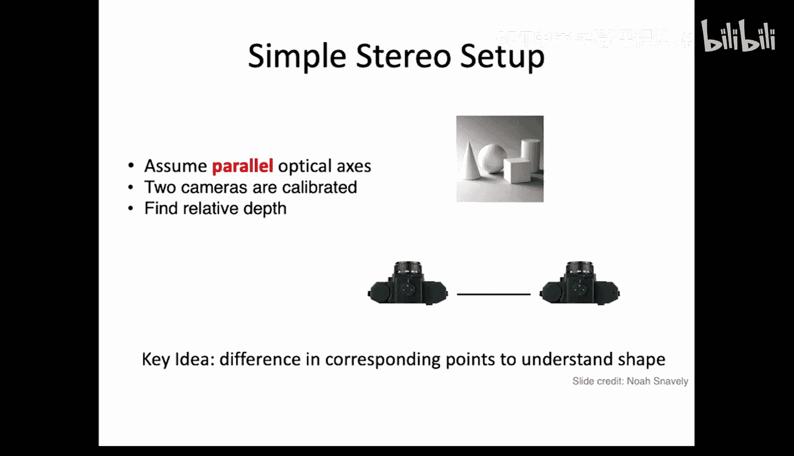

Okay， and so。 we're gonna take a picture of this。 But so basically， it's kind of dark。 I guess can。

 So， so this is the baseline， which is the distance between your eyes。 Okay。

 and then this is optical axis， which is parallel to each other。 You're gonna have this point， U V。

 Like I said， the ground truth point。😊，Or like the true point is somewhere along this array。Oh yeah。

 Thank you。 great， great。 So the this， the U， the point is somewhere along this， right。

 Let's just say。😊，It'， the corresponding point is here。You know that that's the corresponding point。

 Well， now you can triangulate by shooting a radio over here。

And then where that rate intersects is where the， where the actualo depth is。

This is called triangulation， because you're kind of like， triangulating it。诶。有。

So the first thing you needed to know is this point。

 wheres the corresponding point in the other image， you use correspondence finding algorithm。

 and then you can shoot array because you know the camera。

 and then you can shoot array and you're like， where the intersection happens has to be the ground truth。

😊，I't add ground truth， but that's to be where the 3D point is。Alternatively。

 if you know the 3D point， if you know the camera， you can project these points onto the plane。

Because that's like the relationship between the correspondence。

 the camera and the 3D structure that I was kind of talking about。

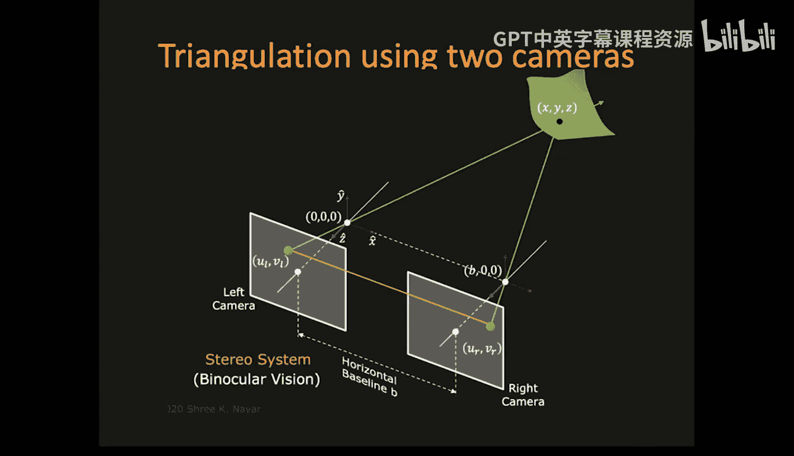

Okay， but let's， let's try this by hand。 Let's do this by hand。 So， so try this。

Or we we're equipped with the theal camera。So， do this。Put 1 hand far away from you。

And then put the one eye closer to you。 and then only look at one eye。Okay。

 and then switch your eyes。I they move。 you gotta make one closer to you。

 You gotta make one closer to you。Yeah， and then try to find a point。

 Try to move your close point so that when you switch。

 it kind of like moves like be back and forth between like。😊，要O。All right。

So what are we really doing。So if you have real， if you have noticed， And then， yes。

 there's a good thing is to kind of like very。😊，The distance。

What can you tell me about the what moves the most。Yes， closer point moves a lot。Right。

 and then the further early point doesn't move as much。 It's moving， but you can't really tell。Okay。

 so this is really how you're gonna solve， so。😊，That kind of tells you something， the more it moves。

The closer it is to your eye。Okay， so let's write this down。So you're gonna have a point x。

Which is where your finger is。It projectss into one eye。And you're looking at it from two eyes， okay。

And there's a focal link。Okay。😊，那。That's where the prediction is。Right， like。

 you can find a point where like when you look at it from one eye。

 it's on the right side of the other eye。 And when you look at it from the other eye。

 it kind of moves around。So that's like where， where the this point。

Maybe you're closer to a finger that moves around an image different eye。O。😊。

And what what do we want to know， do we want to know the depth of this point。Right。Do we have enough。

To know what does is。What can we use， What do we need to know in order to figure out what this is is。

TheYeah， the size maybe yes， that's the baseline。 Okay， I give you this baseline。Now。

 all we can do something like this。What's the idea， same idea。As the previous thing。

Like the similar triangles。 Okay， and the similar triangle is this other triangle。😊，嗯。

Where is the animation of the blue or doesn't come out。Oh， no， it is there。 It is there。

 but you just can't see it here， here， here。哦， thank you thank you thank you。That's the green。

 And there's a。 I see it in my screen but it's very faint， I guess。Oh yeah， like。你是。V听。😊，Okay。

 I have to put this。 Don't work。じまく。Okay， that's making you guys want to look more。And yeah。You you。

Can收。O。O， no。Here we go。Here一个。Here we go。 Give me a that。嗯。Give me a second。

 I need to change this picture from my shape。Color。O。被告。Okay， so there's that triangle。

And that's the other tri。Okay。Okay， so what is the similar triangle， so。

What is the base of this green。What is the base。How big what how big is this？

 How do you know what this is， given what we know。嘟嘟嘟。Okay， I heard something。 Yeah， B， Min。

Or someone said something。O。😊，我 what只 how我是被不 how how want is。Yes， B by S D1 plus D2。Right。😊。

But the D1。Is U。And then you are， you are。 D2 is minus U R。You can kind of do this。

You can stare at this later to figure this out。 I mean， it that's what it is。

 It's confusing because like， these are two different image planes of the same center。Yeah， okay。

 so D1 plus E2 can be written as U L minus as U are。😊，Okay， so what is that U L minus U R。

 So that's the equation。 Okay， so the base is the B minus U L U R。Of the big one。Is to the big bay。

And then the Z， this， the other heights。Z minus S。Is， you know， the length of this dream。Right。

 like basically， this is base to the height， base to the height of the big triangle and then the blue one and the green one。

Okay， again， and then there's a little triangle here。 you can't seeca the color is too light。

 but you can rearrange this。You can move the Z over there。

 multiply the Z minus you can do this thing out。嗯。And then that's what's gonna to come out。

And that is a disparity。O。You can look at this。 But like， long story short。What is U L minus U R。

 Let's go back to your fingers。Okay， U L you are， basically how much it moved， right。

 You guys said the closer the object， the more it moved。Right， so the more move means it's。

 it's that thing。Okay， and that's so it's inversely corresponding to their depth。Okay。

 and if you know the baseline， which we know for our eyes。And then if you know the focal length。

 which we also know for our own eyes， you can exactly come up with the death。But basically。

 the idea is that the depth is inversely proportional to disparity。Okay， so that ya。

 you says further far away。And then the disparity is kind of more like at infinite locations， right。

 at infinite point。It， it's not going to change where it is based on how much you look at it。So。

This is 0。If disabilityparity is 0。The depth is infinitely far away。Okay。

 and so that's kind of like the equation you get。I， I struggled a lot when I was younger。 and I was。

 yeah， yes Sir。So yes， when， no， no， no， no， no， Yeah， when， when the things are infinitely away。

 it doesn't really matter the how far away it is。Yeah， so then for further away， things。

 you're not gonna get this difference。So it might as well you， yeah。我找我 no要。嗯。So like。

 I kind of was confused with this word disparity。 Okay， what， what is disparity。

 Disparity really just means distance difference between where it projectss you。 like， you know。

 where your finger moved to， okay。😊，Yeah， like in two images。 I that， is that clear。Okay。

 so when I say what is the disparity of the closer point。 So you do this thing again。

What is the disparity of the closer。Say big or small。That big。

 And then what is the disparity of the far away point。It's small。 So， basically。

By looking at how where it moves an image， you're basically saying something about how far away it is。

O。啊，没。有。So then I want you to do this finger exercise again。Where， so do it again。Do it such that。

Like， when you look at it in one eye， they align。 like。

 you can't see the other finger because they're in the same line of sight。对的。Okay。from one eye。

 you can see you， you only see one finger， right， And then look at it in the other eye。They move。

 right。And then change the distance between your fingers。 If they're the same， same， same distance。

 you don't see the difference。And then the more further away it is， you， you'll see them move。O。😊。

Anzo。This distance is called parallax。Okay， and then this relative displacement is higher as the relative distance grows。

 further away it is， the more you're gonna see the difference。 as in like you。

 you make this closer and then you do this I and they're， they're not gonna really change。😊，But like。

 you， you'll see more distance over here。 So like， this is a picture。You have your one finger here。

You have the other finger here。 You predicted it。 you only see the blue stuff。Right。

 because it's overlapping。But then if you have， if you see it from another eye， they move。I mean。

 they don't overlap anymore。 And that difference is called parallax。What does the word parallax mean。

If you're good in Greek or if you're Greek。Parallax means it's a from Asian Greek word paralas。

 where para means like side by side or like parallel。😊，And then the last part is like alaso or to。

 to change。 So like a side by side changes， changes as you see， as you change your motion， so。

It's basically changed in the position that occurs from seeing it from a different point of view。O。😊。

Question about the parall。So what does parallax give you。If there is no para。What does bear like you。

Parallax exists between these two red and green， these blue and red points。What does it say about。

Then。😡，The relative depth。 We relative relationship about this。

And then the two eyes already give you parallax。 That's kind of the stereo。

 That's what we mean stereo。 Okay， but you can also move around。 Animals do this。

 like pigeons have to bo their head。😊，Because they don't really have stereo， like we do。

That's also called motion parallax。So， as in， like。If you go to a hike。

 if you go on a hike and if you see like P in， there's like multiple mountains， you're gonna move。

 And like the furthest that way mountain is not gonna really move as much as the closer mountain moves。

😊，Right， and so like， if you move around， that's called motion parallax。Okay。

 this is very important stuff next， is that。You really need to translate in order to see the parallax。

 or the relative depth。Okay， so recall in homomography。

This is like a pencil of like raised shooting at you coming into your eyes， right。

If you rotated your eye around the same point。You're still seeing the same point。 Like。

 you're never gonna see the red right， by rotating。喂。牙。But if you move。

 you get to see the red and the blue， and they're gonna project a different location。

So this is another way of seeing。Like， if you only have a single eye。And the world never moved。

 And if you didn't have any priors， you can't tell the world between like。

 if somebody kidnapped you and like， only showed your eyes to make you sit on the thing， okay。

You can't tell what if you're seeing is like， just a painting。Or an actual world。

 because you don't have any depth queuees。 It could just be， maybe they'll take you to a VR world。

 You can't tell。 Maybe it's like a picture projected onto your screen。But if you have two eyes。

 you're gonna see that。You're gonna see this kind of， you。

 you're actually seeing this depth in the world。 And therefore， you know that it's a real world。

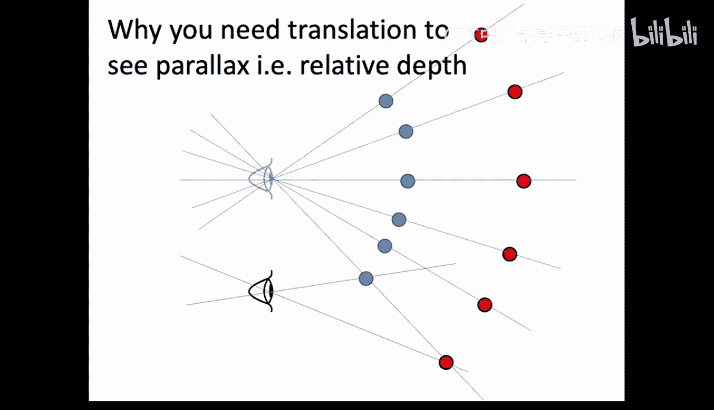

Okay， but basically， the point is if you have this stereo。

 if you can figure out the disparity between the left and the right images。

 you can find something like this disparity map where red white means large。 blue， black is 0。

 So closer stuff has large disparity， which means it's。😊，Closer to you， yeah。Great， okay。

 so were gonna we have to figure this out。 Okay， so when we did this finger exercise。

 we know how much it moves because we know that this point at that point are the same point。😊。

We're solving correspondences。

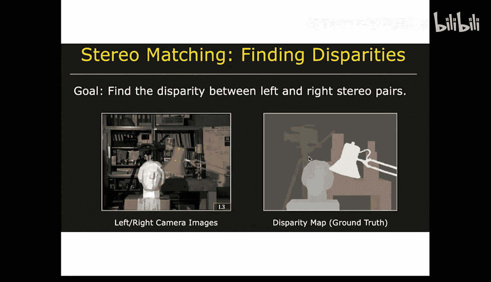

Okay， so this requires us to solve the correspondences。

So where is the corresponding point going to be。And there's a hint。Hint in this picture。

 So this is the point， right， And it predicts into these two images。😊，Okay。And。Where， O， So if you。

 if I said， what is the corresponding point in the other image。You have to find it。But like。

 can you see some regularity about their relationship。Ha to be along the same line as。Exactly， it。

 it's connected by this red orange line。Okay， and what is this orange line。 It's called， I'm gonna。

 we're gonna get into it。 and it's called Eollar line。 and it's complicated or it sounds complicated。

 But it's really nothing but。 But you know how these three points define a a trap plane。 right？

 It's really just the intersection of that plane with the image plane。😊，Okay。

 and that gives you this line because you're kind of slicing your image planes with this。

 with this relationship。😊，O。😊。

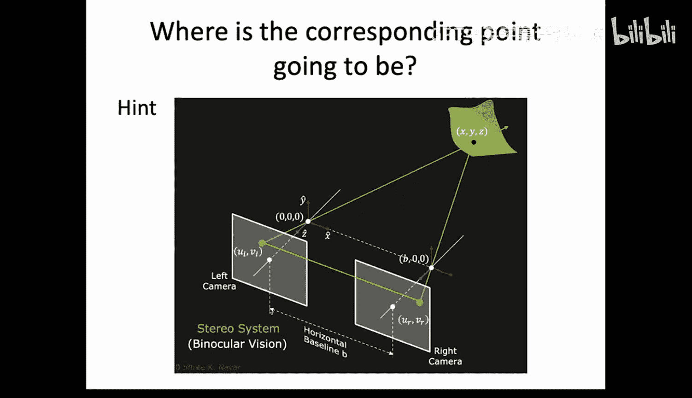

We're gonna get to a more complicated version next week。But if polar line really is this point。

Has to be on this line for this rectified theory。 We have a very special case， right。

 where the eyes have the same rotation， but only translation。 And so in these cases。

 it's always going to be on the line。😊，O。😊，And then you take the x 2 minus x1。

 And that's the disparity of the pixel question。嗯。It's kind of like you。

 they're gonna be in the same image plane， right， So like it could be on， you mean like。这个的关。Yeah。

 but like you， you like put these two dots in the same image plane and you look at the this difference between like。

 you mean， like， if the other image is over here， right， it's difference between here。The other。

 if image went， if the other corresponding point was over here， then it's like that's the difference。

这佢。啊，没。Yeah， so this is why we need to write this away。 I think this is， this is this thing is also。

Talking about this one， like the reason why I that I think it comes from that relationship。

That's where it comes from。嗯。Yeah， it is a little bit。一。I'm not really seeing what your question is。

 actually。Like， like outside of the two lines， like， like outside of the image。Oh like here。

Then they will both be outside， you mean。啊，没。But it's always going to be。这个问题。

You could have an infinite。 You could have an infinite plane。 I think it works。

 even if it's on the infinite plane。I think。 I don't know。要不。Yeah， I think that。

 I think the point is absolute value。 But like， I will look into this。 Like。

 what do you do if the point is outside and they're all on the positive side。 I guess it's like。

 you still look at the difference in these two and you should be able to get the difference。😊。

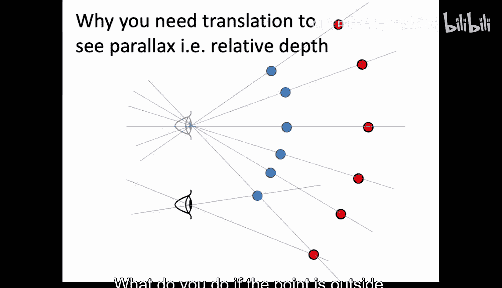

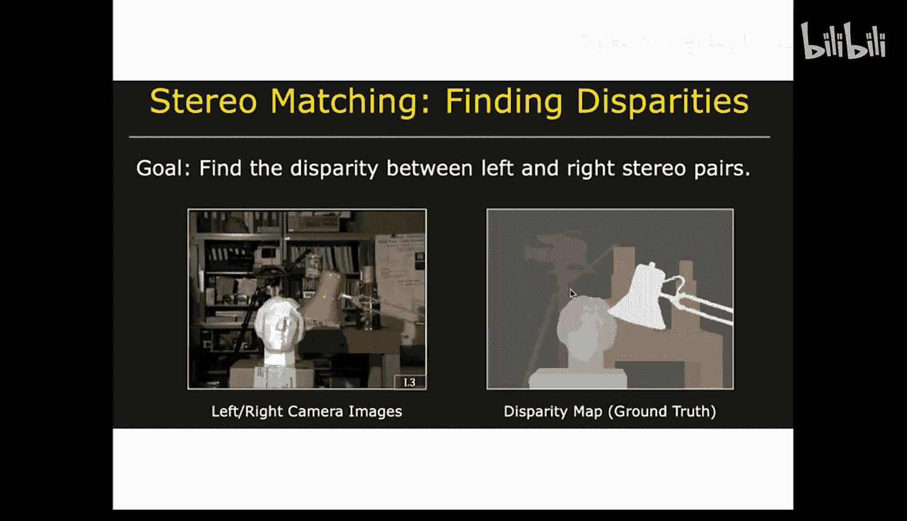

Okay， but okay， so that's the disparity of the pixel。So basically。

 the algorithm for your stereo is that for every single point on the left。

You figure out the epicpoder line。Well， I guess before every single white people are lying。

 you're gonna have for each pixel in the left image。

 you're gonna figure out what compare every single pixel on the right image and then do the pick the pixel with the minimum match cost。

😊，Okay， and then so you're gonna do this kind of rest scan For this point， what's the correspondence。

 For that point， what's the correspondence。 And you're gonna go find this。

So this is why is this nice is nice， Because instead of searching the entire pixel on the other side。

 you only have to search on the line。 So like， it's so much more quicker， right。😊，Yeah， works。Yesあの。

Yeah。For now。 But later， we're gonna talk about the general case。 and it's still gonna be a line。

 but it's gonna not be this flat line。

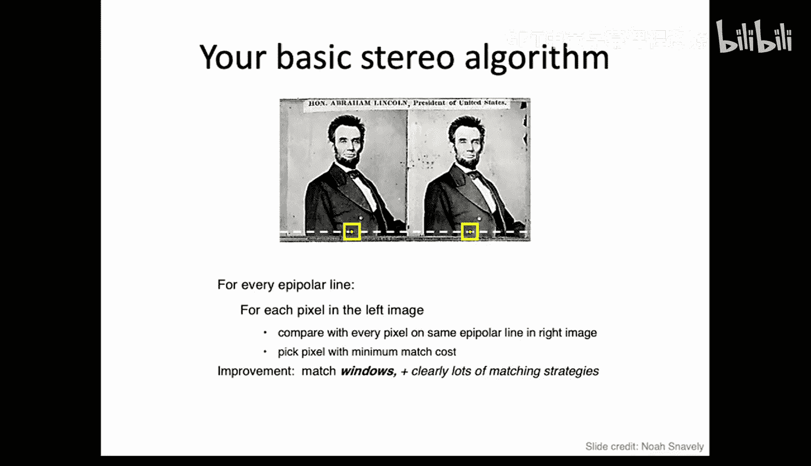

Good question。 So then you have to do this kind of like scam thing。

 And then you're gonna do your favorite correspondence algorithm。 You can do like。😊，You know。

 normalize cross correlation or SSD or like any of these stuff。

 And so that's how you're gonna do this。

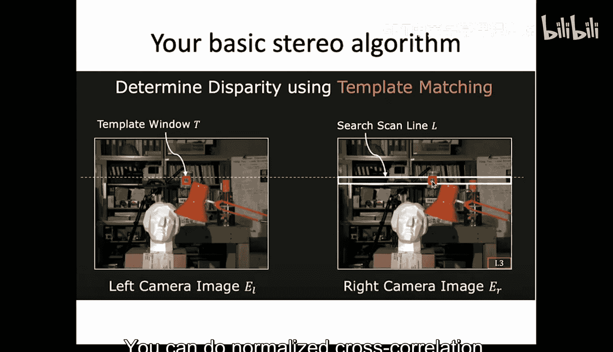

This is kind of visualization of the correspondence， like。From each one， I guess it's like， you know。

 lower means。Corspondence， I guess。But like， it is kind of noisy。

And so if you just look at a single point， it's very difficult to figure out the correspondence。

 So you look at a window。 So this is like you， you're very good at this Now。

 you can also do this across multiple scales。 Basically。

 this is just figuring out if the point is similar to the other point。

And so you can do this normalized cross correlation， which you already know。嗯。

Here is just some visualization of the。Similarity in this bond。嗯。

And then you figure out where the closest point is。Yup， and then in this case， course correlation。

 the highest means similar， similar。 And then you compute your disparity。Okay， so basically。

 you do this dense correspondence search for every single Epolar line。😊，Yeah。

 we just did this compare with every other pixel。 Pick the position with the minimum match cost。😊。

Okay， you can see how this is gonna be bad for texture list regions。

 becauseuse then it's all look similar。And so that's the challenge of these， you know。

3D reconstruction in the way that I tell you right now are all going to suffer from this problem。

 because when there's no texture， there's no correspondence。It's like， you know， that white wall。

 If I like shift that white wall， like， you know， any points can't match any other points。

 So this is why it's a challenging problem。You know， you have to do this like multiple scale。

 multiple size of different windows。 You can do all kind of things。Right， like many， many。

 many points that matches in this other image。Yeah。

 so then you have to do like search over different windows sky scale and stuff like this。

 But then the larger the window， you know， more， you know。😊，More said， you know。

 it its but you don't want it to in be too big and stuff like this。 So it's like a big challenge。嗯。

Yeah， so these， these are different disparity found from different window sizes。The problem is。

 the bigger the window size， it's going to also include like areas of different disparity。

 And because if the pixels of different disparity， they're gonna move differently。

 So it's not gonna look right。 And so you can't really match them。And so this is why you're gonna。

 you have these like nice skinny stuff。 but so noisy on like like black pictureless region。

 Like this stuff is less noisy。 And like in general， the disparity of the depth is correct。

 It's like getting further and further away on the ground。

 But like you miss out on all of these small things because you can't match like the tiny stuff right。

 because they're actually gonna look different。😊，Okay。

 so the problem with the stereo is that the surface has to be known repetitive in texture。嗯。

And there's also this like foureshortenening effect where like things basically look different once it get gets projected。

 And so this is why it's also difficult to match them。But here are some results。This is a very old。

Data set that people like do this experiments on。 And there are many different ways in which doing this。

Okay。But basically， the bottom line is。With a simple stereo system， like our eyes。

It's about how much the pixel moved or the disparity that gives information about the depth。Okay。

 and then you can use correspondences to measure the pixel disparity。😊，And then， in the next lecture。

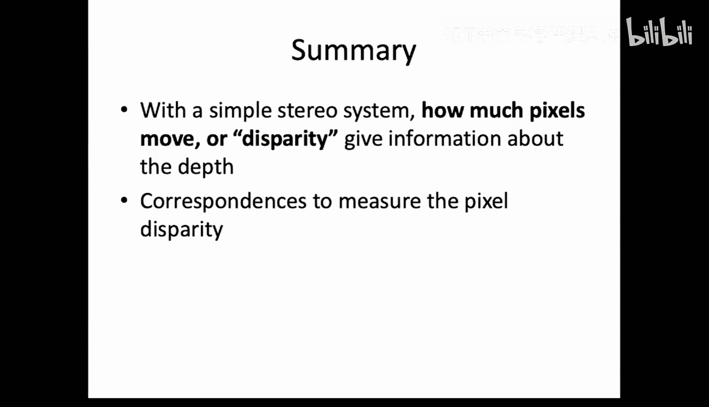

We are going to do from arbitrary views， like， you know， it's not， it's。

 it's now iPhones instead of your eyes。 So they're gonna rotate as well。You're gonna do a version。

 like with and without known。So we're gonna do a version。

 You have to do a version where you also don't know what the extrinsics of these cameras are。

 which is the natural normal case with an iPhone。 Often you make a simplifying assumption that you can assume that the intrinsics are known。

 And sometimes you can get this information from your camera。 camera has like a metadata。

 which actually says， what was the focal length。 what was your optical center。

 And then like what was the make of the camera。 So you can have extra information about this。

 although you can also solve for this， too。😊。

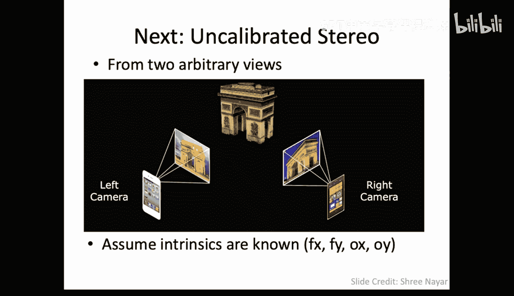

If I have time， I want to show this particular video， which is from the next。😊。

Which is from the next lecture。So， everybody makes this mistake。

Well not mistake。走。What did we do， what we did was if you have two eyes。

 you're gonna be able to figure out this like disparity。Okay。

 disparity is inversely proportional to depth。Okay， so basically now you know。Up to some scale。

 like the depth of this like particular location。And often， people think that。举击。

But here I'm illustrating what kind of information is recovered by that particular disparity。I mean。

 it's a little bit of a strawman argument because this depth was actually recovered by a monocular depth network。

 So it's actually from a single view。 And you do this with a supervised learning。

 So like like you did in your project 5 or you are doing， instead of predicting the key points。

 you can train this thing to predict the disparity。😊，So you can get something like this。

 And then here is the visualization of the pixel。That is warping according。

 And then I'm changing the camera view。 right， Like， I'm moving a camera like this。

And seeing the same image。 But I'm actually rendering the correct position， like the disparity。

 like the， you know， like the giraffe is closer to you。

 So it's moving a lot more than the background。😊，Right so I'm warping the pixels correctly。

 according to the depth in the camera。But I guess what I wna say is that it doesn't really have the full threeD information。

 It's not yet it's it's 2。5 D， like the stereo that it gives you the stereo。 And it's very important。

 like， for example， if you're pouring yourself like a glass of wine。You know， you。

 you want to have two eyes so that， you know exactly where， you know， you want to have this。

 It's important。 That's definitely 3D， but。It's this ability to kind of like。F all of the， you。

 you go around an object。 You see it， and you have to like put it together to a 3D。

 like coherent representation。 That's。That's more 3D than the 3D you get from your stereo。

It's kind of what I want to say。Like， this is why some people， for example。

 why when you look at the depth and images， you call it 2。5 D。Because it's it gives you， you know。

 more than 2D information。 but you only get to know the depths of the visible points。

 This is what the black part is saying。 Like， you don't really know what the。What。

 what's behind the giraffe， right？ You only know what the depth of the。 So that's it's like 2。5。

By the way， if you go to， I don't know， Facebook or like 3D photos。

 like you can there are all these applications that kind of give you 3D photo ethic or like Dolly zoom kind of effect。

 That's kind of what it does。 This is basically what it does。

 which is that you use some kind of molecular depth prediction。 or nowadays， cameras have。

 two cameras right your iPhone。 So you can compute stereo because for those。

 you also have calibrated camera。 So you do that stereo matching algorithm。 you get this depth。

 And then you do this rendering。 And what you do is use something like diffusion model or any kind of in paintingting model to like im paint the background。

 that really gives you this ability to kind of like look around and gives you this like 3D photo。

 That's how it works。 So now you kind of know how that works。😊，OK。Alright， next lecture on more 3D。

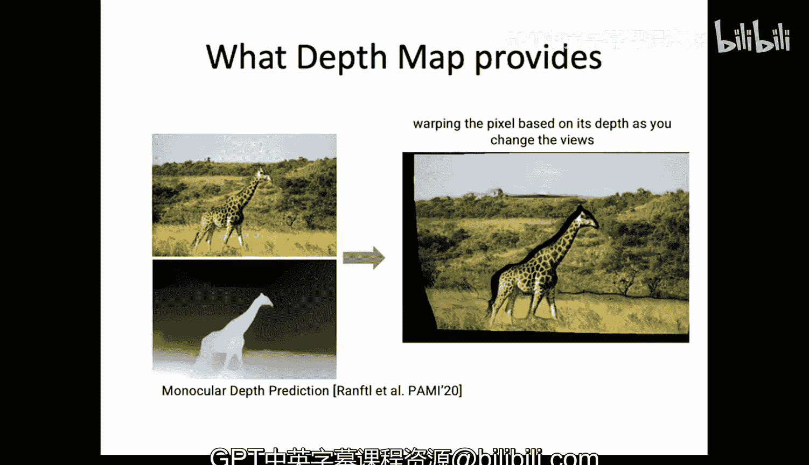

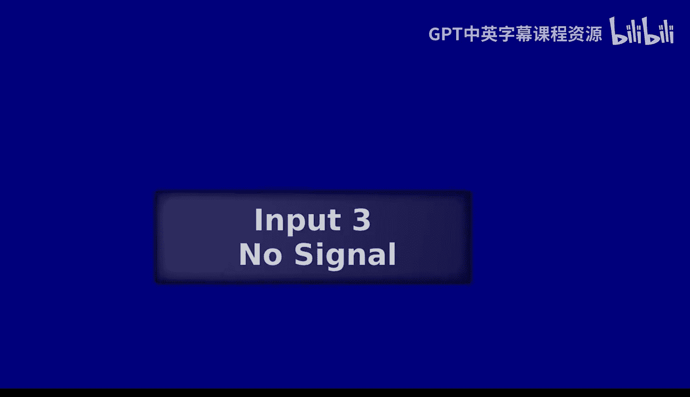