# UCB《计算机视觉与计算摄影学｜CS 194-26 Computer Vision and Computational Photography 2022》中英字 p21 -P21-21-epipolargeometry-11_7.zh_en -BV1w7UfBdELA_p21-

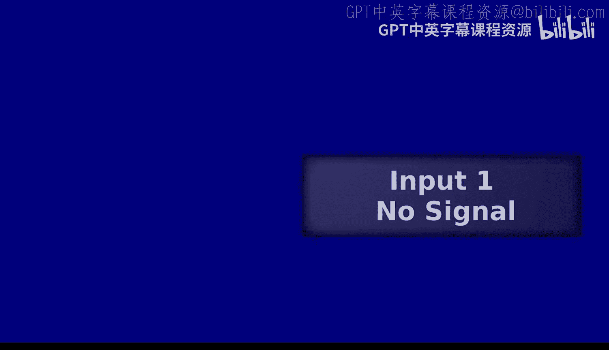

hello hello。😊，Okay。All right。Let's get started。It is 5，11。And。ではで。Oh right。

 you know what we're going to start with？You know what we're going to start with？我喂。ワプクズフイメい食い。

If you don't have a device， come get a physical copy。Anybody wantna take a physical copy。5 minutes。P。

一级B级。In terms。I wait till 5，15。要。Yeah， feel free to use the paper。 paperper is easy。Here。嘘。

Anybody else with paper？Good old paper。Paper 2， if you want to go go， go， go go。Two more minutes。

internet。嗯。不是吧的。One more minute。야呀哥 go哥。I also have paper， if you want。俗。Project 5 is you soon。

 right。有。I will give you。30 more seconds。30 more seconds。3 you seconds。Oh， if you came in now。

 we are doing a pop quiz。You should take a picture of it， a up。A3。Or take this paper。

And we will move on to lecture soon。Hofully it was not。2 번。You can give me the paper。 All good。

 can you get that。O。Alright， thank you。 Thank you。 Thank you。😊，Thank you。Okay。

All right。嗯。Okay， let's。Let's get going。So。We are doing stuff at 3D。Here are some more cool videos。

That you might want to know how it works。嗯，那。The thing on the left is 3 E photo。

And last time I kind of talked about how this is being done。Again， we kept。Okay， so let's recap。

This is the model that we have。And。I just w to be clear again about one more time about what happens going from image coordinates to pixel coordinates。

 So， you know， there's a couple of things I said， I said there are like three coordinate systems。

 but actually， there's a fourth one， which is the pixel coordinate system， which is。😊。

This is kind of like putting pixel coordinate。 This is pixel coordinate。

 There's like a coordinate in the image plane。 and you have to go to the pixel coordinates。Okay。

 so going from the world to the camera is just a rigid transformation。😊。

And going from the camera coordinates， you do the perspective prediction。

 and you also do this intrinsic stuff。😊，And I just want to remind everybody that the reason why we do this。

Its because in this image plane， where is the， where is the origin。Where's the origin in this one。

Center， this yes， this white dot。 That's the origin。 But in the image coordinate space。That is。

That is， yeah。 so 0 goes to the top left。 So you have to remap this 0。

0 to wherever the center of this sensor is， which is often like the middle。 Okay。

 so this is like height divided by 2 with divided by 2。 Okay， that's often the principal point。😊。

Okay， if your image sensor is somehow shifted， then that's gonna be different。 But basically。

 wherever this is， you wna make sure that that's the center of the image or wherever it it it's most often the center。

 So you can just think of it as a center。 And the actual 0，0 is like that offset corner。 Okay。

 so this is why you need to add O X O Y to the 0，0， because that's where the O X。

 O Y is gonna be in the image plane。😊，Okay， and then you also multiply with the focal length for the perspective projection。

 And then there's aspect ratio。 But you guys don't really need to worry about this。 It's mostly。

 most of the times it's equal。O。Okay， so that's the parameters。

 And let's not forget the big picture in 3D reconstruction。

 which is that there is the correspondences and then the camera and then the structure。😊。

And these things act within within each other。 So let's see。What is this problem。

We talked about this problem where you know the 3D points， You know the correspondences。

 and you want to search for the camera。 Do anybody remember what this process is called。Like。

 what is the camera parameter given these things。😀呵呵。😊，This is什。😊。

This is really really this is on where you have like tickerboard to figure out what your camera parameters are。

Caallibration， exactly。 Okay， this is。 so this is the problem of calibration。 Okay。

 I'm just breaking it down in terms of what is the input and what is the output。😊。

So this one is that of 3D reconstruction。 This is what we're gonna talk about today。 Okay。

 because like last week， last week， we talked about how to get the camera motion by doing this calibration。

😊，And we're gonna do assume that we're gonna do correspondence。 We're gonna talk about this。

 We did a little bit with the stereo。 Okay， if you have these two， you can get the 3D。Okay。

 and the thing we're gonna talk about is that if you actually know the camera。

 it helps you figure out the correspondences because they lie on the line like we did with the Epoder geometry。

😊，And if you have the corresponds， you can also estimate the camera。嗯。

Which I'm not so sure if we're gonna get into this。 But this is how that next lecture。

 you're gonna talk about this。 structure for motion is the general problem where you don't know any of this。

 You don't know anything about it。 All you have is set of images。

 So then you have to start with correspondences to estimate the camera。

 That really helps you to get the 3D point。😊，Okay， so those are the things。 And what we。

 what did we talked about， talk about。 So we talked about how to estimate the camera parameters。

 This is camera calibration， solve for intrinsics and extrinsics。

 And then we talked about this simple stereo case， talked about parallax with our fingers and how things move differently。

 depending on its depth。😊，And the depth is inversely， inversely proportional to disparity。

 like the more it moves， the closer it is to you。Okay。

 and here is another visualization of what the depth map provides。 As in it gives you the 2。5 D。

 you know， the， the， the depth of things， which is important for you to pour your wine into your glass。

But it doesn't really give you all the information unless you move around your head and look around the giraffe。

Okay， of course， if the giraffe is moving， you can't do any of these geometry stuff。

 which makes it super hard。 And that's actually my research。

 which is about how do you reconstruct these non- rigid things from images。😊，But earlier。

 I showed you this。You know， they used to have this like， oh， here we go。 Earlier， you， I used。

 I I showed you this thing on the left。Like these 3D photo。Okay， how that works is like really。

 basically。You compute the depth， using。If you have stereo， that's a one way of doing stereo。

 but you compete the depth using some mono depth， which is a learning based approach。

 which is just like your project 5。 But instead of predicting key points。

 now you're predicting disparity。😊，And then you have this hole。

 and then you fill in the hole with like methods like diffusion models。

 Then that's how you do the 3D photo。Okay， so any questions thus far。Okay， alright。

 so next is the general case。 Okay， so we talked about this official case where like cameras are like aligned like our eyes。

 like they're like parallel。 They're on the same plane。 But in general， when you take a picture。

 my microphone is loud today， isn't it now you want to do the case where the cameras are arbitrarily。

 like it doesn't have to have this like side by side eye kind of situation。😊。

But the same thing happens。 We find the corresponds， and then you solve for structure。O。So。

One idea to do this is。To take something that isn't rectified。

 That isn't that that isn't on the same plane。 But from your homomography lecture。

 you know that you can always transform a plane into another plane。

And so you can solve for two different homomography that makes them into a plane that is in the same plane。

Or like， transform each image into another set of image where those images are。On the same co planer。

 So you re project imageplay onto this common plane。And then that， in that way， the， you。

 you set up this kind of like。Side eye situation。 So you can do exactly the things that we did with last week where the correspondences are on the horizontal line。

 And you know how to do this， actually， But the homomography is your tool。 You can read this paper。😊。

To do it， I guess if you're into 94， this could be a cute project。

Or what we're gonna discuss today to view geometry。 If you wna work on it。

 we should add it to a can the project。 I think that's kind of what we're trying to think， okay。

To do this Epolar geometry based 3D reconstruction， to view base 3D reconstruction。 Anyway， Okay。

 so that's one way of doing this。Okay， so for example。

 you get these two images that aren't taken from this like rectified camera。

 but you're gonna fake it by homoography。Okay， and then you're gonna find the correspondences。

 and that will give you the disparity like the same way that we were doing。 Well。

 that will give you the correspondences。Why， why are we really doing this。Like。

 what's the whole point of doing this， Like， I just want to see that we're in the。

 in the big picture， yeah。因 calib。Ca， then what is the nice thing about the fact that it's rectified。

 Like if it's all， if the two camera images are on the same plane， what does that give us。

The depth a little bit before that， when you do the depth， you have to search for correspondences。

 right， And did they lie on the line。If you did this， the line is always this same line in the row。

 Okay， so that's why you want to do this。 Okay， that's everything about last week's lecture is that。

 you know， I'm trying to look for this correspondences。 I， I know exactly that in this setup。

 it's gonna be on the same row。😊，Okay， so that's really nice about this rectification。😊，Okay。

 the thing is， in most general cases， you don't。 And so you can do this homomography。

 But is there a better way to do it because the homomography also like kind of warps the images and everything。

And so you can。 You can directly try to find the correspondence。

 but still do this idea of Epolar geometry， which helps you identify where the correspondence can be。

😊，O， and that's the step of finding corresponds you don't want to find throughout the whole image。

Right， so the goal is to restrict the search space to one the。

And then what is the relationship between the camera and the corresponding points。受。We found this。

 I kind of told you that the Epoar Plas are on this line。 But what。

 where does this concept really come from。And so this is what we're saying。

 So given the P in the left image， where can the other corresponding point。B。Okay， and so。

 for example， suppose this is the point that we want to figure out the correspondence in the other image。

Okay， the first thing we can do is do O N search， do like your first project kind of， you know。

 but that's super slow。 And it's not very good because it it's gonna have a lot of outliers。

If you know， maybe you can restrict it。 But in general， you don't know anything about the theme。

 maybe。And， of course， if you knew it， then that's one thing。

 But that would be the line if it was rectified。 But this isn't a rectified case。

 So that's not the right line。What is the right line， The right line look like that。O。And。

Where does this come from， And I want to give you a very good intuition。

 because this was very confusing to me。 But it's really simple。 It what， what it is is really。

 you take a point。Right that you want to figure out the course funding point in the other image。

You should array from the center of this camera to that point。 And that gives you this rate。Okay。

 the line of the where you search is simply the projection of this line in all the other images。Okay。

 okay， take this one。 Okay， so that's the one you want to figure out the correspondences。

It has delight on the other image。Right。And then the ground truth correspondence depends on the actual depth。

 If the depth is here， it would be here。 If the depth is here， that would be there。 But basically。

 you shoot this ray， and then you project it onto that。It's kind of like。

If you projected the other rate into my image， what， which line does it give you。

 So if you think about it this way。Visualize the camera in the scene。 Okay， so。

I'm looking at this camera from here， right， like this， I mean， this one。 where。

 which direction do you think you can kind of see that the other person is kind of looking at the camera from like that direction。

😊，Right， and then that's the way that's kind of being。Like。Shut。😡，Like this ray， that。

 that ray being projected onto this thing gives you this line。

So that direction kind of should make sense to you because it's kind of like going down that way。

 Like， it looks like the view point of this camera is like somewhere high here， right。

 And then that point is kind of like that。Or actually， this line。 I mean， that's what that line is。

 Like you predict that line。I think， I think this is， this mixture really clarifies it， right。

And then， and then the project of that line is over here。 and you can do it to every other image。

 that's， that's all there is to it。 And that's where the rectified case came from， too。

 But we're gonna derive this。Okay。Okay， so the reason why it's a line is because given this correspondences or given this point。

 you want to figure out the corresponding point。 Well it depends on the depth。

 but it's gonna be on the line because if it's there。It'll be there。 If it's there。

 it'll be there and so forth。Okay， and like I said。

 the ground truth depth is somewhere along this ray。You predict that that becomes a line。Okay。

 and so that's called the Iippolar constraint。And。Exact same thing happens on the other side。

 So for every correspondence， you have a different line。Okay， for a different P。

 you have different lines over here。 like you have different lines。Yeah you have a。For that P。

 you have this this line。Yeah， okay， so let's figure out how to。Derrive this。 any。

 any questions on the conceptual。Set up， yeah。Yes， this is all assuming we've calibrated the camera。

 You can also do this without intrinsic parameters。 We will talk about this。

 but we definitely know the extrinsics of the camera。😊，Good question。

And that kind of leads to this definition。So what do we have。Okay。

 what we have is this thing called baseline。 Bline is a very important term in in computer vision。

 If you work with me， for example， you'd try to capture a video or something like this。

 And I would say， does it have enough baseline。Okay。

 baseline means the distance between the two cameras。 And then larger the baseline。

 that means like more extreme angle that you're looking at the scene from。Okay。

 and then that's important because。If you only have eyes that are closeest by。

 you're not gonna be able to see。 You're not gonna be able to see that much。 You know。

 it's very limited field of you。 You get， you will get like the 2。5 D。

 but you're not gonna really get。Lot of different views。

And you need to look at it from different angles。 So this is why why baseline is， in general， good。

But the wider the baseline， the harder the correspondence problem is often because you're looking at it from a different viewpoint or further away。

So things can't look different， foreshortenened。 Or if you walk around it， there's some different。

Effects。Okay， and then the Epolar plane is the plane that is kind of like this triangle that cuts through this image。

That's called the Ebolar Plain。So it's like the baseline and the two raids or like baseline connected to the ground through 3 D point。

So there's like the two cameras And wherever the 3D point is， there's this different plane that。

Associates to every single 3D point。有。O。And then there's such thing called Eible。Which is like。

 where the other image。Is in your image plane。Okayay。

 so that's or the intersection of the baseline with image plane。Or projection of the other image。

 other camera into your image plane。 Sometimes it's in the image。 Sometimes it's not in image。嗯。

Question。いや。结文。Yeah， good question。 with it's facing each other。 That's a very extreme case。

 And if it's facing each other。😊，You're not gonna see the same point。You're not gonna have the。

 you're gonna see the same 3 point through transparent things。 But like。

 if I saw this particular point this here， right。This， this will look black。Yeah。

 you look at it from the other。 It will like look very different。So that's a very hard case。

And so does this work。If it's that case。You can certainly see the Ipool。Or in the other image。

I think it's。I think it's like， well have a case where you're， you're like moving in。

 that definitely works。 I don't think moving around work。

Because you might not really see the same point。 And there is no correspondences。

But we'll do more experiment examples。Good。Qu身。😊，It's， it's okay。

 So that's where every single point P。 every single depth point gives rise to correspondences in each image。

Okay， and then every single thing has this。Relationship。O。So this is a cute picture。

Where is the Eible。What is the Ipo。😀哎。😊，Do you get this。So， the question is。This is the other image。

 Okay， and the other image is taken by that picture。O。😊，Alright， then the editible is where。

The center of the other image in this in this camera。Okay。

 that's where the baseline is actually straight line through here。

 So this is kind of close to your case。 kind of like， you know， almost looking at each other。Yeah。

 I mean， so you so some points are visible。 Yeah， and then so。

This is why people are pointing to the epi。Yeah， you should really think of it as the projection of the other camera onto my image。

Then the projection， the center of the other camera is here because， you know， that's the camera。

 And that is projected precisely here。 And so that's where the Ipo is。😊，是。Okay。

 so a couple of examples。 So with these conversion cameras。😊，Eippolar lines go through this Ipo。

 And it's kind of， that's like the found shape that it's going to take。嗯。

That's kind of the case that we been looking at。Okay。Here is another example。With the picture。

So that's like the image kind of I think you have to rectify the view of this thing thats， you know。

 like that。And then that like that。 And then these are the lines that go through it。ok。嗯。There。

 there's the parallel to image plane。 That's the rectified case that we've been looking at in the last week's lecture。

 And in this one， because they are on the same plane。

 The other camera is never in your image plane because they are parallel。😊，嗯。Or theyre coplaner。

 And the Iical is said to be infinitely far away。 And this is one of the reasons why it gives you this。

 like， horizontal。😊，啊，line。And then the other one is this forward motion。Where the。Like。

 if you only translate fixing everything。Fk same then the Epo。Is this focus of expansion。And like。

 if it doesn't move。So this is the second image。 And in the first image， The people doesn't move。

 The people is in the same place which is the other camera。

And then the borderer line kind of goes out from the principal point。These are all kind of fancy。

Couny situations。So， that's like。Taking more pictures of that。Cutting through the plane。

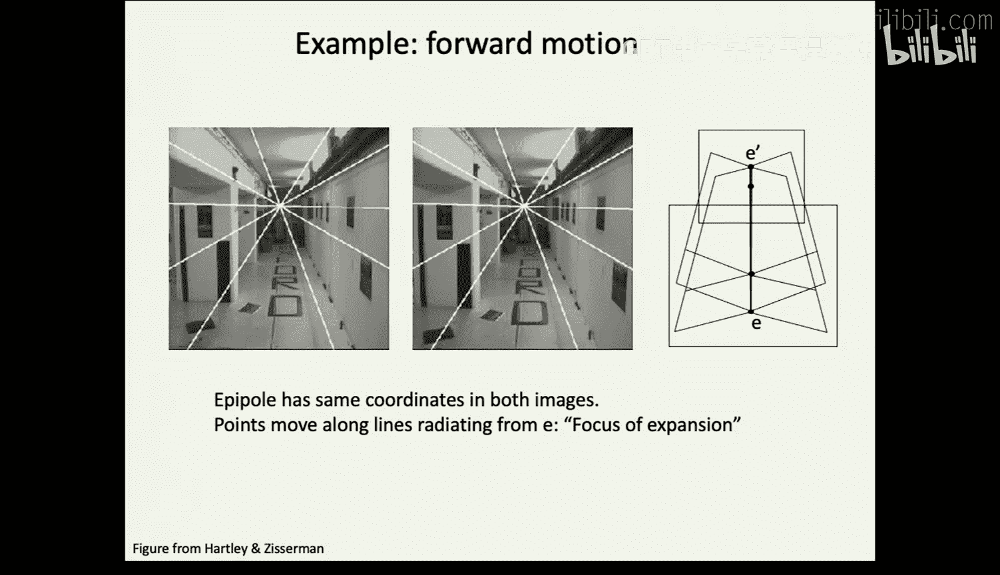

Okay， and。This motion perpendicular to the image plane。Is often used in movies。

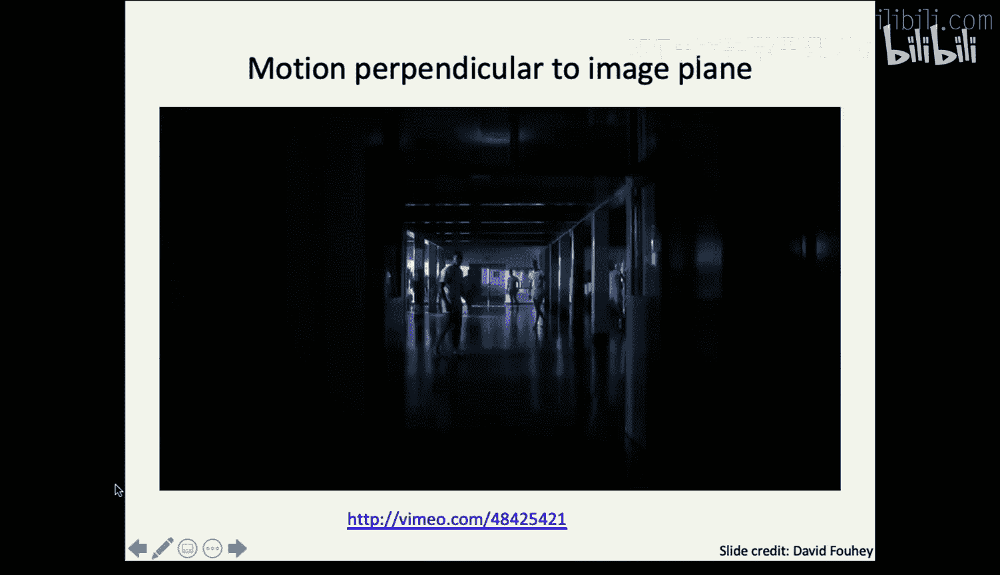

嗯。Like。

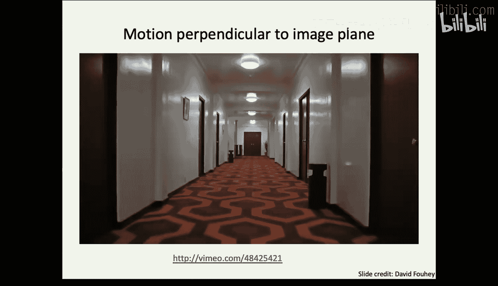

This is cubric focused。I think it's more like just Kubrick， actually。

 probably a study on how he does this a lot。

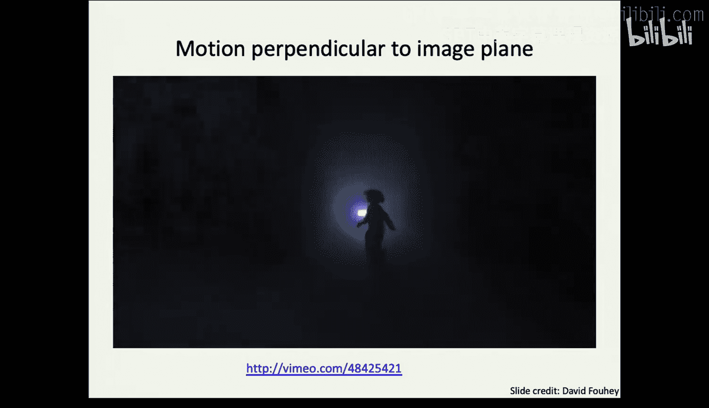

对啊。So it happens often。Okay， so。Where， why are we telling about this。important to remember the。

 the reason why we are talking about this。Is because。We want to find the correspondences。

 and we want to reduce the search。To a single line。

And the goal is to do3D reconstruction of the corresponding points in the image。In order to do that。

 you need to get the correspondences。 So now we have the camera。

 You're gonna get the correspondences using this Ipolar geometry。 right。

 camera helps you reduce the search space。 You're gonna find the correspondences。

 And then we're gonna do triangulation。😊，So that's why we're gonna talk about all of these things and。

It's a little bit like dense。But。You know。That's， that's kind of where we're headed towards。

 And this is this traditional way of doing structure for motion。 Well， yes。

 this is two View geometry。 And next week， we're gonna talk about what if you had more than two。

What ofproof。Okay， so let's do。Okay， I'm just repeating knife searches everything else。

 But with the Epolar， it's 1 D。 So we've seen many of these things。 So how can we construct。

That's the epicpolar lines。 How can we actually compute it。O。So before I talk about this。

 I told you that the intrinsics are known， right， So this is like the focal length and the optical the principal points are known。

 And remember， we shifted something that is a 0，0。😊，To the center of the image。

 because that's what the image coordinate makes you do。 Let's just undo it。Let's just undo it。

 So this is homogeneous coordinate 3 by one matrix。 that's just inverse。 that。

 that's like1 over F minus O X。😊，Okay， so we're gonna factor out the effect of K just to make our conversation simple。

 So this is kind of like。😊，嗯。This is similar to。Like think of it as an image plane where the focal length is one。

 And so this is like x over Z Y over Z in one。And this is called the normalizedize image coordinates。

And it's nice because if you did this。😊，Okay， you're gonna use this normalization。 And it's like。

 you don't really need to worry about the K at all。 Okay， it's like as if。

So the first image is identity。 Remember， like， this is often the camera extrinsics rec calibrated。

 but we're gonna sit。😊，Say the left image to be the origin identity camera。

 And then you're gonna define the motion of the other camera as a rigid transformation R N T。

So that's the R N T。 Usually， there is a K， but we've multiplied it out。To that。

 So we don't need to worry about this。Okay， and everything that we're gonna have a discussion is going to do in this normalized coordinate system。

 So you don't need to really worry about this image stuff。So， with that in mind。

Let's look at this particular example or like this， the state of things。

And derive the epicpolar geometry in epicpolar lines。嗯。That point。I no。Identity。

 because the camera is at identity。 Okay， this is like the identity world， camera coordinate frame。

 Like this is might as well be the world coordinate frame in this case。 And then you're gonna define。

😊，You solve for the rigid transformation of this other camera。O。And。That's the 3D coordinate。

And that's four dimensional， because it's a homogeneous coordinate。O。😊，Yeah。

 so the prediction of this point is that project of that point is this。

 turns out that this camera is the identity same as the world。 So you don't need to do anything。

 You just have to divide it by the Z。 You know， the you， do the homogeneous coordinate thing。

 This is3 by4 matrix。 So you're gonna take 4 by one thing， projected into 3 by one。😊，Divide the Z。

 that becomes 2D， right， That's the projection。 projected projection is kind of implicit in this homogeneous coordinates。

😊，The other thing is this rotation。 you rotate that。 Remember， this is the world。

 You're gonna see things with respect to this camera， which is this R X C。 You multiply that thing。

 and then you project it。😊，What can you say about。These vis， the pink vi。The red vector。

 and then the green vector。What's the property。As you can see from the pictures。Yes。

 they're called playerer， Ex。 And so we're gonna use this。😊，As a property。Let me introduce you。

This normal vector。Okay， so this is the， so this is origin。

 And that is the Richard transformation translation vector。 Okay， that's the baseline。😊，This vector。

Cross product with that vector will give you this normal， right。Now。

 what can you say about the relationship between X prime and the normal。It's perpendicular。

 So it's not that it's bogged up product， but it's。Cross project is 0， exactly。

So this is just like reiterating the fact， right， I mean， you get this plane。Normal equation。

 This thing is on that， no on that plane。 So you take that X prime or actually。

 the you right dot product。😊，The product of this with that vector is equal to 0。Good。O。No。

 we're gonna expand this。Is equal to R x。Po媳。😊，O。😊，And then you're going to expand this out。

The cross product out。The cross product of itself is 0。So then once you get this remaining is this。

Okay。Following。有。Okay， so then let's take this。And then we're going use this nice。Property。

 maybe you saw in linear algebra。 This is called the Skew symmetric matrix。

So when you compute the cross product between two vectors。

 you can write the first vector in the S symmetric。For。And then write it as a matrix multiplication。

Okay， that gives you exactly the same thing。Still a vector。 And then this Q symmetric matrix。

Also happens to be ranked， too。It's just， you can see。

 it's just the property of this excuse ofsymmetric matrix。 It's not， it's not fully inverable。 okay。

 so。Something。That was a cross product。 I am rewriting it using this  s symmetric matrix。

 And the notation is this like little cross at the bottom of this vector that turns it into this。😊。

This， this funky matrix。Okay， so you basically turn that T of X into a matrix。

 Then you multiply it by R， which is another matrix。Then you're gonna call that an E。

 which is called the essential matrix。Okay， and then that's basically the。Think that's。

 that kind of describes the。Eip polarlar is geometry。

So let's write that down here just so that we can remember。Wein C。So。E equal go to。

Is a three by three matrix。Okay， which is equal to。T x。2。O。😊，And this is C with。

And then this is steming from the fuck。That T cross are。X is equal to 0。ok。Okay， alright。

 so that's called essential matrix。 And that's very， it's very essential。

 We're gonna see a we're gonna see a video later。😊，There's a music video made on this。嗯。So E， X。

 and then once you write it this way， it turns out that E， X is the Ebolar line associated with X。

So it's like， magically， you get this line already。Okay， and then to see this。

Recall that the line is given by this thing， equation of a line， or you can write it like this。

And so， that's a line。You flip that around。And。Yeah， I mean。

 these are all cold planar things that kinda comes up from what we just deduce。 But basically。

 the E X is the line of the L L prime。Similarly， you're going to also get。E transpose x is the。

A it border line associated with that。Point over here。

So it gives you all the nice things that you need。Okay。

 and the Ipo tends happens to be the null space of this。Essentialial matrix。嗯。Now space exists。

 It's singular。 It's a rank 2 matrix because this composition of this ssymmetric matrix is rank 2。

 This is rank 3。 is rotation matrix。😊，Okay now。How many degrees of freedom is there in Y。

And the hint is here。It's 3 by 3 matrix。 How many degrees of freedom do you think there is an essential matrix。

Yeah。😊，Is it gonna be nice。Really a。Oh， I heard something。 Okay， why do you think it's 6。

6 is a good guess。O。Okay。So the that rank， the fact that it's ranked2 reduces one。Okay。

 so that gives you to 8。That's not a bad way of thinking about it。 But I thought， look at this。

Essential matrix is made out of E equal to T， this cross， you know， this ssymmetric matrix thing。

With R。So how many what is the degree of freedom of of the things that it consists of。

Like how how many degrees of freedom in tea。How many do freedom and teeth， teeth is just translation。

 versus translation。3， exactly。 And then how many degrees of freedom in rotation matrix。3， exactly。

 So this is 6。So actually， it has six degrees of freedom。Except。Remember about this。

 like up to scale thing with the same thing with homomography。

 So this is why you have to take off one because essentially。

 you don't really know the scale of the T。 how far away the world is。

 So you have5 degrees of freedom。😊，O。So hopefully， you can count things like this。嗯。O。拨的。哎哎。

Any question。呀。It's， it's more like there exists like this whole system can scale up。

 and then T is gonna be bigger。Cameras gonna be bigger， but the world is also gonna be bigger。

 So they were completely equivalent。It's kind of like homogeneous coordinate。 So this is why， like。

 you know， you can have one specific three rotation and three translation specify this。

 But another system that's also bigger also explains exactly the same thing。

 It's really more like it's up to scale factor。😊，全这。我没事出。But number。So that does。 But it's a good。

 good question。 That does。 But then that really is kind of more about adding millimeters into your image plane and how to。

 how to kind of go from this two like pixels， like  one K pixel kind of thing。

 But this whole system can still scale。😊，要。要。要。Exactly。It's like。It's like。

Before we went into this thing， it's really just that。 I think it's， I mean， it's really， yeah。

 it's just， this is。耳机。I mean， R T is just like seeing this world point in this camera's perspective。

But that means you're gonna shift it that much and then rotate it in in that much。

 And so it's exactly the same as this translation。 I mean this。Yeah， over here， this our key。

Kind of like， describes whole translation from the origin of that camera。

And that's also like the baseline。 So that's why it's three dimensions。O。要。3D is so cool。

 And this part is yeah。😊，You know， but it's nice。 It has It's very nice， nice relationships。 Okay。

 other questions。😊，要。哦嗯。Yes， definitely。 exactly。 If you have that。 But the thing is。

 you don't really have it。Like that， we use that to derive this。Okay， but。Like。

 recall how we're writing everything。In terms of the image coordinates。

 and not in the 3D coordinates。Like， like everything is defined whenever we did this equation。

I think that X is really confusing， actually。It's， it's actually。

Everything is written with respect to like the little X's in the image plane。 because right now。

 remember， the problem statement is that all you have is camera parameters。

 You don't know anything about the 3D point。 If you have the 3D point， anything on the camera。

 you can just be like。Like， that's where it's gonna be。 But if you actually have the 3D point。

 you don't even need to search for the correspondences because you already know。

 you can just predict that big X into two images。 And you're like， that， that's the correspondence。

It's， it's a good， it's a good question。嗯。呀。YeahO。All right。Okay。So， that's the essential matrix。

Okay， where is the， where my that's essential matrix。Okay， and that's， okay， so what did we do。 What。

 Okay， so nice thing about this is that， look， we need。

 we could construct this initial matrix just from the T and the R， just the extrinsics of the camera。

 Okay， that gives you the line to do the correspondence， which is what we're trying to do anyway。😊。

Okay， so the next question that you should be asking is， well。

 what if you actually don't know the calibration， You don't know what the focal length is or optical。

Access or like the principal coordinatess。 And then recall that we did this trick to kind of write everything in image coordinate system。

In the uncalibrated case， you don't know this。 You don't know what the case are。And so。

 but then you can simply incorporate this because remember， to get to that thing。

 we did this thing of normalization。😊，So let's add that back in and then go through the， you know。

 you at the trans transs back in。 Then that thing is called the fundamental matrix。Okay。受。

Essentialial matrix describes the relationship between these image between the cameras and the points。

 The fundamental matrix is the version of essential matrix with more unknowns because you don't know about the calibration。

😊，O， so。F is equal to this。 you multiply with also with this unknown stuff。

And so what's the difference。一直在做的 different。What's the difference。Okay， you， you don't。

 you know the K in fundamental matrix， you also don't know the K。Or it， it includes the unknown K。

Okay， in the essential matrix， you assume that the K is known。 K doesn't come into the picture。

 but the fundamental matrix， you also need to estimate the K。Okay。

 same situation happens with everything that you could say with essential matrix。

 you can say with the fundamental matrix， where。X is the line。Associated with。啊， and then哎。

Same situation。 If transpose x is apolar line associated with x， meaning。

If you have the fundamental matrix。You can compute this line。嗯。But， there's more。I think， I。

 I think it's kind of confusing sorry Im it's a little bit confusing because F actually has more unknowns。

 So like， if you pretended that you had these things， you would multiply those things。

 But in essence， you don't really actually。you， you use fundamental matrix when you actually don't know。

 don't know the K， as in。If you already knew the K， you only have to estimate 5 degrees of freedom。

 But if you actually don't know， you have to estimate this whole thing。 and then the。

Degrees of freedom of the fundamental matrix。Is bigger because there's more unknown。

 There's more parameters， right， like on top of the T and the R that we had， which was sums up to 5。

Now we have this like K， T， K matrix， unknown， so。Can someone guess the degree of freedom of the fundamental matrix。

And the way to count this can go from the 9。Okay， so we have 9 unknowns。

 this F is still 3 by3 matrix， right。So you have 9 parameters。

What can you subtract because of the usual way。Yeah， skill。 because of scale， you always take out -1。

 And so that gives you the a。那你。Subtract one more。Because it's singular。 It's rank， too。

It's a determinant of F is 0。 And that give that subtracts one more thing。

 And so that gives you 7 degrees of freedom。And if you wondered why we didn't subtract to -1 for the essential matrix case is because the construction of this essential matrix。

That， that form of T is the thing that causes the singularity。 like go get rank to。

 So by construction， this already kind of counted the fact that it's singular。

 But for the for the fundamental matrix。You， you you have to start counting。

 And that's how you take off it too。嗯 basicallysically， the。

Missage is that theres more unknowns with the fundamental matrix。 You。

 you pretend more things are no unknown。嗯。Yeah， let's watch this。You see where are we。 Okay， okay。

 so where were we， So we were trying to get the 3D points of the corresponding images with the calibrated camera。

 So we don't really need to worry about the， you know， fundamental matrix in this case。

 it becomes more relevant when you're trying to predict the fundamental matrix from images。

 and you might not know the extrinsics or the intrinsics。 Then you have the fundamental matrix。

 And sometimes you know the intrinsics。 So then you can already kind of incorporate that and then solve for the extrinsics。

 which is the essential matrix。😊，啊。But O。Stay， stay with me。

 So for the correspondence is using the Ipolar constraints。 So now that we know the camera。 Okay。

 we set up this Ipolar geometry， we know where the corresponding correspondence has to be on the other line。

😊，嗯，那那。Let's do the correspondence， do some like， you know， distance metric。

 figure out that's the right one。 Now you have correspondences。

 The last thing to do is to do triangulation。😊，So this is the exciting part。 Okay。

 you don't know what that point is。 Now， you know that the correspond。

 this point corresponds with that point。😊，Okay， now you know the camera， too。

 So now you're going to do triangulation， which which simply says you shoot away from here。

 you shoot away from there。 Where does it intersect。

This is why it's called triangulation because you're like triangulating to localize it。O， so。

Are we clear where we are。 We， we did the correspondence search on the one D。

 Now that we have the correspondences， we're gonna to list it to 3D。Okay， and。Let's see。

 What is this。 Oh， okay， so， so， so， so， so let's expand this particular equation， so。okay， for the。

 for the first image， the first image is identity。 So there's no extrinsics。

So this is just prediction。 And then you brought the K back to make it into image coordinate then。

You did the same thing， but you multiply the extrins。 This is like the project projection matrix。

 3 by 4。That's the unknown。 We don't know that number。 It's three dimensions， right。Only are known。

So how many unknowns and how many equations we have。How many unknown。How many parameters，3。

How many equations do you have。It's kind of similar to the case that we had with the。homonography。

If you have a correspondence。嗯。Like， you're gonna write。

 you're gonna least squares or something like this， right， Like， you don't know this。You know that。

 You know what that number is。How many？ How long is that。What is two。Okay。

 and you have another equation。 So how many equations total do you have。4， exactly。

 So you have four equations and three unknowns。 so you can actually solve this problem so you can do the least squares。

😊，Okay， this is like exact same thing that you've done in homography where you like， write this out。

Move everything to the left and then do this A X equals 0。Like the way you solved your homomography。

Right， where like you write all the equations into this least squares。

That's how you actually do the triangulation。Okay， but now you can actually make it into 3D because we need more 3D points in this figure so to。

 to get you excited about it。 let's see， okay。😊，There is one。Caatat， though， Okay。

 so this is what we're doing。 Okay， we shoot this ray。 shoot that ray。 Where does it intersect。 Okay。

 and then that gives you all of these equations。 Find the x such that when you project it。

 that goes to x， that goes x prime。😊，The disclaimer is that so far。

 everything that we talked about is like perfect， perfect case。 But in reality。

 there's gonna be so much noise。😊，Okay， and so you're going to have this situation where the rays don't always intersect because of the noise。

Okay， of course， you know， there's so many sources of noise。 When you did the calibration。

 your camera was wrong When you computed the correspondences， your correspondence is not perfect。😊。

Okay， and so the least square will get you to a reasonable initialization， But it actually doesn't。

 What you really want to do is minimize this distance， actually。

 because they don't intersect completely。😊，But doing the least squares in this a X equals 0 form that as you've done in homomography。

 maybe you realize in your homomography homework， that it's not perfect either。

 it doesn't actually minimize this distance。 It's not actually geometric error。

 It's more like this linear algebra error of how far away is your solution from this a X plus B。

 So in practice， what you're going to do is to do a nonlinear least squares or or like a optimization problem。

 which is minimize the distance of this， this thing。😊，According by solving for the minimize。

 minimize the distance， solve， give me the X that minimizes this distance。

 That's how you kind of like formulate it。 And that's called no nonlinearly squares。

 which we're gonna talk about。 Professor Eros is gonna talk about it in the next lecture。

And that's called bundle adjustment。 Maybe yes。What are those two points。应该是人法。So this two rays。

 the two rays。 like， if they were perfect。😊，These two correspondences were generated from the1 x。

And so， they have to intersect。But because of noise in either the camera estimation or the correspondence。

 maybe you're shifted by X or something， they're not gonna really perfectly alive。

And Lee square is kind of like assuming that they definitely align。 So where is the intersection。

 But in practice， it's more like， how can you minimize the distance of this array intersection。Yeah。

 so that's kind of like。It's all like like， it's all all the things that we're talking about。 I mean。

 it's same in your homomography project is it's kind of like assuming perfect everything。

 And then in your homomography， you did' like your hand to I not take this right。

 you did automatic too。 And so you saw kind of how hard that gets。😊，呀。It's just kind of。

Maybe we can actually get there， actually。受。In summary， this is the two view geometry。Which is。

 you calibrate the camera。Find the correspondences。

And to reduce the correspondence in one these search with Epolar geometry。

 you know how to create essential matrix because you have the calibrated camera。 Now。

 you're going to get the depth。😊，And you can do， if it's a simple stereo。

 you're gonna get the depth of the points using that disparity because the disparity kind of gives you this in。

 there's this special relationship in the， in the rectified case， right。

 like this disparity corresponds to the depth of the point。But if it's not a simple stereo。

 you're gonna do triangulation。So that's kind of how 3D reconstruction happens。

And I wish I had a nice picture to motivate you。😊，嗯。Okay， that's a nice picture to whatate here。

That's kind of how the points， So all the points。 So this is like for next week， because。😊。

All the red points in here are cameras。Actually， this is a tourist camera that people take on Internet and post it on the Internet of the room。

嗯。Next， we're gonna really talk about the generalization of the things that we talked about。

 which was two view cases。 But you have all of these cameras。

 You're gonna do correspondences between these cameras to figure out the camera coordinate system。

 You know this what this means is that this is the world， right， This is a room。

 And every single camera that the tourists took is located in that world。😊。

Which is kind of incredible if you think about it that way。 Basically， you're saying。

 I know exactly where you were and where you were looking when you took this picture because youve kind of put all of these things together。

 And then you're gonna do these correspondences。 And on the corresponding points。

 you can do this with triangulation。😊，So you might notice that this is really sparse。

 It's not really the entire city of Rome。 And later in the like the after the midterms。

 we will probably talk about nurses。 And when you do nurse， like， it's a lot more dense。

 And we will describe the reasons why， but。😊，These are the points。

 because these are the points where you knew the correspondences。 Okay， so。

 so some parts like white wall， you can't get correspondences。

 So you can't reconstruct it using this method。

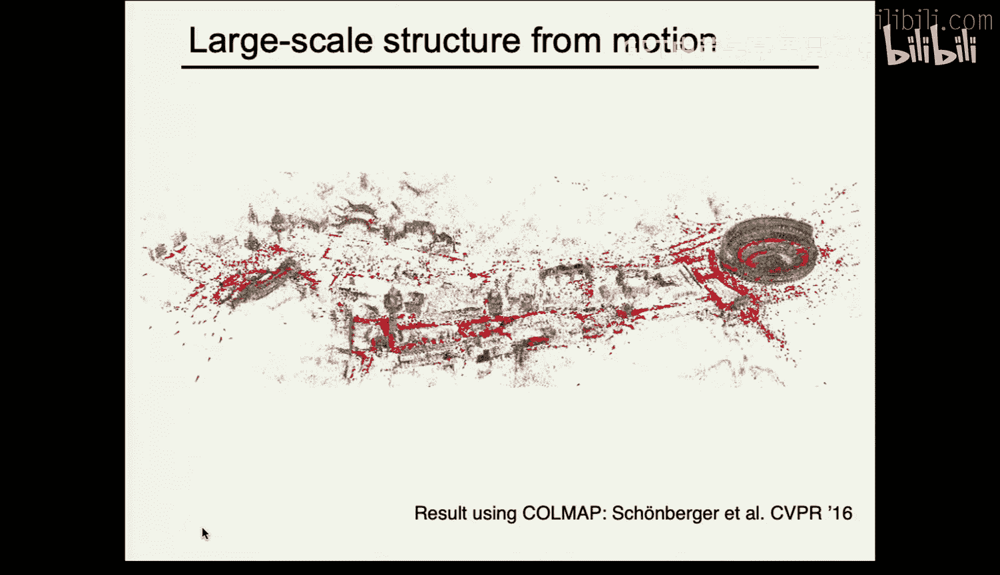

嗯。Let's look at this video first， because there's one more thing I want to talk about。

 but we should watch this。Well， maybe maybe I should do this。After， but I think this is。

 this gives you more motivation。 So why don't we do this。🎼The fundamental matrix。🎼Inster geometry。

🎼AMatri with9 entries。It's square with size3 by3。🎼Ha 70 degrees of freedom。It has a rank efficiency。

 it's only our rank too。🎼Co a matrix， and you see。🎼Cous。🎼F just go。🎼Sandex prime。

🎼Fends first times F times。🎼Every time。🎼Multiplying it。🎼X。🎼我も见你也。

🎼The left and right all spaces over there。🎼The pausey prim。🎼第一片。🎼后来。

🎼Here's a linear your estimation example， take the set of eight point samples， construct a matrix。

 take the SVD and the elements of effort in the last column of V。😊。

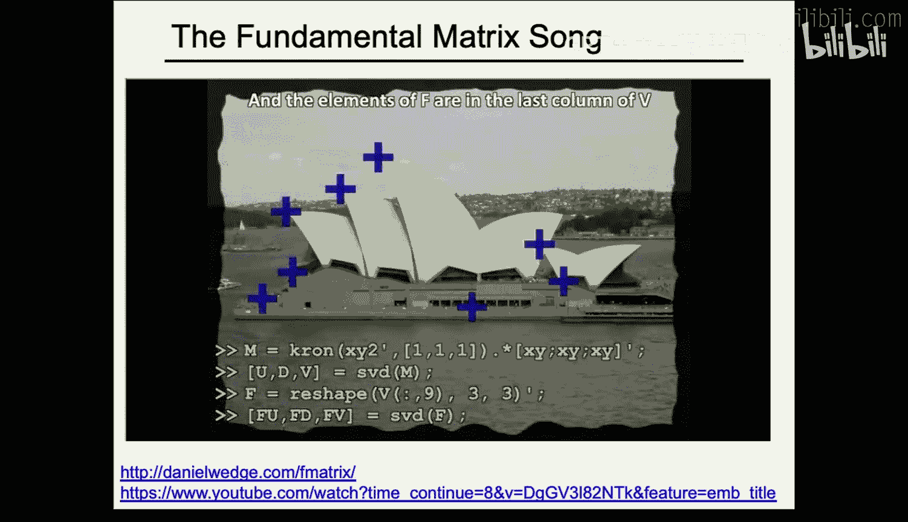

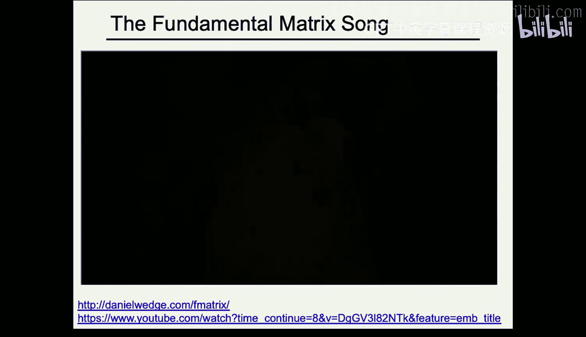

🎼T to West。🎼With a set of， Your set be Jen。

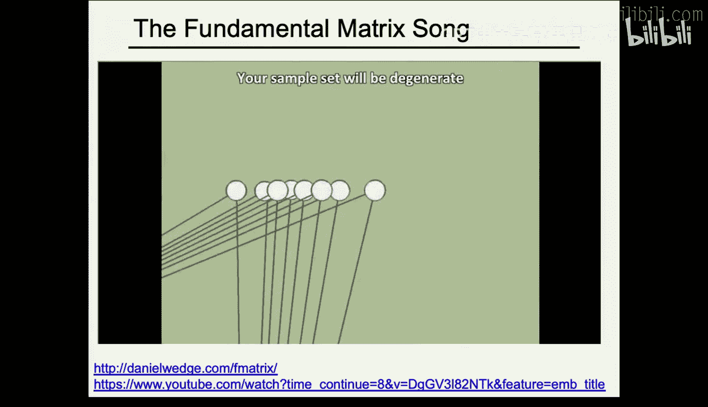

🎼Whennew to。

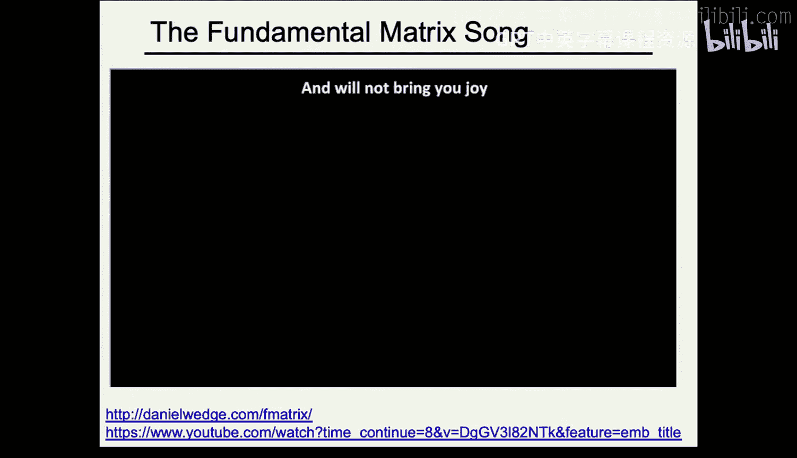

🎼When注 win theest jump four。🎼危险也。🎼やり。🎼Right。🎼是表是。

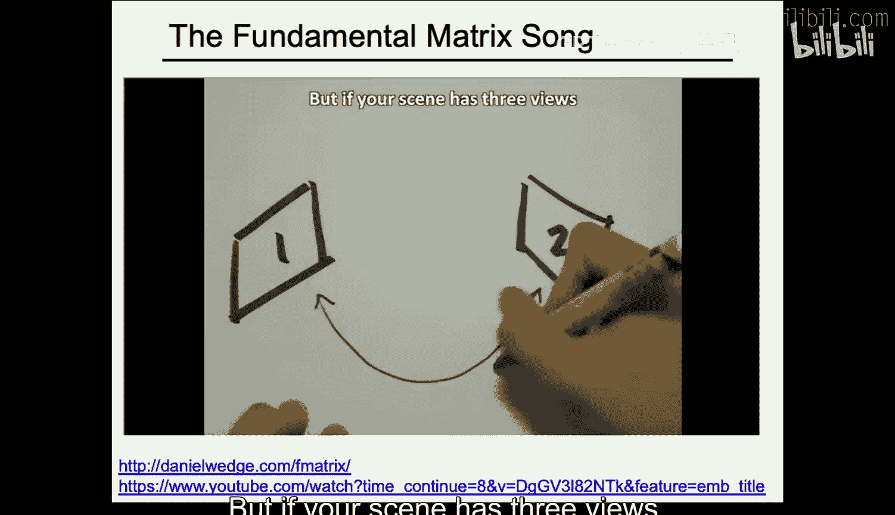

🎼不在。🎼发现。

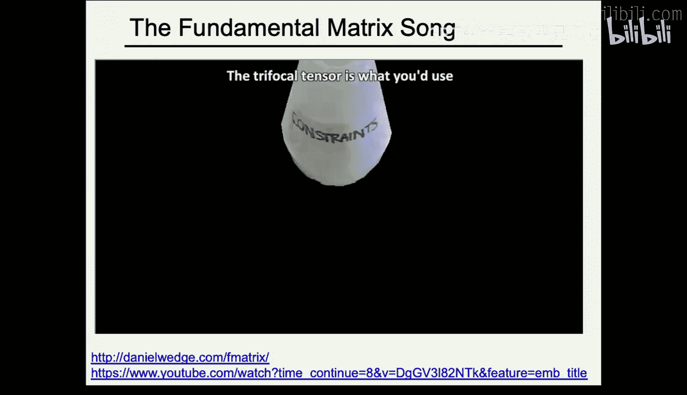

🎼Straight。🎼びび。

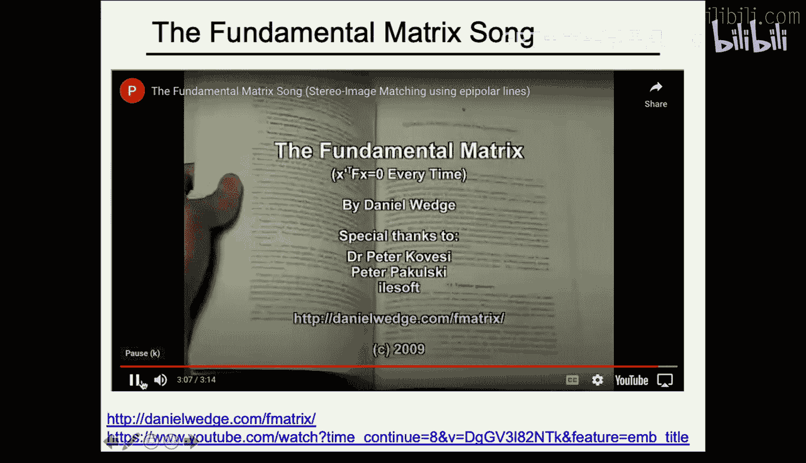

Hoably， you know what that means now。Right。We didnt class。 Okay， one last thing before。😊，We go。

 actually， there's more time， I guess。Let's call。 Okay， so that's the fundamental matrix。

 And in the end。The guitar thing was cool because you could see where the the polar line is。

 the correspondence line。 But we need to talk about。😊。

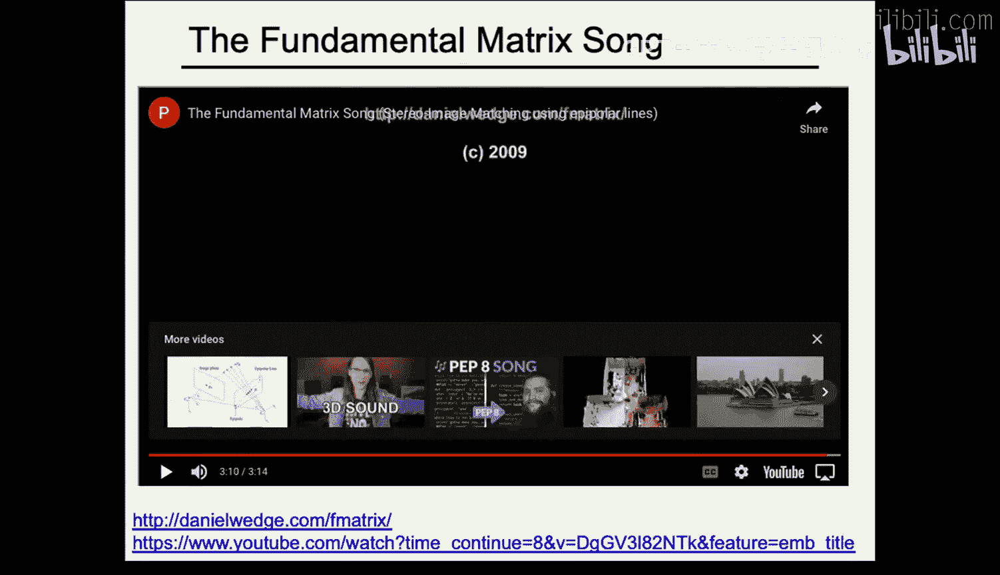

The case， which is most often the case。Which is， what do you do if you don't know the camera extrinsics or the intrinsicns。

Okay， so then that's why you need to use the correspondences to estimate the fundamental matrix。😊。

It's fundamental matrix now because you don't know anything and。So assume we have correspondences。

 Now we couldn't do this  one D trick。 You have to rely on your， you know。

 hair corner detector or like that kind of thing， you know， And so you have X X prime and X image。

And that's the equation of the fundamental matrix in the middle。

 So how many correspondences do we need。So， so， so that's the thing。4， you said4， because。Yes。

 exactly。 So this is called the eight point algorithm。Oh wait。Y， wait。Y would be 8。That would be。Oh。

 no， no， no， no， no， no， no， no。 Yes， yes， yes， it It's it。

 it's unlike the triangulation where every single image gives you two equations。 Here。

 one correspondences give you one set of equations。So you need eight points， correspondence like you。

 you， we're counting like。嗯。One correspondence gives you two equations。Yeah。

 so that kind of seems like it's 4， but it's definitely 8。How why is that it。嗯。No， no， no， no， no。

 Actually， In this case， it's not like X gives you X and Y gives you two equations。 These like X。

 Y prime and X， Y G multiplied with this thing gives you 0。 So that's one equation。😊，Okay。

 and then you have 7 unknowns。 So you need at least 7 or 8。 So technically。

 it should be possible to estimate the fundamental matrix with 7 correspondences because there's 7 unknowns。

 But that's a very challenging problem。 And at one point in the 80s。

 that kind of like game was how many correspondences can you reduce to estimate the fundamental matrix。

 So kind of started， I think， like 13 became 11。 And theres like 8。

 And then I think there is some esoteric theory on how you can estimate it with 7。😊，It's， it。

 it the the equation， the relationship is a little bit more complicated than what we had。 But anyway。

 this is why you need 8，8。8 correspondences， because that will give you 8 equations。

 And then we have7 unknowns， the eight point algorithm。Is kind of， I guess。

 simple in that particular say sense， where you have all of these correspondences and then you write it out。

 You， you use the same same thing that you've been doing with。

 with your homomography in the triangulation。 And then you have to enforce rank 2。

 This is why because fundamental matrix is rank 2。 So you take SVD。

 you throw away the last singular value。 and then you put it down， put it together。

That's kind of really quick。Insight in this class， because we're not gonna have time to cover all of these things。

 So if we study this whole thing in a grad course， you， you。

 we could have spent like four lectures on this whole thing that we talked about。 Yeah。

 which sounds exciting。 So， but if you are interested in 3D。

 you can pick all the things that we talked about。 And then look at this book by Hartley and diserman。

 It would be great if you buy it。 But there's a lot of online copies of it。

 so you can easily find this。😊，And then you can use this for your homework。 Hopefully。

 we're gonna have a 3D canned project， which will make you take two pictures。 Okay。

 calibrate the cameras and then reconstruct the point using 3D using correspondence is just like we talked about someone in the class did it last year。

 So that was very cool。😊，嗯。So。The last thing in the video， they were also talking about it。

 But here we talked about two views。 And if you actually have three views。

 then there is such a thing called trifocal tensor。

I don't know if there's Quad Quad Quad Focal center。 I This was a lot of where， like。

 I think view on computer vision research is that。Tmantic stuff was very difficult in the beginning because there wasn't that much kind of。

You know， computer， like there's no super supervised learning was difficult before deep learning。

 right， I mean， people had S VMs and all of these things。 But， you know。

 most of the study was on kind of geometry， like in。You know， early 80s，9080s。

 And then there was a lot of math。Technical things， like。

 that this is why a lot of physicists were originally computer vision people。

 because they really like to think about the relationship between these cameras and the geometry。

 What if there was three cameras， you know， and then how to optimize and solve for these parameters。

 Well， yes， quadrifocal tensor， okay， so。😊，You know。

 people wrote a lot of papers describing the relationship between three views and four views and all of these things。

But I do think it's important to remember that these are all like perfect cases。

 And that's not really what happens in reality。So in the next lecture。

 we're going to look at a series of problems called structure Form motion where not we have many。

 many， many images。 This is like the room scene or like flying through the cities。

 all all the little like busstr that you see at the bottom or the cameras taken by the tourists。😊。

And these are the points that are reconstructed。And we're going to talk about how these approaches basically happen。

 And there's a lot of the kind of paralyzed thing that we talked about。 Basically。

 you kind of like calibrate all these images。 And then in each image。

 you kind of figure out the correspondences and kind of grow all of these things。

 But Professor Es is gonna talk about that。And he's also going to talk about multi view stereo。

 which is to make these denser， which is kind of similar to the nerve kind of setup， but。

Any questions about this whole thing。Yes。😊，There works with different intrinsics。 actually。

 in that's a good question， because in most of these cases， when we did the fundamental matrix。

 the case that we were estimating were actually different case。

 So it kind of accounts for it properly。 accounts for it properly because this is K prime and K。

 and two images can have different intrinsics。😊，I think in that Rome paper。

 I think they were using the intrinsics from Xif data， which is not always great。

 But that's often what happens with intrinsics because you don't really know much about it。Yeah。And。

 and the stuff that we learned kind of goes in。Into the deeper， if you open up。

 the very details kind of happen in order to do the structure for motion， too。

Any other general questions about3D B， yes。非常个。That's a good question， possible。Possible。

 I think that's a good question， yeah。Possible， because K is gonna be smaller。Yeah。

 I'm sure there's a lot written on this。Other questions。O。All right， well。Then， we're done。

I will see you after the midterm。 I guess I will see you for the midterm。Good luck with your midterm。

 Good luck with your project。😊，I hope everybody is A yes。Any tips？Studying， studying。Yeah lectures。

We're not gonna really ask you super muuffy things。 I think it's more like intuition。

 The goal of the midterm is that if you did your projects， it should be easy。😊，Yeah， yeah。 Well。

 you don't even need to review them。 If you've implemented them。 It should be like so obvious。

 like kind of like today's question， right， Like， I think the first problem。

 if you've implemented it， I think it was pretty obvious。 But if you haven't， it's like kind of hard。

😊，Yeah。

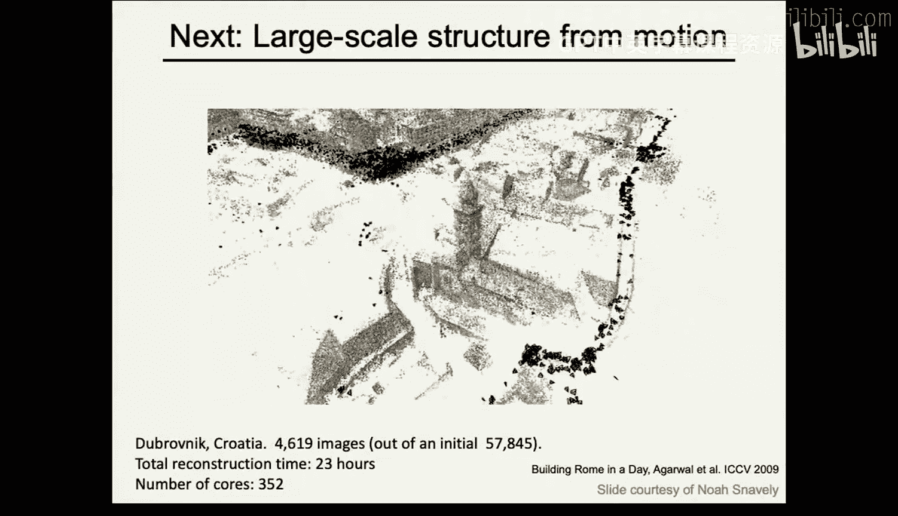

kids on the final project。 You know， I'm a undergraduate student。And。Graduate student。

 So I want to coopboerate with team on the final project。 when love。

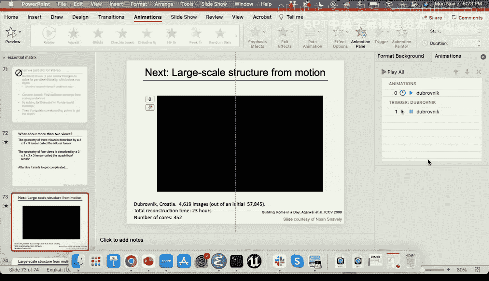

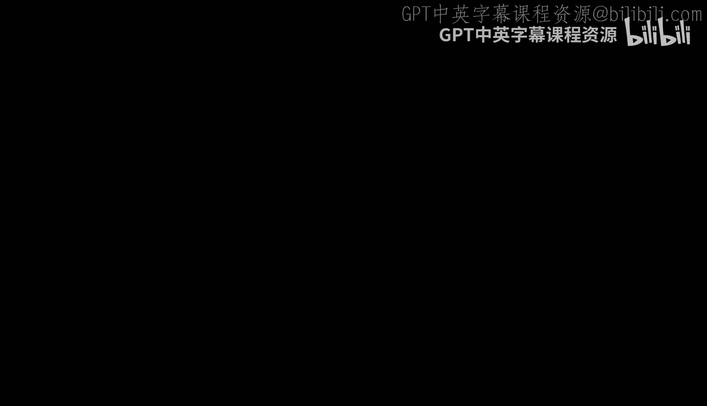

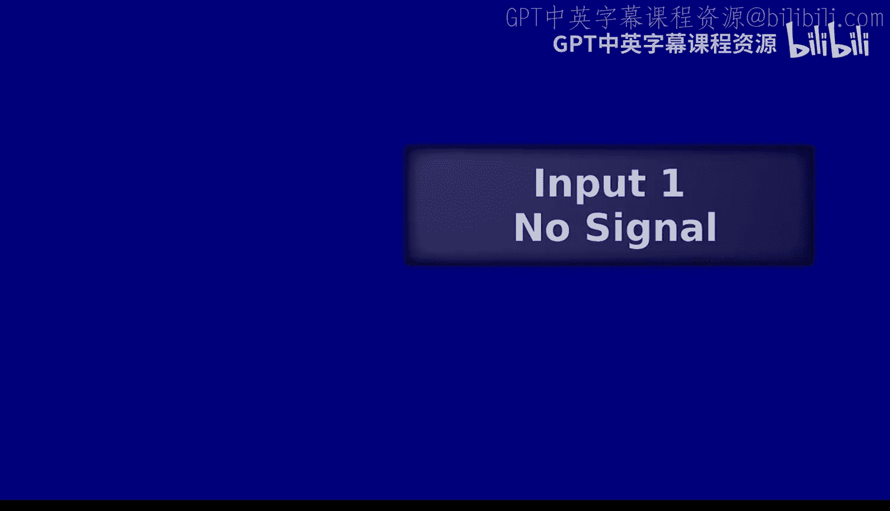