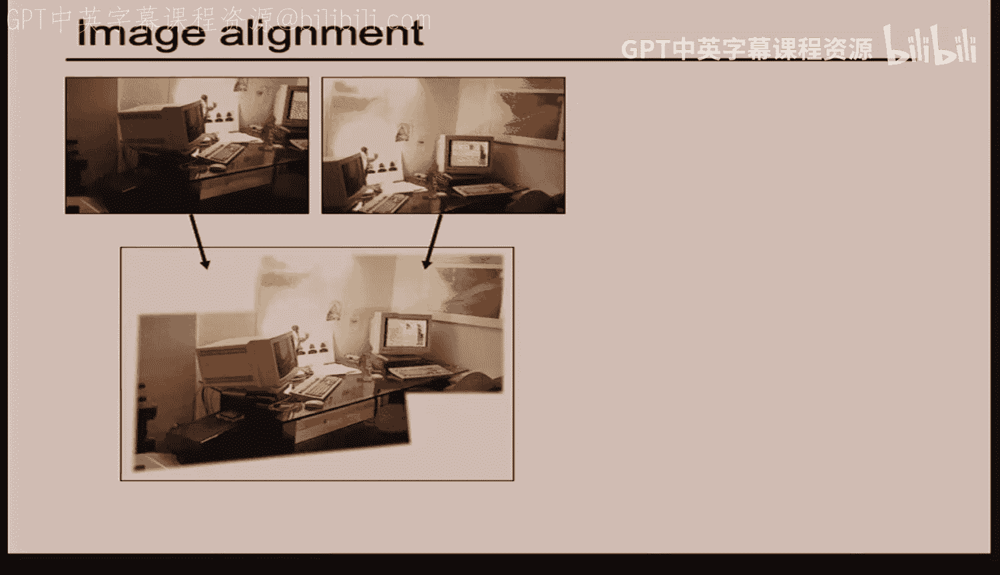

# UCB《计算机视觉与计算摄影学｜CS 194-26 Computer Vision and Computational Photography 2022》中英字 p22 -P22-2021-stitching.zh_en -BV1w7UfBdELA_p22-

見さ。z。有时候会这么的vialvis吧。Sorry， Cuba。啊，我定。W the news。I don't know。

 I don't know Val Val they hasn't replied to you。这个在。可以可以可以。I'm so sorry。For E 1 of one student。

I mean， let's just go back to the lecture room。I have no idea what's happening yet。

AndLet me call Philadelphiaipia right now。 So let's，'s， let's try to get there as soon as possible。

 And let's start like 10 minutes later Park。 I'm really sorry。

 I don't know what's happening in the classroom reservation system。I。Yeah。Sorry。

 yes none of our fault that I'm very sorry for both classes。Sorry you had to。で。That your。Yeah， so。最。

soundsやて sounds。Yeah， that's right， yeah。Just write it。Yeah呀谢谢不。😊，on that board。はい。Okay。

You can just。Make it a now。Sure there's no list to it。I will do that。 Okay， thank you so much。啊啊。🤢。

Allright。This is supposed to be for computational photos。 So if you're in here for econ 1，0，1。😊。

Please go back to your usual classroom。Okay， great。Can。figureュ春オです。

Don don't know how it was usually open。I no sold that one， too。実はのす優秀に。给你的给。Ting。Okay。All right。Okay。

 can you hear me。Great。Allright。Bll is exciting。Okay。Alright， let's get this started。So today。

 our dear Professor Ephras is。😊，Alive and well， but is in San Francisco doing his dental appointment。

😊，So I am here to jump in。And continue where we left off。

And I will do a proper introduction of myself and my work。😊，When we get to。

The beginning of Project 5， like the feature learning， CNN stuff。Okay， alright。

 But let's just pick up on where we left off。So what were we doing。

This is very related to your project 4。We want to do。Something like a mosaic。Right。

 so we will take these pictures。And we're gonna figure out how to align them。

 And that's what we've been talking about， using homomography。Okay。All right。And。呃，有。Okay， good。

Alright， so if you remember， let's go back to this picture。 So we have to do something like this。

 Okay， so for your project。😊，Who started？ I hope you started on this project。Okay， good， the good。

 I see some hands。What we're supposed to do is take a lot of pictures。😊。

Without trying to change your or for for panorama stitching， right。

 you don't want to change your center of projection。

Because we've been doing everything so that the rays come from this a pencil of ray come from this center of projection。

Okay， so you gonna to take all these pictures by only changing the rotation of this camera。

 and you got， you got you have all these cap pictures。😊，And you're gonna pick one， for example。

 the one in red。And you want to warp all the image to this red image。

 The plane that this red image stays in。And we want to warp all the other images towards it。

 one by one。Okay， and the way in which we do this。And then you also want to do blending because there are going to be overlapping reasons。

And you can do sophisticated or simple blending， like we did in project 2， for the faces。Prosic 3。

 okay。So this is what it looks like。 So You have all of these pictures taken from the center。😊。

And then， you want to。Makekey aligned to one mosaic plane， project plane。😊。

And that is your one image。 You're gonna put it there。 You're gonna put it all of all there。

 and you're gonna put it like that。O。So， music。You're reproing all of your image to this common plane。

 and the plane can be fake。And then you're just going to make this panorama。

So this is why it's like synthetic wide angle camera， right。

 because your cell phone has like a very specific field of view。

 You're gonna take multiple of those so that you can make something like a 36 image or more like a long panorama。

😊，Okay， so that's a review of what we've been doing。So。With the。

Keep in mind that we have one center of prediction。you have your eye here。

And then there's all these sense of race。That kind of reached this place。 Remember。

 the poptic function。That we talked about。Okay， and then we're doing this。

We have all of these different images。That you sample for this。So。Hbinens。If you actually have。

2 camera centers。Is it good。Or bad。Or what what happens when， in this case。

You can still do panorama or。nothing gonna change。 Your life is gonna be all okay or。What。

 what do you think is gonna happen。That's information。Okay。

 so what do what do you mean Ex on the depth information。😊，とび法。嗯哼。😊，Okay。

 so that what do you want also what were you going to say。I see。

 you mean like the depths are going to be different。 What the Okay， that's right。

 Another way of thinking saying it。Yes。😊，Yes， then some of the images are going to conflict。

 And that's because they are a different depth。 Okay， so let's draw a picture。 So basically， we。

 we've taken two images from these two different centers。😊，Right。

 and we want to put it to this one synthetic panel on print plane。Okay。

 so then what's going to happen is that this top picture camera is saying。

 I see a red color at that particular pixel。😊，Okay， but the other one is gonna say， oh。

 I actually see a green color of that pixel。😊，And so now， they intersect。

And you don't know whether you're supposed to take the red or the green。Okay。

 and then why does this happen。I mean， this happens because the moment you take slightly different picture。

😊，Things move in different ways。 And that is called parallax。 Parallax is kind of like a。Scary word。

上次蚕丝。嗯。But actually， the para in parallax mean like paraphrasing。

 So you basically see slightly different type of。like image displacement as as you move your head。

And so this is why it happens， right。Any questions， Because this is a very， very important point。

Like。嗯。Another way of saying it。Is this。 Can you do C reconstruction or can you estimate the dip。

If all the pictures you have come from a single center of projection。😊，No。Kow who think no， Let's。

 let's practice saying things。 Okay， no， yes， no。 but that that actually didn't really make sense to me why the reason why its no is because if it comes。

cent prediction。 I mean， you can always you can always say it' it's like as if you're seeing the world。

 like， right， you're not moving your head， you only have one eye， right， the world。

 And if you can't move your head， I can't tell whether you are a set of pictures or not。

 The reason why I can tell that this is not just a plain picture or like that is being shown to me is because I move。

 And then like color ray change because each of the color emitters are in different depth。😊。

So this is why you have these， like。Things that don't。Have a conflict。Okay。But there are exceptions。

What are the exceptions。Yes。😊，Yes， if the object is really， really far away， one more exception。😊。

So one is the one where the object is super far away。

 And then why does it not matter if the object is super far away。😊，Why。

 why doesn't matter if the object is super far away。Just。So be small。Yes， exactly。

 If the image is like super far away， you're like at this Yosemite or something taking a picture。

 right。😊，Like a picture that is being seen from these two baselines， basically is same。😊。

Or in other words。It's like you are looking at。A picture of a。What's the second exception。

 When is the second time when you can actually change camera center， yes。😊，Yes。

 it's like seeing a picture of flat plain。 If either things are super far away。

 it might as well as being a flat picture because it doesn't matter where you are。

 It is't not gonna really change， or things are actually close to you。😊。

But it's a plane plainar scene。 It's actually plain。Okay， so if in these situations。

 you can use homomography to explain all of these changes。 Okay， why。😊，Because P P1。And P。

 P3 are related to each other by homomography， right， why。😊。

Because they share the same center of prediction。 You can see there's that center of project for the first camera。

And then you can， you can draw this line all the way to that picture。Okay， the same is exactly true。

For P P2 and P， P3。Right。😊，And then projective transformations are closed。 Okay。

 so projective transformation multipied by projective transformation is still projective transformation。

 That's what closed group mean。😊，So the relationship between P P1 and P P2 is also。😊。

A homomography or projection， projective projection。Right。

 you go from the transformation that you go from P P1 to P， P3， and then you go from P P3 to P， P2。

 and you multiply that。 And that's still homomography。Okay。Question。Okay。

So this is also how like the big picture， aerial photographs。😊，Are made， right。

 Because if you take a picture from an airplane and look down on the ground。

 the ground is basically plain。What is an exception。When do you think。This doesn't look good。

 And I'm sure you've seen this in aerial photographs。Its like a building。 Yes， in New York City。

 if you do this， you're gonna have a lot of skyscrapers。 And， you know， depending on how far you are。

 but it's not gonna look as flat as， you know， you can think about this disparity thing。 right。

 if there's like a super tall like building， right， If you look at it from the top。

 you're gonna see the tip is gonna move。😊，You know， so that's like the， you know。

 the dis displacement thing。 So that's， that's the。That's the problem。 Okay。

 but this is like a super important point。So。You know， please。Ask questions if you're confused。

 I wasn't really。 This wasn't very clear to me for a very long time。 Why you can't get depth， yes。

Aerial be， you mean like a。Yeah yes。就坏得。Oh， yes， great question。 so like。

If you're super far away on an airplane and you look directly down。Earth might as well as be a flap。

So if things are really far away and flat， you can， it's like a plane。

That means you can explain things with this homomography。Yeah。

 so these are like basically gonna be like two airplane viewpoints。Right， and then like。

 because it's kind of like projecting this plane。It works， except a skyscraper won't work， of course。

Because the skyscraper is not gonna look like a plane。 Like if you're like from like。

 maybe like moon， probably it doesn't matter。Right， like， it depends on how far you're flying。对啊。例ば。

有没。定为同我。Yeah。般万協力。呀。ょ発て。而不早。I guess you're asking， what if that， like， you mean， you put a plane on。

 on this。Here how do I do this laser point I here， Okay， so put a plane through this point。Okay。

 so that's a good question。呃。Yeah， the plane is far away。 Or if you put the plane。On this one。

You're saying that like， of this particular opinion， it's still not going to look the same。Yeah来结婚。

There's still。Right， right。 But then if you can actually draw a plane here and suppose this actually came from a planar image。

 that means you can find a plane or image that kind of explains things， I guess。

It's like maybe the intersection is going to happen a little later。ください。まスで。

I guess the thing is that if they， if they come from the same ray。

 you can always find a plane that that puts them to the same place。

 And it's not going to have these conflicting issues。So， like。if， if they come from。

if the yellow squiggly line was actually straight？They will be emitting exactly same right ray。

 So you， you're not going to have this conflict。Other question。Yes。😊，TheOh right。呢啲方冇的。Yes， yes， yes。

😊，Yes P21 P1 and。pointeded家。Yeah， yeah。 I'm trying to， yes， yes， yes， exactly like it。

 But is this still going to come So， so if， it's still going to。😊，Interscept。Yeah。

 that the relationship can be explained by sets of homomography。

 yeah that's I guess we really do come back to this picture if that's the case。咁开。会究が。But。

 but then I guess you're kind of imaging like things that's actually not a planer， right。

 Like it would be like a piece wise planer。Yeah， yeah， yeah。 So So then like you could。

 you could do that to the part that you've that the planer， one planer， you can actually explain it。

 But the sets of planar， you can't explain with a single homoography。Okay， good。Other questions。

 This is great。Yes。😊，Okay， the objective， I guess the。Well， so the thing is。

 this is really interesting， right， So you can use this。😊。

Perspective projection and the homography to align these images that were captured from actually the center of projection。

 right， So that's one use case of what we've done， right， which is to make your photo photo iPhone。

 which doesn't do 3，60 imaging to do 3，60 or like wide baseline camera。

 But the other observation that we get from this is that whenever you have a plainar image。😊。

You can always connect that。You can always transform one plane to another through sets of hographies。

 So in this situation， now you no longer need for these cameras to have the same center of projection。

😊，I can take a picture of this room。And I can take a complete。 go home。

 Take a picture of my TV screen。😊，Right， but in that TV plane。In this image。

 I can actually like kind of transform these things so that to put everybody in a TV。😊，Right。

 remember， like， I can't show the picture because。Okay， so it's like， it's like this。

 So this is a good， good direction， right， so。So， basically。You have a plane in the world。

 which is this like。Street， which you can also plant it like this is like P P1 to P P3。

 where the P P3 is like plain。And then you can draw like things that if you look at it from a very specific viewpoint。

 it will look 3D。 But in reality， it's kind of like drawn like this because and。😊。

And after applying this， homomography looks like this。 Well。

 which means you can also do this kind of stitching in any plane by matching it。😊。

So here's another example。Of this。going back to this planar thing。Its also。Also this one。

 So this picture of a whiteboard was taken like pieces of the whiteboard was taken multiple pictures。

 but you can compute the homomography because。😊，They correspond to the same plane。

 so you can put it in there。So。Another thing that you have， actually， you use a lot on your phone。

 I mean， very similarly on。Aerial images， it' like Google Maps。 you know， you look up。

 and then it's all stitched together。 right， You can look New York City far away。

 and they're all stitched together。Oh because that's aerial。嗯。Okay， so basically。

The reason why we're talking about this is that homoography has two usage。

 Like it's either the case of one center thing where you can actually make panorama。

 or if they're different， you can actually relate two different planes from one to the other。😊。

And this allows you to do， like， cool stitching。😊，Kind of project that we we saw like in the end of last lecture。

 You saw like a super cool creative video where like people were kind of like showing up this picture。

 and then like， you move into the picture。 And there's another picture that goes into this other thing。

 You can do that kind of effect。😊，Also， byhomography。So the homework， actually， you do both things。

 right， The first thing is to take a picture so that you have this planar kind kind of you do this thing。

 You do this。😊，First our，0，8。 let me show you this picture。Okay， so。

 so this effect of like showing this cool3D effect。😊，By only2D things。Was also done。A long time ago。

 this is actually in 1533。 I actually thought this photo was like this picture was like Photoshoppped。

 but it's not in 1533。 It's like early Renaissance。 People are like， oh my God。

 I can do project perspective projection。😊，And then so people started doing lots of perspective projection。

 And then they drew this。 You know， you see the skull。They painted this by hand， you know。

 so that like this is in apparently this is in the National Gaery in London。

 which is free that you should go when you go there。 I've never been there。 But like。

 if you go there and like， if you look at the painting from a very specific angle。

 you might actually see a skull， right。😊，And so this is actually the reconstruction of this skull by computing the homomography。

😊，And you can like reorp it to what it should look like。 But they can like hide these things。

 And I think this was a way to show that they are a good artist。You know。Fix。kind of thing yeah。

Alright， okay。So what do you have to do for your homework。You have to。Cptture photographs。

 you might want to use the tripod because you want to make sure that they're coming from a center of projection for Panorama。

And then you have to compute homomography， which you have to annotate like at least four points so that you can compute the homomography。

 And later， maybe not in this lecture。 maybe we're gonna talk about how to automate that。

 which is your part 2。 But the part  one is due like soon， right， And the part  one。

 you just annotated。😊，And then you using these correspondences， you compute the homography。

 The nice thing is in the face morphing project， every single triangle had its own transformation。

 But in this project， you're only going to have one transformation between two images。😊。

Because the homoography should explain all of it， especially for the panorama。

 So you only have one homoography。 And then you can do this unwarping， right， like this。

 all the interpolation， you know， inverse stuff。😊，And then you have to do the blending。

 And then the blending， there are very very other ways that you might want to use left flesh and pyramid to do this。

And then all these other bells and whistles。Okay， questions。About project。오케이 야。Oh。

 why do I need the Lalashian pyramid。 Okay， let's go， because that's the next stuff。

 because this is blending and compositing。😊，So you want to do this blending thing。Okay。

 before I go go go there， like the the second part， So you have to do this first。

 And then and then you have to do at least one of the bills and whistles， which is to be creative。

 And so one of the creative thing that you can do is you can take like a painting and you can plaster it on top of like street。

 right， So this is the case where like you use。😊，The the homoography。

 same tool to blend two images that are taken from different camera centers。 But you can just。

 you know， take that image and you can like homomography， like a tiny piece of it。 know。

 or the entire image。 Like you basically define the four corners of that image。 Actually。

 the interesting thing is because it's homomography。 Like， suppose the task was like， okay。

 I'm gonna take a picture， right， And I want to put that into a frame。😊。

you can do a cute thing for your parents。 Maybe like， or like whatever you have a picture you have。

 Maybe they have like a family picture。 Maybe the family picture actually has like a photo frame in the picture。

 You can take the picture and put it in the photo frame。 So it's kind of like recursive。😊，You know。

 to do that。The target。Photo frame actually doesn't have to be looking at your planary， right。The。

 the picture。So like you might have like a picture。Where there's like， you know。

 people taking a picture， you know。Like a happy picture。Right。Maybe have like a cat。

Pture with your cap。 Okay， now in the back。Maybe this is like their table。

 And you may have like a photo frame that is like slanted because it's taken in a picture slanted。

 No problem。😊，You can take a picture saying you your favorite。😊。

I don't know what your favorite thing is。Favite的。I a Berkeley meme or something like this。Okay。

 you have these four corners。I don't know what the paper birthday mean right now was right now。

 And then you actually have to do it like this， right。😊，And you can figure out this transformation。

Biohographies。Right， okay。C good。 So that's kind of like。Project a movie into a building wall。 Okay。

 yes， another thing is you can do this with movies， too。😊，You can make movie mosaics。

When you do the movie mistake， you have to make sure that。Each movie is a stationary camera。喂。

You don't have to make it a stationary camera。 It makes your life easier。So like， okay。

 so suppose this is a picture。 supposeupp this was like a video or like， suppose this is a picture。

 but I can actually make a video go over here。😊，You know， maybe this thing actually moves。

 and you can show this as a video。Which is like a cool effect。 Okay。

 but that means this was like a movie。😊，你 there是那个 movie。😊。

And it's really nice if this was only taken from one center projection， why。😊，Yes， exactly。

 So if this was like， suppose you were moving around and stuff like that， then for different。

 you know。😊，Different frames。 You have to compute different homography。

But if your video is taken from a single center projection。

 all you need to compare is like phrase one frame， whatever the frame it is。 Im。

 assuming things will move in the scene， right， Like just compete one homomography。

 And then you can like place all of this stuff in the other one。😊，But if you start moving the camera。

 you got to compute the homoography every single time。 you move the camera。Okay。Alright。

 so that's blending and compositing。Virtual camera， rotate。Yeah。

 you can take a single image and you can start rotating from your panorama。😊。

So you can talk about all of these cool ideas。 here are some inspirations。So。

This is cool one that's blending like the night。😊，In the day。I guess you had to make sure that。

However， many hours that have elapsed， you know， nobody touched your camera。

Because you want to make sure that it didn't really move your center projection。

 You can put the cameras in these Tvs。I don't know。What that is。I guess they changed like inside。

 I guess。Oh， no， no， no。 This is going over here。Yes， you can do that on your campus。 This is CMU。

 I think it's about to update these slides with the Berkeley pictures。😊。

So you can contribute in this way。Another thing we can do is to do。3，60 panorama。 So this one。

This person put a camera inside the fridge。I took a picture。Open it and probably move this lightly。

 Take a picture again so that you can kind of like look around inside your。😊，Fdge， which is cool。

 But the 3，60 camera can be tricky， which we're gonna discuss later。😊，Okay。

 so this is the thing that comes when it comes to。😊。

About how should you actually blend these two images， right？ So these are two scenes。Okay。

 this is already black。 So just consider that you've already computed the homomography。

 And now all you need to do is blend these two images。😊，Okay， so how do you do the blending。

What's like the simplest way to do the blending。😊，Average， exactly， just do 0。

5 in the overlapping regions。But then if you do this， I mean， this is a really hard image。 You。

 you know， it's kind of， you can't really go through that like， you see， you see that edge。Right。

 that's where the blending happened。 So this is no good。

So this is why you might want to do the Lalaian pyramid， right， which you did in Project 23。😊，Yeah。

 okay， or2，2，2， yes。😊，So another thing you can think about it is that maybe you don't want to equally let。

 you know， you know， maybe this boundary over here is much close further away from this image。

 So maybe I should only take like， you know，0。3% of that image and use 0。7% of the other image。

 And so you can start computing this thing called distance transform。

 which basically computes like distance to the edge。 So， so all of these values are saying。😊。

To the edge。 So like if you're close to the edge， it's0 and then closer further away。

 you are from the image。 edges you get one。 Okay， or like high number。 Okay。

 so then you think you can actually use this to do， you know， basic actually。

 you could have taken this value as the value to do the linear interpolation because this kind of gives you this is 0。

3。 This is 0。7。 You can normalize it。 Apparently， it doesn't really look good when you do it with this one。

😊，I that you could actually do this kind of like hard thresholdholding of which one corresponds to which image and then do that。

You still get this edge。It's not that great either。 I actually think the first one looked bitter。哈哈哈。

😊，And they say you can like blur this alpha。😊，But， it's not really。Right， so what do you do。

And you should be thinking about all the frequency stuff that we talked about。And so。

 you can actually do。Lelashian pyramid， but basically just the two bounds。 right。

 only don't do it so many， but that's the two。 So like high frequency and low frequency。

 And you want to blend the low frequency stuff smoothly。

 And then the high frequency stuff maybe use this binary alpha。😊，Its binary alpha。

 and it will still look good， so。That's kind of here。 This is like the result of this。I guess。

 moving。Yeah， you can see。 that's much better。And。You， you have to， you know。

 figure out from what is high frequency， from what is low frequency。

 You can use all the things that you learned in project，2。Okay。

 so this is a result of this linear blending。And that is the twobound blending。

SoWhat kind of differences。几时。Who can't really tell。Yes， it's sharp， much sharp， this one。Okay。

 so that's。Stuff。I'm going to now any questions。About the project。No question。So it's all good。

Did you even finish it？Who's done。Maybe you。Started it。 so don't really know what questions to ask。

I heard that people were confused about the kind of pictures to take during the office hours。😊。

Like people were confused。 like， why， like I guess， I I think what's the confusion。

I think for the first part， you have to take a picture that shares the center of projection， right。

 And then you want to make sure that， you know， this is kind of different。 Like。

 if it's like super similar， the homomography is quite simple。😊，Right， so you to。

 to make like a nice panorama or like nice white panorama。 like， you know。

 there should be difference between the first picture and the second picture。😊，To do this cool。

 you know， insertion of like stuff。You don't really need it。

You you don't need to have to take a picture between two。

 You don't have to take a picture that shares a center projection。 You can take two images。

 just define what's playing in one image， transform it to another plane in the other image。Okay。

Questions。When you're doing your invert。Like let's say your second image to。Right。

You do the whole image at once， like in the lap project， we did like triangles yes。Great question。

 Yes， the home is what once。Because there's only one homomography that connect connects the two images。

Ex click your images like。Yeah。Yeah会。By 300。两一さ。Right。意げ多。The polygon。こいて。I don't know。

I think it really matters。 Does it， I actually forget， though， because like。

 I think this question came up in like your project1 because it's very high resolution。 But like。

 it doesn't really， I mean， when you implement it， right， Suppose this is the target image。😊，Right。

 and then this point， you somehow figure it out wherever it is， by with like H -1。

Or like each inverse gives you that， right。 And you w to start drawing what this value is。

 when you go over here。You see you know， where this point lies in。In this grid， maybe it's like。

 you know， in between different one。 you do biling interpolation， all the stuff that you did stuff。

Yeah， but then you basically， you can just do one pixel at a time。I mean。

 it depends on how you in implement it。But like， it's， it's， it's probably fine。Good question。

Did I see more questions in the back。Okay， all right。Okay。

 so I'm gonna talk about stuff that's useful for your bills and whistles now。😊，Okay。

 so this somebody asked this question to me last week， which was a good question。😊。

Why do we need8 numbers for homomography when it's just a rotation， shouldn't it be less。

I think that was a good question。So， let's think about this。So， what is。

The transformation between all of this is only rotation。Okay。

 meaning that everything is this situation， right， because the picture between that one and that one is only red describedscribed by rotation。

Do we really， really， really need8 numbers for this。

 or let's just say you always have eight numbers in the end。 But what is the underlying。

Dim dimensionality of the un unknown parameters。 Like what are the unknown parameters。嗯。So how。

 how can we actually constrained our8 or like ask about how what kind of things you need to know to define this8。

And the way to think about this is to just think of it as a rotation of the race， okay， so。😊。

Recall the perspective projection。Equations， so you have this point， x， Y Z。😊。

I guess it doesn't render。 It goes to the to the image plane。

 And then the projection looks like this， right， Like you divide by the Z。

 similar triangles and then multipied by F that comes from the similar triangle equation。And so。

You have to get， you can think of this as just making it into array。 like take a pixel。 Okay。

 a pixel is like a 2D location， but you're going to shoot array， according to this focal length。Now。

 all you need to do now is like rotate this set of ray。And then， project back。

That's just exactly the same thing we've been talking about。

 just differently way of thinking about it。Okay， so then in this picture。What you can do is to。

Take that pixel value， U， U over it over here。 like that that， that U V。😊，嗯。This thing， Okay。

 so that's like your U V point。You're gonna make it into by arbitrarily putting the。Third value。

 that is constant， which is your focal length。 I mean it's not mean it could be one。

 but like it doesn't really matter。 But we we need， we needed to have everybody is at the same plane。

 So if you made it into U VF， I mean， itll just be a three dimensional parameter。

 But like at this plane， right， you're describing the image， U VF。Every。

 every single point gets an additional parameter， third， third dimension。 That is F。

And then you want to。You just you get to pan that that because it's an image。

 you don't have any depth。It's gonna be on the plane because it's an image。

 I'm gonna arbitrarily define what the depth is going to be。 Sa。 Okay， could have be won。

 And then you're going to project it to back onto the unit sphere。Right。

 because the prediction onto the unit sphere makes it makes it array。Okay， and once all of the ray。

Or on this predictive or on this unit sphere， you w to go like， whoop。And they rotate this way。

And then you do this on projection back into your image space。Okay， so basically。

 homomography can be written down。As this operation of。Remember， project， per project。

 project goes from the right to left。 You want to un project the array using this K。

 And remember the word， well， what is this K。 K is this intrinsic matrix。😊，It's。

 its this thing that you need to multiply。 The U U Vs are center of projection， usually it's 0，0。

 but it doesn't have to be。 So you still have to write it down。 And then there's these focal length。

So basically， you undo your pixel into array， which is this K inverse。Right。

 and then you compute the rotation。And then you project it back onto the image。

And that consisted of pornography。So。If you know what the focal length was for both pictures。

How many degrees of freedom is this。You know how if you I say， you know what the focal length is。

Which means you know how to un projectject it。All you need to do is rotate this ray。

 I don't know that。 and then project it back。 So what is the。What is the unknown parameters。3， okay。

3， why。Because rotation matrix has three unknownun。😊，Right， the rotation is rotation， rotation。😊。

The the rotation matrix has  three degrees of freedom。Okay， what if you don't know the focal length。

 but it's exactly the same camera that you never zoomed。4， yes。

 because now you have one additional one。😊，But then you actually may have zoomed when you change the focal length when you take in a second picture。

 So then you add one more， which gives you 5 degrees of freedom。😊，So in the end。

 you actually get this homomography matrix， which has eight numbers that unknown。 but actually。

 the underlying， you know， degrees of freedom， if it's only rotation。

 which is mostly the case on these single center projection cases。😊。

You don't really need to have that many。I mean， there is a catch。In the catches。I mean， there is no。

 there is no catch。 I mean。 You can think about it like this。 The catch is that。Often。

 the focal length is difficult to estimate。I'm going to get to this。But how do you actually do this。

Okay， questions。 you get this idea。 right， You make it into array， You rotate the array。

 you project array。Okay。Now， how do you actually compute this rotation？ Well。

 there's a super nice thing called procice algorithm。😊，So if you know more than， let me。

More than three points。 Yes， more than three points。That， you know are corresponding to 3D rays。

You can actually compute the rotation matrix in closed form。😊，So， proies。Is apparently， this Greek。

Mythology guy who cut his victim' like leg to make that person fit onto a bed。 This is like。

 in action。Okay， and so somehow people started calling this procr algorithm because pro algorithm can scale and then rotate and make the person fit in the bed。

 It's A little gory。😊，I had no idea， but， so。What， what's going to happen is that that's what we just talked about。

 which is that you have this ray， which is the first ray。 you rotate it and becomes the second ray。

 right， So now all it matters is how are we actually going to find the rotation matrix。

 And this n is just。😊，The steps that we just talked about， how to un project and make it into array。

 So P I is array from a pixel。 Okay， that you project it onto a unit sphere。 So it's actually array。

 All we have to do now is to solve for the rotation matrix。😊，But you actually know which like。

 you know， you have three rays。 this， this ray goes to there。 This ray goes there。

 This ray goes there。 And then the relationship is always described by a rotation。

 How can you solve this， This is a super neat trick， which I'm going to give an insight to it。

 And then this link highly recommended， because it's a really nice detailed derivation of the procury algorithm。

😊，What， what really happens is you start from a least square solution。 You start。

 you set up at least squares like， you know， P minus R P is equal to 0 or like p equals R p。

 So P minus R P。 you want to minimize this least square problem。😊，And then eventually。

 you get to this expression that。You're going to take this a matrix。

 which is an outer product of these two rays。😊，Okay。I don't know which direction it is。

 but you make this matrix。 I think it's actually a covariance matrix。

 And then you actually notice that P prime is because P prime is R P。 You can replace it over here。

 but you also notice that a， because it's， you know made by it's just an inner product it's an outer product。

😊，You get it it's a symmetric matrix。 And so you can compute the SVD from this SVD， right。

 You can do SVD de compositionposition of a。 But because a happens to be this nicely behaving symmetric matrix。

 it's actually going to be USD U。 And then of this thing is's actually going to be US U。

 And then you notice that you're multiplying R T outside。

 which means that this V T is equal to U T R T， which means if you get to this far。

 you can figure out what the R is by multiplying the VD on the other side。

 And then you can get your R。😊，呃，you can。You can get to the detailed like step by step derivation。

 that will explain all of these things。 The bottom line is computing 3D rotations。

 when you actually know the correspondences is close form， which is super nice。

 And we use this all the time。 And many different things。 Like how close are these two shapes。

 You compute this proreors algorithm them， align them and then measure the distance。😊。

So it's took a nice thing to know。 But basically， this is what you need if you wanted to figure out the homoography this way。

 because once you've undone the rays， you actually have to compute the rotation。

 but you can do it with this way。😊，Okay。跟这 sameO。Okay。

 so why can't we can make it even like more constrained？ What if your camera rotates on a tripod。

Right， like， it goes like this。What， what， like can you。

 we can make this even more low dimensional or like the we can even reduce a degree of freedom。

 How many degrees of freedom does this have。Only two， Only two。

 I think we can actually make it even less。2， what is， what's the， what's the second。

 The first one goes like this。I think anyone can be like this。Right right。

 But what if this is a tripod and they can't actually do this tilt。

It's one degree because it's just like this data。Okay。嗯。Okay， so you can even make it nicer， right。

the search space is even less。O。So now the question is， so picture that the picture looks like that。

 That's， that's like really what the planes are like， right， because you're going like this。

 And it's like actually spherical or like cylindrical。 So then you might be asking。

 do we always have to project it onto a plane。😊，That seems a little limiting。

What if you actually wanted to do whole 3，60 projection， you can't do that with the plane。

 Like eventually， you're gonna get to a part where like。

 you're not gonna have any of this stuff overlapping that plane。So， you can actually do。

A full panorama， by using the cylinders。And it's not a problem。 Like。

 it's exactly the same idea that we've been doing。 You just project it onto a cylinder。

 instead of a plane。So how does this work。So you can pretend that this picture is taken by this cylindrical projection。

 which I'm not going get into the math， but you can write it down。 Here's here。

 here' here's the equation。 That's how you go from a 3G point onto a cylinder。😊，Of course。

 the cylinder has。 This is a unit cylinder over here。😊，Right。

 and then you can convert these cylindrical coordinates。Where theta defines like where you are。

 And then the height is like the height of the your cylinder。

And then you also need to figure out what the focal length is。 right， this is unit， right， but like。

Actually， it depends on how like， you know， the radius of the cylinder matters where the ray intersect。

So you got to fold for the focal link。To get the cylindrical image projection。嗯。But that's。

 that's how you can do this。And that's what the images will look like when you project the plane onto the cylinder。

Right， and then you also want to know how to invert this。

 because whenever you're doing transformations， you're doing this invert stuff。

 So you w to invert this projection， so。😊，He that's the equation。You can do this。 It's not a problem。

 You can go back。And so you can do this with cylindrical panorama。 So the sip is。😊，1。

 we project these image onto a cylinder。Blennd it。And then， out with the resulting mosaic。O。O。Okay。

Is assuming we're？We're not like。We're still on the tripod that you're getting like this。Yes， yes。

 yeah， exactly， exactly， because it's a cylindrical one， right， exactly。

 So the nice thing about this is， what if you don't know the camera rotation。

 which we don't really know， You could still compute it using procous algorithm。😊，Yes。

 but the thing is， in cylinders。Rotation is just shifting。Right， just shifted like know here or here。

 just like， know， this how much did you move this way。

 This angle is exactly shift in this cylindrical flat image， which means which is nice。

 you can actually do the search Like you did it for like project1。 Remember。

 you had to like search for the D X D Y so that the colors aligned properly。 You can do that here。

 You can just search for like how much to shift so that the overlap is good by whatever measure that you use like SSD or normalize cross correlation。

😊，Stuff like that。So， that's super neat。Because it's only one degree of freedom。And so howly。

 this works is you take all these panorama like this。😊，You。

 you project it onto this clindrical plane。 you figure out how much to shift the second picture。

 Bd it。 do that， B that， do that， do that， do that。And then， you crop it。

And that gives you the cylinder to predict things on。O。Now， because of the noise。

 you can see that there was some like shift in stuff。Because of the noise。

 you can always have some kind of， like， you know， it's never gonna be aligned quite aligned。

 You know， maybe the camera pose is not aligned to the ground or sometimes there is like a thing or like sometimes there's like a bad noise。

 You got a local mini or something like this， which is not nice。

But you can still figure out the correction so that things are up。 So， for example， like， you know。

 you want to make sure that like this smiley mark， smiley face goes back to the smiley face that kind of like figures out how like why the radius is。

 right， because you can search for the radius that makes the smileies match。

 And you can also do that vertically and figure this out。 But this is why like in the fridge example。

 the student was doing this。 But it's a little tricky because of all of these。😊，issuesues。

But that's the 4，3，60 panoramas。And yeah， this is basically， you know， how these 3。

60 cameras like work anyway。 Also， like when you have these visualizations。

 they actually probably project it onto a cubebe map， but。😊，Okay。Now。

 you can even go beyond the cylinders。And try to do spheres， too， Why not。Okay， and in this case。

 you're actually moving this way。 Also， not just this way。 you can do exactly the same thing。😊。

Which is to unwrap it into a sphere。Estimate the focal length。I then put it into this fear image。

 And then also again， search。 And that's like。What that looks like。

And here is the inverse for you to do all the inverse operation。

And then exactly the same story applies， you。Move it into the spherical place。

 and then you fear the rotation， and then you undo it， right。So in， in， in the in this picture。

When we first talked about this idea。The3 rotation model。

 we were basically un projecting onto a plane。Unproject a plane， rotate， project back to plane。Here。

 you're unm projecting it into cylinders。Or spheres。Still， same story。Rotate it。

 and then predict it back。So you get something like this。 fold Panama。 Like。

 see this one actually has the top。😊，And this one was like just one side。 and this actually has tops。

And you can make your pictures， iPhone into a 360 camera。This way。Okay， now。

It's not just all these that we talked about cylinders。Plalanes and spheres。

But you can actually use any kind of surfaces， whatever you want。 I don't know what it is。

 you can like write a surface and you can write it down。 You can project it。😊，Okay， and。呃。Yeah。

 so it's nice。 And all of these projections。 Another thing you can do is you can do the planear projection。

 plane plane panorama。 But then like maybe the plane just like doesn't look good because when you make it into plane。

 like especially the side stretch a lot， right， And so it's not very visually pleasing here eye。

 So you can take your plane panorama。 And then we project it to a cylindderical or something like this。

 just， just to use different projection to make it look good。😊，But like I said， there is a cat。

's the problem with all of these approaches。Is there's like， there's a problem。And。

What do you think the problem might be。Of this all these cylindrical prediction that we talked about。

Yes。😊，That's true。 The top or down is always going to be distorted because depending on the spherical coordinates。

 really concentrates that。 Yes， that's definitely one thing。😊，On in all of these these steps， though。

 I have been saying this thing where you take a unit cylinder， you project it in the unit cylinder。

 but then you actually have to。😊，Get the focal length in order to get the right intersection of the ray。

And that's the real problem， because these things。Are super， super sensitive。

To what your focal length was。Okay， and so these just slightly using slightly different focal length gives you vastly different images。

😊，And that's really bad。Because you need your focal length to be pretty accurate or the estimation of it。

Okay， so that's kind of annoying。 Like， even if you do all of these math， right。

 if your focal length estimate was wrong。Then you're like， not gonna work。给。

So what's your focal length， How do you actually figure out the focal length。It's very。

 very camera dependent。And I'm going to come back to this point again when we do 3D， because in 3D。

 it's also very important。Okay， so one way to get estimate your focal length is to estimate by measuring。

 measuring your field of view。 Remember， there's like an arcan like representation between the focal length and like the the field of view of the image。

 So you can try to estimate your focal length that way， if you know how wide a thing is in the image。

 you take a picture。 And you like how much of that is inside。

 So then that's this much and you can compute this like angle using like arcan equations。

 and you can search for the F。😊，But you have to know how long things are in image。Of course。

 you can use this active tag。Which is just a comment in your JPig compression。 It's like a comment。

 and you has all these information about the camera， but they're not always accurate， unfortunately。

 And so it's not 10% reliable。 So if you just listen to your Xif tag。

 and you might be in a situation where it was off by a little or it doesn't。

 It didn't actually update the zoom that the user did or something like this。😊，Okay。

 you can actually。You can figure out， like， you know， in the case of the cylinders。

 you can actually search for what the right focal length will actually put the two parts that you know has to go together。

 You know， you take a picture around。 you take a picture again like this。

 you come back and you take a picture again。 There's overlapping regions， right。

 They have to actually match。 And that really defines how wide this like focal length can be。

 So you can search it。😊，So get kind of annoying。Another thing you can do is。

You can take multiple pictures of like a 3D object where you actually know how exactly how long these things are。

 We can take a picture of this。 a lot of these things。 Okay。

 and then now solve for this this is called calibration。 You can calibrate。 You can solve another。

 like。😊，These skirts like problem to figure out what the focal length has to be so that all of these points when triangulated go to the right places。

It's also kind of complicated。And the moment， like， you know， you touch a zoom again。

 you got to redo all this calibration。 So it's like annoying。😊，So。That's the problem。

And then the full goal length。The bad news is Foal length is only like the simplest part of it。😊。

In real images， there's a lot of things like distortion。You know。

 like all these pin cushion or like all these other parameters that's going to happen。

 And this is a function of imperfect lenses because lenses are physical。

 and it's going to actually have imperfections around the side。

 And so this is also going to throw you off。😊，All of these things you can actually solve for if you know the right things。

 So， for example， in this radio distortion， you can take a picture where you know。😊。

Every single thing in your blind。Will create like， a flat line。Okay， like in the top picture。

 it you took a picture of the blind。 Unless you bent that blind， it should be straight。

But in the picture， it's not coming out as straight because of these stupid distortions。

So that means you have to do another least squares to solve for the distortion parameters。

 according to some distortion model that you think， oh， this is gonna be this distortion。

 And then you solve for these couple of values。😊，And the focal length that actually make these things nice and flat。

😊，Okay， so。Actually， the open C calibration also incorporates this radio radio distortion。

 and it has like these four parameters for the distortions。 But basically。

 it's a lot of things to kind of estimate for。 And then these， you know， focal length。

 like internal camera metrics can throw you off a little bit。

 So you might have to do some nonlinear optimization to figure out what the right focal length should be。

😊，And all of that jazz。Yes。😊，Yeah， I think so。 I think to go for it。 I mean。

 I won't really see why not。 And it probably makes your life a lot easier。😊，Yeah， basically。

 because if you use an okay， the question was， can you use some software that un distorts your picture。

 And once you do that， basically， they're like already a custom for。

 And then now you can just treat it like our plain image model and then go for it。😊。

Good other questions。O。All right。So。One last thing you can do is to use a nicer projection。So what。

 one thing you can do is。Like I said， you can compute your planar projection or cylindrical one or a planar projection of panorama。

 But then you don't really like how it gets stretchy in the end。 It kind of looks ugly。 Like。

 I don't know。 I actually don't have it in this set of slides。 But remember the Russian one。

 like the dark， dark night one or like in the end， like things got super stretched out because you you don't like that stretching。

 It doesn't look pretty when you present it。 It's not aesthetic。😊，So you want to make it prettier。

 And so what you can do。Is you can actually。Instead of undoing the distortion。

 just distort your panoramic image， then then you can actually get this kind of nice picture where you。

 you get rid of this kind of weird stretching effects by rebending the rays。😊。

So you can think of this as in like， if you do like planar projection， right。

 the distance to the plane is gonna be further and further away for the firing point。

You're gonna predict them multi like one or something like this。

And then you make an image and it's going to look like something like this。

This this is just for like making things look pretty when you present your results。

 That could be your。I think bells and whistles， but take your stick。I think， yeah。Okay。快先。😔，Yes。Yeah。

 this one。啊。一。I think it's up to you how you implement it。But like， if you did it this way。

 it's nice because that red image defines the plane。😊。

And you just kind of like accumulate to all of those points， like。I think otherwise。

 you either do it to the first image that you align， which is exactly the same as this picture。Right。

 instead of the center， you might pick up the first one。 you align everything to the first one。

 or you have to actually draw like like a new plane That's none of them。 and then put it over there。

 which is also possible。 But then like。I think this seems like simple。Good。Other questions。O。

So the homoography stuff。Should be done。呃。Yeah， should be， you know， it should。 I mean。

 the mechanics of it。 if you understand conceptually what's going on， like implementation wise。

 you've already written implementation of transforming two planes， right， to， I mean，2。

 two triangles。 Now， it's just like， you know， one transformation for like a bunch of image each image。

😊，So， hopefully。You are， you can do this。 And taking your own picture looks exciting。

 sounds exciting， actually。😊，So you can do it on your favorite things and。Do all of these cool stuff。

O。All right。Any other questions。If not， let's do a sneak peek because this stuff I really like。哎。

We have like 15 minutes， okay。Alright， so。Automatic image alignment。

So maybe I hope you've been thinking。 so throughout these pictures。

 every single image you have to annotate your correspondences。😊，Right， oh my God。 what a pain。

 Or that's really， you can make all these cool， like face morphing stuff。😊。

But what is the bottleneck。And probably the bottleneck is figuring out the correspondences。

So how can we make this automatic。That is the focus of what that's the part  two of your problem。

 So I believe your part  one is due like this week， right， right？

 And then the part  two is going to be doing it automatically。😊，So。Let's see how we can go。

 How far I mean， we can pick it slowly。😊，How do we align to images automatically。Actually。

 you already did two ways。 You already did it in your homework。What was the first one。

What did it in Projects1。Exactly， tried it like a brute force search， right， shifted a little bit。So。

 that is。That is the second one。That is that that's what's gonna be in here next。

And then the first second approach is this feature based one， which you did for your faces。

 you had to have exactly the same triangles for every single face， right， So basically。

 you were seeing like the corner of your eye and the corner of your eyebrows or something like this。

 And then you use that to transform images。😊，The compute alignment， or you can do the direct。Okay。

 so let's talk about the direct way first， because。You know。

 that's the simplest approach because that's the direct one。 You try all possible different。Combins。

Okay， oops。Alright， so。This is the brute For search， which is the simplest approach。😊。

And you have to define some score， which you did。 like how good the overlap is。😊。

And you have to search over all the parameters within a reasonable range。So if it was translation。

 maybe in that like cylinder one， this is not too bad for each of these steps。

 you're going to do compare image to image 2。If it's the minimal， if it's the best， keep it。

Try until the best one comes up。Okay， so you got to pick Cor x 0 x 1 and step。

And so what's the problem， Like， what if the step is too large。Yes。😊，Okay， first of all， exactly。

 this is gonna take forever。 but if you made the steps like， you know， every five。

 it's actually just a little bit to search。😊，Right， so what's the problem with this。Exactly。

 you could skip over the optimal alignment。And the matter of the fact is that this is a really。

 really complex optimization problem in landscape。😊，Right， like if youre， I mean。

 I'm sure you notice in your like maybe you notice in your。

thing maybe you're trying to match two images， right， And then you do a shift。

This landscape is going to look like if this is air。Or like。Or like， how much they don't align。

It's going to look like。系。It's going to look like this。跟 you乐园。Okay， so basically。

 it's like very highly non convex optimization where like， if you shifted。

 So maybe this is like a shift， right， Like if you shifted like。😊，35 or something。

 Maybe you would have found this good spot。Okay， but then if your step size actually skipped over this particular thing。

 then you're done for because you never really search for it。And then like， you know。

 maybe if you kept on searching it， maybe there was a better， better optimum， all of these things。

SoThat's not good。But the thing is， for translation， like in the D X D Y case for your color images。

 it was possible。😊，I mean， you can do it， right， because like step size shouldn't be too large。

 At least this should be a pixel because you probably don't need to go subpixel。

 although you could go subpixel。 But like， if you go by pixel。

 you'll probably find something that aligns if the only difference is translation。😊。

But in our situation。It's a homomography。So it's not just a single parameter。This is8 predators。

So you're going to get some。So you can try it。But for， it's gonna take you like years。

To solve this problem。That's not the only problem。What is another problem。

Let's try to do the force weight for hographies。 not okay， like for the color images。

 you actually had a two， like however long big the camera color images was you had to search for the space。

😊，For hoography。How was you even set up this？ Like， what's the problem， Like， let's think about this。

Okay， I'm gonna search for the parameter A。Put is this。You， what's， what's the problem。包で。Yes。

 be okay， that's good。 That's one thing。 because now it's not like pixel alignment with the pixel alignment。

 One pixel shift was okay， but this one is kind of like a scaling factor。

 It's like continuous number。😊，Right， like 1。23 and 1 point。3 is very different。Another problem。

Exactly， you don't know what a 0 and A1 is。 like a 0 might be， I don't know。 Like if it's an images。

 it's at least the width of the image。 Like if it's translation。

 you all you have to search is like the width of those two images。 like。

 at least it has to match if they match。😊，But with the hographies， it could be anything an infinite。

And so， you know， you need to really have a very good starting point。If you don't know。

 it's just gonna take forever。Right， so basically， this is really not realistic。Search in this。Oh。

 and8 space is very brave， problematic。 It's going to go off very quickly for like， I don't know。

 like 2，56 images。😊，嗯。Exactly not clear how to set the starting and stopping value and how to do the sipping parameters。

So what can we do。Ideas。When searching in the original space is too much。What can you do。one hand。

 but another another person， maybe her like this part of the。Oh， okay， there you go。

Clver change of basis。That's good。 That's good。 That's a good idea。 It's kind of getting to it。

 The basis function is good。😊，Similar to the idea that we encountered in our classes。嗯。

Dual space for this。 that's an interesting question。 It might be there might be a duel where you。

 I mean， I don't really think people do it for mamgraphies。

 but you certainly they exist for like lines， I guess。😊，Just like。

Find the search base to not pay like。个完。Okay， hierarchical。

 like you start from searching from like one to the other。 Yeah， okay， other ideas， something simple。

😊，Val decomposition。 yes， that's going into the feature alignment one。 If you have correspondences。

 you can do SD。😊，Here， we don't have any correspondences， and the search space is super huge。嗯。

This is this should comeよ yes yes。Okay， greatdy this。It's not a bad idea。

 It's also feature alignment direction。诶。Right， that's good。

 But what if it actually was not just rotation or like in one degree。

 but actually multiple or like it's something simpler。

 something simpler when your search space is too big。😊，And you're in， you're using an image。

 You can always do this。I可爱。Remember what the technique we use when we are doing for your transforms to analyze what the sequence is okay。

😊，D samplingling， Yes， down sampling。 Yes， when you can to do a search in a very big space。

 you do it in a pyramid。😊，Right， because you have an image， right？ And if you like， you know。

 make it super small and then search for this thing。 I mean， you can actually kind of initialize it。

 and then you figure out your values or ranges。 and then you kind of like do courseifying。

 courseifying。😊，So whenever you're doing any vision problems， you should think of it。

 when things get stuck， when lots of things are local mini， you do pyramid to do this course defined。

O。And then the alternative stuff is， yes， gradient descent on the error function。

 So maybe you will do these like rough things。 and you have a value here。 you have a value here。

 you have a value here。 You can actually do like gradient diss to figure out like how to kind of like search along。

 So you could be like， oh， this was low。 Let me like search around this region。 You know。

 that's basically， you know， you can the gradient percentcent。😊，O。Alright。

 you can do some pixel accuracy。😊，Yes， okay。 okay， one more thing before you go。Big assumption。

What is the big assumption。嗯。Yeah。The major is continuous。 Trans is always continuous。

 So you actually have this kind of issue。😊，So let me draw another landscape like of when this is a problem。

 like， this is a very， very， very common。 actually， a very real problem and all kinds of。😊。

We can stuff， so。一楼。Like， suppose the images are very， very off， okay。Suppose I。

 I don't know how to draw this。 Supp you're trying to like， transform this image。To this image。

 And like， maybe that's the part that has alignment， okay。So it's very kind of like， if you。

 you have another image like this， this is image to， if you transform the image to like that。

In that particular way， it might it has this overlap。 Okay， this part gets lost。

But if you initialize your image to be like。If this is the final solution。

 but if you initialize your image。To be like。Maybe I will do like。

 suppose the initializations like this。 and they don't match at all。It's very far away from like。

 the final solution。So what's gonna to happen is that。

You might actually have a solution or like landscape or whenever you do a search。

 like your error function might kind of like look like this。😊，Right， and then if you thirs enough。

 there was actually a nice local minima starts to happen。😊。

This is very common in any kind of mirror networks or any kind of optimization。😊，So。

The big assumption。Right， like， well， what if you're gonna be here。

 What if you started out to be like this very flat and noisy regions like。

You're gonna be stuck forever。Right， so the big assumption。Is that in is your your， is your like。

Almost already。 almost the wine。So。You know， you have to have started like around here or like close by this like actual good point or even like second good point。

 Otherwise， you're， you're never gonna get there because you're just gonna get stuck。

So this is kind of like， defeats the purpose。 Like， oh， if you're already this close。

Then you can actually search for it。 So one thing you can do is to do like feature based alignment。

 which will give it to you in a very close approximate area。

 But then there might be an issue in your correspondences。 You know， like you're not perfect。

 So you can't just you might start from this。 And then finally， do gradient descent from there。😊。

It actually works。嗯。Of course， this， like， you know。

 this is why you can use the pyramid and improve this because if you did the pyramid。

 maybe this is be like a a lot more like smoother。😊，You know， this is why， like。

 if you make your images like super blurry and small， it matches， you know， if。

 if your image is like 8 by 8 pixels。😊，Right， you get everything mostly matches。Okay。

 so this is exactly the same stuff that we do。For motion estimation， when we get to 3D and camera。So。

 I will leave you。Well， yeah， let's look a picture。 And then this is one last slide。

 And then before we get to the feature based alignment。😊，Okay， yeah， I mean， that's it。

 I guess that's what we're trying to do something like this。

 You want to align these two images using homomography。And we're gonna search it。

 And so from next week。Next one， this Wednesday。We can go back from teacher alignment。

私ベ。It's just like a lot of things。 It's like， really could。Over the last few weeks。

 it's been like a lot of material and it kind of builds on each other and so yeah yeah， yeah。第二。

Like we've been providing it。Yeah， the thing is I feel like lots of people are in the same boat。

So maybe you should make an announcement or something to later。えまたね。

I get that the thing is that usually when I study for classes。

 like I tend to rewatch lots of lectures， you know because sometimes like you don't catch everything right away。

It takes time to absorb the material。Thank you。The posted。

Note on Piazza last week that I'm going to be。On Wednesday religious festival， Yeah， yeah yeah。

My phone or anything。 So what if we have a clockquest like。けちゃ。あげあげ。Respon， right。

 you remind us like on the day or something。Okay， like the thing is。といるはず。

It the way the system works is't really optimize because we don't have that many stuff to do this。

 So basically what we do is like we go over our And if you to us like two weeks early like you might be all the way down。

 that's why we might today。 Sure， Yeah， I can post again。

 my question is like if we have a pop or something't you have a I can make it up。😊。

