# UCB《计算机视觉与计算摄影学｜CS 194-26 Computer Vision and Computational Photography 2022》中英字 p23 -P23-Antonio Torralba - Learning to See Without Real Images.zh_en -BV1w7UfBdELA_p23-

We don't have to。あで。最し。来週ま。そうですねけ。まだオッケー。ら。Yeah。was。So she was wondering it。

I think there is a something， but I think as a the world。それ全体。反。か I said have to。That lo there。こ。

やりしていいじ。What is。예。😀ははは。😊，不啊你你想。I dont。Yeah yeah， but its great， it was awesome。してない。basically。

 I kind of understand。We good did。Yeah。😊，还有好。Do add joint paper with both of us left here paper with both of us anywhere else？

I here to thank this today。Yeah啊。等一下。There's kinds of computer for that district。そゼる。

What happened you want to An without any student we with a student。

He was died with the guy because he was been shabby in the diagrams of。わ。愛てるからな前してや。やろすよはい。系系。

可以可以再拿着回。就攒个十多年我。😊，はか。あ。なまこ。ああ、いそそ。And this is still growing， I think is lovely。

Pretty learning paper This the only pretty learning paper that is built for the castle。Yeah。はい、はい。

If I had my car together right？Can。こ。没。大しだける。might keep me out。いやいや。Remember people。じせや。呢个。今なですね。

working now， shes。I'm couldn。that part。あり的。这个分。Like。你你明。当。大じは。あい。That fun I think sure。

 but don don't， don't forget。还是佢 deal。I think。だ。I think put the only one。那你可一思。や电はし。すごいね。Yeah yes。

 yes， yes， yes。Yeah。All right。Ladies and gentlemen。Professor Malick？We are super happy to have。😊。

One of my most favorite scientists of all time would come for a to give a talk。

Antonio Teralba is a professor and chair of this new department at MIT called AI and Decion making department。

 they split from two departments now they have three and Antonio is the inaugural chair of that third department Antonio is of course division I'm sorry sorry division division Yes he is he he comes from little town of little island of Malorca in Spain。

 but for some reason he decided to leave that paradise did his undergrad in Barcelona and then he did his PhD in Honoble in France and then he was opposed at MIT and after a long trials and tribulations。

 he became a professor at MIT he has a gazillion different awards。

 the most the latest one is the Thomas Huang inaugural award。Again。

 the inaugural recipient of the Thomas Huang， Pamy TC Award at I think last year CPR and lots of other honor。

 but really for me Antonio is like，You know like。He， he is definitely the the top。

Person of of his generation， which is also my generation。 And if you can think of。

 if you think of our generation being you know。No， no。

 the generation was like it was a great generation。

 and it was we were like painters in Renaissance Florence， okay。

 and there's lots of wonderful painters in Renaissance Florence。 and then there is Leonardo da Vinci。

😊，You know， because some people are wonderful coders and wonderful kind of creators of algorithms。

 Other people have create new ideas and new directions。

 And third kind of people are all both philosophy。 And， you know。

 we're all good at our little business。 Antonio is good at all of it。

 He codes with two red Bulls still1 years on， he still codes with two red Bulls。

 he creates new directions and new ideas。 and it's。

 it's wonderful to talk to him about philosophy of science and AI。 and and it's。😊。

The thing is that what Antonio is doing now is going to be big in a decade。

 So you have to watch to see what he' is doing now。

 One example when everybody was doing graphical models in early 200。 What did Antonio is like， no。

 it's all about data， It's all about data you know and nobody of course listen then finally in like late 2000。

 people say， okay， maybe we'll do some data， Let's do like 10 you know，10000 images。

 maybe 100000 images And Antonio is like no， no， no，80 million80 million images。

 this is 80 million more than imagenet still sorry。

80 times more than imagenet imagenet is1 million and you never heard of that 80 million dataset set。

 but I'm sure you have heard of CFFR。😡，Car 10 and C far 100。 What is that。

 C far is basically machine learning people thinking， well，80 million is too， too much。

 Let's do it100 categories from that。 And that we'll call that C far。 Okay。

 so Antonio knew ahead of time the importance of data。 and it took the， the the Canadians， you know。

20 years to catch up。And。This should recordedYes。Yes， and just most recently。

 another complaint about Antonio， Oh， but your images are only 32 by 32。 Well， guess what。

 You look at Dali， you look at all these other image generational images。

 What is the resolution that they generated 32 by 32， because Antonio showed that 32 by 32 is enough。

And this goes on and on and on。 so I kindly recommend you look at Antonio's papers from 10 years ago。

😡，And they're about to become big and so now this is your chance to be like two decades ahead of the curve。

With that， the great Antonio Talba。I think just should keep talking， and we just keep the talk。Yeah。

😊，Okay， well， that was embarrassing。😊，I think that nothing I can do now will stop that。 So， O。

 I'm going to try。 Yeah， now it's just downhill， okay。😊，ok， yeah yeah， yeah。😊，Okay， well。

 there is not surprise。 Comp vision has become kind of data crazy。 We already know that。 You know。

 Alyosa has already explained some of it。And data sets are becoming like so large。

 They are going from large to huge。 Like now it's insane。 No， all of the data is in the data sets。

 There is nothing else out there。 Its just amazing。 One of them actually is not very big。

 but you know， so maybe only one of you knows about it， Okay， so but first。

 I wanted to give you an update on my mother's work。😊。

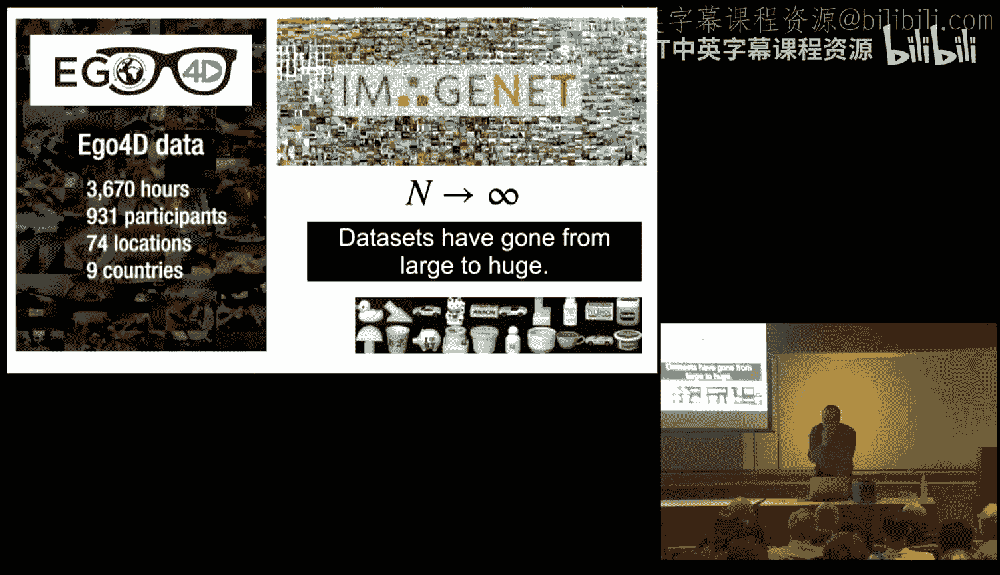

You know， she knew this data set business was going to be important。

 She's been labeling images since 2007。 Okay， this is 2022。 She still labels images。Every single day。

 she'll put a few hours。 She's probably label in right now， as we speak。And， you know。

 she's been labeling like crazy。 And I just wanted to give you a little bit of an update of what she's been up to in the last in the last month。

 So she's been labeling all kinds of images。 These are images that she has labeled。 But recently。

 you know， she learned about imagenet。 And then she thought， okay， just labeled imagenet。

 And she's been segmenting objects and imagenet with parts and everything。

 And it's just becoming crazy。 You know， it's just labeling the whole thing。😊。

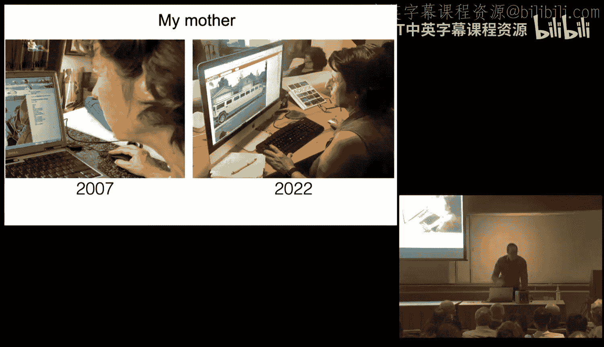

EBut one of the interesting things also is that， okay， you know， my mother is， is labeling a lot。

 but the eventary imagenet is just too large to get it labeled， so。😊，You know， guns。

 on the other hand， are becoming really， really good at drawing images that look very realistic。

 And people have shown that you can take， you know， cars and you' train， you know， with a style gun。

😊，And these are images that are rendered with a gun。 And its just so amazingly good quality。

 And the hypothesis that we had。 And this was work in collaboration with Sanya Fier's group was that。

 okay， if the gun can render it， it knows what it is。

 So can we use this gun that already knows how to render these beautiful images to generate a data set that will be fully annotated。

 So basically， we want to kind of generate you know， a gun model data set that， you。

 your sample from it and it already gives you all the images already fully annotated。😊。

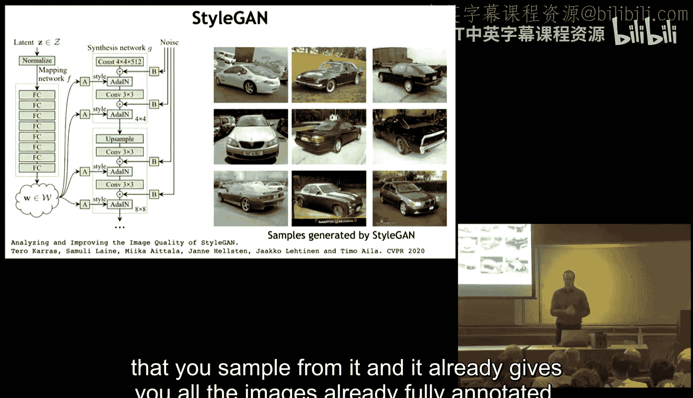

So this is the idea， you start with a gun that you have already trained to generate images that look very realistic and you know that the internal representation must know something about the objects that you're rendering because otherwise how could it do it so well。

😊，And hypothesis is that now one thing that you can do is you take an image that has been rendered by the gun。

 You annotate the objects that are being rendered。 This is the only thing that the gun doesn't really know。

 It doesn't know how to put names to things。 Now， that's what you know。 So you annotate a few images。

And you don't need to annotate a lot And because now you have you can spread your budget。

 your time budget instead of devoting it to annotating a lot of images。

 you can just put a lot of effort in just few images and you can label them with excruciating detail with all the different parts that it contains and now what you do is you take these annotations you also have the images that were generated by the gun。

 which means that you also know what the internal representation was that generated those images。😊。

And you train a very shallow network that takes reads the representation and learns to the the representation inter segmentation。

And what is really cool is that you don't need to have a lot of annotated images to do this with just like 16 images。

 you get fairly good segmentations out。 So once you have that label branch。😊，Already trained。

 then you just sample from it。 And the nice thing is that now we will generate images that are fully annotated。

😊，And they will be fully annotated with a lot of parts and whatever you gave as input。😊。

During the annotation process， and it will just generate these really wonderful images with lots of details。

 And now you can generate a gazillion of them and then use your favorite algorithm for object segmentation。

 mass N or whatever you w to use and just run the standard pipeline and you know。😊。

Running with that data set that is being generated。

 So now what we can do is we can take a gun that generates， for instance， images from imagenet。

 So this is the result of a conditional gun that is been trained with imagenet。

 And they look pretty good。 I mean， the images are quite， quite amazing。

 the images that I can render despite of the diversity of imagenet。

 And now what you do is you take imagenet， you train the style gun。 know big gun， whatever gun。

 you wantna train in this scale， we train by G。 You take my mother， you annotate a few images。

 And then you know， that's it。 You just sample from it and you get a Gatilian images。😊。

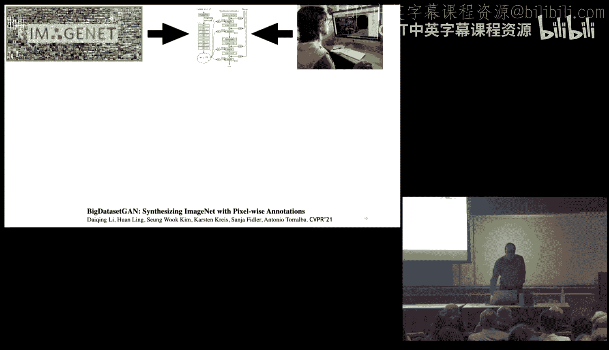

So that's what we are doing now。 And this is what my mother has been focusing in the last。

 in the last month。😊，Well， okay， so that's she， she actually is in the author list in several papers。

 But this one， unfortunately， when it was submitted， the students forgot to add her。

 And then because they， you know， CPPR doesn't allow any more to add authors， we couldn't add her。

 Yeah， but she is called in like four papers。 She has citations and everything。 Like its just。😊。

she has， There is a paper with two authors。 Yeah， Yeah， I have a， a paper to just with her。 I。

 my contribution was to translate from Spanish to English。And now， you know。

 you can sample from this gun。 So here is， you know one of the classes with dogs。

 but they come with segmentations。 No， no， it's a segmented data set。

 and you can do whatever you want。

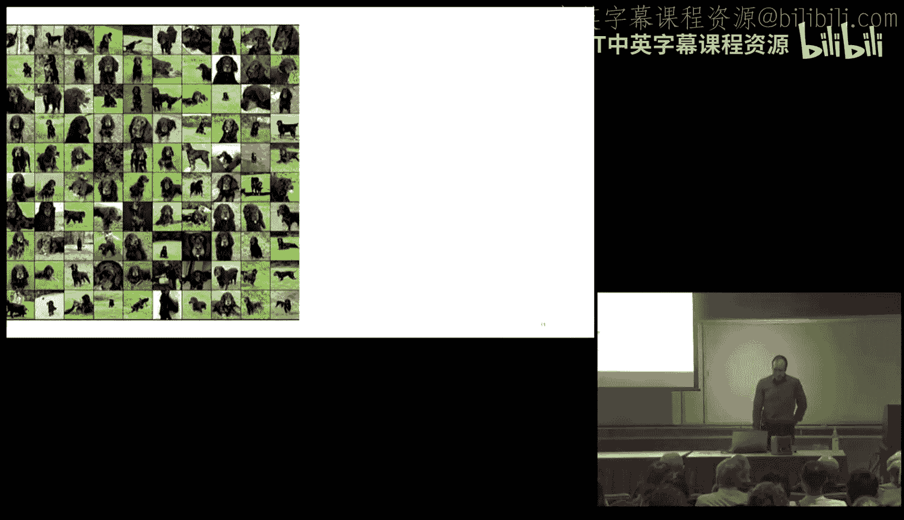

But this is still not addressing the problem of， you know， we are still that asset hungry。

 And here is just another way of generating a lot of data who cares about this。 And， in fact。

 you know， just recalling itendra， many years ago， at some point， we had a conversation。

 And he was saying， you know， everybody， Yeah， sure， sure， latest data are interesting。 but really。

 you know， the interesting limit is not one n goes to infinite。 But one n goes to one， you know。

 and then we had a， a discussion about this。 and。😊。

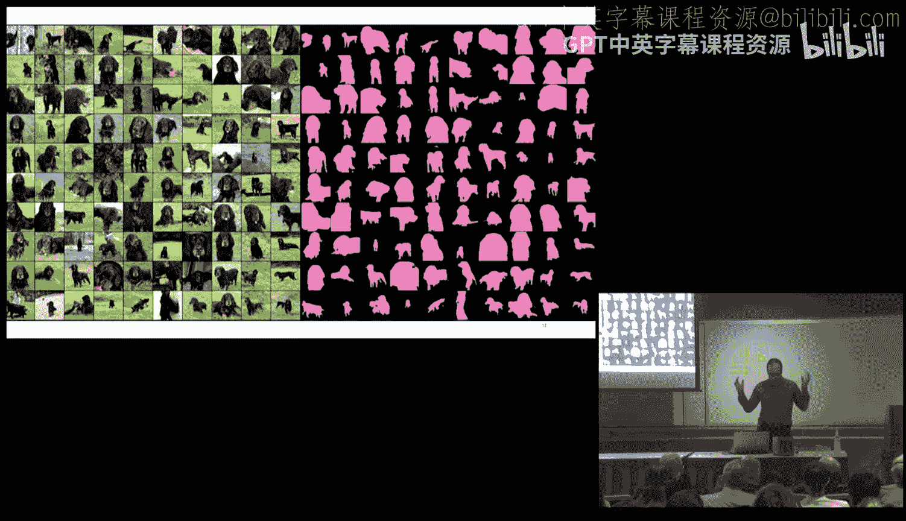

😀You know， I think that the time show that N going to infinitefr was actually quite interesting。

 And I， what I want to say now is that he's still wrong。

 I don't think that n going to one is either very interesting is n equal to 0 That is really interesting。

 So that's what this presentation is about is how do we make， you know， n equal to 0。😊。

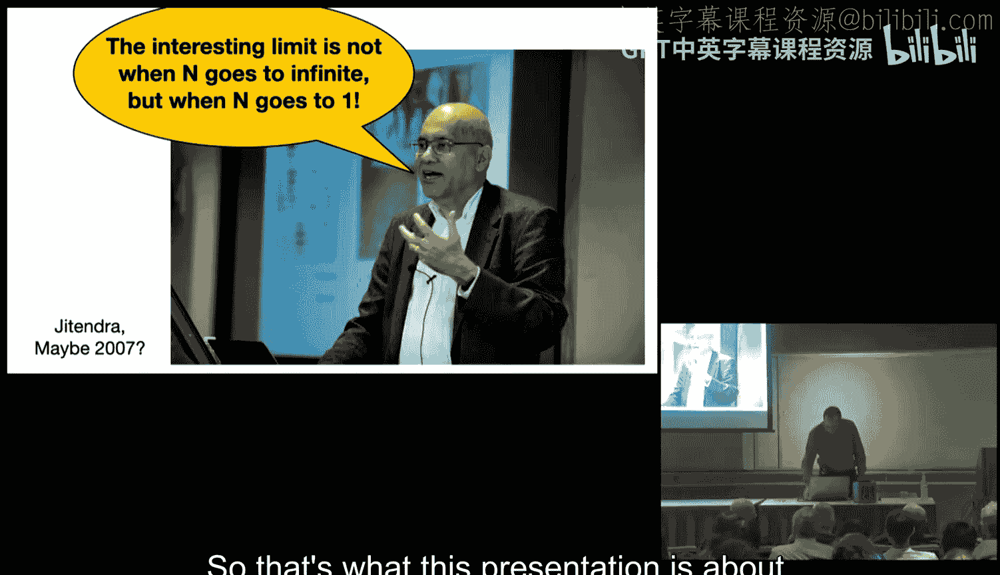

So this is a collaboration with with Philip and and， and Manuel and Jonah San Toung Su。😊。

Yeah that probably， you， you know， several of them because they've been here for a while。

 So that's what we wanted to do。 Let's do n equals 0。 So， okay。

 how do you train a system if you have no data。😊。

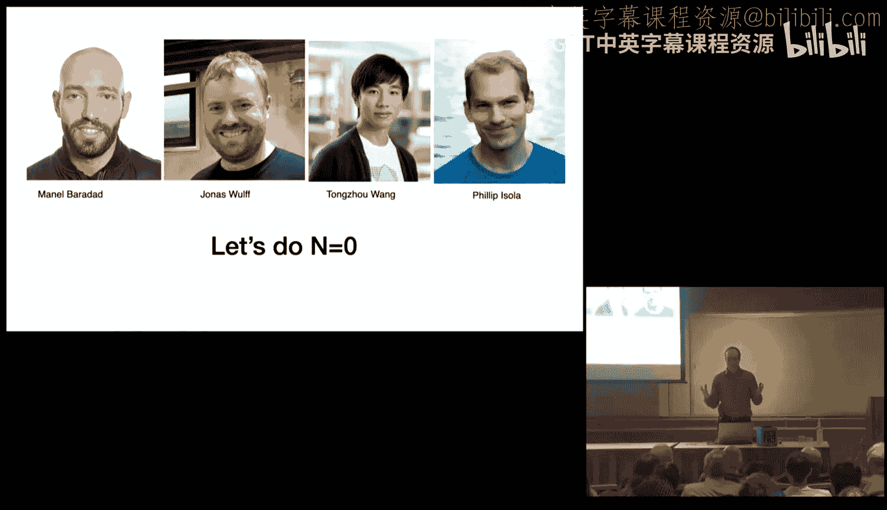

Okay， so this is the two things that generally you need in order to train a vision system。

 You need images and you need labels。 whatever the labels are could be segmentations or categories。

 whatever you want to use。And the community has been working really hard in getting rid of labels。

 and in fact， it's been quite successful in the last few years。

 it's just amazing amount of things that have happened that have shown that you can get really good visual representations with no labels whatsoever。

 and contrastive learning is one example， but there are many other like out and codes and so on。

 and you play these games where you try to learn a representation that will put examples that are similar close together close together and because you don't have labels。

 the way that you do that is by generating virtual training examples that are just transformations of one single image and you want all of those to play together and then that should be different from other images and just play in that game it gives you visual representations that are pretty remarkable。

😊。

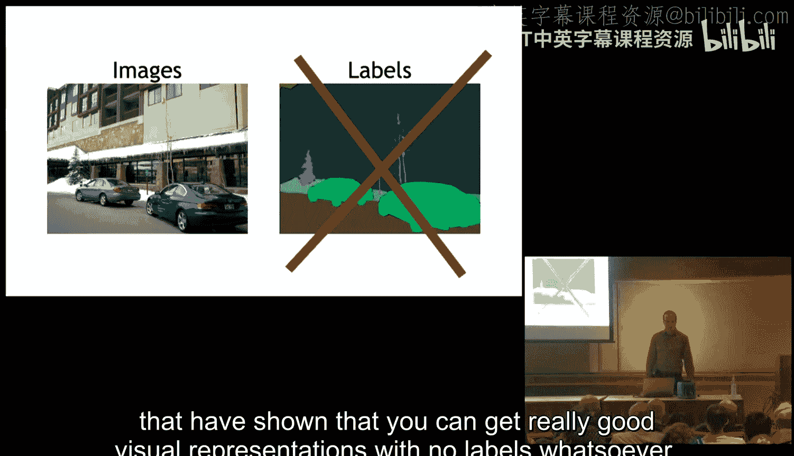

So that's one thing that you can do。And what is nice is that now you have this network。

 you have to learn these weights， these ways， you learn them with no labels whatsoever。

 And then at the end， what people will do is you know。

 this build some visual representation and the way that you check if your visual representation is good or not is you train a linear layer that will translate that representation into a classification task and then check the performances。

 but you only train the last final layer。 This visual representation will have to be able to translate your image into something that is useful。

😊，And， you know， it's quite remarkable how far this has gone。

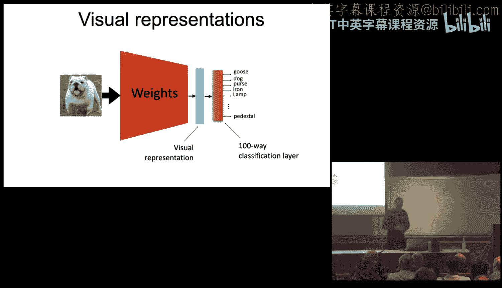

So some of the most of the experiments I will show are going to be on Inet 100。 Okay。

 this is a cheap version of Inet where we selected 100 classes instead of 1000。

 because one of the issues is that， you know， we have these large data sets。

 And this is actually creating a problem for academia。

 because you have to run your experiments on this huge data sets and it takes a lot of CPU and GPs and you know。

 a lot of times you cannot run a lot of iterations。 And think we you know。

 we went too far pushing for large data sets。 And now we are paying the price。

 and we have to push backwardword and say， okay， let's define some benchmarks that are good enough。

 So， you know， I think we need this the help of everybody because its very hard to convince reviewers that this is interesting because they say well。

 what happens with Inet with a full imagenet。 Well。

 you know what happens the same thing is just1 times more data。

 But it's about the same thing So anyway， it's a hard battle to fight。😊，But this is， you know。

 a small， a small data set that will allow us to do a lot more experiments。

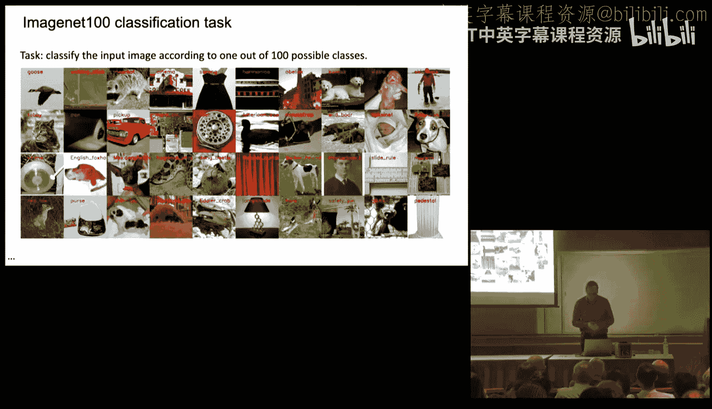

So if you use contrastive learning in this data set and then use a linear classifier at the end to do this 100 classification task。

The performances that you get is what I'm showing here。

 So this is this is a graph that I'm going to be filling with results。😊。

The vertical axis performance。 this is the performance that you get in this 100 classification test。

 So chance will be11% with different data sets。 So when you just contrastive learning to learn。

 you can use data sets that are different from Inet。 So if you use imagenet itself， Inet 100。

 then you get around you know over 60% performance 63 or。😊，But if you use。

 if you use the actual whole imagenet， you get worse performance because you are adding new classes that you will never test。

 So it is slightly worse。And then if you use like something like S T L10， then you get even lower。

 But this is about the type of performances that you can。

 you can get when you are learning that representation with real images， okay。

So this is contrastive learning on real images。 And I'm going to build on this result for a while。

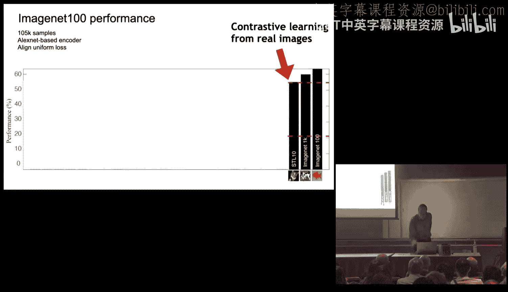

Okay， so yes， you can get rid of labels。But that's not what I want to do。 You know。

 what I wna wantna do is really to get rid of the whole thing。 Okay。

 because everybody complains about labels an notation and so but images is also a pain。 You know。

 there are so many issues with images。 You know， they take memory。 You need to collect them。

 There are copyrights， privacyes， biases。 There is the whole thing。 know， it's a mess。

 So really what I want is to get rid of the full thing。 And this is what I mean by n equal 0。

 because a lot of people when they say n equal one， really。

 they are thinking about transfer learning or one shot learning。 And that you know。

 the resource system already knows a lot of things。 this is about how do you learn to see。

 you have never opened your eyes。 Okay， How far can you go。😊。

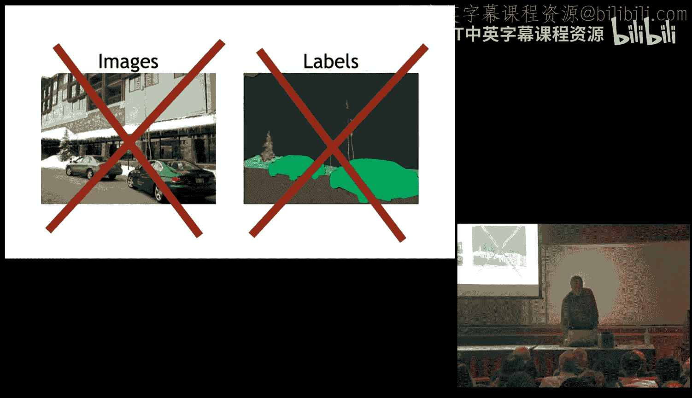

Okay， so what can you do， You have， you know， we want to find out what the the weights here should be。

 and you are not allowed to use any data to train this。 What do you do， Well。

 one simple thing that you can do is just put random weights。And that's it。 You know， that's it。

 That's your word。What happens if you do that。Well， if you put random weights。This is what you get。

This is， you get around over 20%， which is already much better than chance。 much better than。

 you know， the state of their computer vision 15 years ago。😊，You know， for the people that say。

 you know， we didn't have compute to train anything。 there was nothing to train， okay。

You just put random weights and you went already above performance of your computer vision 15 years ago。

 So anyway， there it goes。 You know， the need for compute。😊，And。Okay。

 the nice thing about this project is we wna be able to do better than this without any type of real data。

 The nice thing about this project， it was kind of easy to convince the students because first。

 you only need to beat this。 Okay， As soon as you do anything。 if you get higher than this。

 That's okay， that's already good。 you don't need to get to the real data。

 This is going to be our upper bound， its very difficult that we will be able to do anything better than this。

 But at least you should be able to get it better do better than random weights。

 So this was a winning project for all possible metrics， because whatever you need。

 it was going to be better than this。 This is a fantastic type of project to do。

 because you know that it's going to work no matter what。😊。

So this is this is the range of performances in which we are going to be moving。

And the question then is， what are the strategies that you will use in order to build out those weights so that we clang this ladder？

And we get as far as possible。 and we'll see where we get Do。

Why with random weights to get something non significant。I， I don't think。Yeah， yeah。

 So there is a linear layer。 There is a linear layer。But still。

 why is that even with the linear layer， it works a little bit。

 I don't think no one really knows even why when you train it， it still works。 you know， So。

 you know， I， I think it's okay， but I think that is just the， you know。

 you get a lot of features and they are kind of useful to some degree。

 So I that is the best situation I have right now。😊，And actually， another interesting thing is that。

What if you don't even want to train a linear layer， Like really。

 the ideal test is a test where you don't have real data at all。 you don't think anything whatsoever。

 And the best test is to do nearest neighbors。 So what how good is your representation as a similarity metric。

Okay， so you have a network that has random weights and we take like INe 100。

If I give you like5 query， this query images， and I look for the nearest neighbors in the metric given by。

 by。In the metric given by this， by this random， by the representation bill by this random weights。

How good are the neighbors， Okay， so let's look at them。

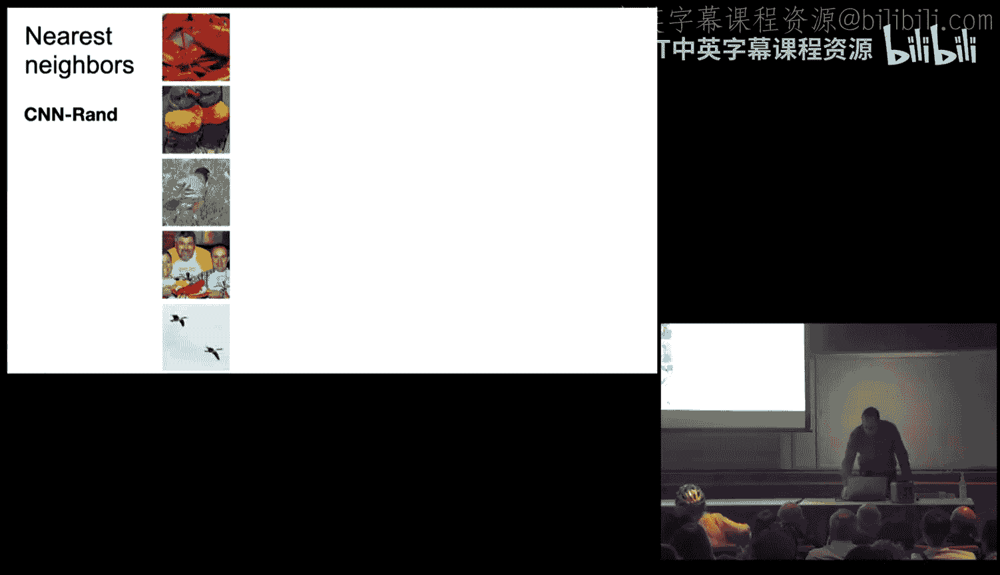

Here there are the top five nearest neighbors for each query image。 And okay。

 you can see it's pretty random。 So， you know， there is some work to do。 The color is kind of right。

 it's getting the color right， but about but beyond that。

 there is really not a lot know these images they don't match that at all。

 if you look at if you try to do classification with nearest neighbors。

 just by looking at the category that has the most votes， the cures is around 4%。

 So it's just barely better than chance。 chance still will be 1%。

 So it's doing a little bit better than chance， but not by much。 So it's a terrible。 know。

 as a visual representation is really not very good。 this is probably computer vision 15 years ago。

 So。😊。

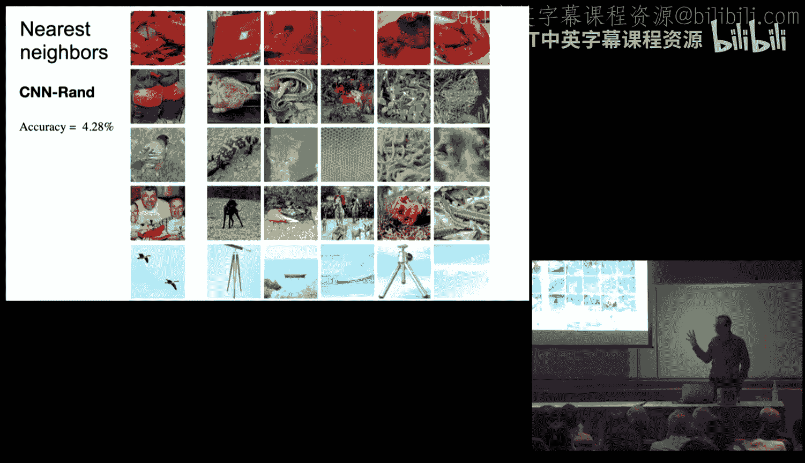

That that's okay。 that's okay。Okay， what else can we do， Okay， let's see。 We cannot use real images。

 So the next thing that people immediately thinks it。 Well， let's just virtual environments。

 You know， you can render images that try to imitate the world And， you know。

 that's going to be great。 Why not to do that。 You're not using real images。 Okay。

 that's fair the game。😊。

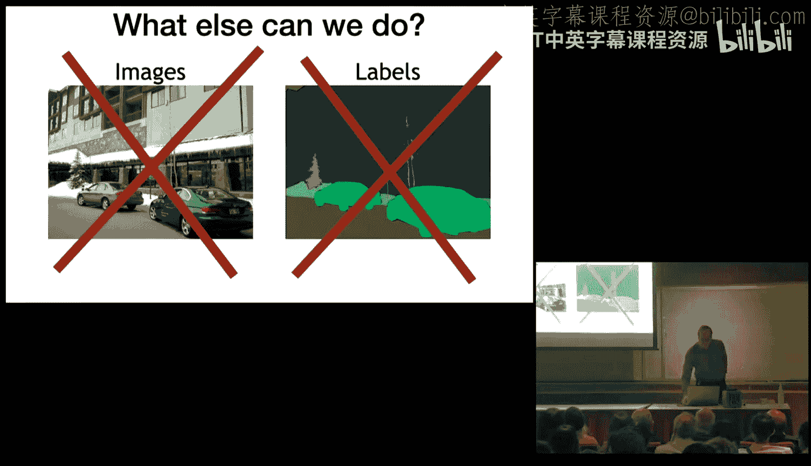

But building these environment is a lot of work。 And this talk is about maximum laziness。 Okay。

 so this is still too much work。 And getting these things， you know。

 is very complicated because you have this gap between simulations and real data that is always there。

 And at the end， the performance is never match。 and it's just very tricky。

 And the problem is that you need to do a lot of work in order to get simulations that are very useful。

 So this is a video from virtual home that is one of the simulator that we created。

 And here is a person。 it's an agent that you can control。 And it wants to watch TV。

 So it takes a remote control with this strange pose。 And now is' going to go to the couch。😊。

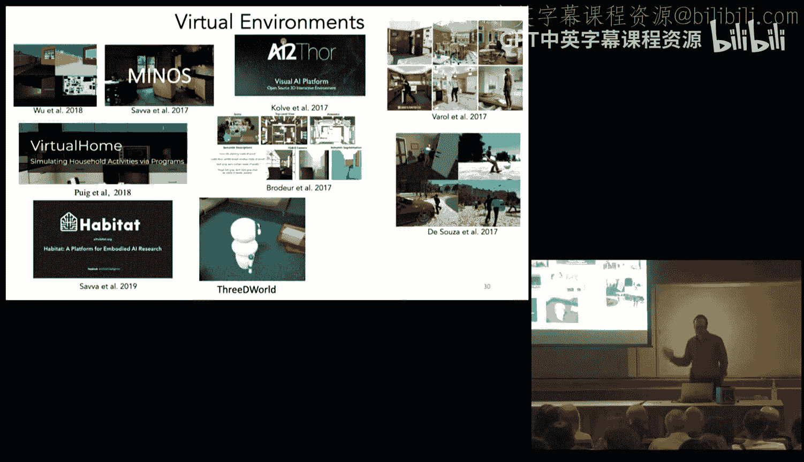

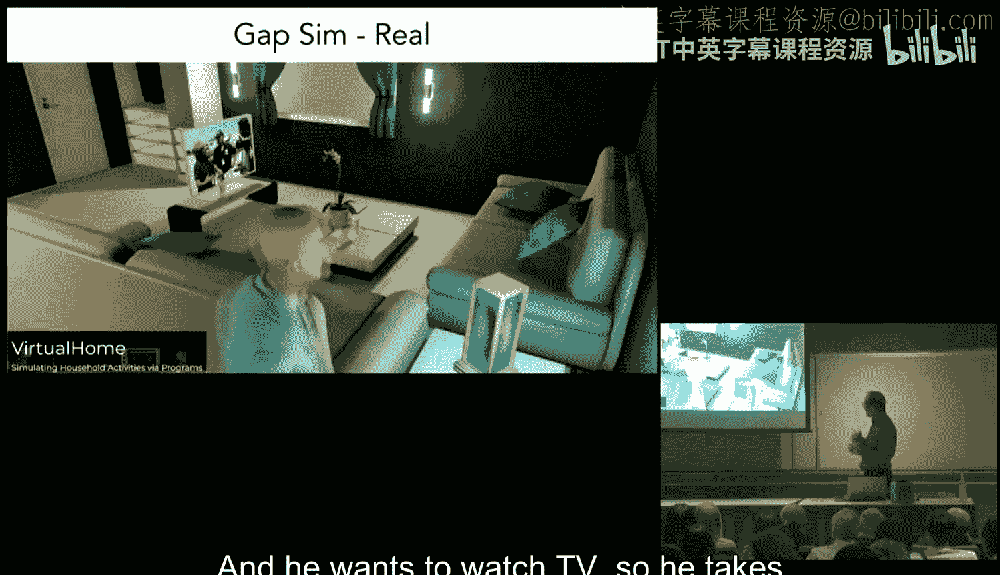

And sit down。

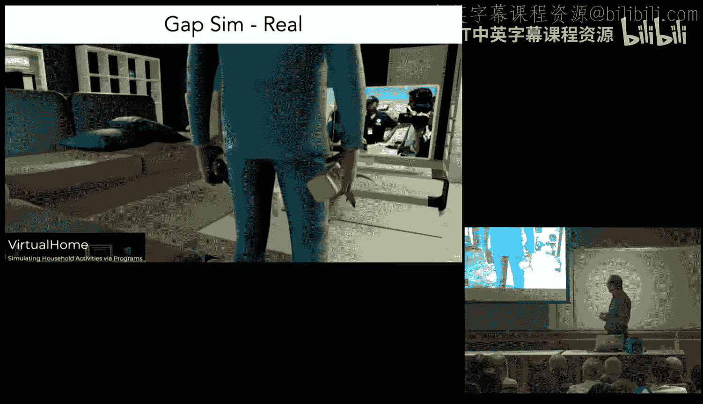

You know， we have a poor placement of cameras。And now he wants to drink and look at that。

 It doesn't know where the mouth is。 Okay， And in order to do simulations that are realistic。

 you need to get all these details right。 And， you know。

 whenever there is something new that you want to simulate。

 then there are a whole kind of worm that gets open and you need to get all these details and so on。

 So the gap is into real is just hard to， hard to close。

 So this talk is not about making that gap smaller， this talk is about making making that gap huge。

 Okay， we are going to make it really， really large。 If we cannot make it as small。

 then just go large， okay。😊。

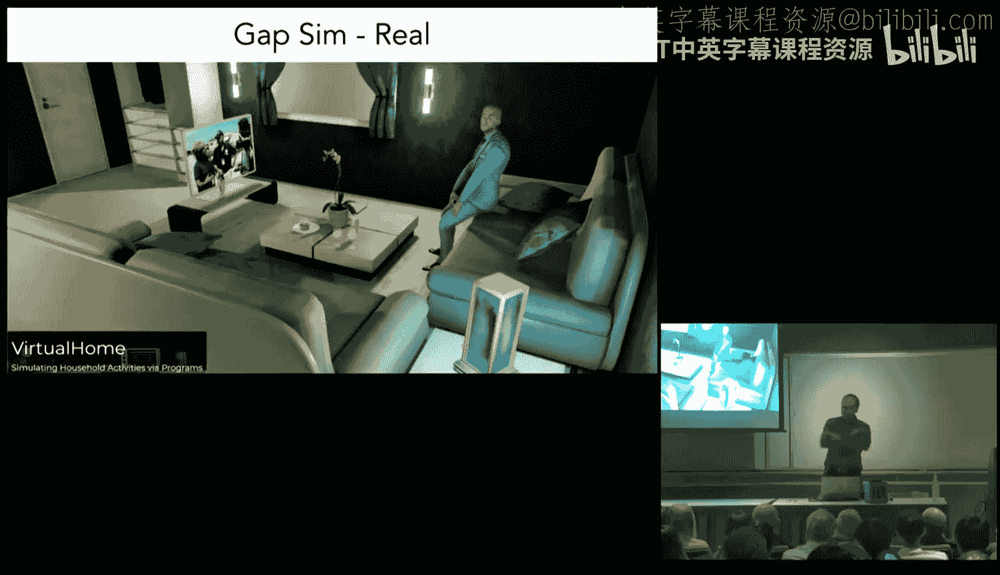

So that's what that talk is going to be。 Well， you know。

 there are a bunch of simulated world that you can use like Mincraft， clever images。 And actually。

 you use them to pretend。 It's not bad。 You， you get some performances。 Now， this is make Mincraft。😊。

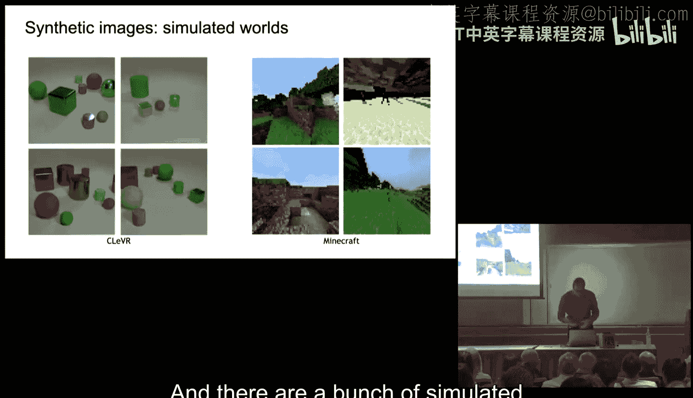

And aco around you above 40% here is pretty pretty good。

 Min graph is images that are kind of very different from real images。 but still。

 you learn some relatively good visual representations， but。😊，Someone had to code Mincraft。

 It's just a lot of work。 You know， you have to create these environments。 And you know。

 the rendering engine is just a lot of work。 We don't want to do any of that。

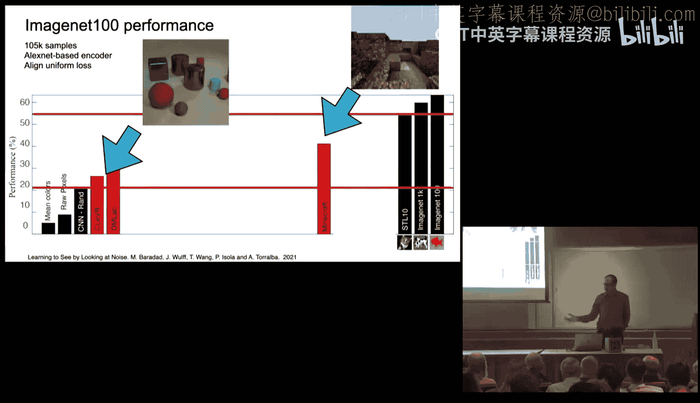

So how do we reduce this into real group， Okay， G， we are not going to reduce it。

 We are going to make it really， really large。 And you know。

 there is evidence that biology might be doing also something like that。

 So what is the type of simulations that biology will do in order to learn to perceive the world So what you will see here is a video of recordings on the retina on on an embryo for mice embryo。

 what happens is that the retina has some spontaneous activity。 and iss generating a stimulation。

 and it might look like noise。 it might look like noise。 and this is what it looks like。

 So this are just different recordings of of the retina。

 and you see these waves that move around and they are called retal waves。 and you know。

 one thing is well， maybe this is just a spontaneous activity。 but maybe it has a functional role。

 and what people believe is that in particular， this type of waves might be just for learning to the optical flow。

😊。

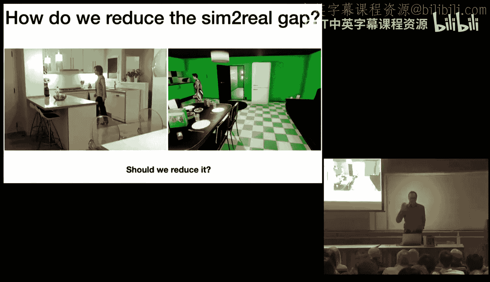

So what we are saying is that， well， these type of simulations might be useful to learn to see before you open your eyes。

 What kind of representations will you learn if this is the type of things that you can。

 you are allowed to see。😊。

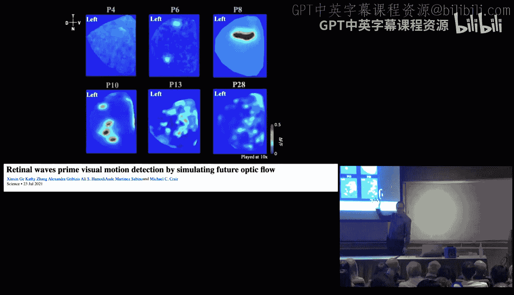

And there is a paper per factoryctor that shows that if you use fractals。

 So just take images that are generated with these very simple generative processes that generate fractals is you pretraining with these fractal images。

 you get， you know， you get performances that are you know above 30% in this task。

 they use it for pretraining a network and then fine tu。

 So here we are not doing any fine tu and you know。😊。

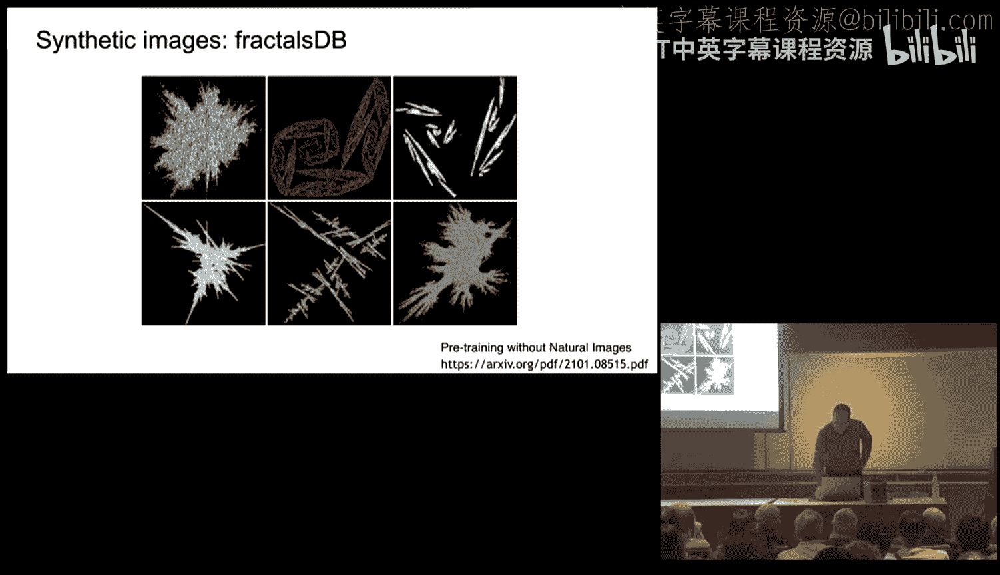

I'm totally against fine union so we can talk more about that。But here， what they show is that you。

 you get some performance。 Well， this is what we show because they show it only for fine tu。

 but you get some performance that is not too bad。 And these processes they look like nothing like natural images。

 but still not as good as minecraft， but you know。

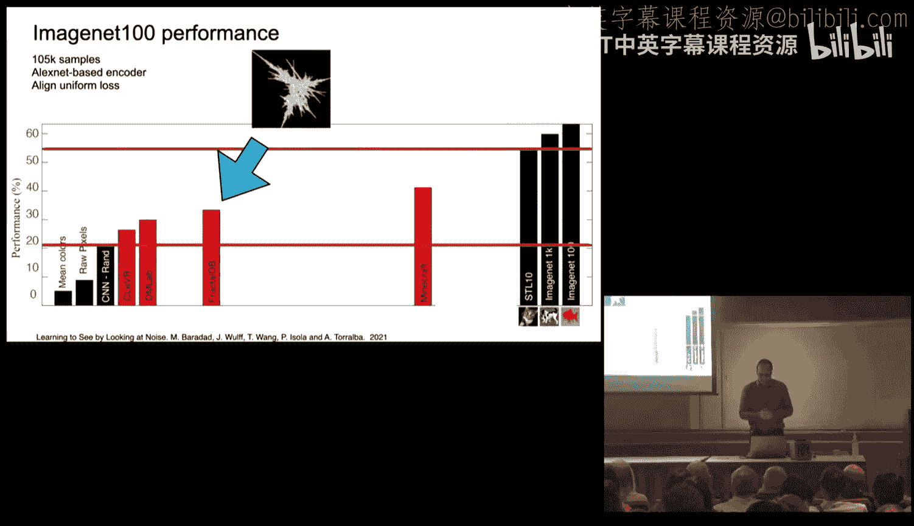

So what we wanted to see is if we could learn by looking at things like looked like this， just noise。

Of course， you know， this is an extreme view snow of noise。

 And the type of noise that we will use is just stochastic processes that generate some interesting patterns。

 but there is still noise some sort of， you know， random process， but there will have some structure。

😊。

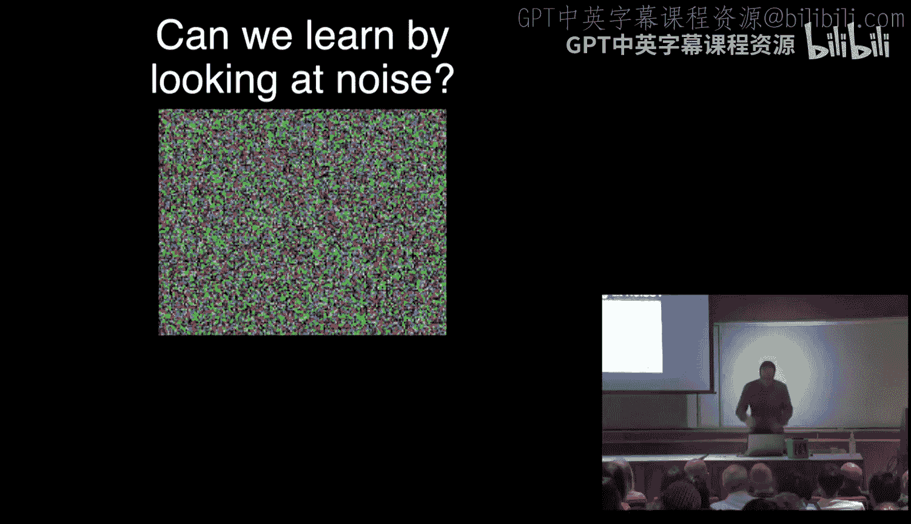

So。Let me show you just some of the things that we will create at the end。

 So this is crops from images that we generate。 and also crops from real images。

 So there are three that are real and three that are fake。 that are the result of noise processes。

 And， you have to guess which one is what。 So I's just think a little bit about it。

 And then I'll show you。😊，Which ones are real and which ones are fake。Its not super hard。

 but it takes a little bit of time。出来没下午就。These are。

So these are these ones here are actually noise processes that have a structure。

 So I'll explain in a moment how data structure works。

 And they generate patches that look a little bit like patches that you could find on natural images。

 So if you were training to see a visual， if you were learning a visual representation with those。

 you could get kind of far away。😊。

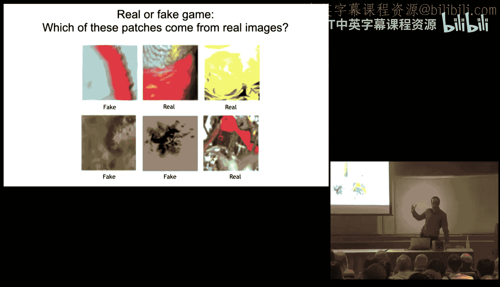

Okay， so now， you know， I'll give you a little bit of， you know。

 we are going to go step by step in building different types of processes and see how well they are as you know。

 data to train visual models。 And that kind of will mirror a little bit of history of computer vision to some degree or or at least a statistical image models。

 So one of the。😊，Most interesting initial generative models of images were what was called the deadlift model。

 This was a process that was' introduced used in the 60s and then it became really popular in the 90s。

 and it was used to explain some of the properties that natural images have its a little bit of toy of what a natural image and the way these processes work is think of leaves falling on the ground。

 leaves have different sizes， different colors， they fall on top of each other。

 creating occlusionions in this case， the leaves are just squares。

 and once they have fallen on the ground， they generate different patterns。

 and it's just the random process of selecting this distribution of sizes and which ones fall first and and last the order it will create different types of images。

 and these images had a number of properties that were kind of similar to the ones that you find in natural images。

 of course they don't look like natural images at all。

 But there are a few things that are statistically similar to natural images。😊。

Are very easy to produce。 You need a million of those。 It's very easy。 Okay。

 I can give you a million of those。 You can actually generate them on the fly。

 You don't even need to have the collection。 You can just generate them on the fly。

 as you are training。😊。

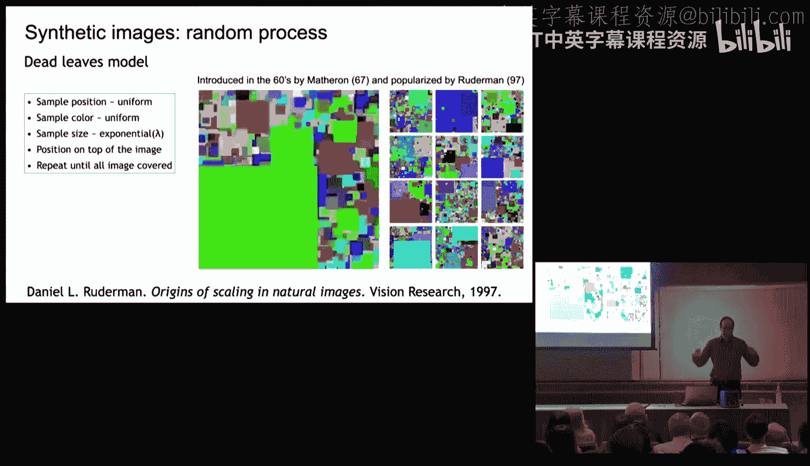

And。You know，Here there are a bunch of them。So what happens if you use these images to pretrain your visual representation？

😊，Well， another thing that you can do is okay， this work with the squares。

 Now you can put the squares in random orientations。 you can also have lift of different shapes。

 like circles and triangles and so on。 So now what happens you know if you take this as just as your input data and now you train a visual representation with them。

😊，Well， this is what happens。So these are the three different types of thelift models with only squares with orientated squares of with random shapes。

 And you can see that as you add more complexity performances get going up， which is， you know。

 reasonable。 And the deadlift models with random shapes， which is a very simple process。

 Its really just shy of the performance that you get with Minecraft。 And there is no 3D engine。

 No one had to encode complicated environments or anything。

 This is the dumbest model you can think of。 Okay， and is already midway in the gap between random training and full training with images。

😊，And the other nice thing is now， okay， what happens as a visual similarity。

 So you have know your input images， these are the same ones that I was shown before。

 What happens if I look for the nearest neighbors once you have trained your visual representation with this deadlies models。

 So this are the nearest neighbors。 Okay， well， is pretty terrible still， okay。

 accuracy has gone up quite significantly 12% now， if you look at the majority vote for which class gets represented there。

😊。

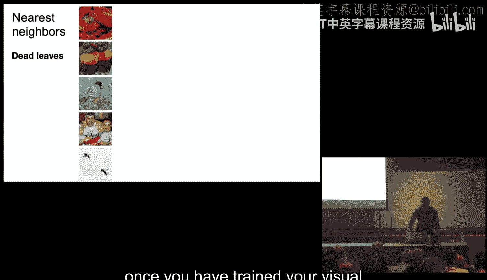

You， this bird， it actually got too right， which is quite impressive。 I mean。

 this is just in squares and circles。 And this is how it's been portrayed。

 And it's capable of locating these birds。 Now， here is just a mess。 you know， maybe one image。😊。

But the parro no it， it took it got one parrorate。 Maybe it's just pure luck。 I don't know。But yeah。

 it's， it， it's getting somewhere。 Yes the parameters could be things like the distribution of sizes that you have。

 How many。 No， there's no tuning。 Yeah， yeah， there's no tuning。But you can， you can。

 you can explore the parameter set and so on。 the amplitude spectrum is。Pretty close to。 Yes， yes。

 yes yes。

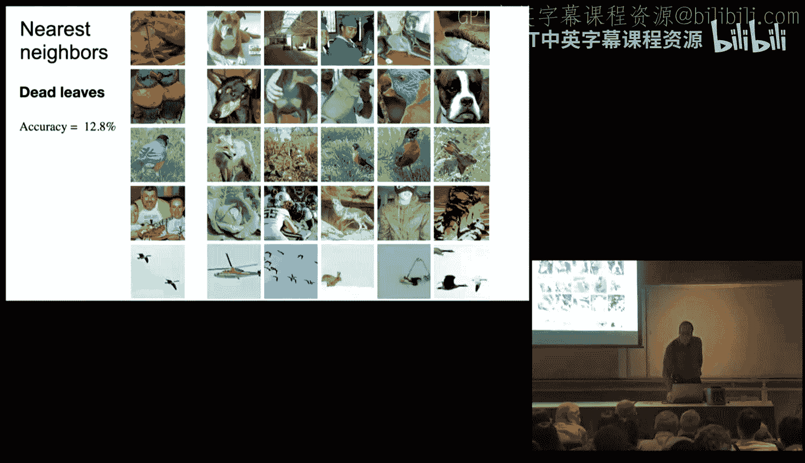

Yes。😀Okay， talking about the update to the spectrum。😊，Okay， here is one。

 one tool that probably many of you have never heard about， which is the fourier transform。

 Can you raise your hands if you have care only the first row， Only the first row。😊，あ。Okay， okay。

 you know， believe it or note， this was the tool to use many years ago。 you know。

 everybody working on image processing， of course。 But even in computer vision。

 further transform was very popular as as a way of analyzingnaly images。😊，Yes， yes。

 And there is still one remarkable property of natural images。

 If you take an image and you do the fourier transform。😊，You know， you don't know what it is。 I just。

 I just talking for the first row probably now， but it doesn't matter。 Just believe me。 you teach it。

 you teach it。 Okay， some people are not but。 Yeah， okay， some people are saying， yes， yes， okay。

 okay， okay， one remarkable property is that is you take an image and you compute for your transform and you look at。

 you look at the amplitude of the power spectrum。😊，So this is this drawing here。

It always looks like this。 Most of the energy is concentrated on very low frequencies。

 and as you go to higher frequencies， which is what encode the details on the image。

 the energy falls off very， very quickly。 And in fact。

 it does it with with this property that is called one over F that the amplitude of the energy that you have on on different frequency drops with the frequency with a square of the frequency。

😊，And this is true for almost any natural image。 In fact， you know。

 I challenge you to take your camera， try to take pictures of things that will not have this property。

 And it's just amazingly difficult to find something that will not fit that。😊，So。What can you do now？

 And in fact， you know， people have been using this for all kinds of things for explaining maybe how the retina actually the encode signal。

 how how you know， wise is that we have a particular structure in our retina， know。

 one of the hypothesistheses is just because its and encode images that have this one over left property in the power spectrum。

😊，Okay， so now we can use this to create images。 How we do that。 Well， you take some noise。 Okay。

 if probably you are more familiar with the fusion models that you are with this， okay。😊。

So think of a big diffus， a very small diffusion model， okay。😊，That it starts with a single。

 you know， a noise signal。 And what we are going to do is we are going to the Fourier transform。😊。

Imose the Fourier transform to have this amplitude。 know， we keep the face。

 and then we you do the inputverse of the4 transform。 and it gives you an image。😊。

And it always looks like this like clouds， whatever you do， whatever image you have， you do this。

 always clouds， always， the only image that will preserve it as identity under this operation are pictures of clouds。

😊，Okay， so this is， you know， the images that you get。 So now the question is， well。

 we can create ailian of those and you can change the slope。 You know， one over F is true。

 But the slope of of the， you know， there's always an exponent in F。

 and thatent changes from one image to another so we can just randomly sweep that in the range that we believe is the one that discovered by natural images between 0。

5 and 2。😊。

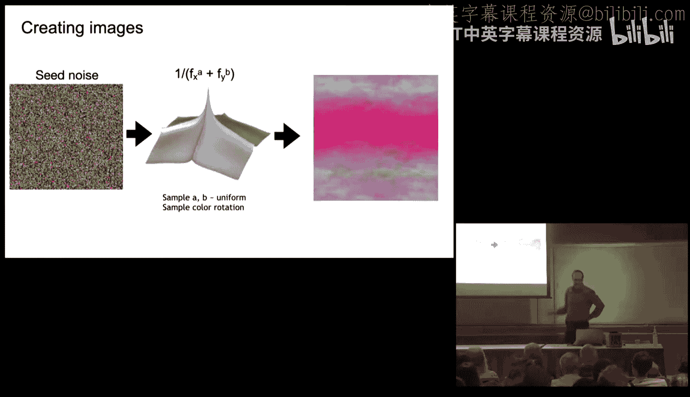

Just some random uniform distribution。 and these are examples of images that you get。 Okay。

 what happens now are you trained with this。😊，So here is our plot of performances。

 what do you think it would land？😊，Any guesses？tterBetter than minecraft。It's actually very bad。😊。

It's actually pretty bad。 But， you know，30%，30% is way better than chance。 But yeah， you know。😊，Is。

 it's surprising that the list is actually better。 No， but you have edges and so on So it's pretty。

 Yeah， yeah。 you don't have edges here。😊，okay， I I'll let's， let's get back to that in in a second。

 okay。Another remarkable property of natural images。

 And this is kind of more related to the scattering transform， although not exactly that。😊，Okay。

 another remarkable properties。 if you take an image and you compute a histogram of color values of pixel values of intensity values on an image。

 You get some histogram。 There is nothing remarkable about it。 There is no special structure。

 And that's just what it is。 There is nothing interesting to it。 Okay， However。

 if you convolve your image with a zero mean filter。 Like， for instance。

 computing derivative of the image。 just by know taking pixel differences across nearby pixels。

 So in this case， it will be like a vertical edge detector and you get this。😊，Here。

 the gray represents0。 And what you see is that most of the image is 0。

 And there are a few places where you have high contrast。 And， you know。

 probably you have seen this many， many times。And the remarkable thing is that if you do the histogram of this signal。

 it looks like that。 And you see it's extremely uniform。 It's just very clean。😊。

It's a very clean shape。 No， it doesn't have all these picks and goals ups and down。 No It's very。

 very clean。 And if you do this for another orientation， you get the exact same thing。

 It's always a very clean shape。😊，And it's almost true for almost any small pseudoamine filter。

So you always get these things and always very， very clean， Okay， so。😊。

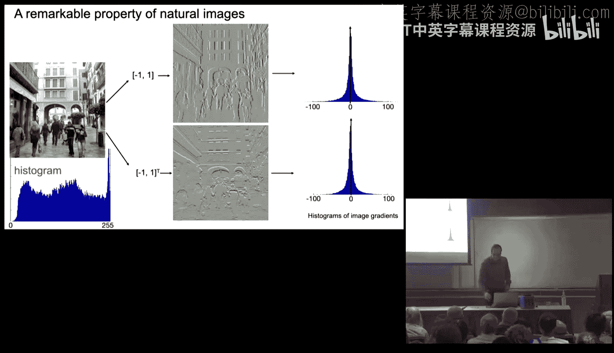

You know， this is Bruno all work。 you know， just this property was enough to build some of the first models that were capable of repro perspective fields that looked like anything that you find on the cortex。

 So this was kind of a， you know， inspirational moment at the time。😊。

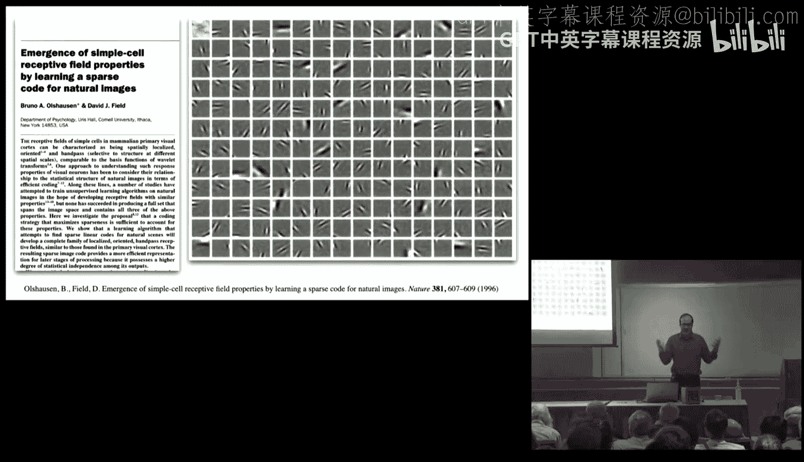

And then it also inspired a full family of models for texture synthesis and analysis that Jetenra also did a lot of work on this type of modeling。

 But in particular， for texture synthesis， there was this one on based on Frank Higer and Bergen。

 which is。😊，Okay， you can think of this。 You are probably a lot more familiar with guns and outrs than you are with this。

 So think of this as a gun with a single encoder layer and a single decod layer。 Okay。

 I'm sure that later you can understand it。And the way it worse is they one image。

You go through your encoding network， which in this case is just one layer， is just a bunch。

 a bank of filters， the steerable pyramid， just filters that are oriented at different scales。

 and then the way that you represent that is just the histograms of all these outputs of all these filters and then the synthesis consists in generating another image that fits the same histogram。

😊，ok。So that's how it works。Okay， so how do we use this texture based image model。

 you start with see noise So going back to the diffusion model。

 but now there will be just a little bit more than just two layers。😊。

The first thing is to spectrum to V1 over F。So we are going to combine all of the things that we have in scene。

 Then you go， you have your encoder that is going to be just a pyramid。😊。

Just a bunch of filters with an orientations， then you。That those filters should be a sparse。

 So if this is Gaussian noise， once it's filter by any filter， you always go get Gaussian noise。

 So this is not going to transform the histograms。 It only scales them and change the variance。

 But this is still Gaussian。 So you need to do some nonlinear transform to get something that will look like a sparse like this distribution that looks peaky at the origin。

 So you impose that。 How did you do that。 We are not allowed to use any learning。

 So we just use a simple pressure on what the shape should be based on what we know about natural images the spars coefficient generate range also between 0。

5 and 1。2 if it's not various partss。's just something like that。 Just pick a random one number。😊。

And then you have your deco there， which is basically just taking this histogram and generating an image。

You know， by collapsing the pyramid。And then you impose， you know， we need also some color models。

 So what we will do is just use the color model that we had on the dead lives model。

 So just take an image from the dead leaves and just we want to match the same histogram of colors that will create patches。

 but they will be very random patches。And that's what you get。 And the only thing is that here。

 you know， if you do this process once is not going to get what you wanted because as you do all these you know。

 impossible different properties， you break the other ones。 you just iterate this a few times。

 So now really looks like a efficient model where you have all this， you know， But next。

 I'm sure that that I I'm getting you back。 And this is what you get at the end。

 some some image that looks， you like nothing。 but interesting。 but。😊，Like， really nothing。

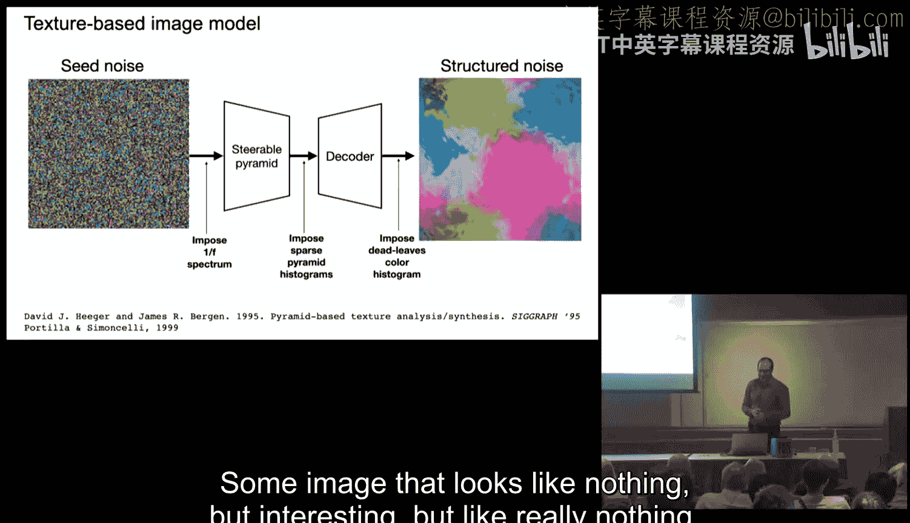

And you can do this many， many times with different coefficients。

 and you get all kinds of random images that look somewhat more interesting than than just dead leaves。

 Okay， so now we can use them to train。😊，Where do you think this will land。

 What do you think will happen？You think it will be better than the lives or worses。

There are some holes。 No so because you have a hint。Okay， this is what happens。

So this is if you only use the histograms。So it's just barely better than the spectrum。

 This is you use the spectrum plus color。 actually。

 So you use the power spectrum and just add the fact that you wna generate one of of noise that has a color hisster and that looks like deadlies model that already this increases performance quite dramatically。

 And thats because it forces to create patches of more or less uniform color。😊。

So it gets really close to the this model。 But when you use the three things together。

 it actually gives， you know， pretty good performance really， really shy of Minecraft。 And this。

 again， is just very simple images to produce。 really trivial。😊。

And you can actually use these textures in combination with the leaves。

 And that gives you the best performance。 just like basically like Mincraft。 Okay。

 and you can play this game as many times such one。😊，我开发的是干过的。😡，Okay。

 let's look at the nearest neighbors。 Here is， you know， you have some input images。

 and these are the nearest neighbors。 Ac accuracy went up quite a bit now is's 28%。

 This is pretty good。 And you can see some of the neighbors are really spectacular to me。 I mean。

 the the pars is just basically same thing the。😊，The lobster there。 You got four of the lobsters。 No。

 it's just， and all kinds of poses。 And this has never seen any natural image。

 It has never seen what a lobster is。And it's kind of capable of putting all these things together here。

 you know， have images of people。 These people are eating lobster。

 but it just gets just images of people。 And the birds here is just all kinds of different ones。

 So probably you know， im by imnet standard。 This is not a very good classification。

 But the visual similarity is quite kind of a striking。😊，And， you know， it has never seen images。O。

 what does干 with度。Okay， we know that guns are really good at generating images that look very real now。

 So let's just guns。 and you know we know that if you train with real images。

 you can get things that look very realistic， but you cannot do that because you cannot just real images。

 Okay we cannot just real images for anything。 not even to train guns。 So if you wantna adjust gun。

 you can still not train it。 That's the rules of this game Okay So what can we do Well。

 you could put random weights。 know， just take the gun before training it and just sample from it and' see what happens。

 So I'll show you in a second what happens。 Another thing that you can do is also to sit to put into the weights filters that look kind of what you would expect to learn things that。

😊，What， what happens you on。 So what are the filters， you could put some pretty fine filters。 Now。

 these are convolutions of 3 by  three most of the kernels。

 So just put things that look like derivatives and， you know， laplas and so on。

 And you put it inside。 You know that， you know， that's the type of filters that， you know。

 this models is like to learn when they have natural images So when not to put them。😊。

And now you can sample from it， and these are the type of images that you get。😊。

And they look relatively similar to the ones that I was showing before。

 But there are some other things that are happening here。 Like， if you look at them。

 they seem to have like more threadiness to them。 It's not， it's not very I mean。

 there is not really anything natural here。 There is not a lot of structure。

 but it seems to be there seems to be a little more complex than the ones that we we're generating with with the power spectrum and histronomic statistics。

😊，They don't look as flat as the other ones did。 So there is something thats different here。

So now when you train this with those images， this is what you get。You get， you know。

 you go much higher than Minecraft。 The gap is really getting really small here。

 and this thing has never seen real images。 This is a style gang with random weights。 Now。

 it's actually not that very good。 But if you put you initialize the weights with the right up of kernels。

 then things get quite good。 And I'm sure there are even better initializations。

 this is you are that's very game。 you know， I allow that。

 You are allowed to use your knowledge about what natural images are。

 You are just not allowed to use natural images。😊，But， you know， it's okay。 So you can say， yeah。

 but we are also like a gun。 You know， it's okay。 you know。

 I cannot have a person that is untrained on this。 So it's， it's， it's okay， I think that's fair。

's not're not at No， that's right it was never trained。 So there is no it's just， yeah。

 it's just the architecture there is no gun。😊，Yes， and you are allowed to use the history of computer vision to decide what to do。

 you know， so that you there is it's just， I'm just trying to bring back， you know， the。

 the fact that what we did in the past was useful， okay， that you。😊，That， that， that' I am trying。😊。

Okay。So now what are what is happening with the nearest neighbors。 So here there are the images。

 and these are the nearest neighbors。 the aquiestic went at。 But for these particular examples。

 I think that they actually went down you know， I don't like the neighbor so much。 But you know。

 it's okay。 the performance went up to333% overall， but just for this five examples that I pick。

 know the quality is slightly worse。 here is interesting to see that there are a couple of people actually eating lobsters and you might think。

 okay， but this must be this must be just fortus。 Now， I don't think it is。

 I think that there is something to it。 In fact， when you drink with imnet。

 you really will get only people eating lobster here。 So it really is capable of doing that。😊。

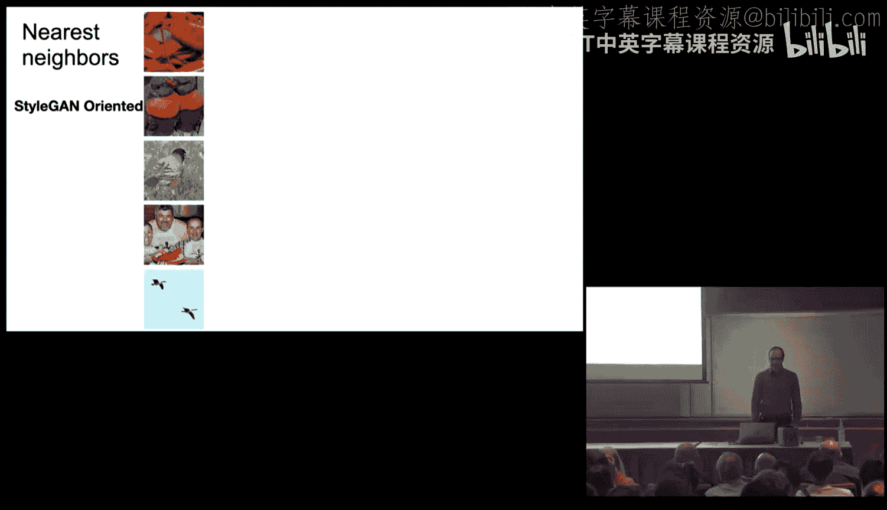

And I think that he's just getting closer。 But， you know。

 I think that the bird now got got really bad。 And before it was doing fine。Okay。

 what else canwiidow？Okay， so this is the game。 Now。 we are trying to learn to look。by。

 by just looking at noise。

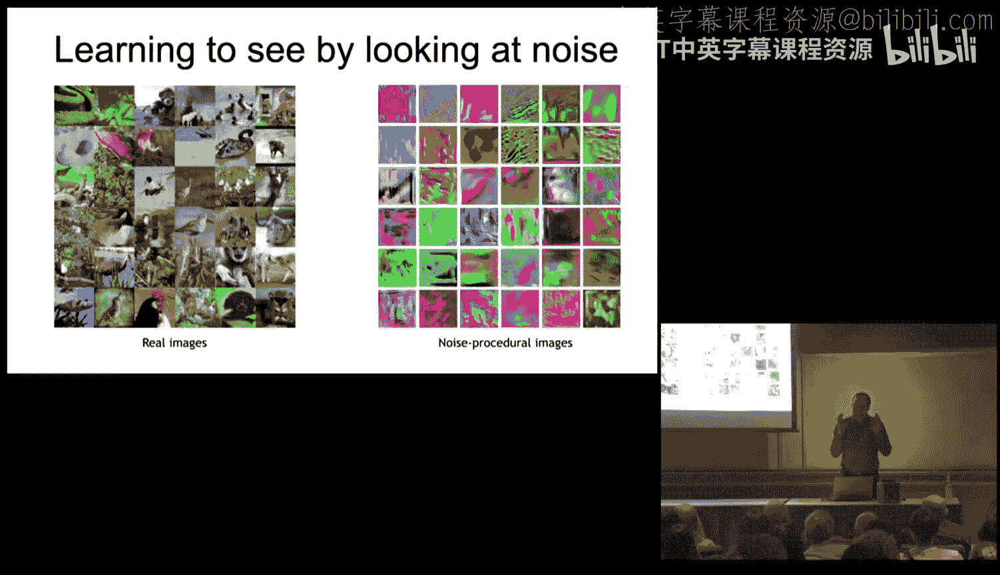

嗯。There is actually， you know， we also know that these models now are getting quite popular。

 This strategy to train systems is getting popular in other domains。 For instance。

 language is also showing that you can pretrain a model with random strings。

 and these pretrain models actually do something reasonable。 It not totally crazy。

 They are much better than chance。 So there is something about this random structures that that that is interesting。

😊。

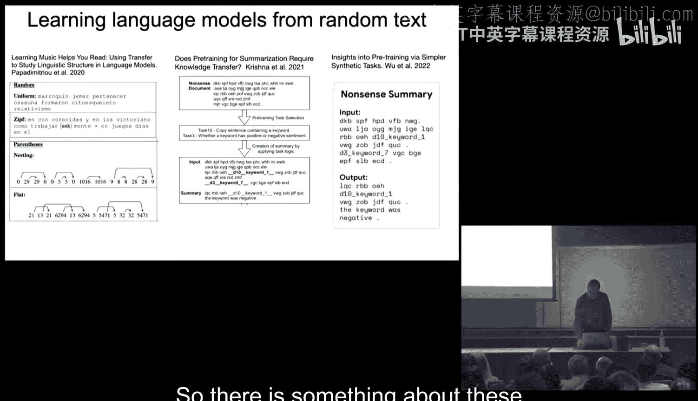

So what else can we do。Well， there is another community out there that creates really beautiful visual displays。

😊，With very simple scripts。 And this is like， for instance。

 what is called like open GL fragment shaders， which is this。

 this particular example is one that has enough characters that will fit on a t。So you， you。

 you can tweet your code， and you should do something really beautiful。

 And there are some that are just amazing。 So this is one example of one。 is you run this。

 you get this beautiful image。 And now the question is， well， you know， this is not real data。

 How far can you go。 If you start training with these things。😊，This is like the lives model。

 You can think of， you know， a version of this。 You can also write a script that will know。

Drive draw the release models。

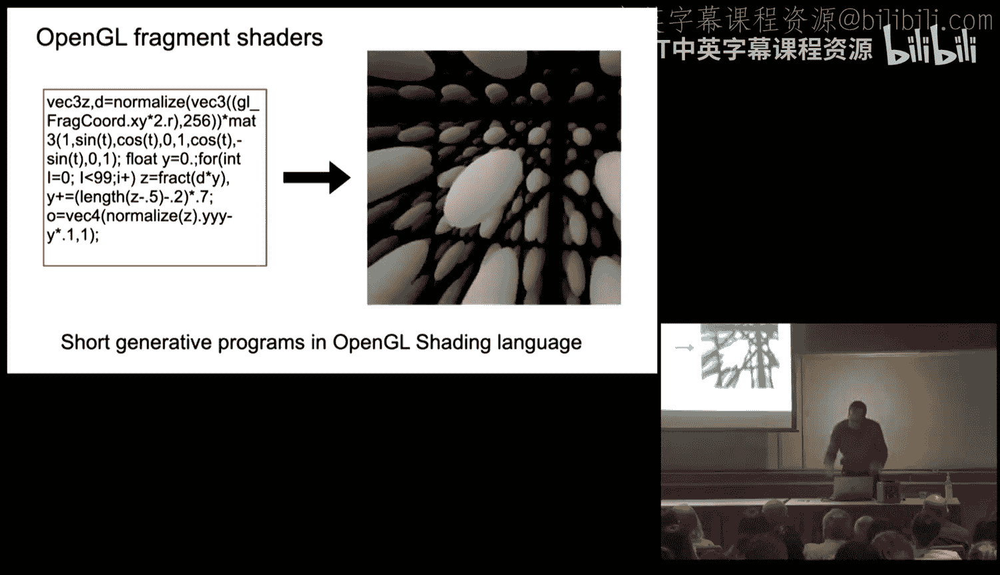

So here there are a bunch of examples of， you know， short scripts and the images that you generate。

 there are kinds， all kinds of things。 Now， it's really， really beautiful set of images。😊。

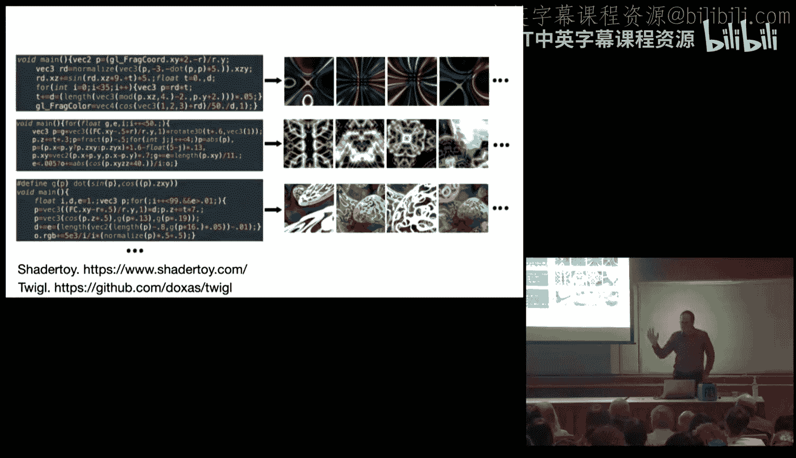

And they actually， you know， if you test them one by one。 just what you do is youre on the shader。

 you collect like 10000 images from them and you train it。

So these are the different performances that you get with images that come from each of those。

 This is just to show a little bit relatively the fact how how it system performance。

 the test is not completely fair because we are using 100000 images to train each model here。

 This is only with 10000 images。 this comparison is not valid。

 But it just to get a sense of the fact that there are some shaders that works really well another that are not so good。

 In fact， there is one that works really well， which is different one here。😊。

That produces just these amazing images。 And this is relatively short a script。

 This is larger than a tweet， though， but yeah， its still short。 And it is。

 is around what dead lives can do。😊，EWith much fewer images for training。

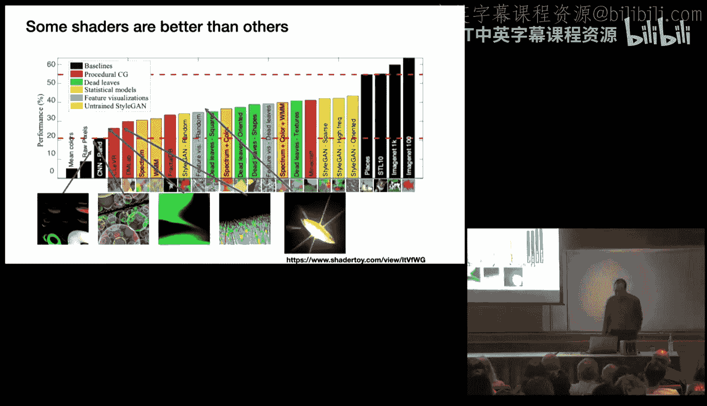

So what we did is we collected 20000 of those as scripts。

 So now you have a huge data set that is like imagenet。

 But with nonre images iss all these different types of graphics。 And now， you know。

 you can run the same game that you have with imagenet。

 You could run a classification task or you know， whatever you wanted to do here。

 But these images are non real。😊，So what happens to do that？😊。

Here is strain with supervised contrastive learning because we do have labels。

 but also you can play the contrastive learning game。 So where do you think it will sit， Okay。

 so the labels here are just which shader produce those。😊，So where do you think you will sit， Okay。

 this， this question is really trivial。 I left a home here。 so you will have to be here。 But how。

 how close will go to real。😊，can see the relation。Yeah， yeah。 You can see that I。

 I made the white bar Here it is。 So it's really， really close to real images， really， really close。

 Of course， this is an I at 100。 One thing that happens when you go to im at 1 k is that it's like a microscope。

 and it amlifies everything。 And this gap becomes a little bit larger again。

 But it's the same order in everything the same。 and the gap is really relatively small。😊。

How many different shapes are there？The well， in this case， we have 20，21000。

 It is a lot of knowledge， but it's knowledge。 It's not real images。 So it's fair a game。Yeah。

So we are not using the videos per se。 I mean， we are just frames as if they were independent images。

 but you could， you could use the videos and do things， cool things with the video here。

 We are only using them as static frame of the graphics researcher。Yeah， that is。 And some sorry。

The graphics researcher has looked message。 Yes， yes， that'， I， but that's for the game。

 I think that's okay。 That's okay。😊，we， we can have a biological entity in the middle。 Okay， that's。

 that's perfectly fine。

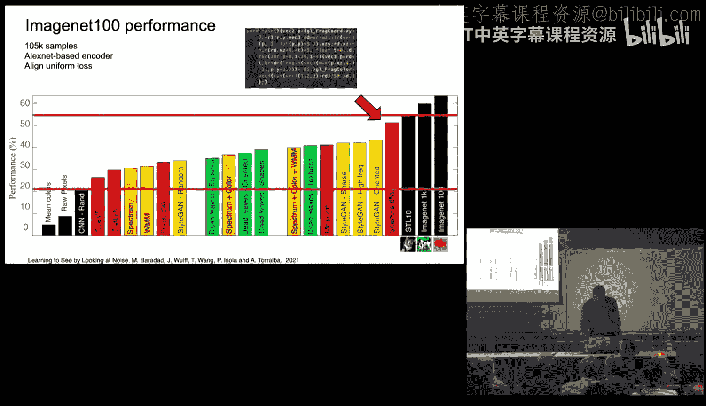

Okay， what happens with the nearest neighbors。 Ac Kii goes to 43%。 And this are the neighbors。

 I mean， and， and this is not a handp set of neighbors。 I mean， when you look。

 we look at the whole thing and they just look beautiful。 you know。

 look at the the parrates even images with two pirates。 It has never seen pirorates this thing。

 It's only seen circles and lines floating around and explosions。 And this is what it has seen。

 makes some mistakes。 know， I don't know why this， but you know， still1 person eating loster。

 but the rest showing a loster and the rest is kind of random。😊，But， but I mean。

 the neighbors are pretty good and。This is and this is not just that Inet is easy。

 Like this is from objectnet。 Obnet is another data set that was created to make imagenet perform really badly。

 So anything that you train on the imagenet should perform really badly here。

 because they chose things that will have like random orientations in 3D and so on。 so。😊。

What I'm showing you now is the nearest neighbors for some images here。

 These are the nearest neighbors when you use shaders for training。 Okay。

 performances are really bad。 Okay， because now， this thing this data set is crazy。

 It's really difficult。 But the neighbors are really nice， know， I mean， here， for instance。

 I think is matching in the carpet really， So the category is wrong because that was not the category of this image。

 but the neighbors are really nice。 it's looking at boxes。 There are know。

 many of the images just look very interesting。 Like here now there is a hand and there are here some hands。

 it's just quite amazing。 The fact that this this thing has never really look at real images。😊。

And what has the network really learned。 So you can look at what the units are doing。

 So this is what one of the units in one of the last layers has learned when its string with shaders。

 So they really learn about texture。 So this is units seems to be selected。

 So these are the images that most strongly activated unit。

 and it just seems to be selecting some random texture here， there is another units。

 It's just shapes and texture。 There is really nothing meaningful in these units。

 theres one seems to detect isolated objects on a flat background。

 and then there are other units that detect like circles from more texture like bright things against other background。

 There is no semantics。 If you do the same thing。 and you supervise with imagenet or with other data says you actually see units that are selected to objects。

 You don't find this here。 It's just textures and shapes。

 But those features seem to be rich enough to support classification。

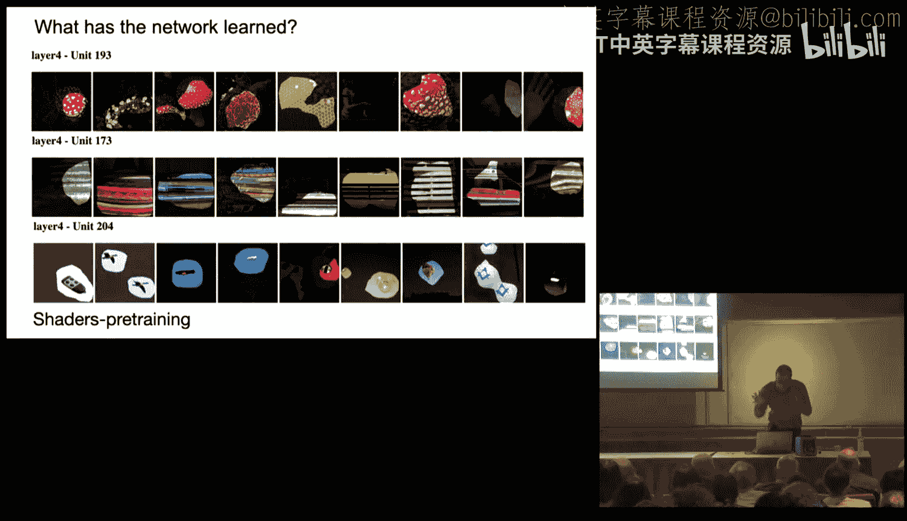

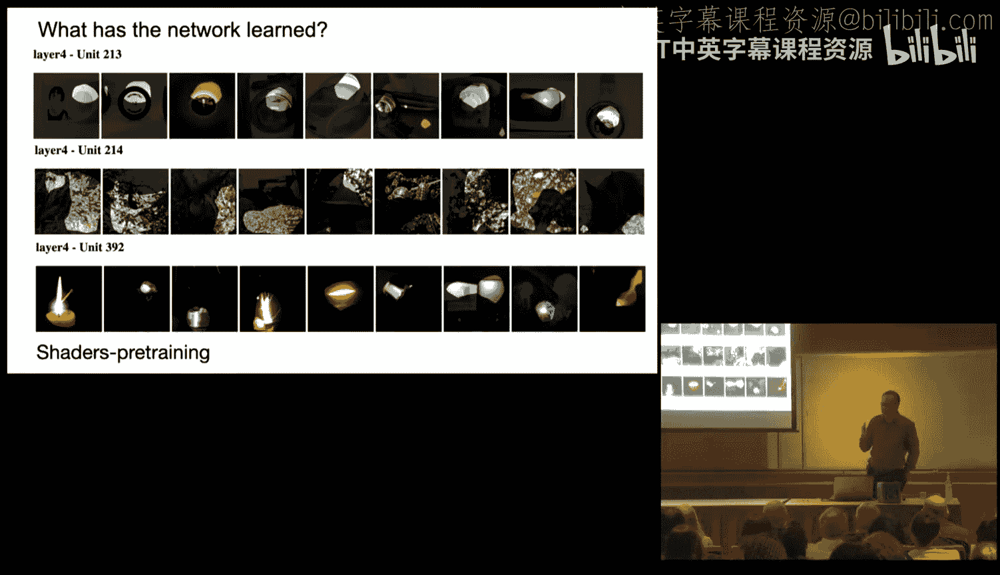

So， you know， what I think is maybe the evolution of computer vision data sets。

 Maybe it will look like that at some point where this really represents the amount of real images that we need。

This doesn't mean that you don't need images， but most of them could be just fake。

 fake and I don't mean like synthetically generated like with a virtual environment。

 I mean these crazy processes that generate things that look like nothing like real where the gap between simulation and real is huge。

 but that's fine。😊，Okay， so I have a stopping point here。 I don't know。 I'm out of time。

 So this is it。 You know， I finished here in my presentation。😊，Yeah。Alright， well， as Ive。

 as promised， Antonio can be relied upon to， to， to twist your brain and all the weird directions questions。

Yes。Okay。Yeah， like， I was asking about the videos。 Like， I'm wondering if you have relate。

 relied on the historical information of the like， for example， the former frame and the next frame。

 there will be relationship between them。 So I only。Yeah， you can， yes， we， we use that。

 We can use that。 for instance， when you are doing the supervis con the contrast learning by making sure that。

 you know， if they have to be far away temporarily because if they are close temporarily。

 they might be， they might still be neighbors， know， so you， you put some time between them。

So that the frames look relatively different。诶呀。like。Make it sure。Oh， sure。 Thank you。

 I think like you are sampling logical image from noise， right， But I'm wondering how you can like。

 pick out the positive and negative samples to finish the training process。

Oh but here we use the exact same thing that you do in contrastive learning。

 The positive examples are given one image， transformations of that image。

 small augmentations and the rest are negative examples。

 So we don't really change anything on the training procedure。

Everything is as if you had real images。So it seems like you have created something from nothing。

And I'm trying to find where is the pitfall。 Okay so one of the things I noticed on your vertical axis is that the accuracy was never really that great。

 I mean， you were hovering around 50%。 to understand what you've done Well， okay。

 so 50% is still pretty high because chances 1% So I think this is a hard classification task。

 I think50% is you created Well， you know， I think that that comes back to whattenra was saying before iss not from nothing it's from all the cumulative knowledge that we have from computer vision history about what things seem to make sense to produce images that look realistic and all this has been relyant on on types of geneative processes that people have know imagine in order to explain properties that we know are present in natural images that lives model was used to。

Tsplain why you had a correlation between pixels that was you know。

 relate related to the one over f power spectrum。 So that was one model that tried to explain what that。

 what that property might come from。 It was just to create models like retinx to separate luminance and shape。

 So people have been working quite a lot of time on this type of model。 So we know that we were not。

Following a path that had no future， like I thought that with deadley。

 I was sure that deadleys was going to be able to do something。

 It's just that the beauty of the game is that it didn't really matter where it landed。😊，So。

 you know， it was， it was a win win situation for sure。 You know， it can be heard or here。

 It doesn't matter， you know。Other questions？Okay。うん、ロんどキ分なる。Okay。Hi， Antonio。

 thanks for the great talk。 So I feel like going any equal0 this way is following the word of the law。

 but not the spirit of the law。 we thought about like how what happens in low compute with these images where you actually don't train 400000 images。

😊，Or if you have fewer images you have fewer images that are either synthetic or some other Yeah so I mean then you have the same properties that you have with real images that as you add more and more data。

 you get better and better and better than it will saturate at some point so 100。

000 images is what we could use to get to the deadline so that's generally what limits。So。So in fact。

 we plotted the performance as you had more and more data and we didn't feel like we were we were at the at maximum performance yet。

 So but because the trends at the end， they don't really change the ranking。

 So you have to decide at some point to stop Yeah， but it's very difficult to believe that something is going to progress very。

 very slowly but forever， generally this things kind of move parallel。 I mean it you。

 it might be different， but we observed that it was starting to saturate。

 So it's not like we were still far away。 know， we were starting to see some saturation。

 So maybe the saturation will happen with twice or four times the amount of data that we use。

 but I don't think that it will supported a lot more。Thanks for the great talk。

 What happens if you combine the synthetic images with natural imagess any benefits or yeah， okay。

 that's a great question， and。😊，The problem with that。Is that I think that's great。

 I think you can do it。 I think we did some experiments like that。

 And really what you see at the end is that the natural images will dominate and you get very。

 very little benefit。 The other thing that you can do is fine tune in start you train with synthetic images and then you fine tune with real images to see how far you get the problem with that I don't like about mixing data sets in that way and everything is that I think it distracts you a little bit from the ultimate goal。

 which is to have a process that is completely blind to real images and see how far you go As soon you add you add the dimension of adding more real data and see what happens。

 Then you go through a rabbit hole that it will distract you and then Yeah。

 and there's no longer zero。 So you cannot give this talk， for instance。😊。

What was the story with the scattering transform， Where did it land？ Oh。

 so the scatteramine transform。So it， it actually performs really well。 It just gives a much high。

 It's a very dimensional， high dimensional vector at the end。 And I don't， you know。

 I don't think we did experiments with this particular data set。 So I don't know where it lands here。

 but it was actually not too bad。Maybe one， one last question。Oh， there is。没必要。

What video with me or video Yes， yes， yes， yes， yes。Yeah， I think that particular with the shaders。

 No， you have full information。 and even with the lifts， you cannot you can make a move。

 dynamic models are easier than the spatial models。Yeah， but。The only， I think。

 is just a question of computational cost and and。We decided to start with this。

 but I think a video will be great。 I think you know， I think that our video will work really well。

 I get to the last last question Okay the ordering of the fine tuning or the linear layer and the ordering of nearest neighbor。

 are they the same orderings。😊，Sorry what So you have also you can evaluate the same thing same same I mean。

 there are maybe some small swaps locally， but it's basically the same order just All right。 Well。

 let's think the greater once again。So actually， Antonio will be around tomorrow morning and Friday morning。

 If you really want to get chat with him and you didn't have a chance。

 there might be some possibilities in the next two days。 Okay， thank you very much。Thank you。

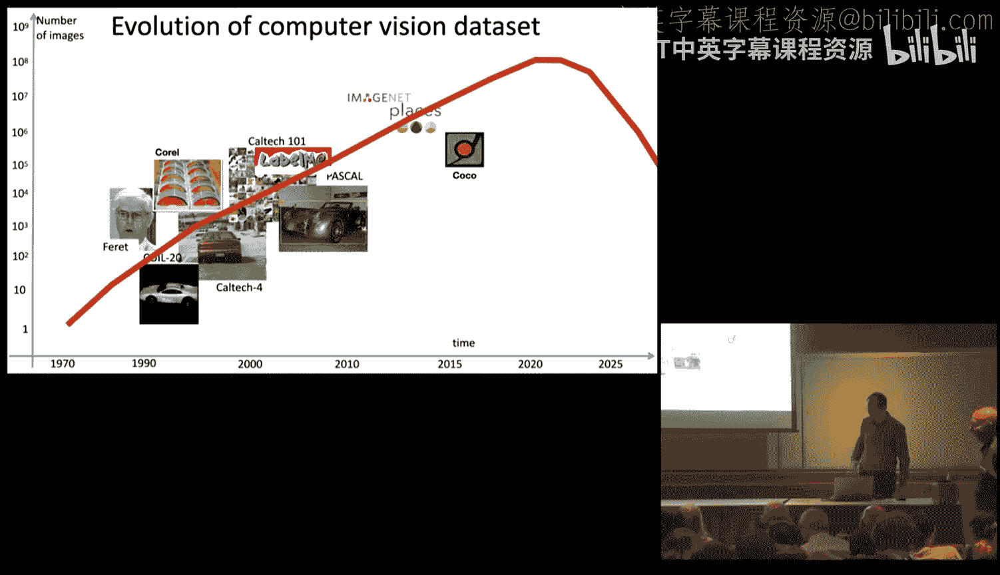