# UCB《计算机视觉与计算摄影学｜CS 194-26 Computer Vision and Computational Photography 2022》中英字 p24 -P24-CS-194-26-Why THIS is the Future of Imagery (and Nobody Knows it Yet).zh_en -BV1w7UfBdELA_p24-

Thanks to bones andall for sponsoring a portion of this video。

This is not video footage， it's a render but it looks pretty photoreal right like achieving this level of quality in CGI would normally require a huge amount of time and effort But what if I told you that I easily made this in a matter of minutes thanks to a brand new technology called Nerf No。

 not that kind of Nerf No no not that one either No。

 I'm talking about neural radiance fields and in this video I'm going tell you how they're going change filmmaking forever。

I've managed to make a career out of experimenting with new technologies to create short films and along the way。

 we've learned tons of tools such as Deep fakeakes virtual production and one of my favorites 3D scanning little known fact about photo scanning is that when Reren does it he makes a very specific face Reren。

 would you like to show them the face that you make when you photo scan There it is It's the most serious face I've ever seen on Re it's every time he photo scans always we've been using photo scans in our videos for years being able to just take some photos and then after a few minutes。

 get a pretty good looking 3D model that I could then just use for whatever I mean come on that's a superpower but here's the thing Photo scanning has always been just a shortcut on the road to rendering 3D scenes a lot of effort is still needed to set up the lighting and make sure the scanned materials look correct because out of the box they just never do However。

 some things are simply impossible to scan。

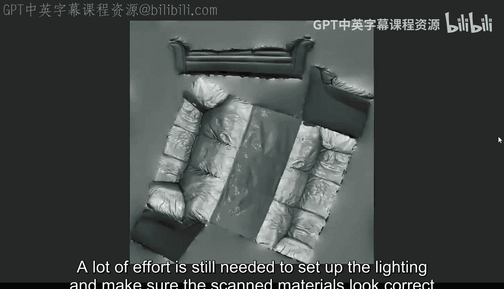

I should probably not do that。 How do you feel about photo scanning this。Be impossible。

 wouldn't it Yeah Yeah， there's too many reflections This is not gonna work Why wouldn't it work Photo scans rely on the pixels to be consistent Chrome ball。

 It changes every single angle you look at it。 Therefore。

 it's impossible to reconstruct beautifulutly said。 Did you try it Oh I'm about to Yeah。

 I don't know how it's gonna go。 It's gonna be weird It's gonna be weird。 It's gonna be super weird。

 I'm looking forward to it me too。I processed the scans The table got perfect Look at these frickin chips here look at these cookies however。

 the chromrome ball， it's like a crunched up can the photocan didn't even try scanning the bottle It just kind of got to it in the parts that it could see that we transparent it's like there's nothing there Photocan isn't magic it's math and when the math isn't perfect you end up with unusable garbage I do not know how nerves are supposed to solve this though Oh well I got a video for you Sam。

It's the end of this one when this one's done an uploaded， you can watch it and you'll be like，Ah。

 sweet。Yeah， you guys fast forward to that。Now I'm going to take these same photos and instead of processing them with photogrammetry。

 I'm going process them into a neural radiance field。

 I have no idea how long it's going to take me to figure out how to do a Nf。

 There's a lot of things I got to download and install and uninstall and reinstall and I'll make aer。

Okay。I've made through all of this all afternoon。If this works， when I hit En。

 this will be my first neural radiance field。

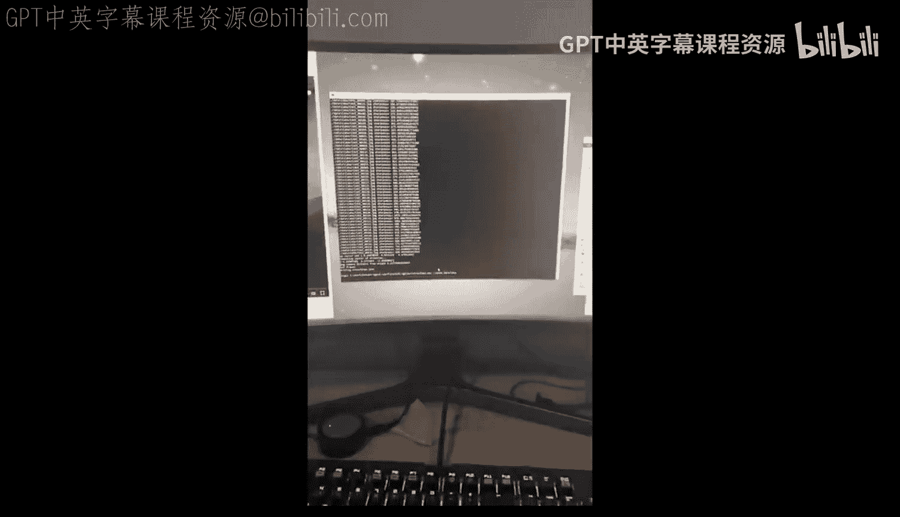

Okay， okay， I know these results are a little janky， it's kind of blurry。

 there's all these weird floating artifacts and holes everywhere。

 but the ball has accurate reflections， it's even got the transparency of the bottle。

 so here's the photo scan， but here is the Nf。After I tweeted out these results。

 Frickin Paul Franklin of all people responded that he could see a V effectsx revolution on the horizon and he knows a couple things about V effects having won the Oscar for best visual effects twice to understand why visual effects are excited about nerves we first need to understand how light works holy Gil for any Cg artist is photorealism to make an image so utterly realistic convinces your brain that it is real what is the secret to photorealism Refs if I was to ask you to point out all of the reflections in the scene'd probably point out the balloon the bell or even the water look the white wall is bouncing back some of the red of the painting In fact every object is light from every other object I mean think about it everything we see is just light that has reached our eyeballs unless you're looking directly at a source of light it first has to reflect off of something along the way。

 So this was a trick question because technically everything we see。

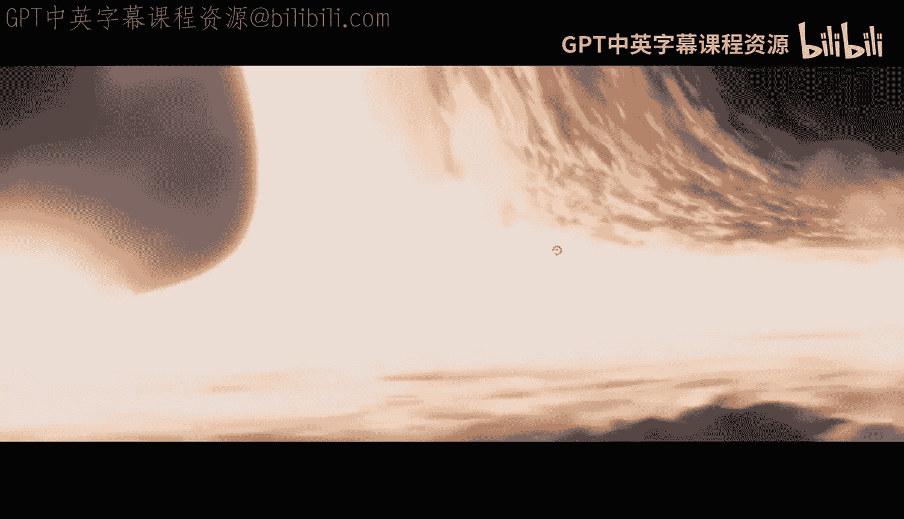

A reflection because reflections are how we see stuff。

 They play a subtle but crucial role in convincing our brains that stuff is real。

 Check out this photo scan of some pans Now check out this Nf of the same pans see the difference as the camera moves around the reflections change realistically without having to add any Cg lights and that's because Ns rely on neural rendering just like deepfi do It's able to learn what the color of every point and a 3 space is depending on where you're viewing it from And when you have an entire field of these points you end up with something that looks shockingly similar to the photos used to make the scan Now let's compare the Nf to a real video and they look well they kind of look the same because it was literally trained on this exact video and that is the entire point。

 It's the ability to quickly easily and cheaply replicate reality in a way that looks like video。

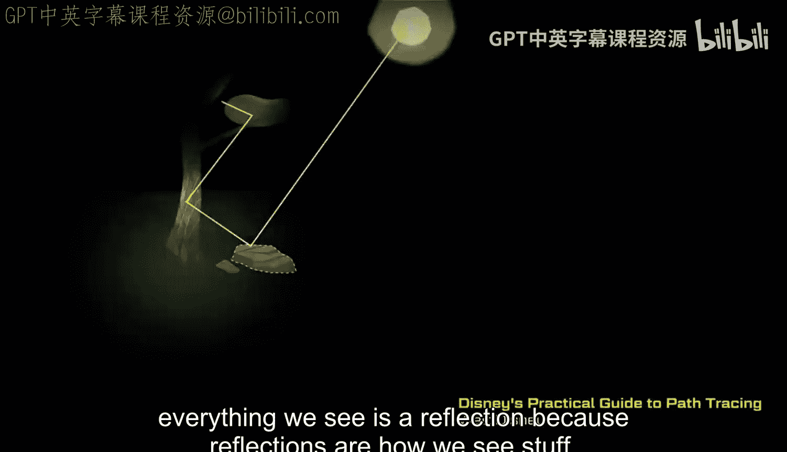

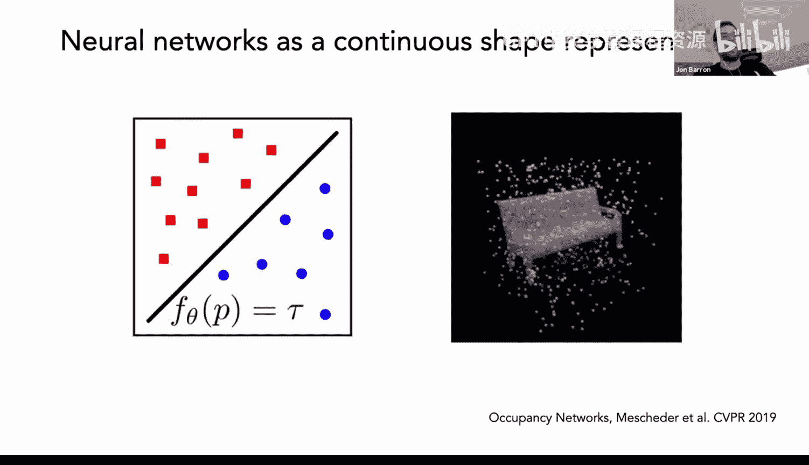

This portion of the video is sponsored by bones and All。

 a new movie coming out only to theaters this Thanksgiving is a new movie about a couple young people who fall in love who are also cannibals。

Yeah。

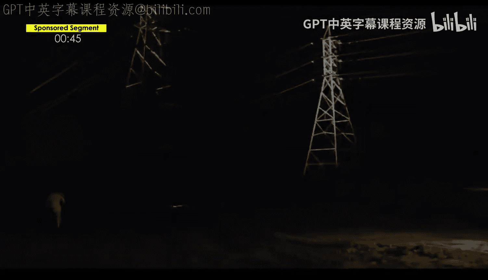

This movie stars Taylor Russell and of course the Dunne Man himself， Timothy Chale。

 the story revolves around Marin and Lee two wayward kids trying to find their place in society as they munch down on people。

 They embark on a liberating road trip they try to figure out what their place in society really is because I mean where is the place for people who eat people。

 It is a love story but it's also like a horror thriller movie It's like bending these genres like Frick and Picasso performances are incredible the cinematography is the directing is excellent。

 It directed by Lucca Guanino if true Cophil Chances you're gonna love film check out in local theater Thanksgiving or go to boneenoff film get tickets today Once again thanks to Bsoff for sponsoring this of the video Now it's time to get back to this crazy new scanning technology My journey with the Chrome ball started over the summer with Nvidia's instant Nerf program I had to learn a bunch of Python coding and use a command terminal just get the thing to run Now however it's as easy as using a phone app to Luma AI。

 It's like Pocam one of my other favorite apps， but it's for Nfs。 you take a bunch of different。

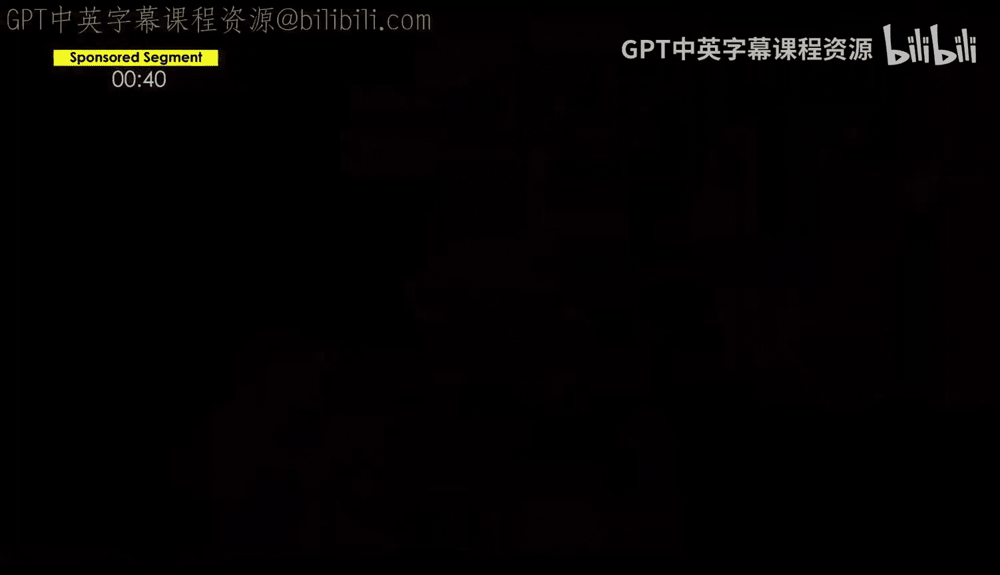

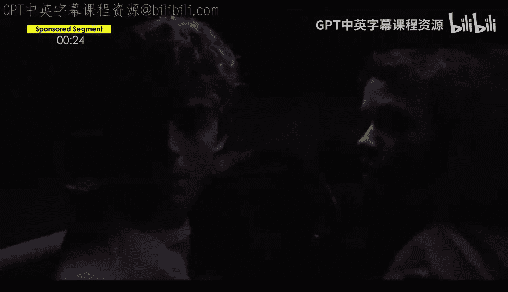

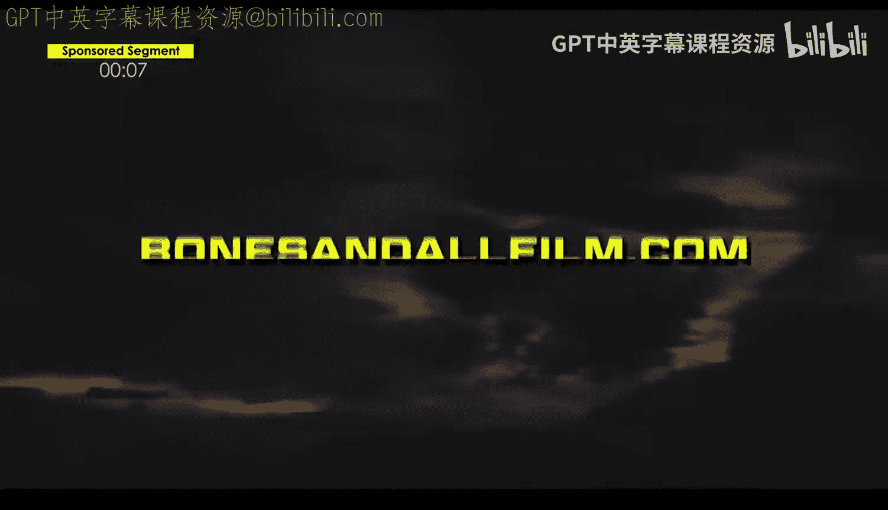

Photos and you upload it to their server couple minutes later you get back in N It's great and it's easy and it's fast but I need to be able to import my own camera animation separately and that's something I can actually now do with the website version of this app on my computer and that opens so many doors and I'm going to spend the rest of this video walking through some of them。

Apparently not that one。So I know what you might be thinking What can you do with this new Nerf technology。

 Well， one of the more obvious and easy things to do is just a simple background replacement。

 So Nikco here is standing in front of our X greenscreen wall。 don't worry about it。

 I'm gonna wrote toem。 Typically most people， when they're shooting on a green screen。

 the camera is gonna to be locked off because the background needs to match the foreground and the moment you add motion to everything。

 you're gonna have a hard time。

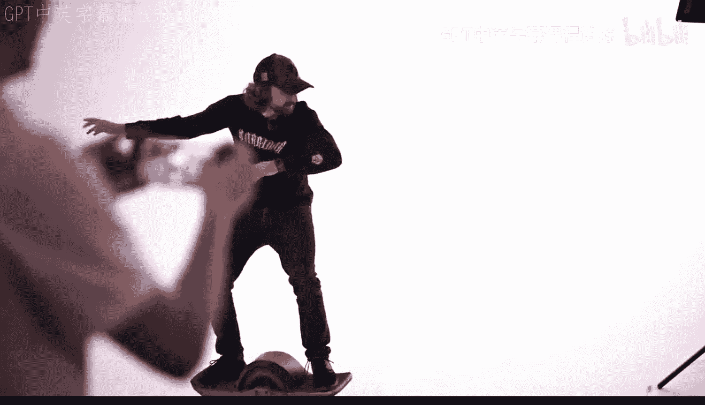

Like me right now， what we're doing here with Nikko is we're going to take the camera out of the tripod and move it around。

 I'm gonna be using biplay camera app to 3D track the scene as I record the footage here。

 and then I'll replace the background and make him look like he's anywhere I'm in a ner So another idea you can do with this type of scanning tech is like portals。

 What if this door turned into a portal。 This is really a do to another world。

 So you first got to start by 3D tracking your shot。 This is all pretty standard。

 Now I could take that exact same camera move and apply it to any radiance field that I want。哇。Y。

What？Oh man， now it's a new one。How's this working？And can I even peer through it？Whoa no kidding。😮。

Sick。Oh wait， where to go？

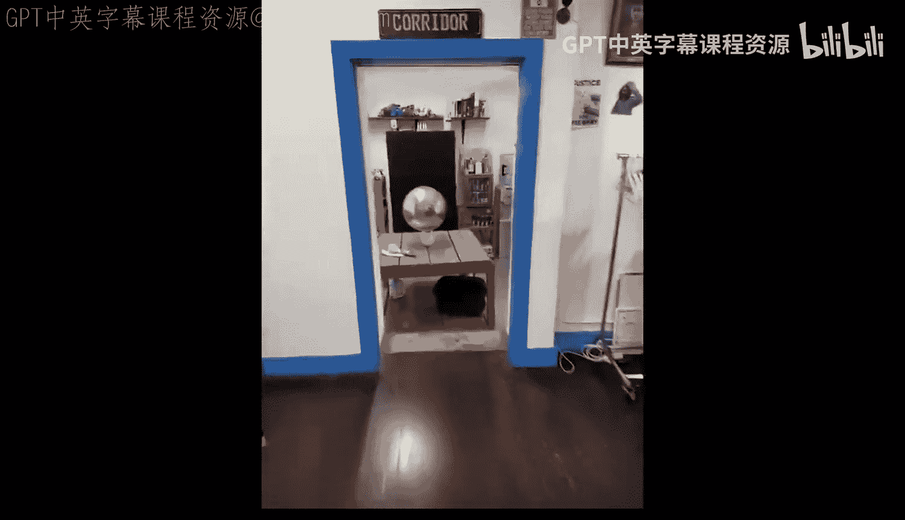

I want to go back， I a shop for 40 seconds， this is a 40 second one take the effect shot。

🎼And it's not even a thing。 I mean， it was a bit of a thing， but not too much of a thing。

 So going back to the stuff I shot with Nikco， here are a few things I learned。

 I was just having fun rendering out shots because it was so easy just to take the exact same camera move and drop it in another scene look at that Wow What a spot Look at that that's crazy I put them on top of a mountain where I like to go one wheeling。

 I put them in my kitchen。 I put them in a garden at night。 Nfs work really well at night。

 Have you ever tried photo scanningning anything at night。 It doesn't work。 It doesn't work。

 but this worked Another thing is just how subtle reflections can really be。

 I know we talked about this earlier， but it's what makes all of this stuff just sell so well is because the wall slightly getting brighter when a reflection gets a little bit more direct to your eyes。

 That's how light works。 it looks like footage better look photoreel otherwise I'm gonna be disappointed。

 the camera just kind of wet through the geometry there a little it's not geometry。

 Those aren't polygons at all。 our radiance fields。 Lastly。

 check out the shot of Nikko on my kitchen table next to a plant。

3y camera move is still something you can scale down or up。 And that gave me an idea。

 What if I scaled the world down to make someone big。R Reren。

 could you scale me back down please or like scale the room up or something I don't know how you did this。

 but I don't like it I comfortable It must go bigger bigger you don't have to use your phone It's just based off of images they can come from anywhere So when use my drone。

What I'm looking to get here is I'm basically trying to get a scan of that big building so that I could then comp it in a shot of a person all big All right I capture the Nf now I got to capture myself so that I can 3D track this shot and put it in the N I'm gonna have a spin around me Na。

 I'm kick on。All right， we got something there。Oh。I am the king of the world， yeah。

🎼What sells the shot for me is， of course， the lighting。

 I captured both the plate and the Nf outdoors at golden hour。

 and the Nf has captured all of that golden sunset Goodness。 Pro tipip。

 if you want your nerves and plates to match， capture both of them with the same lighting conditions and ideally the same camera as well。

 So Nfs gets you cheap photorealism， but it's not just any photorealism。

 It's a specific flavor that's tuned to the camera that actually captures it。

 So I'm going to do an experiment comparing the scans from a red camera versus a webcam。

 This is the stupidest thing。😊，I have ever done My theory is that one scan will have a cinematic look and the other scan will have a bit of a cheap webcam look Yep。

 that's exactly what I expected。 You know， we got compression dynamic range。

 the quality of your lens。 All of these will have an impact on your finished scan and speaking of cinematic The dream of a gimbal operators get like the smoothest most cinematic shots。

 but sometimes for whatever reason， maybe you're not able to get that sort of smoothest new one。

 So I'm gonna to get the most ridiculous camera move possible here。

 Like this is not gonna to be a good shot， but the magic of nerves is that it can do this。

For comparison， here's what Warp stabilizer did with a shot I'm also not limited to simple camera moves either I can get as complex as I want Do you remember？

Frozen crossing Alpha。Everyone's frozen in time and the camera's moving through that when they needed to speed up the shot。

 they would take the footage and fast forward it， but then you get the but if they were able to just do a radiance field scan of the whole thing。

 they could pick and choose their camera moves after the fact。This is the nerve dude whoa。

 your face gets a little weird here up close Oh dude just a little bit shy Can I take this and extract geometry from it still Yes。

 you can extract the geometry but you lose all of the reflectiveness because it all gets baked down into a single diffused texture and so that texture then doesn't change as you orbit around and view it from different spots It's a little like you know being handed the keys to a Ros Royce and then be like sweet。

I'm only gonna need the hub caps it's almost like you're leaving the most valuable part behind exactly the most valuable part of a Nerf is the actual neural render That's what you get that photogrammetry doesn't give you Nerfs are at their most powerful when we treat them like video footage rather than a scene to pull textures and models out of。

 but it does allow you to do something cool like。Collion geometry for simulation Yeah。

 dude drop a clock on that Now you're getting the best of both worlds you're still utilizing the sort of photogrammetry mesh of the whole scan。

 but what we're looking at is still the neural Rer Oh。

 it'd be so sick if you can apply motion blur inside of the Nerf program and depth of field inside Oh dude you're totally right like it's so early days The tools are so rudimentary It feels like I'm trying to carve a statue with other rocks like technically I can get it to work。

 but it's just taken a lot of pound and ahead。🎼It is literally 12。

44 a right now because this video needs to be done tomorrow It's been difficult to explain this to people。

 While with jaggy edges and stuff。 It's kind of weird smeariness in the background of this machines better look for real Otherwise I'm gonna be disappointed Wr green screen white See it's like it's not about how perfect the results are right now。

 it's about the potential of these results。 you know。

 I have a very strong belief that it's just a matter of time before no one will be able to tell the difference between a  Nerf and actual video。

 I think I need one more shot， something to like really demonstrate how crazy useful this new tech can be。

啊。😮，There it goes。Yep， I guess I'm not dreaming。I think I know what our final shots going to be。

We're gonna try to do an inception shot you know the shot in inception when like Paris folds over I'm doing one of those kind of I'm doing a poor man's interpretation of the very advanced effect。

 but it's going to require like a thousandth of the effort Re。

 are we doing an inception shot because you're trying to impress Paul Franklin I'm not not doing that Okay。

 don't really have access to this bus so I'm just going to record a quick shot now to quickly get a rebel scan The Re scans has gotten away from most this time。

Because of all the chaotic stuff going on here， if I wanted to actually shoot a video。

 it would have been too hard before Sun was able to get a scan。

 so in theory I can go back and actually do all the production filmmaking after the fact。Car。

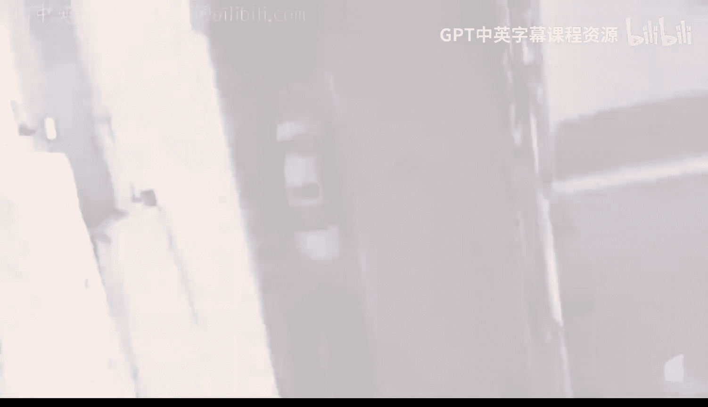

🎼And there you have it。 I hope at least some of these ideas have inspired you to pay attention to the Nfs。

 I mean， there's a lot of potential here。 and I've just barely scratched the surface。

 It's our job as artists to push this tech as far as it will go。

 none of these shots in this video we like production ready。

 but I hope that maybe they inspire some sort of nugget of an idea in you so that you can get into this stuff as well and push the bounds too。

 Of course I recommend Luma， it's what I've been using for the majority of this video。

 but my buddy James helped me with Nvidia's instant Nerf thing。 In fact。

 I think he has a plug out that allows you to control all of that stuff inside of blender。

 And also as of today， Polycam announced a partnership with Nerf Studio。 there's tons of options。

 And if there's anyone out there not yet convinced of the potential of this new technology。

 I implore you to just look two papers down the line to see where this tech is going。

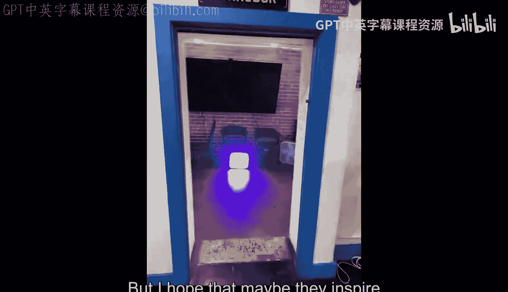

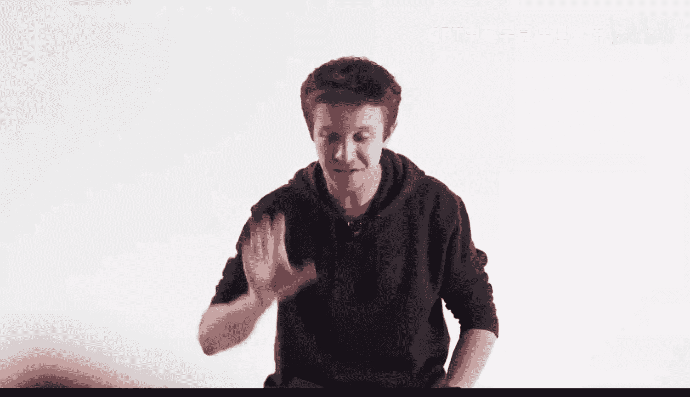

It's exciting。What a time to be alive。We keep calling it Ns。

 but I would like to make the point right now to change the name because I thinks are stupid。

 was honest， it's confusing。😡，I think a better more op name would be like fields。

 Like fields the much technical， it's opposite of brain field。

 but it's still the same sort of thing it。 technically， like fields are a little different。

 But in the， you're still the same sort of results I think like are much more in the。

 I impre everyone to use that name instead because。

