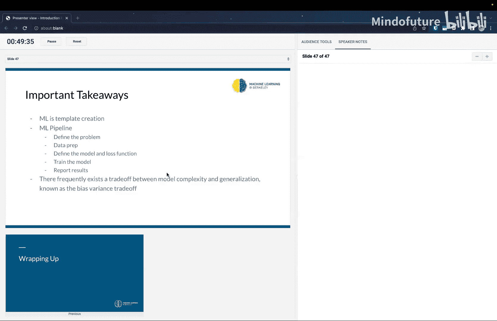

# 【加州大学伯克利】计算机视觉：视觉数据的深度学习 ｜ Cs 198 126： Deep Learning For Visual Data p01 P01_讲座1-机器学习导论 -BV1Va8zzfEtk_p1-

I didn't see is there oh。好。I。滚。对有。I don't know if it was boring easy。Hey out of curiosity。

 can you all hear me in the back or do I need to figure out the microphone situation？

Are we okay or all right？What was that yeah I've never had to use it before though so I don't know should I give it a shot？

对吧对。好。有。嗯。Okay。No it's important。一般。Yeah。System works。I don't know。嗯。Thank。嗯。

Is thisIs this marginally better， I can't tell。系。那个请看他们的。Okay。See， is this marginally better？

Can you all hear me better up there， people that thought Mike would be？Is it not do I need to？学美。Yes。

我是是在。我哋呢个。我不。All right out out。这嗯其他的。thinking can totally reach that。No。

 I know it thought better totally I agree friends in the back。

 is this better is the microphone like working？Yes， you。Is it not？Am I no sadness？

Evidently they can hear you well， I know， but I want to I don't want to have to strain my voice friend。

Well， I can always just like hold on to two。Oh， you think it' a distance， dont know， I mean。

 that' it， no， it's on。Okay， let's completely on。That's fine there's a mic volume setting。

you don't want to讲佢思啊就系。Iund like the old text thing sound I guess。我不是。Test， maybe。

I don't think it's I don't think it's substantially better but if you talk about like normal what time we got it？

Okay， we're still five minutes forre showing。Well， I think it's directional。That'啥。

So I think it matters which direction is' pointed that up a bit hired， maybegan。

Do is like size is going to go， I mean the zipper。W that way it doesn't like plot。

If that's uncomfortable， don't do it。一。I don't know how much working， neither do I。

 I'm not an audio I just for to talk on。Okay。Anything else working Jeff。Dctor's working。

 I don't need chocolate。Where we're going， we don't need shock。

Probably for like an example or something if want to elaborate。No， I makes my Aaron aren't really。

 this is just sort of conceptual what you good。But first plenty correct。什么。

So can wrong answer questions。Put me over time。I' be on spot know。

like so in yesterday's paper wasn't published to。Okay。我。5。

It depends if you're counting from three or one Oh， it was five， right。

But it depends the comes3 good oh no， okay， all right， what's fine。嗯。Let's sit down in a gallery。嗯。

喂其实今个人想系好 enjoyice。Right，That's the point。I think so， I think that'll mean that I'm doing right。嗯。I。

And I will explain。完了对。Oh。不。If I remain Chris helping affiliated her helping so feeling same your。

Yes， we don't know if this is like。Yeah。nervous。part wherever you want to。It's your world， man。

Sit everyone sit on the desk facing the class like a。You know， like a cool professor。

that is is you're like， guys substitute substitutes the day。你。Or whoever was like and met Jason all。

唔仔。But they with the sport。呢个，大家都有问。I think it's directional。P this feels like I's doing amplified。

Next work go nice work。Yeah it's fine I have a timer around here so it does it matter。有。

I think it should be recording。Good喂。Okay。It's not up there perfect。

 he's not active in the club anymore， we can talk about Brian。

Frian laps Verona touched these up last so she could have her name on this put it on I don't think I can kidd this working。

哎呀。And you know because Zoom says it's recording right here。

 it says it' reporting stop reports no one will ever know when this is recorded。No。

 because it would be weird if someone did because this is my own Zoom room。

So let's just slide in my all right， I'm then going to start here。Go be peanut gallery。嗯。All right。

 it's about7，10， y'all good to get started。Someone saying no。All right， so welcome everyone。

 thank you for being here。😊，Welcome to CS 198126 Deep learning for Comp vision I'm Jake today I will be your lecturer we have many other people in course stuff we'll introduce them in a little bit but yeah the time being thank you all for attending I appreciate that you are here and i'm really excited to teach y all about deep learning and computer vision。

Um so。Let's and the slides， there we go。So outline for today， meet our course staff logistics。

 tell you a little bit about the course itself， and then we will get into the meat of today's lecture。

 which is just sort of a broad strokes overview about what is ML and how do we think about it。嗯。

So course staff。More formal introduction I am Jake I'm a senior here at Berkeley I'm computer science somewhat obvious from the fact that I'm here teaching a computer science class I'm mostly into computer vision go figure as is a lot of people on our course staff we have Aen we have Verona who is here today Arvin Rohan and Ryan。

These are people you'll see lecturing as well as on Ed STEM answering questions at homework parties。

 so on and so forth。So before we get into the course today or talk about logistics。

 I want to tell you a little bit about what this course is， why we're here。

 why I think this is an important class。So this is computer vision the aim of this course is to be basically a boot camp into not only computer vision but just deep learning for people who are freshmen haven't had a chance to interact with the material before personally I can say that when I was a freshman it was really really difficult for me to break into ML it felt like clubs courses research were all off limits to me and this is kind of my attempt to try and give back and hook people up with the resources that they would need in order to get a really good positive first experience with ML and specifically with computer vision。

The scope of this course is limited to computer vision with the intent to try and get as deep as possible and as close to you know state of the art as possible so you can see what it looks like what the field actually looks like today。

And this course is supposed to be you know fun forward。

 I just want to make sure that's emphasized and out there and provided people a really good positive first experience because for a lot of people in this class this is probably the first time you've seen deep learning a lot of people in here like freshman sophomores they've taken 618 math 54 math 53 whatever and they want to know what it means for like computer science。

So I just want you to know y'all to know this is supposed to be fun and a good time and we really really do hope that you have a good first interaction with machine learning here so this is like just some fun stuff that this course will kind of go over so at the top left we have like a lot of more basic computer vision tasks like classification this is a cat where is the cat which is localization localizing all kinds of objects cats dogs ducks and then showing where they are course bonding cats dogs dogs whatever we're going talk about how we learn from like large data sets of just images how do we how do we gain insights from that top right we'll talk about math autoencoding a little bit later bottom left is 3D vision 3D vision makes me really happy how do we go from just different images of objects to like representing them。

Nral Radiance Steel that is we' learn a little bit more about that later and then the bottom right y'all maybe heard about Dolly Dolly2 that was just something off of like the MBHD video on Dolly2 text based image generation and the prompt for this I believe was a full of suit that is portal to another world。

We will talk a little bit about generative art at the end。

 hopefully hopefully that is intriguing as intriguing to you as it is to me。

 so that that's a flavor for the kinds of things we will be seeing throughout this course。

So some quick logistics here。If you haven't seen already hopefully y'all have。

 but this is our website tiny URL fall 22 CVDCal we have an Ed STEM the slides are obviously these are going to be linked on our website I should have pointed that out on our website recording slides assignments will all be posted and so you can find these slides and find this E Ed STEM link a little bit later but Ed STEM is your way to interact with other students in the course staff so this is a new course and there's going to be a lot of hiccups we're going screw up at some points so this is where you let us know that like we've screwed up。

And it's again， like a good chance for you to interact with the material， ask questions。

 talk to fellow students， that kind of stuff。Quzzes and assignments will be on grade scope。

This is the code again you can find this later on the slides。

 the slides will be on the website classes Tuesday Thursday。

8ight to7 pm Phs building to y'all are here so good job you got that one down and normally codes have been sent out make sure you use them syllabus is on the website it is the website rather so make sure to read it for a little more information Does anyone have kinds of like questions here before we get started。

Does come party on party on feel free to interrupt me at any point or raise your hand and I will try and get to you this is supposed to be fun and interactive so you know feel free to interact。

嗯。So some announcements the first quiz will be due at the end of next weekend it'll be released a little bit later either tonight or tomorrow on gradecope first assignment is in two weeks don't worry about it because it's not going to have anything to do with like the first two lectures so y'all are chilling for a little while here the first assignment will be short too just pertaining to the tools that we use for deep learning but it'll be released either later this week or next week but again it's shortened you don't have to worry about it for a while here。

So now for the first lecture， if anyone doesn't have any questions。

 then I'm going to keep rolling on。All right， all right， all right。So。

Again this is kind of this is meant to be an introductory course hopefully we get all the way up to state of the art but this is for a lot of you probably your first time using deep learning for many of you probably your first time with M so again this first lecture is really just supposed to be like what is ML so y'all going to flavor for like what we're trying to do here so a little bit about ML M is just the paradigm of approxiating data from function approximating functions from our data traditionally if you wanted to do a task you would have to find a way to code up that task make a function yourself like in Python or whatever language you would choose with M we're going to try and use our data。

To figure out what our function exactly does and what it looks like。嗯。

sortrt of a change in the traditional programming paradigm so why would we want to do ML if we can just program things ourselves well sometimes it's really really hard to program things yourselves so it's really easy to just learn from the data instead we like to be lazy here and and is that is the core of ML how do we let our data guide our functions。

So if you had challenge of trying to classify this digit。这下。

If I asked you to write a program in Python to classify that digit you would probably struggle it's really really hard to take in like an image and figure out what digit that is I don't even know where we would start with that if you wanted to try and program that no it's just not happening。

嗯。It's much easier to try and find a way with ML。To separate。

Sevens from other values and that's a little bit that's kind of like the flavor of the things that we're trying to tackle here with ML in general how do we figure out what kind of function could separate this for us rather than trying to program one by hand。

嗯。So let's narrow in a little bit on what ML is， it comes down to template creation at the end of the day。

So rather than specifying some kind of function fully by hand with ML。

 we're going to define the structure of the function， but leave a few parameters in there。

 which we will learn from the data that will determine exactly how our function behaves。For now。

 I don't think too much about how we would go about learning these parameters。

 but I just want you to understand kind of like， again， what ML looks like。And in this case。

 it could look like something very simple， like on the right。

 we have a function that takes in input and our parameter A。

It's very straightforward if the input is greater than A we return true， otherwise we return false。

This is a function where a in this case is a parameter that we will learn and it determines the way in which our function behaves。

So。That' that's sort of the idea is we have a template of a function and we will fill in the parameter values from our data。

So in this case， let's think of like a one dimensional line， we have red data and we have blue data。

Our parameter is still a if our input is less than a， we spit out the value red。

 otherwise we spit out the value blue。Again， this function is just like a hypothesis。

 a hypothesized function it's a template we need to find a good value of a。

 that's going to work pretty well。We might suppose that the value one works pretty well in this case it does if our input is less than one odds are looking at this data that it is red and otherwise it is blue。

So we hypothesized what our function kind of looks like。

 and we tried to find a good value of our parameters in this case。

 just a that fit and spit out good values that we liked。However。

 if we change it very slightly and we just change the inequality。

 so that if the input is greater than I you return red， otherwise you return blue。

 might be very there might be no values of our parameters that work well and this is the important part of ML is that what kinds of function templates we create really。

 really does determine how well our functions or our models can do。

So it doesn't matter how cleverly you select your value of a。

 you can't get better than like 50% accuracy here。😡。

And it's just due to the fact that our model our function here is bad it's not meant to do well in this data。

 so it's just important for you to note that。The kind of function that you're using really does play a very big role in how good your results are。

嗯。So being even more specific。The art of ML is simply figuring out what format function takes。

 and this is sometimes referred to as like a class of model。

And we're going to try and figure out we're going to leave blank certain parts of this function。

 these are called parameters， these are values we're allowed to learn。嗯。

And how we learn these values to you know approximate how we approximate the best possible values for this function。

 that is something we'll talk more about， but that those are the basic three steps for like what again。

 what is ML， everything you'll see in this class， everything you might see in other classes。

 whether that's CS 182， CS 189， CS188。or graduate level classes， whatever。

 it literally this is all it is， what is the template for your function。

 what values of that function are we allowed to learn and how do we go about learning those values。

So it's literally just template creation。Does anyone have questions at this point because this is for people that are new to ML this is probably still slightly nebulous and you probably might have questions at this point so if I have questions feel free to raise your hand ask you're expected to still be again someone in the dark on this we're going to talk more about specific kinds of models which parameters are learnable and how we go about learning them more in the future。

Yeah， but for now this is the this is the broad idea if you haven't seen that Mel before of what we're trying to do。

So if there are no questions， I will keep on trucking。

So how do we describe all of the different kinds of m it's useful to kind of like categorize things we really have a broad definition of what m is and now we want to try and like。

Break that up a little bit more into the different kinds of tasks that we might be doing so in all we have supervised learning。

 which is like classification like figuring out whether that image is a seven or a one or a two or a three or whatever。

or regression， which you may be seen in like stats or something like that。

 we have unsupervised learning which is how do we learn insights from just swathbs of just unlabeled data。

Like our images with digits you know head labels on them like we could tell clearly that that's a seven and we could label it is a seven whatever that we don't have labels like that and we just want to learn from data in general that's unupervised learning we'll touch a little bit more on that later in this course and then reinforcement learning is something we're not going to talk about it all in this course but it's how do we react to environments that we don't fully understand。

Um， so that's sort of that's sort of the the taxonomy of MLL， so to speak。

So a little bit of vocab before we keep on going function or model these are terms that are used interchangeably。

 it's again just a template with some parameters that we're going to try and learn the best values for。

Pameterters weights and biases these are all just interchangeable terms for parameters weights and biases are terms that specifically arose from deep learning weights are things that are multiplying other values and biases or things that are generally being added。

 but they're all parameters and they're all things that are learned。

A hyperparameter is like a nonleart parametermeter， it refers to things like how big our model is。

 what class of model we have chosen to use in the first place， the training procedure。

 these are things that aren't learnt， how you would go about learning which training procedure。

 which learning algorithm you would use that's an insane task。

 these are just things we set ahead of time like setting what do we want our function to look like。

We have lost function cost function risk function these will come up a little bit later。

 they're all just interchangeable you might hear them get tossed around。

We have a feature and this just refers to bits of data。

 they're either inputs or representations of our data that we've learned。

Um so you'll see all of these these getting tossed around does anyone have clarifications on the vocab before we move forward？

Yeahep， we got。Okay。Okay。No， well， you have you have just a like a whole bunch of data。

 so like imagine we just have like a whole bunch of images。

And we don't attach labels so like we just have a data set of just images and we don't have labels and it's like how do we learn from that how do we how can we do interesting things with this data still does that kind of make sense。

Okay， whereas supervised learning is when we have the labels attached and our computer can say like。

 oh， this is a sudden。not from the image， but from a label that we've attached to it yeah what do we got so this case model。

That's by all of the images on like。我。In supervised learning in unsupervised yeah sorry sorry in unsupervised learning yeah that could be a task is say we have a whole bunch of images and we want to like。

we don't necessarily like say we want to cluster them as a frequent one so like we have just a whole bunch of images and can we find some groupings of them that are like similar so yeah and frequently we'll talk a little bit more about this down the line but you can use actually now I'm not even going sorry but does that sort of make sense like things you can do with unsupervised learning yeah there's a lot of other things we'll talk about too with unsupervised learning but hopefully that gets you to understand what the the whole the whole deal with unsupervised learning is。

Um，Any else have questions， unlike boab and stuff。All right， party on？

So let's talk a little about the ML pipeline so the process of actually doing ML it's pretty straightforward we're going to figure out like what our problem is this is sort of like a project management level figuring out what our problem is what are we trying to solve we got to prepare the data get it ready and make sure that it is usable for whatever model we're going to be using down the line and then we pick our model our loss function which is what are we going to be trying to like optimize for and then train it minimize our loss function optimize our model and then that's it。

So let's go into this a little bit more defining that problem this is very much just like a project management thing but just like what does your data look like what are you trying to do and what is your metric for success on like a project level like what do you what do you want this to do these are just things you need to figure out hopefully these are somewhat obvious but but it's important that you have like an understanding of what you're trying to do when you go into any MLl project。

Preparing your data。So you have to collect your data don't take this for granted because like seriously in the real world it can be really hard to find。

 especially for computer vision like the right kind of data set that you want and if you have really crummy data your model is going to learn really crummy things garbage in equals garbage out don't take this for granted we're gonna to have hopefully good data for you in in the course we're going to be using like data sets that are widely used in research but in general for your own projects this is like so important don't take it for granted the existence of good good data that is labeled yeah we need to find a way to represent our data with numbers all of this all of this all of this is just math at the end of the day our functions are just templates but it's still math so we need to figure out how to convert everything into numbers if we have text we got to get it into numbers image files it can be represented by numbers every single data point it's got to be numbers。

You have to select which parts of your data are important。

 which parts of our data do we want to use as input to our function。

 and we sometimes do things like normalization to make sure that our features are like all about the same quantity。

This is you'll see this more down the line it's just something to keep in mind that our features should be like on the same scale。

And frequently we just put everything in vectors， we just take all of our important numbers and just string them up into a vector that's like mission critical that you understand that too vectorization of our data just take everything that's important。

Plop it in a vector。Yeah， yeah， and make sure that the order stays the same otherwise it's chaos。So。

Representing labels。One hot labeling this is just this is getting a little bit ahead of myself。

 however it's still like important to know and it's a good chance to think about how we go about representing data。

One hot labeling is the most common labeling scheme so before we had images you know zero one two three four five six seven eight nine and how do we like label that because our labels too need to be represented as numbers。

And sometimes it's really difficult if we just put the label as the number four frequently。

 it's really best practice to represent the number four。As follows。Four zeros followed by one。

 followed by as many more zeros as we have labels。Having one unique digit output。

For all of our potential different outputs that we want our model to be able to recognize。

 so one hot labeling just to sum it up is simply a vector of zeros with a one in the position corresponding to what kind of data that is so again if we have just a vector。

If we have for classifying digits， you know， zero1， we agree， whatever。嗯。

Are labels in this space for an image with a number three in it？Zero indexing would be。我。

The image zero。That corresponds to the first。Spot in our label。0ero， zero， one。

As this is the third spot。Fed by。Six more zeros。One， two， three， four， five， six， seven eight five。1。

There are 10 different outputs or 10 different kinds of data。And different kinds of images。

And we have one spot for each of them。If our images are free we're going to fall a one in that thought this is something that's useful more down the line。

 but it's just important to think about so。If we're trying to classify， if our model isn't sure。

 say it gets something that looks kind of like。Like maybe like that。

 like is this a seven or is it two？Maybe maybe it's ideal that our model says I'm not really sure 5050 i'm kind of split whether that's a7 or two I don't know and then what should we do in that case what do we want our model to output like would do we want our model to output four and a half because that's the middle between seven and two but wait that's not four and a half that's clearly messed up that's not right so rather than that it's probably better that our model just says you know what？

I think 5050 probability。That's a two。And then 50，50 probability that's a seven， you know。

 it just it allows us to be more expressive about what our data is， what we're representing。嗯。

So that's kind of an important point and it's a little bit maybe confusing so does anyone have questions on that because yeah one not labeling something we'll see a lot index。

U this guy yeah oh well use for the vision zero oh no it would be okay yeah yeah so if we had the image zero right here。

 that would correspond to just one followed by all zeros。Yeah。

 sorry maybe that was a little bit confusing， does everyone okay with that？Any questions， comments。

 concerns？All right， yeah， so that's getting ahead of myself。

 but the important point here really is that it's important to think about what our data looks like and to make sure that it can be interpreted correctly。

Representation of data is like， again， mission critical because without that it's madness。

So defining a model and defining a loss function。So we're going to talk a lot about different kinds of models so don't worry about that now just kind of black box it for now so we want to know again。

 as we talked about before， like what is our template that we're going to be filling in with parameters that we're going to be learning。

What kind of model do we want to use that that is a function of what kind of problem this is。

 what our inputs look like， what are our outputs look like thinking about what kind of model to use requires you to think about again。

 yeah what kind of problem this is， what does our data look like。All that kind of stuff again。

 we will learn more about this so don't worry too much if you can't think of an explicit model at the moment。

We can also try different models and just see which one works better。

 that's something we'll talk about more down the line。So。

Yeah that's defining a model defining a function needs to be done and remember we need to like optimize this we need to figure out like what settings of our parameter are best。

 but in order to figure that out we need to know what we want if we have no concept of like what we're aiming for like what metric we're trying to optimize like we're screwed like we can't even we can't even start so different models will have different ways to optimize for the parameters but all of them needs some kind of goals。

 some kind of metric that we're going to optimize for and this is what our loss function is basically。

Once you have the model， once you have your data， your job is going to be to minimize this loss function。

And the reason we call it a loss function is it's a value that if it's high。

 that generally means our parameters are kind of bad。

 they can be better and if we have low loss that means we have good parameters。

It is our metric for success to have low loss。And you need to make sure that whatever your objective is corresponds to a loss function that is low so in supervised learning before we were talking about again like labeled digits。

If we， in this case wanted low loss， we might want our models outputs。

 which will just be again in one hot format。We might want them to match the correct label given an input image。

 so given a three， we really want to make sure that our model is spinning out。

Something that looks like this， a one hot vector with a one in the threes position。And to do that。

 you can just take like the mean squared error to say like HR model is like。You know。Say。

 say it's doing like。08 like 0。2 it's like 80% sure that we have a three and 20% sure that it's a four。

Means square it error if we just look at the correct label。Which has a one。

In the threes position and the zero and the fourth position。

 we just take the distance between our correct label and our models output。

That is a single value that we can optimize for just a single number that represents how good our model is doing if our error between our labels and our models output it's really high then you know our loss is really high and we need to be doing a better job and if it's really low we're doing a good job so it's a single value means where at error is just an example of a function that's taking the distance between our models outputs and our correct outputs and it just is a single value a loss function that scores how well we're doing。

We'll talk more about that later， so if you didn't if you didn't get that that's okay。

 but just again， the idea that I really want to make sure I'm conveying is that we want some kind of metric to optimize for。

Does anyone have questions comments concerns Yes friend it the loss function something like choose oh yeah。

 you choose it yeah， it's it's another like hyperparameter it's something we choose there's all different kinds of loss functions you can choose that。

Make sure that our models output like close really close to our labels mean squared error is just like really easy to write。

So that's frequently why it's like brought up first。

Yeah it's it's something we're going to choose before we go into it because again we want to make sure we have like an idea of what we're trying to optimize so our loss function is just that metric for what we're trying to optimize。

So yeah it's something we're going to choose beforehand so training this is something again we haven't talked about models yet。

 so we we can't really talk about training procedures。

 but once we have the data the model the loss function we just have to use some algorithm to figure out which values of the parameter。

The parameters in our function are optimal。Which ones are giving us good outputs according to our loss function we'll cover these more later。

But the， the hope is that you sort of。Yeah， you'll get a flavor for this more down the line。

 but the understanding I we need to take away here is that training is the phase where we're going to just select the good values。

 the parameters that mean our model outputs really good values。And then finishing up an ML project。

Use some testing set that our model has never seen before。

 some set of data so that you can report your results。

And frequently you can use this to see how you stack up to other systems like state of the art systems。

So you can use if you have your model and you want to see how well it's doing you can use a common data set like MNISist。

 we saw those digits earlier， it's from MNIST and you can see how well your model。

 your training procedure， your loss function stack up and it's the way that we standardize you our results across ML and check and make sure that you know we're moving the ball forward everything。

So yeah。Questions， comments， concerns before we jump onto to another topic。喂。

So let's talk a little bit about generalization。嗯。So。

We've just seen performance on training and testing data。

How well our model generalizes is simply how well we're doing on the data。

That we were training on versus how well we're doing on new data because really at the end of the day。

 if our functions can't our our models can't do well on data we haven't seen before。

 all of this means nothing。We want to make sure that in the real world on data that we've never seen before。

 we can still do a good job if we。Make our model more complex。

 we might find that it's really good at like memorizing the data and that's not what we want because that when we seen new stuff it's not going to know what to do because all it did is just memorize all of our training data。

Um， so you want to make sure that you're not doing well just on the data you've trained on。

 but you want to make sure you're doing well on data you've never seen before。嗯。So with that in mind。

 we're going to talk a little bit about bias variant or does anyone have questions on the idea of generalization。

 what we're trying to accomplish。All right。So bias variance。

 this is something that you're going to run into not just in deep learning， but everywhere in ML。

 182， 189， every class you're going to take on ML when you're talking about things that are learnt。

 there's always this bias bias variance trade off。On one hand， we have bias。

 which is just our model's tendency towards certain predictions normally when we have really low complexity models that aren't super expressive。

 they're going to just generally bias towards certain values， they're not very good at learning。

Small changes in our data set means our models still going to be off by that same amount and our predictions are still going to be off by some amount and on the other hand we have variances if our model is really good and can just like memorize all the data。

We're going to find。But if we're too good at matching our data。

 then we're generally not going to be able to generalize very well。

 we're not going to do very well in new data we haven't seen before and this is generally seen when you have small changes in your data that result in wild changes to your model and how it behaves。

It basically comes down to that we want our model to be able to capture the complexities in our data。

 but we still want to make sure that it's robust if our data set changes slightly or if the kinds of things we've seen when we train very slightly we don't want to just memorize our data we want to make sure we're learning meaningful patterns about it and this is sort of like a really good example my opinion so the green polynomial or sign function is where our data came from and we added a little bit of noise to it in blue。

And that is our data set that we're training on and our model in this case is just a different kind of polynomial on the top left it's just a polynomial or zero degree polynomial effectively。

 that's just a constant。It's super high bias， it's not matching our data at all。

 it's biasing towards certain values and it doesn't matter whether our data is noisy or not it's still going to do really bad。

 it's just biasing towards the content value。On the top right， we' going to get a little bit better。

 we're now learning a line to step up， still kind of high bias。

 doesn't matter whether our data changes we're still going to predict about that same line。

 we're still going to bias for certain values。on the bottom left that's sort of the golden zone。

 you know our model is as complex as our data was and they did pretty well if our data becomes slightly more noisy。

 we're still probably going to do pretty well。But you know we're not necessarily biasing towards bad values。

 we doing we're in the Goldilock zone and then on the right。

 our model is way more complex than our data。You can see on the edges our predicted red pollin just wing out。

 its values are insane and don't correspond to our data and the reason that adds is because we're trying we're perfectly able to fit to the noise。

Look， we're going through those blue points when it's going near them we're going through them。

 but that causes everything in between all of our predictions in between to just be wild in order to accommodate that noise in the data。

 our prediction， everything in between， everything we haven't seen before is just going to be garbage。

😡，So that's that sort of trade off。And this is something you will see often if your model is way more complex than your data set。

 you might just overfit and not do very well on new data。

This is the bias variance trade off this is pretty much important and now you're going to see this everywhere you go。

嗯。And hopefully you have a little bit of a flavor for what that looks like at this point in time。

 sending don't have questions because this is like a really important concept。Questions， comments。

 concerns， yes friend。哦，我是把就是一个。Bs and the various examples。Yeah， so the bias again。

 in our top left example。Ifs bias sort just one value it's just a constant right like it doesn't matter what we put in like we're always going to be off。

We're always going to be sitting out you know， just like constant value we're biased towards certain values and variance again generally refers to like on the last slide。

If we change our data set slightly because we're overfitting so much to this data。

 we're trying to match it so much in order to minimize our loss。😡，That。

You know we end up having wild interactive erratic behavior or values that we haven't actually you know seen before。

 does that kind of make sense？There's like a more mathematical way to do it。

 but I didn't want to do that and I want to scare y'all off。It's。

 but it basically corresponds to how much your model is able to match the data if your model is able to match the data too much like in the bottom right hand corner。

 we have no error。From our our blue points that we're， you know。

 training our model on that we're fitting on， we have no error。

 but that still means we're not doing a good job， right？

Because it's clear that everything that we've never seen before is still just like insanity。

We tried so hard to match the blue data that we ended up shooting ourselves in the foot and our model was trash and on the left hand side。

 you can see it's that sort of Goldilock zone between where we're fitting to the data accurately。

We're not perfect， it's not exactly going through the blue points。

 but its it's getting the gist of it and it's sort of learning the core you know pattern in that data does that make a little more sense？

😡，Okay， anyone have more questions， comments， concerns， yes， friend。你，我都你。ThisYeah。啊，你说。

So the loss function is so say we've chosen polynomial。

 so say we've chosen like a degree three polynomial and we've chosen a loss function。

 which is like how far is the red line and like the blue dots。

Our loss function is what's going to tell us what all the coefficients of our polynomial are that are going to define the shape of that polynomial。

 thinking which polynomial is referred to like hyperparameter tuning because the you know。

 the degree of our polynomial is a hyperparameter， it's not something that we learn ahead of time and。

You're going to have to it's going to just end up being trial and error， to be honest。

 hyper parameterameter tuning is is difficult and it generally involves。

Holding out a segment of your data， you have your training data and you have your testing data。

You're going to train a model and you're going to see how well it generalizes and you're going to try and look for a class of model that is going to a selection of your hyperpara that's going to generalize well to your new data does that make a little more sense。

Yeah， so your your loss function corresponds to actually training the model once you have selected what it looks like。

Yeah， yeah。So overfitting and underfitting， I think I might have accidentally used the words earlier in trying to explain this stuff。

But it just sort of explicitly says you know， thing we care about is generalization。

 we want to hold out a little bit of our data， I realize I jumped the gun there on the last slide。

 we want to hold out a little bit of our data to test and see how well we're doing on values we've never seen before。

Well we really care about， well we do care about you know， the full accuracy to some degree。

 but another thing that we really care about is the difference between the accuracy on the data that we trained on and the accuracy on data that we've never seen before because again。

 it's really important that on new data， like if we're deploying a system in the real world。

 it's really important that our model is able to generalize because in the real world you're going to be seeing data that you've never seen before that you've never trained on。

And if you can't be well in that data。Then it's really bad situation。So this is again。

 the balance between bias and variance。If we're overfitting。Then our model way too complex。

 we have a lot of variances and we need to scale things down and find ways to make it more less complex。

 sorry。And make sure that we can't just memorize our data blindly like we can't just。

 we can't just intersect with every blue point exactly。

and get like zero loss we don't want to overfit like that and on the other hand we don't want to underfi we don't want to just get a line with like a crazy amount of bias that's not helpful either we need happy medium it's a tradeoff between being able to have a model that's complex enough to capture all of these rich patterns in our data and having a model that is still robust enough to generalize。

And again， we're going to have to try a lot of different models。

 we're going to have to try a lot of different models。

 play around with our hyperparmeters until we find something that works pretty well and doesn't have a huge discrepancy between data that we trained our model on and data that we're now testing on that we've never seen before。

嗯。So wrapping up。Or does anyone have questions before I try and cap things off？

Reest common concerns yes， friend like bias how good you on and how you go head your your bias。

Generally models that have really high bias。Will have very close accuracies between your training and testing data because it doesn't matter what you feed into the model。

 it's always going to spit out the same thing， right。Yeah。

 if our model always spits out like you know， the value one for some for some input value x it it。

It's going to do the exact same thing on training and testing data。

 so it's going to have about the same error there。嗯。

And variance is again fitting too much to the data so that we have like we have our loss here。

 the distance between the red and the blue points is nothing and we were able to do that。

By just memorizing the data so that's sort of that's again the sort of idea of variance and generally when we test on values that are you know in between our blue points and our training set。

When we test on new points we're going to get huge loss and that's you know。

 so generally when you see a system that is。There's a huge gap in between our training and testing error。

 our training and testing loss， that's generally a sign of high variance。

Whereas if we're getting a really trash accuracy， but our model is doing about the same on training and testing data。

 that's generally an indicator of high bias。Does everyone to feel okay with that？打十嗯。

So wrapping up today's lecture， where are we on time， golden？

so the important things I wanted you to take away from this because again。

 like this is meant to be like a really introductory course it's not just to deep learning your computer vision。

 but also to like ML and I want to make sure y'all kind of have a feel for what we're trying to do here ML is just template creation。

You know we just created some Python function with some empty value a。

 and we're going to need to use our data to try and fill in that value。

 it just comes down to template creation。嗯。And in ML you define the problem。

 you've got to prep your data make sure it is it is。

Expressive enough as we talked about like one hot vectors。We need to make sure that it's clean。

 that it's usable， that we can actually like learn stuff from it。

You need to define what kind of model you're using the loss function， all your hyperparameter。

 choose them， and then train the model。And I also want to make sure you understand that there's this trade off and you're going to see this a lot。

 especially in deep learning there's this huge tradeoff between the complexity of your model and how well you're able to generalize and this is the bias variance trade off you're going to see this pretty much straight off the bat as soon as you start training models so I want to have you I hope you you have somewhat of a flavor for that idea between。

Complexity and our ability to just memorize our data versus our ability to you know。

 be robust and generalize。So yeah。Sendending enough questions， comments's concerns。

I think that about wraps it up for today Thank y all for coming out here I appreciate your time I hope you have a good time in this class I will be down here if you want to come down and chat it up I can explain things a little bit better maybe yes friend。

It's not， but it's really better if you show up， friend， I really enjoy it more。

This is I should actually before you' leave I want to just emphasize here like I'm fully aware that this is a decal this is not your priority and should not be your priority so this is hopefully hopefully we're giving you the resources you need to learn about machine learning and deep learning but if you if you know if you don't want to you know put in the work I can't stop you I'm not here to hand out NPs like Candy I want y' all to pass but like but please show up again like this is my effort to try and like give back and make sure that there's openings for people to like get into ML and get into deep learning because I think this is really cool and I think y'all should too so attendance isn't taken but like show up please Thank you friend。

啊，对。耶个。啊，你个。

不。Yeah。