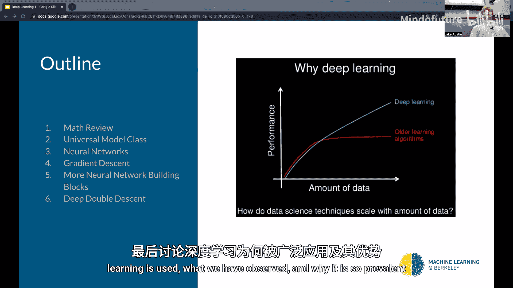
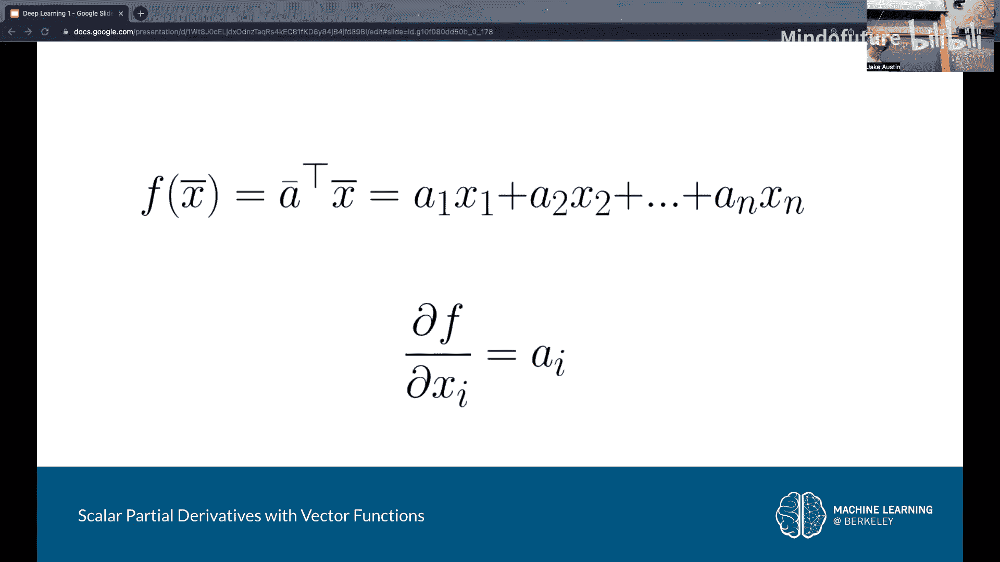
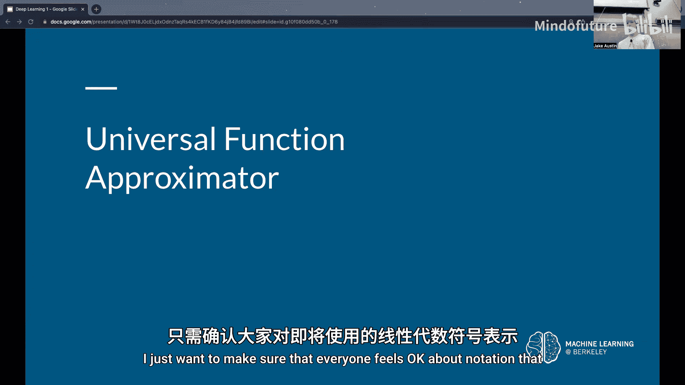
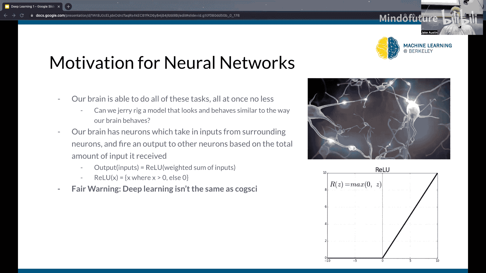
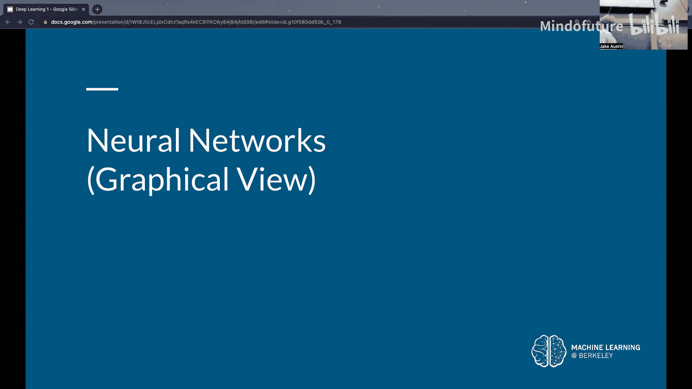
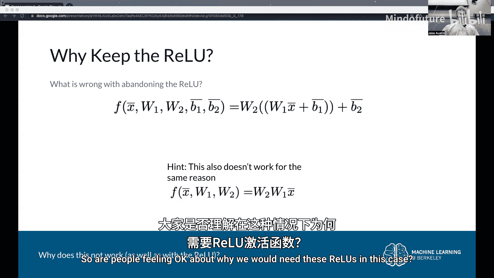
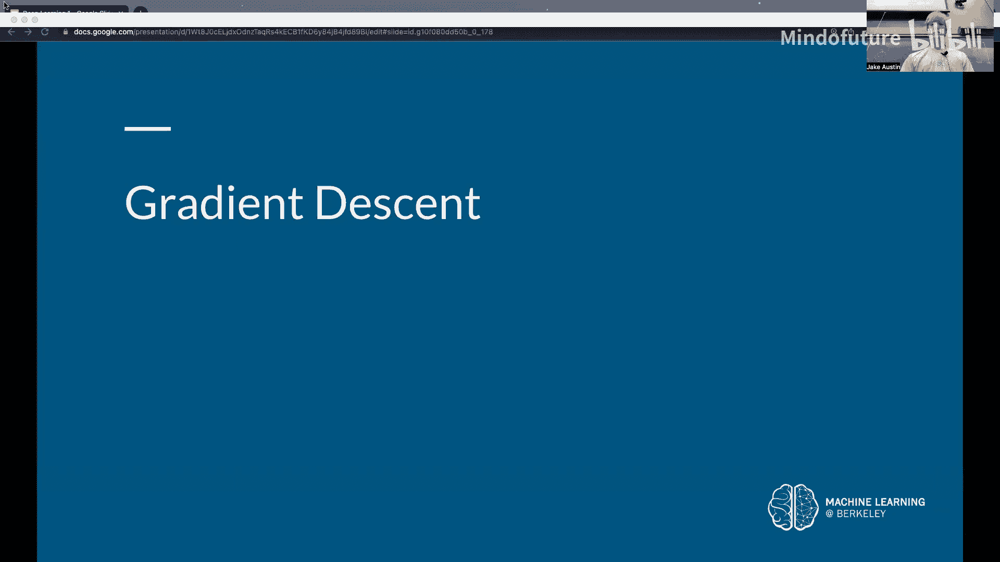
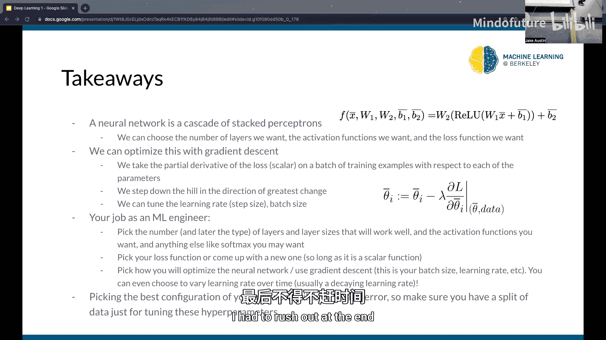

# 【加州大学伯克利】计算机视觉：视觉数据的深度学习 ｜ Cs 198 126： Deep Learning For Visual Data p02 P02_讲座2-深度学习导论_第一部分 -BV1Va8zzfEtk_p2-

。

And it's。这个意。唔系。好。I'm going to。嗯。不会。Okay。系呀。Can I get everyone's attention for a minute here I this on maybe all right can I get everyone's attention for a minute here does anyone have like questions from like the last lecture we kind of like rushed it pretty quick to try and try and get as fast into into deep learning as possible does does people do people have like residual questions or maybe they went back and like looked at slides now they realize they have there's something that wasn't quite answered does anyone have like are there questions comments concerns about like previous lecture that we can talk about before we get into things today like I think there was a little bit of maybe confusion or like。

Like the bias variance trade off。That kind of jazz。One hot and coatings。Anyone have questions。

 comments， concerns， any any up？Or there yes friend we're not going to talk about it very much I mean there's there's like there's all different kinds of wait by exploratory data analysis do you mean like hyperparameter tuning or do you mean like how we how we choose all of the like what form or model takes all that or are you talking about just like looking at your data and yeah so there's like there's all different kinds of things that we're not really going to cover much here like like kfold cross validation it's like stuff you' learn in 189 or like data 100？

It's basically for the purposes of this class， you're probably not going to be doing a whole ton of it。

 but if you want to know how it works。How you would probably go about doing it on your own you're going to like partition your data into the the stuff you're going to train on like a chunk you're going to tune on and a chunk that you're going to test on so you'll have a specific segment of your data that you're just going to like tune with effectively you're just going to try a whole bunch of different models and stuff loss functions see what works best for that data and then you're going to use that to move on to like your training data and stuff does that kind of make sense。

拜拜。If not， I'm happy to elaborate as well。Okay。We are about at time。So yeah。

 if anyone has more questions， I think there's some time that we can take here at the start of this lecture to just address them if there are questions in the audience before we get started。

 yes friend。Because if you。Find overt。Yeah。U。The whole point is that they're like fully independent of each other。

So if you find a model that works really good on the segment of your data that you're using just to tune。

Ods are that it's going to work better than average when you actually go to like。

Report your final results for your model so they're they're not entirely independent the model you chose is dependent on that data and you want to make sure that whatever data you're like reporting your results with is like fully independent of the data that you trained on and selected your model with。

Is that fair okay， are there more questions？If not， we can。Jump on in， all right。Party on。

 so welcome everyone to lecture two。This is going to be a bit of again another quick lecture so please feel free to stop me if there are questions that you have things you feel like I haven't fully explained again like the first three lectures of this course and technically the fourth one as well are just to get you into deep learning as fast as possible and like break nextfe so that we can actually start like learning how to use the tools for deep learning and like playing the stuff so that's that is sort of a short sort of explainers to why this is going be very quick the hope is that after today you understand what deep learning models are the most basic form of deep learning model and how we go about training them we talk a little bit about different kinds of models but we haven't really touched much on like how we actually would go about selecting the best parameters so we're actually going to make sure that you know what the form what the function actually looks like in the case of deep learning。

As well as how you select the good values and parameters。

So it will be fast please feel free to stop me at any point and answer let me take your questions。

 I just wanted to put that out there before we get started。So。Let me fix my speaker notes。

So first we're going to start with like a little bit of math review。

 we linked some things that we wanted you all to know before starting this class。

 but just in case we're going to go over some of them like a little bit of the linear algebra that we're sort of expecting for this that is going to be useful later in this lecture again this is a safe space and please feel free to ask questions if you have them we're going to talk about the motivation for neural networks。

 we're going to talk about neural networks themselves， we're going to talk about how we train them。

 gradient descent and talk a little bit about some other building blocks you might want to have bells and whistles for your basic neural networks and then a little bit about why deep learning is used。

 why what we have observed and why it is so prevalent。

So a little bit of math review。Vector dot products。

 this is something we want to make sure all y'all are comfortable with just the idea that if you have two vectors。

 their dot product， you have a vector of W1 W2 frequently using Ws for our parameters。And then WN。

Multiply by another vector。X1 all the way to X N。That if you multiply， you do this。

 which is referred to as a dot product， that it is equal to x1 times w1。Plus x2。

 I's W2 and so on all the way down。ExcellN， WN。And this is how we notate it。

 we refer to this vector of ws as a row vector and the vector of x as a column vector sometimes shortened to W transpose multi by x。

Does anyone are there questions in the audience about just vector multiplication and more specifically this notation。

 how we get from this written out all the elements to just W transpose x where w and x are vectors？

Okay then in that case we're going to roll on to the next one the reason we're going through all of these is because we really use them in just a minute and I just want to make sure that again you're fully comfortable with with this conversion from elements in vectors to this shortened vector notation and if I'm writing too small in the back to let me know and I can try and write a little bit bigger。

So matrix vector multiplication。You can think of a matrix specifically。

 this is something that probably isn't immediately apparent if you've just taken， you know。

 like like high school algebra and stuff， you can represent a vector as just a list of row vectors。

So this whole guy right here is a vector， just like that vector of written out Ws that we had on the board。

Another vector。So on and so forth。And when you multiply that。By Colin vector。

You can imagine distributing this column vector to each of your rows and doing a whole bunch of dot products。

Right， so in the top， you'll have W1。The dow product of W vector W1 in this case。

 W1 is the first row。嗯。Dot product with R X。W2 transpo x。All the way down， WN。

Transpose x or all of our W's and x's here are vectors。

Does anyone have questions about specifically how we can make matrix vector multiplication compact by representing it？

As you see on the bottom right as just a series of dot products between the rows as well as our original column vector。

Okay， if there are enough questions then I will move on to the next one。

 don't be scared by this bottom thing， it smells your peer。

The the important thing I want to just talk about is just notation how we sort of like。

Index into our vectors with neural networks we're going to be talking about just sort of like black box functions just some magical black box that takes in a vector x。

's not writing very long apologize and spitting out perhaps another vector wide。

And as we start to talk about what's inside this black box that makes it quite magical。

 we will be referring to again， elements of vectors。

 and I want to get you comfortable first with notation。

 so X is often refers to like our input vectors to our function to our magical function a function of vectors。

We're going to refer to why usually as a label vector。

So we talked a little bit about like one hot encodings and how if you're classifying digits and you have 10 different potential output classes。

It's convenient or perhaps best to represent the label for the digit3 as00，01。

 and then a bunch of euros。So that would be an example of our label of why it's a vector。

W is often a matrix of parameters， every element in the matrix will be a parameter。

 something that we're trying to learn B is if we have like a vector。

Still usually parameters and then theta is just sort of。

This shapeless thing that refers to all of our parameters together。In this case， on this slide。

 it is a vector。And when we're subsscripting things like a vector B。

Subscript I that refers to just a single scalar because if we have a vector and we index into it and pick something in it。

 that's just a scalar。Things like that。That we can have a vector of parameters。

Like if W is a matrix of parameters。嗯。Or yeah。Our individual elements of W are all just scalrs and they are there are parameters individually。

 each of these scs is a parameter that we're trying to optimize。

Are there questions in the audience about？This idea that we can have things like matrices and vectors。

 but all they really do is just contain all of our scalar parameters。

 just values that we're trying to optimize for。Any questions， comments， concerns？Okay， so again。

 don't worry about the thing on the bottom， I just wanted to emphasize that you can have vector of parameters。

 you can have matrices of parameters， but they're all all the parameters individually on their own are just scrs just the same as you've seen before。

And derivatives of vector functions。Our function， if we have a function here that spits out a scalar。

 if our function is just the dot product between some vector of constantss a and another vector that is the input to the function x。

There's no reason why we can't just take a derivative of our output。With respect to one of the。

 in this case， inputs to our function。So if you have something like this。

Because at the end of the day， everything that's inside A and X， they're just scalrs。

 there's no reason why we can't take the derivatives of our output。

 which is a scalar with respect to like one of our inputs， which is also a scalar。

And so this is something you can see a transpo x is。

It just boils down to scalar multiplication and addition。

 even though it all came inside vectors and matrices it all boils down to scalar addition and there's no reason we can't just take you know boring old partial derivatives with respect to the inputs are there questions about this because this is something I really want to make sure we're all clear on。

Because it just makes life really easy going forward if everyone's in the same page with us。

Other questions？

嗯。So with that in mind we can start motivating and talking about neural networks I just want to make sure that everyone feels okay about notation that we're going to use with all the linear algebra。

So。Why， where does the motivation for a neural network come from？

So there's like all different kinds of problems that we can solve in machine learning， regression。

 classification reinforcement learning， and frequently it revolves around。

Super non nonlinear functions like creating in the case。

 if you're trying to regress onto a polynomial that looks super funky。

You're trying to learn something that's like super nonlinear it doesn't look like a line at all。

 it's a really complex kind of function that you're trying to model。😡，And。

We want we want something that's capabled like a universal model that's really good at doing all these different kinds of tasks and the motivation we want to have for that is like the human brain the human brain is really really good at doing all different kinds of tasks it can classify objects you can figure out where objects are they can do all kinds of crazy stuff and。

Despite the fact that your brain is really just one model that can do all different kinds of things。

And we're going to try and take some inspiration from that to figure out is there some kind of model that we can reuse for all different kinds of tasks down the line that's just like good out of the box and your brain has neurons they're just these little dudes in your brain and they take inputs from surrounding neurons and depending on what the inputs are they spit out of value depending on the sum of all of the inputs into that neuron。

And just a fair warning too this is not the same as cogsai if you want to take cogsci that's fine。

 but don't like be baited into thinking that you're going to get like a special insight into deep learning by taking cogsci maybe some people do。

 but I've yet to hear about it people just sometimes feel like they got into it because of neural networks and then they felt like they got cheated but we're going to try and take some inspiration from that。

So if we want to look at。We're going to first like kind of draw out like what we want。

 what we want our black box to be。

So we're basically going to try and mix sort of like a mini brain and like the simplest form of that is the perceptron。

It is a mathematical formulation pretty similar to a neuron。We have a whole bunch of inputs。

K how to write those， we have a whole bunch of inputs。Dctor， my back chalk on it。

We have a whole bunch of inputs。And we're going to just wait them。

Just like the incoming connections from one neuron to another will get weighted and then summed up。

So。We have a whole bunch of inputs in blue。X1， x2 all the way to XN， we're going to weight them all。

And add them and then activate on them with some kind of step function。

We're going to hijack this and we're going to replace the step function with a ray loop。

 which basically on this graphic you can see for any value less than zero。

 it fits out zero for any value greater than one， it's going to spit out the value it took in。嗯。So。

Yeah it's it's what it ends up looking a little bit like actually no i'm jumping the gun we're taking in a bunch of inputs we're scaling all of them by a different value our W zero ends up being added really and that's be on this slide here。

So we have our W zero， which we're just going to refer to as B and then all of our inputs weighted by different value。

So that's really all the perceptron is， but the whole point is that it sort of looks like a neuron。

 it's pretty close， it's got a whole bunch of incoming connections and it's got one outgoing connection based off of what all those inputs were。

So this is sort of like what a neuron looks like。Just taking in inputs， waiting them， adding them。

 and then spitting them out through the rale function。

So this is like just a little demo basically a toy problem so if our inputs are。

If our inputs are like。3。Two and one。And we have a bunch of weights。In this case。Three， negative one。

 negative one， and a WZ W zero or bias term of negative two。

We're simply just going to take our first weight and our first value。

 we're going to multiply them together the output of all this。

We're just going to take our first weight， our first value， nine。Next weight， next value。

 negative to。Next weight， next value， negative one。We're going to add them together。With our bias。

 let' forgot it。Negative 2。Add them all together。Which should give us more。

And then we're going to pass it through the relu function。上色。

We're going to pass it through the raylu function， which in this case。

 because the value is greater than0， it's going to spit out the exact same value it took in。

And on the right hand side， it's the same thing only now all of our weights multiplied by all of the inputs plus our bias。

 some to a value that's less than one。And when you pass a value that is， I'm sorry， less than zero。

 and when you pass a value that is less than zero through the relu。

 it just outputs the same thing it took in。So does anyone have questions on this example and how the math works？

Or are there questions yes？What is what don't knowYeah yeah so reallylu it's just a graph up in the top left it's just a function that just takes in a scalar。

And what it spits out is the value it took in if x is greater than zero。Yeah。X is greater than zero。

 otherwise it just sps up zero。So yeah， so the output graph just one of looks like that。F enough。

All right， are there more questions？Yes， Ram， yeah， is the weight p？

The weights are arbitrarily chosen， so for every perceptron it could have different weights and a different bias there are learned values depending on what you're trying to do for a different data set。

 you might learn different values。嗯。Yeah， they theyre learned values and they can。

 they can do whatever they want， whatever。Optimizes for our loss function Are there more questions？

if not so let's figure out how to write this a little bit more compactly because doing all of this like addition is really gross and takes a lot of space an easy way to write this is just as a dot product between all of our inputs and all of our weights and then just adding a little bias term at the end。

So you can see that down at the bottom what we have before is just a whole bunch of x1 X is by times wys and then we just added B and we're just going to represent that on the right by just a dot product between our vector of weights and our input vector and then adding just our scalar bias does anyone have questions comments or concerns about the the way in which I have written this because this is going to be used a bunch more。

We're about to go hog while here。Okay。嗯。So this is the effective formula for it after you've added the Ray loop。

Um， this is this is the perceptron， this is our simplified simplified model of sort of what a neuron is doing。

But your brain has a lot of neurons and they're all stacked and all over the place。

 so we're just going to go absolutely nuts we're going to stack and we're going to cascade arbitrary numbers of perceptrons so what we've basically done。

Is for like the top blue circle。You can think of that as a perceptron。嗯。

That top blue circle is a function of all of the inputs before it all weighted and then output would put it again。

 so we've just taken a whole bunch of perceptrons that we just saw and just stacked them all on top of each other。

And then we took the output of all of those perceptrons and then fed them into another stack of perceptrons we've just gone absolutely nuts。

But it's sort of as resembling a brain。The top blue guy takes in a whole bunch of things。

 you can think of the top blue guy as a neuron takes in the output of a bunch of other neurons。

And then spits out the radio activation of that and then on the right the green guts take the output of a whole bunch of neurons that came before them and then you know weight them weight all of the incoming connections and spit out a value so like let's look just at a single layer because that's kind of overwhelming by itself。

So again， what this is is just a stack of perceptrons。嗯。

So we can think about just doing the perceptron operation a whole bunch of times。

We have a function now of all of the weights of all of our different perceptrons， in this case。

 the WI vectorors。Forresponding to the weights of the I perceptron。

And we're just basically going to take all of our independent just this adding that we did over here。

 and we're just going to stack them all up all the outputs into a vector。嗯。

Only we can shorten that to our previous perceptron notation， so if you look on the far right。

 it's literally just the perceptron formula a whole bunch of times on the same input。

Does anyone have questions so again it's just。This reallylu function right here。

And we just stack it a whole bunch of times。The railo in this case applies to each of the elements independently。

Other comments there probably will be likely， yes， friend。It's like I being like that works。Yeah。

 and you've done that a whole bunch of times and you're just stacking it。Yeah。

 they're all taking in the same input， but each perceptron has its own unique weights。

Can I provide any more clarifications to anyone right just？Y。

It literally just boils down to the dot products so you can see again on the far right。

Each element in our vector is just the perceptron output and the perceptron output is just the dot product with the scalar being added。

And you can see each of the biases are different and each vector of weights is totally different。

 independent， all that。Are there more questions I can answer， yes？呃。Yeah。

 we're going to eventually when we bring a whole bunch of layers together。

 you'll see how this works a little bit more， but eventually yeah。

 all of we're going to try and figure out what a good value is for every single element in every single W and for every single B。

But the W again it just has scalers in it right it's not scary scalers are like they're our friends。

 they're fine。So it is eventually going to just boil down to a whole bunch of scalrs just being added and multiplied together。

嗯。Yeah。Are there more questions？Okay。So here's like just a sort of toy example again。

 turn to your neighbor and just talk about this for a minute here so again we've notated all the weights and you know our input values and just turn to your neighbor and talk about you know doing the math and what you think the the output will be。

Make some friends。没错。It。Yes。对对对呃，差。我想。有钱。佢以想检。Okay。さい。要。好。啲系。Yeah。Yeah。Oh。He slide。好。中午。对。The。好的。没关系。

好，行你你题。😊，有这个。你这。对。好。这地好。Can I get thumb up if people will have if they feel good about those。

Yeah it out。Okay好。YeahOh。Oh， and I also forgot to note that the output layer will not have a raylu on it。

I forgot to mention that。系我哋鬼。系咯，要去。Yeah， so if you go back。他么状。没。刚刚有可以。我不样。完全都。Okay。我不。好。可。没。哦可。

好下都再。わ。你。我也就什么多少。一个他的话。Can I get a can I get a show of thumbs to see how people are feeling about this thumbs up and like a thumb not thumbs down。

 a thumb to the side if you're feeling like you stole have more time。嗯。Okay all right。

 then we will keep going here。The if you just end up doing this。

 you get negative three so the the first。Lodge it in the middle when you when you actually calculate its value it it's less than zero so you're going to end up getting the value that is zero and then the other two because they are greater than zero when you pass it through the really you're going to get the original values which are five and one respectively。

And then the output we did not apply a raylude to and when you just weight all of those values from that we obtained from this middle layer you're just going to get negative3 can I get like a show of thumbs to see like how many people got that it's it was kind of a lot of basic addition so people didn't get it like the fully expected because like doing this in my head too is like impossible。

Okay， so like looks like people felt okay with that。

So this is this this is a very small very basic neural network that is what it is that is what。

It looks like to compute the outputs of our neural network and if we want to revisit this even more and get our notation even more compact previously we listed each element in our output。

😡，As being the result of。A dot product and a single edition。

If we can pify this even more and just bring out all of thesees into just one vector。

 the dude on the left hand side is literally just matrix multiplication。

 a bunch of W dot products with our input X， that's the same thing is just matrix vector multiplication and again that really applies to every element individually in this case。

😡，So this is the most compact form of a forward pass for a single layer。Of our neural network。

That is the way to write it。We have， we have。Achieved what we wanted a very compact way to write one little layer of a neural network to people yes friend do you know the order the elements yeah sorry it wasn't very clear from this。

 but I was hoping that it would be the first the dude on top corresponded to the first weight the second output in this middle layer here corresponded to the second weight and so on。

Well this is just me making a crummy little design for it normally normally you'll just represent your weights as like again like a row vector and you'll just notate it as we're doing here and then there will be no ambiguity。

But yeah， good question and I apologize this is not。

I will see if I can make better graphics going down。Going down as we progress but。

I hope the point is clear the point got across the essence of this exercise。

 are there more questions？All right。So this is a little bit of a sidetrack。

 but so let's talk about like classification so we have we have a neural network and we've this example here that we just did can be scaled up so we have like many layers and they're even bigger and we end up with like millions and millions of weights。

So with all this。Just。We want to take a short digress and talk about how we would go about like。

Interpreting the output of our model。😡，So in this example。

 the output was from like negative infinity to infinity。

 but that's not like super useful if we want to try and like classify a digit so previously we talked about like what happens to give the picture。

😡，With like numbers that go from zero to and including nine。

 so say this include this is a seven but maybe it kind of could be interpreted as a two。

How say we have like。We've talked previously too about we can represent our labels。For this。

As being one hot representation of this where we have zeros in all of the places that don't correspond to a seventh。

 so this is zero1， two，3，4，5，6，78 nine。So we have a one in the seventh place。

And we talked about how we maybe want to do something like。Mean square error， we want our model。

 our black box。Spit out something that looks like this。But like how do we constrain that。

 how can we make sure that we can interpret。Our models outputs。

As like the probability that the model thinks that this is a one a two a three or four or five six seven how do we how can we like with math make sure that the output can be interpreted as like our confidence that this is a seven if our model like is I'm not sure that maybe that's a seven maybe that's a two。

It maybe would do like 50% chance。That that's a two and then a whole bunch of what is that0， one。

 two， three， four， five， six。7even8 maybe it's like 50% sure that it's a two maybe it's 50% sure that it's a seven how do we like make sure that our output a model's output can be like interpreted as you know the odds of it being a certain class and we're going to use one last operation on the very end of our neural network。

That's called softftmax。What do we want we want two things in order to make sure that our output can be interpreted as like probabilities that this is you know a seven probability that it's a two we need to make sure that all the elements sum to one。

We also need to make sure that no value is less than zero or greater than one because having negative one probability is absurd so those are we need some kind of function that always outputs a value。

Or a vector where all the elements are from zero to one and they add up to one。

So what we're going to use is softmax don't worry about the formula on the right it's just if you want to go back and look at it later。

What we're basically going to do is maybe our network output in like crazy values like 3。

 20 negative 50。Like insane values， the first thing we're going to do。

Is take the exponential of all of these things so we're going to take。In this case。

 we're going to use a base of E just because it happens to make the math really nice that you can use like any value you want。

嗯。We're going to take e to the three we're going to just replace our vector E to the  three e to the 20 E to the negative 50 when is this done all of our elements are now positive that's a start nothing each to the power of any number is always greater than zero so that's like a start。

😡，And the next thing we're going to do with our formula is with all of these values。

 we're just going to normalize it， so we're just going to take the length of this vector and divide every element by the length of it。

So that when you sum all of it up， or not the length of it I apologize the sum。

We're going to sum all of these guys up and divide by the sum so that when you add all these elements up。

 they're going to sum up to one。So it's very simply just the act of taking all of the outputs of our neural network。

taaking e to the power of all of those individual elements and then dividing by the sum of all of them so that we guarantee that one everything first we guarantee that everything is greater than zero and then second after we have divided or normalized we've made sure that the sum of all the elements in it are one。

😡，And because the sum is one and everything is greater than zero。

 then we also can see that like no individual element is going to be greater than one。嗯。

So does anyone have。sortrt of questions about that and mean it's sort of it effectively will make sure our model will never have like perfect confidence unless it outputted like negative infinity for almost every single value ends the meme that there will always be all of our probabilities will be probably they might be small but we're never going to output something that looks like this it's probably going to be 0。

001。0001 very small values after we've done this operation。嗯。

Not possible softmax means it's not probable the largest values will stay the largest after we take the softm whatever whatever value was largest after we take the softm it will be the largest probability by a good margin。

Li bit， little bit May。But I want to know are people comfortable with that and the idea that we're just。

 we have a function here that takes in some value， some vector of values and spits out a whole bunch of a vector of values that sum to one and are all greater than one。

Greater than zero。Okay， sort of a mafia aside， you won't ever have to implement this or worry too much about it。

 but it's just something you're going to throw on the end of your neural network。So to like recap。

 we took a whole bunch of perceptrons， which are just weighted inputs plus a bias。

 and we stacked a bunch of up of them up to create a layer and we just cascaded a ton of them。

And that gives us this neural network and if you want to interpret the outputs of your neural network as like probabilities of different classes。

You're just going to stack， you're just going to stick on like a softm operation at the end of it。

If you want to do classification， which we will talk about a good bit in this class。Um， so that is。

 that is the forward passive internal network that all of this crazy stuff that's been happening in machine learning boils down to this。

That is the essence。And here's how we got here， just taking the perceptron。

 notating it as just a dot product plus a little scalar value on the end。

 stacking a whole bunch of them up， inform forming a matrix matrix vector multiplication。

 so you can represent a single layer of neural network。And then cascading a bunch of them。

You get something like this for a simple two layer neural network。That is。

That is what it all boils down to。嗯。So yeah， if anyone， again， if anyone has questions， comments。

 feel free to stop me or I can keep rolling on。嗯。So the question was asked while y'all were talking about that example。

 it like why do we even bother having this relu if we took the raylu out of this two layer neural network。

 we would get something that looks like this。Um， and at the end of the day， what this boils down to。

 if you multiply a bunch of matrices together， you' get another matrix。

And then it's like why did we even bother with all of these layers if at the end of the day if we multiply everything out。

 it could have just been summed up by a single matrix multiplication in the first place。😡。

The reason that we add this raylu here is to add some kind of complexity to it to make the function much more complex because at the end of the day。

 again， oh weight matrix from one of our layers， W2 multiplied by another matrix W1 could just be represented by a single matrix in the first place and it adds some necessary complexity that allows us to model all kinds of crazy complex things。

So are people feeling okay about why we would need？

These Rayludes in this case。ok。

So gradient descent， how do we actually optimize？Our models。

 so we talked a little bit about loss functions， some kind of metric for like how good or bad the output of our model is doing。

And ideally， it is high when our model is doing really poorly and it's low when our model is doing really good。

嗯。Our model output may be a vector， so we need to make sure that we can handle that。

 that our labels and our outputs can be vectors。And ideally this also should be like differentiable we're going to be using a little bit of calculus here。

 so it's also important that this is differentiable we'll talk a little bit more about why that is and what that looks like here in a minute。

But this is again， just sort of recapping what we talked about Tuesday。

And we talked about like mean squared error。If。This is our real output and this is what our model outputs we just take the difference between every element。

 square all the differences and then sum them out it's not a bad metric for for like how good or bad our model is doing because if everything's really close。

Then， you know， that means we've probably outputted close to a one and we've classified this maybe correctly as a seven。

It's a loss function that we can use。So I want to talk a little bit about make a metaphor here if you're on a hill and you want to go to the bottom but you can only see like one foot around you。

 what are you going to do？The best move you can do。

Is you're probably just going to take a step in the steepest downward direction if you want to get to the bottom of that hill。

Since you can't really see everything around you， you're probably just going to take a couple small steps in the direction of steepest descent。

 stop， re-evaluate， figure out okay， has the direction of steepest descent changed and then keep on trucking。

So we're going to use this as this is how we're basically going to optimize our neural network。

We have a very complex vector function really。The steepest。Or。The steepest direction in this case。

iss the gradient of any kind of vector function this is something you learn in multivariable calculus if you have some kind of function of multiple variables and you want to figure out at any given point what the steepest direction is you're going to take the gradient of that function with respect to its inputs。

And if you want to follow the steepest descent， you're going to take the negative of that gradient。嗯。

Just this idea of hill climbing and how it applies to multivariable calculus。In calculus again。

 just your steepest ascent， the direction you can step in that will cause the greatest upward change is the gradient and likewise the opposite direction。

 the negative of that is the direction of steepest disscent。Um。

So this is hopefully something y'all have seen in math before。

 if you're not comfortable with why this is the case。

 feel free to check out Khan Academy it has good examples for why the gradient is the steepest direction that you can step in。

So we have。A complicated admittedly function of what are effectively scalarrs。

 so we have a function our loss function spits out of scalarrs。

And all the dudes inside all of our Ws， all of our Bs they're just scalrs right it's not really substantially different from just a normal function written out right like x1。

 x2 that are all scalrs， it's not substantially different。From a multivarial calculus problem。

In that all of these elements inside our Ws are Bs， whatever， they end up just being scalrs。

And our output is a scalar。And is our we just take our data here as consance。

That you don't take derivatives of。So what we have here is just kind of a complicated looking calculus problem if you want to figure out。

What is the best way we can change our weights？Since it's really hard to figure out like on at face value what is the best value of these weights that would optimize and give us the minimum loss that's like a really hard problem so frequently we're lazy and what we'll just do is we'll just initialize all of our weights。

 all of our biases to be completely random and then just say okay we can't see everything we don't know where the best place is。

😡，But we can kind of see which is a good direction to step in。

It ends up being just the same thing we're going to take the gradient of our loss function with respect to all of these scalar parameters。

And we're just going to step them in a direction of steepest descent and we're just going to step with the idea that hopefully our loss if we're taking steps that are small enough。

 measured enough and keep we keep evaluating where the new direction of steepest descent is。

 that if we keep doing this over time，We will ideally come to a good selection of weights and biases this is sort of unintuitive because again like if our weights and biases are if we have millions of weights and biases this is a million dimensional gradient function in a million dimensional hill so I encourage you not to try and visualize it like that。

But I hope you understand that in multivarial calculus， when you have， again。

 a gradient of some much higher dimensional function。

 it's still the direction of steepest ascent and if you move in that direction it will be the steepest increase in your functionss output。

So we again。Here， we've just written it out explicitly， the first weight matrix， its first element。

And then so on the second weight matrix， its last element， all of our bias vectors。

 all of those individual scalarrs， that's what our loss function as a function of。

And there's no reason why we can't just turn it into a math 53 problem。嗯。

So let's explicitly write out how we take these little steps here。And I should note again。

 the gradient vector， what it ends up being is just the partial derivative of our output。

 the output of our function， which is L here with respect to all of the inputs and our inputs here are parameters。

Right。It ends up just being the partial derivative of our loss function with respect to all of our individual parameters。

 you can think of it just stacked up。And then we'll worry about reshaping it later to match the shapes of all of our weights and biases。

This is kind of an unintuitive concept， so I imagine there's questions。嗯。

And this idea that we're just going to basically step down the hill。

 we're going to figure out which direction we can move all of our weights and biases so that maximally decreases our loss function。

Yes， friend， we do those partial risks to change the weights of 97？Yeah。

Yeah that's based wait did you say how or would you how I mean this is just a continuous function right so you can take partial derivatives of the output with respect to the input it's it's a very complex very high dimensional function but it's all continuous at the end of the day I mean we'll talk about this more in the next lecture how you would actually take those partial derivatives but the bottom line is like do you buy do you believe me if I say that like since everything in here is like fully continuous or entirely differentiable。

That there's no reason why you can't measure a small change in the output if you make a small change in the input does that sort of scan。

Yeah， we'll talk more about how you do it later， but yeah， the。Yeah， well I mean our loss function。

 if we choose different weights and biases our function is going to have different outputs correct so our loss function is going to change so in a certain sense。

 our loss function depends on all of our parameters。

Which is why we can just think of this as just a standard multivariable you know math 53 calculus problem where we're just taking the derivative of some F of X。

 Y， Z， W， whatever， with respect to those input values， X， Y， Zw。Yes， friend。

Then we're going to backtrack and walk in the opposite direction。But家 other。Well， yeah。

 well here's what it is basically we're going to we have all of our parameters。

And we're going to evaluate we're going to take the derivative of our loss function with respect to those parameters evaluated at their current value。

 I just want to point out this is the correct notation and like we don't really care about what the like symbolic derivative is we're just going to look at the value of our parameters right now。

We're going to look at those weights。And I guess you jumping the gun a little bit。

 but then we're going to update them。We're going to take some small step the size of our step here being scaled by theta or not theta lambda。

We have all of our parameters and we're just going to take that small little step corresponding to the component of that gradient。

We're going to take that small step scaled again by something called our learning rate。

 which is lambmbda。Rats， I'm running over time。Arere there questions about this idea of like the gradient update？

And we have all of our parameters data， we've taken the the gradient here is just the vector of the partial derivative of L with respect to all the individual components that went into our function。

And we're just making this little increment。We're moving in the opposite direction of greatest change。

嗯。Are there questions， comments， concerns about this still？Good I can answer。

And again just it effectively boils down to just taking the gradient of our loss function。

 L with respect to all of our CL parameters， which again is hopefully not substantially different from things you've maybe seen before in like vector calculus only now there's just a lot more inputs。

But it is still the same thing at the end of the day。

So this is how we make a gradient update if we're just looking at like one little tibit of data and one output。

 this is how we can step so that we can make the biggest decrease in our loss function。嗯。

On that example， so if we saw that example again after making this little update。To our weights。

 we would get significantly decreased loss on this one example。That is that is the hope。

And we need to make sure that our lambda our learning rate is like small enough because we're taking two biggest steps then we're going to like we're going overshoot and then all of a sudden were we're going to find ourselves going up the hill again so just by taking small measured steps we should see a decrease in our loss function on this one example only the thing we really care about is that our loss decreases across all of our data。

So now that we've talked about how we would like step our weights in order to decrease the loss on one example。

We basically need to figure out how to do that for like all of our examples and if you use the math what it turns out is that if you just take the gradient of every single training example and you just average it。

That will be the step in which you can take that will result in the largest decrease in your loss over your entire data set。

So this is really the direction we would kind of want to end up stepping to make sure that we're decreasing the loss for our entire data set。

 so if we run our entire data set again and measure the average loss。

 it'll be hopefully a lot smaller than the last time before we updated our weights。

This is sort of again a bit of a confusing concept。

 but my hope is that you will believe me in that we can take the gradient。

 we can simply average the gradient across all of our training examples。Um。

And just to recap what it's simply going to be is you're going to take every single parameter。

 you're going to take the partial derivative evaluated at every single training example。

With respect to every single parameter， and you're just going to subtract off that partial derivative。

 the average of all the partial derivatives across all of our data。嗯。

You're taking the gradient on every single example and stepping by a consistent amount for every single example。

 updating your weights and then trying again， it's kind of a lazy method because there isn't really a good way to concretely find the best value of all the weights and biases for the neural network。

I'm going to move a little bit quicker here， hopefully y'all can review the slides or ask questions on Ed STEM because I don't want to keep you too long。

But if you want to do this in a more computationally efficient way。

You're going to instead of taking this across your entire data set you're going to chunk it up and just look at little chunks and hope that they're a good approximator for your entire data set。

 this is called like batch gradient tocent so rather than doing this for your entire data set taking gradient steps for your entire data set just do it for like a little bit of your data and hope that it's like about as good or about accurate。

And the idea is that as we get closer and closer to the bottom of the hill， we're going to slow down。

 we're going to take smaller and smaller steps because the value of our gradient will decrease as we slowly come to a little local minimum。

I'm going to skip this part on network building blocks you're allowed to pick different loss functions you're allowed to pick different values different activation functions other than the raylu because at the end of the day all we care about is that our loss function quantifies how good or bad we're doing and there's many ways to do that and there's many ways to make sure that all of our weight matrices multiplied together don't end up being a single matrix multiplication you can add a raylu you can add all different kinds of things to make sure that the the function stays complex and wild looking。

Yeah。Let's see， I apologize for being over time， but I want to get to this here， why does this work？

We have have empirically found that the bigger you make your networks。

 instead of overfitting at a certain point you end up getting better accuracy。

 normally you would start to overfit， you would start to just memorize your training data。😡。

And that would end up with you getting really， really bad loss on data you haven't seen before。

 but it has been observed effectively the bigger you make your network at a certain point。

You stop not overfitting， but。You start observing low loss。

 even though you have the capacity to effectively memorize your data if you want them to。

And it's a strange phenomena that we don't fully understand， but big networks go blur。

is what has been empirically found so we've talked a little bit unfortunately I went a little bit over time I went a little crazy with or answering questions but。

😊，You now know what a neural network looks like， all of these crazy things that you've been hearing about。

This is what it boiled down to， it's just matrix multiplication at the end of the day。😡。

With some nonlinearity like a Ray loop。And you're simply just going to step in a direction that we think is going to decrease our loss across our data set maximally and that's how we optimize it and your job as an ML engineer is going to be to pick the number and the type of layers in question we'll talk about different types later。

You're going to pick how many layers you want them you want how big they're going to be and whether you choose to use something like a relu or something different so long as it isn't。

You know， so long as it's going to make sure that we can't just multiply all of our matrices together to get some trivial linear model。

And a lot of it just comes down to trial and error so you're going to have to just tune for this kind of thing and figure out。

Which values， how many layers， how many activations at each layer。

 which ones work best for that data set。So that is my hope now that you sort of have like a grasp of。

How the forward passive internal network looks and how we kind of optimize for this。

 so I apologize I ran out of time and had to rush the end there。

But yeah feel free to come and ask questions otherwise you can go home we will try and have the quiz out as soon as possible it won't be insane as promise it'll be on great scope eventually I just haven't found time to upload it yet I apologize that's my dad。

不不。Yeah， sorry I had the rush out at the end we got on her are you recording？

I am。So hopefully it's。