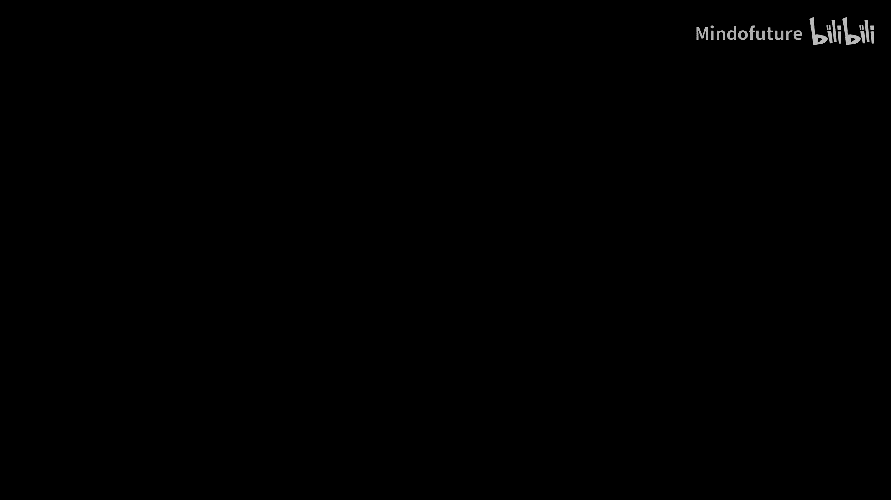
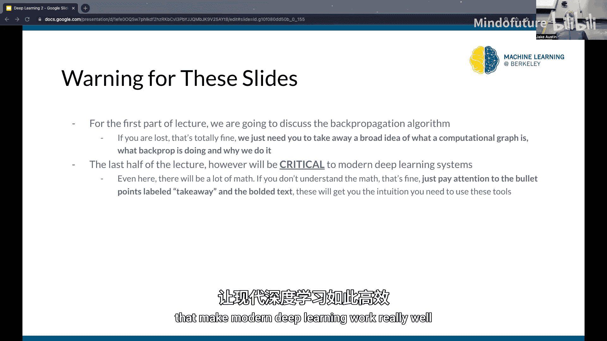
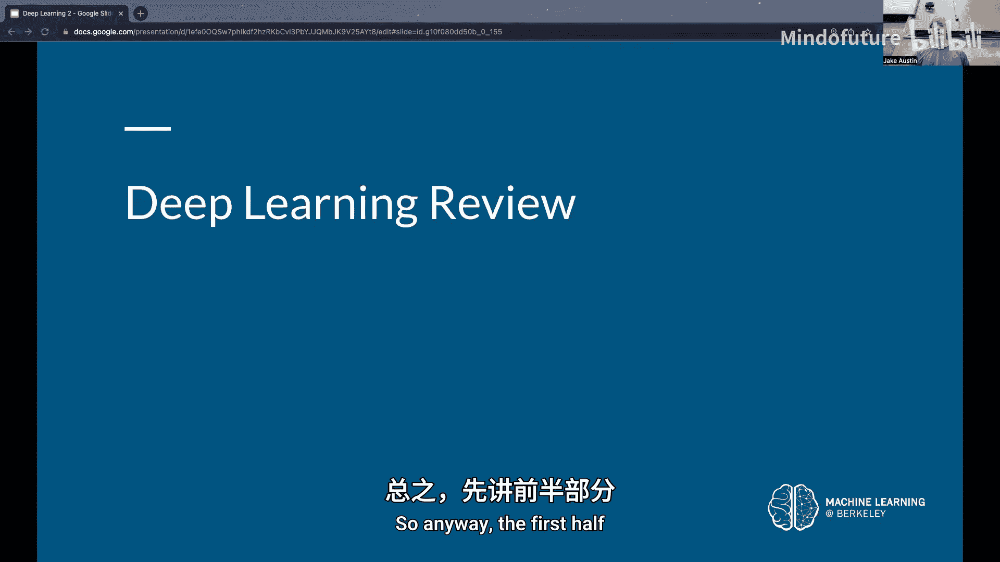
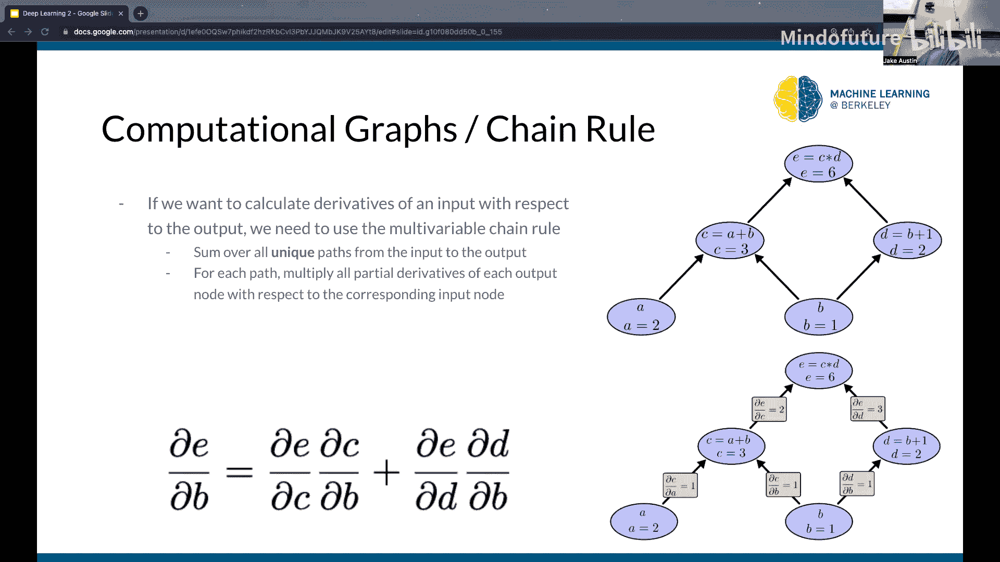
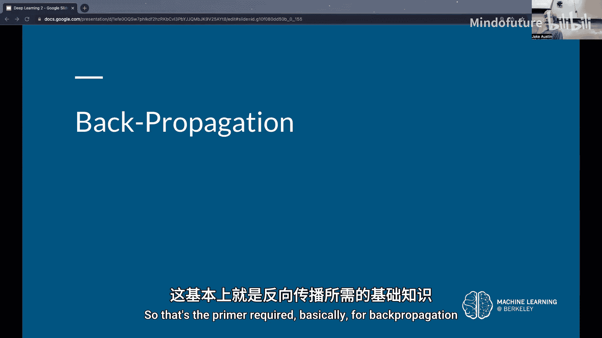
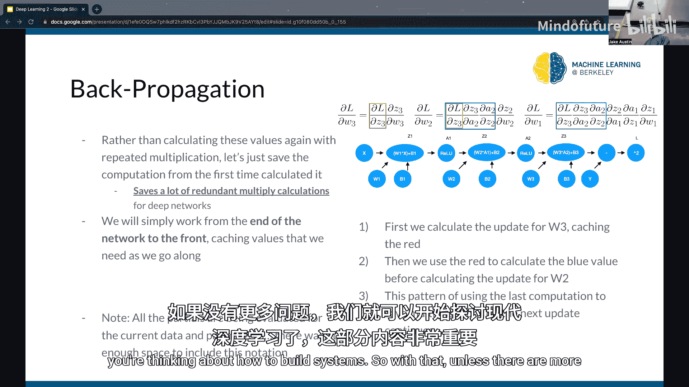
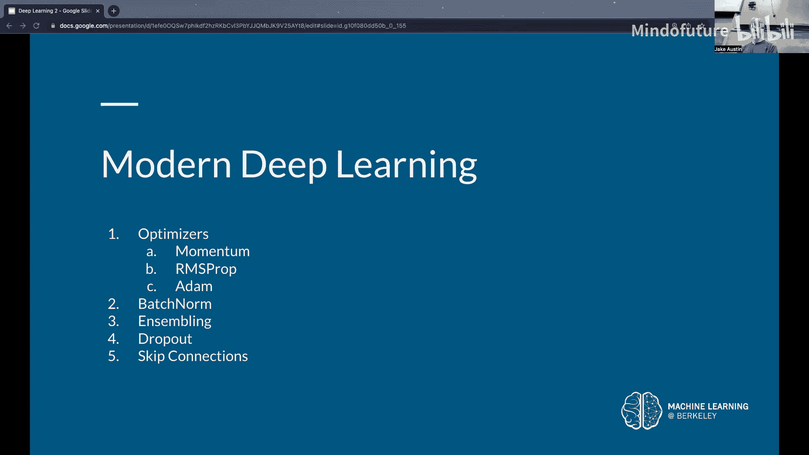
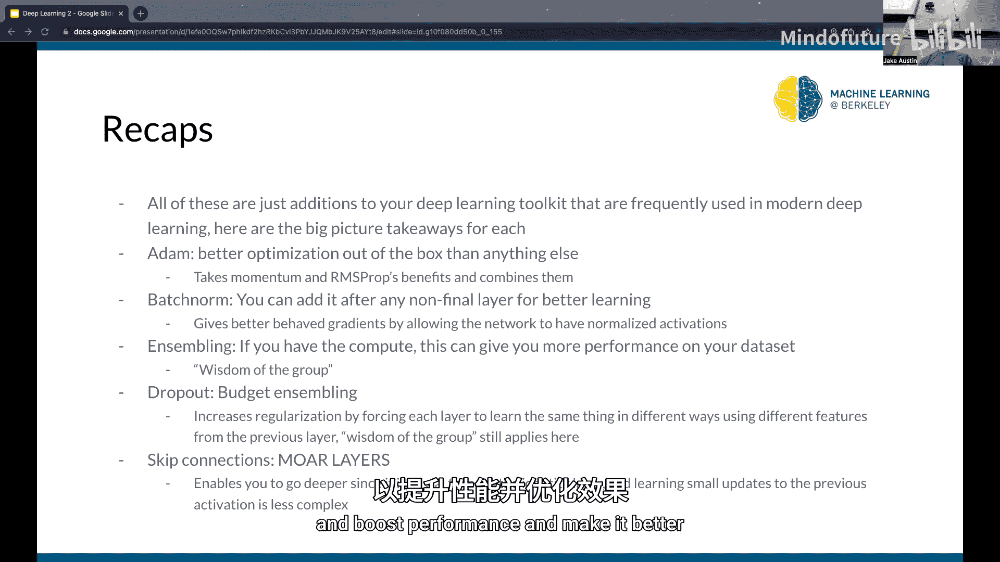
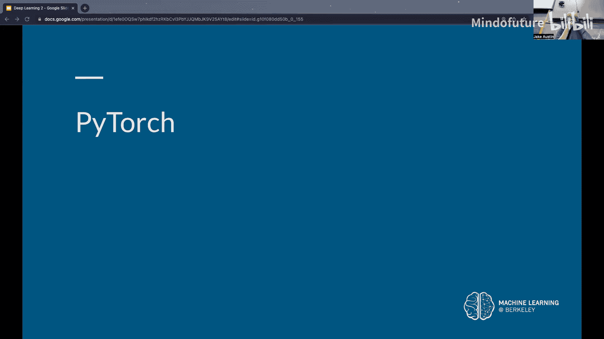
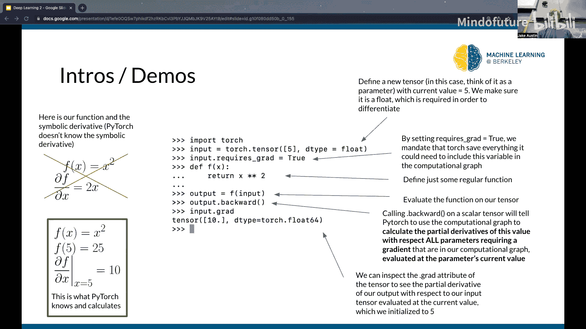

# 【加州大学伯克利】计算机视觉：视觉数据的深度学习 ｜ Cs 198 126： Deep Learning For Visual Data p03 P03_讲座3-深度学习导论_第二部分 -BV1Va8zzfEtk_p3-

嗯。

Oh， it's on the website。嗯。Oh， it's not links。H。Oh my God， I'm so sorry。啊。Oh， it's at the bottom。

 it's at the bottom， yeah。Yeah。呃，Com here come here come here。Thank you。Down at the bottom。Sorry。

 yeah， the slides are the slides don't have a hyperlink attached to them， but not this， I apologize。

Um， but yeah， it's down here， it's down here at the bottom。哎。嗯。Yeah。

 it's going to be a on grade scope it's just it's not going to be like a。Like difficult or anything。

 it's just going to be。诶。Just like did you proof of work effectively。

Um just to make sure that you actually。Like tried to run a training。

 just submit some kind of the effectively。Just a screenshot of that because this first assignment is more for your benefit。

Than anything else， just because it's going to teach you the tools that we're going to use the rest of the course。

是。Okay。Are there more questions？Not we can jump straight in。All right。

Yeah I guess some quick announcements we have the coding assignment due next Tuesday we got it out a little bit late so I won't be grudgy if you turn it in slightly late the first quiz is also due tonight again same story if it's a little bit late that's not the end of the world but it should just serve as some kind of a comprehension check just to make sure y'all like paid attention like stayed awake during lecture。

Yeah， it should be it should be integrated with feedback shown and if it's ever not like please yell at us。

Because yeah， its it's not meant to be hard and it's not something you really graded on。

 it's just completion。冇得。It was supposed to be due tonight。

 but I'm not going to be grudgy if you turn it in a little bit late because we got it out kind of late too。

嗯。So just on completion。It corresponds to last week's lectures so。

Hopefully you should be able to complete it yeah there more questions？And then we'll can all right。

Then let's jump into this so this is the first half of lecture is going to be on we had some questions about like how how does one actually like calculate these partial derivatives this is just sort of some culture as to how this actually happens like under the hood if it goes fully over your head and you space out for the first half hour like it literally doesn't matter so long as you can still use the tools at the end of the day but this is just sort of to answer like how it's actually done under the hood how we calculate all these partial derivatives of our gradient and then the second half is going to be actually important stuff。

What different？Different sort of tools to add your toolkit for modern deep learning stuff and then if we have time at the end I can show you guys Ptorrch the tool you're going to be using all throughout this course to actually code up neural networks and use them。

So again， just a warning for the first half of lecture we're going to be discussing back prop or the back propagation algorithm and if you don't get it if you only catch like the general gist of it like that's totally fine it's it's all good。

The only thing is really again， just that you understand the high level idea of like what it's doing。

And and why it's important the second half of lecture though。

 I really do want to make sure we spend enough time on it because it's all of the all of the things that make modern deep learning work really well。

Yeah， so anyway， the first half， so deep pointing review before we get started。

This is from last week's lecture， our neural network is just a function of scalar parameters that are contained in our weight matrices and our bias matrices。

And we can take the gradient。Just the direction of steepest asscent。

 or if you go in the opposite direction， steepest disscent of our loss function with respect to all of our just scalar parameters and effectively step our weights and biases in a direction that slowly hopefully decreases the loss of our network。

m simply just subtracting a small scaled version of the gradient is what we're going to be doing。

 the gradient being evaluated for our current data and our settings of our parameters。

so this is going to be kind of the core idea of backdrop is just sort of creating a computational graph for our functions。

 so say we have a function C which is a function I'm sorry a function E of two parameters C and D but C and D are in themselves functions of other parameters in this case A and B。

We can write this all out as a computational graph。They take care of the right。嗯。

Where every single function is depicted as a node and all the parameters required lead into that node and the operation that little function is written on the node itself。

So we can create this little tree here for functions of functions of many more functions if we want。

 so this is sort of what it looks like we call this a computational graph。

 it tells us how we can compute E given our starting values just A and B。嗯。

And if you want to do calculus， so say you want to know the partial derivative of E with respect to something else in this tree。

Um， you can use the Cha rule， which simply tells us that if we look at every single path to get from。

 say， in the case of this down at the bottom。To get from B all the way up to E。

 if we go on every possible unique path and multiply by all the partial derivatives between nodes along the way。

We can get the partial derivative of any node， any final node with respect to like any input node。

So this is just a way to write out the chain rule that many of y'all learned in like math 53。

It's's pretty， it means that we can just calculate the partial derivatives with respect to adjacent nodes instead of having to calculate partial derivatives over long distances。

 and we can use all these little individual components like the partial E with respect to C and the partial C with respect to B and use all these little individual components to get a larger partial derivative that stands a larger distance on this graph。

It's just a more。Interesting way to think about the chain really。嗯。

So are there little questions on that on the chain rule？For multivariable calculus。

All right， so that's the primer required basically for back propagation。

Um， so。To start about what background is we have like a little example here。

 this is a toy neural network our Ws and our Bs are just they're not even matrices and vectors it's just single sailors so we have a neural network with exactly one unit at each in layer one bias term to accompany that so our W1 our B1 they are just simply scor values so not even matrices not even vectors one neuron per layer。

And we want to compute the loss with respect to our parameters。

 or the derivative of the loss with respect to all of our parameters。

 so we need to calculate the derivative of L that note on the right with respect to B3 with respect to W3。

 B2， W2， B1， W1。But we don't really want to do like。

A ton of redundant computation like this is this is six different partial derivatives that we need to take and we want to make sure that we're doing this efficiently because in the more generic case where we have many。

 many parameters， this is important。So we want to make sure we're not doing six times as much computation to calculate six gradients。

嗯。So if we want to write out the chain rule for all of these。

We'll end up seeing that this allows us to kind of optimize and like save some computation。

Because again， this is just a computational graph right just like we saw before。

 and you can take partial derivatives with respect to individual nodes。That are next to each other。

So if we do this and this is this looks a little bit complicated。

 but I assure you it's not just the same little again。

 so if we want to take the derivative L with respect to W3。our first weight parameter。

That's simply the partial derivative of L with respect to the node to Z3 multiplied by the partial derivative of Z3 is with respect to W3。

 there was exactly one path on our computational graph from W and3 to L。

 and we just multiply all the partial derivatives along that path。

And we did the exact same thing for L with respect to W2 and L with respect to W1 you can see that the deeper we go into this network or the farther back we go from L all the way back to W1。

 the more things we have to multiply out。But if we look here？

A lot of these multiplies length the same。So this value boxox in red on the left there gets reused as soon as we go to calculate the partial derivative of L with respect to W and then you'll notice that entire thing boxox in blue is reused when we recalculate or not recalculate when we calculate the partial derivative of L with respect to W1。

So there's a whole bunch of redundant computations being done the farther earlier internet our network we go。

And back propagation is very simple， it's just that as we go and calculate all of our partial derivatives rather than refinding。

Rather than recalculating the stuff。In blue over here。

 let's just cash in when we're culating a partial derivative oh with respect to W2。嗯。

That's that is the core idea of back propagation rather than recalculating values and doing repeated multiplication。

 redundant repeated multiplication， we should just save compute from the first time that we went in and calculated our partial derivatives and it saves us a lot of redundant multiplies and we go to calculate our partial derivatives we simply work our way from the back of the network all the way to the front。

嗯。And you can imagine in general that now WV are matrices and vectors instead of just individual sailor values。

In that case， all of your derivatives are now going to be derivatives of scrs with respect to matrices which is scary。

 so I don't want you to think about that too much， but my hope is that you understand that。

Now all these partial derivatives involve matrices and our simple tailor multiplications have now become major multiplications。

 so this patching become even more important now， because now as opposed to now we're saving we're saving matrix multiplies。

 which are very expensive operations in general。And it's important to kind of catch those where we can。

So it's the same idea as we saw before。Only now these derivatives are going to be of scrs with respect to matrices and matrices with respect to matrices。

 which again， don' if you don't want to think about that， don't bother， it's all good。But again。

 were now saving matrix multiplication operations as we start caching all of our multiplies。Um。

 so that is that is the the big thing I wanted y'all to take away from this。

Back proppagation is simply a much faster way to get all of our partial derivatives required for a gradient without having to do a whole bunch of redundant operations。

Um， simply caching things as we go， working from the faculty of the network from L all the way up the front。

To our initial weight matrices and bio frequencies。Does anyone have questions， comments。

 concerns about this I know last week there were like questions on how do we actually go about calculating all of these derivatives for our gradient vector and hopefully this kind of。

Lets you kind of peer into the hood a little bit and see how this is working。不。

How do we know what values to cash？诶。So， it's。You can see that as we're going back。

 we have just like this running value， like you have the value box in red。

And then we're going to multiply two more terms out we have a we're going to teach you high George。

 which is a tool that will do all of this automatically for us cash all this stuff as we go。

But it's it's。Yeah， that's that is effectively it high torch will figure out what it means to cash in order to do this efficiently。

Um， but the hope is that you understand， you can see the need for caching things as we're going back and you can imagine how this gets even worse if we have even bigger networks and so on。

Are there any more questions or comments or concerns？

Oh back prop and again this is kind of weird and if you if you're not super familiar with the multivari chain rule that is like totally okay。

Yeah， going it's not going to affect the way in which you create neural networks because again。

 we have tools to take care of all this for us for free。But the idea of a computational graph。

And graphing out how all of our different。Prameterters are related。

 how they all interact with each other is a useful tool when you're thinking about how to build system。

So with that， unless there are more questions I can take， we can run through modern deep learning。

Which is is definitely important， all of these things I think in here are prolific throughout the field。

 and they make the standard version of a neural network。

 the most basic version of a neural network that we saw works far better。嗯。Yeah。

 and hopefully they answer some more questions that were had from the previous lecture as well。m。

So yeah， let's jump into it then。

So optimization and we do a little bit better than middle and gradient descent there were questions last week like someone someone asked what happens if we are if we're if gradient descent is descending a hill。

 what happens if there's a little bump in the hill？If we're going down a hill。

And all of a sudden we hit this little local mini， how are we not going to know that there's an even better place we could have landed down here and with vanilla gradient descent。

 the answer is this is definitely a problem or just flat spots。

Where we can't seem to get passed because our gradient here is zero。

 we have no direction wish to move。So these are like problems that vanilla gradient descent has。

Oh and also to emphasize with these things it's fully okay。

 I have the equation so that if you want to go back and look at it later you can。

 but if you don't want to look at the equation that's fine just make sure you understand the high level takeaways as well I would like to add。

So， momentum。I this one way in which we can improve gradient descent？

So we'd hate for these little small local minima to screw us up so we're going to take inspiration from the actual ball rolling down a hill if you roll a ball down a hill it has momentum so as soon as it comes down to the bottom here it's carrying with it plenty of momentum and objects in motion tend to stay in motion and it has the energy enough to climb up the hill and hopefully get down to a better local minima。

So what we were going to do basically。Is take all of our past gradients and simply add on to whatever gradient we're about to do。

 the weighted average of all of our previous gradients。And technically。

 we are no longer doing like true gradient descent。Because if we have hit the bottom。

And we start climbing up the hill a little bit more we're moving in the opposite direction from the true gradient。

 but that's sort of okay the hope is that by adding this little thing onto our normal gradient updates。

We're going to be we're going to be enabled， hopefully to climb over little hills。

 push past any big flat spots。And again， the core idea here is that we're simply going to add to our gradient update。

Just the previous weighted average of all the gradients that we've been taking so you will continue to move in the direction that you have been moving in the past。

😡，Um， with the idea again， that you can power through little local minima and flat spots。

Are there questions on this？Yes。Scale it down。Oh are you talking about the betas yeah so that's just the that just lets us do a weighted average so what that line is there the first line so before previously we had we were subtracting off just。

TheThe gradient component of this parameter， the partial derivative。

 so now what we're subtracting off is the weighted average so。If you think about it。

 our previous gradients。四利。T thing how to describe this well。

 but the bottom line is if your previous gradients are like non zero。

 if your previous gradients are like。They' have an average though， right？

If you multiply them by like a scalar say like one half and then you multiply your current gradient by one half。

 the resulting value that you get， you've scaled two components by a half。

So when you add them both together， you're getting something that's about the same size。So。

Say your previous gradients had a magnitude of like one。

 say your current gradient has about a magnitude of one。

 your concern if I understand correct is that we've now just shrunk our gradient even more。

If our previous gradients on average， had about a magnitude of one。

And our current gradient has a magnitude of one， let's say like beta is equal to in this case。

 like 03。If beta is equal to 0。3。We're going to multiply our previous gradient。

Our history of gradients by point3， so that quantity has a magnitude of about point3。

And then we're going to multiply our current gradient。By the remainder of that， which is 0。7。

And if our current gradient has a magnitude about one。The resulting quantity。

That we're then going to subtract off of our parameters that are resulting sort of effective gradient or grading with momentum。

We'll have about the same magnitude does that sort of answer it if not I can try and go again quite differently we're thinking about how a ball is going like to how is that showing kind of our？

明白啊。The the betas are simply to make sure that we're not like。

Making our gradient too big because say like we didn't have betas。

And we've been rolling down the hill。And we have a lot of momentum。Like， okay。

 say it's not even going to say it's just a straight line down the hill。

UThe hope is that so we're going to start here， we're going to make a gradient update。

And we're going to move down to here， the hope is that the next step we make will be about the same size if the hill stays constant。

Um， but so I guess yeah， you're right， if if this was true to momentum。

 the next step we take would be even bigger and then after that even bigger。

But the reason that we have those betas is just to control that so it doesn't get like way out of control we just want to take consistent steps if。

Our hill stays the same。But that momentum will still be used if the hill instead went like this。

We would have the history of taking step sizes about that big。

 so even after we fit this little local mini we'll continue to climb。

So yeah you're yeah I see your point so in that sense。

 it is a little bit different for momentum in that our step sizes don't keep on growing like crazy。

The betas are just to kind of control that a little bit and make sure things don't get too wild。

 but the momentum thing still applies。If you you have been moving in one direction you will generally continue to move in that direction over time。

 does that sort of answer your question okay yeah good point。え。So you can see。

On the top we have a loss surface so say this is a hill one both of these graphics are hills that we're trying to descend the kind of darker area is lower and the lighter areas are generally higher。

It's basically like a topographical map， if you've ever seen like a map that tries to have little elevation lines。

 it's the same idea， so you can see without gradient descent。

We're going to move in the direction of Stevenus theent。

 which jumps us over this little you know canyon and it keep ping ping us back and forth。

 back and forth， back and forth momentum。We're moving slightly in the direction。Or is our local name。

So the next step we made we're going to boots lightly towards that direction a little bit more and a little bit more and a little bit more。

UmThe direction in which we have historically been moving over time average is the direction we're going to continue moving in。

And you can kind of see that in how with momentum， we move towards the local minima far quicker。

Instead of dis oscillating back and forth， moving in the direction of the true gradient。Yes， friend。

你想诶嚟烧。Yep， yep。You're taking the the weighted average of all of our gradients and yeah as we start to。

Yeah， we hit the say we hit the actual bottom rock bottom。We're we're going to start going up again。

 but because historically。After we've started moving this way our gradients will point this way right we still have momentum so we're going to go a little bit further。

 but the more and more times。That we sample over here and take gradients from over here。

We're going to start sliding back a little bit and the hope is that we kind of slowly settle in there。

Yes。Does that answer question， okay？Are there more questions？Allright。嗯。

So the next kind of optimization method we can use that's a little bit different。

The TLDR of it will be on the next slide， but this is just explaining what it is。

thell RMS prop what we're basically going to be doing is instead of storing a weighted average of all of our previous gradients。

 we're going to be storing a weighted average of all of the components in our previous gradient squared all the components squared we're just going to keep holding on to the moving average of our squared gradients。

Our so gradient components rather that is the the basic idea and when we actually make our update so you can see down at the bottom this is basically our vanilla gradient descent except for that we're dividing by the square root。

Of theware。Of archer learning， which is a little bit unintuitive， but we will explain sort of。

The reasoning for why this would work here in just a little bit。诶。

And we also add this little epsilon before we take a square root of it because it。

We really want to make sure we're not dividediding by zero or before we before we divide we're going to add a little epsilon just as sort of a computational note epsilon is just a really small arbitrary number again just to make sure we don't get divide by zero errors because that's frequently problematic and will cause our program to crash but it's so small that it doesn't really affect the value。

嗯。So that is what we are doing mechanically。So why would this work？

So think of like two specific cases here with gradient descent in one case our gradients have historically been very small。

 you can think of that as this example right here saying we've had a flat spot and our gradients have a history of being super tiny whereas here they were much larger。

So。The square of this history of super small gradient components will be even smaller if you swear a small number。

 it gets way smaller。Is the basic idea？And when you divide。

I said increasingly small number that'll sort of boost our gradient a little bit so if we have a history of really small gradienting components as soon as we square。

If we keep the history of the squares of this history of small gradients。

 that number it just becomes incredibly small， even after you finish taking the square root of it it still is just absolutely tiny so once you divide by that number it's going to boost our gradients。

So our grade becomes much bigger because when you divide by a very small fractional number。

 that has to be effectively increasing。A you in the first place。In the second case。

 if anyone has questions on that and wants to interrupt me。

 I can take them too the the second case is say our grains have been super big。

Maybe we have something that just looks like that。Our gradients are huge。Because they're so huge。

 we are about to wildly overshoot this minimum。If ingredients have a history of being extremely big。

 when you square all of those components， they're going to become even bigger， right？😡。

And then as soon as we divide by that number。We are going to get a much more reasonable scale down value so if our grants are way too big and out of control。

RMS prop， as soon as we divide by the history of square grading components。

 we're in to value that's a little bit smaller and a little more reasonable and keep us from wildly overshooting our minimum。

So RMS prop is really good at handling cases where our gradients have a history of being really extreme。

 either we're in sort of a flat spot and they need to be boosted or。

Our gradients are way too big and are going to cause us to wildly overshoot the value that we want。

And it sort of allows you to previously with vanilla gradienting descent。

 if you wanted to get around this， the issue of a flat spot。

 you had to have a really high learning rate， which might be suboptimal。

 it might help you get through these flat spots to have a really high grade or have a really high learning rate to be updating our parameters by a lot。

😡，U but then as soon as you get out of that flat spot， now your learning rate is way too big。

And in this case。If you have a history of having a lot of pills adding a really low learning rate might be nice。

 but it might also take forever as soon as you've gotten off that huge so RMS Pro means you know your choice of learning rate。

 the amount that you're updating or gradients by that constant lambmbda isn't really as big of the deal and sort of you can think of it as like an adaptive learning rate。

Yes，Yes， you jump the gun。Aam。Are there more questions before I move on to fantastic question you read the slides didn't you so there are no questions i'll keep rolling on Adam is basically the best of both worlds。

😊，It gives us the benefits of both and out of the box when you're using Pytorrch and you can select an optimizer just choose atom and leave the parameters as default it works good pretty much everywhere it's just fantastic it is the preferred method of gradient descent it basically combines RMSs f and momentum。

We keep track of all of our previous gradient updates。

 the weighted average and we also keep track of our history square gra components。

 it's like we didn't know our desktop stop and just like with momentum we're going to sub out our gradient update with the momentum included gradient update and we're wanted to combine that gradient update by the square the square root of our weighted average history。

Of squares。Giving us the benefit of both is the idea and again if it's complicated like that's fine if it looks complicated no biggie the thing I want you to take away is that we get the benefit of being able to roll through little local minima just like the momentum。

While still being able to account for issues like this where we have really flat spots and we want to boost through them where we've really see spots and we want to slow down we wildly overshoot a minimum。

So that's sort of the idea of Adam。And it just use it as the takeaway it's fantastic are there questions on this？

Yes， friend， so does artists not already solved the momentum problem when you have a square gradient I isn't that still giving you some touch on that？

It doesn't change the direction。Of your gradient， all it does is change the scaling of it。So。

 so yeah， so if you're right here， it's going to yeah， it just changes the scaling。

 but not the direction where momentum will actually update the direction。

Good question good question very good question Are there more questions or comments yes friend。Yeah。

I body this fun。Oh yeah， u I mean， it can be， it can be。

 I suppose if you're actually at the minimum and your gradient has a history of being zero。

Yeah yeah that's a that's a good point rMS prop is good for getting to the local minimum。

 but after it gets there it might be problematic。So if you generally just keep a history。

 if you're keeping track of all absorb。Your're loss after every iteration。

You can actually just like do something called model checkpointing， which is sort of important。

 which is just save your model every once in a while after each iteration after you've gone through your data once。

 just see how well it's doing evaluate it。Figure out what the loss is on like some some validation。

 some new data that our model hasn't seen for， save it。Right so yeah。

 if if say we've hit a point like this， our loss has like gone down over time。

 but now it hits this value of zero and it starts acting erratically and our gradients just go nuts right because our history of gradients squared is so tiny you might see your loss function like jump up again and start doing weird shit so just if you're keeping track of your model's parameters after every iteration and just saving them at the end of the day all that matters is that you have a model that works on new data so if you have your history your model's history saved you can just pick the best model basically but yeah fantastic point RMS Pro is good for getting you there but once you're there it will definitely。

Start acting erratically。Yes， friend there yeah second order optimization methods can be used and some people definitely do use them。

 but it's not super common because Adam works pretty well out of the box。But yeah。

 you definitely can， Pytororch can calculate second derivatives for you。But again。

 it's just not as common just because it requires more compute to be able to do that for like marginally better gradients。

Um， but yeah， there's there's definitely plenty of other fun。

 different tricks that you can do to to get better gradient descent like that。Other more questions？

Yes， friend。Oh like when to stop training yeah， so like again， like same。

words's getting kind of flued。呃。Like if if we're descending this hill like say up here like on the y value is the value of our loss right so if we're keeping track of our loss at each iteration so our loss is going to be like pretty high right and then we we make a bunch of smaller steps after we run through the data set say we end up kind of down here right now we have lower loss。

So our loss is decreasing。It's going to continue decreasing for a while。

And at each one of these dots here， you've saved the model。😡，Right continuing to decrease。

 you've saved the model again， you've saved it again all of a sudden it gets down here and it starts going crazy right and the loss increases again。

You save the model here。😡，So， you know， just use that as。

So it's important to keep track of your training history how well your model is doing on its training data。

 the data that it's training on and how well it's doing on new data that hasn't seen before so that you can effectively figure out which one of your checkpoints is the best does that answer your questions。

可。Are there more questions？嗯。Allright。So that is that is the fancy optimization trick that is prolific like just everywhere in deep learning at so moving away from optimization this is just something you can add in you can think of it almost as a layer like we had linear layers before that's enormous just something you can do at the end of every linear layer that just helps your network train a little bit better。

So in general， with our network， when we're inputting the data。

 it's sometimes frequently important to normalize your data so that all the values and your input are in about the same range。

And the reasons for this in neural networks with neural networks is because when we run gradient descent。

 if our data isn't generally in about the same range。

 you get sort of like lost surfaces that look like on top。

Where it's it's very elongated and we're going to get some of that kind of like bouncing behavior whereas in the bottom。

 if you have normalized all yourp， you're going to get much more sort of regular looking loss surfaces that are far easier to descend down with gradient descent。

嗯。Yeah， it just it makes life a lot easier when at each layer。

Or not 80 later when with our input data， our features are normalized that helps sort of the lost surface。

That helps our gradients in the first part of the network but the problem is like halfway throughout our network。

 we have no way of controlling whether our features predicted are of like wildly different orders of magnitude and we'd really like for our activations like halfway through the network at the end of each linear layer to be you know like somewhat normalized。

So that when we calculate our gradients。And take all of our partial derivatives。

 they are crazy and erratic。m，So we're going to basically at the end of every single linear layer。

Subtract the feature or the per neuron mean and divide by the standard deviation so for each neuron we're going to look at that entire that batch we're going to look at all the activations across the entire batch for one specific neuron。

Subtract the mean of all of those neuron activations。

 that neurons' activations divide by the standard deviation。

So that we effectively normalize across the batch。For every single activation on our neural network。

Sort of a weird concept and after that we're going to then。

Allow our network to basically rescale those values as it sees fit by multiplying each weight by some value gam up。

 which is the learned parameter that our network is allowed to control and add the bias。

So is this is a very strange concept， but the thing I want you to take away here。

 what's happening is by default。Before our value of gamma and beta are learned。

What we're going to be doing is normalizing all of our activations， so we have a neural network。

Right and。This neuron right here。We're going to look at its value across our entire batch of data and we're going to normalize it。

And if our network wants down the line， if it feels that it's valuable， you're gradient descent。

We can say you know what you know what we don't actually need this guy to be perfectly normal it can be it can be scaled up by a little bit we can multiply it by a value we don't actually want it to just be normal。

 we would like it to be a little bit bigger or maybe we would like it to bias towards the certain value because when we add batchlor we effectively kill the bias because we've normalized。

Our outputs from a certain layer。It it's like， well， maybe we kind of want it back a little bit。

 it effectively makes the default for your neural network。😡。

To have super well behaved activations so that they're kind of normalized。

This is sort of a strange concept are there questions on this I imagine there probably are。Yes。

 friend。诶系压佢嘅专标系俾啊。我意。Yeah generally generally when you when you the value that we compute at each neuron is like called the activation of that neuron sorry it's kind of confusing it's not good terminology the output of any given neuron is what we're going to be normalizing it so we have an entire batch of data that we're going to turn on。

And we can compute。Right， the average。Activate the average value due to the this neuro as well as the standard deviation。

Computed for that neuron across our batchship data。

 and we're just going to try and normalize that value。And again。

 that might not our network might not think that that's like ideal。

 so we allow it to learn to kind of like scale up and add back a bias to that value does that kind of make sense。

😡，It's sort of a strange concept， yes， friend。Oh yeah， did you raise your hand yeah。开啲。然。はい。Yeah。

 again， like we're not， we haven't actually added like any expressivity to our model。

By adding by normalizing all of our activation and then allowing it to learn to rescale them and re them。

 we haven't actually the set of outputs that we can compute at any given layer is like literally no different like we added。

Rundance parameters effectively。The important thing is that now with this the default for your network。

Is to have well behaved neuron outputlets。That's sort of the idea。

 but doesn't it doesn't mean our network can like express new things or anything like that。

They're the input to the next the next layer when I say this in this context specifically I apologize that the terminology does by that the activation is the output of the neuron so the neuron takes a bunch of stuff and then it computes a value like five five is our activation you can also do batch norm after you've taken your your real activation like the raylu or。

The any any other kind of activation you would like and H you're also allowed to do batchbone after you've done like the rail or whatever people go back and forth on which one is better you can just sort of pick one randomly and doesn't really make a huge difference。

Um， but yeah， does that make sense， the term is clear， okay？Yes， friend。Yeah。

 just after every single layer。Just normalize every single neurons' output across that batch and then again allow it to rescale it if it wants but。

But make the default well behave outputwards。Other more questions？Okay， yeah。

 so again batchor just something you can throw at your network just after every single layer。

It just it simply gives us nicer gradients because our loss surfaces will just look a little bit more like this because all of our values being passed into every single layer are going to be about in the same range。

 at least by default。And it doesn't allow us to represent anything new our function。

Doesn't become any more expressive， we've just made the default setting for our model a little bit nicer。

mEnemmbling。So if you have a model and it's topping out。

 you think this is about the best you can do on validation data。

And you don't think there's really anything you can do。

 something you can try and do if you have the compute is train a whole bunch of model。

 a whole bunch of models and hope that you get sort of the wisdom of the group。

If you have a model that's working really well， you can initialize that model a whole bunch of different times train it up and simply average the predictions across all those models this doesn't get you a ton of extra performance and it normally takes a lot of extra compute because now instead training one model you're training like five or six different models and then averaging their predictions。

Um， but it can give you slightly better results if you want to squeeze a little bit more performance up。

And it's again， just this idea of wisdom of the group， decreasing the variance。

 increasing the bias of your model by a little bit。Yeah。

 this is this is something you're probably never going to do， but it's just I feel like。

Something that you should know about happens， does there anyone have questions about this？

Li weird thing that people do if they have a lot of compute drop out this is used a little bit more。

So overfitting is a problem before you go and train that batch of data。

 you can simply choose a whole bunch of neurons to just half and send a zero and why would this work。

Say a neuron。During gradient descent isn't sure which one of the neurons before it is going to be sent to zero or not it's going to have to learn to use all the features that came before it all different kinds of combinations of them。

 so say you're like classifying。An image and say like the last layer of neuron corresponds to like different things like maybe something that has legs or something that is like red hair or whatever whatever remember if some theater acts out you're going to have to learn。

To figure out。Classify your output based on different kinds of information。

 different combinations of information。You have to learn how to tell the same thing in multiple ways because you're not going to have complete information from the layer before you。

😡，嗯。So its just sort of， yeah， it makes you learn the same。

 it makes each neuron have to learn the same output。

 give a different combination of input and only those combinations。

So this is something you can just do at the end of every single layer and it increases regularization。

 it increases the bias of your model， it makes it a little bit harder to overfit on specific specific neurons。

 it makes it more difficult for one given neuron to depend heavily on the output of just one specific neuron that came before。

嗯。Other questions or comments on this？Okay， so it's sort of another way to get the wisdom of the group effect and that you have to learn the same thing multiple ways。

Yeah。Skip connections are the last thing I believe and if you have time I can show you a little bit of Pytorrch。

 but skip connections are the one last thing， so say you have a super team network network of like 50 layers and say about halfway through。

You have enough information to accurately classify the input， for instance。

 the problem is that you have half the network to go and you have to very carefully select your weights and biases for all of those layers that come after so that your perfect information doesn't get like obfuscated or confused or permed as you keep going it doesn't get noisier as you go the。

😡，Yeah， it it's a it's a question of like。At a certain point with with our standard model of the neural network。

 you can only go so deep before you start getting worse and worse performance and we want to make it really trivial so that as you can just sort of stack arbitrary amounts of layers with like no consequences and skip connections sort of allow us to do this because if you look at what this formula it's doing so we have this block right you take an input。

 you run it through a bunch of weight layers and then after that you simply add the input the identity so if you want to make it really easy to continue to pass a message without without it getting confused if you want to learn the identity layer to be able to just output whatever you took in without adding noise to the information you have you can simply learn all the weights and all the biases to just be zero it makes it trivially easy to figure out how to continue to propagate information forward if you feel like at a certain point in your network we have all the information。

We're good to go so the important thing about a skip connection is it allows you to learn in this block here。

 you simply just take a bunch of blocks and just stack them on top of each other to create your network or stack them one after the other rather is it allows us to learn the identity function。

😡，Oh I jumped the gun a little bit when I was talking but yeah if if you're ready to classify halfway through your network if you have skip connections all you have to do is learn zeros for all the weights which is trivially easy and then you can pass your your good information all the way to the very last layer which will classify for you correctly we can build arbitrarily deep networks with like no consequences now you can just hail marott and just keep adding layers big networks go bur it's it's that simple with skip connections and they are used everywhere so。

Basically what today was is we wanted you to learn like these tools which is prolific and you will see them in all kinds of models we're going to see them lots in our computer vision models that they're used all over the place in like natural language processing all of these different tools and these are just things that you have for your toolkit now if you're building a network you can just add these things to your existing network to try and like boost performance and make it better I didn't have enough time to get to Pytorrch but it is on the homework which I think explains it pretty well。

If y'all want to to disperse that's totally fine I will continue to stay here and talk about this for a little bit more it's only a couple of slides the basic idea back is super hard。

We want something that will compute derivatives for us what pytorch can do is it calculate the derivative evaluated it at a certain point。

 it cannot calculate like a symbolic derivative know what the derivative of x squared is。

 but it can tell you what the derivative x squared is at a certain value and if you know how to use numpy pytorch is going to be really really easy for you because it basically just looks like nuy with extra bells and whistles on it。

So by forch， just like you' would import nuy， if you're importing that rather than creating nuy arrays you're going to create forch tensors。

 but it's literally the same thing so we can create functions and。It literally。

 it looks exactly the same you things， swear them add them， subtract them， whatever。

But if you create a function that takes in a value， wheres it and returns it。

 we can actually calculate the value of the gradient on a certain input then basically what types work you're doing and it might fantastic so with that I think we're done got through the slides yeah。

I will stay up here for questions。

