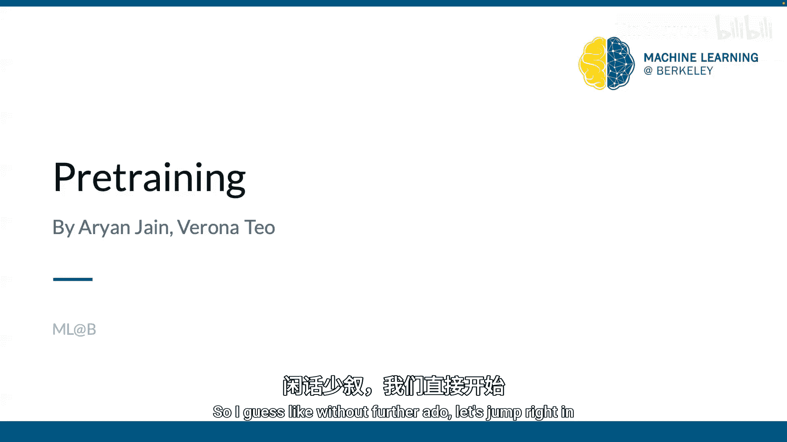
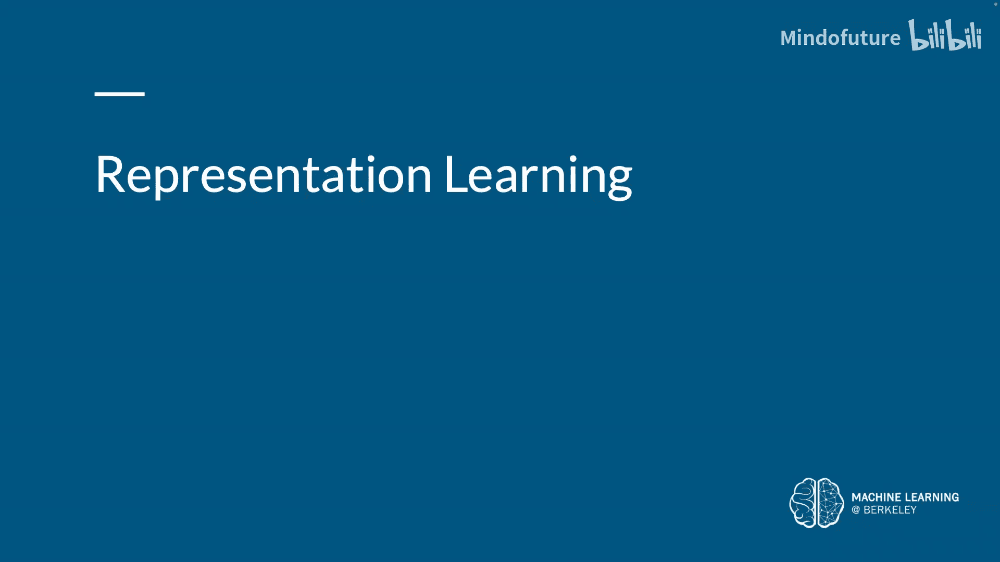
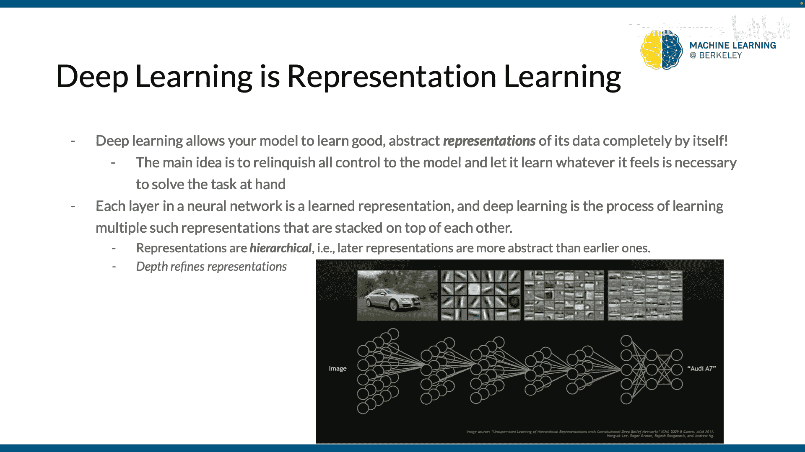
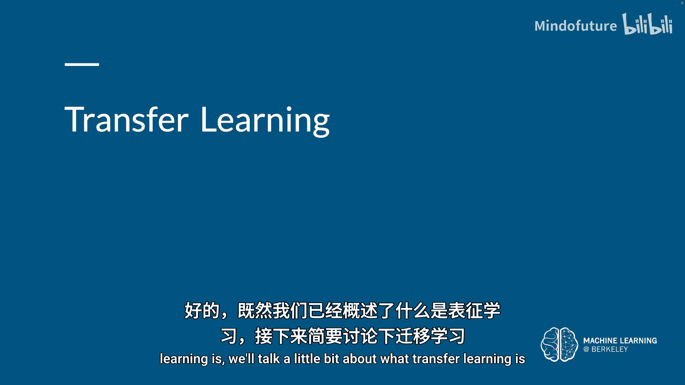
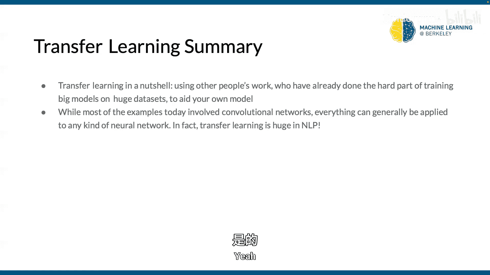
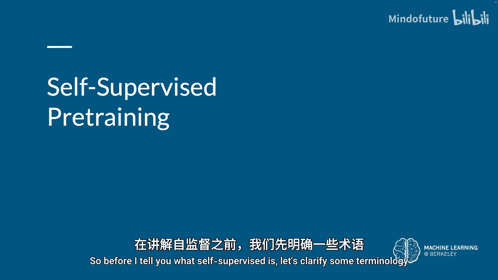
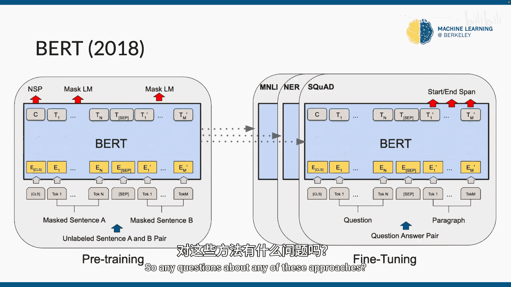
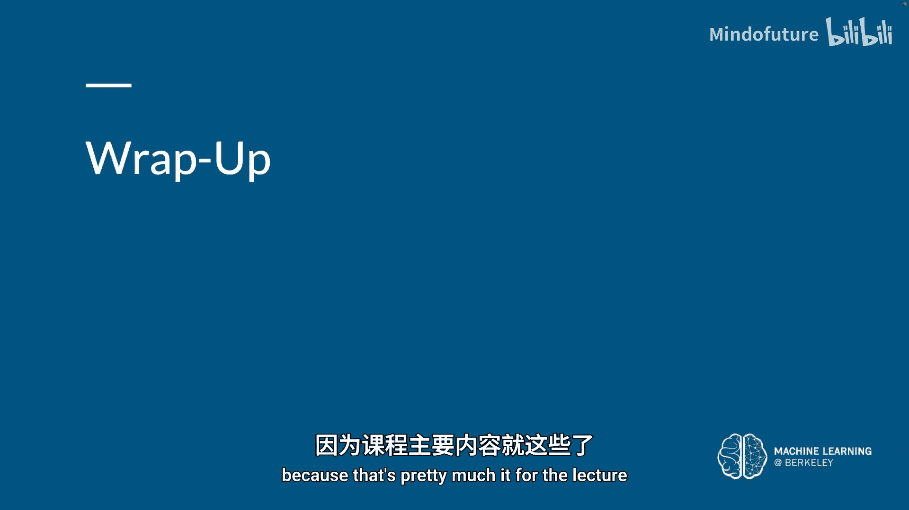
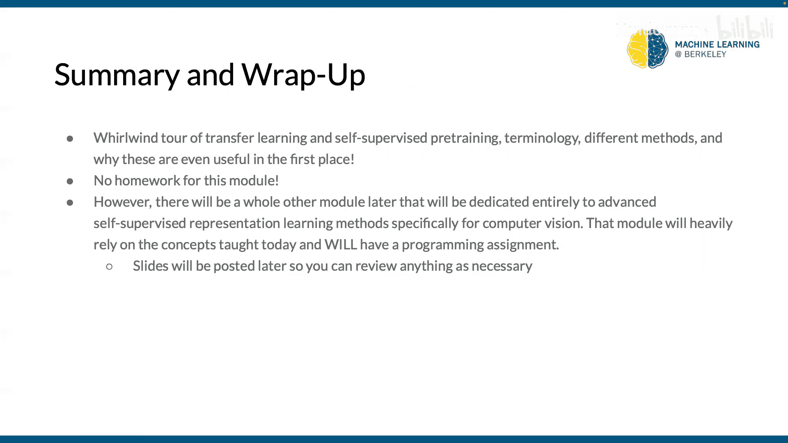

# 【加州大学伯克利】计算机视觉：视觉数据的深度学习 ｜ Cs 198 126： Deep Learning For Visual Data p04 P04_讲座4-预训练和数据增强导论 -BV1Va8zzfEtk_p4-

Andpresent。

O。That's you also share your screen that's what i'm doing Oh your。

Hopefully it is yeah stop sharing yeah you should be sharing my screen click on slide show my camera does I guess I can minimize it。

Your screen sharing are you recording too。I hope I definitely click on car， yeah。

 it looks like it's fine。PleaseI mean it's my first I'm doing more lecture so I'm as good as I can if you don't easily I mean I have to write hear me。

😊，So。Yeah， should I speaking it works I think like unless you itt just pull a Arian goil from Baium。

English class。一个。你系。Physics though。都准觉得。Just for a few more minutes。

If you probably put this in your comments or they can be moved。

attendanceend usually like for these lectures， it's not that's it。this is a really。

You can reduce some that。s not for a few seconds that scared me。钱在。得系当。Okay。嗯。suppose' a good idea。

 I should have got that。That's fine， I guess。YeahYou probably don't need that's when desire。

I'm so nervous。I mean， I am with Ga， but I can have like admin's responsible because I don't finish this section。

So。Yeah。这是。你可。叫。嗯，对。次わりました。没有。嗯对。So we're going to started two more meds police 1710 should be enough to everyone get settled in。

自己。这个1107。Yeah。嗯。Are we both going to be here when we are presenting or what's going to happen but are we both going to be in this area when we are both presenting or what's is's going to happen？

I'm down for either option what do you mean like when I'm presenting are you going to be here and when you're presenting am I going to be here as well？

对啊，好嘢。That's almost 710 like two minutes yeah， it's fun to start。是这个。

Okay we will get started in two minutes before we take。Yeah。You it like literally。Okay。对。12。啊。Oh。嗯。

你不证。嗯。对。可以的。嗯。好。好。That's seven chance probably a good time to start。So hey， my name' is Ain。

 I'm one of the facilitators for this decal and I'm going to be presenting today's lecture on tree training with Bona today。

So I guess for important announcements， I think homework one is going to be due next Tuesday。

Probably start that if you haven't already， the quiz for this week will probably go live tomorrow。

 not quite sure yet， but you'll try to get it up as soon as possible。

So I guess like without further ado， let's jump right in。

So I guess before we start the official pretraining part of this lecture。

 Im want to go somewhat into detail into what representation learning is。

 and I think this should sort of cap out the last two weeks of deep learning and probably give you a more comprehensive understanding of what deep learning actually is doing。

And yeah， hopefully the last lectures will make more sense after this context。

So I guess before we jump into deep learning， let's talk a bit about shallow learning。

Say you have the classical machine learning problem and the way it is set up is you have some input X。

And you extract the features from this input X。And you pass it into some model that is going to be parameterized by some theta to get an output y so keep in mind that this sort of datata is going to contain all of your learned parameters so if you have a neural network this would contain all of your weights。

 biases， any other things that you might want to learn if this is say a regression model this would just contain the weights and maybe a bias term if on a sta。

 but this the is going to represent all of your weights and。

Instead of passing in the input X directly， we would extract some features from it using this function file。

 which is what we're going call a feature extractor Now why don't we push why don't we input the term X in directlys it might not be something that you can so let's say that you're working on a problem of predicting the price of a house from a house so your x can be a house you can really put that into a model right you would have to extract some information about the house which is then something that you could input into a model so this information can be you know things like the number of rooms in the house the size of the house how old it is that can be categorical variables like does it have a pool a backyard basement and of that。

So once you extract these relevant features。You can get your output y or you can get a prediction why and your goal is to learn these weights in such a way such that your predicted label。

Your printed output is as close to the true level as possible。So justs just sort of precap。

 the machine learning pipeline， you start with an inputex。

 you extract all the relevant features from it。And then you push those into a machine learning algorithm to get an output Y。

 and you sort of optimize based on that。so。I guess now we defined this feature extractor as something that we need to this is something that we need to define right so and you might imagine that different kinds of problems will different kinds of feature extractors so if your data is arranged and say a table so if we go back to the housing crisis example。

 you could maybe say that each row is a single house and each column is one of the features now getting these features is pretty easy because you can just take each row directly right or you can also maybe take a column depending on however the data is arranged in this tabular format。

But what if your input is something complex like it can be text， audio images， right。

 how do you extract all the relevant features from such a complex input？

Since this is a CV class I want to go over the CV example and turns out that there are special feature extractors for images。

 so this is sort of what classical machine classical CV look like you people would come up with all of these like different kinds of feature extractors one really common example is something called ho or histogram oriented gradients it sort of captures the edge information in an image and based on that you can train some sort of like class fire model on top of that so say this can be an SVM with learned weights for example。

Now， something you have to notice is that this。Peture extractor is something that you have to program yourself this is not something that's being learned right now it's something that you come up with yourself based on。

Your intuition about the problem， whatever you think might be the most relevant features for this problem。

 right？And if you think about this， this can to be a very challenging task。

You can really use the same feature extractor across multiple tasks， right？If you。

 if you have a task that has to do with the colors in an image。

 this sort of these features won't fully do anything because this gives you edge information right you would have to define a different。

Feature instructoror。Does that make sense？So。This process of choosing the right features can get really complicated really fast。

And this is also kind of a compromise solution in the sense that you are learning the weights of your model。

But you' are still pen programming the feature extractor yourself。

Why don't we we want to make this whole process automatic right but as of right now only the second half is automatic。

 the learning of the weights， we are still defining the features ourselves and this is sort of where deep learning comes in so deep learning says that hey。

 we don't need to hand program feature extractors we can learn those as well。In fact。

 we can learn the entire pipeline from feature extraction to training and you could you just need to pass in this like raw image input and it will spit out an output and you won't have to hand program anything specific in。

In either of the pipeline， so one example of this is you can use a something called the convolutional layer again don't worry about what a con layer is that is something that we will teach you guys next week。

 but it is。A neural network layer that can extract features from an image。

 and this extractor has parameters that can be learned。So sort of something like hog。

 which is sort of a very stationer in the sense that it doesn't really change。

 you still have the same thing。You can learn this feature extractor and you can then pass these features into a learned algorithm。

 so steps in both steps of this process you're learning something right？And。And you might think that。

 okay， we have two different steps and we are learning something， but why keep those steps separate。

 why decouple those two？And what if you combine them and that's exactly what a neural network is。

 a neural network is a model that combines what feature extraction and output prediction。

 and it learns everything from the data。So hopefully this sort of gives you some context as to why deep learning has been sort of takinging off and classical machine learning is not as used in areas like vision anymore because。

Deep learning allows you to sort of automate this entire process from end to end。And。In a sense。

 what you're really doing is you're learning a representation of your input， right。

Your features are a way to represent what that input looks like because a model doesn't know what an image is。

A model will know what the features of that image are because that's what it's receiving， right？

So in a sense， what deep learning is doing is it's allowing you to learn good。

 abstract representations from the data itself and without having to manually do anything。

And the main idea is to sort of like relinquish all control to the model and let it learn whatever it needs to learn for whatever task it is trying to solve。

And in a sense。You can view each layer in a neural network as a learned feature extractor。

And you're chaining these feature extractors on top of each other right so a single layer might receive some kind of input。

 it learns how to best represent that input and it can pass that representation along to another layer that comes after it。

So a deep neural network is basically learned representations that are stack on top of each other and these representations are going to be kind of hierarchical so if you look at the image right over here we have。

And neural network that whose goal is to sort of predict something about a car。

 so then if you input the image of a car， you can see that the earlier layers。

What they're trying to do is they're trying to look for so like these like smudges that you see if like black and white well what this is doing is is trying to look for different kinds of edges in the car so if you have a straight line it trying to look for a straight edge right so it's trying to look for different kinds of patterns and like low level like low level information like edges from the image but as you go further along instead of looking at this low level details you're trying to look at something more concrete so a later layer might be trying to see if this image has a ve maybe a door。

 maybe a window something else that might be in a car and by the very end。

The final layers of trying to see if the input image had a car in the first place now this model has a mental model of what a car looks like。

 it's not something that we know， but it's some sort of abstract model that only the model knows and as you can see that as you go deeper down the network。

Is trying to become more and more abstract。I guess the thing I want I want you to take away from this is that depth refines representation。

 you start with course information like edges and you go all the way down to like find information like this mental model of a car so I know that this was a lot of information does anyone have any questions。

About any of this。

In case notdge， I'm going to pass the My country Verona， who will talk about transfer learning。Yeah。

Okay， yeah， so now that we've sort of gone over an overview of what representation learning is。

We'll talk a little bit about what transfer learning is and what the benefits might be。

So when we train。A model from scratch which we don't usually do。

 a lot of the times it takes a lot of time compute and training data。

 so to just to give you an idea of how much data is often necessary to train a pretty good model。

 even just a few thousand examples is often not nearly enough。

 it takes a lot of data for a model to learn properly。And of course。

 it's also very expensive to find a model。But luckily huge models have already been trained before。

 so the sort of question is can we leverage them in some way and the answer is yes absolutely so you might have heard of what we've called pretrained models and many of these pretrained models are frequently used all the time and so we can take a look at how and why we might want to use them。

So if we train a model from scratch， our model parameters or our weights are randomly initialized in the beginning。

 and then we update them gradually through an optimization algorithm such as stochastic gradient descent or something like atom。

And so let's say， for example， that we have two separate tasks that we want to solve using some sort of deep learning technique。

So without transfer learning， we might have to train these two models separately from scratch。

 which as I mentioned earlier， is very costly in terms of time， compute and data。

So the idea is can we do better and so when we learn something we often find in general， you know。

 just like us ourselves， what we can use what we've learned already and apply them。

 our skills and our knowledge to other domains。Right， so just to give。A little example， you know。

 once we've taken a sort of intro programming course like 61 a。

 we don't continue to learn programming from scratch each time we have the program where we take another course like 61 B or 61 C we already know the high level important ideas and we only need to focus on the new step after。

So we can see basically apply the same idea to our neural objects so as an example。

 let's say we have a convolutional neural network trained for a single or simple computer vision task like a cat versus dog classificationification or some sort of object detection and again no worries if a convolution is sort of familiar will' cover convolutions in CNNs in much greater depth very soon。

But we'll notice that even though these tasks are slightly different from each other our models should be able to learn some sort of suitable representation of the respective inputs so for example each of these models should be able to for example。

 capture how low level features， as Aion mentioned， such as the general shape， the edges。

 the patterns and the colors。嗯。A for this data in the lower layer。

 so the more earlier layers of our neural network， and then once we've moved on and we've gotten towards the later layers。

 they should be able to capture some higher level features such as the abstractions of the cats versus the dogs。

 people's faces or some of the major objects in the later layer layers。

So here is a small example of some of the layers for some sort of object detection or classification tasks。

 so in the first layer we can see that we have features like colors and patterns that are similar tightly close to each other and then we have shapes and maybe some textures and then once we've gone and see something like layer three usually just to give you an idea there are we don't usually train like a five layer neural network but like a lot of the times there'll be like hundred layers for example depending on how deep we want it to be。

So but in this example， we start sort of abstracting in layer three where we see objects and humans and then once we reach layer five at the end。

 we reach to a close to final level of attraction that we want。

And just for a slightly more concrete example， let's say we train a residual neural network on the imagenet dataset。

 so again， don't worry about what a residual neural network is。

 but basically we can train a deep residual neural network with many。

 many layers for tasks like classification or object detection。

And good thing this has already basically been done for us。

 so how can we use this ResNe image net classifier and transfer the knowledge that we've learned from this。

Two other tasks。So we want to figure out what aspects of。

This network is already shared among the other ones。

 and we want to keep that shared information and then basically use that kept information for our other models。

So how might we actually go about this？And so in other words。

 like how do we actually transfer or do transfer？Does anyone have any ideas。

 perhaps of how we might want to keep certain information？From a previous pre trade model。

And transfer that knowledge。Yeah。不是。He。是。你意思。没有。妈个。Yeah。Yeah。

 that's basically the right idea for about you we just copy the weights baby。Yeah。So very similar。

 one of the more common ideas is that well basically our neural networks are just stacks of layers。

 so the idea is can we keep certain layers and basically use that on our next model。

So there's an idea called freezing so that's basically what you guys both mentioned one idea is to freeze certain layers of our neural network so basically we use our pretrained network which is like the already trained resnet classifier discard a few of the layer layers and then freeze the remaining earlier layers and so we can add and train the later layers to basically customize them in a way that sort of satisfies the task that we want to perform on for the second task and also remember how the later layers are often the higher level abstractions and the earlier layers are the general shapes edges patterns so we generally want to keep those general shapes textures patterns but our abstractions might be a bit different depending on the types of task that you know we want to solve on our second task so we can add and train our new custom later layers。

And the layer weights of a train model。Are not changed when they're reused in a downstream task。

And by freezing layers， you might imagine we're not really modifying the weights or parameters。

 and so that backward pass that we talked about earlier in the past few lectures can be basically avoided。

 so the speed of our model increases by a lot by doing this。

Just sort of a note is when you're trying to freeze certain layers be careful of where you're freezing your your models。

 so if you freeze layers too early on that's basically sort of useless like this can lead to pretty inaccurate predictions because you're not really understanding。

The low level edges， for example。嗯。And just to sort of go back to the CNN example。

 so a CNN model with several several layers that's trained on a pretty large image data set like IageNe。

 it can be reused by removing the last few layers depending on the task that you're trying to do the second task。

 you can either remove just like one or a few layers and then have the model classify some new image categories for example。

 so instead of cats or dogs， maybe let's say you want to I don't know。

 understand like how to classify another animal。So you might want to just change the last few layers。

Or you can also use like a larger data set。ok。So another common technique is called fine tuning so instead of freezing our layers we can fine tune our pretrained neural network。

 so instead of discarding the layer layers we can basically train our pretrain model a bit more on some output layers。

And non frozen layers from our original neural network。

So the more data that we generally have for our downstream task。

 the more that we can unfreeze the layers of our original data， original model。

 and then fine tune them again for our specific second task。

And sometimes we might want to finet tune the whole pretrain network rather than just the unfrozen layers。

So essentially we sort of initialize our new neural network to the pretrain network the weights instead of initializing them at random so remember when we sort of pre train our network from scratch we're initializing our weights initially in the very randomly in the beginning。

 so now we can take the pretrained the weights from the pretrain network and use those instead of initializing them at random and so again this speeds up our training process as the parameters of the neural network is taken from the pretrain parameters。

Okay， so。One other question that you might have is how do we sort of decide between whether we want to freeze or fine tune so there are a few main factors that you might want to consider。

 but the two main important ones are the size of your new dataset set and the similarity of the new data to the original dataset。

So for example， in the case one where you have a small small data set or large a large data set and it's pretty similar to the original data set since it's larger we have more confidence that we won't overfit if we fine tune so we've briefly talked about overfitting in the past and this is a topic that will continue to come up when we train。

And I work。On the other hand， if we have a smaller data set。

 even though it's similar to the original model， it's not a good idea sometimes to fine tune because you can definitely overfit。

And then in the third case in which you have like a small small data set and then it's pretty different from the first task you can probably。

Fix some of the initial layers but you don't want a really fine tune and then at the very end you have a very large second data set but it's very different from the first task。

 so you can probably just train it from scratch but in practice it's mostly beneficial to initialize your weights from the pretrained model。

Okay。So before we sort of get into embeddings， just some practical advice。

 so just a few other things to keep in mind when you're performing transfer learning。

 so think about the constraints of your pretrain models think about what sort of tasks it was sort of trying to accomplish in the beginning。

 the data that it was trained on and then also consider your learning rates so we'll talk a little bit more about learning rates and greater depth again next week when we talk about some of these more particular models。

Okay。In terms of neural networks embeddings are pretty important。

 so they are often described as lower dimensional learns continuous vector representations of discrete variables。

 so neural network embeddings are useful because they can reduce the dimensionality of your categorical variables。

 for example and meaningfully represent them。In the transform space。In this photo example。

 they have decided to use TsN for the dimensionality reduction。

Taking the embedding vector dimensions and mapping them into a 2D space in this case plot they also plotted the embeddings and then they color coded based off the genre of the book。

 so they took like book data and then basically did some dimensionality reduction and pop them。

So just as a summary， like embes are pretty useful for like representing high dimensional data。Okay。

 and very， very closely linked to embettings is something called a latetnt space。

 so we often prefer to work with lower dimensional data。

 so a common task is transforming them from high dimensional data into lower dimensional structures。

So we can capture this through something called a latent space of features。

 which basically encode all of the important information that represents a high dimensional the high dimensional data。

And so to be clear on the terminology， we often to say that high dimensional data is embedded in a lower dimensional space。

 latent space， and a lot of the time latent space is sort of interchangeable like an embedding space。

And so something to note here is that what is what we often call the curse of dimensionality。

 one of the reasons that high dimensional data or high dimensional spaces can be bad。

Is because if the data is naturally a lower dimensional structure it's going to be very sparsely spread out in your latent space。

 as you can imagine in high dimensional spaces so a lot of the times you want to be careful about。

Yeah， I don't know you can sort of draw something yeah。

 but like can imagine like if something is naturally。

A lower dimensional structure in high dimensional spaces， it's going to be like very， very sparse。

So this is an example that I came up with， so say that you have the3ie space。

 but your data is along this line now。Your data basically has a one dimensional structure right。

 you don't need to work with the entire 3D space because you don't need to。

And this sort of goes back to the idea of crossciality because you can see that all of these points。

Occuppy a very small region of space in 3D right so the idea is that if we can directly work with the significantly of find a way to represent this line using just one variable instead of three and so of you say the x Y z coordinates that's going to be better because。

Like high dimension data can be very complex， we want to avoid that as much as possible。No。Thanks。

Okay and so obviously one of the big questions is how do we actually get our embedding so well we can basically learn them and so one way is to learn and embedding as part of our neural network for our target task so this sort of allows us to get in embedding that's nicely customized for our particular task。

 but it may take longer than training the embedding separately。

And the idea here is that we can basically reuse our embeddings or other tasks。Again。

 embettings they're sort of just like what we talked about earlier the broad idea is that we're trying to。

Represents our data in meaningful ways。So here's sort of an example。Honestly， it's sort of。Like。

 I don't know we talk about normally quite talk a lot about soft softm but。

You can sort of see how there's different ways， like we have one hunt。Aarget probabil。

 so it's like pretty sparse as we talked about earlier so。嗯。嗯。I didn't do this， do remember run。

This part， what's up。The oh yeah so this example， it's an example about training something called。

An MIS classifier so MIS is a data set of hand drum digits。

 it's a 208 by 28 image which you can actually represent using a single vector as a 7784 dimensional vector but 208 by 28 to 784 so what you can do is you can train a model that would。

Classify。What digit the image contains？usingsing this and and it's going to be one of 10 digits from zero to nine this is what those target class labels sort of identify over there and you trained this using a softm loss because softmax is a loss disease for classification I don't know if we talked about this before I guess not but。

It's basically because it's a loss function， don't worry too much about it。😡。

The idea is that once you train this model。You can take can you see my cursor you can once this model has been trained these three like sort of neurons in the middle of the model can then be used as an embedding for this MIS image so once this model has been trained this the weights must have learned something meaningful right so this means that we could just take some of these layers in the middle take the output of that as a representation of this 28 dimensional 208 by 28 dimensional image。

Yeah。Yes。Okay， and so here's sort of an example of some of the results from training networks from scratch versus applying some sort of transfer learning from a paper。

 so in this example the authors compared pretrained convolututional neural networks for audio classification using transfer learning and they found that the retrained models with transfer learning applied actually achieved better accuracy。

 classification accuracy than retraining the network of scratch。

 so not only is it lesss computationally expensive， but it also helps achieve better results。

So here' is sort of another summary of some of the major advantages of pretrain networks so a lot of the time pretrain networks are trained on very very large data sets and oftentimes again more data means better representation so if we're only given a little data using some sort of pretrain network can be a great idea。

There are also a lot of freetrain networks that we can use immediately。

 so you can use models that haven't trained on large data sets already。

 just search them up on like hugging face or something or import them directly into them。

And we can also pre computeute and store our embeddings instead of using the original high dimensional data。

 which can again save a lot of time and storage。Okay， and so here's just a very。

 very broad summary so without transfer learning we're basically trying to learn two separate tasks and train our model separately。

 but then with transfer learning we basically apply the knowledge that we've learned from one pre trained network and apply that to。

The second task， and so we've talked about two main techniques for doing that。

 freezing some layers and fine tuning our print trend network。U。Yeah， so very broad once again。

 you basically just apply your knowledge and try to transfer that to another task instead of relearning everything。

And just a quick note we'll go into some。Details and examples of this in action。

 but especially I know this is not an NLP course。Talk more about CV。

 but transfer learning is especially huge in NLP， as you can imagine with natural language。

Once you've trained on a large， large amount of text。

There's no reason for you to relearn all of that so you already know the meaning there's like some semantic meaning of words once you prefri you can understand syntax so。

You can imagine in tasks for natural language of processing。

 it takes a lot of time if you want to retrain an entire network。

 so using pretrained networks and using transfer learning is a really really good idea。

 but not only does that apply to NLP applies to almost other domain every other domain like CV。Yeah。

Yeah。

对。不。Okay。Yeah。So we will transition to the next part of the lecture。

 which is going to be on self supervised free training， so before I tell you what self supervised is。

 let's clarify some terminology。

So if you think back to how we describe the machine learning setup to you。

 the way it usually works is you define some model， you takes input X。

 which is going to be a raw data， and it gives you some output， say y hat。

 and you define this notion of a loss that sort of compares how far apart this prediction is from the ground truth label Y。

 right？And your goal is to optimize the network such that this error decreases and your model is trying to output with something that is very close to the actual labels why。

 so in a sense， your training process is receiving supervision from the labels your labels are guiding what the model must learn。

And some examples of and this whole process is called supervised learning， like the name suggests。

 and some examples of supervised learning can be a typical classification problem like the one that we just showed where you class five digits。

 you're checking in some image of a 100 digit and you have a label correspond to that it can also be something like regression。

 if you have taken say 16 a or 16 B I think you might have seen regression in those classes。

There are other examples object detection， segmentation， we will discuss those in the coming weeks。

So now we know that we can learn if we have both labels and the raw data。

 do other thing we can learn if we just have the raw data， and it turns out we can。

 so even without any labels， we can still learn something meaningful about the structure of the raw data。

How many have you guys taken 16 B before？So yeah you might have you might recall something called PCA from the class principal component analysis。

 it's actually one of the most common unsupervised learning algorithms out there because if you remember correctly you just input some data matrix into that algorithm and it spits out those principal come1 in vectorors right you don't you never feed in any labels into that algorithm you just feed in the data matrix。

Um if you remember from the 16 V car， one thing that you did was to。

You took the audio signals from the words that you would pass the car and you would cluster them together again there there were no labeling involved you just took each audio signal。

Projected it down to two dimensions and clustered them with other points so yeah it turns out that dimensional eruption with PC clustering etc cea etc cetera are common examples of unsupervised learning and this is sort of and this is sort of hopefully it give you a clear picture of what's going on so in the first picture your different points and they have labels associated with them so in a classification task you're going to predict what the labels are and you can draw like decision boundaries based on that。

But even if you don't have any labels， the model can still learn that okay。

 these points are grouping up together， they're forming clusters and this is still like meaningful information that the model can learn so。

Yeah， hopefully it sort of this picture makes clear difference between unsupervised and supervised learning。

So the examples that we have discussed so far when we were going over transfer learning was supervised pre training。

 so we take。These large models that were trained on say something like ImNe。

And usually these models like a Resonnet are trained for the imagenet classification task。

 the imageagenet classification task is where you train a CNN on the INe data which has a million different images and a thousand different classes and it needs in the class has to learn to like classify those images correctly。

And since this is classification is a supervised learning problem。

 you have a label associated with each of the images in the data。Now。

 we mentioned before that large data sets are helpful for learning more generalizable representations。

So what if you take this idea further， image that only has a million examples。

 but you can find like a billion images on the web or even trillions。

So what if you try to like harness all of them to learn representations？

And this goes beyond CV as well， so a common data set that people use in NOP is the English Wikipedia。

So and this usually has like hundreds of millions of text tokens in there。

 but you can find like a trillion tokens on the internet of text right so if you try to harness all of this information。

And maybe you can learn better representations using that。

And turns out this is a pretty good idea also， but it turns out that these large data sets are usually not labeled。

 can you could like scrap texts image or images from the web， but you can't rela that automatically。

 right？So a lot of the time we are working with unlabeled data。

 so we want to see if we could use unsupervised learning techniques to the some labelbeled data sets and learn representations using that。

And this is also appealing because labeling in general is a very time consuming and tedious process。

 say that you want to label a billion images， you would have to hire manual labor。

 you you would have to pay the labor， you would have to pay for storage。

 it would be very time consuming， it would also be very expensive and it just turns out that gathering good labels is simply a very。

 very hard process。And so the question that researchers has asked is。

If it could do unsupervised representation learning and indeed it we can。So before I delve into that。

I wanted to clarify one more term。So the way on supervised representation learning is done typically to do something called subupervised learning。

Now， like the name suggests。Sell supervised learning means that the data is receiving supervision from itself。

You still don't have any labels。😡，With in the data set。

 you still only have say a collection of images， but what you can do is you can create labels from those images and train in a supervised manner。

Now， how does this to play done is。I'll just read off the statement from the Facebook air research blog is the general technique of selfupervised learning is to predict any unobserved or hidden part or property of the input from any observed or un hiddendden part of the input so let's say you have an image。

 you hide some information about the image from the model and the model has to predict the hidden part from the unhidden part。

And this information can be hidden across time or space。

 we will go over some examples soon and actually we will have an entire lecture dedicated to selfservised learning for in vision in a few weeks。

 so well de deeper in that lecture too。So again， some more terminology before I go into examples。

So during a discussion of transfer learning， we have been referring to two different tasks as task one and task two。

 which is not a very descriptive name。It turns out that in the context of supervised learning。

 these two tasks actually have a special name， so the task on which you train the representations。

 you know what we have been referring as to task one for so long is also called a pretext task。

And the tasks to which data representations are transferred down to are also called a downstream task。

Now different domains will have different kinds of downstream tasks so in computer vision this can be something like you learn the representations from some pretext task and you'll use those representations for image classification or object detection or semantic segmentation or whatever。

For NLP， this could to be something like text classification， machine translation。

 document summarization， question answering， any of that。

It turns out that this is also possible for RO， you could pretrain something called a policy in RO and then find that later for different kinds of tasks。

 again， don't worry if you don't know what that means。Yeah yeah。

 I just wanted to show that great training。Is a very broad topic and self service learning algorithms can be applied to different domains。

So I guess we can delve into examples now。So this was a paper that was published in 2017 and it was called Jigsaw。

What the authors do is they take an image， they take some part of the image and divide it into a three by three grid。

 so you get nine patches。And what they do is they shuffle the patches around and ask the model to predict the original order。

😡，So the hope is that if the model can learn to predict the original order like。

What cash goes in the let's say the top left corner versus the top right corner。

 it is trying to learn something meaningful about the image so it's not just focusing on say。

low level features anymore， but it's also trying to understand what's going on in the image it it's going to learn that an image can be made up of different parts and those parts are going to be related to each other。

嗯。There are some more technical details on the slides， I won't go into those。But。

Something that the authors actually did， I actually will mention this is when they sample the patches and they。

Divided into a grid instead of taking the grid directly they actually generate each patch a bit so the patches that are like not next to each other because if they are the model can just learn to see the pixels along the edge match each other and it really won't learn anything in that case because it will just be you know。

Because like matching pixels is are very easy。Task is a very easy way to achieve this process。

 right so。Which is why you might see a non perfect grid imagej。

Any questions about this task before I move on？Yeah。这。Yeah。

 so what they did is they actually they took the representations from this pretext task and tested it on classification and detection downstream tasks。

I think I have some numbers up there， it turned out that this was sort of the best pretext task at the time and it actually and it actually sort of bridged the gap between supervised and self supervised learning in a sense on these different classification and detection tasks。

 so yeah。Another task is the rotation， sorry go ahead I guess。

Ting on like classification or whatever or they like。

Spitting in it getting these sort fish passess like something in your bus driver this is like a actual transfer evening。

Get started。that students then using that like data end most I guess about like how can just put the。

If you remember correctly， I think they took like most of the backbone from the original model and I think they just took the。

 I think they treated that as like a frozen feature extractor interpret their representations that way。

Another task is something called BroNe。It's sort of a similar idea， but instead of predicting。

 let's say， a shuffle order， but you do instead is you take an image。

 you're rotate it by some number of degrees which is selected from 0， 90 degrees。

 180 or 2 70 degrees， and you ask the model to predict the rotation angle from this rotated image。

And the hope is that。And then if you look at the sort of example over here。

 even if you rotate this image of a bird， the fact that it's big and it's vital or close together doesn't really change。

 they're still going be close together in each image and the fact that it's sort of claws are pering on this branch is still going to be the same in each image so the hope is that the model can learn some of that information is that a single image might have different kinds of objects and it might have to learn to focus on say something like the object's orientation。

 location， pose， type etctera， etc instead of just focusing on again low level details and I think this sort of next example makes it more clearer so on the left- hand side you have a model that was traineded enough fully supervised manner。

And when you look at what is focusing on on a given image， it's looking at a single part at one time。

But on the right hand side you have this model that was strain using the rotation prediction task and instead of focusing on a single part it's looking at multiple parts of the same time。

 so if you look at this image on the bottom right， it's looking at the eye of the cat and sort of it's not at the same time to see if there's like a relationship between those two and in the image of a dog its looking at both the body of the dog and the face at the same time to see if it could like maybe discernance and sort of relationship between the two。

So maybe this is a way to like qualitatively show that these selfupvised learning algorithms are trying to learn something much more beyond supervised training。

Turns out that this example is not constrained to just CV， you can also do SSLd MLlP。

One really common example in NLP is something called Worldtube。

 which and the role of World tobe is to learn embeddings for a single word。Now。

 the way this can be done is you could predict a word from its surrounding context。

So say if you have the sentence the dog with the man。

 you could try to predict the word bit from dog and the because dog should kind of imply that the word bit is associated with it。

So this sort of approach is called a continuous bag of words model。

 there are many other ways to train verttuic models， one example is Scrm。

 so instead of predict predicting a word from a context。

 you instead predict the context from a word so you like kind of like flip the model upside down。

And there are many of other approaches， this is just。These are just like two really common ones。嗯。

Okay， there's also something called wave tube， which is。Set up a generalization of Vitube for audio。

I'm not going to go into the details of this， I just wanted to show that SSL can also be applied to audio。

 it's a very broad sort of paradigm。And I think the current of the art and audio classification is V2V2。

 which I think came out a few years ago。Okay， so what if we go back to this idea of where to act。

 we are predicting a single word from some surrounding context right and we are only considering a few words at a time。

What if you predict a word from the entire sentence that it is a part of and I think you might imagine that this this might work better because the sentence will give you more context than just like those two surrounding words。

诶。And you can take this step even further and instead predicting a single word from a sentence。

 you can try to predict multiple words from a sentence。And what。

When what happens is that you call these like multiple words a masked word and your goal is to predict the masked word from the rest of the sentence。

 so if you have a sentence that says a quick dash box jumps over the dash dog。

 your goal is to predict the words brown and lazy from the Z。

And it turns out that this was a really effective approach for learning body embeddings and theres a very famous model in NLP called BRT which takes us to the next level。

 the bird is something called a transformer model， you don't need to know what transformers are yet we'll have a lecture on that later in the course。

But。Bd takes in these sentences that have like mass words and it tries to predict what those mask words are。

It actually goes a step further， it actually takes in two sentences instead of one and it predicts the best words for both of them and at the same time it also predicts the order of the sentences like you might imagine that if you sample two sentences from a paragraph one sentence comes before the other one right so it tries to do both at the same time so it learns。

A word level and a sentence level embedding。no。BirRT was a huge success in NLP and I think BRT is sort of what kick startedted。

 the interest in substance learning back in CV because this idea of SSL in CV。

Kind of like died down a bit in 2015， 2016， 2017， but people started taking more and more interest after people thought that B worked really well in NLP。

And like another reason I included the slide is。It turns out that the current state of the art for CV is actually very similar to Bke。

 so that's the teaser for the lecture Peter we discussed advanced techniques and as solve for CV。

So any questions about any of these approaches？

Because that's pretty much it for the lecture， so just to give a wrap up。

This give a summary， we went through a whirlwin tour of representation learning， transfer learning。

 selfsupervised learning， and we discussed like different kinds of we didnt discuss different concepts。

 terminologies， methodologies， etc cea。I just want to point out that this specific lecture doesn't have any homework。

 but there is a homework for this entire cluster， which is the Ptor notebook that should be due next Tuesday。

Even though this lecture doesn't have a homework， I mentioned before that there will be a lecture on advanced SSL for CV。

 and that will have a homework。So if you ever need to review。The topics from this lecture。

 so to work on that homework， this slide deck should be up on the website again。

 feel free to do that。That is it for today。Yes。

A second pause。I just end the meeting。