# 【加州大学伯克利】计算机视觉：视觉数据的深度学习 ｜ Cs 198 126： Deep Learning For Visual Data p05 P05_讲座5-计算机视觉导论 -BV1Va8zzfEtk_p5-

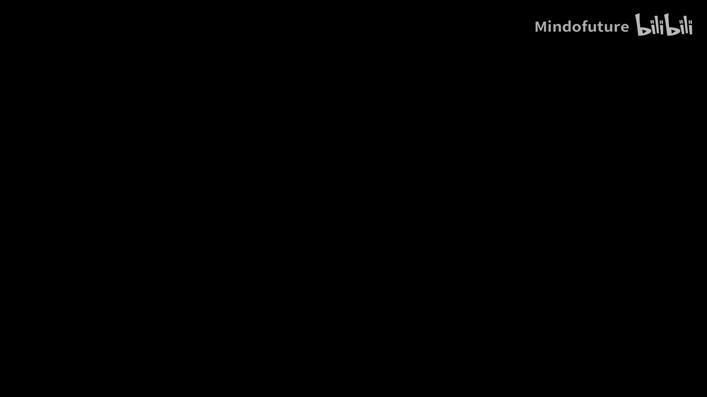

Hey and welcome to lecture five of the intro to CVDC。

 so this lecture is going to be on introduction introduction to CNNs。

We have already given this lecture in person， but due to some technical difficulties on our end。

 the video of the lecture did not record so this is a recording of a lecture that we have done later in time。

So that students who were not able to show up can still go through it later。

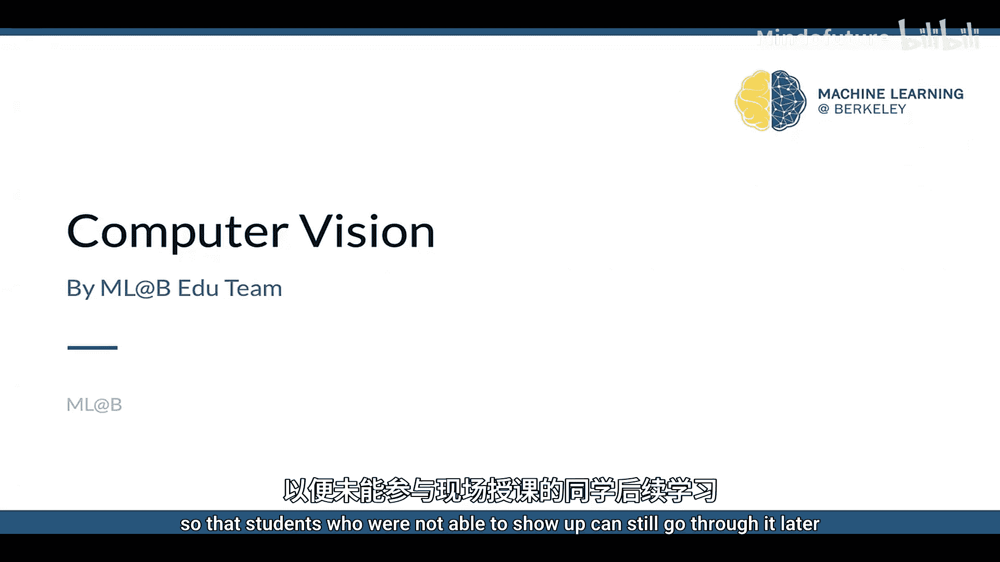

Right。This lecture is very much going to focus on the most basic sort of ML model that you see in computer visionion and before we motivate what that model can be what that model looks like。

 let's try to ask ourselves what computer vision even is in the first place。

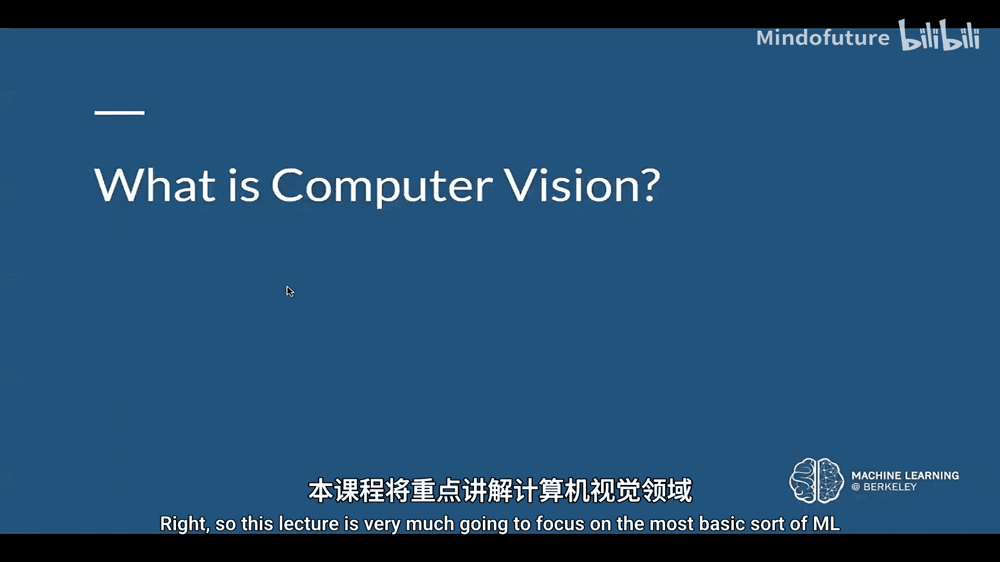

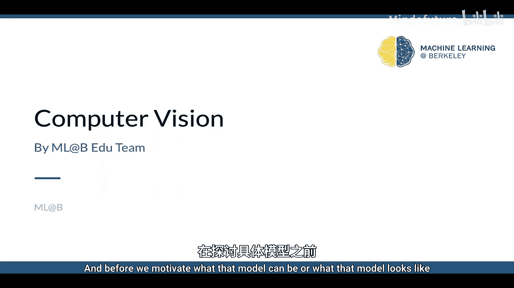

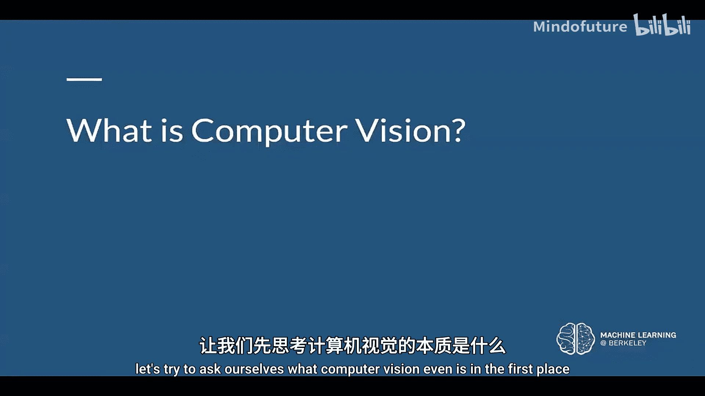

So at a high level， computer vision is simply the field of AI。

That deals with anything that involves sort of extracting information from an image。

At a low level it's a set of tasks that revolve around concepts like classification detection segmentation。

 et cea， so anything that requires。A machine to have a semantic understanding of what's going on inside an image so again there are multiple ways in which this can sort of take place。

 so the the most canonical or I guess the most famous task that you might have heard before taking this class is。

Is out of classification， so the problem of classification is to simply。

 you know just classify what kind of object is in an image。

Now that is all well and good and there are many models that can do that。

 but what if you want to go a step further so instead of just classifying where or what what an object in an image is。

 maybe you also want to。sortrt of point out its location with say a bounding box。

 so we know that here we are looking at an image of a cat。

 but instead of just classing that as a cat， we also point out where this cat in particular is。

Now again， you can take a step further and instead of you know detecting a single object。

 you going try to detect multiple objects because that is usually the case in many real world images so。

If you have like say， different kinds of animals in an image， you could probably to star。

You try to predict these positions not only the cat。

 but also say the dog and you know the rubber duck at the very bottom。And again。

 you could go even further instead of you know just making a box。

 you could predict their outlines now these are different kinds of CV tasks that we will sort of indulge in over the next couple of weeks。

But。The main thing that is in common between all of them is。

All of these tasks will require a machine learning model to have a high level understanding of what a dog or what a cat is。

 right？when it just sees that image to it， it's just a series of pixels and the way it can sort of interpret meaning。

From those pixels is what we will be focusing on。So computer vision。

Has its roots in cognitive science。And psychology， so there was an experiment performed in 1959 by neurobiologists Huber and weasel who were experimenting on cats。

 they wanted to see if they could sort of probe the visual cortex of a cat and they showed this and they showed it like different kinds of patterns。

 what kind of activations they could like sort of observe。

And they noticed that simple edges like like simple patterns like edges led to the highest actuas and they were able to figure out that a cat is trying to break an image down by looking at different kinds of edges first。

And this led to many developments in computer vision。

 computer scientists started to take inspiration from this experiment and they decided to make feature extractors that were say based on edge information。

 so you know one common example in this image that you would be seeing is that of hog。

And when they're extracting these like different kinds of features。

 they would train like you know different kinds of classical machine learning models on top of those。

 and this is how CV was usually done for a very long time。

But then deep learning came in now remember back to lecture four， we talked about how。

The difference between shallow learning or classical MLl and deep learning is that you allow a model to not only learn。

A mapping from you know the features to an output， but you also allow a model to learn the feature extractors themselves so in classical methods we were sort of hand programming these feature extractors like Sft or Hog or Daisy again you don't need to worry about what these like specific extractors are because we will not focus on them the the focus of this course is on deep learning not classical CV and it turns out that you could like simply replace them with you know neural networks and。

Learn something even and learn like even better and better models in particular。

 this breakthrough came in 2012 when a certain computer scientist by the name of Alex Kzzyevsky demonstrated that you could train huge neural networks that could massively outperform you know these like classical models。

So the way you typically use deepton learning for computer vision is through this special kind of model called a convolutional neural network。

 they were first developed by Jan Lecooon in the early 1990s I believe that he first tested this approach in 1989。

 I think it might be an year or two off but it was something about the ballpark and again。

This was a massively successful sort of experiment by him he was able to show that he could use neural networks to say recognize10 indigens from an image。

At that point， Ener started to become more and more widely adopted and it finally exploded in 2012 when again Alex Kevsky came up with this model called the Alexnet he demonstrated that a few years like large models that huge with。

A huge amount of compute and huge data sets， you could train really high performing models and。

And he was able to sort of train the best model。Until then and in this challenge called the image net visual recognition challenge。

 we'll touch on that slightly at the end， but he just need to know that。

This model was a huge turning point for deep learning and it sort of led to the deep learning revolution and led to the state of deep learning research as we know today。

Again。So the INe classification challenge is an annual competition and you can see sort of the massive transformation that AlexNt had in 2012。

 the previous approach before him had a really high error rate and AlexN almost reduced it by a very significant margin and it has only since going down as better and better models come out。

We will talk about some of these models that you see here like VGG。

 I believe in Subtionnet or Google Lanet and Rasnet in the next lecture on advanced architectures。

 but all of these models have something in common is that they are all based on convolutional layers。

 which is going to be the focus of today's lecture。

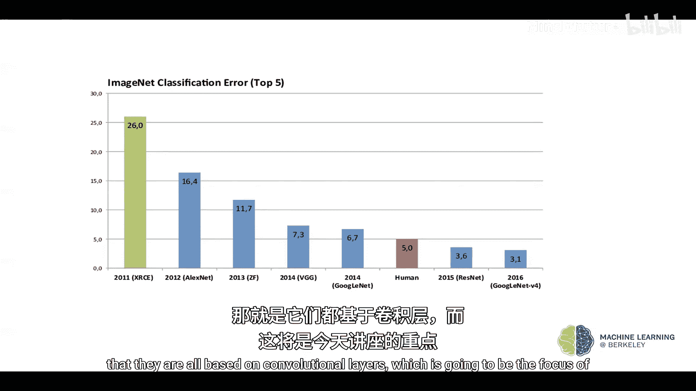

So before we delve into you know these like CNN based models。

 let's try to answer a very crucial question。We are trying to work with images。

 but how do we represent images in the first place， like to a computer。

 what exactly does a computer read when it sees an image？

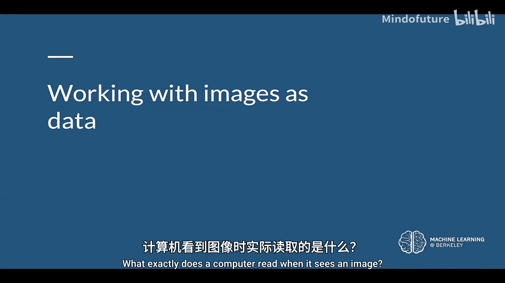

And the question you want to ask is how do we represent these images digitally and the answer is。

 well simply as matrices， so you know when we talk about an image it has an associated height and a width。

 you could simply view that as the number of rows and columns in of a matrix and each say value of this matrix represents you know some kind of brightness from you know white being the brightest color and black being you know the darkest color and。

This is typically how you would represent gray scale images。Again。

 you would use a brightness value that ranges from 05255 y is 0 555 so that we could have。

They could represent each pixel with in just eight bits because you have two for six possible numbers in that range。

 which is represented which is。Which can be represented by a single bite。

 so essentially what's going on is that each pixel is can be represented by a single bite and。

I think that's a pretty good analogy if you have taken something about computer architecture classes。

 you might see why this might make sense。嗯。So you know， just to recap。

 each image in grayscale is simply a matrix with aix value in the arrangement of7 255。

 but we don't always this work at grayscale images。

 we typically want to work with color images because those are you know more realistic。

Now there are many ways to denote color in the sense that you could break a color down into different kinds of components。

 you could break a color down into say RG and B values like each color can be composed of like different shades of red。

 green and blue， you could also break a color down into other color spaces like CE lab or YUV for example。

 we will go ahead with RGV because it is simply you know the most common color space out there and pretty much everyone uses it。

So we know that each pixel， each colored pixel can be broken down into through different values。

Which means if you have a matrix。Which means that if you were to consider your original color image with some height and width。

 you know that each each pixel in that image is going to have three values so you could construct three different matrices for each particular you know component。

And。In a sense you can like just stack those on top of each other so if you're working with RGB you could create a matrix for the color R。

 you could make a matrix for the color green， you can make a matrix with a color blue and。

So of composing them with each other will yield the original image back。

This is a pretty important concept as to how we're breaking down an image into you know different kinds of matrices and it turns out that。

When these like matrices areed on s on top of each other， so let's say that each image is。

say that your image is a height of 256 and obviously 256 this would mean that you have three 256 by 256 matrices。

 so what you're doing now is instead of looking at a single matrix you're looking at more of a 3D matrix with dimensions 3 by 256 by 256 and there's three accounts for the fact that you have three different matrices right？

U。In deep learning literature， we call this generalized 3D representation of a matrix a tensor。

 so in a sense you could break each image down into you could represent each image via a tensor and just like three at the very beginning is referring to the number of channels that the tensor have。

Okay， just want to make sure that you guys pause this video。

 make sure you understand what's going on in this picture。

 make sure you understand the concept of color imagess and channels because this is going to be very important going forward。

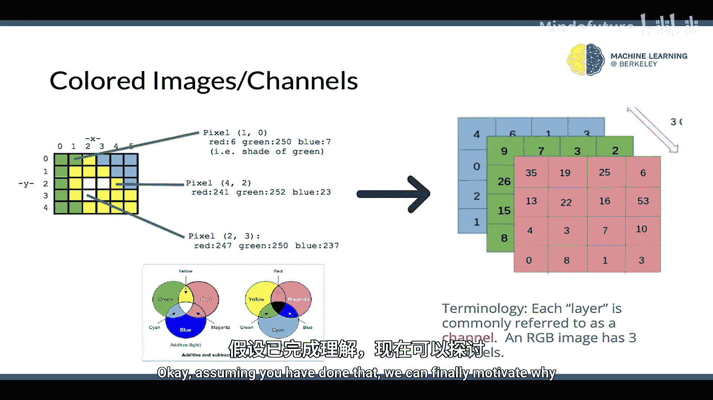

Okay assuming you have done that， we can finally motivate why we want to use convolutional neural networks。

 so before we motivate why a CNN might be helpful， let's try to see why a regular NN。

Or a molecular perron， as you have encountered， or as you may have seen in the previous deep learning lectures might not be too helpful。

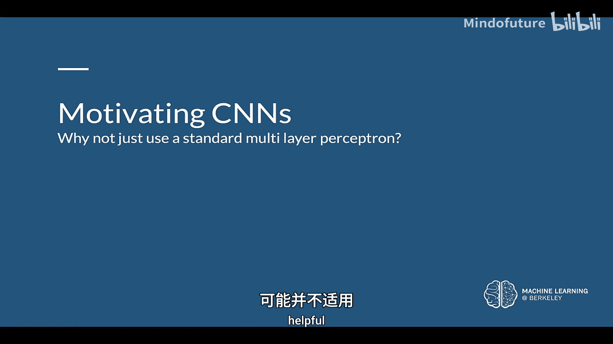

So say that you're working with a 200 by 200 by3 image again。

Sincely it F we just came off of a discussion of color images。

 this means that this image has a height of 200 a width of 200 and this is probably an RGB image because it has three different channels or a depth of right。

嗯。In order to pass this image through a dense layer that we might see in a fully connected network。

 you would have to convert it to a vector， so if you look at where my cursor is pointing。

 this is exactly what a dense layer in a。Ne network group does it's basically a matrix multiplication and。

Bas addition operation right， so we would need to somehow convert this image into a vector that can be multiplied by a matrix of weights。

Now， one way to do that is to like simply squash this 3D like tensor into a single vector and since the original 3D tensor had 200 by 200 by3 images。

 your final vector would end up having 120，000 elements。

Now let's suppose that the output of this3 let's say that the output of this layer that we're passing this like image vectorentto is supposed to be 10。

 so we are passing in。A 120，000 dimensional vector。

 and we are expecting an output that is 10 dimensional。

I want you guys to pause this video and answer the question。

 how many parameters will this fully connected layer have？Again。

 this fully connected layer is an input with is taking a 120。

00 dimensional input and is outputting a 10 dimensional vector。Okay。

 assuming you guys have paused and given it a go， let's look at the answer。

Since you have a 10 dimensional output， your weight matrix would need to have dimensions 10 by 120。

000， right？So this would mean that your weight matrix has 1。2 million weights。

And and similarly you also add a bias vector to the output right this y vector is supposed to be 10 dimensional so there's going to be 10 other parameters that come from the bias vector and which is exactly why we have 1。

2 million plus 10 or 1。2 million and 10 parameters now this is way too much and again we are only looking at a 10 dimensional output10 is not even that big normally you would want to look at maybe say 1000 dimensional output right so if you're looking at 1000 dimensional output then this。

Layer itself would have 120 million parameters instead。And this is only single layer。

 and we are already exceeding like。not necessarily exceeding， but we already have。

 but we're already at like this such a big capacity， right？

And you can imagine like you already have such a huge network that you would have trouble training and you would also have to at some point。

 it's simply like to un wheel。嗯。As you add more and more layers because you know as we saw in the previous lecture on pre training is that you typically adding more layers allows you to learn better and better representations。

 adding more layers will simply add to the parameter count and simply make this network。

 this already big network even bigger。That is not ideal。

Another reason why this formulation might not exactly work is you are treating each individual pixel as a different feature now recall each vector that goes into a dense layer or a layer of this form over here。

嗯。Is assumedd to be some vector features if if you are flattening out all of the pixels into a vector we are saying that each pixel can be represented by as a separate feature and in the case of images this does not exactly make sense again I would encourage you guys to you know pause the video。

Think about why this is， you know。Kind of unorthodox are weird by you know。

 treating each image pixel as as a bread feature。Okay， assuming you guys have given it a go let's。

Let's go through some of the reasons。So。Before we del into why this might be a bad idea。

 let's think about how we as humans classify objects。

So say that I present to you with an image of the swan。

The way you would recognize this image as you know as of a swa that's floatinging on water is you would break this image down into different parts。

 look at each part separately instead sort of like assemble like those parts back together so you would you know maybe focus on its you know orange beak first and then maybe shifting focus to the to its like long neck or maybe it's like over body or the fact that it's like floating on water right and you're using all of these like different kinds of like。

ThisThese like different patches of this image to construct to sort of like construct this mental model of what a swan is and。

And based on that， classifying that image as that of a onewan， right？

Let's look at exactly what's going on over here we are saying that instead of looking at the entire image by itself。

 it might be better to look at different patches or regions of an image at once and sort of combine the information from those patches together at the end so again。

 the idea is that we want to look at local regions。

Instead of like individual pixels and I think this sort of would make sense would make more sense with with another example。

 say if you guys can see my cursor if you're zooming in to this patch over here。

 you can kind of make out that this is。Does that dispatch contains a sunflower。

 but if you were to say zoom in and consider a single pixel at once， say something on the pedal。

 then you would just see this like yellow dot and that doesn't give you an information right you need to look at the neighboring pixels to figure out what's going on it turns out that in images these like neighboring pixels are very very strongly correlated to each other and they contain information is not that you simply cannot link from a single pixel。

And this sort of structure of an image is not exactly it doesn't exactly lend itself to the neural network template that we have been seeing so far because again those will treat each image pixels separately we don't want to do that we want to look at regions of regions of pixels at once。

And and this idea is not exactly new to deep learning it's very popular in classical CV2 so this is this the slide over here shows an example of a very famous feature extractor called canny edge it simply retrieves the edges from this image now if you think about it you can't really retrieve you can't really form or like sort of extract edges from an image by just looking at single pixels at a time right you would have to look at regions of pixels to find say the orientation of an edge。

And yeah， this idea of local regions is more。relevan to an image then is more concerned with the structure of an image than it is with。

 you know， say something than it is with a particular technique like deep learning。Just as an aside。

 this feature extractor is also called a Kenny andtro and was actually made by Berkeley Professor John Kenny。

 if you guys don't know who he is， I believe he used to be the head of the department a few years ago。

Another。Another thing that we might desire when building some sort of model that processes images is we need to extract representations。

 so recall that deep learning is a process of extracting hierarchical representations from an inputput we talk about this idea in the representation and learning part of the pretraining lecture so if this sort of terminology doesn't make sense I would encourage you guys to you know pause this video go back to it review that lecture and come back to it later and come back to this lecture later。

So what this means is that we want to learn representations。That sort of depend on each other。

We would start with， you know the very basics， which can be something like， you know。

 information about edges， textures， colors that you can retrieve from， you know。

 just see pixels themselves。Then we want to learn representations that depend on these like basic alert representations。

 such as you know， shapes and patterns， they can combine information about edges and textures。

To form different kinds of shapes that might be in an image and I think this is sort of more prevalent in the in the example that right so the very bottom layer layer one is trying to look for different kinds of edges。

And once it has sort of retrieved that information。

 it can combine edge information to look for different kinds of shapes in an image。And finally。

 as you sort of go deeper and deeper into your network， you would。

Combine like different kinds of shapes and patterns into an abstract representation what a face looks like。

And the reason this representation is abstract is because we don't know they can't really interpret what's going on or what this representation looks like。

Your model will be able to and you know that's kind of the important part again if you can sort of at look to the example at the right once you have sort of formed these like different kinds of patterns in layer two。

 you can combine you know parts of them and make out like different faces and your model is then going to be looking for those in an image。

Let's see what else we might require from a good image based model。

So there are two important concepts that I want to sort of touch upon so one is called translational equivaris this is the idea that if you have some set of pixels and you have some and you have its representation if you are to you know say translate the pixels you should also translate the representations so if you look at this example on below to the right or to the left we have this image of the number two and say if we pass it through some neural for clear I don't know what kind of layer this is but let's say that there is there exists some layer that gives you this representation in the top。

Left now if you were to say like translate this two to the right。

 you would ideally also want the representation to move as well right it's not like the semantic meaning of the image changes of the two shifts position this image still has a two and this representation should not really change based on position。

Another concept that we want is something called transitional invariance。

 so this is simply saying that you know even if we translate this number two the semantic meaning of the image does not change so let's say that we were training a model to classify the digit in an image the left。

Image would eaggle an answer too， but even if we were to say translate this to to the right。

 we would so like the answer you to pop out at the end right because。

The fact that you still have the same digit does not change。So。

These sort of features are can't really be worked out in the traditional dense neo network architecture architecture。

 which is why we turn to this new kind of model called the CNN and we will sort of see soon enough that a CNN can sort of fulfill sort of satisfy all of the criteria that we just laid out。

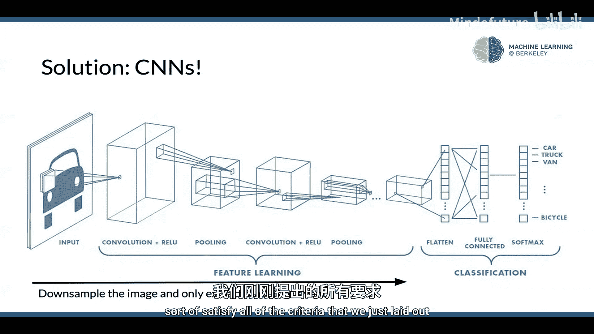

Okay， so let's move on to the sort of convolutions， the CNN is。

is short for a convolutional neural network and this idea of convolutions sort of lie at the base of this like new kind of model。

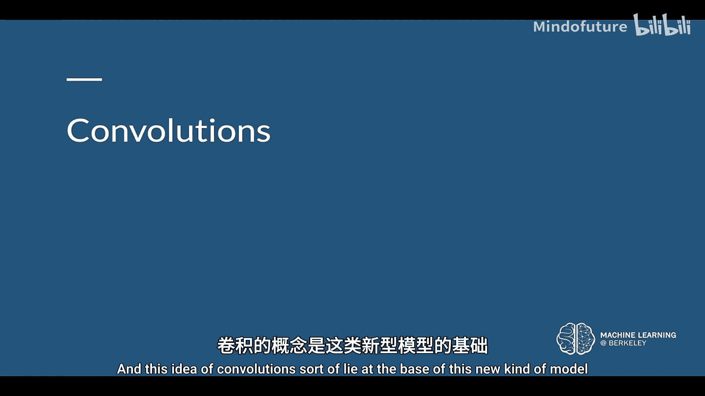

Okay， so we laid out some。Some like requirements that we want this model to， you know。

To have so we first of all， we laid out the fact that this model should instead of you know processing entire images at once。

 we should be processing you know different kinds of patches instead。

 and we could assemble the process output of an image by by。By sort of like assembling the。

Processed output of each patch and you know i don't know like concatenating or something them together the at the very end so what what was what' in other words we were forcing the model to pay attention to local regions of an image instead of the whole you know sort of instead of the whole image at once。

Finally， we also talked about this area of like transitional equivariance and translational invariance。

 so the idea is that if we were to say sample some region of patches in one position。

 if we are to encounter that same region of patches in a different positions in a different position we should get the same representation out so say that if we are。

Processing each patch， this would mean that we want each patch to go through the same layer in order to yield the same representation or in other words。

We will pass each patch through a layer with the same weights and biases。

 this idea is called weight sharing and we will see soon enough how this idea sort of manifests itself in the CNN。

So okay， with these initial ideas in mind， we are now ready to define the convolution operation the convolution operation I'll first go over how this operation is performed before trying to explain what's intuitively going on so the convolution operation involves different components。

 you have an input image。And you have something called a weight filter。

 this weight filter is simply a tiny matrix that you can slide over your image and take darkt products along the way。

 so what's happening is you line up this image in the top left corner you take the product。

 you take the element wise product of the filter with the patch of the image that this filter is covering and you sum those up。

And you can repeat this process by sliding filter across and concatenating the outputs that you get。

Again。Just just to go over this process once more， I want to make sure that you understand what's going on here mechanically because this is going to like underlie the entire this is the main foundation for the entire lecture so we take this weight filter we slide it along the image by a certain amount and at each time step we compute the dot product between the entries of the filter and the input that it's covering。

Right and the reason we call it our product is because we are element by summing the filter and an input patch and summing and。

We are taking the element by product of a filter on an input patch and summing the results。

 this is exactly how a product is performed between vectors。Now again。

 keep in mind that there is also going to be a bias term involved。

 so like after we you know sum everything together we would add。

 we would tack on a bias term at the very end and our examples it's not present， but in a real CNN。

 this would be this this would be something that you have to keep in mind。So at the moment this。

The sort of like process might seem very arbitrary。But and， and but。

But it does satisfy our initial ideas right so this process of convolutions is making sure that we are only looking at single patches of the input at once instead of the entire image we are building up the process output of the image by sort of concatednating the process output of each patch and furthermore we are using the same filter for each patch so we are essentially sharing the weights right it fulfills all of our initial theta right。

And it turns out that this process isn't exactly something that was arbitrarily chosen。

 it actually has a very。It's doing something very particular。

 and I'm hoping that the next example will sort of make that clear。

So let's say that we have this input image on the left and we have this very particular weight filter in the center。

 we want to see what happens if we convolve this input image with this particular weight filter what would be the output that we get so say if we overlay this filter on the top right patch of the image。

 what would the output could be。So again， we would have 10 times 1 plus 10 times 1 plus 10 times 1 plus 10 times 0 plus 10 times 0 plus 10 times 0 plus 10 times negative 1 plus 10 times negative 1 plus 10 times negative1。

 So all the cancel like sort of cancel out and you would just left the zero here。

 Now we slide this ful。W one unit to the left。And we repeat this process。

 we would you know sum up all the tens along this row because we have because the filter has a column of ones here。

 we would ignore all of these things because the filter has a row of zeros here and we would also ignore sort of like this column over here because the image has a row of zeros here so we would get 10 plus 10 plus 10 which is a 30 again we could repeat this process again。

 we would get another 30 and similarly once we slide on to this like region of all zeros we just get a zero and you can repeat this process for the entire image and this is what the convolved output looks like let's actually see what's going on over here。

This convoled output has a bunch of zeros along the left and right edge right。

 and it has a bunch of 30 along the middle。Let's。Forget what the actual numbers in there are for a minute and instead of you know focusing on the zeros and 30s。

 let's just say that this convolt feature has low values on the edges。

 but high values along the middle。Let's look at what's going on in the image in the middle。

And between the second， between the third and the fourth columns。

 what we are seeing is this transition between this like column of1s to a column of zeros。

Whats what this means is that there is this like very explicit boundary or an edge。

And this filter has high activations along this edge， but low activations elsewhere。So。This is。

Exactly what's going on over here this filter is trying to detect vertical edges in an image right it's trying to give you。

High values where things that it has a that there's a high likelihood of being an edge and it's going to give you low values where things that it has a low where the image is a low likelihood of having an edge so。

And we just noticed that we turn this like very arbitrary looking process convolution into something that's returning something semantically meaningful。

 right， they can extract edge information by this very carefully designed filter。

And it turns out that edges are all the information you could sort of extract。

 you can define different kinds of filters in a very specific way to extract different kinds of information so you could we were only looking at like vertical edges。

 you could look at different kinds of edges at once with a more general edge detector。

 you could also try to extract and image that is say sharpened by sliding over this particular filter over an image and it turns out this idea of convolutions actually dates back to classical CV。

 this is not a new idea that deep learning research proposed people have been using convolutions in digital image processing and classical CV for a long time。

But。This class is deep learning， where does the deep learning part come in。

 so we just saw that these filters can extract different kinds of features from an image。

These filters are basically feature extractors， recall what we said in lecture four。

 deep learning is the process where you convert the feature extractor to something that can be learned。

So， you know， if like the fully connected dense layers that we know and love。

 what if we try to learn these filters？So you know instead of you know。

 hand programming a edgedirect filter， we say that， okay。

 this particular filter is just just of parameters and we will allow the network to decide what kind of f it wants to use on that particular image。

 right？Now， if you did go to lecture four， you might have seen these like images in there。

 and at first it might not have made any sense， this image is representing what learn filters might look like。

Again。If this doesn't make too much sense， don't worry about it。

 sort of like trying to interpret what's going on in a CNN can be。

Veryry challenging and I would not want you guys to like waste time over trying to interpret like every single detail。

 but that's this image I included this image here just to sort of give you an idea of what's really going on inside of CNN you're trying to learn these different kinds of filters which are ultimately your free structures structures。

Now， something that you have to keep in mind is that we have been only defining this concept for2D images。

 or rather we were treating an image as a matrix， but as we saw earlier。

 if we are working with something like an RGB image。

 that is more of a tensor because it has three different channels， right？

How do we sort of generalize the process of a convolution to an input image with multiple channels while we were earlier only considering a filter。

That was also a matrix， what if we also add a depth to each filter right so this would mean that we could still slide over the filter along the height and the width and take our dot products as normal。

And I think this animation over here does a good job sort of illustrating the point。

 just like highlighted white part represents what the filter is looking what the filter is in this particular image and you can still see that you can like slide it over because。

This filter has the same depth as the input image， right。

And this is something that you always have to keep in mind that if you're working with like 3D inputs。

 you would want your filter to have the same depth as your input。No。

This single filter and select process of convolution forms a convolutional layer。

 we take in this like 3D。In inputput we slide a filter along it and we get something called a convolve feature out it turns out that in the CNN literature this convolve feature map is also called an activation map。

Because it sort of represents the activation of different kinds of features again。

 the way you can think about intuitiveitively is that if you have a high value it's this activation map is sort of saying if you have high values in this activation map that is sort of saying that。

There is a good chance that this feature extractor activated or rather。

There was a feature in the input image that activated this feature extractor and gave and resulted in a high value at the end。

So hopefully that gives you some intuition as to why this output might be called an activation map don't worry too much about why it's called that it's just something I wanted to put out there because you might notice this in a paper or something but。

Yeah。Now earlier we were only convolving an image with a single filter and that gives you one and that can extract a single feature from the image right what if we want to extract different kinds of features from an input and use information about all of them well we can simply do that by using more filters so you know instead of using a single filter。

 what if we had six different filters we would get six different activation apps which would represent the activations for each different for each of the features right？

闹。Recall that each activation map is simply。A matrix。And we are getting six of these matrices。

What if we cancatenate those or what if we like sort of squish these together what does this remind you of recall back to our discussion of representing images in an RGB format we were saying that。

Each image each color can be broken onto into an RG and V component and we could build matrices for all three components and squish them together and this gives an image a depth similarly we can give your activation map a depth。

And in a sense， this activation map is also going to have a 3D structure and this is going to be a tensor。

So， you know， another way to think about this process is。

You want to extract different kinds of features from this like3 image and the 3 comes from the fact that it has like multiple channels and the way you can do that is by looking at different kinds of。

Ds convolving。And and convolving that image with all all of those filters right。

 so let's say that you have four different filters as in this you know as in this example given over here。

 you would。Sample each patch from the image。And take a do product with all different filters to get an output and you would slide and when you're sliding your patches across the image。

 you would sort of keep repeating this process for all all four possible filters， right？

And so in the end。Instead of you know concatenating a single feature together into an activation map。

 you're concatenating four features at the same time and this also gives03D output this is exactly the same process that's going on over here but。

This might be a different way to think about this so you know instead of like instead of convolving each input image by a filter separately and then you know stacking the outputs after the combinations have happened。

 you can also view this as。A single convolution that's going on。

 but with four filters at the exact same time。And you're building your output in that particular way。

So in a sense， we could generalize this covol operation。

 instead of saying that we are taking in an image as our input。

 we could take in any 3D tensor as an input and this 3D tensor would have some sort of height with and a depth which is represented by the number of channels it has。

We know that if you're working with a 3D input， you would also want to have a 3D。Filter。

 so this filter would have this filter these filters are usually square。

 so they would have a heightened width given by I don't know some letter K because another name for a filter is a kernel。

And these will also have a depth of C is because that is the depth of your original input image。

Right and say that you're working with F different filters now this would mean that your output is going to be。

There's also going to be a 3D tensor， but with a depth of F because。

The number of channels and the output is simply dictate by how many filters you use in the first place and you would and this output will also have some heightened width given by H prime and W prime we don't know what those numbers are yet we will get to those just in a few minutes。

But。But the main point you take away from this discussion is that this convolution operation is sort of very general and instead of just being applied to images。

 it can be applied to any three input。And what this allows you to do is if we sort of keep this abstraction of an image as just a 3D volume。

 we can start stacking convolutional layers on top of each other。

And this is exactly what leads to deep learning， it recall that a deep learning or a deep neural network is simply a stack of layers that each learn representations。

 right？And this abstraction is what allows us to do that。Now。

 I simply could have ended the lecture right here because I think I've gone over all the big ideas that you need to know to you know。

 start writinging with CNNs。But I'm also going to go into some implementation details that I think are important to know when you're working on projects and something and such。

So and CNNs are actually。There is this concept of something called the receptive field and this idea is actually not limited to just CNNs。

 this is actually more prevalent in neurobiology and psychology and I think computer scientists like simply stole that term from like those areas and apply it to your CNN in fact I believe if you were to like search Google search like receptive field you would probably see more results from biology literature than CS literature and I don't know this is true I think there's a pretty good chance that it is。

So a receptive field simply refers as a concept that is defined for each element of an activation map and it's simply saying。

And it's simply saying that it's simply describing the region of the input that each element of an activation map is influenced by so if we look at this example over here say that we have this like five by five input we convolve this five by five input with a three by three filter and this gives us a3 by two activation map just assume that we are working with a depth of one here just like make things simpler but of course this concept will apply it to depths greater than one as well。

So we get this activation map and what we can do is we can apply another convolution on top of this activation map to get another activation map with a single element now the single element over here is connected others is influenced by all nine pixels in the first activation map and each pixel in the activation map is further or influenced by nine different pixels of an input。

So if E till I think about the single element in the second aition map as a single as a whole。

 we are saying that the entire five by five region is going to influence this single element right because if you know something were changing in this very first patch over here that would change。

This element in the first activation lab over here。

 and that would also influence the result that would also influence the element in the second activation map。

So we are saying that this input has a receptive field with height5 and with5 because that is precisely the region of the original image。

ThatThat it is being influenced by。And it turns out that there are many ways to get the same receptorceptive fuel so you don't need to sort of stack to different three by three convolutions on top of each other if you were to say apply a single five by five convolution instead to this like5 by five input。

You would also get an activation map whose element。

Has a receptive field given by a height of five and a width of five as well。No。

This deceptive field is a pretty important concept。We ideally want。

TheSo so let let's look at whats what's going on in this example over here again。

 we say that the receptive field of a signal element in the first activation map is going to be three and we know that the receptive field of the element in the second activation map is going to be five so what's happening is as we add more and more layers we are increasing the receptive field of our network right。

And。This is pretty important because we don't want the network itself to have a small receptive field。

 but you also don't want it to have a big receptive field。

 so let's say that you build a CNN network and。the very last activation map in this network ends up having a receptive field that is。

Too big， or rather it's big enough to be similar to the size of the input。

That's not really any different that's not really anything different from just。

Passing the input in as a single dense layer right。

 because what what's really happening is you're instead of like looking at patches。In the end。

 you still have an element in your network that is being influenced by the whole image。

And that's not particularly different from the dense network formulation that we had earlier。

But on the other hand， if we have a re receptorceptive field that's too small。

 then it can miss information inside an image， I think this sort of idea would be clear with this example over here say that。

This orange， this like this region marked by this orange square is represented by this like five by5。

Region of pixels in this like first activation map and this。

Blue patch or just like smaller blue patch in the top。

Left corner of this like orange box is represented by this like 3Y3 region of pixels in theacation map。

So。Let's assume that we convolve this。Layer one with a 3 by30 convolution。

 and we get our layer2 Now the layer this the second layer has inter receptive field that is。

P of small right if we were to say cut off or network after layer two。

 if we were to pretend that layer two does not exist then。

Each element in this activation map is only looking at a region of the image that is the size of this blue。

Bs over here。Let's say that our goal was to classify the brand of a car。In order to do that。

 we must know what the whole car looks like， right。

 but this blue box certainly doesn't contain enough information。However。

 if we were to say add in a third layer。By convolving the second layer。

Then this third layer is an activation map whose feature is being influenced by this entire orange box in a sense right。

 so we are saying that this particular element in layer3 captures all the information inside this orange bounding box。

 for example。And this is much more helpful for our current classification task than。

If we were to say look at the pixels in activation layer two instead in Act map two instead。Right？

So this can give you maybe hopefully this gives you some intuition as to why small active small active fields are bad。

 but on the other hand， if we were to say have a network that。

if few were to say we have an activation map with an element with receptive field sort of covers the whole image。

Then that's kind of akin to passing that image as a vector right that's sort of the intuition behind this idea again don't worry too much about if you don't worry too much if you don't quite get what's going on over here it's a pretty it's a concept to keep in mind but it's not particularly too important in fact I think there might be a different way to be this concept so earlier we said that increasing the number of layers increases the receptive field so what this is really saying is that if you add too many layers you're making the receptive field too big。

And this can lead to， you know， overfitting， however。

 if you're not including too many layers in your s field is kind of small then。

Your model is like not looking at big enough patches and you might not get good enough performance your model is sort of underfitting。

In essence， this idea of subject feels kind of leads back to this idea of overfitting and underfitting that we saw in an earlier lecture。

 and it does align over their intuition， we kind of expect that if we make the model too big。

hen the model might overfi， but if the model is too small。

 then the model might underfi and it's sort of the CMI idea over here。

 it's not exactly that but I think this might be a more helpful way to think about what our subject field is actually doing in a CNN。

So。We saw that two three by three convolutions have the same receptorceptive field as a5 by5 convolution。

 so does it mean that they're the exact same like will they yield the exact same output？

And the answer is no， so the reason why is。When you pass a 3D tensor through a convolutional layer。

And you get like this new like 3D output， you typically apply。

A non linearity to this select 3D block， so what you would do is you would apply say something like a rail or a sigmoid to each element in this select 3D block。

To introduce non nonlinearities into your network in order to learn non nonlinear decision boundaries。

 so if you have two different convolutions。You're going to have2 different non nonlinearities instead。

 but if you were to have a single 5 by5 convolution。

 you would only introduce one non nonlinearity after the like convolutional layer right？

Yeah so this means that the output of two convolutions is not the same as that of a single convolution。

 even if they have the same subive field because it's possible to stack in more activation functions with more convolutions right and intuitively that is what we really want we want to learn non nonlinear。

Functions right， that is what a neural actually does。

So sort of going back to this idea of a receptive field。

 we saw that as we add more and more layersric， we are increasing the receptive field by。呃呃。

Were increasing the receptive fuel like incrementally every time。If we， you know。

Stack two different three by three convolutions we move from an RF of three to an RF of5 if we do like three different three by three convolutions we might move to an R RF of seven right so in a sense we are increasing our receptive field linearly what if we want to increase the receptive field like faster and。

Why might you want to do that if you're increasing the field linearly it's possible that by the time you get to a receptive field that's in a kind of big enough。

 you you have used way too many layers to get there and this can make your model like too large and training large models can be very tricky。

So it turns out that there is sort of a hack to like speed up like this like increase in size of your or your RF。

 and one way to do that is by something called a pulling layer。Now a pooling layer。

 mechanically what it does is you。Look at some square region of your input。And you apply either。

 you apply one of two different operations。 You can either take the maximum element in each square。

 and you can like slide the square along your original input， or you could take the average of。

Of each square does the function where you take the maximum is called max pooling and where you take the average is called average pooling。

Right， so what's really happening is when you look at like these tubeite of chunks of。Of your input。

You are and you're only picking like a single value from each of them。

You are essentially hing the dimensions of your input by two。Again， notice over here。

 how we started with the four by four input， but ended up with a two by two output instead because we are only picking a single value from each chunk of four pixels。

Right。And in a sense， what we are saying is that each pixel and another way to phrase that is each pixel in the output of the pooling layer is connected to four different pixels in the input layer。

In a sense， you have increased you have scale your subive field by a factor of two Now you can also do three bytes three pulling layers where instead of like。

Breaking an image down into2 by two chunkngs， so you break it down into three by three chunkngs instead。

 you can also do four by45 by5 although I feel like at that point that that might lead to degradation and performance I think2 by two is very very common I have seen3 by3 before but it's not as common and I've basically never seen anything that four by four or something bigger。

SoThis is one sort of hack to increase their receptive field and it turns out that these pooling layers also have an intuitive meaning。

Say that this activation Mas example is going to give you a high number if it's detecting a circle and it's going to give you a lower number if it's not detecting a circle right so let's say that the presence of this 12 means that there is a circle in sort of this region of the input。

There 13 means that there's another circle over here。

 there 14 means there's another circle over here， but these like load numbers like five。

 three and  seven means that there is no circle in this region of the input right if you take the maximum。

And you sort of like。诶。And you look at the information that's passed over。

What we are saying is we are， we are preserving the most important information from a local region。

 right， We are passing this 12 over because this 12 was representative of。

The presence of a feature because it had a high value。Similarly， when we take the maximum of 5，5。

3 and 7， we pass along the seven， which is a low value and we know that。This region did not have。

 say， a circle， so。This low seven would still indicate that in the output， right？

So you can view max pooling as a way to sort of like。

Extract important information from a localized area。

Hopefully that intuition behind max pooling makes sense， these max pooling layers are very common to。

To to first of all， reduce the。The spatial dimensions of the activation map at at each stage。

 so you need like less and less layers in order to make your model like more compatible with the compute you may have。

There is also this idea of something called padding。

 so recall that we are convolving an image with a filter。

 we are getting an output that is typically smaller in both height and width。

What if we want to preserve the height end of them well so if you look at the very leftover here we are convolving a four by four image without a3 by3 full turn that gives you a two by two output what if we want to have what if we want to make sure that the output。

嗯。Actiation map has the same height and width as the input image Now one way to do that we know that we are always going to be decreasing the height and width is we could simply increase the height and width of the input image such as when you perform the convolution you get a reduced height and width that's the same as the height and width of the original input。

So in the middle， you have this five by five。imageage。

You know that if you were to perform a three by3 convolution on top of this you would get a three by three output instead。

 but if you artificially increase the dimensions of this 5 by5 image to a 7 by7 image and you perform a convolution on that instead。

 then you would get an output that is also 5 by5 and hence the same dimension as the original output。

Now， why might you want to do this？There are many reasons。诶。In fact。

 this process is actually so common that it actually has a special name。

 so when you are artificially increasing the size of your of your input when way you do that is by simply。

Surrounding it with a bunch of zeros because zeros。

Are a very zero is a very neutral number and it doesn't。

 which means that it's not going to really affect your output in any way。

 or it's going to have a very small effect on the output， right？So， when you。

Pad your inputs dimensions with a bunch of zeros or you know any other constant value。

 I just use zeros because that is the most common， but you can also under with a bunch of ones or two is like no one's going to stop you。

 but that's like very， very uncommon。In order to like preserve like the spatial dimensions of of your activation map。

 this sort of padding is called same padding because you would have the same dimensions， right？

However， if you simply don't have any padding and just perform the convolution operation as is you would get valid padding because this is a valid output this is what the convolution operation is supposed to do before you。

Paed the input with something else。嗯。要买。So there is no particular reason why one sort of padding is better than the other。

It's just a preference that people have and I think the deep learning community as a whole as a large tends to prefer same padding even though there is no particular empirical evidence that one leads to better performance over the other it's just a matter of preference and I think。

A good channel the community supports likes having same padding because it's I think it's like slightly cleaner because if you are。

Say starting with a256 by 256 image and your activation map is also 256 by 256 it feels less awkward than saying a 254 by 250 activation map right so I think that's。

Kind are the only reason why practitioners prefer having the same padding。

There is also another concept called the strideide。

 so recall that a convolution is simply just like sliding window where you take the product of the filter with like different patches of the input。

And you slide this filter by one pixel every time。However， no one's really stopping you from。

Sliding it sliding it by an amount higher than that， you could slide the convolution。

 you can slide the filter every two pixels instead。And that is a perfectly valid operation。嗯。

Why would you want to do this So it turns out that strideed convolutions actually sort of have the same effect as a polling layer。

 because if you are sliding a。Falter every two pixels instead。

This would mean that you're skipping sort of every other pixel along the height and the width。

And this would mean that your output。Acctuaation map roughly half the。

It has dimensions that are roughly half the original height and half the original width。嗯。

It's not going to be exactly half， it's going to be like roughly half， which is why。

You could view a stride convolution as set of an approximation to a pullinging layer is there a reason is a slight convolution over a pullinging layer again not particularly I think there was a big debate over this idea a few years ago but I don't think there was any particular conclusion that came out of it I think people just use whatever they find I guess like more convenient I guess again using a stride of bigger than one。

Is akin to。诶。is akin to combining the convolution and pulling layers together。

 but there is no particular advantage to doing it， you could essentially treat the stride as a hyperparameter in your convolutional layer。

Now， this。So earlier， I mentioned that。Your output is going to have some。

D mentionion that we don't know yet。And it turns out that this dimension depends on like many factors。

 it depends on what the dimension of the original input was。

 what the dimension of each you know of each filter is， what padding you are using。

 what twices you're using and it turns out that there is this very nifty formula that gives you。

What the。What the output dimensions of your activation that could be like so again if you take in an input dimension with of say with w filter size F padding size p and strides s you would get an output with a width given by this formula over here where the seal function is simply the ceiling function ceilinging function is the greatest integer that is。

Or it's going to be an integer。Or rather the smallest in a that is greater than or equal to the input。

诶。Yeah， this formula is really helpful for。Trying to decide what kind of strides and paddings and f sizes you want to use。

 because what you can do is say if you want to try to use if you're designing a convolutional layer such that your output such that your activation map has the same dimension as the input。

 you can equate this equation equal to W， and solve for say P or S or F， et cetera。

 et cetera to determine what size you want to make certain components of a convolutional layer。And。

So that's sort of the main details that you want to know what behind the anatomy of a convolutional layer。

And we will sort of delve into some more technical stuff now。So。

Let's discuss what a conutional layer really is doing a convolution is basically just a bunch of multiplications and additions right and we discussed during the deep learning lecture that if you're just doing a bunch of additions and you know products and stuff like that you could back propagate gradients through these operations。

So what this means and we saw this in the context of fully connected layers because recall that a fully connected layer is simply doing a matrix multiplication followed by in addition by a bias vector。

 right？Since a convolutional layer is nothing more than this process but in a different form。

 you could also back propagate gradients to a convolutional layer now how this is done is not something you have to worry about because your favorite library pieytorarch will handle this for you。

诶。This command that is on this page is going to be very。

 very important because you're probably going to use it in every single homework that you come across in this class along with any project that you work on that involves CNNs。

So the way you define a convolutional layer in pyr is you have to pass in like multiple parameters into it。

Your in channels parameter is simply。The depth of your of your input tensor right so we know that if you're passing in an RGB image this channel is just going to be three。

 but if you're passing in some other 3D block then you have to like look at how many channels it has and pass it in instead the out channels is going to be the number of channels or the depth of your of your output。

So essentially， the L channels is how many filters you want convolal layer to have。

The kernel size is simply the dimension of the。Filterters like the height and the width。And again。

 you can define different parameters like the stride， the padding。

 there's also other terms like dilation groups， you don't you know what that is because。

You don't really change the default values is sort of go along with the defaults given here。

 the only parameters that you really change in a con layer are in channels， out channels。

 the kernel size， the thread and padding， depending on what you want。Your CNN to look like。Again。

 the documentation for this layer is given by this link。

 I would highly encourage you guys to visit us at some point， read through it。

 once to understand what's going on。O。So。We talked about these like classification layers and these pooling layers and what we can do is we can pass an image through you know stacks and saxon and we can like pass an image through a network that is simply a stack of these con and pulling layers on top of each other now。

你。Input and output to these layers is still going to be。83D tenser， right？ So let's say that after。

You passing this like3 image。T a bunch of flares and it gets like 3D output out。How do you。

Turn that into say a prediction if you're trying to work on a classification task。No。

What usually happens is by the time this like huge input has been processed by this multiple layers。

 this 3D output at the variant usually has。Small， like it's usually like very low dimensional， right？

So you're not going to have like this like 200 by 200 by3 image that you had earlier。

 you might have something that's like 64 by five by five instead。And that is a much more manageable。

Number， if we were to say convert this pretty block into a vector and pass that in to a。

Holy connected network right so essentially what's going on。

you can view these CNN layers and these pooling layers as a feature extractor that converts this high dimensional input into some low dimensional block of features that can be passed into an MOP for a final classification task to yield the input。

This is exactly what we discussed in the representation learning part of。The last lecture。

 we could break。A machine learning pipeline into the feature extraction and the prediction parts。

And that's exactly what's going on over here everything outside of the red box is simply a feature extractor。

 everything inside of this red box is a classifier and we can suddenly combine both parts into a single neural network。

And this idea is not that foreign to a CNN， it's simply the same idea that he applied to Denstone networks but。

With images as well。Again， just to sort of recap。嗯。

A convolutional layer has many different hyperparameters that。

Sort of makeup up this anatomy so you have you have to define the stride that eachvol will like slide by。

 you have to define if you're extend if you're extending the input by。

Any particular amount of padding， and you would have to choose what the kernel size of the filter is that you're sliding over your input。

You would also have to define。The pooling layers， you ever have to define how big you want to sort of like pull how big you want the kernel of the pooling layer to be typically a size of two is pretty common and you might decide between max pooling and average pooling I think the norm at least in the deep learning community right now as to go with max pooling I haven't really seen average pooling being used that frequently when it does exist I want you to keep that in mind if you're trying to you know grid。

Online implementations of different kinds of CNNs or you reading different research papers you might come across this at some point。

And， finally。These two layerss make up the feature extraction part of a CNN once the features have been extracted。

 you could flatten them out and pass those through your。

Classification layers which form your basic cookie cutter MP that you are already familiar with from lectures two and three。

so。We have been sort of describing a CNN at a very conceptual level let's actually look at what a real life CNN looks like so this is a network called Lenet this was developed by Jan Lacooon for classifying1written0 digits so I don't know why this has the letter a I think a number here would have been more appropriate but really what's going on is you take an input you convove this input into。

Six20 by  when you had feature maps， which means you must have used six different filters， you pull。

Here subsampling is just another name for pooling， you pull these 28 by 20 activation maps into 14 by 14 activation maps。

 you basically have the size of the width and the height。

You apply another convolution on top of those。And you apply the pooling operation again until you get a much until you get like a smaller representation of your input。

 so here this 16 by5 by five tensor block contains。About 400 elements。

But this 32 by 32 input contains 1000 elements and you can see that this is much more buildinging。

Then there's like housing dimensional input。But you can then pass into like different kinds of like。

Poly layers and get an output at the end where this 10 represents， you know。

 one of the 10 possible digits that you see from zero to nine。In fact。

 all classification architectures that are based on CNN sort of look like this in a sense。So。

 usually。Once you get your input， you stack convolution and pull linears on top of each other again。

 recall that you apply a non nonlinearity after each convolutional layer in this case I've chosen Ralu it can get any nonlinearity for that matter but I think Ra is very very common。

 it could keep trackinging these like con raillu pool combinations on top of each other。

 flatten the result。And pass those to like a fully connected network or another common design pattern that you usually see is instead of doing a con raillu pool。

 you do a con， raillu con， raillu and then a pool， so you go through two different combinations。

 you go through two different convolutions for applying a pooling operation。

And after that it's the exact same story or recall that you learned about this layer called a batch norm in lecture three。

 this is a normalization layer that makes the training more suitable and in modern architectures you might see this like batch norm layer more and more frequently and typically this is inserted between a really and a con layer so you could also do like a conre ba or conre bache norm pool repeat this as many functions as you want。

Fodden and ped at through。Yeah classificationification theres these。Design choices are very common。

 in fact， a lot of popular architectures that you will cover in lecture six are going to use one of these patterns。

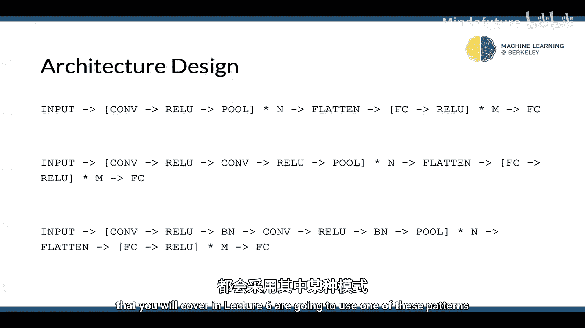

O。So we have finally gone over what a CNN is at the end。Let's talk about some more practical details。

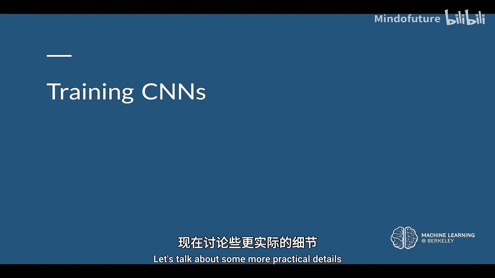

So when you're training a network， you would ideally want to train it on some sort of data set。

 right？There are some common data sets that people use very frequently in the field of CV。

 and I think you should be familiar with those if possible。

So one of those data sets is the MIS1written and digit classification data set these are。

I can't regard of this as supposed to be 28 by 20 I think this might be32 by 32 instead。

 but these are basically like gray scale images。That are each。Contain a single。

Ddget from Led to nine。嗯。I think this data set is like。I think the data set has a。

It's not a particularly big data set， I think it's relatively small。

 but it's also like relatively easy to work with。There is another popular data set called C4R 10 this has 60k examples with like 50k training examples and 10k examples that you can set aside for validation or testing these are 32 by 32 RGB images so unlike Ms which only had grayscale images you actually have multiple channels in a CR data set the 10 stands for the fact that each。

Each image can be classified into one of 10 different classes。

So MNIS and CFR 10 are actually very commonly used as when in proof of concept implementations。

 say that you are a CV researcher and you come up with some new algorithm。

 there's a very good chance that you'll try to test it out on a simple dataset like MNIS or CFR first before moving on to something more complex like MSNe or Coco。

So yeah， so those are our toy dataset sets now we move on to some serious stuff。

 the image that data set is a million images and a000 different labels where each image is a 224 by 224 dimensional largeGB image。

This data was collected by a team of researchers across many different universities and it led to the birth of the Iagenet which recognition challenge。

 which is how the model that we called asonnet earlier came into being which started the deep learning of revolutions。

 this data set actually has a huge history behind it。

 the citizen set is also very popular in the sense that whenever a new architecture pops up you typically test it on INe to see how well performs because this data set is actually fairly challenging and you actually designate state of the art a status to a model by its performance on Inet。

 in fact， when we say that a model is soda or state of the art and CV。

 we are usually saying that okay it's it probably has the highest accuracy of INe as of right now。

But IageNet at its core is only a classification dataset we also discussed other problems like segmentation and object detection at the very beginning right and turns out there are pretty common datasets for those tasks too there is the dataset set called the Pacal VOC dataset which has different kinds of images for detection and segmentation theres also the common objects in context or the coco data that is also used for these different tasks I think you will cover more of PasCL and Coco when you actually go through the segmentation and detection lectures so don't worry too much about those yet。

Other practical details， so typically when you we mentioned earlier that each image has a value that is in the range from0 2 256 or 255 right？

Typically， when you are passing an image into a neural network。

 you would want to normalize it to a range of zero to one。And it's。

Pretty much the same reason or the same intuition as to why they use batch norm is because using these like small。

Values for the for the overall range can give you like nicer gradients that don't really explode and are kind of like well behaved。

And in a sense it doesn't really hurt to like normalize your images， it may not help。

 but it almost certainly never hurts one way to do this normalization is through this function called Ttensor that is part of the Torch Vi library I have linked the documentation for that over here。

 so remember to check it out in your on time。Finally。

 this is another pretty important concept when it comes to training CNN models。

 so a general real of thumb and deep learning is that the higher dimension your input is。

 the more of it you' will need to create a decent model。

 we know that images are high dimensional at 256 by 256 by three image is 256 by 256 by3 dimensional right。

That's a huge number。And this would also mean that you would need。

A lot of data to train a good classification network， a good classification network， for example。

 right？However， collecting data is expensive， collecting data is hard。

 and you also want to make sure that when you are collecting and labeling data。

 it's all coming from a somewhat similar distribution because if it's not。

 you're going to run into problems with multimodality and that can make very difficult。So。

The idea is that we want to get more data， but it's hard and having more data can never hurt more data can help you sort of prevent the problem overfitting that we discussed in lecture two or lecture three and yeah it's always a good thing。

Now， luckily。You can artificially create more data from a single image now let's say that you're training a network for an animal species classification task。

 so let's say that this image in the top left is the original image and you would predict the label Lama for it right if you were to say flip the image or you know maybe crops of part of it。

Or it maybe change the brightness or the contrast or maybe change the coloring slightly。

It doesn't really change the fact that the image。It doesn't really change。

The fact that Alama is still present in the image right the semantic content of the image is so preserved despite these augmentations。

 so what you can do is you can create like these new images from the original image and assign them the same label。

Andvoa you've essentially created new data This is a very cheap and easy way of creating new data from your from your preex data sets and there is no real reason to not use these at all in fact every。

CV pipeline that you will see out in the real world will use some sort of augmentations in order to train a somewhat decent model。

Yeah， there are many different concert augmentations possible like changing the color changing the lightning lighting。

 flipping the image if you want to go through a more comprehensive list I would recommend visiting the torch vision。

Documentation online。Because that is typically how you would implement these in Ptorch。And finally。

 model checkpointing so CNNs are typically huge models。 you're also working with huge data sets。

 This means that youre training。Your training time。

Is usually very long and you're also requiring a good amount of compute like you know maybe you're possibly training on NDHP for example。

 right but even then it can still take a lot of time to like train a decent model。No。

This could take anywhere from you know minutes to even hours to days to weeks。

 and I'm not even exaggerating， but I've also heard of models that were trained for months at a time。

And what would happen if yourre training where like suddenly stop in the middle you do I don't know。

 maybe your machine crashed or your server that you were training on shut down， for example。

 you've basically lost all of the progress that you've made so far right and I would suck。

 I'm saying this from personal experience？didnn't really notice how big of a deal this was until I started losing my progress when I was on checkpointing。

So one way to prevent this from happening to you。I to like simply store your model weights in a file as youre training。

 let's recall what's really happening in the training process your parameters of the model are updating right through some sort of like gradient based optimization process。

What you can do is you can store like snapshots of the parameters at like different points of the training process and if your machine does go down and your training gets interrupted you could go to the latest snapshot and pick off from where you left it's almost like nothing really happened right？

This is a very good habit to wall up again I didn't。When I started working on deep learning。

 I did not get into the habit of checkpointing my models until I sort of learned it the hard way and I don't want any of y' all to go through the same experience that I did so again remember to set up checkpoints CNN training can take a very long time you don't want to lose your progress if something goes wrong in the middle。

And yeah， well， that is about it for the。CNN's presentation， hopefully it。

Made sense to you guys this is a pretty foundational lecture because CNNs underlie a lot of the models that you will be talking about in the upcoming lectures。

 so it's pretty imperative that you understand this lecture to the specific your ability of course feel free like stop by officers if you have any questions。

 we will always be there to like discuss any of the concepts that are covered in here。And thank you。

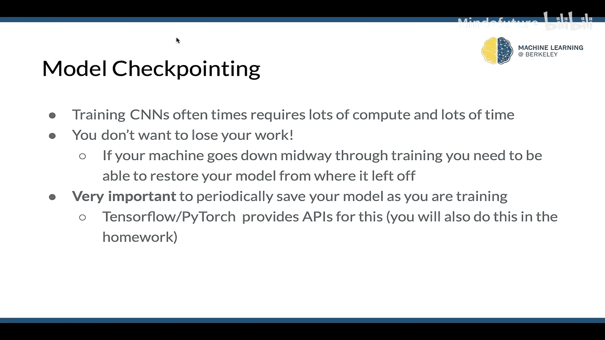