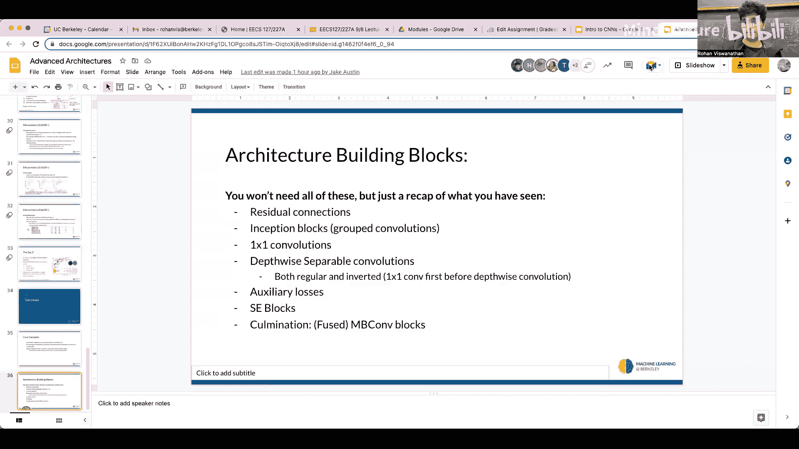

# 【加州大学伯克利】计算机视觉：视觉数据的深度学习 ｜ Cs 198 126： Deep Learning For Visual Data p06 P06_讲座6-高级计算机视觉架构 -BV1Va8zzfEtk_p6-

Bre。move it over here。Okay。We're sorry forward of them。Oh。Ohello。I like the most I could move it。我道。

And I should turn off the zoom background blur。Yeah。I this哦 that show up。

you can also we're going to set up like official presenter notes。

 like speaker notes on your screen but there is。We be careful because I accidentally just bring something else to the first one。

Okay， I don't have too many， but。a slidePreenter of you。好好好好好。Okay。

There's interview view oh this is where it has speaker notes and stuff I think it's fine I don't handle this。

Manam， the race is disgusting。The双。稍等好，是这样啊。Oh wow， you're're really going out as small。

 I just to go。对。are you本你啊咁。Yeah because our slides were vague。嗯。对。

The should the product place something。Oh no it's fine well it started as their slide deck guess fact easy so yeah goess。

They're probably going to make their own though。哦，哎哎哎。还是原趋是对。喂20。Pictures are good。三个多。

I would like have a clue the only part left I think is all more。Yeah。嗯。对我来。是。I did， yeah。我买说。有。Okay。

嗯，好的。对。I think it is for the most part。Okay。应用转示。During。那个我就个替我是吧。

green and the yellow with identical。我应该十分钟嘅到身。So。Startted。有。诶我屌得买。啊。She很是 find的。嗯。

I a fun that's here。Okay。All right so I think we can get about started here I want to start today before we get into like talking about four advanced CNN architectures。

 I want to start by sort of recapping what we talked about last Tuesday。

I apologize that was kind of a rough introduction that was a that was me making a couple of last minute edits that probably hurt more than they help so I want to just review。

Convolutions and the architecture of a CNN to make this more clear and put it into perspective perspective how it relates to just standard dense neural networks。

 you think it's fine for。So we talked， I think most people felt okay about the actual mechanics of doing a convolution。

And。I just wanted to sort of clarify that when we do a convolution operation。

 we treat it like a layer， like with standard dense neural networks we treated matrix multiplication as sort of like a layer where all the learned parameters where all the values in our matrix and all the values in our bias vector it's going to be a very similar story with the convolution where your convolutional layer will have a bunch of filters right and all the values inside our filter are learned and we also have a bias term that gets added to the output of moving each window on each location of our input。

We refer to it as a volume simply because it sort of looks like a cube。

And I wanted to reiterate this idea that again， if you have a whole bunch of different filters。

 so if you have one filter， you're going to get an output map。

For every location that we started and put our filter or every location that it overlapped if you have a whole bunch of filters。

 if you have a whole bunch of them。Then you're going to end up stacking up all of the different outputs from taking each one of your different filters and running it over your input。

对。And you get something that has a number of channels in the output。And again。

 you can kind of think of this as like a layer of a neural network so after we're done doing this。

 we're still going to add our activation function like a ray loop or something else。

We're still we're still going to to very much treat it。

 yeah as a layer and because all these values in here。嗯。😊，Because they're all because our output。

 our loss is differentiable with respect to all these different parameters。

 we can still take partial derivatives of our loss with respect to our parameters in do gradient descent。

嗯。So it's simply as opposed to doing matrix multiplication on a vector。

 when you have images and a CNN， you can simply just do convolutions instead of your normal matrix multiplication。

Which is demonstrated up here， you do convolutions followed by your activation functions。

You have pooling layers if you want to decrease the size of this volume because it can get quite unwieldy if you want to decrease the size of it so it's much quicker to take this convolution。

You can do pooling simply just looking at each if you have a two by two pooling。

 you're just going to look at every channel， look at a little two by two square， take the maximum。

 look at the next two by two square over the next two by two square over to simply just chop your the size of your output in half。

And were there questions on this on the sort of mechanics of like what a CNN is and what what it looks like mechanically Yes friend。

Yeah yeah every filter has its own bias so basically every created every yeah you can yeah you can think of it like that I don't really think of it as like after we're done doing all the element wise multiplies from overlapping our filter with our input we then just add the bias corresponding to that filter onto it but yeah that's like that's probably an equally as intuitive way to do it is just add the corresponding bias to。

The corresponding channel。The corresponding channel and the output。Yeah。

But again the big thing I really want to get across is that you treat it just like another layer you're just going to stack a bunch of them and then eventually when you want to get to the end you take this volume and you just unravel it in a very specific you just flatten it all out and then just do like a dense layer。

 a regular matrix multiplication at the end。YeahYeah， so obviously you have like calculation。はい。Yeah。

 yeah。7块钱。Yeah。Oh。that like no， not really it's just there because like if we if we have like a huge input that's like 256 by 256 our image likes huge the output assuming you don't do a strideed convolution。

 which is just taking your filter overlapping in this case at 3 by three area。

And instead of moving over one to overlap in the next area， you move over two。

 if you don't want to do a string fundvol， a very simple way to do it is to just look。

At individual little squares。And just take the max in this whole area at each one of these areas。

And just fit that out that just immediately cuts the whole bang in half on your height and width axis。

 so you have a quarter as many values now， but it still ideally still sort of captures all the main information that was in that feature volume。

Yeah， it's it's more just used so we can get our feature volume down to a reasonable size so it doesn't take forever to run convolutions on it just makes it a lot quicker。

Yeah， no， well， so we're going to talk about segmentation。

 which is where you have like an image with like a person in it。

And you need to output another image except each pixel has basically been like labeled with like there's a person in all of these pixels inside of like here。

And then everything else is background， so in that case your output is the same size as your input。

Which gets a little bit weird and we'll talk about that more later how you because at face value that would be like super inefficient。

All of your convolutions are on these just huge inputs we'll talk about that more later。

 but generally for things like classification you do want to start bringing it down a little bit there's no reason to leave our feature volume huge if we can shrink the size of it without reducing the amount of information in it hopefully does that make a little sense。

Are there more questions because last lecture was confusing and I apologize that was a pretty rough introduction to CNN's。

Yeah。Yes， friend width。Career input image， the depth is like RGB like one。

One channel is what we call it for each pixel， but say we had like 10 filters。

It no longer corresponds to like color， the output of a convolution layer with 10 filters。

 it simply means there were 10 different activation maps。

 one from each filter that we obtained so your channel's dimension would be10 deep yeah it just corresponds to like if if this filter is corresponds to like horizontal edges and this filter corresponds to like edges like this you can just sort of look along the channel and see like okay like was there an edge that went this way。

 was there an edge that went this way， you can just sort of look in all of the different features throughout that channel they just correspond to what the filter what that filter in the previous layer picked up on。

Does that kind of make sense， there's not like an intuitive like sort of like color as as you after the first layered。

嗯。But yeah， excellent question， are there more questions？

Okay if there are no more questions then I will hand it over to Rohan who's going to talk about more advanced CNN architectures and I just want to contextualize this with there's only really like one architecture that you really need to take away from here which is going to be resnet we'll get to that the rest of them like if it goes over your head like don't worry it's it's fine this is just more for people who want to know Resnet are the only one we should really like feel free to ask like tons of questions because we want to spend the most time on that all that。

So yeah。Right。Hello， so this is going to be kind of a survey on the history of neural network architectures for computer vision starting from。

 there's a little timeline here。Starting from AlexNe and moving forward。

 Lanet is something that was created quite a while ago and AlexNet is like the first kind of visible improvement in this field that kind of starts the motivations behind creating a deep network that can be learned from without any gradient problems and things like that。

So yeah we're going to be talking about Alexnet VGG the motivation behind Inception nets as well as briefly about mobile nets and landing with Resnets and a couple other miscellaneous networks none of these are state of the art on INe now I believe things have kind of transitioned to transformers and other much more advanced architectures that we're going to be talking about in the next couple weeks but this is understanding the motivation behind these really sets the stage for the future of advancement in this field。

So yeah， convolutional nets like Jake was's describing a single convolutional layer。

 these were proposed in 1990 by Ian Lacoon and he kind of pioneered that pattern for today。

 he's currently head of AI at Facebook AI research， so furthering the metaverse。

For those of you that are into that kind of thing， but Alexnet in 2012 was a big groundbreaking feat in that it proposed stacking layers of convolutions max poolings following it up by fully connected layers and coming up with not a very deep network but one of the deeper networks that were introduced at the time this kind of。

Turned a lot of heads when it achieved a around 17% error rate on INe。

 there are conferences yearly that will evaluate state of the art models and papers against IageNe N81 in 2012 in fact most of these architectures won in their respective year VGG in 2014 I think inception net in 2015 a lot of really cool advancements。

So going over the architecture of AlexNe there's a lot of things to consider and this makes it look extremely complicated in reality all this is doing is stacking convolutional layers and pooling layers intelligently to synthesize information from lowlevel features and work its way up as it passes through the network to higher features。

 which really is the motivation behind most of these architectures。

 start off with a bunch of data a full dimension image with all the features that you have in whatever your input is。

 starts to detect low- levelvel trends， create feature maps。

 pass it through pooling layers to condense the information that you have and lastly come up with a prediction or a model that can be used to predict because now you have a feature map that corresponds to different classification metrics。

So there are some observations， there's only five convolutional layers and the next slide should have an updated drawing that's hopefully a lot easier to understand than the previous one。

 but this has a convolutional layer followed by a max pooling layer。

 another convolutional layer followed by max pooling， then three convolutional layer stacked。

 followed by a max pooling layer and it ends with a couple of fully connected layers。

So three hefty dense layers are following this last stack of convolutions and max pooling。And that。

Results in a lot of parameters dense layers are fully connected so you're doing your matrix multiplication across the entire layer so your number of parameters stacks up quite a bit this also means that the number of computations that you need to do stacks up quite a bit。

But we want to go deeper right only having five convolutional layers and three dense layers really limits the amount of information we can synthesize by our feature maps you might have heard the term deep neural networks this course I believe is called deep learning for computer vision so that is something that we're going to touch on but this can barely be considered a deep neural network just because of how shallow it is we want to abstract these concepts more we want to be able to have our model learn higher order feature maps and by that I mean low levelvel features like edges things like that but as we go higher starting to see the correlation between like color spaces how edges lead to other forms and things like that。

Yeah， this is basically that what like what I was talking about theres。

A lot of space that we want to have， and we want。To。Go through this architecture so yeah。

 this this is hopefully a lot easier to understand than the previous drawing and it's saying the same thing。

 So you have a。This is a five by five image with three channels similar to what Jake was drawing here actually this is your original image in like RGB or something it's passed in through to a convolutional layer it's max pooled so its dimension has been reduced either through like some average pooling or some gradient like that pass through another convolution that's max pooled again dimension is further reduced and then you pass through three convolutions which don't change dimension you max pull at the end of that and then you go into the concept that Jake was talking about earlier which is flattening so by unraveling the final kind of layer that you have end you end up with a。

One dimensional vector instead of whatever you landed up with after your convolutions these are then passed through three dense layers。

 this is what we were talking about earlier and lastly passed into a softm function so up until this point all of the activation functions are re so rectified linear that's at the end of each convolutional layer and max pullinging layer。

Softmax at the end will scale on a zero to one scale so it'll give you like your final like predictive class that you would want to have This is how the sizes are changed as a image would go through Alex Ne so this is say you start off with a 227 by 227 by three image you have a stride of4 so this is like approximately quartered your kernel size and we talked about that is like the size of the kernel that you're sliding across the image that's 11 by 11 you pool with a stride of two so you're having a dimension the actual image dimension。

You go through another convolution which adds depth to the image given your kernel size。

 and once again you pull you're having the dimension of the actual so basically each of these steps corresponds to each of these steps as you can see here。

 you end with three fully connected layers and you go into a softmax function which ultimately instead of relatively so scaling linearly softmax will scale more logarithmically and it'll give you a final like probability map。

Are there any questions on Alex actually before we move on？有首。这个考虑是。Yes。我在。感觉。Yeah。

 so if you don't specify a certain type of padding。

 valid padding is going to be applied to make sure that as you're sliding your kernel across an image。

 you're left with the same dimension。Is there anything you want to Lju no that's I should have mentioned adding to yeah。

 I mean you did a good job we basically just had a bunch of heroes on the outside if we want to just tool with the size mark and certain wire。

Yeah。And by having a stride at one， you don't like lose information， you don't reduce size。

 you're quite literally going over every single pixel in your image。Yeah。

 and as you can see we use relu activation all the way until the end VGG is you can think of it as a deeper AlexNe there's not too much to go over here the motivation behind this is you want a deeper neural network that's kind of the purpose of this now instead of five convolutional layers you have 23。

You still have the three dense layers at the end。Which。

Computute's a little bit better because computers evolve CPU power is able to handle these high order matrix computations。

 but yeah， you have a lot of parameters as is kind of a side effect of all these computations that you're trying to do。

So this is an interesting observation using a one by one convolution to create a transformation of input channels so one by one convolutions can actually be used as a form of padding and dimensionality addition and reduction we're going to be talking about that a little bit more。

As you can see in like I think one or two slides， but we do want a higher accuracy。

 we want a deeper network， we want something that is able to effectively。

 its both space and time effectively compute these matrix products。So yeah yeah。

 and you're also adding pixels to the top and bottom as you're sliding。If that makes sense。

There is a yeah， there's a picture on the next slide， I believe。呃。Okay， yeah， yeah。

 so a one by one convolution， the motivation behind it is you're applying a linear function that doesn't lose information as you go across。

给你的。Great thank you。And。这一回。Yeah exactly that's why the size wont change the change though the number of。

want addBut yeah you won't change the actual size of the image dimension the depth of your earth yeah depth is kind of how I think about it。

 but in reality it's channels that are gradiently moving yeah。That' was a good question， though。Yeah。

 so this is an example with we do you 16 so this is 16 layers with three dense layers at the end as well。

 as you can see as you。Go through your convolutions。

 your output dimension is shrinking so based on your kernel size， your actual image is shrinking。

 but your number of channels increases as you gain information as you can see in VGG16 specifically it looks like the sizes approximately getting halved every time and yeah this is more so just a visualization of how you have multiple layers that are stacked they're pooled together which is where you're having the information that you have between each of these steps as you apply your kernel of size two by two you're increasing the number of channels。

And information that you're getting and lastly， you're passing it into three dense layers to do those matrix multiplications at the end of post flattening。

All right， so inception nets this drawing is also quite complicated。

 but what you need to take away from this is that you。即。

Is that you want to be able to use one by one convolutions to keep your input size the same as you go through multiple steps as well as do your regular max pooling and convolutional step with a certain kernel this is going to be explained more clearly there's a visualization for this as well。

 but essentially you're taking information from the previous layer and also using it in the current layer that you're using and this kind of kind of lead into the next topic that we're going to talk about。

So yeah there's a lot of one by one convolutions these are used to only change the number of channels and not modify the input size these are deep and wide to capture features at different scales and that is also going to be covered in terms of depthwise convolutions as well as pointwise convolutions these are combined to form a more efficient computationally method while still retaining all the information that we get with a traditional convolution neural network。

Yeah， this is not explained super well but。Essentially we want to encourage discrimination in lower stages。

 increase the gradient signal that gets propagated back and provide additional regularization the motivation behind this is that again we want to learn low levelvel features in earlier stages of the classifier and then as we go through we want to consider previous layers and previous inputs that we've taken into account to regularize and make sure that spatial I guess discrimination is maintained in our gradients so as we're tuning as we're going through the back propagation process there are a couple of common issues that can kind of result from just blindly stacking layers so you might ask we saw Ali N we saw VDG which was like basically the same thing but we added a couple more layers why can't we just infinitely stack these layers and there are a lot of problems that come with that that inception and resnets try to fix。

That is adding residuals， yeah。What do you mean by branched off？

Yeah the classifiers at the end by this again there there's a drawing for it。

 but essentially you have a yeah yeah you have a multiheaded yeah so you're taking whatever your input is in a certain step and applying it to the output of another step this maintains kind of a it's a backwards way of maintaining a residual value which is why it's called residuals。

We want higher accuracy and a simpler architecture and these are two things that in nets are able to give us in some form。

 but renets bring to another level as well so。Yeah。

This is the intuition that I was talking milk for adding more layers shouldn't hurt because the layer can learn the identity transform。

 which is essentially how you're transforming a certain input in every step。

 so the accuracy should not decrease as you add a bunch of layers。However。

 this is not the case adding more and more layers hurts because you're not taking into account the previous identities that you've had post transformationation This is kind of where residuals come into play and you'll see that soon vanish ingredients is a common problem as you add a bunch of layers stacked together and that the learning signal or the gradient computation becomes extremely weak。

 the model struggles to learn and your weights start vanishing the other side of this problem is explode ingredients which isn't as applicable to this but another problem。

 a third problem is shatter ingredients and the point of shatter ingredients is that as I go deeper into an extremely deep convolutional neural network my gradients actually start resembling white noise so there's no pattern my model isn't actually learning anything because of the depth of the network this chain rule that never。

ates based on a previous step， it only goes backwards in time。

 it never learns the identity transform。This is where residuals come into play。

 that's why it's called Resnet。The solution is make it easier to learn at least the identity。

 so keep information from previous stages。Into future computation。

 that's like the key motivation behind residuals。So yeah this is what I was talking about earlier。

 which is that you have X which is some identity that you want to keep in mind， you have F of x。

 which is the function that you're applying through your weight layer and REof activation function as your x goes through a weight layer the function is applied you go through another weight layer。

 this F of x kind of encompasses that process this is the function that you've applied to x now your output is whatever F of x is。

The motivation behind residuals is that after your F of X has been applied。

 you add X back into your network， so by multi or by adding the resultant X by whatever your original identity was and using that as the input for the next layer you've maintained a semblance of what you had prior to whatever function you've applied。

 so this helps especially when you're adding you're doing this computation like hundreds of times as your layers and the depth of your network increases。

Yeah， so as you can see each one of these jumps is a residual that's being computed so a 34 layer residual will have jumps in this case shown between every two but there is another topic that we wanted to talk about which is bottlenecking so as you tune how how often your residual is considered so for example。

 if this jump was after three or four layers this is a process known as bottlenecking versus if it was after every layer the idea behind this is that adding residuals will。

Increase the time to convergence because you're increasing the number of。

Backwards considering computations that you have so if your if your bottleneck isn't as big your time to convergence will be smaller so as your as your residual skips more and more levels。

 your time to convergence will be smaller but your results may also not be as good because you're not negating the problem this is highly dependent on what system you're using to compute these as well as like where the model is eventually running。

So yeah。Yeah that was an example of a very long residual net adding skip connections makes the identity easier to learn because you're quite literally adding a previous identity to the resultant of a transformation as you can see this is a gradient map the lost surface of resnet with and without skip connections。

Ys。Yeah， as you can see， this is used to， this makes the loss a lot smoother because your identity is preserved as opposed to trying to retrain after every transformation。

再来。Like how they actually have loss。I am not sure， actually， yeah。

Because like the loss you get after every update step is like a number。

 so i'm not super just kind like low dimensional projection。します。F。Yeah。

People like questions on this stuff too this is like probably like the one any important thing from today and like this idea of like。

Why it be important to sort of be able to learn the identity like it's sort of a weird thing。诶好现好己。

I think I yeah for sure right so like if you have a dense neural network。

 like like let's just ignore convolutions right now， if you have like a dense neural network。

Tribilly， you have a matrix called the identity matrix which just ones along the diagonal。

And it spits out the exact same thing that it took in so if I have like a vector。

And I multipied it by like the identity matrix and like x1， x2， whatever。

I'm going to get that exact same vector here X that I took in。

So like if I have a neural network and I just trivially add。

 so I have like a whole bunch of like layers right like this this layer connects on to the next layer。

Right。Like just a advanced neural network。And I just make each layer like the identity matrix。

 if I make all the weights correspond to the identity matrix。

 like there's no reason I shouldn't be able to make like a million length neural network。

Which is kind of absurd， but like in practice we've observed that like if you add if you put a million layers on a dense neural network。

 it's going to just learn like garbage like it's not going to work at all。

 but like that's kind of weird because we should just trivially be able to add more layers if you carefully select the weights so that it spits out exactly what it took in it's just kind of curious that it was observed that。

Deeper networks don't work。And this makes it super easy so if your weights are literally all zeros and your biases are literally all zeros you're going to spit out exactly what you took in so it makes it really really easy for the network to just say like hey okay we've got enough information at this point in the network like we don't need to learn more complicated features I could just send the weights to zero and just ship exactly what I have about halfway through the network all the way to the end。

Does that kind of make sense？Like it's way easier to learn to just。

To change what you have or it's it's much easier to just spit out exactly your features like halfway through the network if your network decides like okay。

 like we've got enough information to like make a good classification。

 but we're only about like halfway through the network。With with this。

 it's just super easy for it to learn like okay， don't we don't need the rest of these layers。

 they're only going to just confuse the signal。How do you know exactly like how mean is。

To do more adding into that。て内し理。Oh， like how many layers to have in your block here？So I mean。

 Resnet just used two。Two is a fine choice。It's just something you can tune。Yeah。Yeah。

 mentioned that like the issue of the second layers but was a issue where like the seminar moment is that it kind of feels like。

I guess I mess my is I why like。We heard to know that we're rating so fast and you're supposed to one loss。

 so like if you're doing the chain rule， it just results in a lot of multiplications。

Right like the more like like we talked in the third lecture about applying like the chain rule to deep neural networks and if you know every little individual step in your network。

 if you just multiply the partial derivatives of all of those steps。

 you can find the derivative of your loss with respect to a given parameter just with the chain rule。

 but if all of these different things that you're multiplying or even a little bit smaller than one。

 immediately like at a certain point at a certain number of multiplications， your partial derivative。

 your chain rule that you've gotten as a result of many。

 many multiplications just gets sense straight to zero。And on the other hand， if your values。

 if all of your individual little partial derivatives of all the individual little steps are a little bit bigger than one。

 it's going to explode。And that's just not helpful。It's problematic。We would like， yeah。

 we would like to update our weights any way that is like。Sort of sort of regular。

A little bit more consistent so that our weights aren't either just exploding because the gradient steps are huge or they're just literally never going to change so does that sense。

Yeah， if you're stacking like a bunch of sub one multiplications。

 you're going to be left like a super small number as you go back and it doesn't necessarily mean you're close to a minimum either。

 like because your lost surface can be like a little plateau。

 it just means that for some of our parameters really early in our network where the gradients that we're getting are either huge or super small。

 it just means it's not moving it's not moving isn't necessarily the same thing as being at a minimum。

And there's other things that help with vanished ingredients like baaginor helps as well。

 and it's probably like a bigger contributor to like。

Caed it stopping the vanisheding problem than residuals， but like。

Res think residuals are more for like shattered gradients so that's when like you introduce a bunch of like meaningless noise into your gradients so they're slightly different problems where your gradients start resembling noise instead of something that's actually meaningful as you go through back。

在不す。No it comes from again like the the depth of the matrix multiplication that you're doing so without like by losing form of the identity。

 that is the reason that。Stacking a bunch of layers doesn't result in like better performance or strictly better performance。

 even like equivalent performance actually， you would think that like going from like three to 20 layers。

This is like a very small example， but like that shouldn't produce accuracy when in reality。

 like if this is scaled， it can。We doing that before thanks your dimension。实啊。So yeah。

 that is a really good point。If your layer is a convolution， the dimension can change。

 which is why often this is。Result like kind of viewed as F of x plus w of x where W is a transformation that you do on x to。

To make it the same dimension， exactly， yeah， to make sure your matrix addition stays the same。

Like basically padling the X number of layers and it really matter make you out or within but its really nice say actually that without like like let check the weight and like positive they are you about our company that。

You're talking about which weights are you saying。Or unnecessary necessary。喂。

It's more so that you maintain information that you had previously post a feature map being applied。

 so you're not necessarily zeroing out of learned weights this like Jake was saying like other。

Ways of normalizing your data as you go through like bacheorm affect the vanish gradient problem more than residuals do。

 the main point of this is that you want to maintain a semblance of identity as you go through your your network。

If that makes sense。But that was a very good catch on the dimensions of x yeah。

 this is often viewed as plus w of x。Therere any other questions about Resnu？All right so。So。

The next thing to talk about is global average pooling which is designed to replace fully connected layers in CNNs This is also used in Resnet in replacement of the fully connected layers you're generating a feature map for each category of the classification task so once you have a the vector that you want to classify your classification vector you're generating a feature map for each of those averaging those and then that is fed into the soft maps layer this the typical dense layer that you previously had that's。

Faciliating these connections does not enforce correspondences between feature maps and categories you're kind of throwing feature maps down the drain as you go through the three dense layers at the end of a network there's no parameter to optimizing global average as well which saves overfitting time because you're just generating a feature map averaging those and feeding that into a softmax function you're not actually tuning a parameter to your data and in dense layers this often results in if I have a very deep neural network that。

iss trained on a certain subset of data if I have a bunch of den layersators at the end it's very easy to overfit to the data that I have provided for training so this kind of prevents that。

And this comes more into play also in mobile nets and efficient nets that will be talked about as well。

All right， there any questions on the previous？Tind of topics。All right。

That was kind of the meat of this lecture， but mobileNes are very cool in that you're using depth wise convolutions and pointwise convolutions to reduce the number of computations that you're doing。

Yeah so as we get deeper the number of channels can get large which leads to a lot of parameters what if we process each channel separately and then intelligently combine those at the end how can we still retain data from each channel while reducing the number of computations that we need to do the answer is depthwise separable convolutions so this is a pretty decent visualization of how that works if you have like a three channel like some X by x image you're applying like a feature map to it that results in one product and then you're left with one product by one channel instead of that what if we took each channel individually we applied a smaller or a lower dimension feature map to it created three depthwise layers and then combined those with in this case it would be three one by one by three convolution so once。

have these three layers， I can get the same output size here by applying a one by one by three feature to it if that makes sense。

Hopefully this will explain it a little bit more so if I have an 8 by8 by three kind of channeled image after a convolution step we want to increase or decrease channels in this case we want to decrease it so that we're left with the same output size as we would have if we did this three by three by three map so by taking one by one by three image kind of calculations we're left with the same8 by8 by one image that we wanted to get。

Yeah this is extremely important when we want to stack a bunch of filters or a bunch of layers。

 so when this computation is being scaled over a wide variety of filters that we're running in this case it's 256 but we want to be able to do these computations more efficiently and there's a little example that will hopefully。

Show a。How the math behind this works so essentially。Yeah， if you did 12 by 12 by3 image。

And a like five my。5 by，5， by，3。Fature you would have to do and list。It resulted8 by8 by one。

At the end of your process， you would have to do 75 computations as this is applied into like a smaller subset over beard and this is career channels。

Times this would be 64 times right， so this would be times you're 64 and then this would then be multi applied。

2256 times or however many channels that you're doing on the other hand， if we did the other metric。

 which is instead of a five by553 we have a555 by one。Then we still have 25。

 which is the amount of computation we're doing on a single pan times。64 times again。

 there are three channels。Sorry 25 times 64 which guess you your saying8 by8 by one as you're stacking this is then multiplied by 256 so now you have 64 times three when you're one by one by one convolution is applied to the kind of single single8 by8 by one image that you have if that makes sense there's some visualizations on the next slide that make a lot more sense yeah so you're applying this one dimensional filter to each channel of your image。

That is applied to each one， these are then concatenated together and you apply a smaller pointwise convolution one by one by the number of channels you have to end up with a feature or a resultant that's the same dimension as you would be expecting。

 which highly reduces the number of computations that you need to do。

So yeah normal you would do three by three by three by eight which is you know you have a three by three by three block you're multiplying that by8 or whatever the size of your your output is versus now you have a three by three by three the same computation that you're doing but now you're doing a one by one by three times eight which is like the size of your。

I guess。Output the channel。 So if I had a。Starting off at the last step， right。

 if you have an8 by8 by3 image。That you're you're running this on now instead of going through and like I guess multiplying this by 256。

 which is like how it would generally work， I'm running a thin one by one by three。

Layer here so this is 64 times3 it's 192 and this is what is being multiplied by the 256 and added to our previous product which is 74 times 64 so these two are being added together。

To end up with your， your final computation for how many。I guess multiplication parameters you have。

Are there questions about this？Yeah， so this is the same kind of chart that we had before。

 but apply to the mobileNe and thinking about it in terms of like simpler problems， simpler layers。

Kind of helps you visualize it better。Yeah'm okay yeah so Monet has a lot fewer parameters。

 which results in a lot faster conversionence time and it matches inception of V3 accuracy just by using depth and pointwise convolutions and combining those so you can think about it instead of doing one step that results in one map and multiplying that by the number of filters you have you're not doing one step which generates a feature map of the same number of channels So you're applying this one step to every channel and then your next step is applying a different sized convolution to do your filter multiplication so instead of one。

呃。Yeah， so instead of one step， you have two steps that are being combined。

 which reduces complexity quite a bit。Alrighty， I guess we can quickly go over like squeeze and excite networks basically you squeeze。

 you applied this through a couple of dense layers。

And then you rescale so we talked about global average pullinging how you come up with a feature map for each channel。

 you're compressing this through a fully connected layer。

 passing it through other and with a fully connected layer you can also expand this back to whatever dimension you originally had rescaling according to the layer output is also not as computationally intensive。

后面他。O。Like， for the rest of these， I think the slides are pretty good and compressed in a very digital way。

 the remainder of the data。More impressive or effective does way。

 but I hope the main takeaways are that youll understand those tools and then you see that we like adding all of these different sort of like tools to your tool belt now。

 so like residual connections you can just use them in place of regular convolutions。

 that def convolutions and one by one convolutions you can just throw them instead of using a standard convolution like they're just different little tools that you can you can swap out trigger involved CNN building loss。

Yeah。Yeah。I think understanding like the base of how optimizations are held and the problems that certain optimizations face and others don't really sets the stage for like future networks like the efficient net in 2020 we can straight up just go by what we've already learned in that we know we can pass through a one by one convolution。

 a depthwise convolution which is where we apply this filter to each channel individually recombine them using our squeeze and excite networks and then pass it through another one by one convolution to maintain like dimensionality so really that's all these architectures are is just taking a bunch of building blocks and putting them together。

Yeah， this is kind of a graph comparing efficient net。In latency and accuracy to other networks。Yeah。

 so these are some things that these models wanted to optimize over time。

 accuracy performance and model size model size is something that has a tradeoff if you get too big。

 you lose out on other metrics like accuracy performance is something that directly corresponds to Dewise convolutions and mobile nets for edge computing and things like that you want to drastically reduce the number of computations that you want to do。

Yep， that is basically everything for today thank you guys for coming。Oh， there will also be a quiz。

 There will also be a quiz。Work kind those。Is there homework for this week go through or and due next Friday？

嗯。天清必须。

