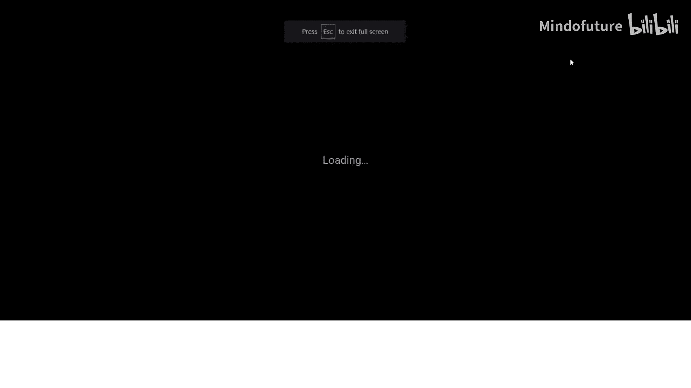
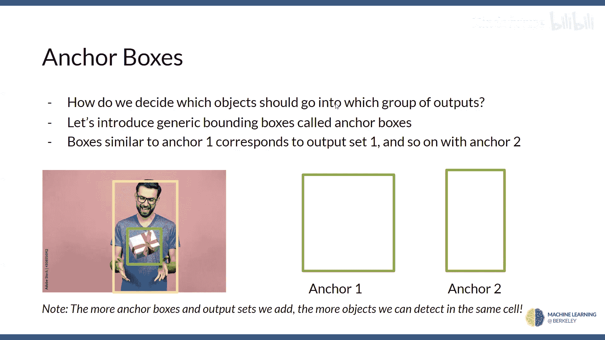
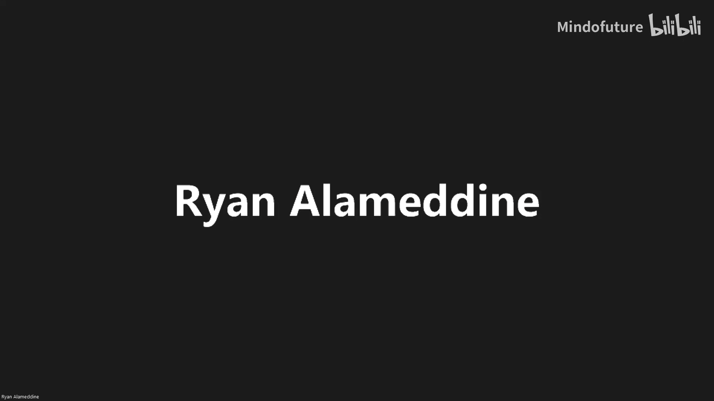

# 【加州大学伯克利】计算机视觉：视觉数据的深度学习 ｜ Cs 198 126： Deep Learning For Visual Data p07 P07_讲座7-目标检测 -BV1Va8zzfEtk_p7-

There we is， okay。

Recording and progress also。All right， can you guys hear me is is I don't know if the mic's really working。

 but it's working， all right， Greg great are y'all oh。I mean， clear this out of the way。Alright。

 yeah。 So say were。 Oh my God。 is it。😊，There we go。Zm。

Me one second al right。

There we go All right so today we're gonna be talking about deep learning for object detection so essentially just you stepping a little bit more into the kind of cool stuff that we can do with CV I'll get into what that means in a second but I guess yeah so to get started we all have seen classification already right it's like when you classification problems are essentially asking answering the question you know what is in this image right it's like if you have a photo of a cat it tells you it's a cat right next we have classification with localization。

 which is what we're gonna be starting with right now before we go into full object detection and classification with localization essentially answering the question of what is in this image and where is it right like specifically you know like what kind of bound of the image is it a part of so to start off before we。

Generating classificationization of localization we're going to start off with landmark detection so again so we're willing talk about classification but let's start with like a simple classification CNN and add in the like localization of one feature right so maybe we're looking for like the location of a specific feature。

Right so assume we have this classification network that you know takes some photos of you know。

 cat dog or something else and it's， you know maybe a convolutional neural network and then outputs it has these you know maybe it's a one hot en codingd right these three classes like maybe class one is。

One if it's empty plus two is one if it's a cat and then class three is one if it's a dog right so how would we like expand this network to essentially pinpoint the exact location of like the animal's nose right so let's say we wanted to like have it output a little dot right on the nose in the image right so this is kind of like halfway to localization so it's just landmark section so。

Essentially， in order to do this， we need to add some sort of output to the network。 right。

 So one potential solution to this。Is we have those classification outputs but now we can also add an X and Y output right just two additional outputs from the network but in this case these x and y values are essentially just going to be like the x and Y coordinates of the nose on the image right and one thing to note I guess we can it's not necessarily like in pixels right it like it could be a normalized values so maybe for the x coordinate like zero would be the far left of the image and then one would be the far right of the image right and then it'll pick some normalized value in that scale and the network is maybe able to output that now and I think you guys could all see how we could make training for that right essentially we could just have you know specific points paired with images and then we could kind of do the training based on that。

Let's make this a step further right so we have the you know point on the cat's nose does anyone have any guesses as to how we could take that network right the C1 ctC3 x and Y and we could expand that by adding more outputs to essentially come up with a bounding box for the cat as a whole does anyone have an ideas yes。

Yeah， that's that's one option， does anyone have any other ideas， that totally works。

 but does anyone have any other ideas？😊，Yeah。Yeah that's a good idea as well yeah there's like lots other options but the one I went for in this example is something a little closer to that where you can essentially have like an X and Y coordinate either of like the center of the corner or anything and then width and height of the box essentially just the solution I went for but both of those totally work。

😊，Yeah so now all you have to do is just you know we add those components to network again we can you know add some extra rules for our training and right we have we have a network that's able to kind of localize certain object in the image right so。

Talk about training it though right it's like we maybe know how to collect data for this。

 but how would we actually do our training right what would our loss function be as an example right it's like we have this image on the left is you know photo of a cat and has the desired boundning box to that cat right and let's say our model outputs this blue square right here right how like wrong is it it's like it's a little bit harder to quantify because we're not just checking like in the past when we're doing classification right it's like it outputs one for cat if it's a cat so our loss function can just be like how close with the output and probabilities to the actual you one hot encoding that we have for the image right but this time it's a little bit more complicated because we have two boxes right so it's like what do we what do we do from there so one option which is pretty popular is IOU which is intersection over union。

😊，So the idea behind this one is that we're trying to maximize the overlap between the predicted bounding box and the real bounding box right and that correlates to that is essentially maximizing the intersection over the union so as you can see in these diagrams right here let's say we have the two boxes the intersection of those two boxes essentially just like where those overlap so the area shared by both and then the union of those two boxes essentially just like you know the two boxes like all of the space that either of them take it up and so essentially if we calculate the area of this intersection and divide it by the area of this union we get this value that's pretty useful and I guess maybe some intuition as to why this is useful is you can think about it as if for example the predicted output in the real output were totally separate from one another。

 the intersection would be zero and the union would be pretty large so this number is just going to be zero whereas if they perfectly matchsh one another their intersection and union are going to be exactly the same so it's going to be one right。

So the closer we get to one， the better we're going better we're going right so we can essentially have a loss function be attempt to essentially train the network to maximize this intersection over union value。

Does anyone have any questions before going to the next part， I want to go into detection。

Anyone no all right perfect Okay great so the next thing I'm going to go over is extending this a little bit right so we have classification localization right we're able to kind of detect you know specific object。

😊，But this task becomes a lot more complicated when we have a bunch of different objects in the same image right because for example。

 like you know we don't know how many objects they're going to be right we don't know you know do they overlap with one another are they different types if you have like a bunch of people standing next to each other and you have a network that's like classifying people where it's like is it going get them all as like different images or different people or is it just going to be like one giant person box it there's a lot of of considerations to to come into play but there's a couple kind of ways that we can approach this so to start off the most basic I guess possible solution that you guys might have come up with if you thought about it for a second pretty simple solution is essentially an exhaustive search also called sliding windows so if we want to detect multiple objects in an image we can have an image we can select a bunch of boxes on the image different positions。

 different sizes， different aspect ratios and then we can classify them right and if it classifies as being a good match to like a cat then we just say okay。

That box is a cat right， so essentially you have this。

Dager mind you actually I can just try to chop and be a little bit easier so is right like we have。

 you know like。sIf we have a image， right， maybe I don't know there's a person here。

Right what we can do is we can start off we can say okay we're going to draw a box right here right we're going to crop the image to this box。

 we're going to run it through a classification network。

 it's going to say there's nothing here we're going to be like great and do it again。

Right we're gonna move over by some little value called the stride right essentially the offset。

 and we're just gonna keep doing this over and over and over again all the way down the image right we're doing it like hundreds of thousands of times possibly depending on how value And then in this case right these boxes don't really fit the person right So maybe we would even try with like multiple sizes of boxes or multiple asset ratios。

 So maybe eventually we'll have a box that looks like this right and we'll run that over and we'll run and over and run and over and then eventually it gets here。

 it sees the person。 it's like yeah， that's a person we're like great， weve got an output right So。😊。

This works， but it has some pretty significant problems。

 Does anyone have anything they can think of right off the bat That might be an issue with this approach。

 Yes， well depending on how big your stride is， you're just going to keep repeat repeat period。Yeah。

 that's definitely definitely one thing everyone don't have any any other ideas。😊，Yeah。

 this seems very inefficient Yeah， it's pretty slow。

 especially if we're doing at the low str anyone else。😊。

All right no it's yeah those's both great points so the kind of problems that I listed were essentially that you have this tradeoff with like stride and like the amount of aspect ratios and sizes that you try。

 which is that if your stride is very low which means that you're like each image is just stepping a little bit then essentially' its just too slow right it's like we're running know hundreds of thousands of locations checking this if we're trying like hundreds of thousands and then we also try with the different aspect ratio like really skinny tall box right it's just gets it's so many classifications we're just running this over and over and over again so much crossing power。

😊，If we try to counter that and we make the stride a bit larger or have like fewer aspect ratios then we get the issue where we could you know skip over potential boxes。

 the boxes aren't really going to be a good fit for the output right like if we like have this box and it was like here and our stride is like to this like we just jumped over the whole thing right but I mean more trivial or less trivialulated right it's like it might not fit perfectly if we're moving at set increments and so essentially we're kind of forced to have that stride be pretty low and with the time computing。

So a proposed solution to this or one solution to this is the system called RCNN。

The basic idea is what if we could guess likely bounding boxes and just run classification on those right so the idea is instead of trying like these hundreds of thousands of different。

 you know potential box options， what if we could just somehow magically guess good options and then just run classification on that So how do we do that。

 well one approach is to essentially use classical like nonmachine learning algorithms to segment an image and then propose a bunch of bounding boxes for objects So as you see in this little example on the right right I believe this like this is the base image and this is kind of like an output from the classical segmentation approach where essentially what it's doing is it's like picking a point on the image and then it's like floodfilling out for similar colors and then essentially just repeating that until all the spots in the image are filled out right and so the idea is we can use these kind of segmentation boundaries to do some。

You know， like decrease the amount of windows we have to consider。

So the intuition behind why this works right because you may think oh isn't this the same is just picking random boxes like not considering him well the reason why this works is or the reason why this could work is that like edges in an image are likely to be like the bounds of a bounding box right like when we have that cat example like the edges of the cat we're touching the edges of the bounding box right so it's like if we can kind of get a vague sense of like an edge classically then if we take bonding boxes around there we're pretty likely to have a good estimate right so。

Yeah， so essentially like the way that this works in a little bit more specifics。

 I guess is you initially do that segmentation right so you can see here we have this is like the initial segmentation of this image with a bunch of sheep right？

😊，And essentially on each of these segmentation regions。

 we're essentially going to draw a bounding box around it。

 we're going to crop the image to that bounding box and then we're going to run it through classification right it's going to say it matches or it doesn't match etc cetera right it's going to kind of go through there and then。

That doesn't necessarily work right actually， probably doesn't work for a lot of images because like as you can see over here。

 right the sheep are not a single color right It's not like a solid color object like not like every object we want to detect as a solid color So this sheep is actually like 15 different segmentations right so that doesn't really work on its own。

 So essentially we do multiple runs right we do the segmentation once we do the classification。

 all the bounding boxes there。 then we merge similar segmentation components right So for example。

 like as you can see there's a step from this leftmost image to the one next to it we're essentially merging like segments and then again the next one and again to the next one and essentially on each of these merges we're once again running the classification on all the boxes right So the idea is like。

😊，It's still quite a few runs of the classification。

 but we're getting better guesses right we're not just having to do that sliding with this approach where we're doing way way way too many guesses a couple little clarifications of this because you guys might be curious you might be wondering well if we have all these weird size boxes like how do we run those the CNN can't just take in some arbitrary sized image right so usually is done like in the paper suppose that they just they war them so it's like if you have a bound box look like this and you crop the image looks like that you just scale it to be a square and then throw it into the CNN So that's also a little bit gross because if you're looking for like a pencil for example。

 it's like the classification network is gonna be running on like a really stretched version of that pencil or something right so you might have some issues that as well Another point that I think someone brought up earlier is it's possible this could like classified the same object multiple times because we're considering like multiple boxes over the same area。

This is also an issue with sliding windows， there is a way to kind of remove this redundancy with something called nonmax suppress。

 which I'll get to later in the slides， but that is something deep mind is that as an issue that we can deal with it's not really a problem。

Um， yeah， so this is just another example， like you can kind of see it's going through the classification that it finally ends up selling on those green locations over there。

😊，诶。Yeah so problems with this so it's still really slow right because most images are not like a solid color right they have like thousands of different you know segmentation regions depending on how you define your like classical algorithm and the algorithmm using but again we have the same trade off where it's like if we make our algorithm like。

😊，you know， a little bit sharper and a little bit less likely to just blur everything together then you know we're going to be doing too many passes right and then if we make it you know less likely than that race we have the same tradeoff that we had described just this time with like essentially how fine grainined our segmentations about。

So how do we get around doing so many passes right it's like we ideally wouldn't want to have to run thousands of classifications just to like tell me there's a couple sheep in that image right so how to get around this well one hint is that our classification network is rerunning on similar parts of the image many。

 many times right if you guys think about the way a convolutional neural network works right where we have that like you know kind of filter thing passing over right it's like we're rerunning that kind of convolutional。

Loic on the same regions of the image over and over and over again right so one potential way that we can kind of make RCnNs a little bit faster is by essentially running the convolutions on the full image to create something called a feature map which I'll get into what that means in a second but essentially the idea is that we're removing some of the redundancy in the work So this is a fast RCnn essentially the idea behind it is that we are taking the image as a whole we are running a CNN over it to essentially like create this feature map thing which I'll explain in a second。

 but essentially we're extracting key information from the image and then when we want to do the classification all we have to do is like define that box around the image but instead of pulling the image out like the crop section of the image out。

 we just pull the section from the feature map and then we run classification on that right so the is we don't have to rerun the full CNN thing every single time right so what is this actually like。

Because I know sounds a little bit confusing but essentially we've seen like CNNs with you know like we have a bunch of CNNs and then there's like an end of the CNN layer and then there's a fully connected layer afterward that does like the kind of classification on there So the idea is we're essentially chopping off that fully connected component to it and we're essentially just running the convolutional neural networks to output that kind of volume at the end that has like ideally has some like feature information about the image right so the idea is because again it's a CNN there's kind of like local information like you know we're passing over the different rows So the idea is like maybe you know like。

😊，When this is run right like this， you know， map to some point in like the feature volume。

Right and so maybe this little area you know is holding some key characteristics that the CNN has picked up on from that section of the image right so the is that then we just run class page separately using this as an input instead of running the image every time and it was kind of confusing so anyone have any questions for that。

啊。All right， and feel free to ask after it as well， but all right so。This。😊，You know， leads us into。

A little bit of a cooler option， which is Yo。 So Yolo was like。

 let's take this idea and let's just run with it， right， let's throw out all the classical stuff。

 right， let's just replace everything with a single convolutional little network， right。

 So instead of， you know， running， you know， like the。😊。

Thousands and thousands of different classifications with like bunch of different options。

 What if we could just take an image pass it into a CNN and then that CNN outputs you know。

Where our objects are and their bounding boxes and what they are right like all of these different things right and this may seem kind of impossible because its like how does it know what's output that kind of thing but we'll get into into the details of that it' it's really cool so this is the architecture for Yo so as you can tell we're not like running things a bunch of times it's literally just a bunch of convolutional layers and then like a little you know plugned piano for the classification or some some other things as well but yeah。

😊，So how do we get this well let's go back to our model we were talking about earlier right this is a model that we solved classification patient plus localization with so essentially the like this is how we figured out you know detecting one object's bound。

So how can we expand this to kind of detect multiple objects right that's essentially well the question we're trying to ask is does anyone have any ideas and this is a hard question。

 but does anyone。Having ideas of like how we could kind of expand this to detect multiple things？Yes。

😊，Maybe like after you like went on the first time brought out that part of the image and then you running again Oh。

 it's an interesting idea I haven't thought about that before。

That could actually be would be something interesting to try out I don't think I've seen that before that's cool yes。

😊，We get the director so yeah， we could we could just that that's definitely an option right we could have。

Two copies of this right so maybe just add two two things or something like that there's a little bit of nuance to that but that's it's a very good idea Does anyone have anything else yes you just combine those two ideas you say like say one object。

Okay。是。Sorry， can you repeat that whichever interesting， yeah。Yeah， that definitely could work yeah。

 okay， those are lot great ideas we are going go something a little closer to your suggestion but yeah。

 this's all really cool。 So the way that Yolo works is essentially that but like on steroids a little bit crazy so。

😊，对。Yeah， so the basic idea is let's take our image and let's chop it into a grid， right。

 And actually， this is actually kind of combining all of your ideas because we are kind of doing。

 we're not running multiple programs， but we are splitting the image that we can kind of classify things within certain ranges and then letting the rest of the network classify in other areas。

 So that actually is kind of combination of everything you guys said。 But so essentially。

 we take an image。 We chop it into a grid。😊，For each of the grid tiles we're going to output one of our classification vectors or like with bounding box vectors that I talked about earlier right so the idea is like each of these little grid marks on this image has a corresponding vector in the output right so。

This may not really make sense of like why this works just yet because there's a lot more details this。

 but I think you guys can see at least in a general sense right now that like。

This means theoretically that we can have like a number of objects equal to the number of grids in this image this does also seem to imply that we can only classify images or like objects that are like smaller than a grid mark but that's definitely not the case and I'll get into why in a second but before I do that。

啊。Oh we actually， yeah， I don't know。 Okay， so one thing I want to kind of explain about this as well is that the way that。

The way that yellow gets around that problem that I was just mentioning where it's like。

 you know what if it's like the object is larger than the the grid itself right well the way that yellow gets around that is that this X Y。

 width and height，In our previous example， it was just the x and Y coordinate of you know that point in the image and then like you know maybe a width and height of like what that bounding box looks like within kind of the bounds。

 but in Yo this X and Y coordinate are the midpoints of the bounding box and the width and height are the width and height of the bounding box。

 but that bounding box doesn't have to be contained within the grid square that is like currently being classified。

So what that means is， for example， if we look at this dog down here right this square for example。

 could somehow figure out that it's like okay I'm in the center of the dog right I'm classifying the dog so it would output you know this point as the center right and then it would maybe output the x and Y coordinates of this kind of boundary right here and then it would be reaching outside of its grid in classifying this is a dog right。

So one of the issues with this is that you can now kind of think of it as we're not only forcing the network to you know like classify things and come up with the bounding boxes。

 but it also somehow has to like know which section is like the center because it's possible that at the center is like really close to a grid boundary then maybe like multiple cells will all think that multiple grid points will all think they're the center say all output classification and so we get that same problem that we were talking about earlier where there's multiple bounding boxes that are representing exactly the same object right so now we're going to actually explain how to deal with that I know I attached them is alluded to this earlier but we're going explain how this works so we have the same nonmax suppression so oftentimes multiple cells will detect the same object in this example these two grid cells right here are both thinking that they're the center of the dog's bounding box right so you can say in yellow they're both outputting you bounding boxes that are maybe about the same but that are both centered in their grid。

So。😊，You can see like the left cell output of the pink box and the right cell outputted the yellow box。

 right， so they're in conflict。So to resolve this， we're essentially going to come up with this process that we can repeat for each classification class that essentially gets rid of those overlaps and is able to kind of pick out the best one right。

Yeah the first step is that we essentially pick the bounding box with the highest confidence So if you guys remember from the like network earlier right it's like it's outputting Xy with height but also the classification classes right and so those are all you know like maybe if one of the outputs has a really really high like it's really really close to one in the class that is dog right it's like I'm really certain that this is a dog whereas maybe the other bounding box is like I'm like 0。

8 you know certain that this is a dog right so we obviously want the one that's more certain because it's probably more likely to have an accurate kind of bound as to what we're looking for So we're gonna pick the bounding box with the highest confidence and then we're gonna remove all boxes that have high IOU。

With the high confidence box so again I use that intersection overunion thing it's essentially just a measure of how overlapping two boxes are so we can essentially come up with some threshold value right like maybe if like 75% of these boxes overlap pick the one with a higher confidence right and we can just remove the other one we can just ignore its classification output and be like this doesn't matter this is not relevant we want the good one right so in this example maybe it's this box that has the higher confidence right so we're gonna clear out the other yellow one because it it has too much overlap。

All right， so another problem that we have with Yolo is what if we have two objects who are centered in the same cell？

Right。This is quite a bit maybe a more challenging problem to solve right because if you look back at our Yolo architecture earlier right it's like we have you know a vector for each of these grid spaces right so。

How can we like have multiple classifications within one cell， does anybody have any ideas？

NoNo worries， this is a hard question。Yeah， so okay。

 I would say the way that I would think about this is imagine that you were trying to you know invent you right it's like the trivial solution。

 which I'm assuming a lot of you thought of but then we're like this doesn't really work is why don't we just like copy that vector again right but just have two vectors。

 two like classification and bounding box vectors for each cell right so it's in like for you know this specific cell of the image we're outputting a classification and then an x y width and height for one bounding box and then a classification X y width and height for another bounding box right so we can have two images or two objects in the same cell right but。

😊，That doesn't really work right because it's like well wouldn't both of them just output the same thing like if there's a dog there like wouldn't both of them just output the bounding box to the dog and you just duplicated your bounding box or like if there is like a person holding a cell phone and they're both centered in the same grid cell right which one of the vectors should output the person and which one should output the smartphone right it's like it's the network doesn't know right it's like how do you that's kind of arbitrary it's like how do we has it know which vector kind of that output So there's this idea Oh yeah so we are doing the multiple things right so we're gonna output two vectors for each each grid cell but there's this idea that's taken advantage of which is that different objects。

Are different right like if you have a person standing in front of a car right the shape of the bounding box of a person is different from the shape of the bounding box of the car right and so we can take advantage of that to essentially solve that ambiguity and essentially tell the network have the network have like a deterministic way to determine you know which object should go into which classification vector right so。

The idea behind is an idea called anchorch boxes。Essentially。呃。

Sometimes what we're doing is we're creating these generic bounding boxes called anchor boxes。

 so in before I'm running classification， before I'm doing anything， I'm just going to say， okay。

 we have anchor box one， which is like a square and then anchor box two。

 which is like a rectangle that's stretched vertically。Like before we do any classificationification。

 we just arbitrarily define， well not arbitrarily， but we just define that these are anchor boxes。

 right？Now。When we're doing our classification， right， when we're doing our。

 know like making our data set and that kind of thing。WellAll we have to do is we have to say， okay。

 like for example， take this image， right there's the person and then there's the present。

 maybe we're both we're classifying them both。Well。We can say the person's bounding box。

Is very similar to Anchorbox2。😡，And the presence bounding box is very similar to anchor box1。

So we can just say the first output vector for that grid cell corresponds to things that look like anchorbox1。

And the second output vector for that grid cell corresponds to things that look like anchorchbox 2。

Right and so now we've kind of removed that ambiguity right because if we see a present that present is pretty close to the square right。

 so it's going to be classified in into the first vector， right， ettera。So。

There's this is kind of like an overview of like the the architecture as a whole right kind of combining all of these things so Yolo it's fully convolutional right it's you know not doing a bunch of different rounds it's just doing one pass over everything。

It is。Very fast this this number like arbitraryrbit like 10 times faster and it be could be more depending。

 But the idea is that it's essentially we don't have to run the classification over a bunch of times right we just throw the image in once get one output that's all so it's gonna be a lot faster and with some you know extra tricks like the anchor box some other fancy things that they go over the paper you can match the RCNN and accuracy and it's actually performed really well This is just really groundbreaking the time that it came out because it essentially showed like you can do some really。

 really powerful stuff just exclusively using neural networks right it's like getting rid of all the classical components it's getting rid of you know the sliding windows is's just doing everything with just one run right Yeah so it's pretty cool so。

😊，Yeah， I guess the the key idea for this one is that like yellow transformed， you know。

 this section on the right， which is this mess of fast RCN all just into one little neural network actually did you add that animation to nice okay。

😊，Yeah， so we're actually， we're actually done。 We finished really early。

 I was trying to go a little fast， but I went a little too fast。

 Do you guys have any questions or anything。 Do you Yeah， just。

 I guess you guys want me to go over anything in a little bit more detail so I went fast。😊，啊。Yes。😊，好。

谢谢要护人。有。2是。This。Yeah， so that's a little bit harder so the like just basic。

Idea of like the anchor box thing on its own like just like shapewise is not really going be super helpful to you you can do things with like you know like size you could consider sizeizing it as well maybe it's like if you have two things that are the same shape but one of them's like really tiny separate from that it's a little bit hard because also the way that you can think about it I guess as well is that if you have two objects which are exactly the same shape and exactly the same size。

How can they really be visible if they're overlapping on an image right like it's like if I'm like oh。

 I might have like an Android phone and an iPhone that are overlapping well if I'm holding the Android phone and the iPhone in the exact same spot。

 it's like you're not gonna to see the one in the back right so in most cases the things that you're trying to classify are going to be different shapes or different sizes because otherwise it's like how would you even see that they're there if they're taking up the same area the other thing as well is that like these anchor boxes it something that I didn't mention but like like if youre actually using this a lot of times you're not gonna be like manually being like oh。

 I think I'm going to classify these shapes it's like you can take in a training set and then they're actually algorithms that you can run that will essentially look at all of your objects and it will essentially come up with like mathematically optimal anchor boxes that like match like that are most likely to match and kind of be separate so there are kind of solutions to that as well but in general I would say like。

It's actually very hard to think I right now at least cannot think of an example where you'd have two things that are the same shape that are going to be overlapping because at that point it's like what do you see right what are you seeing there？

I don't know that incombos will really solve that issue， but yeah， it's a good question。Anyone else？

go some time。Yes， it's not too specific for like the segmentation。

 but if you have like a million of things to classified， does that mean your output vector。

 you know has to be？A million long worries are more taking ways to do more hard， don'？So。

You're saying if you want to like just like you have a million classes or whatever yeah I don't actually know how like you guys might people to answer that more than I you because that's just a classification question but not just about Google lens but just in general like if you have like an insane number of classes that you're trying to classify it's like if you're just doing one hot encoding that's so much space。

One of the great verses in the yoga series of your man Health？啊。

And so they come thousand00 classes they still。啊，这感不道。

hing that impose I opposed that the tree structure for there。

So you know instead of just like 9000 in the process。

 it was separated would say like in all jets and animals。

 pretty most storage human scared so once on like dogs might beans and so then created。

Using them as a sleep structure， they brought down the ining sites。

For 900 make a much smaller record， and definitely it's actually。Prity a large number of classes。

 additionally what it does is because I's going to affect the platforms that going。

Maybe it doesn't get the dog want to get the rest of the animals and storm。我人员嘅一应发。

So that's one way they。There's also for like classification to people free train on like imagenet 22 day or something like that。

 which gets like 22，000 different classests。So this is definitely something that。过下。嗯。

I don't have any other questions。One cool thing about your is is papers by D not and hydr。

He ran most crazy over the course over the course of Ca speech by the paper so the first paper is super professional。

 a second paper is like a bit more interesting and the third paper just complete master writers。

SoYeah I would actually say to the Yoola paper is a cool paper to read if you guys are just interested in like trying your hand at reading a more technical paper I think it's a cool one to kind of look into I would not say the same for RCnN avoid the RCNN avoid RCNN and that paper is unreadable but the Yoola one in school feel want to check that out and if you have any questions about anything you guys probably ask on EM and we'll try to answer that too but it's cool paper to read if you want to check on that out。

Yeah。If no one has any other questions， Jake， are we going to head over to the Yeah。

 like I'm just going toander Yeah， soSounds good。Yeah， you guys are welcome to leave。

 you're welcome to come with us， you're welcome to stay a couple minutes ask some questions。

 but I see y'all have a good daye。😊，Okay。当。啊。嗯。I didn't think not。Oh boy， I don't remember。😊。

Walk over there in a couple of minutes， so you're welcome to walk with us as well。😊，啊た因为。嗯。怎么到这没。东す。

7。So。

