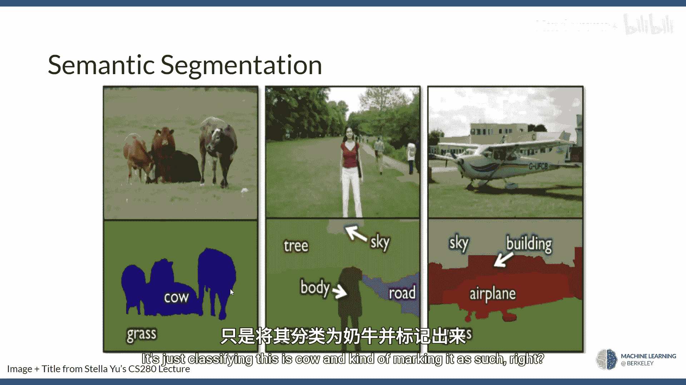
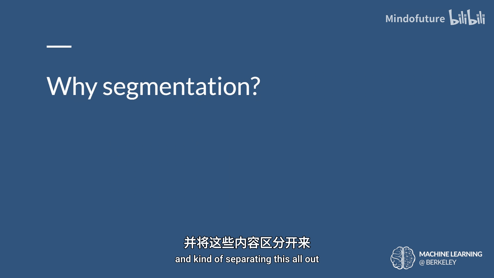
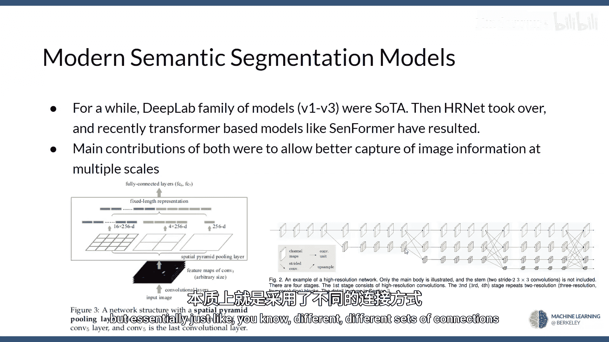
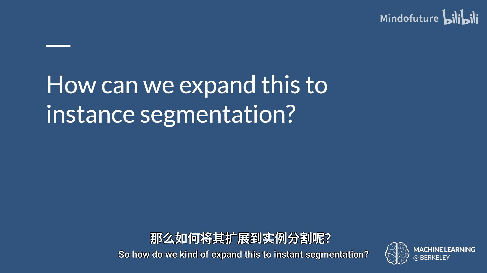
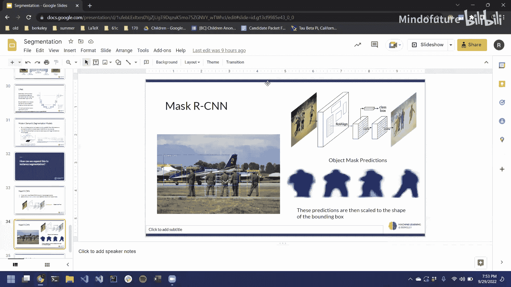
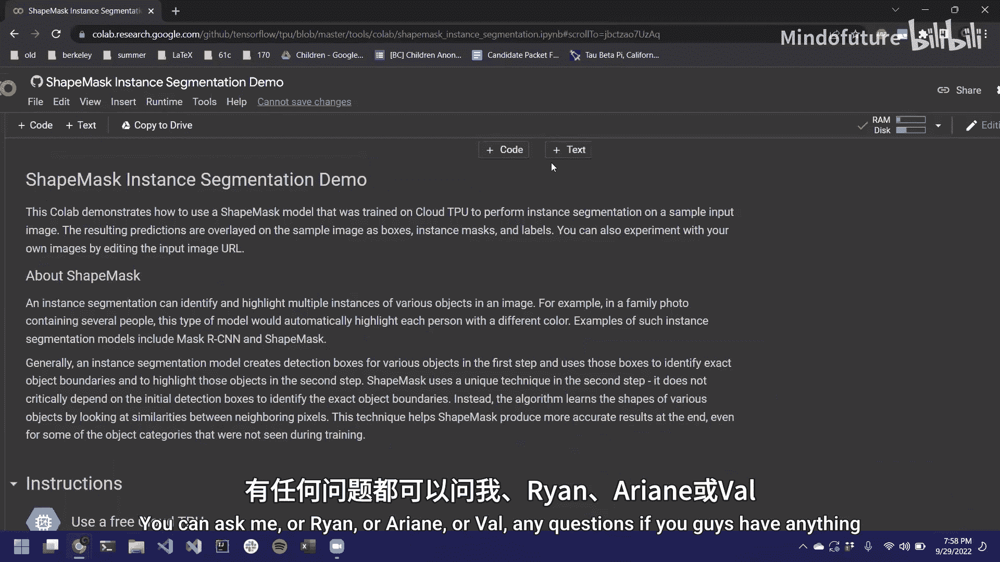

# 【加州大学伯克利】计算机视觉：视觉数据的深度学习 ｜ Cs 198 126： Deep Learning For Visual Data p08 P08_讲座8-语义分割 -BV1Va8zzfEtk_p8-

Progress。系。Yeah。嗯，是的。No all right。All right， are guys getting right。

Today we're going to be kind of covering a continuation of Tuesday's lecture so we're going be going over is themic good perfect we're going to be going over image segmentation segmentation as well so I guess what is image segmentation so I guess the review of yesterday things went over we started with a classification network that essentially you know like took an image and then told you what was in the image right we moved from that to classification with localization or we went to landmark detection and then classification with localization which essentially telling us you know what's in the image and where is it right Scott there we go and then finally we went to object detection so essentially having you know multiple object in an image being able to tell what they are and being able to tell where they are all individually so the continue the continuation of that is semantic segmentation or sorry segmentation so the first we break these into two types semantic segmentation and instant segmentation。

The basic idea behind semantic segmentation is that instead of just finding a bounding box of an image or of a certain object。

 right we want to actually find like the specific pixels where that object is present in the image。

 right？And the continuation of this is instance segmentation which essentially is answering the question you know where specifically is each instance of each class in this image as in if we have a photo with you a bunch of people in it it will not only be able to tell the exact pixels that correspond to people but it will also be able to tell you know like which sections of those are correspond to each individual person and again hello and again we can have multiple classes in this as well right so we could have you know like an image that you know has a bunch of people and a bunch of dogs and it should be able to tell each individual dog and each individual person in the background etc right so。

😊，Again to give kind of an example this right it's like we have some images here right it's like you know we could have this image right here where there's a person and you know grass and trees in the sky and it's able to kind of pick out all these different components and it's able to kind of segment them although again notice we're talking about semantic segmentation to start so it can't for example differentiate between like each individual cow here right it's just classifying this is cow and kind of marking it as such right。

😊。

So this is what we're gonna start with， but the eventual goal right is that we want to be able to detect。

 you know like everything right we want to be able to look at an image right。

 break it down into kind of all of the different separate components for like you see in this image like we have all of the different individual people are being detected differently there's like two boats or like a bunch of boats actually a bunch of boats that are all kind of being detected separately as well right like this is kind of the ideal。

And case right this is like what we are trying to accomplish what we would really like So why is this useful because this may seem like a lot of work it may seem kind of scary because it's like it seems like quite a bit of a step up from just picking a little box and an image to actually like classifying the exact like positions of everything kind of stepping this all out So I guess I hope I can convince you guys this is useful So first of all。

 we have this whole idea of the gestal principles I don't know if you guys are familiar with this。

 but the basic idea is that there's a lot of different components that go into how humans kind of perceive things how they perceive objects right it's like if you look at this image for example right it's like I think these are little balls of like yarn or something like that right it's like you know is this you know maybe you're seeing each of these individual barss of yarn they all have like you different colors on them but what your brain is processing is this kind of gradient right it's like the whole idea is that the。

components or sorry sum of the whole image is more than just like the collection of the individual components right we want to be able to actually you know classify and like pull all these different things together and then come up with some meaning based on that right so being able to kind of identify all those components of the image more specifically is really useful So another kind of just cool aside with this that I think is kind of interesting as well is that even just determining you know like what an object is with the way that we kind of perceive things is a more challenging question then maybe you might might think it is and sense that like if you look at this image right there's just a bunch of like weird curved lines right everywhere but。

You probably see a circle right because the kind of components of lines change color at you know an era that kind of you know happens to match that sort right so it's like how could we you know kind of like get these different groupings。

 these kind of perceptual groupings， how could we kind of figure that out know how can we do that from e ever perspective Additionally you can see this example in the right of this little you know set of weird shapes moving I'm sure you guys all see that that kind of looks like a dog right even though it's objectively like not following the shape of a dog like if we were to you know talking about RCN yesterday or Tuesday。

 if you guys remember if we were to like you know pick out the different components of this object right and we were to you know like create bounding boxes on them the object of a dog is not actually connected right It's a bunch of different kind of subcomponents that all kind of come together So again。

 really the point of this is to kind of motivate segmentation and why this is like a useful thing for us to look into right because the idea is if we're able to kind of identify all these different。

components， but we're also able to more generally you know connect different you know classifications or kind of do larger level you know segmentation this becomes a really really useful ability to have so again yeah segmentation is just really there's a lot of like really abstract speaking but the basic ideas just segmentation is telling you which pixels go together right like taking image telling you these two are pointing or the same thing right these sort。

So how do we approach segmentation so there's actually a component of this that we brushed over last lecture we actually referenced segmentation in the RCN section again when we were talking about region proposal where we were essentially saying that we will use some magical classical you know region proposal method that will just magically look at an image and propose to us boundaries that might be good regions to classify on right and so。

We're actually going to take a look at like what that actually means how it's kind of implemented there's obviously lots of different methods this。

 but the the simplest possible way that we could kind of approach this is。As well so first of all。

 the idea that we're looking for is to create connected segments by grouping based on some sort of similarity criteria right so if we have you know like this image right here right maybe we want to you know group together potentially the cards or maybe we want to group together the you know individual components like you know the little spades on this playing card it's like we want to group together visually distinct objects on a maybe not so distinct image。

So。Let me just。Yeah， there you go so one。Way to approach this is that we can essentially define some function by which we were to group image or pixels together right is in if we have some image right like let's say we have this image done here and we pick point。

 you know this point right here which maybe is x1 y1 and then we pick you know a point next to it。

 x2 y2 right？And can say we can have some sort of function that takes in the point。

 return some like similarity criteria， we can essentially say if the difference between those two of those two pixels are similar enough to each other。

 their difference is below some epsilon， then we group them together。Right。😊。

And so this is like a very simple kind of classical approach to this problem and there's a lot of different similarity functions like like metrics that you could use to measure similarity classic one is just you know intensity so like the brightness of a pixel that's not the technical definition but you can think of it as right it's like the intensity of a pixels like how kind of bright that color is right so for example。

 if we look at you know this pixel right here and this pixel right here right they are pretty similar in color but they're not I they're pretty similar in color but they're a little different right but they're overall brightness is similar enough that that difference there is going to be less in this classification and so then we would kind of merge those two pixels together in the sense we would consider them part of the same group and you can kind of flood bill outwards here and then maybe wed get an image that looks like this threshold image on the right where essentially you know there's the white section is like all of the kind of pixels that have been grouped into this one you know collective。

Right， so there's。Lots of other ways to kind of approach this but。

The idea is that's kind of I guess a very very basic classical approach to this algorithm now we're going to look at some you know new or maybe deep learning approaches to this so one way that we could kind of do segmentation that's a little bit more interesting because it's learned as opposed to a fixed algorithm is we can go back to that sliding Windows idea that we talked about on Tuesday right except this time instead of doing sliding windows an attempt to classify a bonding box but we can essentially do is we can slide windows across the image and then we can have for each like you know slide in the CNN。

That current。Box， its only goal is to classify the middle pixel of that box。😡，in the sense。

 like if we had this red square down here， it's running classification on this patch of the image。

And then it's outputting what it thinks the middle pixel is， right？

And so what this allows us to essentially do is we can run this CNN sliding window across the image and every time it outputs。

 it'll output you know what object that should be a part of and then on our output image like our segmentation map。

 we can just write that you know value to the corresponding pixel right so we're sliding across and you know maybe this pixel s sky。

 this pixel s tree， this pixel s tree， this pixel s tree。

 this pixel s cow or this pixel sank cow right we can kind of run all the way over and then we'll kind of be able to create that segmentation map like that。

This is as we saw last time sliding Windows approaches in general just is just very inefficient right it's like once again we're you know recomputing a bunch of shared features right we're kind of you know running classification over the same area lots of times so how do we fix this right well we talked about this again on Tuesday but there's this is kind of a different approach to it so we can do convolution's end end again right we can just take convolutional network instead of running it multiple times we can just have you know one sort of convolutional operation that we can run over the image that ideally will perform all of the desired effects that we want without having do the sliding window approach so in this case but we essentially have so okay to clarify there's one kind of caveat to this situation which is that。

Last lecture we were talking about you know classification like detection that kind of thing and so our output was a defined size right in the sense that we were like when we're talking about the case of classification with localization our output was going to be one classification one you know X and y coordinate pair and one width height pair right for the battle box right whereas。

Theoretically， with segmentation， we want our output to be the same size as the input and essentially contain you know。

 in every single pixel tell us what that object is。Right， so。

One kind of bonus of this end to end convolutional approach is that the。

The whole system is size agnostic of the input and so you may like it maybe a little bit confusing because like well if we're plugging the image into the convolutional neural network like how is it size like isn't it expecting a certain number of inputs that kind of thing but essentially the way that you can think about it is that if our convolutional layer is that you can use that like kind of filter explanation where we have you know a convolutional kernel or like a filter that's kind of running a long image right and then it just goes on by the step size moving over each time if we。

Just take that filter and keep running it right there's no required you know like size right we're not decreasing the size of the network using pooling layers or anything like that we're literally just running the convolutional network over getting an output layer that's exactly the same you notice this is three channel like if we look at the actual numbers this input image is three channels like the red blue green channel and then a width and a height right when we run our convolutional layer over right we're still getting a you know width by height length volume it might have more depth or less depth depending on how many channels we have internally but the basic idea is right we're just passing that convolutional filter over so we don't have to worry about like you know the size changing or that kind of thing we can just kind of run everything over and our predicted output will map one to one exactly with the original image。

Yes。嗯。What your sign like。Yeah， yeah great question。 So yes。

 theoretically there's a couple different ways that we can we can do。 so first of all。

 if we have like film me。😊，He some cha so for example， like let's just take a very trivial example。

Where we have like a two by two image， right， and let's say our filter is three by three。

Right so one thing that we could do is we could potentially use padding right so it is if we just like padding is like complicated and it shouldn't necessarily just do this。

 but let's just say we add zeros。To the outside， like all the missing pixels in the image。

Right now when we run our three by three filter over。It's going to run here。

It's going to output that into。You know， maybe it's going to output that into the first pixel。

And then when we shift it over one， it's again， using up those patting bits。

Right classify this one you run on this one it's going to move into there right and the idea is if we have you know stride one we have them padding rights like we're not going to be we don't have to be decreasing that size and I guess just quick aside but when doing patting and that kind of thing there's a lot of different I don't know if we've talked with this yet but like。

Patting with zeros is kind of weird because then it's essentially you're like treating the network。

Seeing as if there's like a black wall， the edge of image there's a bunch of different kind of approaches to like fix this yeah one second one of the things you can do is like you can kind of mirror the edges so for example we can take these pixels and like duplicate them here or like even better you could take like this whole thing and then like flip it over and kind of duplicate the padding kind of matches the colors inside but yeah great question you had a question yes so slide later。

Has a feeling like big place how think it the final。please。Yeah， so the basic idea here okay， really。

 you can kind of just think of it as essentially。As we kind of go through。

These convolutional layers right and then as we kind of get to the final output the final output is going to be a volume that has sized width by height of the image and then the depth of it is essentially each slot in the depth is talking about a certain classification output so the idea is where we're essentially finding the maximum classification output for each pixel yeah exactly C would be the number of classes so。

So yeah， I mean， there's lots of different like。We talked about this a little bit last time like there's different ways to like kind of encode things。

 but for right now just think of it as like a one hot encoding where like each class。

 you know maybe there's a one if it's sky there's a。There's a one in the next， but if it's。

 you know like a cow or et cetera， does that answer your question？I agree。Yes， so。Oh yeah， okay。

 so the problem with this is that it's pretty expensive to compute this at the original image resolution。

 right？And and what do I mean by that well， I mean let's say you have like a 4K image right and it's like maybe you have I don't know like。

20 convolutional nets or something right I'm just coming up to matter numbers right but it's like the idea is we're still doing that excuse me we're still sloting that filter over right and doing that kind of computation on like every single pixel right its like we're still doing quite a bit of work right and so。

As long as we kind of maintain that original resolution right it's going to be kind of hard to you know shrink that down so one potential solution to this is to essentially downsample the image gradually and then ups sampleample it at the end。

So。😊，What do I， what do I mean by that？ Well， essentially， what we can think of is。

If we look at this image here， right it's like we have this input image right and then when we run our you know first convolutional layer。

 right？We can instead of doing this like you know padding thing where we we like want it to be the exact same size of having like a stride one or that kind of thing。

 we can you know maybe up this stride a little bit。

 get rid of a little bit of padding right do something like that so that the output of running the convolutional convolutions。

Over once is going to be smaller than the original input。

 which at smaller and with the height maybe it' a little deeper or something right。

 but the idea is we're kind of shrinking it down。And each time we're kind of shrinking the image down further and further all the way down to like this example it's like I don't know。

 it's 21 or something I don't actually remember what these numbers are。

 but the point is right it's like the volume that we're outputt is getting smaller each time So we're essentially downsling the image every single time right you can think of it as we're。

Taking the image right the convolutional neural network ideally is going to be like extracting information right removing redundancy from the image as it kind of passes over and each level is getting like more and more like abstract and sense of like it's you know ideally maybe would be collecting like the first pass would be like collecting information on like edges or that kind of thing and the second pass would be like you know combining those different features to like maybe get more you know high level。

Understanding of the image or something like that right like it's all just theorizing but the whole point is that we're kind of down somethingling this we're getting down to a much smaller kind of volume at the end。

 but then of course we have this problem that we want our output。

 our segmentation output to be the same size as the input image。

Right because we don't want to like output if we input a 4K image。

 we don't want to output like a two pixel by two pixel segmentation map right because that's not going to be very useful if the pixels don't really match so we somehow need a way to kind of take this small volume and somehow transform that small volume back into an image the size of the full image。

喂。Which is a little is a little weird right like how do we how do we do that so there's。Yeah。

 how do we upset So there's a couple ways to this the classical approach that or classical approach that I'm sure if you guys have ever used Photoshop or done anything with that in the past you guys have definitely seen this before where。

😊，You know， I don't know if you guys ever use MS paint。

 but if you put an image in MS paint and you like scale it up a little bit。

 it gets all like pixelated and gross because MS paint is I'm pretty sure of by default using nearest neighbor or at least maybe it used to。

 which is disgusting， but essentially the basic idea is when you scale up an image， there's。

You can essentially think of that as we're stretching the pixels out and then now there's kind of new spaces for new pixels to be formed and so a interpolation function essentially deciding like what those new pixels should be right how to kind of blend between you know the two pixels we had already that are now sta it or not that there's a new one that's seen it in between so nearest neighbor it making fun of essentially the basic idea is that we're literally just taking the value of the pixel it's most adjacent to so if we have a small tiny image and you scale it up really large we're just gonna to get giant pixels because we're not doing any sort of blending we're literally just selecting the nearest pixel you can do you know like some sort of a linear interpolation where it's like you take the two edge pixels and you find the color that's halfway in between them right it's like you can do something like that the option that like most software like you use Photoshop and you try to scale an image I believe the default is going to be whether bilinear or bi cubic interpolation but essentially the idea is that it's essentially taking。

はい？you know the color information from you know both the pixel like you know the pixels to the side and also the pixels up and down and essentially kind computing some sort of linear like average between those to find the output color and so the idea is that if we take you know like this image on the right right and it's like we want to stretch out to four times the size right we can put those pixels on the corners and then we can use like bi linear inter interpolation to kind of fill in the missing spots right。

And this。Like theoretically works right， Like it's not like a wrong approach。

 but the issue with this is that。What we're really doing is essentially scaling up the image and then blurring it a little bit。

As opposed to filling in detail that we're missing right and so a way that we can improve this is by once again。

 we can move from a classical algorithm to a learn algorithm right So the idea is we want to ups samplele。

 but instead of upsling with。You know like biininated relation or something like that。

 we want to have some sort of you know neural algorithm or something that can learn how to ups samplele images right so。

I already kind of went over this but like just I want to do a quick review of convolutions because I'm about to introduce something called the deconvolution which is pretty easy to understand if you understand convolution so I guess just very briefly I can go over again like right it's like you have you know like a filter that you're kind of passing over like in this case through a3 and you're essentially taking you know all of those values and then you're multiplying them by the weights of the filter and then kind of summing those all off and putting it in the corresponding output pixel right and then you know shift over by the stride each time and you kind of keep passing on through that until you've you know gone through the entire thing so。

The idea they can kind of think of is how can we kind of reverse this process right like we want to take a essentially the same like a kernel idea of a kernel like kind of passing every image right but instead of passing over you know the。

You know some sort of input layer and then getting a smaller output layer we kind of want to take this and do the opposite right we want to pass over a small input layer and somehow project that through some sort of filter onto a larger app right so to that enter the deconvolution so it's literally I just flipped the diagram right we have the smaller one on the left and then larger one on the right and so。

The basic idea is we're literally like you can kind of think of it as we're literally flipping the diagram that we had before and I'll get into how that actually works in a second。

 but so instead of passing the filter over the input layer you can think of it as we're passing the layer over the output and' removing pixel by pixel on the input right so actually I have some slides here but honestly I think it's going be a little easier if I just draw it so。

😊，I'm just going to draw an example。Let's say。We have， you know。

 one or that's not a one I can write on this all right， one， two three also is 188 feet long。

And you can see I'm good perfect， okay， one， two， three， four。

 let's just say we have this very simple input image mat and we want to upscale it to like a three button。

 right？So。What I said before is we can start， let's say then let's also say we have like a three53 kernel。

 right？呃。I'm going to make this kernel。Very simple。And let's just say it's like。I go like 1，0，1，0，1。

0，1，0，1， just for fun。 I don't know。 So what we're going to do is we're going to start off。

 We're going to look at the first pixel of the first image。😊，喂。

And then what we're going to do is we're going to take our filter。

And we're going to place our filter over the output layer centered around this pixel。Okayect。

And essentially we're going to do here。Is we're going to take this input value？

And we're going to multiply it。By each of the output values in the output or sorry by each of the filter values。

And we're going to essentially project that or kind of imprint that onto the apple right so in this case like if this box were placed over like this whole section is just like outside of the range so I don't have to worry about that right but you kind of think of it as it would be you know maybe like one。

You know， one times one， right， that's going to go there， one times  zero。

That's going to go there right like one times zero and then one times one right so on the very first pass we've kind of added and again。

 this is just this number multiplied by this and then placed on the corresponding slot on the output right and so we can do that once and we get some values panically appear here right and then all we have to do is we can shift over to the next pixel。

 and now we can do is we can maybe， you know shift this。

Box over as well right so maybe now the this filter is now looking at this region centered here。

Right， and we can say， okay， let's take two， two times two is or two times one is two， right？

This is not you。All right we can say you know two times zero is zero right two times one is two right et cetera the point is you can keep doing this right but you may see a problem with this。

 which is that we're going to end up like overriding values that were written and just like kind of weird like what's the point of this right well the idea is that if we would add a value to a node that's already has a value we just add them。

Right， so the idea is is that these apple values are essentially going to become。

Like a sum of the kind of projection of the input values through the filter crashs onto that image right so I'll go over to kind of again and it's a little bit weird。

 but you can kind of think of it as you know it's like we have this input pixel we multiply each weight in the filter by this input pixel and then kind of think about it as like we're pressing that down onto the output image and that there's already a value there we just sum it up right。

And again， we can keep shifting that over。Yeah， and so that's an decon。So。

Using this we can do something a little cooler which is that we can take like essentially an incremental approach to the problem right where we can you know start with this really large image and then we can run thevolution convolutions over it to downsample it into some you know low res internal representation with maybe some depth but it's like you pretty small and then what we can do is we can use decomvolutions to start raising the size back up right to slowly upsamp。

And I guess。There's two benefits of this approach as opposed to the approach that we talked about previously so first of all the big one is that the upsling is learned it's not just a classical algorithm right it's something that can learn and can you adapt to the problem that we give it。

 which means that instead of just like filling in you know the blend of the pixels of like what the like average color value is right it's like theoretically the desampling could kind of learn to you know maybe like fill in certain edges or like knows a certain shape and so when up samplingling it might refine that shape a little bit right it could do you know different cool kind of approaches like that。

And secondly， the reason that we're doing this ups like slowly instead of just doing it in like one giant push is essentially just that we get like you know more chance for。

 you know if you think about like doing this decomvolution process right like there's more intersection between things there's more opportunity for overlap if we kind of do that over multiple passes yes。

Yeah， yes。So so the deconvolution itself does offset。Right because I mean。

 like in the example that we just showed right， it's like the input was smaller than the output。

你唔喐诶叫所。If you had a like greater than one stride and you didn't pad yes， we should。啊。

So then there's no sort of linkpoy。In the what？So well the up samplingling function is the decovolutional like there's no additional ups sample yeah it's entirely justconvolutional yeah that's good question okay yeah so if we take this approach and added a couple little bells and whistles we'll get in two a second we get something called you know。

So the basic idea about unit is that it's combining all the kind of previous improvements we talked about with the addition of one little fancy feature which is skip connection。

 so I don't think I don't know if we've talked about those we have great okay I have to explain it so current skip connections idea the whole idea is that it like it can pull in you information from you know less processed parts of the process up all the way to the very end right so you can see right we have this image as we kind of pass through we're slowly like downsampling it until we get to this internal state and then we start upsamp but when we're doing the ups we pull in information from the corresponding level of the downsling path so idea is like you know for example in the very last section of the network right it's like we're pulling in like potentially like detail information from the component over here which is why these skip connections are really really powerful and they work really well for this type of task。

Yeah， so。Modern segmentation models like it's essentially like there's a lot of continuations on kind of unit a lot of similar approaches I can just you know yeah so for a while family of models deep lab family of models which say the art nature ads took over recently transformer based models like Ser have resulted so the main kind of contributions of these were essentially just you know different methods to kind of better capture image information at like multiple scales so like as if you guys want to look at these firstlator you can check them out but essentially just like you different different sets of connections and different kind of ratess of da sampling and different kind of approaches like that。

So all the things that we've been covering so far have been about。

Like semantic segmentation right it's just classifying like this is cow right as opposed to this is a cow and then this is a different cow right so how do we kind of expand this to instant segmentation so when approach this we can go back to our old friend ourC we can expand it a little bit to just solve this problem for us so。

😊。

If you guys remember RCNN right again the basic idea is we use like a classical method to propose potential segments and then we you know essentially like。

You know find like crop the image each of the segments and then run classification on there and then if it matches then we output that baing box and otherwise we combine segments and then keep doing that over and over again right it's like i'm sure you guys remember a couple of days ago but so essentially mask RCNN is a continuation of that where。

Once we've。Kind of crop that image down， right， We classify it， but then we also。

We also add kind of an output mass prediction right where essentially we run one of these methods right to essentially you know predict the location or run one of those segmentation methods to essentially identify that current object right within that kind of v box。

And so the idea then is that if one bounding box outputs you know like this shape or whatever as like a person right and then a different bounding box outputs you know this shape as a person we can tell that even though they're both classified as people。

 they're different people because they represent different options right so yeah you guys can see some some examples of this right this is like。

Some examples running right it's like able to kind of detect the different airplanes able to detect all different people and you can see these mass predictions that are coming out right like these are corresponds in people again they're scaled to the shape of the value box because R CNN but so you can see that those kind of are all working and then they're scaled back up to kind of match the corresponding output。

😊，And so yeah， here's an example of this running。 so full instant segmentation using mass RC。

 So you can tell this is for like a self driving type， you know。

Purpose where it's detecting the you know outlines of cars the outlines of people pedestrians like it's able to detect this backpack on the person as well as kind of identifying each of these different peoples and each of these different cars as separate objects yeah that's。

I believe that's about it as far as the slides because anyone don't have any questions right now。

 yes。等会。I。this是两嘅姓。Ill give then we're final each those。And is it like one yeah。

 you can kind of think of it as it's a little bit simpler because we have the not that youre like have to remember this。

 but when we're doing RCN the。When we pick like a potential bounding box and try to run it on like classify。

 we essentially like squish it down into like a certain size box and then we run the。

And then we want the classificationification on it。

 so the idea is that we are guaranteed to have like a certain fixed size image so we don't necessarily have to do like a fullylly convolutional there's different kind of ways that you can do the super。

 but yeah that's prevention yeah。And， yes。就是这个事。It。都可。

What is the label oh that's a good question so you know else i'm not actually sure how they collect it do you guys Jen you guys know how they collect data to train the segmentation stuff on。

啊。People are so for example， if you're multi label people， you might current tools them。

What's your outline just boring。And then。What is这个。Yeah。

 that's one option you just have people to do it for you。

 just arbitrarily create the training data for you。😊，嗯。不是么。Okay。

 yeah sometimes you must the system methods。Or nowadays。

 you must to existing address was just important adjust。

It works basically the same rate of basketball kind segments into different colors the which transfer form and all together。

啊。And it most simply pose like can for you and justin。I you， so still。So。

Thanks Bob does anyone else have any questions yes how do you so that's learned in the same way that you choose a filter for accomplish neural network it's just the weights essentially yeah。

Yes，How is the what the decomution。Okay。I mean， essentially。

Like it's kind of hard for me to answer that question about like having a bunch of like labels and everything。

 but essentially it's like it's really just the exact process that I was talking about before right it's literally just a projection。

 you take the filter， you multiply each value in the filter by the you know value of that corresponding pixel of that corresponding slot and then you essentially you know you're iterating your filter over the image。

You're iterating your multiplied filter over the image。

 and essentially at each point of the iteration， you just add the spot at that correspondingla filter to the spot in the output and then you just kind of keep passing that it。

Yes， the question was more of for a convolution， it's like vector or major co， but what's that？啊。嗯。

You know， I can't actually remember。I sure I top my head how。This is optimize。嗯。I don't remember。

 I can get back to you on that one， sorry about that。Yes。😊，Is this operation like。So not really。

 I know I presented it like that， it's not actually like inverting a convolution it's just easy to kind of think about that。

It's easy to think about that way， it's not really doing like an inverse of like a computational operation。

Yes， yeah， yeah。Yeah。AndSo it between those are called there's no that we were interested in that very secondary。

It' so so the harsh department。It's not cross that can help know。Yeah。

 i'm sure there are like formal definitions of like like essentially efficient ways to to optimize this we didn't actually look into this for this discuss again the point of this is not like have you guys implement you know like。

Hi Georgeor it's just be able to like understand like conceptually what this is doing and then just trust that the people who wrote the algorithms implemented it in some fast maty way that I actually don't know。

 I just don't know top my head， but yeah。Any other questions？No， okay， great Rohan。

 do you want to show the demo Okay， okay， yeah， yeah。😊，妈咪。One second。

I'll like just feel quick so I can open up the。

食一。Thank。啊。好的。Wait， sorry， Richard， can you？😊，嗯。sematics can youel。Okay， okay。

Should just be able to run this， let me I stop changinging。Give me one second， can you on through it？

对。你 spin again。I can give you Oh yes。你。Thank you。Yess。

Hello so yeah oh this is just a quick demo of a train model that was trained on a cloud TpU this is an instant segmentation model so literally all the details are abstracted away this is just like a visual representation of how instant segmentation would look。

Post implementation。哦。Yeah we don't even need to run this essentially this the COA data has a bunch of IDs。

 this is just a map of all of those to reasssoociate what the segmentation model says to whatever its like ground truth label is。

Yeah， so this is the image they passed in。 I think this is somewhere Japan。

All of this is literally just calling the model that has been pre traineded。

And yeah okay so this is kind of what I wanted to show this is an example of instant segmentation so as you can see there are multiple people that is' detecting in various capacities it's also able to detect things like umbrellas with a like 50% accuracy score it's a little more secure on other things as you can see it looks like there are two people behind this umbrella it was not able to get the second one but what's interesting about this model is that you can give it a score threshold you predict on so if you were to increase okay so you can also visit the URL for this it's tiny URL slash semantic dash sag and then you can actually play around with the deep parameters but if you were to increase this to 70。

A lot of the actually。Maybe running through it is a good idea Yeah we do have a little time so。Okay。

If you guys want to follow along1url。com/semanticsag。He。All right。

 so if the mid threshold is increased you're only accepting information or you have a very high likelihood of the semantic segmentation being accurate so as you can see the handbag goes away all of these people go away and the only people that we see are things that the model can very confidently say。

It can draw a balloting box around with over whatever 76% accuracy so this umbrella is exactly the boundary。

And the pretraining， the beauty of this model is that you can pretrain a lot of things on the cloud on like AWS a lot of offloaded services and bring them together in a notebook like this so your homework is going also be a col out notebook I believe Renet assignment is mandatory the unit one is optional but I would highly recommend doing unit one I think a lot of it is done for you and Ar can talk more about that as well feel free to come to office hours if you have any questions about it。

啊 sir sorry。That is due， I think it's being released tomorrow night。证据。Okay。

 it'll be over a week from now， sir。And it's also everything is on the course website。

 so all the due days and assignment links will be there。Yeah呃。

That's pretty much you can ask me or Ryan or Orient or about any questions if you guys have anything。

Yes。Yeah yes。

嗯。You your going backward。