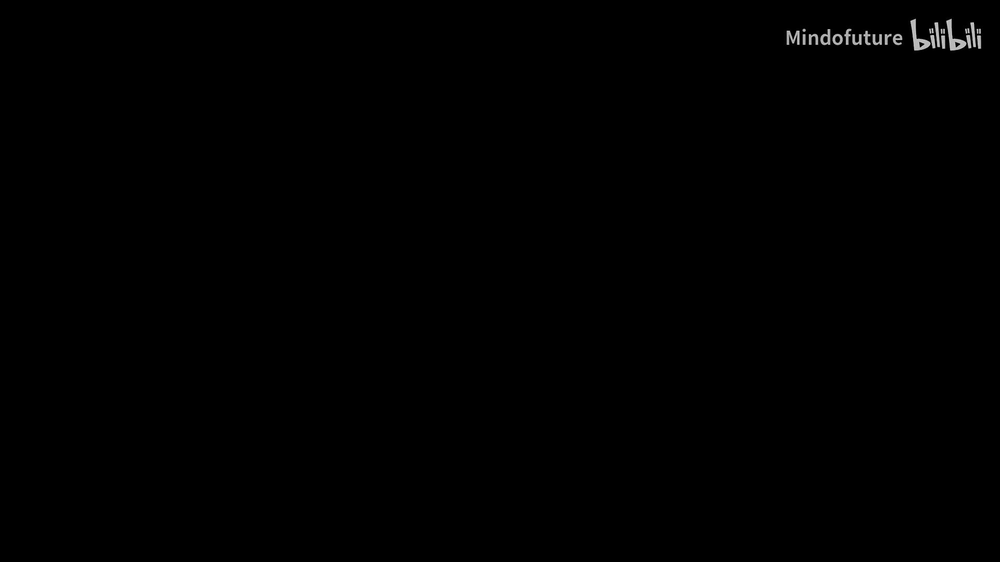
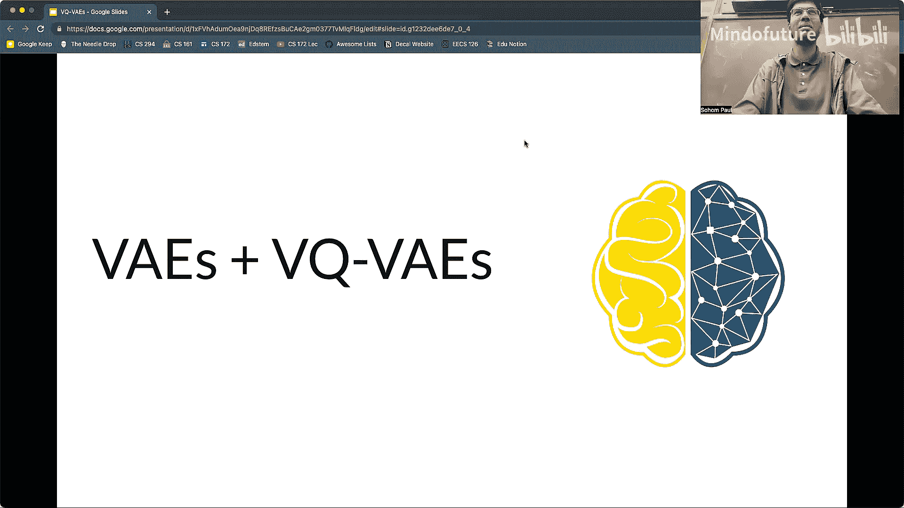
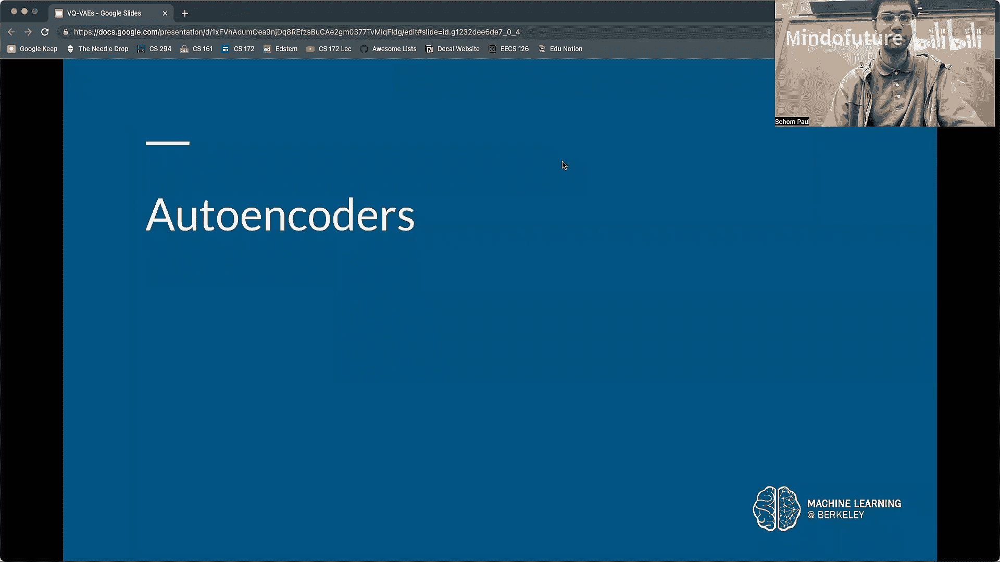
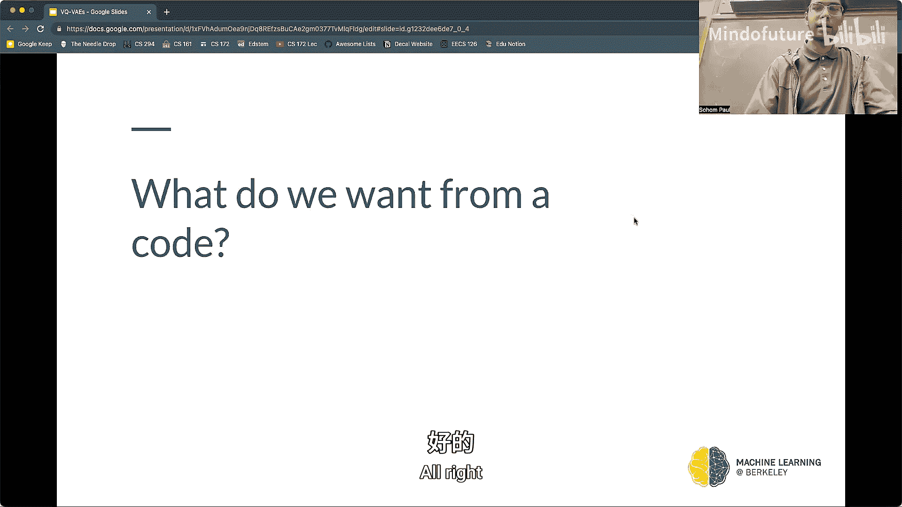
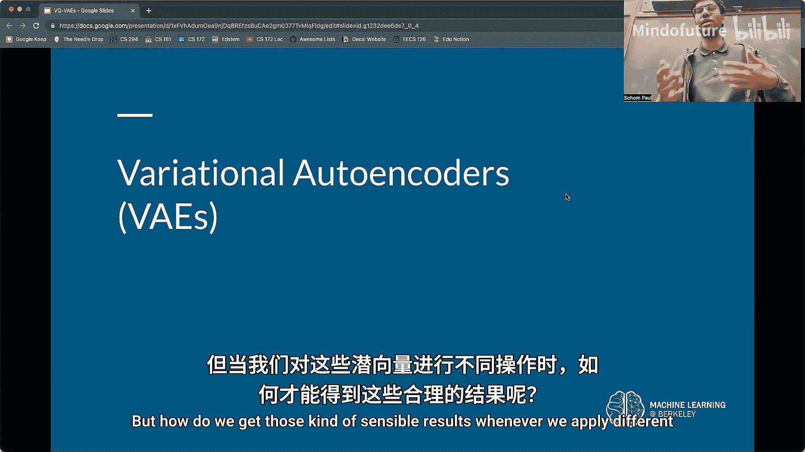
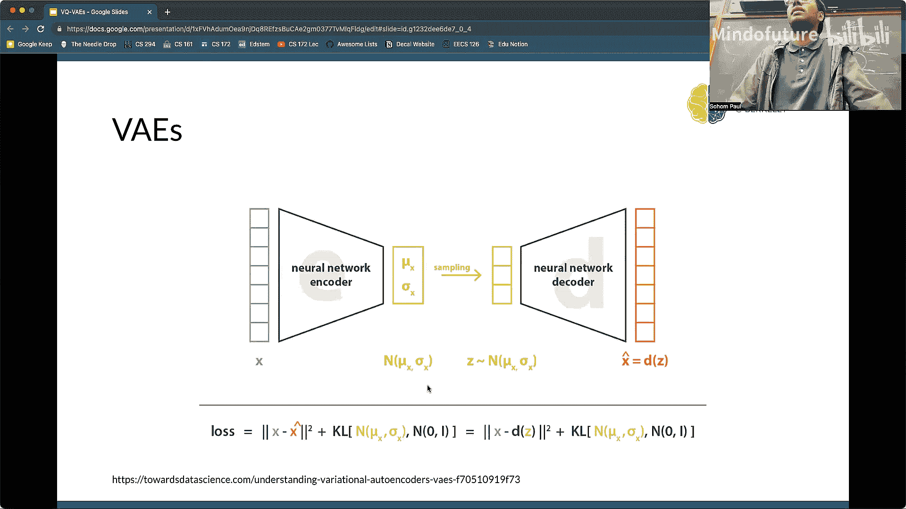
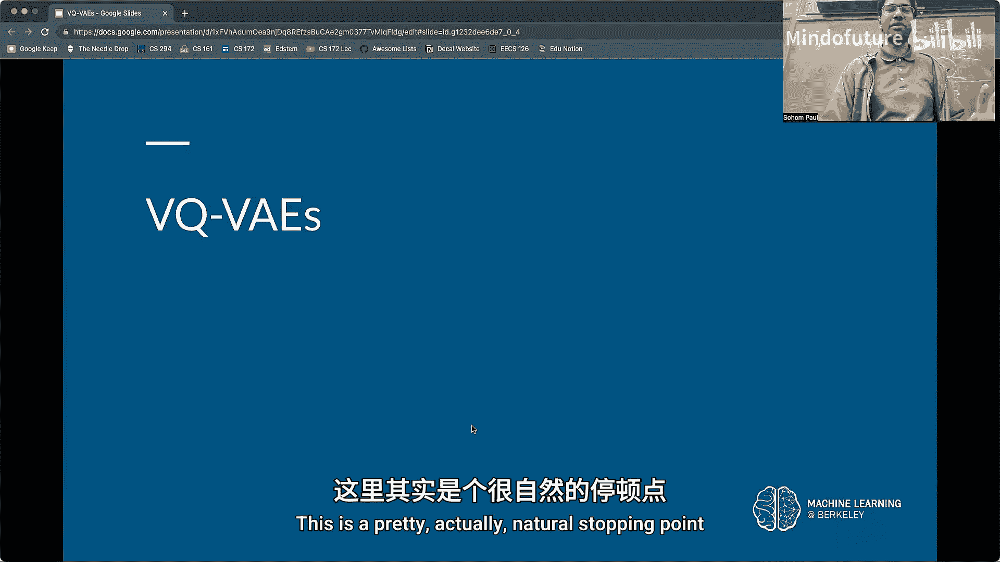
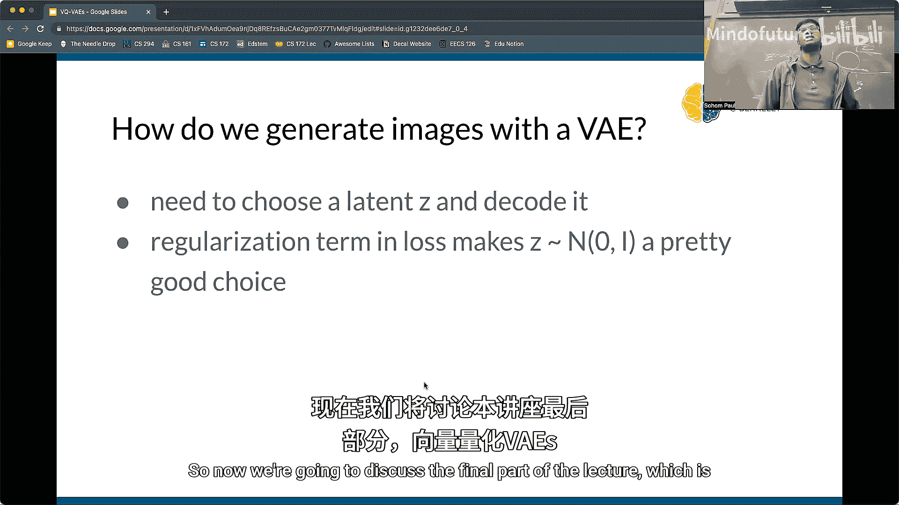
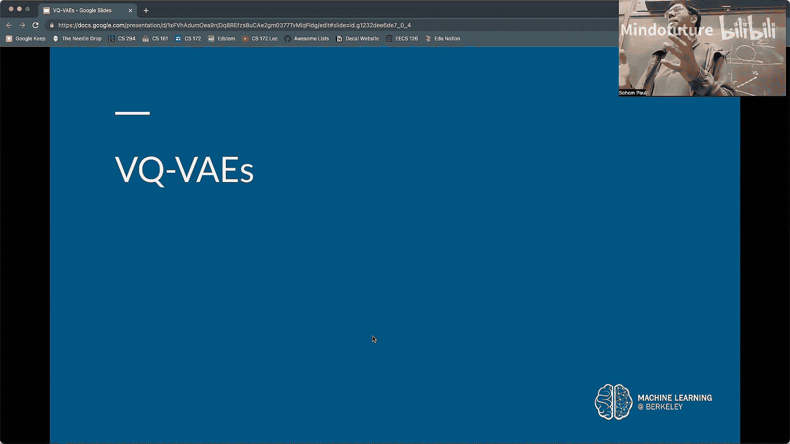
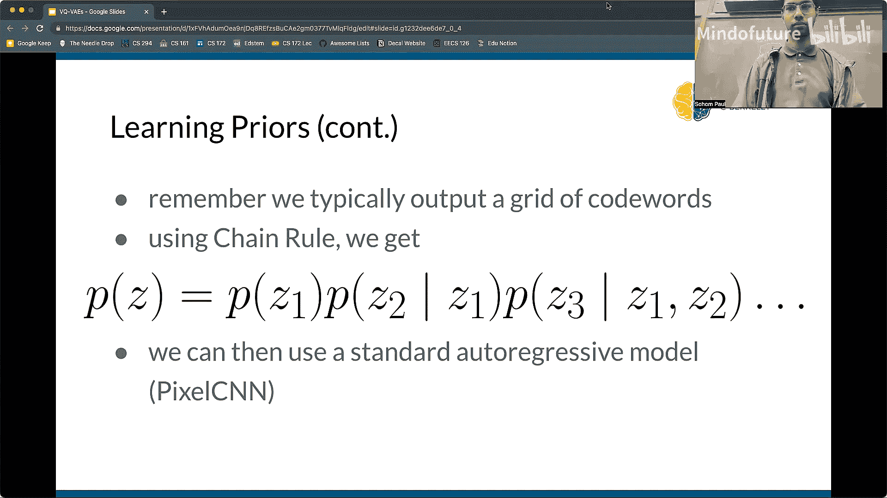

# 【加州大学伯克利】计算机视觉：视觉数据的深度学习 ｜ Cs 198 126： Deep Learning For Visual Data p09 P09_讲座9-自编码器、VAEs（变分自编码器）、生成模型 -BV1Va8zzfEtk_p9-

嗯。我这边吃过呢。So I two in a I can view today， but if you're amazed by their review number1 two。

We'll try if it it as honest as possible。And the end of the food Florida in which is one of the love museum。

 though。你该是复关。And， so here that I would do some people that see money。All right， hey guys。

 so you guys have probably not seen me yet My name is Sohu I'm a another person involved with machine learning at Berkeley I created some of the content for this course。

 but this is my first lecture so at the end I would appreciate it if you have like。😊。

If you have any questions throughout， if you want me to slow down， you want to clarify anything。

 please stop and just let me know all right。All right。So。The past few lectures。

 we were talking about you know some CNN related stuff like tasks in computer vision。

 so you guys probably have seen you know like image classification， semantic segmentation。

 all these different ideas that are related to the like。

The broad field of computer vision and like kind of。

Trying to find different objects within different images or trying to classify different things within the images。

We're going to start a module for this dec that's going in a slightly different direction we're going to be starting a module in generative modeling so what is generative modeling the basic idea is that。

We have a ton of data， you know， we have so many different images of cats。

 so many different images of faces。Wouldn't it be nice if you could use machine learning to generate new images of caps。

 new images of bases？But whenever you think about it this seems like a really really tricky problem right because we're giving like all these concrete examples of cats。

 how do we expect the machine to understand you know what are the characteristics that make a cat a cat you know maybe I'll end up learning that。

You know， like it's actually the particular value of some pixel in the corner that makes a cat a cat。

 maybe we'll end up learning that anything that has like a bunch of legs is actually a cat so then whenever we ask you to produce a new cat it will actually just produce an image that has like a thousand0 legs。

 which is not a realistic。So you have all these kind of things where it's very easy for the computer visions。

 like for your machine learning system to just like regurgitate some output that' seen before。

 but the goal of some of these methods we will be showing you in this lecture as well as the next one is that we will be showing you methods to generate novel images given some data。

So the technique that we're going to be used going to be using is called variational autoencoderrs。

 but before we discuss that， let's discuss what an autoencoder is。

。All right。And。Sorry， I apologize， I don't have my speaker notes in front of me。

 so these explanations might be a little bit rough， but please bear with me。

So let's first talk about the JPEG algorithm。Just quick poll。

 how many people in this room have heard of JPEG before？Okay， I was really hoping it was everybody。

Out of curiosity， does anybody have some like some knowledge about how JP compression works like maybe like some things they heard about it？

That's perfectly fine if you really don't know so I'm just gonna to like briefly say so it turns out that there's a few different ways that you can store images one of like the more popular types are like you know PNGs so essentially what a PNG is doing is that it storing like all the different colors and all the different locations within an image so you might be thinking like very very intuitively this is not exactly what's going on but like intuitively what they're doing is they're just saying okay at Pix00 I have this color for red green and blue and then a pixel 01 I have this color for red green and blue and they do that for each pixel on the image。

But that's not in a very efficient way of storing images， right， you know， like intuitively。

 it seems like。In general， you know that two nearby pixels are likely to have very similar colors。

 right？Like let's look at this image of a cat if I told you that one pixel a chic is orange。

 then you had to guess what are the nearby pixels on the chic you'll guess that they're also going to be orange right so there's like these different patterns that you can use to kind of compress the amount amount of data that you're using。

So here I'm showing in a source image and then the JPEG algorithm applied to two different levels of compression。

So we see for the middle image， this is actually a compressed version of the original。

 but it's actually very hard to distinguish， like almost none of the perdinence information is being lost。

 even though we are able to cut down on the number of bytes。

The third image is like a more extreme version of the compression。

 so even though like you see that you know it's like very clearly has artifacts。

 there are like kind of corruptions to the image。It's still recognizable as a cat and I don't have the actual sizes for these files off the top of my head。

 but you can expect that the third image here will we have a much。

 much smaller size in the original image even and it still retains that kind of semantic information that looks like a cat。

So how does JPEEC work well， sorry， let me take a step back and say。

 why are we doing compression in the first place？So there's a few reasons why you might be compressing data one of them is that you might want to save space right so like a。

So those you have a database of like 100，000 images of cats。

 you don't want to like completely blow through you like your computers like memory budget。

 so you want to like have each image compressed so that you're overall using reducing the amounts of space that you're using。

Another like kind of application is like if you're sending these images over a network。

 then like usually will be limited by like the number of like bits you can send per second so you want to like reduce the number of bits that the the images are so you can send more of them in like a reasonable timeframe。

And the final thing I want to mention is that because of these like other kind of like things you're trying to optimize for where you're trying to save space and like you know maybe reduce network bandwidth your compression algorithms don't necessarily have to be perfect so by perfect I mean here it's okay if you lose like a little bit of information like going back to this original thing it's okay if like the top right pixel of the image gets it's like the value for its red channel changed by like a couple of percent it's very unlikely for a human to like recly like see the difference but it might help whatever computer algorithm we're doing to kind of understand or like to be able to compress that data into a smaller similar amount of space。

So there's a few reasons for compression。But I think more fundamentally。

 the reason that we as machine learners care about compression is because compression。

Relies on having understanding the data that's something I'm going to go into a little bit more depth very shortly。

 but this is some some takeaway that if you only remember one three from this lecture。

 I want you to remember that compression means you must have understood the data at some level。

So let's go back to the concrete example of how JPEC works so the reason that JPEEC works is because nearby pixels are related so you have like some value of like some pixel then the pixels around it are likely to be very similar values and also we know that just in general very very fine features in an image tend not to be so important like a human eye cannot distinguish between you know a couple of percentage points in the color difference across two adjacent pixels。

So as a result。I'm not going to go too much into the full like signal processing involved here。

 but we use a technique called a Fourier transform which essentially represents the kind of image as a sum of like signs and cosines and says like all the signs and cosines that have a very very high frequency are likely not going to be very important for the actual image so it's basically saying the pixel to pixel differences don't matter so much it's only like the kind of like general structure of the image you know how does these10 pixels compareds to these 10 pixels next to it those are the kind of things that like humans really care about and those are the things we want to preserve so in essence with the JPG algorithm does is it takes out a Fourier transform it actually just completely throws out some of the higher frequency information some of the pixel to pixel relationships that don't really matter whenever it comes to human perception。

But let's take a moment to think about what we did here。

 because we understood that human perception has these characteristics that we don't care about like pixel to pixel relationships。

We're able to like reduce the amount of size of the image。

 so because we have some understanding of the patterns in the data。

 we're able to have some reduction in our storage complexity。😡。

Now I want to take this one step further， so the JPEG algorithm is great because it generalizes to like pretty much any image。

 you know， any kind of realistic image that youre going to take with your camera you're going to be able to find some reasonable JPG compression。

But what if as like just like intellectual curiosity。

 you wanted to make a compression algorithm specifically for cat images？

So for general images that the only kind of information could rely upon was that nearby pixels are going to be correlated。

 but if we know the images are images of cats， maybe there's some like more advanced compression scheme that will work。

 maybe we can do something that's like oh let me just specify like the location of the legs。

 the location of the tail， the location of the head and then just say okay let me store some additional bits to say this is the color of the cat this is kind of like the pose of the cat with all this information we can reconstruct a very good estimate of how that cat looks like。

But what are we doing here we're relying a much deeper knowledge of how a cat is structured than the JPC algorithm did the JPEG algorithm only looked at like different pixel values and used the assumption that nearby pixels are close to each other here we're making some very deep assumptions saying whatever objects is in patron our image if we know it's a cat then we know generally how cat likes are shaped we know generally how cat bodies are shaped so then you only have to tell me particular aspects of this cat and they'll be able to deduce the rest。

At a high level， that's how it works。That being said。

 it turns out very difficult to kind of engineer this by hand。

 you know what does it mean to look like a cat leg， what does it mean to look like a cat body？😡。

And your kind of intuition from the previous few weeks of lecture should kind of be kicking in now。

 whenever we have this kind of challenge of trying to represent some features of some data that's really hard to like hand engineer really hard to hand code。

That's something where you should be thinking about how can you apply machine learning to kind of learn those patterns automatically。

😡，So here I'm just showing a cute example from a few years ago， this is called eigenfaces。

 so essentially this is like way， way back in the early days of computer vision before we had all these fancy con neural numbers。

This uses only。He uses a technique called PCA if you've taken like E16b you might be familiar with that essentially what they did was they took a bunch of like images of faces that were like all centered and crops in the same way and they applied something called dimensionality reduction in order to get like here are the kind of like typical aspects of the features so you see in like some of these eigenfaces and you look at for example eigenface number 11 it's showing that like okay this person like has like like a distinct like a smiling teeth he has like some two swatches that corresponds to eyes and he has you know like a kind of nose and turns out that like by combining different characteristics of these different faces you can end up like representing like a large class of different faces。

So like here， this machine learning algorithm， we just told it to try to represent the data of faces in a sensible way and it ended up learning like what are the pertinent like kind of characteristics of faces。

And this finally brings me to the main topic of today's lecture， which is an autoenr。So earlier。

 I mentioned that eigenfacesis was using something called a PCA like in order to kind of compress these faces and like understand what are the pertinence features。

Here we're going to use a neural network to accomplish the same task and on the screen you will see the structure of this neural network。

So let's just take a moment to study this。You see there's going to be some input layer and this might be your input image。

 okay so it's like your picture of your favorite cat。

Then it goes through a series of different layers and then it comes to something that they've labeled here as the code。

 it's called the bottleneck layer， I apologize for not writing this on the slide but it's like smallest team player in the center。

 it's called the bottleneck layer。And then from the bottleneck layer， it goes back to the output。

But one thing you'll see visually on this slide is that the input is a very tall vector。

 while the bottleneck is a very short vector。😡，So what's actually occurring here？

What occurs in a real implementation of an oddr is that you might start with like a 128 by a 128 input image。

But then each convolutional layers will kind of decrease the size of the image until it reaches a point where it's like only like。

 you know， maybe 30 by 30。And then you'll have like a second。

 a convolutional network thatll take that 30 by 30 image and like try to blow it back up to output something that looks like the original image。

嗯。So let's just like go over the structure again， the first half of this network is called the encoder。

 it's taking your input and producing some some representation。

Like some vector that's going to be a lot smaller than original input and then the second half of this network is called a decoder it's going to take your representation and produce an image back。

So the goal of this encoder decodder structure is that your original image and your output image are going to be very close to each other。

 so I think on the next slide you're going to see we apply something called a reconstruction loss to this basically saying we want X and X hat like the original image and the decoded version of the like the result of this network to be very like similar to each other。

O。Now， one very natural question to ask is like why。

 why would we design a network that can like take an input and produce the same output can somebody like propose a very simple way of a designing network that can take an input and produce an output that looks very similar to the input without any like additional intelligence。

Yeah exactly if you just took the function f of x equals x then the output would be exactly the input so that's not a very useful useful function so why do we care about it here the key fact here is that the code the output of this bottleneck layer one second the output of this bottleneck layer will be a much smaller size than the input and then doing so we're forcing the network to compress and by forcing some compression we're forcing it to learn some features of the data yes that that question here。

😊，Using a different odor than you want for this stage to add like。For your transform。

 your're I like taking me outside into those size， but even adding different ones to get all。

images not necessarily relevantYeah， so the question from the audience here is like could you like somehow take the output of your encoder and like add like new features into it does I understand that correctly？

Okay so like that's a very good question and that's actually something we're going to be addressing in the later part of this lecture once we get into variationalrs that will then be possible。

 it turns out that just with this network structure it's not possible right now。

So what are the kind of like things that we want from a code， we want a few things。

One thing we want is that we want it to be small right。

 because like the smaller we can get it to compress the better understanding we must have had by the data。

But then there's actually some other kind of like things that we might want from this kind of encoding。

One of them is that if you take like two similar images。

 then you might want them to produce two similar codes。

 so like this notation that I'm going to be using throughout the lecture X is the input C is the code is actually in machine learning literature its called latent。

Z is latent and then x has the output we want if x and x like two different x's are similar。

 then we want the corresponding Z to also be similar and that's not actually being enforced by this autumn code structure。

In fact， there's actually no information we know about the kind of like Z vectors。

 they can just be kind of like arbitrary things in whatever dimensional space they live in。

So it turns out that it's very difficult for us to go back in and like do operations like say。

 if we have an image of a poodle and an image of a golden retriever。

Or like we should not we we might wish that we could like kind of interpolate between those images and get like some like new breed of dog。

 but it's very likely that if you just took the two encoded representations。

 the two z vectors for these two different images and you just added them together or like sorry you average them together you're probably going to get some garbage once you pass through the decoder it turns out that like this autoencoder structure as shown right now is actually not imposing any kind of sensible structure on like the the codes that's being generated and therefore。

It's possible for it to learn something like very like， a， a。

 it's possible for that space to have some very undesirable properties。Yes。So basically so。你云多机。

Thank。Yeah， yeah。旧时唔飞。Yeah like some of the questions like first of all is our main like kind of use of this network for the encoder and then yes。

 and then the second part of the question is like would the decoder like involve decoconvolutional network players and that's definitely like some way to implement it like it turns out that autoenrs to like a very general structure so like you could like replace the encoder and decoder by like transformers or something depending on like kind of your application。

But like， yes， deon flers is definitely a way of doing this。All right。

So now I'm going to be talking about variational onenrs。So variational autors is like。

It's going to be building upon some of the stuff that we talked about in eyeenrs。

 but when we actually give us some like really really magical properties like these properties will like let us do stuff like taking two images and then like kind of averaging these images in a sensible way so the example that I was like describing earlier if you have two dogs and then you like average their coats somehow whenever you decode the result it should give you something that looks like halfway between the two input dogs and it should be like in a sensible way it should be like you know if you have like a really short dog and really tall dog the output should be a medium dog it shouldnt just be like something with like two hecks or something like that。

But how do we get those kind of like sensible results whenever we apply different operations to these latent vectors？

All right， before I go into that， I'm going to discuss more generally why this our kind of like generative framework just because this is something we're going to be returning to viewtime over the course of like this kind of module。

So in general， whenever we're kind of do like kind of like image generation or text generation。

 what we're going to do is like we're going to sample something called the late inspector that kind of like has the information of like the image or the text kind of encoded in it。

And then we're going to like use that to output some final output。

So the intuition that I'm using here is that the late vector kind of acts like genes。😊，So you know。

 like every， every human has like some set of genes and that set of genes will kind of determine the structure of your face。

So like even though you can't like， you know， like you can't observe the genes directly。

 maybe if you like had this kind of data set of like a large number of people。

 then you could like start looking at like maybe some like the kind of relationship between the different faces and then you are able to deduce like oh maybe this person has like some gene that codes for like maybe your right hairitness and then like you would like deuce some like kind of properties of that。

And then if you wanted to generate a new face， then your general approach would be first you like choose like some set of like of genes for this like hypothetical human。

 and then given those genes you choose like a face that corresponds to that。Actually。

 because I get a quick poll， how many people have seen the words like prior before and how many people have understand what I mean by like P of x bar Z。

A few people。Okay， so it seems like some people are like。A little bit familiar with this concept。

 but just as a quick refresher whenever I write down let me just。

Increase the size of this so people watching lecture at home can see。Whatever right， right， he of x。

This is saying X given Z。So it's basically saying once you know Z。

 there's going to be some probability distribution over x。And then whatever we say a prior， well。

 it's basically we first generate our set of genes and we know that。

There's like some distribution over possible sets of genes， you know， it could be that like you know。

When you're born， you're randomly given like some genes that code for long hair or you're randomly given some genes that code for like shorter hair or something like that。

So like we model this by saying your set of genes is given by some probability distribution。

And then once we know what particular like genes that you got。

 then your your facial structure will be some kind of like function of the of the genes that you received。

 so I'm not saying that it's necessarily deterministic mappingping。呃。

AndBecause there are like some things that affect your facial structure aside from your genes。

 for example， a real robotics out。Like your diet or like the amount of exercise you did as a kid or like the kind of environment you grew up could all affect like aspects of your appearance so that's one part of it but just like kind of abstract these notions away you can kind of think of it as even when a process in the real world is deterministic sometimes you might want to model it as a machine learner as kind of like random if you don't understand like all the underlying processes so for this example。

You might not be able to kind of like capture the kind of other things that are affecting people's like facial structures。

 so as a result you just model it as like some probability distribution so you know like maybe 50% of the people ate this growing up and like 50% of people ate something else growing up。

Okay， so that's a bit of a detour like introducing some notation， I don't think this is super useful。

Actually， there's one thing from the previous slide that I do want to kind of highlight。

So what the encoder's job is。Is it all take？Some input X and all produce。

Some latent vectors so I'm using these terms interchangeably latnt and code the word code comes from like a field called coding theory。

 it actually precedes machine learning， but in the machine learning literature more commons call it a latent so I'm going to be using that kind of word more often now。

the encoder takes some input image and produces a latent in the decoder。Takes that latent。

And produces its estimate back for the original image。Right， first of all。

 can everybody see what I'm writing on the board？Right。O。

So the approach that we're going to use to ensure that。

We get some sensible structure and lant to give such desirable properties as I apologize that I don't know your name。

 but one of the students earlier had asked for is it possible to take the latent vector and kind of add things to it to add more features so like we want to kind of impose some structure on this lant space？

The technique that we're going to end up using is we're going to use probabilistic encodings。

So the idea here。Is that。Suppose that instead of like mapping like some input。

To some particular so you can think of that as like you know。嗯。

And I have thats this particular third point。Whatever it map。

To a kind of distribution over possible disease。So like we're saying the notation for that and probability is we're saying v is from a distribution dependent on x。

So it might be that we're saying that X will like map for this entire kind of region。

And the reason that going from just one point to an entire region is useful is because this is forcing nearby by points in latent space to decocode to the same vector。

That's a really important point， so like， please stop me if this doesn't make sense。

Originally we had an encoder giving one point and then like whenever we do the decoder。

 it would take that one point and produce the original image。

But now we're producing some we're taking the encoder or making like some probability distribution so for now it just like think of that as like some big circle so we're like saying the encoder has to be like reduce some circle and then every point in that circle must decode to the original image so because every point in this circle must decode to the original image and saying that nearby kind of nearby vector in this latent space or we're going to have to decode to similar images。

So like let me just make this clear that you're on final plot。那边cos are。

So this brings us to variational autoenrs， so the basic idea behind the variational autoencoder is that we have the same encoding like encoder decoder structure as we saw earlier in the lecture where you have some kind of input image that's being passed through some neural network encoder it gets out some code or a latent vector and using that latent vector。

 you decode that and get something that you want to be close to the original image。

But now there's actually some caveats。Before we would have that like the input X would produce some Z and you would feed that directly into。

Yes这 the decoder to get x hat。But now we're doing something different。Instead， what we're doing。

Is that we're using x to output the parameters of some Gaussian。

And then we're sampling Z from that Gaussium。First of all。Does。

How many people here are familiar with the concept of like a Gauss distribution？Okay。

 so for those of you who are not familiar a Gaussian distribution。

 you might know it in one dimension as like the bell curve。Let me just separate out here。

That you might have like seen like this kind of like curve before。

It turns out that the Gaussian distribution。It's like a very。

It's a very important model in like probably statistics it shows up all the time like kind of real world statistics。

 but also its just like the reason that we're like using these x's to decode into Gals instead of individual points is actually just entirely this for the reason of this picture that I drew on the board it's like instead of forcing it to be like a single point that gets decoded。

 it's forcing it to essentially be like a circle somewhere in Laden space and that entire circle has to get decoded to the same thing。

So the structure of the variation on or loss is that we include some reconstruction term。

 so this first thing that you see here， which is x minus x hat of bar squared。

 that's essentially saying that your input student the network and your output of network should be close to each other。

But now we're adding a second truck and this is called the。

I cant for life for me remember what it's called but this is forcing the kind of like output of the encoder to look like a normal distribution and it gets very mad if it does not look like a normal distribution so it kind of prevents you know the encoder from kind of just producing one point and learning only one point to output as the decor enforces instead is like encouraging the encoder the output like very large sets and then the entire set has to becode it to the same point。

So you kind of see that there's like some kind of like contrasting objectives in this loss here what the onr would like to do is like map every input to just like a single point like really far away from each other so that want to make us decoded it's able to just say oh you're from that point I know exactly which image you came from or you're from this point I know exactly which image you came from but what this other term the loss is doing is essentially saying I'm forcing all the points that kind of be close to like being in the center of the plane so first of all yeah I'm forcing to be close to the center of the plane and they're also being forced to like have like some variance so that it's actually Al existss and some of just individual points。

So if you don't know too much probability， then like it's okay。

 I think that the main intuition here is that you should remember that this is like kind of for state to learn that nearby points should decode nearby vectors。

Okay， and the reason that。Having these kind of like structured lant space is such a useful idea is because it turns out that having structured lants。

Lets you do some pretty incredible things， apologies。这个是啥事？

Let's you do some pretty incredible things one application that I' mentioned earlier that i'm going to come back to just because I think it's such a surprising application is that once you switch over from using audio encoders to variational audio encoders。

 it turns out that you could do things like interpolate between two images so。

You might have seen some applications online， and I wish that I maybe included one in this slide deck where you have like you input two celebrities faces and then like gives you a slider that you can use the slide between the two faces。

And if if this online demo is any good， then you're going to see that it behaves like a kind of sensible way。

 if one celebrity has like you know a very pointed chin while the other one has like a round chin。

 then like the slider will like cause it so that the chin becomes like less and less pointed as you like move the slider along。

The reason that works is because in this variational autocoder it's kind of forcing all these lane vectors to kind of have these like live together in the same space and like。

Have these nice properties like you know nearby lant should decode to the nearby points。

 so if you kind of like draw a path between two latent vectors。

So if you were to take two latent vectors and draw path between。

And then you try to decoding points on each kind of step along this path。

 and each of those things should like kind of progressively get further away from x1 and get closer to x2。

Yeah。你死啊。你和家人同意东系。I不。So it turns out that what you do is that you take a neural network and you output the parameters of that Gaussian distribution。

 so you use a neural network and it's going to put some vector mu and some vector signaligma。

And then those parameters get fed into a Gaussian distribution。

 then use like sample from that Gaussian distribution。

 and then that sample gets fed through the deffier。啊。

Or like are you saying like how hard immune is like my like？就系佢要佢得成。Is。Yeah。

 so you know how like for the different machine learning tasks we've discussed so far。

 we take like some input vector， we apply some layers to it and then become some output vector。

So that's exactly what's happening here。This you five layers。3减7M万以拉1天。Yeah， exactly。

In sample is still like， you still like training。不ish。

Yeah that's the thing i'm leaving out the details of how to train this because those detailss are really tricky because like your intuition spot on you should be like this sampling step looks so different from the things that I learned about。

 you know。At the start of this course， when we talked about like， you know， for neural networks。

 each of the layers has to be differentiable in order to like do back propagation through this。

It turns out that you can do back propagation through the sampling。

But there's like some hacks that can get around it essentially。Um。

 like I didn't go into too much detail about exactly what this like KL term and the loss was。

 but it turns out like this paper had a bunch of really good ideas。

That like somehow made this thing work and like now that those ideas exist in the world。

 you can like think about how to extend upon those ideas and like how to like modify those ideas in order to like fit your like applications。

And then that switch。未来自己玩也不行，一个都不行。Yeah， the choice of the Gaussian here is like really arbitrary。

 one of the reasons it's used is because it makes the actual final expression for the loss a little bit nicer to compute。

All right。

This is like a like a pretty actually actual stopping point。

 so do people have like additional lectures on otherrs on VAs are people like lost that。

Does everything so far make sense？All right。So now we're going to discuss the final part of the lecture。

 which is。

Vctor quantifies VAAs。So so far， whenever we were discussing VAs we've been always working in this kind of continuous setting so I said that you're going to have like some some La vector Z that like kind of exists in this like kind of space and then we're going to sample from a Gaussian but you see like pretty pretty quickly that this is forcing。

啊。Like this seed being along into the disc is forcing it to like kind of have like some kind of continuous value。

So like it's。The Gaussian is not a discrete distribution。

 so you should not expect to get from your probabilistic encoder some kind of discrete outputs。

But can anybody give you an example of a field where discrete kind of outputs make sense where you only want one of end things as your possible output to the network？

没。Yeah， so classification is like a good response。Yeah then the classifications。

 the correct response to the question I asked and the question I had was different from the question I asked but like yes that's a very very like a nice observation I was like slightly going towards if you're trying to generate some like new art if you're generating like you know like visual art it makes sense if your things are kind of continuous because like if you like change some pixel value by 1% then it's the same its the same pixel essentially so it's going to be the same artwork essentially。

😊，But if you are try to generate poetry， for example， what does it mean to change a word by 1%？😡。

There's no there's no good definition for changing a word by 1%。

 either it's a valid English word or it's not。So you can only change like kind of text in like kind of discrete increments。

So yeah I don't think that you guys got to exposed too much NLP yet。

 but essentially whenever you're using like textual data it turns out that you represent them you using discrete tokens so like you might have a dictionary of like saying these are like the top like you know 5000 most common words in English language so whenever you have like some some text you'll say oh this is word one。

 this is word 10， this is word 5000 but。But like you will kind of like not be able to。

Like those are all discrete things it's going to be one of those values from one20 5000 encoding the kind of like words the in the text。

So this means that if we have some architecture that's meant to work on kind of like natural language shita on data involving words。

 then those tend to prefer discrete representations。So like if you guys have。

Happen to have heard of transformers before。Transformers tend to be applied on like a kind of discrete data so as a result。

If you want to generate some like kind of like text instead of generating some images。

 it makes more sense to like find some way of extending VAEs to work for these cases where you're using kind of discrete tokens。

So kind of the hack that people have thought of is something called vector quantization。

So actually another quick poll， have people heard of the one nearest Stan algorithm？Okay。

 so it looks like it's a pretty mixed pack The basic idea is that。Actually。

 I'll just point to the image of the board， you might have a bunch of vectors right。

 so those vectors are being represented by the axiss。Pause。Good。

Those vector are being represented by the axis as of essentially saying we have some codebook of like。

kindd of like valid words or valid tokens and whenever we see a vector。

 we're going to round it to the closest codework。So in this example here， you see that like。

Well let's focus on the top left corner of that image for now so in that top left corner you see that there's like four or five different vectors in that kind of region。

 but the closest elements of the codebook， the closest red dot is the one being labeled Y10。

 which I don't imagine you guys can see but just the right dot in the top left corner。

Because that's the closest code where， they all get arounded to that value。

So essentially what a VQ VAE does is that it does the same steps as a normal VAE。

 but after you do the sampling of the Gaussian， then it has a separate step where it like quantizes all those values。

 meaning that arounds them to different elements of a codebook。

But then that like leads to the kind of issue， how is this codebook chosen， you know。

 like we have all these vector that are being outputted by our VAE。

And then we went around them to a kind of discrete set of values。

How do we know which discrete set of values will make the most sense for the network we could just hard code you know like we want the code words to be evenly spaced。

 but maybe like。Maybe it turns out like most of the images in your data are like related。

 but then there's like some other images that are like just really different but also related so in this case like evenly space codes might not make sense it might make sense to have like the code wordss kind of be like there's a bunch of codes corresponding to different kind of clusters within your distribution。

So as a result， we also want to have a step where we're learning the locations of these codes。

So this ends up being the loss for a VQ of VAE it's really complicated and I don't recommend you study it。

 this is like probably one of the most difficult topics of machine learning。But basically。

 the basic steps are you have a reconstruction loss。

 which is similar to the things that we were saying earlier。

 you want the output of your decoder to be similar to the input that you pass in。

So that's one that element lost。Then the next element is that you want the vectors that you're being outputted from the networks to be close to these code wordss because like essentially if if the vector you output it from your Gaussian is' really far from any of these code wordss。

 and it seems like it's a really strange operation you're doing to like browse that like vector that's really far out to something that's like a really large distance of away。

 you want your code wordss to more or less represents the centers of a clusters of your distribution。

So we have this like term a loss called Co alignment that essentially says like the results of your encoding should be close to the。

嗯。Should be close to the covers and then it turns out that we need another term in our loss call commitments I'm not going to go too much into detail there。

 but essentially you'll notice in this problem we're learning two things simultaneously。

 we're learning where the vectors output by why the encoder should go and we're also learning the where elements that like kind of represents like the centers of the clusters of these outputs of the encoder。

So as a result， because we're learning like two different sets of things。

 both the output vectors and then also there the latent vectors as well as the things that' are getting grounded to。

 we need two different terms in the loss to kind kind of like force these two things to be close to each other。

The exact mechanics again， not so important， I don't recommend stressing about this if you're very curious like you can read the paper。

O。So。Just taking a step back， what we're doing is that we're like using an encoder to get a Gaussian。

 we're taking samples from that Gaussian， and they we're rounding them to different values to make it like a kind of discrete thing。

But what's stopping this like this kind of network structure from just like learning to hard code the input data it seems like。

One of my issues with the first architecture I proposed。

 the autoencor was that it could learn to just take your input data。

 like just like map into some discrete set。And then like learn some inverse map for that so it's going to like just memorize your data and like not use the full lightnt space。

So it seems here that like maybe your code wordss are going to end up like a hard coding the input data。

And also seems like if you only maybe have like 512 code words。

 and it seems like if you're actually using this for textual generation you'll only be able to generate 512 different words well that's okay what you're using for image generation then being able to generate only 512 different images seems like really terrible。

 whether you want to generate like a huge like diversity of images， how do you achieve that？呃。

One kind of naive solutions like you increase the number of code wordss you're learning。

 but like then you kind of only have a linear relationship between the number of code wordss that your network learns and the number of distinct images your network can kind of output。

So instead of doing that。😊，What we do is that we have each input produced many coverts。So。

This is going to be a little bit complicated， so let me illustrate with an example。

 so the example they gave in the paper was suppose you had like a 128 by 128 by3。

So what I mean by 128 by 128 by3 is that the height and the width of this image are like 128 pixels and each pixel value has three different color fonts。

So then what it's going to do with the encoder。It's going to。

Eventually get this down to like a 32 by 32 by one。kindin of like a tensor size。

So now instead of 128 by 120， it's only 32 by 32 instead of three color color channels there's only about12。

Then each of the elements of this like 30 by 32 by 3 paper。

Each of them gets separately quantized to one of 5 12 values。So now it's still 32 by 32。

But instead of like having like one real value， it's going to have like some quantized values between the between like a zero and 5 and 11 or something like that。

And then using that， you can like end up learning something that's going to output some some image and the reason that this works is because each element of this like 32 by 32 grid is going to be a different like quantized code word and we set that the number of code wordss is going to be around 512。

 the total number of distinct kind of things you can generate is going to be 512 to the power of 32 by 32。

And that's huge。So like now we've gotten away from the problem where we needed as many codewords as we needed potential outputs by like kind of like saying okay we actually forced the inputs to a map to many codewords and that collection of code wordss。

 it has like a lot more possibilities， that's going to rev kind of exponentially。不。

Right now I've not been so clear about how we're actually sampling from the VAE sorry。

 we're in the VQVE whenever we're sampling from the VAE。

 what we're doing is we're just sampling some C from a normal distribution and passing it through the decoder and that's going to give us a novel image an the image that nobody has seen before。

But how do we generate from a VQ V we could try uniformly sampling the codebook elements。

 but you know。Maybe it turns out that like in the true data distribution。

 you have many more data data of like dogs than you have of cats so you might want to end up learning that like these kind of code wordss are like more common to use than these other code wordss。

 so it turns out that you can also have a step where you learn a prior over the code wordss。

All right， I realize that we are at time， so I won't go too much detail about learning these priors and also you guys do not know what an autoaggressive model is yet so I'm going to kind of skip that apart from that。

But yes， do you have any questions？Just a recap， we started with autoencodederrs。

 which I was able to take an image， compress it down and then like produce the same image which forces it to get some understanding of the data。

 but we want to be able to generate new data or take linear combinations of data so then we move to a variational autoencoder variational autoencoder forces the latent space be shaped like a Gaussian distribution so then whenever we want to sample like a new image that nobody has seen before we just take an element of a Gaussian distribution and then decode that。

And then finally， I've discussed that we have very vector quantas of variation auto encoders。

 which are able to generalize these ideas to the kind of discrete setting。All right。

 that's all I have to talk to you a about if you have any further questions。

 come find me at the front of the room。

Okay。