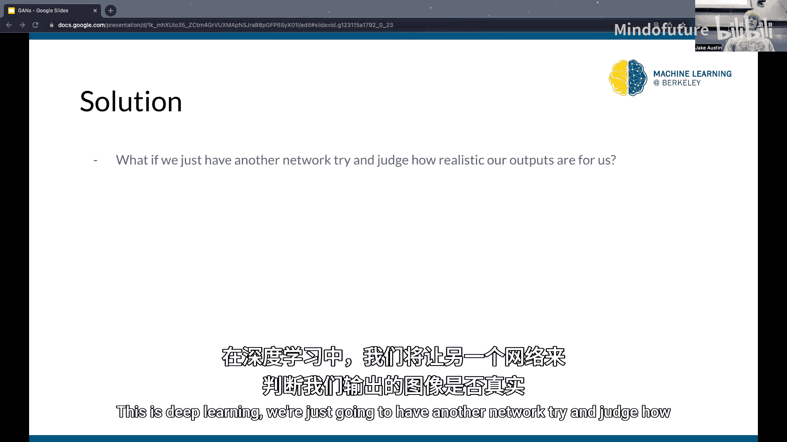
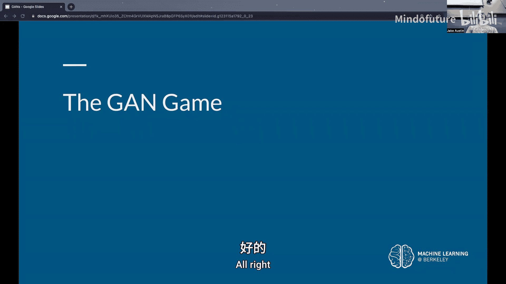
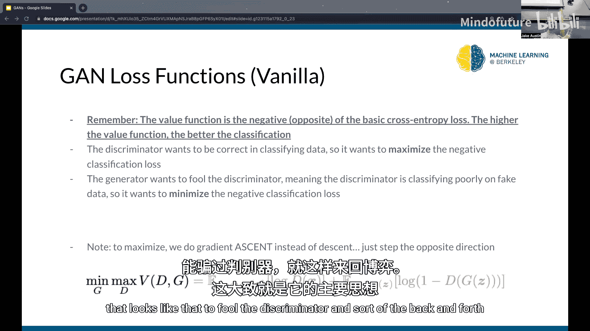
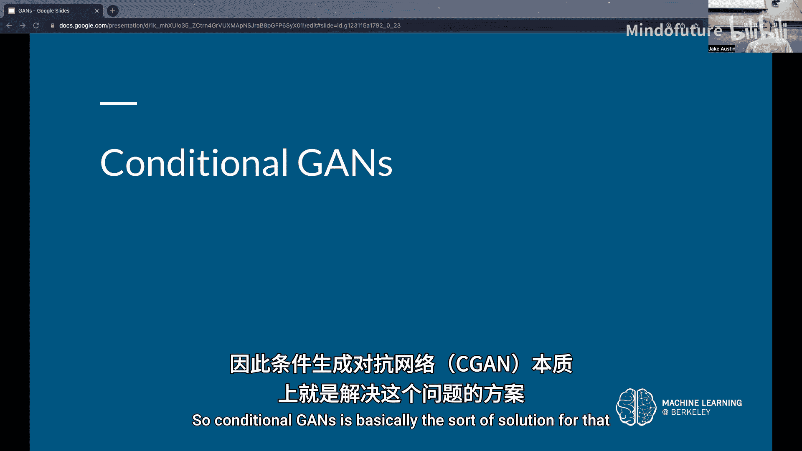
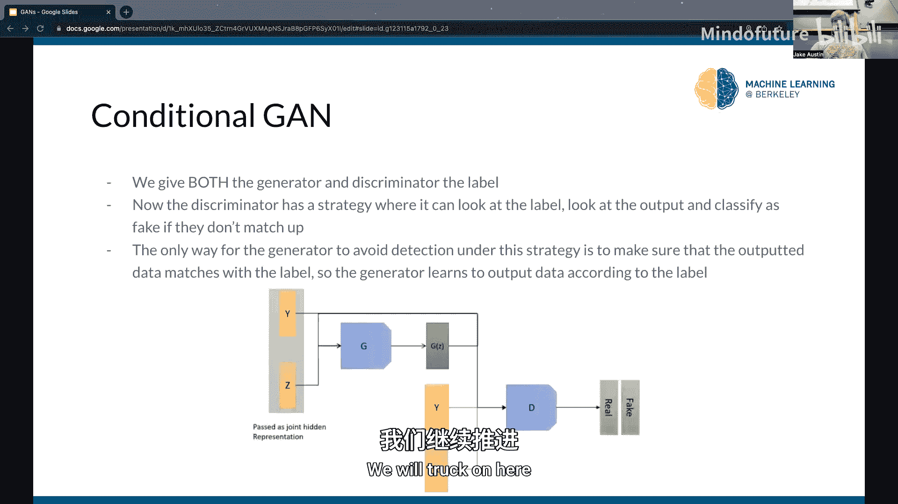
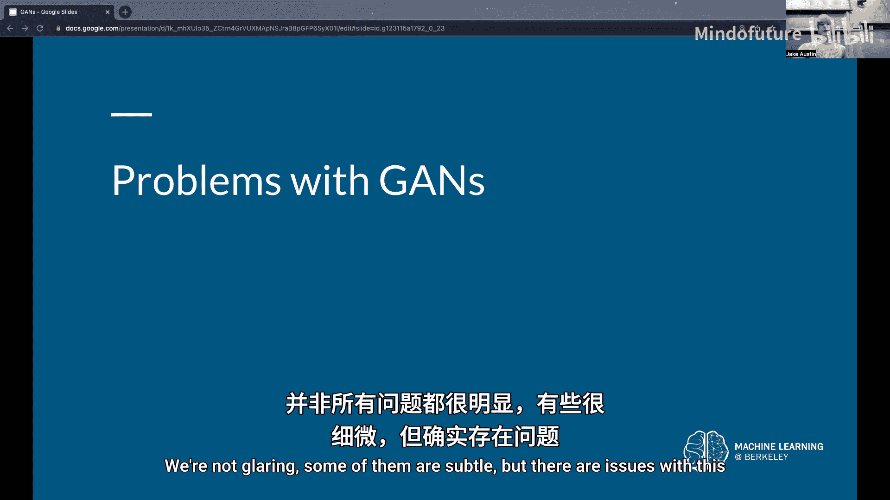
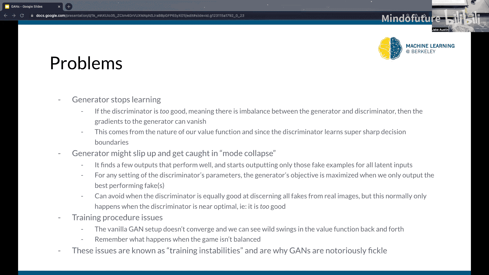
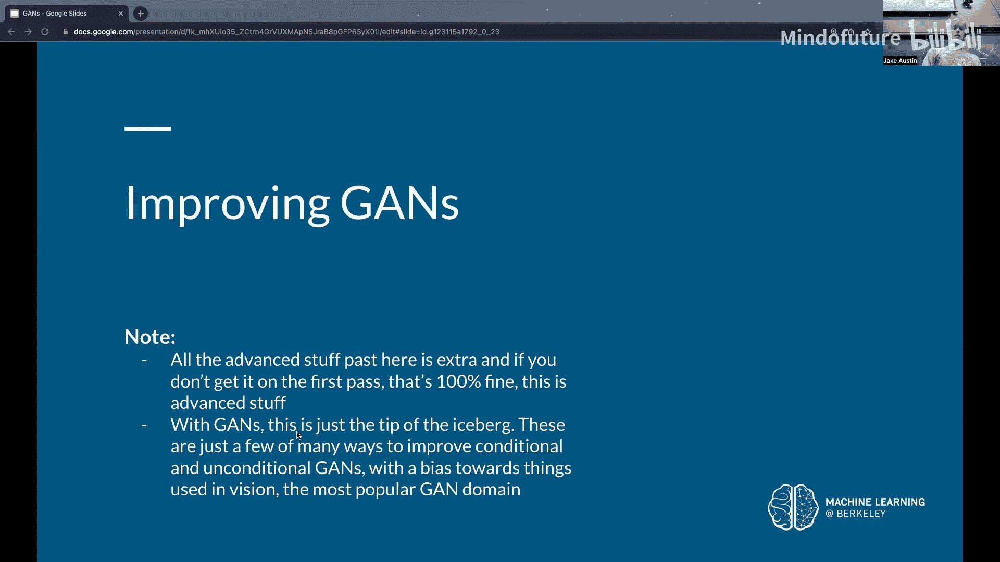
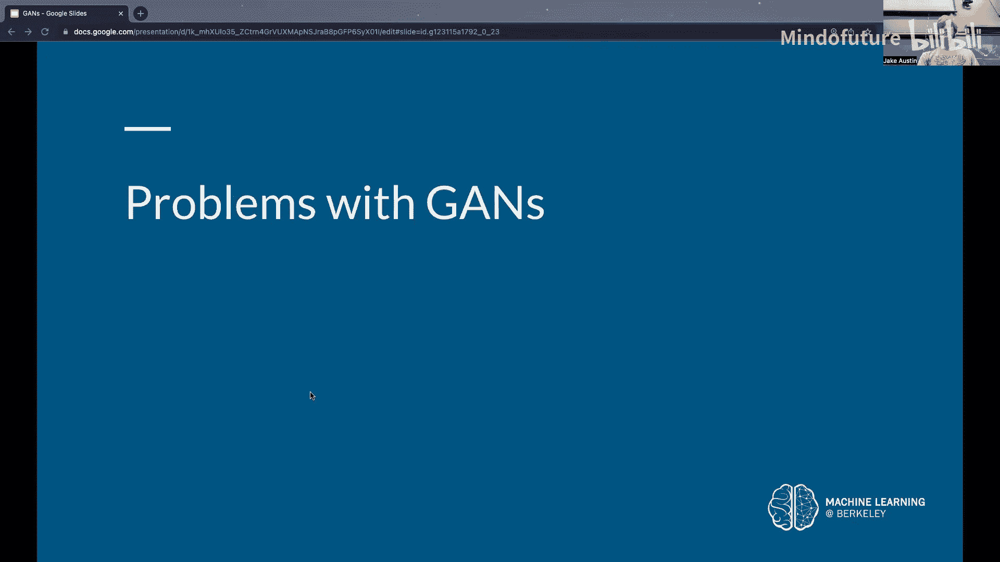
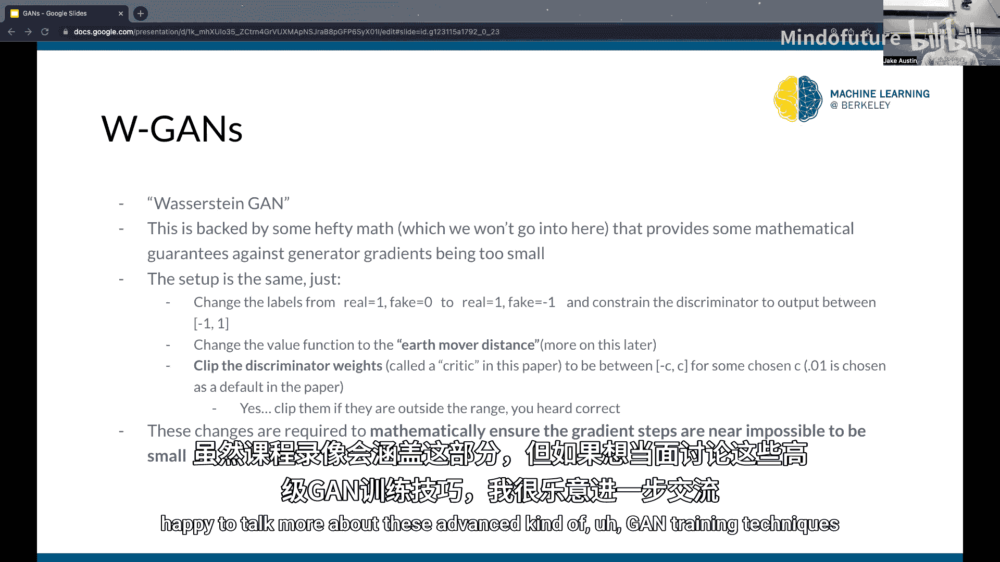

# 【加州大学伯克利】计算机视觉：视觉数据的深度学习 ｜ Cs 198 126： Deep Learning For Visual Data p10 P10_讲座10-GANs（生成对抗网络） -BV1Va8zzfEtk_p10-

Okay， so I think。s get started here so today we're going to talk aboutganNs but before we get started I was wondering if people had more questions or if we can run a little bit of review from the lecture on Tuesday if people like questions comments or concerns about like this idea of like a latent space and like a codebook representation of inputs if not i'll do a quick review anyway but if there's if there's pressing questions that's probably slightly more pressing then the back half of this lecture which is going to be。

farar less crucial and critical， so if people have questions， I'm happy to take them。不是道。All right。

So， yeah。So we're going to talk today if not about GNs we're going to go over first a little bit some stuff that we talked about on Tuesday。

 so this is review but again please feel free to stop me if there's any questions or comments or concerns about what i'm saying。

So on Tuesday we talked about latent variables in this idea of like codes like we have a whole bunch of different inputs in like an image data set and we want to figure out how to compress them and map images into more compressed representations in the form of like say 32 dimensional vector so we have a 128 by 128 image the challenge in the case of like an autoencoder is to figure out how we can represent that 128 by 128 image with simply just like a 32 dimensional vector like how can we encode all of the important information that is in an image and put that into into a vector that then we will pass to a decoder who is responsible for looking at that vector and saying okay based on this vector I know what was in the input image。

 I know what the most important parts were and I'm going to try my best to reconstruct that。嗯。

And if we want to， we can， after we're done training an autoencoder on this setup of just a giant data set of unlabeled images。

 we can generate new images if we want by just sampling new latent vectors that maybe we didn't get while training on our data set and if our decoder is working well。

 hopefully it will be able to attempt to， or it will attempt to decode that into something that looks good and realistic for our data set。

Um so that was sort of that was sort of the the key idea that we wanted you to take away from like Tuesdayum yeah。

 are there questions or comments on that？All right。

So the thing that we were really looking for from like our autoencors is we really wanted things that look like in distribution for our data。

 which means so given like a data set of like cats or dogs。

 we're hoping that our generator will generate an image that looks like a cat or a dog and like a real cat or a dog too not like a stick figure or something likeme but how do we like judge this because this is sort of a really subjective thing like how how do we know when our data looks good。

 what does good mean。So if our data is something really super high dimensional， like an image。

 128 pixels by 128 pixels by three color channels， that's like a lot of different choices we can make at every single pixel。

And。This this can be this can be really difficult to figure out like given this really complex input。

 what does it mean to be good what does it mean to be like realistic and oftentimes if you don't really have enough data to form like a real probability distribution so it's really hard to kind of to figure this out how do we figure out whether something is outputting according to our data distribution or not sort of this weird nebulous concept that we're trying to solve。

And。Rather than trying to solve this directly by like。

By hand specifying what defines a good looking image this is deep learning we're just going to have another network try and judge how realistic our outputs are for us and that that brings us into what Gs are in the GA game there questions so far。

All right。

So the core idea is that we're going to have two networks that are competing against each other。

 one is trying to generate data and the other one is trying to guess whether that data looks real or it looks fake。

This is sort of a game theory ask concept， the discriminator wins this game when it has low loss when it's classifying images correctly as real or whether they're fake and the generator gets really low loss when it fools the discriminator and gets the discriminator convinces it to classify its outputs as real images so they're competing against each other。

 so your discriminator network is going to take in a batch of fake images and a batch of real images and trying to figure out which ones are real which ones are fake try and divide them up if it can and the generator again is just responsible for feeding the fake images and trying to get better and better results according to your discriminator network。

And because everything here is still fully differentiable， all of our linear layers， convolutions。

 all of it's still entirely differentiable， we can still back propagate all the way through from our discriminator's output from the classification that it does all the way back to our generator' weights so we can still we can still run gradient descent and all of that but yeah that that is the high level forganNs here。

 it is effectively this game theory， this game that these two networks are're going be playing competing against one another and you'll notice it's sort of a slight shift from autoencoderrs whereas autoencoderrs we're trying to take inputs represent them in a compressed way and then decompress them instead of the bottleneck being in the middle。

 we have something in the middle between these generator。

 the discriminator and generator networks that's a lot more high dimensional it's sort of like we just swapped the discriminator or the encoder and decoder from our autoencoder set。

And it's a slight paradigm shift the differences whereas in auto encoders we're training jointly。

 the encodeder and the decoder were working together to try and best reconstruct images with GANs。

 our discriminator and generator network are competing against one another。嗯。But other than that。

 the same techniques， the same architectures you use for your encoder and decoder will work exactly the same for your discriminator and your generator respectively。

So it's not a terribly large conceptual jump or a jump in terms of what you need to actually go and implement。

Yeah。That's what I want you to take away。So the things we have agency to choose oh and I should note as well。

 the input to the generator is going to be just some kind of random noise vector sampled from some multivariate Gaussian or something like that it's just going to be some random noise that the generator is then going to try and figure out okay like how can I assign some meaning to this random noise so that i'm not always outputting the same thing every time because if your generator outputs the exact same image every single time your discriminator is always going to win it's going to say oh I've seen this image before and it's always going to to tell for certain that an image is fake so we need we need to give it some source of randomness。

Something to try and again assign random meaning to the generator is going to see this latent variable of noise and just try and decide。

 okay， if this value is big that means my cat is going to be standing up or running or something like that。

 it's going to get this this variable this latent variable of just noise and try and assign meaning to it so that I can generate a whole host of inputs or a whole host of real looking images。

So we have agency to choose how big the latent vector is and what distribution we're going to sample from we can choose the generator architecture that goes from just a single variable latent variable just a vector all the way up to something that looks like an image instead should of the same size。

 the same shape as a real data。We can also。Yeah， and we also get to choose like the discriminator as well。

This is a typo I apologize， the discriminator architecture architecture that goes from either real data or fake data all the way down to like a value between zero or one that classifies how well how much we think it looks real or fake。

And then like the loss functions we're using。Hyperpar optimization， all that。

 so that those are the things that we have agency to choose when training again。

So this is sort of Laman's terms hopefully don't worry too much about the math on the right if you want to go back look at it later that's fine。

 but for now the thing I want you to care about is that on each batch of real data。

For the number of times that you want to update the discriminators rates for this real batch of data。

We're going to take。All of our real data and we're going to also generate some fake data pass that to the discriminator。

And then choose to update just the discriminator weights and then alternate back and forth between training the generator。

 the discriminator， the generator， the discriminator。

 giving them each a turn to improve before going back and forth。

And you can choose whether you want to update the generator multiple times before you update the discriminator or vice versa so these are these are some things in the training procedure that we also have a little bit of agency issues use。

 but again the core thing I want you to take away is when you're training again you simply just alternate it back and forth between the generator and the discriminator just doing gradient descent freezing the other one's weights。

Yeah。Are there questions so far on GANza， this idea， training procedure？Yes， friend。平。Yeah， yeah。你出次。

Yeah。我意知道。Thank morning。Yeah。Well it's yeah so it's basically like it's really again like going back to the Dr start like it's really hard to figure out like what makes an image look like realistic so we're just gonna to have like a network that's given a whole bunch of real data and fake data and yeah if the generator does its job and is able to to start trying to figure out some patterns of like what makes our image look fake like how can I tell that this image that I've gotten is clearly fake as opposed to like real then our generator will get some feedback it can tell based on what the generator is deciding like why the generator made the decision as to as to whether the image looked real or fake our generator will start getting like feedback we can propagate our gradients all the way back into our generator and our generator can see like okay。

The discriminator knows that this color scheme that I've been outputting is clearly like fake need I need to change this a little bit。

Does that make a little bit sense？Yes， this。Yeah yeah it wants to fool it exactly and the discriminator starts out like horrible right we randomly initialize it。

 it is garbage it is no good it starts as soon as it starts getting a little bit better。

 it starts to notice some patterns like okay our generator is currently just spitting out random noise clearly that is just fake I'm going to look for things that aren't random noise and our generator like okay well shit I got to start generating something that looks like maybe some random edges or textures that look like in our in our real images。

And then the discriminator goes， okay， shoot now it's generating textures that look about the same。

Okay， well now I guess I should look for like high level features like okay。

 there's texture that looks like like the cats fur but it's not arranged in a way that looks like a cat okay so I can tell then that this image that has the texture of a cat but no actual shape to it clearly it's fake okay now I'm gonna update and say I'm gonna start looking for shape now so it starts it starts getting as they start training they start one upping each other and the hope is that slowly our generator gets fixed it starts learning to fix all of these problems like okay I shouldn't output put random noise okay I should output something with like shape okay I should output objects that like makes sense in the context of other objects in the scene and so it starts learning to fix itself slowly but surely。

And by the。是。嗯。The loss function here， so the only like loss function that we have to worry about is our discriminator is going to have some well we'll talk about this a little bit more a little bit later。

 but like the basic idea is that like the we're going to use the discriminator the discriminator is classifying whether it thinks the object belongs to the class of real images or the class of fake images and so the discriminator sort of loss。

Judges both how good the discriminator is doing and how bad the generator is doing so if the discriminator is classifying getting a really low like classification loss it's doing really well and our generator is doing really shitty so our generators score is sort of like the opposite of that。

It's like the negative of that basically is is sort of like an easy way to like start thinking about it so like the only loss is just like a classification loss really at the end of our our discriminator except when we actually go to update ourganNs weights we're going to take the negative of that loss and use that as our loss function for the generator does that。

It's a little bit nebulous， we'll get to that a little bit later。Yeah。

 but the loss is really just coming from the end， from the discriminator and how well it's classifying the generator's outputs。

嗯。So。Let's see some little notes here， why might we need to update the discriminator multiple times？

As opposed to maybe or training the generator multiple times。

So the generator only gets better if our discriminator is good。

 so remember when I said when I was talking about our generator our discriminator if it。

Is looking at an image and it's getting random noise ass its fake images and then clearly like cats and dogs is real images if our generator is never able to figure out like okay this random noise is clearly just like fake images then our generator is going to have like no clear way it's going to have no understanding of like how to improve the generator only improves when the discriminator starts getting a little bit better and starts saying like okay。

If I want to classify this as real it needs to have some real looking texture， things like that。

 so it's important that the discriminator is able to actually do its job because if the discriminator can't do its job。

 the generator is going to never it's never going to get any kind of feedback on how it can improve。

so in order to make sure that our generator is doing its job and giving meaningful information to the discriminator about why its images suck。

 the discriminator may need to be updated a few more times than than the generator so that it can actually discern like a meaningful difference。

And this is like a hyper parameterameter to tune again like how many times to update your generator or your discriminator。

For like every single time that you're going to step your generator's weights。UmSo yeah。

So like loss functions， so this looks really scary we're going to break it down here so ignore like the idea of like expectation the big E so let's just go over like some basic terms here。

 so like V is like our value function。Which corresponds to like how much value like I think it is the discriminator is getting out of this game X is your input data just a tensor Z is just a random vector of noise that our generator is going to use as some kind of like source of randomness so it's not just generating the same thing every time D is our discriminator G is our generator。

Okay， so what this ends up being is basically crossenttropy loss， which I know we briefly mentioned。

 it's basically a classification loss if we are given a set of data that has the label one and a set of data that has the label zero。

 this is simply the classification loss for something for something which in this case is our discriminator that has to classify between the classes that are labeled as zero and the classes that are labeled as one our discriminator output for a single image is just a scalar。

 which is why this makes sense if you're interested later and going back and confirming that this math makes sense。

So。Remember， this is sort of this is a game theory scenario。

If the discriminator and the generator have opposite goals。

 one wants to make this value function really big， one wants to make it extremely small。In this case。

 the higher the value function， the better the classification。

 so if the value function is super high， that means the generator is doing its job very well and classifying the images correctly。

 so the discriminator wants to maximize this value function whereas the generator has the interest of fooling the discriminator and making this value function as small as possible。

And if we're maximizing in this case a value function。

 just note for the discriminator we're going to do gradient ascent。

 but this just comes down to like a single keyword in your pytorrch optimizer not something to worry too much about means just step in the opposite direction from your normal gradient steps。

So that is the Min Max part of this。嗯。Oh， I thought we were going to break this down a little bit more yeah。

That that is the high level takeaway， probably the most important idea is we have some value。

 some value function which corresponds to how well the discriminator is classifying the discriminator wants to maximize its value and the generator wants the discriminators suck。

 meaning it's doing， meaning it's generating images that the discriminator look very real。

 and it wants to pull this value function down and wants to steal the value from the discriminator they're competing against one another。

嗯。So big high level takeaways， we have two models， a generator and a discriminator。

We have a value function that corresponds to negative crosscenttropy loss。

 which is to say it corresponds to classifying very well。Generator wants to minimize it。

Discriminator wants to maximize it they're going to be competing against one another and we're going to alternate between updating our discriminator and updating our generator back and forth back and forth generator wins when its data looks real。

 the discriminator wins when it's able to correctly decide what is real what is fake。

This is this is sort of the meat of it， so if we want to sit on this for a while and like just like pepper me with questions like that's totally fine。

These are like the high level takeaways and probably the most important things from this lecture。

 So are there other questions or comments。On this idea of this sort of game that these two networks are playing。

And how。They can sort of inform each other and progress and get better over time。

 hopefully generating real looking images at the end。Yes， friend。你说。嗯。Yeah。谢。

It's like the value so like we had a loss function to represent。Like how poorly we're doing。

In this case， the value function just represents how good we're doing it's sort of an arbitrary choice。

 but the hope is that you understand that with the value function。

If you have something like the discriminator， which is trying to maximize your value function。

 you need to step up the hill and try and get to the top of it。So yeah。

 it's it's basically just the opposite of loss if you're trying to minimize your loss。

 then the value function is something you're trying to like maximize。U。It's classification。

 yeah it's。We had a classification loss called the cross entropy loss and to get the value function。

 we just literally took the negative of it， which is kind of lazy but。Yeah， the paper。

 they could have simply just formatted it。As a loss that the discriminator is trying to minimize and the generator is trying to maximize but they wanted to be confusing or maybe they'd been doing a lot of reinforcement learning in which you try and usually maximize a value function it's sort of just a choice but again quality of value function is the opposite of a loss it's something a quantity you would usually want to maximize so your discriminator wants to maximize。

The value function here。Its ability to correctly classify。

And then the generator obviously is doing its job if it data looks real and discriminators like。

 I don't know what this is， this is real or fake， I don't know。Does that make one more sense？别人。

If I confusedfuse you with words， please tell me。Yeah。不是。Wai said。Yeah， yeah。So而家都快咩。嗯还是咩。可以。前你。It。

Yeah， so we're going to like。Yeah you're not going to you're not going to update the generator's weights so we have like we have our generator。

This is only sort of on video， okay。That's fine so we have our generator and it outputs an image。

And then our discriminator。Oh，'s that。Um so and we also have a batch we also have a data set of real data over here。

 real。Thank you。So what we're first going to do。Is we're going to freeze this thing。

 we're going to freeze our generator。So we're going to freeze all the weights we're not going to update them with gradient descent we're going to take a batch of real data and a batch of fake data。

Just passing in some vector of random noise， just some source of randomness。So we have our。

 we have our batch of real data， our batch of fake data。

And we're just going to train the discriminator we're just going to just like a normal classification task just train it a whole bunch。

 do like one iteration of gradient descent， sample some more fake images。

 sample some new real images， pass them both then you know to give it new data to work with do that a couple of times。

Like 10 times say and then we're going to do the opposite then we're going to freeze our discriminator we can still calculate gradients even though it's what I mean frozen I mean we're no longer going to update the weights of gradient descent so then we're going to sample some fake images we only need the fake images when we're updating the disc or the generator。

We're going to see how well it does in the discriminator and we're going to ask the generator okay。

 which direction could you step your weights so that given these fake images again。

 given these are the same。Yes， let's just say given the same fake images again。

How could you have generated these images slightly better so the discriminator thinks， okay。

 they're a little more real。And you're going to do that just like once say that's your like second step and then you're going to loop back to the top and start training the discriminator again。

 does that make a little bit sense？Yeah， how can I clarify this a little more？

A what have I said that might have been confusing or potentially conflicting Yeah showing the discriminator yeah。

Where is great。Yeah， so we have we have we've generated a bunch of like random noise and we're going to feed that discriminator so we get a bunch of fake images here with that right？

Now we're going to feed them to the discriminator and the discriminator is going to give us like a scalar loss。

 or in this case it's going to have like a value function。

So I should rewrite this it's not a loss anymore it's a value of like how well the discriminator did like good job。

Right， and we can actually then take the partial derivative。Of our value function。With respect。

To our generator's weights。Right because again this is like all can or it's all differentiable right it's all just matrix multiplications and like really loose stuff convolutions so it's all it's all entirely differentiable we can do calculus on it。

So then we're going to say like， okay， using the partial derivative of our value function with respect。

To some of our weights that are in here。How can we。Taken。

 if we are given the same random noise again， how could we have generated better images is basically like what this gradient is。

Yeah， because again like it's all differential right like it's just it's multiplications and additions。

 things that we can take derivatives of。but yeah， we're just as we're calculating gradients as we're doing back propagation。

 we're just not going to update anything in the discriminator。Does that make one more sense？

All right。Yeah， no no， that's good， keep it coming。Yeah。Exactly。Yeah。

 and and the idea is sort of like it's a game， right？

Like if if our discriminator recognizes like in the bottom right hand corner of our images。诶。

Let's say， okay。In the bottom right hand corner of our real images， there's a pixel。

 this is a homework question， so you're you're in on it or quiz question say there's like a bottom right pixel here that's red in our real images。

And our fake images don't have that our discriminator is going to say like oh I see this pixel colored entirely red this must be a real image or there's a pixel here that isn't red in the bottom right hand corner。

😡，All the real images have the pixel that's right in the bottom right hand corner， this one doesn't。

 it must be fake。The generator is going to clearly learn like， okay， if Ive made this。

 if I updated my weights， if my weights were such that this pixel was just a little bit redder。

The discriminator might have a little more trouble。

So it's just sort of this game like any strategy the discriminator comes up with like。

I see that real images tend to do this， whereas the fake images don't have this sort of defining feature。

As soon as the generator identifies that feature， as soon as the discriminator， sorry。

 identifies this feature as clearly separating real images from fake images。

It is then the generator's job to figure out how to fix that。

 how to how to generate a feature that looks like that to fool the discriminator and sort of back and forth。

😡。

it's sort of that is the main idea， yeah it's it's a game between the two a zero sum game between the two of them。

Does that make sense to people， how are we feeling about that？2。So conditional Gs。So。

We've talked about just if we have like a data set of just numbers like seven。

Is one image and another image Maybe like you've got a six or whatever， just digits， right。

 we've talked about how we would go about generating like realistic looking digits。

 But what if we want to have like some control over which digit gets generated。

Because currently with this setup， if we want to figure out if we want to generate an image of like a seven。

We would have to just keep feeding it randomly in vectors。

 keep feeding the generator randomly vectors until we get something that looks like a seven and that's not ideal。

 especially as you have more and more classes like ImageNe is a data set that is a thousand classes so do you really want to sit there feeding it random noise until it spits out the right kind of object that you were looking for like no so conditionalganNs is basically the sort of solution for that。

So yeah， we have a data set of like random number or different numbers between like zero to nine inclusive 10 classes in total。

 we don't have agency， we would like to have agency。

Basically the idea is appending to our vector of random noise we're going to just app on a one hot vector corresponding to that class so if we want it to generate a nine。

We're going to app on all zeros until the very last digit， or we're going to app on a one。

But the question is sort of like。Or let me make sure i'm not getting two ahead of myself yeah so the question is like how do we actually make sure that the generator is incentivized to use this feature because right now it is absolutely no incentive to use this information of us telling the generator like we wanted you to generate a nine here。

It has absolutely no incentive。But the basic idea with a conditionalgan is we're not just going to give the generator this label。

We're also going to give it to the discriminator。And again。

 this is where the idea of like game theory comes back in a really big way。

If the generator generates an image and it was given this data， it was given this right here。嗯。Oh。

 I should also add where I'm going to depend on。This one hot vector to our real images as well。So。

If our generator completely ignores this。😡，Our discriminator has a strategy now。

 since every correct image， every real image comes with a real label。

The discriminator has a very real strategy now of simply looking at the label we pass in and asking itself like does it correspond to the imaging question。

 all real images will have correct labels， but if we get a fake image with maybe a very convincing looking six。

 but it's clearly labeled as a three， the discriminator has a very real strategy of being able to look at the label and say like no。

 this label doesn't correspond to what's in the actual image and completely clearly identify a fake image is fake or real image as real。

😡，So because the discgraator has this very real strategy of being able to look at this label。

That previously， until we you know put the label over here。

 our generator was able to completely ignore by making sure that our discriminator has access to it as well。

 the generator is sort of forced if it doesn't want to get cornered by this strategy of the discriminator。

 it's sort of forced to pay attention to this label and realize okay。

The disner is going to know that I'm supposed to output a nine， I guess I should output a nine。So。

The only way for the generator to avoid detection is to make sure that it's outputted data actually matches the label。

Since all real images will have a correct label。So that's sort of。

 that's the idea of like a conditional game， are there questions on that？Probably are。

Yes friend no it's good I appreciate it。Can。Yeah， are you asking like what the architecture would look like？

Yeah，Yeah exactly sorry this got a little bit this got a little bit messy if I can clean this this visual up a little bit got a little bit convoluted。

嗯。Yeah， that's。That's basically it so the generator took in。

The label that we asked to generate an image of。As well as the source of random noise。

And it outputs a pair。It outputs in the image。And it also outputs this same vector。

 I don't know what we want to call the vector。Plus L subscript to fake， Subscript F for fake。

So the discriminator takes in。The output of the generator。The image。A fake image IF。

 as well as the label that the generator was supposed to generate an image for。

And the discriminator takes in a data set。Of images。嗯。

Pairs really love images with their correct lenses。

So this is the real image I subscript R in this case， as well as L subscript R for the real label。

So the disgraator always takes in an image as well as a label。

And its job is to figure out whether it thinks this pair of image and label looks real or not。

And again， like there's a very real strategy if the discriminator sees that for fake images。

 the image does not match the label like it's clearly going to to be able to tell real from fake and the generator will have to fix its shit very quickly。

SI嗯个。です。你是这。在跟你聊天。No， no， no， yeah， this label this label we gave it to it like we yeah。

 we chose the label。We picked it ahead of time and the generator cannot influence this value right here。

All it can do is try its best to make the image match the label。Yeah。Are there more questions？

All right。We will truck on here yeah this is this this is the last section that's really important and if we have time we'll cover this stuff at the end and you can feel free to look at it on your own but this is sort of the meat of it that I really want to get to。

Let me grab my water here。对。So there's like some pretty。

 there's a couple of kind of glaring problems with this。We're not gling some of them are solve but。

There are issues with this and there are very real issues and are sort of whitegans are。

Not as popular anymore。Compared to much more stable methods。So the generator can stop learning。

 we need to make sure that the generator is progressively getting better and better。

But there's a problem if the discriminator gets too good， like way too good。

 like on almost any image， it's almost able with 100% accuracy to classifiedify it as real or fake。😡。

The generator has a very real problem， then in this case when the discriminator is way too good there is no direction in which the generator can step its weights to become slightly better the generator's weights are going to go to zero if the discriminator is way too good。

😡，This can be this can also be thought of in a more theoretical sense of like。

The discriminator learns super sharp decision boundaries。诶。

And lots of flat spots on your lost landscape for the generator。

So this is that is one very real problem if the discriminator is so good。

 the generator might have literally no directions in which it can step to better its advantage in the GAN game。

The generator can also slip up in a cotton mode collapse if it finds a set of maybe like 10 outputs that do pretty well。

 the discriminator is pretty convinced that they're real the generator might be incentivized to just start outputting those fake examples a lot but by the time the generator catches on the discriminator might be sort of stuck in its ways and just perpetually outputting those 10 images mapping every single source of random noise to the same like 10 images this is called mode collapse for any for any setting of the discriminatorss parameters the generator will always have。

It's value in the G game for its advantage maximized。

When you output only the one best performing fake。So this is sort of like a weird， yeah。

To describe this in a slightly more mafi sense like。You can think of like the set of all。

 I'm going to do it over here cant see imagine this number line is like the set of all possible images。

That's a generator can output point。And maybe like this is the score on the corresponding image。

right。二。Or rather， it's a value function that the discriminator or the generator trying to minimize so I guess it would be。

The other way around， but。So this is the value function。On the single lowest example。诶。

The single best performing image that the generator could create。

The generatorss expected value in this scan game。Or the value function in the G game。

 an expectation is minimized when the generator only outputs that one image because if the generator outputs a couple of images that are like over here and don't fool the generator as well。

 well then the generator has done worse in the G game。诶。The generator sort of encouraged to just。

I would put this one example every single time is sort of the idea， this is called mode collapse。

 it's not good。And it's definitely an issue there's also a lot of training procedure issues so the vanilla G setup doesn't converge like with our other models that we train your loss function goes down and it eventually stops improving but on training data your loss is unless you've done something like horribly wrong your loss is probably just going to go flat your training loss。

So it's going to it's going to converge， it's going to stop improving there's going to no longer be a way for your model to improve on your training data。

Gans do not have this it is a perpetual game and there will always be slight little edges。

The discriminator can always try and overfit。To specific features。

 specific patches of pixels in real images and say like oh I've never seen this patch of pixels before。

 this very specific configuration of pixels so I'm going to try and overfi to that there's always going to be there's going to be a perpetual tradeoff between your generator and your discriminator you're never going to have a clear way to look at like a loss function and say like okay it's no longer improving。

There's no metric to tell you when again is done training。Yeah。

 it is it is never going to converge in our default setup， there's going to be a perpetual trade off。

So these are these are a whole bunch of different issues with GNs that are like really common and it's why Gs are really really annoying to train they give really good results sometimes。

 but they can be incredibly fickle。Yeah， are there are there questions on this because this is like。

Something you're going to probably encounter on the homework like at some point and like you will hopefully。

 if we've done our job right， you will you will observe it in at least one context because it's sort of one of the defining features of GANs is how unstable they can be in like the default setting。

Okay， if there are any questions on that， we will keep rolling on。

 but that is sort of the main thing， all of the stuff before now。

Is really the main stuff we want you to take out of this lecture。

 everything from here on out if it goes way over your head。

Totally fine it literally does not matter we're not going to have enough time to cover all of it anyway。

 which is why again if y'all have questions on anything I can go back to a slide here and we can just hash it out because everything before and now is like far more important than like these little minor improvements that people have found to like make them a little more stable and stuff。

嗯。Yeah， so people want to like if if there's question comments， concerns。

 points of discussion for I'll move on， I'm happy to take those first。All right。

 I will keep truck then。

So the first thing is looking at the actual like math for the loss function that we defined this improvement would be known as the nonsaturating loss。

 it was proposed in the original GNs paper but they didn't actually use it for some reason I'm not sure why they didn't test that one out but it's basically a simple reformulation of our generator's objective so beforehand。

It was very simple， there was a single value function that our generator was trying to minimize and our discriminator was trying to maximize just a single value。

 but now we're going to change that the discriminator and the generator are going to have slightly different goals。

So the problem with this， if the generator is failing totally so you can see on the X axis it's a little bit small I apologize the X axis is。

The discriminators output， whether it think an image is real or an image is fake。

So just from like the the partial derivative of your loss with respect to your discriminator output of zero or one does this very first derivative this very first partial derivative。

 if you look at the。The case in which the discriminator is。

Not being fooled this graator thinks okay this image just fake it's clearly zero it's a fake if you look at the actual slope like the magnitude of the slope。

 the magnitude of this partial derivative is incredibly small when the discriminator is just shutting out the generator。

So this is kind of a problem that the generator only gets like that first partial derivative。

 the derivative of the value function with respect to。In this case。

 it's the discriminator's output on generated data。That first， that first partial derivative。

Its problematically small for your generator when the discriminator clearly recognizes that it's fake。

So rather than。Formulating this right here as our generators objective to try and minimize this is the only term。

In our value function that our generator has any agency to change。

Rather than trying to minimize that。Instead， we're going to try and minimize something or maximize rather something slightly different。

It basically boils down to。A slight mathematical trick rather than minimizing this term in the cross entropy law。

 you're going to maximize something that's extremely similar。

I don't I don't think I have a good a good way to explain this。

 but it ends up being a little mathematical trick so in the case when the discriminator is absolutely just shutting down your generator and it's clearly recognizing okay it's a fake image let's classify it as zero your generator gets much。

 much larger much much larger gradients and it will learn a lot quicker。

And sort of helps us out with some of these these training instabilities to some degree。Yeah， it's。

 it's sort of a strange。A strange thing it's basically the way to think about this is rather than。第。

Generator trying to。Minimize the。The value function， which is the negative cross entropy loss。

 let's try and instead just maximize the probability that our generated images get classified as a one as real data It's like this it's the most minor of tweaks。

 but it makes a large difference rather than just blindly trying to minimize the the value function。

 the negative cross entropy loss rather than just blindly trying to do that trying and very specifically make it so that your generator's objective is to maximize the probability of getting classified as a one using like similarly like a binary cross entropy sort of loss。

It's a little bit strange， don't expect you to get it right away。

 the idea though noncentrating loss will give us larger generator gradients and allow us to train quicker when the discriminator is just shutting down our generator。

Um， theres literally no way， I have time to get in the wstein Gs。

So we can just cut it off right there if you want to you can peruse this at your leisure but there wont be quiz questions or like homework questions on it it's just sort of advanced stuff if y'all want to go into it so i'll end the recording there but if y'all want to come up and talk about it i'm happy to talk more about these advanced kind of G training techniques。

