# 【加州大学伯克利】计算机视觉：视觉数据的深度学习 ｜ Cs 198 126： Deep Learning For Visual Data p11 P11_讲座11-高级GANs -BV1Va8zzfEtk_p11-

嗯嗯。All right， I think we can get started here so today we're going to be talking about GNs。

 but specifically in the context of computer vision。

Just kind of talking about a couple of interesting papers that have come down the line。

About like four years ago ish since GANs have sort of fallen of out of  Vogue a little bit。

 but they're still kind of interesting I think， and they can give us really interesting looking at images like on the right when trained on like massive data sets like IageNe。

So we're going to talk a little bit about how you would go about constructing like an architecture for a computer vision G we're going to talk about then three different sort of papers that I think are interesting oh they're out of order we're going to talk about stylegan than cyclegan and then big G hopefully you don't have to worry too much about stylegan or biggan if you feel comfortable with the idea of like making a G architecture for computer vision specifically and I think cyclegan is fairly easy to hang in there if you just walk away with that that's totally fine those are the larger ones that I think are probably the most interesting and yeah。

 and if there's questions we're going to get pretty into the weeds with stylegan just because it was my big want for this course to really on a couple of occasions really dive deep into specific architectures。

So we're going to be going pretty hard in the paint on that but if there's questions or comments or concerns about any of that like feel free to stop me I think we'll have no trouble hitting at least cycle game by the end of this so yeah hopefully that that sort of sets your expectations for like。

What you feel like， what you should take away from those， at least。

so for basic an architectures like how do we make something that looks something like this like this was something off one of the projects that I did a while back。

 just like a particularly interesting looking face that you can actually generate using the homework three that is out now。

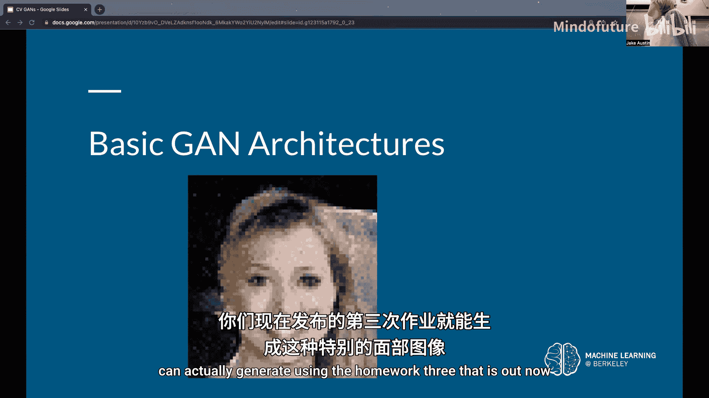

So。Basically this idea is your discriminator is basically going to be some kind of classification CNN。

 something along the lines of like what we've seen throughout this course it's what a discriminator is doing is classification at the end of the day when your input is an image so it's really not going to be something you need to worry about too much it's going be a simple CNN for classification just slowly downs increasing the number of channels you know decreasing the height and width of the feature map over time still use whatever you want like pooling batch arm。

 whatever deep learning tricks you want it's just a classificationifier but the generator is a little bit more difficult because we need to figure out how to get from some latent vector just some random noise vector。

All the way up to some height by width by free image。

We need to figure out how to ups samplele this thing somehow and that's that's a little more challenging so we're going to talk a little bit more focus more so on the upsampling side of things so downs again it's just a vanilla CNN this is a particularly the nice graphic I found that I think represents nicely this idea of doing you know a convolution where the gray window that's sliding around it's just our filter our blue is our input feature map the little white areas in the side of our images are just padding and then the green is our output。

Feature map and we're going to use some more graphics that look kind of like this in a minute so that's why I wanted to bring this back up I know you' all know what convolutions are at this point。

So yeah downs， just convolutions， so like the most naive way you can do up sampling is just nearest neighbor upsling。

Simply when you have just。Our little cell on the left hand side and for every single cell you basically cut it into quarters and whichever value was there beforehand is going to stay there so we go from having a one in the top left corner to having four ones in the top left corner a two in the top right hand corner having four two is in the top right hand corner。

You basically just duplicate every single cell on our existing feature map to its neighbors。

 and this is of this is sort of a trivial way to go about it。So it's， yeah。

 simply taking every single cell and you can imagine subdividing it a whole bunch and then just expanding it。

And this is this is pretty naive because what you get isn't really a higher resolution。

 it can still be well it still does look incredibly blurry and you can follow over like a regular convolution after this to process our sort of blurry looking feature on the right hand side still。

 but we can still do a little bit better。So rather than just nearest neighbor sampling。

 you can do bilinear up sampling where we basically take our our new feature map so if we had something like。

Like just one， two， three， four。One， two， three， four。We blow this up， so it's four by four now。我。

And we put like， let's say our one in the top left end pointer place one of the twos。

 one of the threes， one of the fours。and now rather than just filling these guys in with whichever we started with like a one in this case or a two or a three or a four。

 instead we're going to average this so the average between all the nearest the next door neighbors in this case like one and two like one and a half。

诶。The student right here will be the average of all of its neighbors。

So do something a little bit more intelligent。Place basically the average of all the neighbors and all the gaps。

In our new empty feature map that we want to fill in and you can kind of see that right here。

 the yellow guy that's particularly bright gets a little bit blurred when you average the both neighbors it's sort of a slightly more intelligent way to do things。

It's getting a little bit better and probably one of the more common ways to do it is called a transposed convolution so on the left hand side you can see just our standard regular convolution basically a transpoposed convolution when stride is one ends up looking like a regular convolution but you've just added so much padding that by the time you slide your window over it。

 you're ending feature map ends up looking bigger than when you started。

And if you add stride you get this really interesting pattern where you're putting gaps in between all the elements in your original feature map so the stride gets added sort of to your input image so to see you've dilated your input feature map that you're been involving over so this is like a slightly more intelligent way and we're still using like a kernel we can still do some kind of processing on our input and we can get something that's slightly more meaningful than what we had before which is just sort of like blurry scaled up feature maps。

So this is just sort of a slightly more yeah intelligent way to upsample images these are the three like most common ways that at least I have seen reading through the literature。

You can pretty much just use these out of the box anytime you need to make your height by width and your generator like bigger scale it up by like a factor of two you can just choose any one of these you know'll get like okay results againganNs are fickle enough to the point where just trying different things might eventually yield good results on one of them randomly so are there other questions on sort of like these just sort of mechanical things at all。

I'll tell you how we can upsample all of our feature maps。All right， okay。Yeah。1月份之前。

So if your stride is one， I believe it still just looks like a regular convolution。

 but if you have like stride two， we've taken our input image and we've added gaps in between every single element in it and then we're doing a convolution over that。

Does that make sense so like the blue we started out with the blue two by two in both of these examples the input to our transpo convolution layer is just a little two by two feature map and then when we added stride to our transpo convolution we took all of the little grid squares in our feature map and we split them out so there's a gap in between their neighbors now and then we ran a convolution on that。

I don't know exactly where it came from。It's sometimes called a deco convolution though I know mathematically they're supposed to be like different things。

 but in deep learning people just sort of use them interchangeably that's a I mean it generally refers to the idea that like if you have。

My my understanding and this might be fully incorrect。

 but if you have like a matrix that's sort of like particularly wide when you multiply it by a vector。

Your output is going to be smaller than what you。Started with。

If you started with a particularly large vector and you multiply by a very wide matrix you're going to get a very small matrix output。

 but if you transpose your matrix， so it's instead quite tall。

When you multiply by a very small vector， you're going to get a large output so my understanding is that it just sort of refer to this idea that。

Whereas a convolution takes in something bigger and usually spits out something smaller。

 it's working the other way around with a transpoposed convolution you're taking in something fairly small and your intent is to make it bigger。

嗯。Sort of like multiplying by non square matrices。Does that make any sense？Somewhat。Okay。Yeah。

 I mean it's there's more rigorous mathematical definitions for what all of these are。

 but again in deep learning our idea is to just find some interesting math operation that is differentiable and just run with it whether or not it's like。

Mathematically identical to something you would find in like a math textbook。USo yeah。

 this is just an operation that we found works okay for blowing up in the feature maps。

Are there more questions？All right， yeah， and if we have like conditional GN set up。

It's a little bit trickier because now you have your input to your generator is now not just。嗯。

A latent vector， but it's also a latent vector plus。Our condition vector。

 our vector that tells it what exactly we want it to generate。So like our generator。Takes in now。

A latent。And like a one hot or a multi hot vector of like， I want it to be， you know。

 like I want it to be a three。Or in the case of like the homework where you're generating faces say like I want the face to have like say this one corresponds to like I want this person to have a goate or down here maybe it's like I want this person to have brown hair you can select like multiple things but the point is that this vector here corresponds to like what we want。

Our output image to be so that's question of like what do we do now that we have the two vectors and。

I mean， one lazy thing you can simply do is just concatenate these together。

 concatenate your lant with your label。You can also process them separately。

Start with some deconvolutions or upsampling on both of these independently process them independently for a little while and then concatenate them later sort of the main idea and for like a discriminator。

Where you're taking in like this label over here in an image。

 you can just sort of broadcast this label here to be concatenated with every single position in your image and then send that to the discriminator sort of sort of lazy ways to go about doing it not particularly intelligent。

 but they can get the job done。Just to give you a more concrete idea of how we would go about passing in multiple things to a discriminator or generator。

It was sort of a lot of words， but do people have like questions on that idea at all？Okay。嗯。

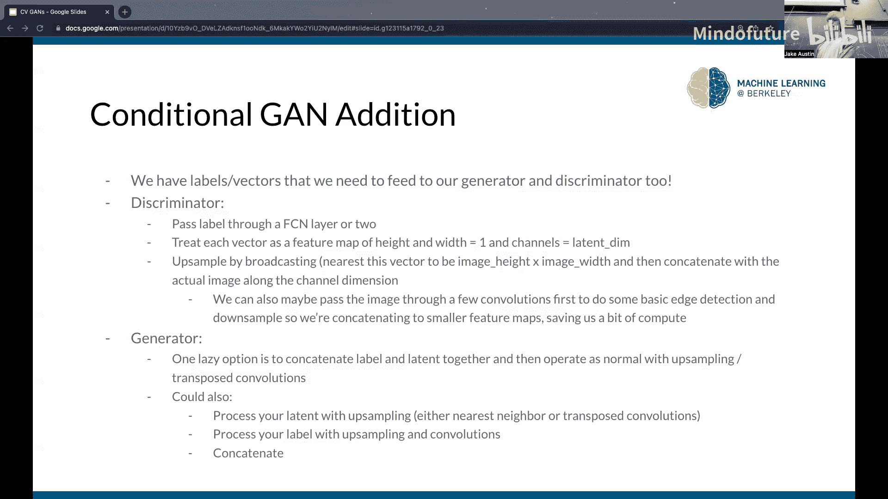

So in that case we're gonna to move on a style again and again。

 just doesn't note this is more for people that like really care about architecture like I think architecture is really cool and I really like it when I'm reading a paper and they give like a really nice architecture design and really go into the weeds about what the architecture is and like why they did it。

So that's what these slides are if you're not as much interested in that and this you feel like it's kind of going over your head a little bit like that's totally fine。

 but also if I'm confusing you to like feel free to ask questions。So yeah。

 hopefully this gives you a more in depth look at like one of the more popular G papers over the last few years style G and like what it's doing into the hood。

 yeah。So just sort of a fair warning so stylegan is basically just a new architecture for like your generator its it's a generator with some artistic flair in its architecture so it's motivated motivated by like a couple of different desires so like we get these lateens into our generator but like before we start doing deconvolutions and blowing it up and making feature maps it would be nice if we can do a little bit of preprocessing on our latent vectors first like。

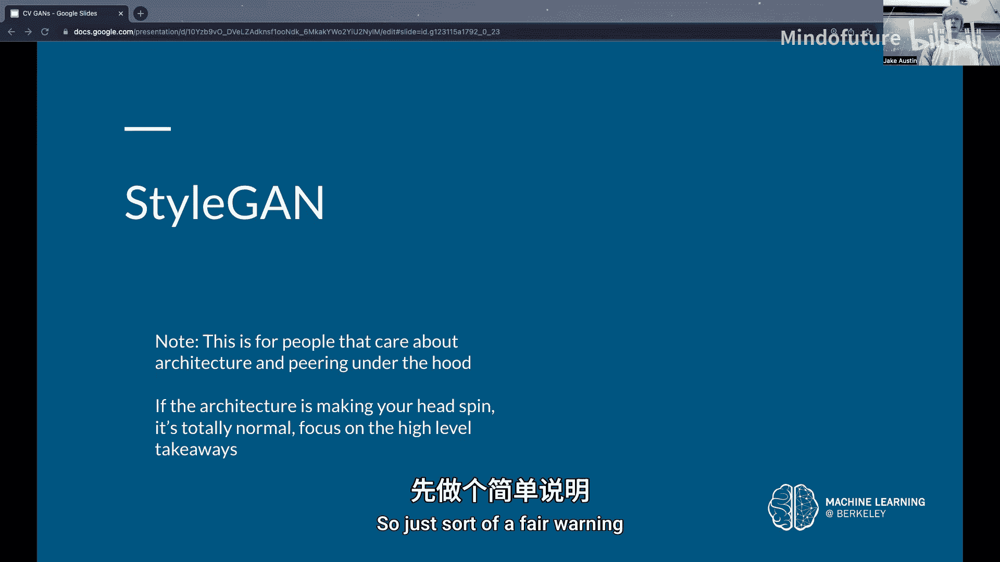

Maybe this latent isn't like immediately interpretable。To our generator。

 so we want to figure out how to take this random noise and maybe put it in a format that makes a little bit more sense to our generator give it give it a chance to do some preprocess on this latent before we start doing convolution operations on it。

We also want our lants to be a little bit more closely connected with all the different convolutions in our network。

We have a whole bunch of different layers in our generator and we only really pass the latent into the first one so this first convolution operation here sees the latent and then after that no one directly sees the latent we just sort of have to hope that all the layers pass enough information through and it would be nice since our latent really controls the style and like what our output image looks like it would be nice if we can feed that somehow in and give all of our different convolutions。

Some sort of access to it。To make sure that the style that's encoded in this latent really has an effect we also want a little bit better textures like you can see in this image hopefully like on the right hand side of both of these images there is not a whole ton of texture everything is fairly we really like things that are more in the left hand side where all the individual hairs really stand out all the dimples all the imperfections on like a human face all the texture that makes something with lifelike we really want that to be there and at the end of the day texture is really just random noise it's just a pattern repeated in different randomized little ways so we need to really make sure that our model has access to like a ton of noise and lots of sources of randomness because otherwise our model is basically responsible for pseudoran number generation。

Which is like a hard task for our model to learn to figure out how to make something that looks。

you know how to make texture that looks really randomized。

 it's not an easy task and it would just be a hell of a lot easier for a model if we just gave it some source of randomness that it can access at all times。

So these are basically like the three different sorts of things that we really are trying to get at with style again。

 are there questions about this so far？And these sort of issues that。Gans can have。All right。

Keep going。So this is the architecture we'll dissect this here in a second on the left hand side it's like a normal generator it's basically just taking in a latent vector and repeatedly scaling it up。

Doing some kind of normalization。Involving on it， more normalization and then repeating that with more upscaling more convolutions。

 normalization， convolution normalization。Just repeatedly convolving upscaling normalizing and on the right hand side we're going to do a little more fun stuff。

 but to start with the thing I want you to recognize is that on the left hand side this pattern。

Of just slowly up sampling， doing a normalization layer like batch norm involving more batch norm。

 that kind of thing。It's still very much repeated on the right hand side we're going to start with some sort of input don't worry about the input too much but it's going to just be repeated normalization ADAIN it's just a special what kind of normalization we'll talk about here in a minute。

 but it's just repeated convolutions normalization up sampling。

Convolutions normalization over and over like the core of the network is still very similar。

 so it looks very complicated， but it's at the core it's still somewhat similar so I don't want y to be too frightened。

Yeah， it's still going to be， yeah， a very similar style of architecture。

So what is this thing on the left here， this is our desire one we want to preprocess our latent so we took in some latent vector and the intu for like why we might want to do some preprocessing on this is like give it in the paper here so like say we have like a two dimensional latent vector。

That corresponds。So like。Say we have a two dimensional latent vector and it is interpreted by a model so that the first entry corresponds to like gender most data sets with gender like male and female so that's what we're dealing with here and then the second one is like long hair versus short hair。

And you'll notice that like it's probabilistically less likely for there to be like men with long hair。

So like the whole chunk of our latent days is like basically unusable。

If we try and generate an image of like a male with long hair our discriminator is much more likely to just notice that like oh this is less likely it's more likely to be fake because their data set doesn't have that many dudes with long hair so we want to give it a chance to like。

Somehow take these inputs， these latents that are otherwise unusable。And figure out how to somehow。

Create a or map them to some kind of code that is more meaningful。More uniformly likely。

So that's sort of that's sort of the idea the motivation behind wanting to preprocess our la so that's just what it is we've taken our latent and we're just passing it through a whole bunch of dense layers eight of them to be exact until we have a new latent modified lant called W。

Yes， friend。Okay。对。没审合。Yeah。对。Yeah， and I mean， this sort of breaks down to a little bit because if you imagine that it's like a conditional if our latent is like our random noise plus like a condition too。

 I mean it's additionally problematic if you're sampling labels that are like out of distribution if that makes any sense like if you're asking your generator to try and generate men with long hair and then somehow pass that off。

 that's a that's a fault of your own for doing that a training。

Yeah you could that's except I was just trying to to motivate that maybe this example that they gave isn't perfect。

 but but yes you you understand the point of it， which is yeah you want to somehow create like a new version of your la that's like yeah just more meaningful。

嗯。So yes， we have our more processed version of our original latent now called W。

And now like what's going on what's going on here， what is this madness so AD AIN stands for adaptive instance normalization。

 So we talked a little bit earlier about like bashor。sortty couple。

Where you're basically going to take。Everything on every single。Actation map。

In your CNN and you're going to to normalize it so we have like an activation map。We have。

Say a batch of first activations。And we're basically just going to normalize it just take every single element divide by the standard subtract off the mean divide by the standard deviation we have a whole bunch of activations and we're just yeah normalizing them。

What ADAIN does is instead of。With batch norm， we had taken。

Are activation x subtracted off the mean of x？Divided by the standard deviation of x。

We had learned some values gamma and beta to rescale and rebias by we had like these were parameters for our model。

AAIN instead just takes these as inputs， so we're not going to learn them now we're just going to take it as a second input to the layer。

So what we're going to do is our style vector W is going to dictate how much we rescale by and how much we rebiased by。

That's the that's the TlDR it it's sort of weird it's a weird way of introducing style into the network the only the only access point our entire network has for taking in our style vector W is。

In the way that we renormalize all of our features and it's like super weird。But does the。

Sort of idea of。Instead of learning gamma and learning be。

Does the idea of like taking it in as a second input？Like Y FYb make some sense to people。

Instead of instead of learning the parameters by which we rescale and rebias。

 just take it as a secondary input to that layer。If not， it's not the end of the world。

It's sort of an arch concept but。ThisThis concept that we're basically only ever introducing our style into the network by simply rescaling and rebiling all of our feature maps by a specific amount dictated by our style。

呃。As they said in the paper， it is quite remarkable that this even works and that it produces meaningful results。

 but for some reason it certifiably does you're taking in your style vector。

You're going to pass it through like one fully connected layer and then use the output to rescale and rebi all of your activations。

Yeah， this is a weird concept and if you don't get it right away that's like totally fine and if you want me to explain it a little more I can I can try and do that but again like it's a weird operation to do and it's even weirder that it works。

Yeah， your style dictates how we rescale and rebias all of our feature maps。ThatThat's the takeaway。

Yeah。Okay yeah and we can talk a little bit more about that later or afterwards and then the second the the last desire we had was increasing access to randomness so we're going to basically just generate a ton of feature maps that are just purely random noise。

And at every single layer， we're going to add that noise to all of our feature maps。😡。

And we're going to allow the network to scale up the amount of noise。

 multiply it by a large constant or scale it down， multiply by a really small constant at any point in the network。

 all of these B values that are multiplying our noise before we add it they're learned so our network can say I really want a lot of noise here I want to I want to generate better texture here if I had better access to random noise I think I can do that or it can say our features are really good at this part of the network and we don't really want random noise let's turn the random noise that's added off。

At every stage， after every single convolution， before we normalize。

 we're just going to add some controlled amount of noise into the network that the network can decide to increase or decrease。

嗯。Yeah， and this will this will sort of allow us to generate better textures。

 better like imperfections， wrinkles， individual hairs。

That sort of thing are there questions about sort of adding this random noise onto all of our feature maps or controlled random noise。

 I should say。Yes， friend。Fantastic question。这个。Yeah， u so you're yeah。

 so we have a feature say we're only doing like one image like let's not worry about batches。

 we have like a feature volume。Yeah， this is one of the things I had to go and like look through their code for to figuring out so we have a whole bunch of like feature maps。

Right， midway through our through our network and we take in basically like one feature map's worth of noise。

We take in one feature maps worth of noise。What we're going to do is broadcast this。

 so we're just going to duplicate it over every single channel。And then for every single channel。

That we have broadcasted to each of these gets scaled up by。Our learned amount。

Our beta corresponds to just multiplying each feature maps noise by like a separate amount like let's make it Bs not betas B1。

 B2， B3， these are just little scarrs that decide how much each feature map's worth of noise gets scaled up or scaled down and then。

Each of our original。Each layer gets its own random noise。

That we're sort of adding to these channels yeah， after every single convolution it's going to get a unique thing of noise。

And after every single convolution， it's going to get a unique set of scrs to control the amount noise out of does that make sense yeah。

I'm so glad it was worth it to read their code。Yeah。Oh yeah， are there more questions？All right。

So the main the main takeaways from Stgan， I know what's the architectures like insane looking and the next paper we're going to cover will be more fun。

The innovations are basically our latent vector that we took in。

Is much better put to use since we can do some like preproces on it。

Doing things like adaptive instance normalization to slowly introduce style。

We're basically introducing in each one of these lines denoting a convolution。

 our latent vector gets fed。Into and influences our model after every single convolution。

So this style vector that is going to tell our generator what it wants the output image to look like doesn't get lost we have like guarantees that。

This information is getting passed in and can be used by every single layer。

We have lots of sources of randomness， we just added a ton of random noise that we allowed the network to control the magnitude of after every single step。

Gives us far better texture。Just some random factoids for people who care about architecture。

 we didn't cover Wgan， we didn't get to it last lecture。

 but it uses WganN with a gradient penalty or the vanillagan with a nonsaturating loss and R1 regularization just if any of y'all happened to read the slides after last lecture if not totally fine it just for anyone who cares。

Yeah， and as you asked， the noise starts out as one channel and is broadcasted to all the feature maps。

Standard discriminator and then style again two。Is like this person here， I'll just go to it。

 why not this person does notexist。com。

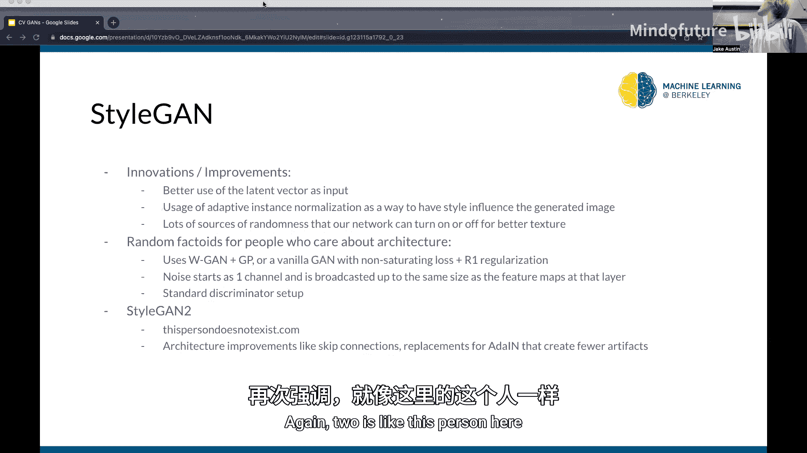

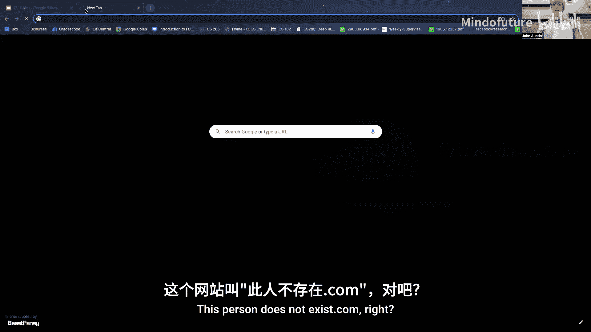

Right。This person does not existist。com and you it will generate random faces。

 this is style game too。

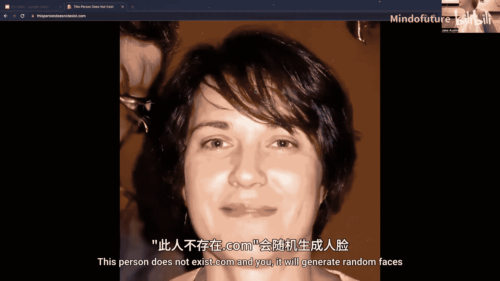

And these are like some of the bases that are generated。It was a。

 it was definitely something in spell again one you can see like you can see the individual hairs like texture is something that is like vastly improved by this random noise let's getting at it's see if I can find my mouse。

Yeah， so style G is a pretty big step up in terms of the image generation and the quality that we're getting。

Yeah， are there more questions yes friend。Yeah， I mean I think it just I think the reason was because it's better like your latent sort of corresponds to the output style like whether this person is going to have like different facial features like hair color texture like the curls in your hair your latent vector controls the style and I think that's like the main thing about this architecture is that it's really using this style vector W this this processed version of your latent vector to really dictate how your output looks that's sort of that was my takeaway from it though that might not be correct。

But that was， yeah。My takeaway， are there more questions？

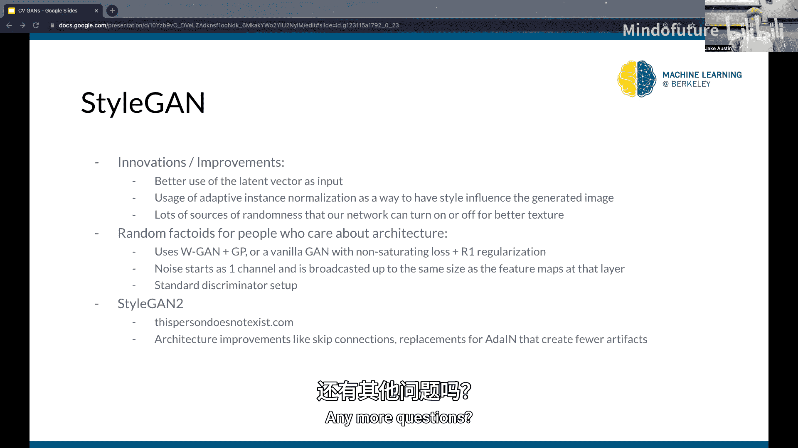

All right cyclegan much easier much more fun it's very basically that we're going to figure out how to take something in one style and transfer it to another we're going to take realistic photos and turn them into monet paintings or back the other way around from a monet painting to a real life photo we're going turn zebras into horses and then back again winter into the summer。

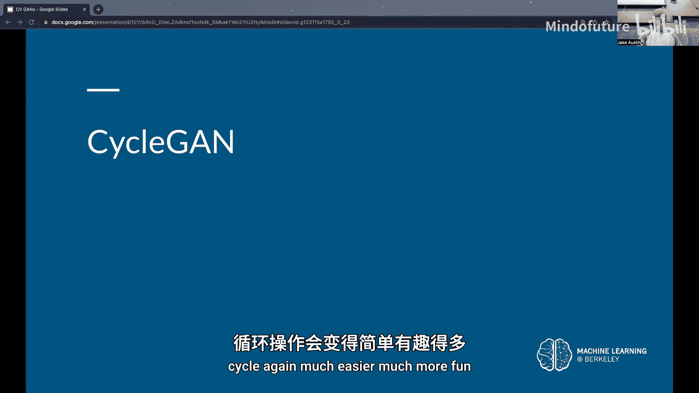

Yeah， it's the basic idea that you're transforming images。

From one data set to look like they came from images from another data set of images。

It's significantly more fun in my opinion， so what we're going to have is we're going to have still a somewhat standard setup we're going to have two discriminators and two generators。

嗯。If we're doing zebras to horses and horses to zebras。

 we're going to have one discriminator that judges does this look like a real zebra and one discriminator that judges does this look like a real horse and your generator's job isn't going to just be to generate from random noise。

 a horse or a zebra， it's going to be to take a horse and turn it into a zebra and then use that zebra discriminator to say like does this look real or does this look fake。

And the one other thing， other than just doing your standard ga loss of。

Looking at your your horse to zebra generator and saying like okay。

 the discriminator for zebras says you're doing a bad job do better instead of just doing that we're also going to add one other cycle loss。

 which is where we're going to take a picture of a zebra。Turn it into a horse。

And take that image and try and turn it back into a zebra and the idea is that if our generators are doing their job。

 what we should end up with after we went to a horse and then back to a zebra。

 it should look like what we started with and you can just simply like compare pixels and just see how off we are。

So yeah， it's two lost terms， our lost term for just like how realistic do our zebras and horses look and then the question of do we get back to where we started？

If we go from a zebra to a horse back to a zebra。Are there more questions about this？Yeah。

 think I think again， it's significantly more fun and。Yeah。

You can take individual frames unfortunately this is not like there's no there's no consistency between frames like if you watch the video there's no way to make sure that the stripes stay in the right place。

I can't see the control when I restart it here。Like you'll see the stripes start moving around。

 but I think it still it's still interesting that it works at all frame by frame and that it does even a half piece draw one video。

So yeah， it's a significantly sillier， more fun， in my opinion version of again。

 are there more questions about this？Yes， friend yeah that's a really good question Think about the distribute so if we have a data set of zebras like where do zebras live they're often from the savannas right where the grass is consistently like much more much more like yellow right so if you're the discriminator and you can look at this image and you say that's some real green looking grass this is this did not come from the savannahs。

 this is not a zebra I don't care whether it's got stripes or not your discriminator then has like。

A a way by which it can classify something correctly as zebra or a fake zebra so to account for that your generator has to learn to change the background to make it look like a savannna too Yeah that's a fantastic question。

Yes。It's a really good observation。Yeah， it's the shift in the distribution of horse images versus zebra image when you shift the background is also likely to change。

Yeah， other more questions？Yes， friend。Yeah so I mean this video what it was if I'm not mistaken is they just took a video of a horse and they just frame by frame just changed it to be a zebra。

 which is again why we don't have any consistency between the features on like the stripes are moving around and stuff but I'm sure you could right like I mean the idea of again is that we just have a second network that's judging does this thing look real or fake so if you have a bunch of videos of courses I mean it would be significantly more compute because when you're processing a video you're processing it frame by frame so however much work it took to process one frame of a video right just doing like an image processing an image with a discriminator you have to now do that across all the frames so you on a compute goes up。

 but yeah there's no reason that you couldn't do that if you just have a bunch of videos of horses and zebras in the wild I mean yeah it's like I think it's less common or maybe i'm just not tapped into it as much。

But people definitely do it yeah sequences are just hard because it's a lot more compute that's required you have to figure out like you're probably not going to process every single frame if you want to process like every like fifth frame or something like that like you need to you sort of going to figure out how are you going to do this in a way that's like efficient because again videos are just big。

嗯。Yeah I mean there's there's probably more clever things you can do like I imagine I know there's like a G called like patch scan where instead of looking at the whole image just looks like small little patches if you're only looking at patches of video that's probably more efficient to do there's little hacks like that I should have covered patchcan too there's little there's little hacks like that that i'm sure you can do to get around it but yeah it's just it's tricky to figure out how to do it in a way that doesn't take like a year。

Yeah， but but yeah there's no reason why you couldn't just take a discriminator that takes a video of real horses and our fake videos and at that point you probably would start to see consistency frame to frame in your generated videos otherwise your discriminator could say like oh these strikes are moving milk fake。

Yeah， there more questions， yes， loving it。Yeah monkey to horse I mean I think I think for the purpose of their demo and trying to get published in a conference paper they selected a very clean example。

 I suspect it would not work as well if at all。😊，Yeah， I have literally no idea。

 but I can't imagine what。I've never looked at a monkey and said that monkey looks like a horse so I don't know。

 but I suspect it's going to have a hell of a lot of difficulty and yeah it'll probably it can probably take a video of like a monkey and figure out how to generate a horse from that however getting back to the original monkey is not going happen I figure it'll probably just start looking at the image and just find like random variations and texture and just use that as the random noise you need like we had a random noise vector that we were feeding into a generator I imagine it's going to take all the pixels of that monkey and just treat it like random noise and try and generate a horse from that。

But again， it's not， there's no way you're getting back。Yeah。

Yeah you need to you do need to be careful with this and it's the same reason why we can get away with it with like paintings and like winter to summer。

Yeah。Any more questions？

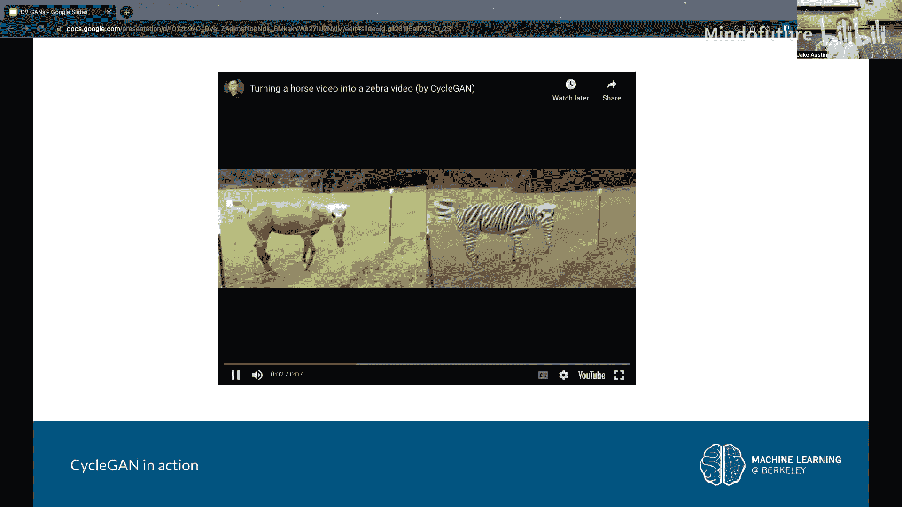

All right thank y' all for the good questions I appreciate it yeah I think it's a I think it's a cool paper it's quite fun。

😊，Yeah and then to end it off big G which is we had images from it at the very beginning I thought I had the images in here again Okay so like how do we train it G on a conditional G for like imagenet which has a thousand different classes so the vector on which we're conditioning we're telling it like what we want in our output is a thousand long which is is kind of a very tall order so this paper sort of analyze like how do GNs scale up when we throw more data bigger models and bigger batch sizes how do we do talks about a little bit of some trade offs between like stability and reliability and quality as well as like the variety of images you can generate。

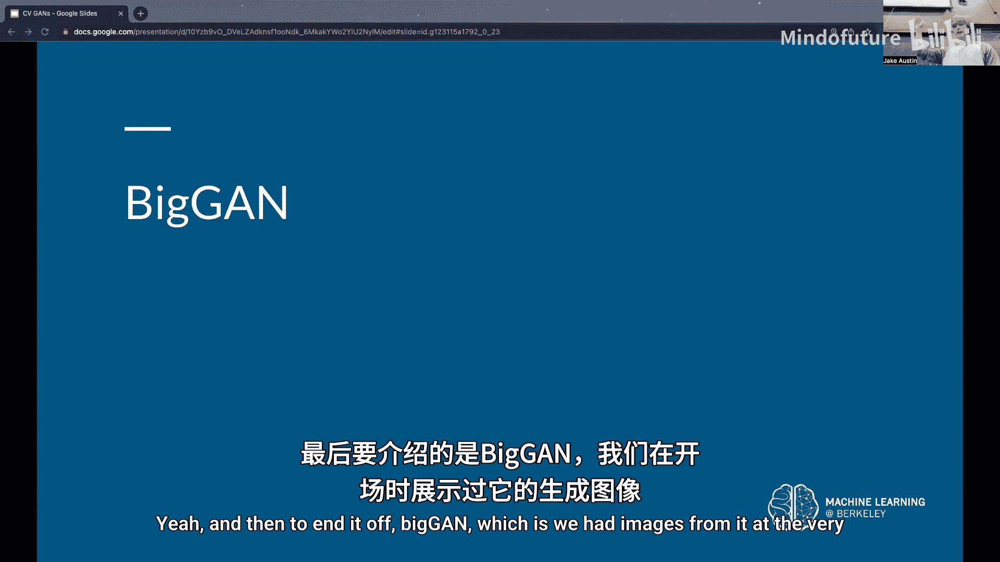

They they also used an interesting architecture as well。

 but we're not going to cover that they were also interested in how do we make sure that this lant is accessible by our entire network。

So like scaling bigger ve big models more data bigger batch sizes do better who to thunk the biggest way the best way to get rid of training instbilities is to just have bigger batch sizes this will give you better quality greater stability for complex tasks like GANs it's true anywhere but GANs especially benefit from it and I think yeah things like you'll learn about diffusion starting like next lecture but a lot of the more common models that are trained nowadays I think I think I wanted to say stable diffusion use like like batch size of like 8000 or something insane bigger batch sizes increase your stability it's yeah it's sort of a must at a certain point if you want to get really good results。

They also have this little trick if you want to at test time get better results。

 how do we deal with the fact that sometimes at test time we're going to sample lates that are like way off on the tail and are like super unlikely like if our vector is just random Gaussian noise where every single entry is just a normal distribution if we sample a vector and it's got a whole bunch of elements that are like way off on the tail our model has probably never seen a vector that looks anything like that and it's not going to give us very good results。

嗯。What do we do what do we do about the fact that sometimes at test time we're going to give it latents that it has no clue to do with and the trick is basically at test time when you sample things that are way out on the tails like this。

 just resample， try it again until you get things that are much more in the middle of your distribution。

Random noise if you're sampling from a uniform distribution。

 random noise that's much closer to the middle， much closer to the mean。

Is it's far more likely that our model has seen something similar to it and is going to be able to do an okay job。

So at test time， if you want to hack and get a little better results。

 give it latents that are slightly more squish towards zero random noise with smaller magnitude effectively。

 however， it comes with a trade off。If we're sampling noise in a much smaller range to give to our model at test time。

 we're probably not going to be able to get as wide a variety of images。And this is what we see。

So if you apply this truncation trick， where if you get elements in your random vector that are super unlikely。

 just resample until they're much closer to the middle of your uniform distribution。

You can see on the left hand side is with very little truncation we get a really wide variety of images and as you start going more and more to the right when we're truncating more and more and mandating that all of our random noise stays in this really small little zone our images stop becoming varied really at all and then the right hand side is just an image that they gave of to show the district doesn't always work if your model is like not regularized and your model is just generally not good on latents that it hasn't really seen before this is still going to fail to some degree you get these these。

Nightmare fuel dogs。So。Yeah， this comes with the caveat that you still need to make sure your model is like well regularized to begin with。

 but yeah， it can get you slightly better results at test time。

Training andtabilities they also talked about this in the paper a little bit too the tLDR is if you constrain your discriminator so that it has super well behaveved gradients and that it can never just dominate the generator in the G game and you make sure you try too hard to make sure your discriminator is behaving well and playing fair you're not going to end up getting good results。

To some degree， you just have to accept that at a certain point yourgan will collapse and one side or the other will just absolutely win the game 100% you have to accept some amount of training instaabbilities if you want to get good outputs。

嗯。Yeah， it's sort of it's a， it's a trade off and it's imperfect。

 but good results won't come by by making sure your discriminator is too Nfd。

ThatThat's the last takeaway from Big GAm are there questions on this？Yes， friend。不。

I mean it would probably it would probably exacerbate the problem a little bit where like things on the outside do really poorly but that's an interesting question the other thing too is if your model at the very beginning of training only ever sees really really similar latents it's going to have probably a lot of difficulty generating samples that are like。

Of good variety and the discriminator might just see like the generators just generating like the same image modified like once or twice every single time so that's interesting that might work might it might give interesting results my guess is that it might result in a few more training instaabbilities but。

Yeah， that's definitely an interesting idea。Yeah， it might work to work the other way around to to start with like a really wide distribution。

 so our model has to。Perform well on latents that are super big or super small and then slowly narrow it down。

嗯。Yeah， I would be interested to see if that works or not。Yeah， are there more questions？

Okay yeah I think we're I think we've we've hit everything takeaways stylegan just making sure your latance are accessible all throughout the network and making sure you have access to lots of random noise for very nice textures and things like that cyclegan I think we had a lot of really good conversation just to sort of show that like。

This idea that you can use a separate network， a discriminator to see how real your outputs look like this idea can be used in all kinds of wild different ways。

 besides just generating single images one off from random noise like there's lots of different ways in which you can apply this sort of likegan loss of having a discriminator see how well you're doing。

And then the big G is just sort of to cap it off and like。

What does it require to make Gs at very large scales do well so yeah I think that's I think that's about it if people have questions feel free to come on up。

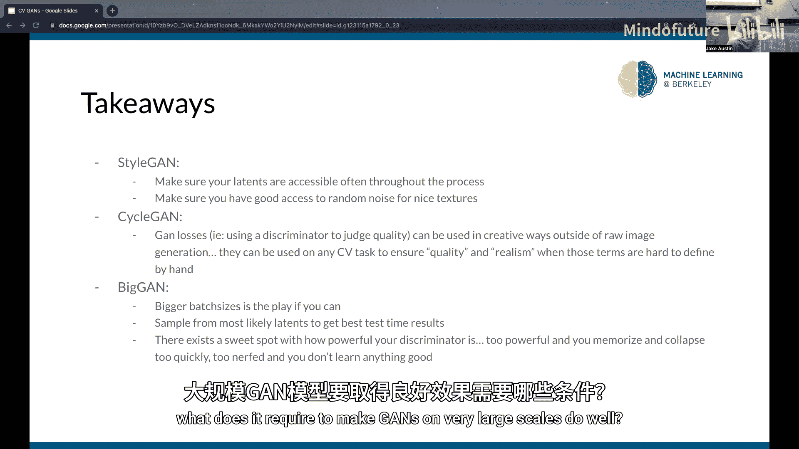