# 【加州大学伯克利】计算机视觉：视觉数据的深度学习 ｜ Cs 198 126： Deep Learning For Visual Data p12 P12_讲座12-扩散模型 -BV1Va8zzfEtk_p12-

Incurring。

。嗯。Yeah所一管。咁其常会系使。's whyWhat happens。Okay， it's 7，10， it's probably a good time to start。

So today we will be talking about something called diffusion models and this is going to be the last lecture in the series of image generation lectures that we have seen in the last few weeks。

And hopefully this will cap off everything that you've learned so far in a nice way。

This is a quick agenda today， I just want to give a disclaimer that this lecture is more mathematically involved in the previous lectures。

 I just want to make sure that these details you don't need to know any of them。

 I'm going to also mention those because I feel like if I don't I'm going to be doing a big disservice to di fusion models。

But yeah， if you get lost in the weeds that's why this is understandable。

 this math is not easy to understand I would。I'll say that myself， yeah。

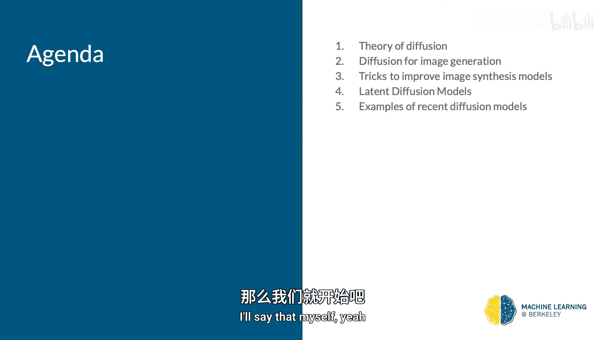

And in that case， I guess we can get started。So there are many different kinds of generative models out there。

And we have seen two of these classes in this class so far。

 we have seen variation auto encoders or VAs。And we spend the last two lectures on Gs。

There are other models too， like auto aggressiveive models and energy based models。

 we won't talk about those in this course， but if you want to learn more about them。

 I think you should take CSC94158， it's taught about Dr Peterbil。

 that course will go over these kind of models。What we will do， however。

 is we are going to talk about this new class of models called dennoing diffusion models。

So I'm going to start off with some theory behind diffusion and some of the math that goes into it。

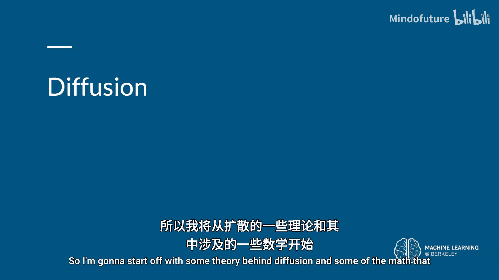

Before I delve into that， density let's talk about how you synthesize data in the first place。

In machine learning， we sort of make this assumption that your data comes from a distribution。

Can be kind of data， can be image data， can be text data， audio。Anything else？

We assume that it has like an underlying distribution and your data set is basically samples from the distribution。

The goal of generative models is to basically learn the distribution so you could sample from it and basically get another data point that looks like it came from the training data set。

Does that sort of intuition make sense？Yeah， and if you look at the image to the right on the top。

 we have this like printing data and you can kind of see that it comes from a distribution that if you follow along my cursor。

 kind of looks something like this。嗯。What the model does is then it learns to like sample from this distribution and it generates this like test set and you can kind of see that it looks very similar to computertor training data。

 which means that it must have learned what the distribution actually is。Now。

 this distribution is not known to us， which is why we have to learn it from the actual like data symbol themselves。

And that is what like all of the models that you've seen so far have been doing in a sense。Now。

 how do you learn distributions。This is kind of a complicated question to ask。诶。There are。

Two main methods to do it。You distribution is is going to be probabilistic nature right so it could define something called a likelihood for the distribution so you can see that okay。

 if I have a sample。If this likelihood value for the sample is going to be high。

 then there is a good chance that that sample came from the distribution。

 but if it wass going to be low， this means that that sample probably did not come from the distribution。

What we can do is that you can try to increase or maximize the likelihoodli。

Of the samples that the model generates。The last one way to do it。

 the other way to do it is to minimize some sort of divergence metric between your data distribution and the distribution that the model learns。

What this divergence is， ways to there are many divergence metrics。

 I'll get to some in a few minutes。But that's sort of how gene modeling works。And in a sense。

 we learn about these like two kinds of models， we learn about VAEs， we learn about GNS。

 and even though it might not be obvious， those cluster of models are exactly doing what I just described。

So the VAE loss looks something like this complicated expression up there。

 but what really is happening is that this loss is basically a bound for the likelihood so if you minimize the loss。

 you're in a sense increasing the likelihood and that's why VAE work。Similarly for GNS。

 we have this kind of adversarial loss function。Which looks like a complicated mess。

 But what's really happening is that when you're trying to optimize again。

 but when you're trying to optimize the subjective。

 you're essentially trying to minimize something called the DJs between the。

Data distribution for of the training set and the distribution that the generator learns。

 this DJS is called the gensen Shannon diversions， it's basically a divergence metric that says that okay。

 if this value is low， then the distributions that we are looking at are fairly similar。

 if this value is high then they are very dissimilar。Any questions about this so far？Okay。

 so once you have learned these distributions that sort of mimic the data distribution。

 how do you generate a new sample？One way that pretty much all models do it is you look at。

A sample from random noise。And you convert that sample to something that looks like it might have come from the data distribution。

If you remember GNs， you took a look at some like latent noise vector you passed with a generator and I'll pop an image right。

 that's how GNs work。And it's exactly how VAs work as well。And。In both of these cases。

 what's really happening is that you pass this noise into this like model and you get an image out。

 so you're taking a single step from your noise vector to the actual image。

The single step might not be easy to analyze it's like you have a whole like neural network in between。

 you don't really know what's happening in there。😡。

So what diffusion models do is instead of taking one big step， they take multiple tiny steps。

Because these are actually easier to analyze and what's really happening is that these tiny steps are basically a Markov chain have you heard the term Markov chain before？

Yeah。So。Yeah， this is basically the motivation for why diffusion models work。

 you don't need to sort of know this， the main idea is that these models were inspired from non equilibrium staM or statistical mechanics。

Yeah， this slide I just wanted to like put the inspiration out there。

 you don't even know what that is。Now a diffusion model has two parts。

There is something called the forward process。Which is。You take an image。And you add noise to it。

And you take that noise image and you add some more noise to it and you keep repeating this process。

So your image can be some data point， say x0， you add noise2 it， you get x1， you add noise2。

 you get x2 all the way up to some xc， you can repeat this process for key time stepss。

And the noise that you add can be parameterized by the Gaussian distribution given over here。

You define these values called beta for each time step。

The sort of like the set of values is called a noise schedule because it controls how much noise you're adding at each time step。

 it follows a particular schedule。And what happens is that if you keep adding noise to the image。

 you can actually kind of show mathematically that what you end up with at the very end is basically pure noise。

诶。This is a mathematical trick that was proposed in the original difftion paper。 It shows that okay。

 I know that my。Time step I know that the image at time step T condition on the image at time sub t minus1 is going to be a noisy version of t minus one and you can sort of express that in like this particular way again don't worry if you。

Don't know what that means， but what the trick is basically showing is that。

You can express x of t in terms of x of k minus1， but you could recursively repeat this process and you can actually directly define x of k in terms of x of zero so it could directly go from the initial image to a noisy version at some given time of t and this is a very。

Cool trick that will simplify some of the mathematical。I guess like results that you will see later。

So I said that there are two parts to your diffusion model。

This is the second part it's called the reverse process， so we just took an image。

Basically made it into pure noise。That isn't really helpful， right， we want to generate a new image。

😡，And in the VA in game lecture， we saw that we could generate an image out of noise。

And this is what the reverse process is trying to do。So what it's saying is that， okay。

 if I look at my sequence of like noing steps in the forward process。

 what if I can find a way to reverse that？So I start with noise。

I move to a slightly less noisy version of the image and I keep repeating that until I get back to the original image。

The goal of a diffusion model is to basically learn how to do this process in reverse。

Any questions about the two main steps of attriion model？ok。So。When we were moving。

 so if you look at the whole process， which went from x0 to x of 1 to x of 2 to x of t minus1 to x of t。

 what we were saying is that we know that the conditional distribution of x of t conditional x of t minus1 is the Gaussian。

Right but we don't know what the reverse distribution is like。

 we don't know what the distribution of x of k minus1 conditional on x of k is。

And that's going to be very hard to find because。It turns out that if you apply something called base rule to this like set of distributions。

 you need like these set of terms to define this like reverse distribution and these set of terms are very hard to compute because you need to know what the exact like distribution looks like and that's not possible to like it's like it's intractable to compute you can't really compute it in like。

Qunoial twin， for example， you have to evaluate this like very nice integral， which is not possible。

So what you do is you try to approximate what the distribution looks like。Okay。Any questions so far？

Yeah。主系。Yeah， the Q function is going to be the distribution of x of t conditioned on x of t minus1。

 so it's a distribution that。Defins what x of T looks like。Yeah。Yeah， and Q of x of t minus one。

 given x of t is basically the reverse distribution， we don't know that。

 so we try to be approximated using this P function。Which is basically what the neural network does。

 which because it's parameterized by this data， right？So and before we define our neural network。

 we need to sort of。Define what the distribution should even look like because if you don't know what the distribution is。

 then we can't feel it defined on the owner network。And a， I guess like。A proper manner。

So turns out that， okay， if I virtually look at my forward process and I look at， say， some step x5。

If I look at the distribution of say x4 given x5 or maybe x3 given x5 or maybe x2 given x5。

 it's like this is what the distributions look like。Turns out that these distributions are very。

Hard to sort of compute because they look very weird like I don't know what this distribution is in the red right this is some like random distribution that I can really parameterize。

Similarly， it's the same if you were to find a distribution of x1 condition on x5。

All the way up to an x ray， but wait， I look at the distribution of x4， which is right。Before x5。

If I squint my eyes enough， I can see that this kind of looks like a Gaussian right。

 does I pretty agree that this looks like a Gaussian down below？So。

What we can do is we can see that okay。I can just make a guess and say that， okay。

 my reverse distribution should also be a Gaussian。

Therere actually it turns out that our guest is indeed correct and the reason behind that is it goes into this like very deep theory behind stochastic differential equations I don't want to get into that because I haven't taken a course like myself and I don't completely understand it myself either but。

But there is like a justification for why we can make that assumption as to why th distribution is also Gaussian。

No。A Gaussian is parameterized by two terms。You need to have a mean and a variance。

What diffusion does is it tries to learn the mean invari through a neural network。

Any questions so far？空。Now， how do we train this？We need to have a loss function， right。

 we need something that we can minimize or maximize。

So it turns out that we can use the same trick that you might have seen in the VA lecture is that okay。

 I can really。But what we're trying to do is we're trying to maximize the likelihood that an image that we generate looks like it comes from the original data distribution。

But that likelihood cannot be calculated。But in the VA lecture， we can see that， okay。

 we can bound the likelihood using something called a variational lower bound。

They basically applied the same trick to diffusion。你。

We apply this bound to the actual likelihood and it turns out that you end up getting a loss function out of this。

 which sort of looks like a sum of like multiple smaller loss functions like L of T。

 all the way up to L of zero， and those loss functions are going to be given by these terms down below。

Now， typically we ignore the term L of T because it's almost always zero。

 doesn't really contribute to the loss， it turns out that the main terms that do contribute to the loss are L of zero all the way up to L of t minus one。

In this lecture， we are going to sort of ignore what L of zero does because it's a bit complicated and I don't want to get into the reads。

What we will do instead is we will analyze what。These like middle terms look like， especially this。

L of little T， which is defined from1 to t minus1。Any questions？Yeah。Again。

 the little T is going to be a time step and the uppercase t is going to be how many steps we're in the tuion process for。

 it's going to be say a horizon of that term。Sounds if。If you ever heard that term before。

So if you look at this term over here， this is what we are trying to sort of analyze。

We are looking at。De k dirgence， okay， you don't even know what the k dirgence is。

 it's basically another divergence metric which says that okay， if this term is low。

 then the distributionsq of xt condition on x of t plus1 and x of zero。

Is going to be very similar to the distribution that are neural network learns。

 but if this term is high then those are going to be dissilar our goal is to sort of drive this term as low as possible。

We are looking at Dl dirgence between this distribution over here and this Pta over here。

It turns out that this distribution。Q of x of t minus1 condition on both x of t and x not。

Has a very explicit form。Which I have written on the top over here。

I'm not going to go into the derivation behind why this form， why this distribution has this form。

 I have linked some papers at the very end if you can check those out if want if you're curious about that。

And what ends up happening is it turns out that if you try to look at the tail divergence between this distribution over here。

And the distribution that your neural network is trying to predict。

You end up getting this term down below。what really ends up happening is you're trying to minimize the L2 loss between the mean of your learned distribution and the mean of the conditional distribution that is given by this expression over here by totally of mu。

Turns out that you can do some more algebra and you can reexpress this like whole term that my cursor is pointing at。

T the of mut tea。As this expression down below in the red box。

Those two expressions are the exact same。Again， the derivation is going to be in some of the papers that I linked at the very end。

So what this objective is saying is that we want。Our learned mean。

To predict what's in the red box because we're trying to minimize this L2 loss。Right。

So what the authors of the diffusion papers say。Is okay。

 what if what if instead of trying to predict everything inside the red box。

 we try to predict a single term instead because this whole expression looks very complicated。Right。

So this do that okay？We know that our totally of mu has this form over here。

What if you take inspiration from that？And parameterize mu of theta。

 which is the learn mu in a very similar form。But what we will do is we will make this very just like noisestorm at the end。

Prame instead so what what this。Equion at the very top is seeing that， okay？

I can write my learn mu as this equation and the learn part comes from this epsilon。

If you make those substitutions under the loss function and you do the moralge。

 what really ends up happening is you're trying to predict。

The noise that was added at time step zero to get to time step T。

 you're trying to predict the noise that was added and what this means is that if you know what the noise is。

 you can take a noisy image， subtract that noise and get the original image back。

But if you were to say start with pure noise。And you subtract some other noise from it。

 it's possible that you might get a completed new image back instead。

So this is the main intuition behind diffusion models。Any questions that before I move on。

 I just want to make sure that this part is kind of important。So make sure the intuition is clear。

 again doesn't really matter if you understand the math or not， the math is very complex。

Don't get lost in thes， I just want to make sure that you get the high level details。

So this is the objective that you're trying to minimize over here at the very last line。

And it has like this complicated missive terms at the very beginning。

Turns out the authors say that okay， just so you can drop all of that。

 it's kind of like extra baggage， we don't need that。

What you can do is instead minimize this very simplified expression instead。

So instead of looking at all of those like different ratess。

You just focus on minimizing the noise between。But the noise that was added to an image showing the order process versus the noise that you're trying to predict so it could dennoize that image。

Now， this does mean that you don't really have that same lower bound that you started with anymore because it's going to be a weighted version of that lower bound。

 but it turns out to be fine。And it actually actually， it actually increases。

The quality of images that you see later on。So this is what the training process looks like。

 you start with some image in your data set。You add noise to it and using the trick that we defined earlier。

 you can instead of like adding noise iteratively during the forward process you go from x0 to some x of t。

 you can go to x of t in one step directly。You pass that noise image into your model。😡。

You predict the noise that was added。And you try to minimize that with the actual and you try to minimize that through distance between that and the actual noise。

And。He just reviewed this process until the model has sort of converged this is like a pretty standard training loop that you might have seen in pier before。

And once the model has traineded。The way you can synthesize new images is you construct start with random noise。

You could pass。Just like completely noisy image into your model。Predict some noise from that。

 and you can subtract this predicted noise from the actual noisy image in hopes of getting。

Did noise his image back instead。But and if you recall all the way back here。

We were going to do this process in reverse， right we were going to start to pure noise。

Find a slightly less noisy version of that and keep repeating that until we get something that looks like an actual image。

And that is now possible that our modeller can predict this noise。

Which is what this algorithm is doing。Any questions about。That。Yeah he okay。So yeah。

 that is it for the theory of diffusion。😊，Again， there are some derivations that I did not go over。

 but those are going to be included in some blog posts and papers that I linked at the very end。

 I would encourage you guys to check it out。Again， just like a final call。

 any questions about how diffusion works before I move on to how it's actually performed practically？

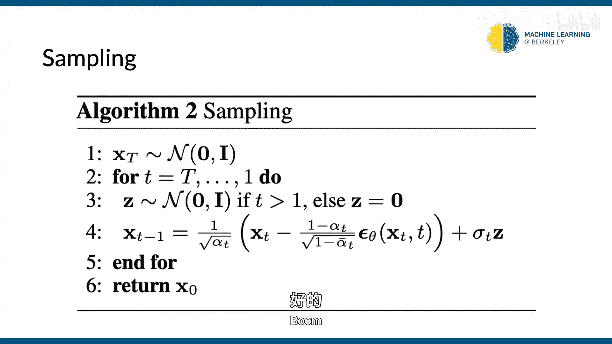

H， so what we have discussed so far is how diffusion works in general。

 and turns out that this x of key， were we were pretending that this x of T was going to be some image。

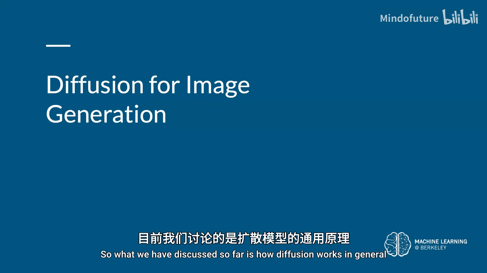

It doesn't have to be an image， it can be anything else as well。

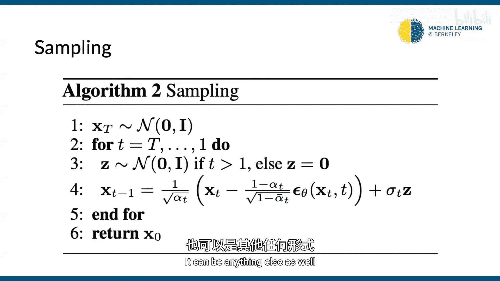

What we will see now is。What happens if that x of T is indeed an image？

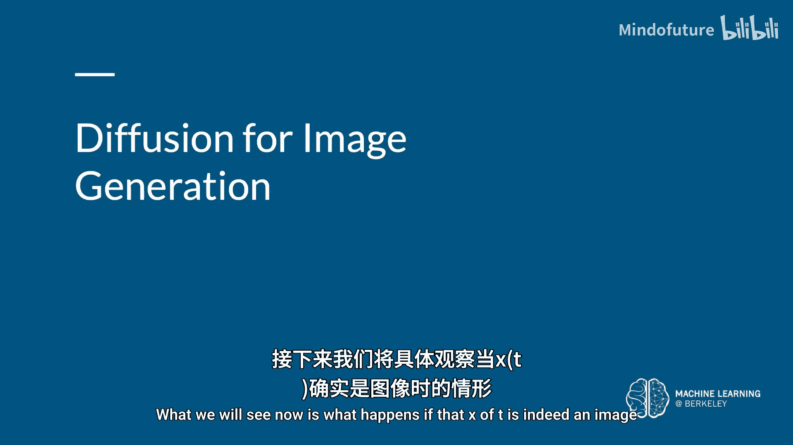

And this is sort of what the diffusion process looks like you in the top half， you see an image。

That is being noised up in the over process you keep adding noise to it until you get like pure stochastic ones at the very end and then the bottom half you see sort of the reverse process you start with pure noise but as time goes on you get an actual image out of that hopefully these two sort of videos give you some more intuition as to what's happening in diffusion。

Any questions about this？哦。Yeah right， so this is so the image is going to be like some very high dimensional object right because this thing like 256 by 56 by3。

 the plot on the right is basically showing what's happening if you were to look at say a single dimensional object。

 for example。So。What this is really showing is that on the left hand side。

 we have the actual distribution of the data。And we take some sample from it。

 which is like going to be some starting point on the very left and we keep adding noise to this until we get something that looks like a pure Gaussian。

 which is what sort of just like，Graient of colors of like at the very。

And the picture at the bottom is basically doing the opposite， it's saying that okay。

 if I were to start with。At Gaussian， if I learned some like diffusion reverse process。

 I could map back to something that looks like my original data distribution。

Because you can kind of see that left end points of the left end point of the top image is very similar to the right end of the bottom image。

 which kind of shows that this diffusion process was successfully able to learn the original data distribution。

Okay， so we know that we are going to be predicting noise and this noise has to be added to the image。

 which means that the noise must have the same dimensions as the image。

What is one model that has the same dimensions as the input and the output and you saw this during a segmentation lecture right you know that if you pass in an image into a unit you get some segmentation mask out and said you get some segmentation mask out which you can use to sort of like label different pixels into like different classes but the authors see that okay I can also use this model to like。

Preict noise instead， because this is just a model。

 the output purely depends somewhat what objective we are trying to。Well。

 what objective we are minimizing the model perspective， right？So yeah。

 it turns out that with the objective that we showed earlier， which was a noise predictive objective。

 you can use this S model to like output noise。And this is not really the same unit model that you saw here。

 it turns out that they added a whole bunch of stued。

 they replaced your normal unit blocks with resnet blocks， con next blocks。

 they added like attention modules， like don't worry if you don't know what attention is。

 I think that's going to be covered next week。They replaced batch norm with something called group norm。

They replace relus with other activations called Swish and Glus。

 these are basically activations that look like Ralu but have mice sub propertiesties。

They basically took like all the modern C tricks that you might see。

And in different papers and they threw it all into this like one model。

And it actually works very well， so I guess they were。Right。Yeah。

 many that's a good question actually。So， okay。The original paper used  a thousand0 time stepss。

Turns out that using more transcriptlips is better， so there was an improved paper that。

Repeated this process for 4000 times sub and said and they were able to get like better quality。

And there have been improvements ever since to sort of reduce the number of time steps you need。

I think modern diffusion models take maybe 250。是那个样的。是。There are other tricks to make it even faster。

 there is a model called DDIM i'm not going to cover that in this lecture。

 I think you can that makes sense that you only need to run this block like say 25 times instead。

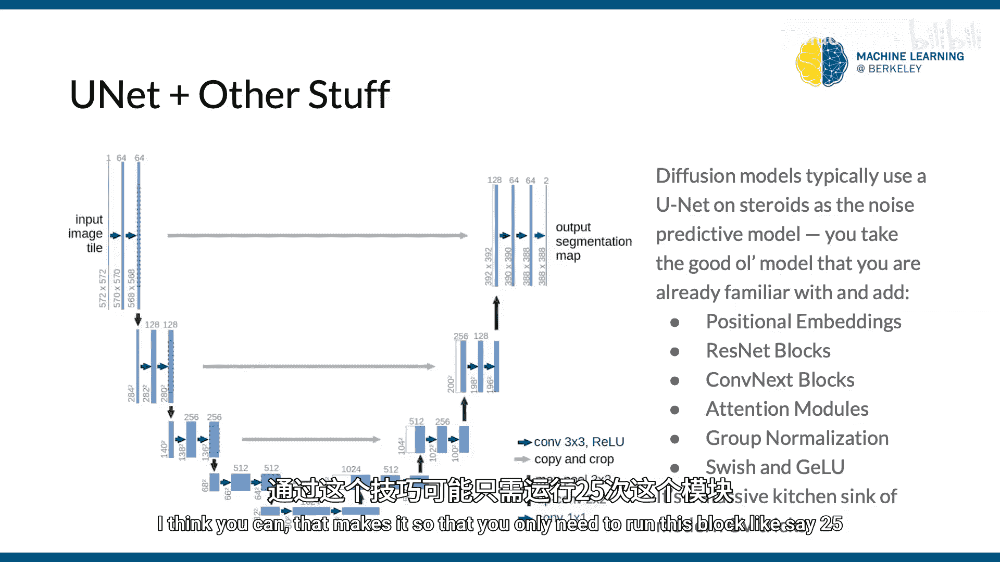

Yeah。诶。喂嘅。Wanted to escape the presentation yeah so。

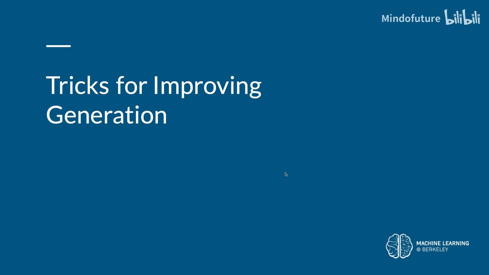

I actually have what this model looks like pulled up here。

 so this is the normal unit but they're actually throwing like this whole bunch of stuff to it。

 so they add like these residualible blocks which you might have seen in the renet homework。

They add like use attention blockss， again don't worry if you don't know what tension is that will be covered next week。

Yeah， I have linked this slide at the very end， if you want to like take a look if you want to have a deeper look at the architecture that and how it's implemented in Pytorch。

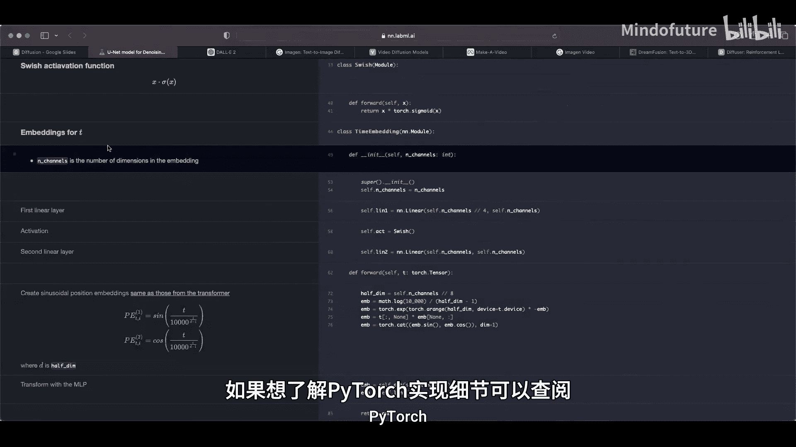

Pa。So that is how image generation and using diffion models work。

And it actually gives like pretty good results and there have since been some tricks to improve the results even further。

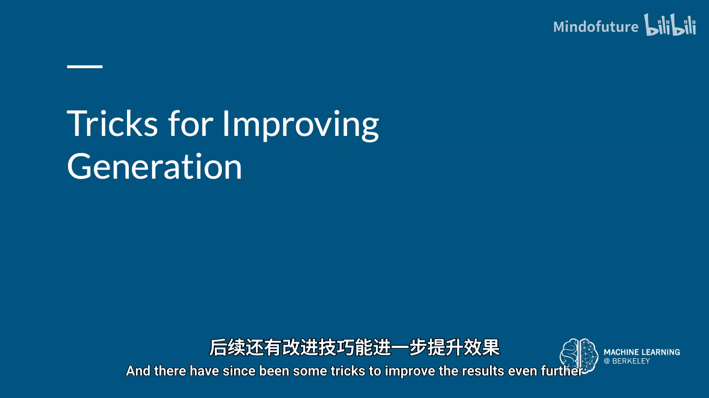

So remember those beta parameters that we defined at the very beginning。

 those controlled how much noise you add in the ho process and in a sense it also sort of affects the reverse process because the reverse process is trying to reverse ho process right。

Researchers said that， okay， if I were to say use a linear schedule。

 which means I increase these like beta terms。Liinniarily。

I get a forward process that looks like this talk over here。

And it converts my image to noise really quickly， which makes it harder for my reverse process to sort of go the other way。

So what they instead hypothesize is that， okay， what if I use a different function。

 maybe something like a cosine which is。I guess。something like this and at the very top it has a very gradual change it doesn't change that quickly right so saying that okay what if I change slowly。

At the beginning。And of like ramp up later on。And the idea is that you convert images to like noise slowly you're destroying information at a slower rate and this should help your model learn the reverse process better and it actually does improve sort of the results。

 I just want to emphasize that this choice of cosine was like completely arbitrary you could also use some other function。

 which is something that happened to workflow。不计管。It。不。All right。It's。

They use some weird tricks to make this thing work so turns out that when you apply the linear schedule you applying the linear schedule to like these like beta terms。

 they apply the cosine schedule to this like alpha terms that I。Sort of。Gloed over at the。

Very beginning so they define alphapa like minus beta。

 which is y you sort of go head and something like that。Okay， oh。

 I just realized that this bar was floating over its entire time。ok。So。

When we defined our distribution for the reverse process。

 we said that okay it's going to be some Gaussian with some mean and covariance。

What we kind of neglected the covariance partal now。

 so the original diffusion paper used a fixed covariance this is that okay。

 I'm going to say my covariance is equal to some sigma squared timess the the identity matrix which sigma squared is either the beta term or some modified version of that。

And the idea behind that was。My covariance matrix is going to be very small。

 it's not going to have a big impact on my model anyways。

And the mean is going to contribute more significantly anyway going to be iss going to contribute more significantly than the covariance。

 so it should be fine to go ahead and something like that。And that actually works kind of well。

 but there was a second paper that came after the original DPN paper。Ws said that， okay。

 you can that's a completely fair statement to make， but if you try to learn the covariance。

 it's possible that you might end up improving your images even more。

And what they found is that it doesn't really affect the image quality。

 but it can help you improve your log likelihood。no。

My understanding is that people in this field use log likelihood as a measure of how much of the initial distribution youre able to learn。

 so if you have a lower if you have a higher log likelihood。

 this means that you're learning more of the initial data distribution。Which means that you could。

Sample more and more images from it。So in a sense， this look likelihood term can be viewed as a measure of diversity。

Right。The authors of the second paper said that， okay。

 if I parameterize my learned covariance matrix in this way where V is the term that I'm going to predict with the neural network。

 I could get better likelihoods and that's one improvement they made。

Any questions about the noise schedule or the covariance matrix？Very stupid cases， right。呃 yeah。Yeah。

Not really。一要为。Well， the covariance matrix of some like random vector is going to be given by。呃。

Or other。It's going to be like。it's a big matrix， but it turns out be fine because there are some tricks you can do。

With covariance matrices and like numerical linear algebra it's sort of like non deep learning related。

 but yeah we are in magic basically yeah， so yeah it's not that big of a deal。

They also proposed some more architectural improvements。I put those up there。

 I don't think that these are that important because our architecture of this unit model that changes cut of every week。

Different papers use。They all use some unit， but like different variations of it。

So these are some changes that they found helpful in like this one particular paper， so that okay。

Make the model bigger， which is kind of obvious。嗯。They were using something called attention modules which I sort of preference earlier。

 this is that okay add more number of heads again if you don't know what that means。

 you will learn about attention next week。U this is that okay。

 I'm using these like residualable blocks and stuff in my unit。

 and I know that there's this other G model called Big G which works really well。

What if I steal some parts of the architecture from there and that also improves the quality even more。

They also。It' something called adaptive to formalization my understanding is that you covered adaptive incidence normalization last week。

 this is basically。A variation of that in a sense， but applied toization group normalization instead。

Again， don't focus too much on these improvements because like I said。

 the unit model kind of changes。From paper to paper like。

I don't even think like these changes are used in like something like imagine or Dolly tube。

 something like that。And this is a big one。So。Recall when you covered Gs。

You said that okay I can condition on a class label and generate an image that sort of pertains to that label because earlier again we' just like spreading out stuff right there was like no control over what cu sort of generated。

 but you say that okay， if I condition on some label instead。

 I could guide the gang to sort of generate a very particular kind of image。

You can sort of apply that same idea to diffusion。So they call it GPa guidance and the way it works is very。

 very ja。Dave。Train a classifier to predict。The class label from the images in your data set。

 but instead of just going with the original images。

 they also feed in the noisy version of the images and try to predict a label from that。

And once this lossware has been trained。What they do is。

They take the gradient that of that glass fire and they add it to the result of your diffusion model and they do some like。

Weard sampling thing with that gradient is kind of highlighted in the step down below。

 they take the gradient the classifier， they sort of multipied with some other terms and they add it to the。

Me that you would get from the neural network。And。And the reason as to why this works is going to be highlighted in another blog post that I've linked at the very end。

 it is the justification for this is kind of mathematically heavy。

I don't want to get into that in this lecture。It it turns out that this improved results by a lot。So。

呃。So when you have that generative models， you need a way to measure how good a model is rather have two other models。

And there are some metrics that you can use。One metric that is very popular among folks in this field is something called the FID or the freshhe inception distance。

 I think it's called yeah。And there's also like a version of that called the SFD which is the spatial FD。

 basically what what these metrics measure is how good damage quality is and turns out that the lower your metric is the better。

Your model is。This sort of metric was designed to sort of imitate how humans would sort of judge images。

And it's kind of widely accepted by the community so yeah people people trust this a lot there are other metrics called the precision and recall what precision measures is the image fidelity it tries to measure how close the your generated images are to something from the data distribution。

And recall measures the image diversity like are you sample。

 are you generating a very diverse group of images are you trying to like？

Generate like one thing and give a time。And you can see that with these improvements that I mentioned earlier along with Class4I guidance。

 diffusion was able to sort of beat GNS。And pretty much like all across the board。

Diffusion is getting better FID than。GAan models are transformer models。By generating images。

And I think these two images will sort of like drive the point home。

This is from the paper called diiffffusion models Bea Gs and image modeling。On the very left。

 you have images from a big gang， which was sort of the state of the art until this point。

In the middle you have images from the diffusion model and on the left you have the training set and okay。

 these two images。Sort of like these two classes images are pretty good you don't see like an noticeible difference between these two yet。

 but something that you might notice is that，The images from the again look very similar if you look at all the like the flings down here it looks like sort of a varied version of the same image whereas you see more diversity in the diffusion models。

 so it's just sort of showing that diffusion models。

Can get like can capture better fidelity and better diversity of your data distribution。No。

There are some more specifics of images。Again， thiss sort of the same issue with diversity and fidelity as before。

 but you can kind of see if you look at all of these like images of people holding fishes。

The Big model is kind of struggling。Say Grand got faces。

You can see like this like demonic phase over here but like in all in pretty much all of these images。

 whereas diffusion is much。is able to capture sort of this like finer detail in a much better way。

So this was basically the point when diffusion models took over against， this was。

 I think this paper came out 2021 last year。And yeah。

 ever since Antifuion models have sort of been dominant in this field。So earlier。

 I sort of highlighted this method called classP guidance。

 which was able to sort of steer theff models to sort of like this dominant path and the way that worked was taking was by looking at the gradients of a pret classifier model。

Or rather not a pre train， but I'm one that you trained yourself。

And I suppose look at the gradients of those。However， that is a very。

Jnk process because you don't know what's sort of like going on under the hood there。

It's hard to sort of interpret why this sort of technique worked well。

And you can't really use a patron flashifier because this classifier must also work on noisy images。

 so you must train your own。And to sort of like avoid these sort of dilemmas。

Researchers came up with a better way to sort of guide your defff model。

 and they call that class free guidance。How this model works is。

You train something called a conditional diffusion model， so like the way you had conditional GNs。

 you could feed in the class directly into the diffusion process itself instead of using like an external classifier。

And while they were using this model to sort of understand the behavior of how guidance worked。

 they accidentally ended up improving the results even more。So。

These are sort of like some hyperparameters that they tried and they were able to notice that okay。

 for a certain hyperparameters， the results were even better than older diffusion models and like other G models。

And this is sort of the way the your models work right now。

 people use classify free guidance all the time。I just wanted you to be aware that this thing sort of exists。

But one thing about guidance is that。It can sort of trade diversity for increased quality。

Because when you condition your model on some class label。

You're inherently telling the model to predict certain kinds of images。

Which means that you're kind of automatically decreasing the kinds of images that you can produce。

 you're decreasing the diversity of all images that you can produce。

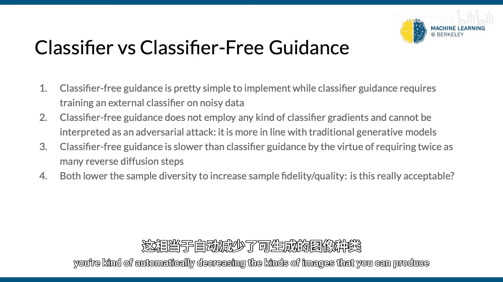

And。This is sort of more evident in this picture， so in the left column as you have a diffusion model that is predicting that is sort of like generating images。

Without any guidance， but on the right column， you have a guided process。

NowI can see that the guided images are slightly like they are definitely like better quality。

 but there's also like less diversity in them now。The question of diversity was quality is sort of my open question like some people might say that okay more diversity is better。

 some people might say that better quality at the expense of diversity is better it's kind of up to the。

The human practitioner to sort of decide on what they consider can be more important。Okay。

 now there's another class of diffusion models called latent diusion models。

 so the idea is that you were training this diffusion model。

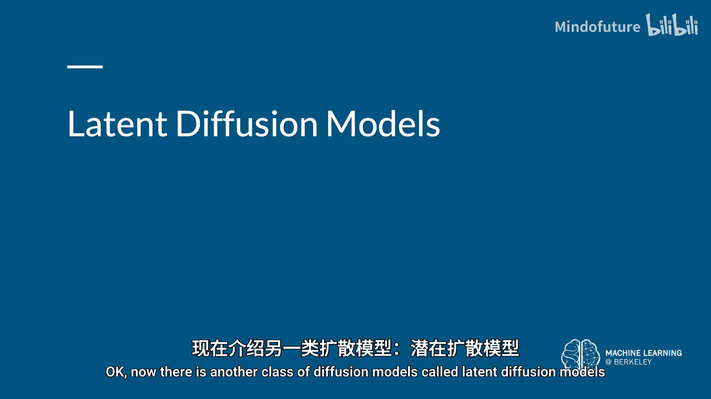

On images until now， and it turns out that these images are like very high dimensional。

 which is going to be a problem because this is going to make the whole process like very computationally expensive。

Turns out that training a huge revisionsion model can take。

Can easily take days to maybe even months on like GPUs， which is like not acceptable。

 right in certain conditions。Another thing about。Diffusion models， or I guess like images。

 is that if you were to say store an image and。If you when youre like storing an image。

 you can convert that image into say binary。And what researchers has discovered is that more bits were being used for sort of capturing the。

Pixel level details and less bits were being used to capture some of the semantic details in an image so like if you had an image of a dog they were less this dedicated to sort of describing what the picture contained and more bits describing something like I don't know like the pause or the four or something like that。

But it turns out that when you're trying to run a generative model and this is not exactly just for diffusion。

 I think this sort of goes for all kinds of generative models like even VAes or GNs or any kind of model that you may see is that you want to run a generative model on the semantic part of the image instead。

 because that is what you're really trying to sort of。Generate， right？So。

The researchers came up with a way to sort of make that happen， and they said that okay。

 instead of trying to predict， instead of trying to run this model on an image directly。

 what I can do is I could compress this model to a latent space。

 run diffusion on the latent space instead of like ups sampleample that latent back up to an image。

So。The way this works is they try to learn a latent space first and they sort of use this like very。

complex loss up there what this is really doing is this looks like again because it's using a combination of adversarial losses which sort of promote reconstruction quality and it's also trying to use like some other kinds of losses and other terms to sort of learn like some meaningful latent space again。

I would recommend reading the LDM paper to sort of get an intuition as to why this loss is defined this way。

 but it turned out to be sort of the best one that they could use。

And once you have just like latent space learned， you can convert from an image to the latent and back to the image using an encoder and decor model。

Which is what like does D represent。And once this space has been learned。

 they run diffusion on the latent themselves。And this is sort of what that process looks like。

 you take an image， you run it through the encoder， get some latent。

You run the forward process on it。And now you're on the reverse process on the latent itself。

And once that is done。You can pass it through a decoder to get an image output back。

I wanted to throw this model out here because this is how stable diffusion works have you guys said of stable diffusion yeah this is exactly how that model works。

You can also like add other things to it like you can try to feed in。

 say you can try to condition on things like semantic labels， text， other things， breaks， et cetera。

 et cetera， and this model can sort of like handle all of that。

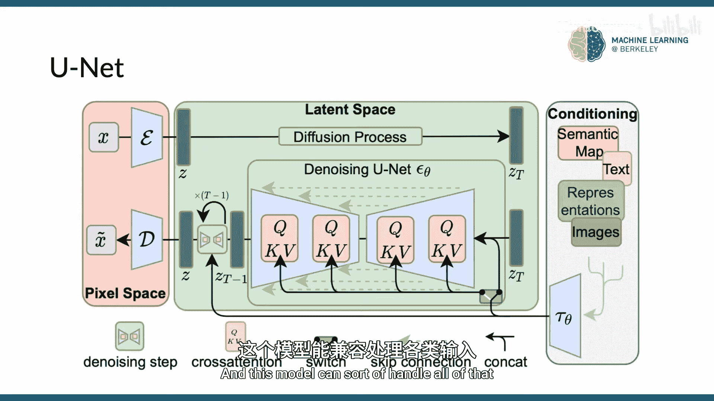

Okay， so that is what I had for today's like diffusion lecture。

 we can spend the rest of the time looking at 30 images。

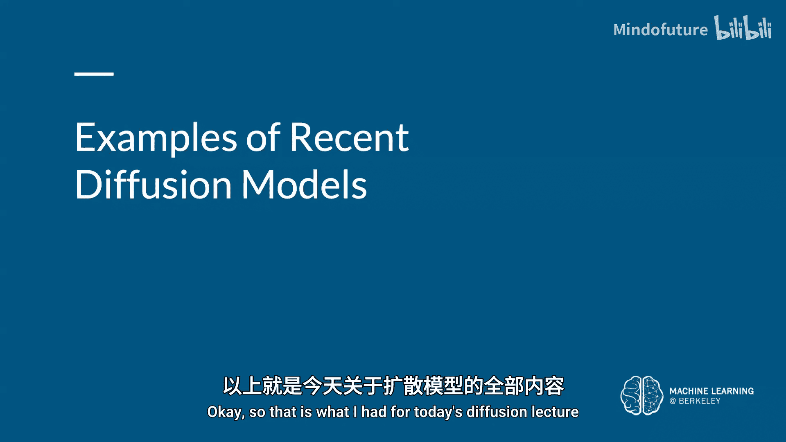

So there have been a lot of progress and diffusion。In the past two years。

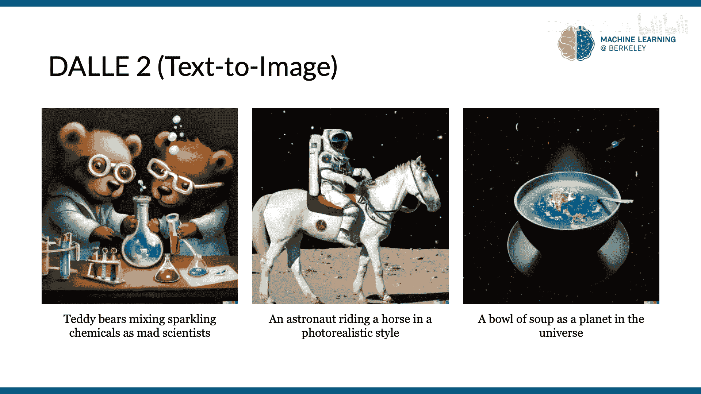

And I want to highlight some of the models that people have that。Labbs have come up with。

So this one is called Dolly2， this was one of the first like text image models that sort of highlighted how powerful diffusion can be at this sort of modeling。

So you can see that okay， if I were to like feed in some like random text。

 I could get very like high quality images back。In fact， I have sort of linked。

I'm going to go through like multiple models and I have linked the websites for all those models in the slideshow so you can like check those out in your own time as well。

So in response to Doli2， which was developed by open AI。

 Google came up with their own model called Imagine。

 which then is a pretty clever name because you have image gen， imagine， right， image generation。

I think that's kind of cute。They were able to get like better results than Dolly too because Dolly wasn't exactly like a fully diffusion model I think it has some other things thrown around in it as well。

 but imagine was a pure diffusion model， it was only diffusion。诶。Okay。

 so after this model came out people were like why stop images。

 what if you tried to do video generation using diffusion instead that also works this was proposed by Google this paper called video diffusion what they do is they feed in this prompt firecrackers and they were able to get this sort of dizzle out。

In response to Google releasing this， Facebook made their own model called Make a videoideo。

So on this slide I have some examples of videos that might that are like somewhat realistic。

 like a horror ring out of a pond or an artist like paintbrush on a piece of canvas。

But can also like generate other kinds of things so like you can feed in the prompt。

 a grizzly bear and a calculus glass and it throws out this image to the left。

Or you could have like a panda thing on a swing set and this model is able to like。

Generate images for like all of these kinds of problems。In response to Facebook。

 Google again came up with another model， extended the Imagine model that I shown you earlier to videos now。

Again， these are just some。They didn't list the prompts for this on the website。

 which I would be kind of curious to see what sort of prompted like these results out。

And by stop there， you can also turn， you can also like generate 3D models using text。

I think this paper actually came out last week， so this is like very very new I have linked the actual website in the slideshow so you could look at other models too see how this sort of model works。

Finally， you can also apply diffusion to RL， I don't know if there's like any robotics enthusiasts in this crowd。

 but that's also completely fair game you can apply diffusion to trajectory planning and even something like offline RL。

 this was a paper that came out earlier this year called diffusion QL and it achieved it of the art results in Offline RL。

Yeah。Again， just a summary。You went over a lot of stuff today。

We went over how generative modeling works and。How you can view image synthesis as sampling from a data distribution。

 we talked about some theory of diffusion again， I know this was very math heavy。If you're confused。

 that's completely fine， I've actually linked。All the papers that Ive used in the slide over here。

 I also link some other helpful papers and other resources like blog posts。Maybe。Like say。

 videos that others are made。I would recommend checking all of these out in your own time if youre want to let to learn more about this because。

Like I mentioned earlier， diffusion is sort of the state of the artrc in geneative modeling right now。

That's all I have for today。

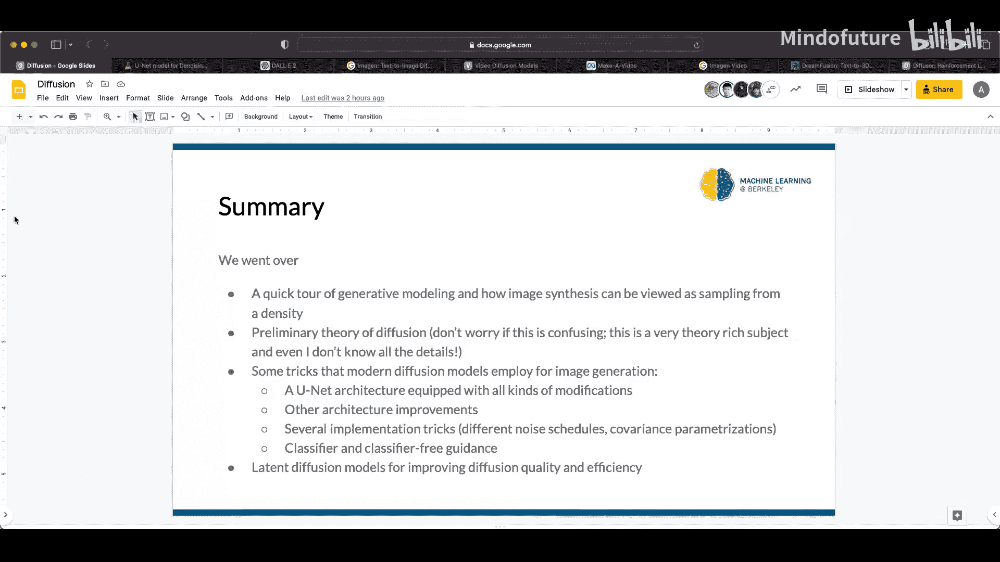

Oh。