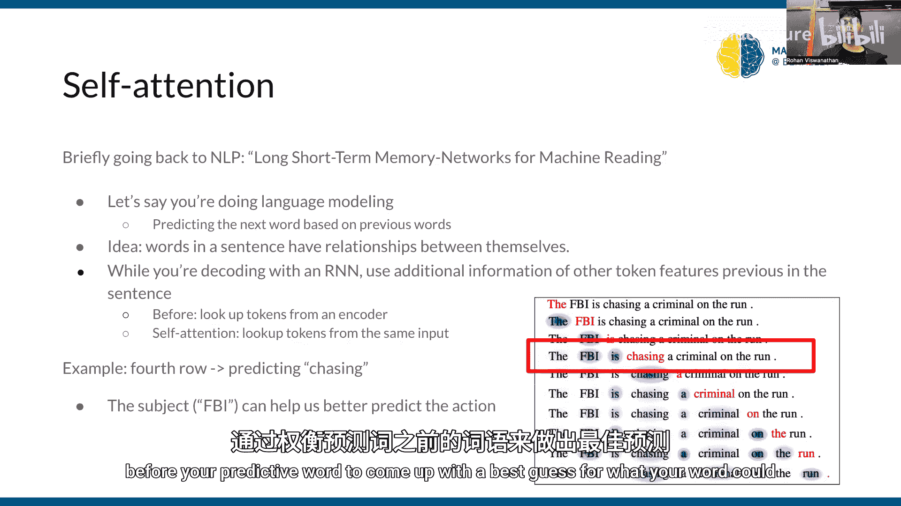
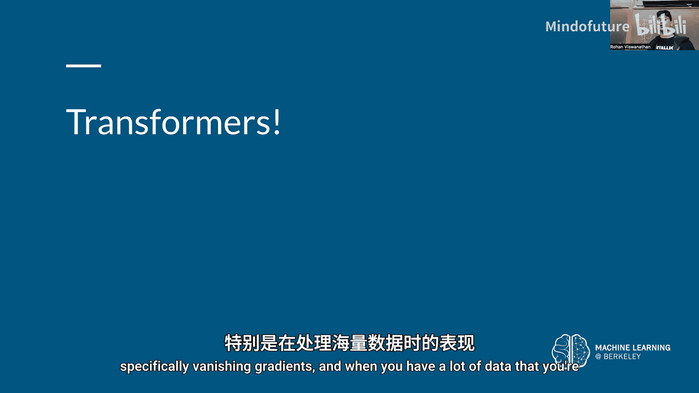

# 【加州大学伯克利】计算机视觉：视觉数据的深度学习 ｜ Cs 198 126： Deep Learning For Visual Data p14 P14_讲座14-Transformers（Transformer模型）和注意力机制 -BV1Va8zzfEtk_p14-

Great。You get the previous recording I sent you， by the way。活人。严究。o后又你望你谂我哋上一十嘅廿五十一阵冇。嗯。什么对什么的表准。

Yeah。Thank so。好。嗯。有啲都会有啊嘅嗯。是的。It is。对。一。But。Alrighty， so we can just about get started now。

The kind of goal of today is to ease into the motivation behind attention and then kind of how that relates to transformer models which are very up and coming kind of the state of the art thing and we're going to be spending a couple classes going over like modern vision transformers as well as like vision transformers as a whole an attention is kind of a cornerstone of that that is going to be very necessary to kind of give you an idea really quickly before we jump into it of what attention is if I tell you to look for a certain thing in a book like a certain chapter or a certain like phrase what you can do is you can read the whole book hope that you recall everything and then kind of present that specific place as you read it but a more informed way of doing this would be first to go to a chapter and then a certain like subheading and then find what you。

Looking for that's kind of what attention is doing it's focusing your effort and your your kind of your eyes on a certain location and blurring out the rest so that you can figure out what specifically to to focus on during this like lookup process。

And something that we're going to also be talking about is how this uses a query key value system to make more informed decisions。

 more informed guesses as to which things to pay attention to the modern attention system is kind of focused on how humans read so when we're reading a certain sentence everything else is kind of a blur and we're focusing specifically on the sequential words that that we're looking at。

Yeah so attention allows models to focus on the important parts of an input and make an inference using a specific subset of data instead of taking in everything as a whole not all features are equally important and that's something we're going to talk about more is kind of figuring out a probability distribution to figure out which things are more likely to be more important than others a big example of this is NLP and RNN so residual neural networks are often used in NLP contexts for example。

 sequence to sequence models are encoding sequences as a fixed vector then decoding them to another sequence an example of this problem is translating so if I wanted to translate for example French to English I start with a sequence I'm encoding this than decoding it into English there are other chial models there's like sequence to vector models etc but sequence to sequence models have both pros and。

One approach from like kind of the lens of an rM and we're going to be discussing them through this through this lecture there's a lot of content to discover so this is going to go decently fast feel free to stop and ask any questions you may have。

Yeah so as you can see here on the left we have a bunch of French words and on the top we have English words and you're kind of creating a map of correspondences where the diagonal maps certain French words to English words and this is kind of the byproduct of attention you're saying that like these words are more closely related to this based on their ordering based on their structuring and position and so I'm going to say that these input tokens have certain correspondences to output tokens and the reason that the shading is different is because not all of these are one to one。

 but these are our best guesses as to which ones correspond to which outputs。

So yeah there are a couple of different types of attention the two we're going to be kind of talking about are hard attention and soft attention hard attention predicts which indices are relevant at a certain time step so you're kind of looking at all indices and trying to figure out which ones of these are specifically important this is kind of hard to backpro through and it requires a lot of computation because you're searching through the entire input representation for the most relevant input tokens。

The other side of this is soft attention where instead of figuring out specifically which inputs that we want to focus on we create a set of soft weights with the softmax function to create a probability distribution based on the input tokens that indicate they're importance that we do a weighted st where we're constantly tuning these weights and this gives us an expected value of which tokens are more important which keys are more important and we're going to be getting into that and this intuition combines the representations of different features that we have So attention is what is generally used and it's something that we're going be focusing on quite a bit。

So yeah we're translating from French to English， when translating destruction， we want to reference。

 I can't pronounce that， but the attention weights will be tuned accordingly and corresponded to certain outputs。

This is kind of the meat behind the motivation of soft attention right we have a database of features that we're interested in and that is our French reference and we want to convert these to an English sentence output to eventually make our prediction so we have a certain sequence of French words that's our first sequence our output sequence is going to be a sequence of English words so the two kind of problems we have is are relating French words to English words that's one problem and the second problem is making sure that this ordering makes sense the order in which we get the French words is also the order in which we decode the English words so there are two things that we need to do in order to make this distinction we need one metric to determine importance so what are we looking for in the input to correspond to the output so this is how do I match a certain query to a set of given keys these are going to be kind of represented as Q and K and then we have a weighted sum of features corresponding to each importance weight so how can I weight these different words these different similar。

To give in an EV and an expected value as to which words are more correlated。

And this is getting the value from the key if your prediction was really good， if you're really good。

 your key will be equal to your value， if you're not that good you're going to be tuning these weights as you go through your this process to figure out which values are more representative than others。

😡，Yeah so I think this is a pretty good illustration of how this system works in like a traditional encoder decoder system so we have we've talked about like encoders and decoders previously but if I have I am Iron Man and I want to translate this to just Su Ironman this is translating in this case English to French but we want to encode each word and as I build an embedding and a kind of latent representation of these words each phrase is picking up from the phrase before it so this is a sequential model then we have a context vector which relates H4 which is kind of a correspondence of the entire input the entire sentence and relates it to decoding sequentially as well then we go from S1 to S2 S3 S4 where H is our encoder creating these representations we have a context vector that maps our full representation to our deco。

And then we slowly decode and this takes those representations and puts them back into a form that we can consume。

This is how a traditional encoder decoder network works where we have our inputs sequentially kind of processing that we have a context vector that only takes in the last one the difference in using soft attention is that now our context vector takes in information from each latetnt representation we don't take this in just sequentially but we're putting all of them into our context vector then using them to decode。

Wwhichhich means that given a certain S2， this only has the first two decod right now in order to come up with S3。

 we want to take S2， which is our previous kind of guess or our previous representation and take it with respect to all of our different encodings so these latent representations。

 which is why our two inputs are going to be an s vector and an H vector where H is our encodings and is our previous decoding the next step is to create a score function to figure out what these similarities are between these and this can be this can be scored in like a variety of different ways there's a general scoring where you have a weight attention matrix which is tuned in the attention layer you can just take the dot product of the S transpose and whatever your H。

Ebedding is for the encoded representation you can concatenate them you can take a softmax there's a lot of different things that you can do notice how the softmax uses a weight matrix that's changed but it doesn't actually use the encoding it only uses the previous decoding method and this is specifically by location that you're only taking into account the location of previously decoded representations and kind of to give a summary of a bunch of other metrics that you can use this is a whole bunch and the papers that correspond with these。

But what these metrics allow us to do is based on our encoding and our previously decod considerations can we come up with a relative importance can we come up with a scoring function of relatedness what are we looking for based on what our current decoder state is which the only information we have at this point is previously decod things so yeah again s subi is the decoder hidden state and H subi is the encoder hidden state in this case S is the queries that we're looking for and H is the keys for each S we want to find its relevance to each H and we're going to be kind of going over this if you think of this as kind of like a python dictionary where you have a bunch of keys。

And a bunch of like values that correspond to this these keys。

We're introducing a query that we want to compare to each of these keys。

So we're going to be doing this。This comparison right we're going to be taking like the do product of these or put it through some scoring function。

 this will come up with aing。So'm kind of waiting。That we then want to apply to our values。

And coming up with this can give us the relative importance of how our Q。

 which is kind of what what you want to find out Q in this case is going to be our our S right so our query is our decodder representation and H which is our encodecoding is going to be our keys that we compare against the score is then passed through the softmax function to get the weights so these weights will be generated through like a softmax function to get a like probabilistic representation of the relatedness of a query with a bunch of different keys。

Yeah， so this is basically explaining that we take our feature， we calculate attention weights。

 and you weight all of our features using these weights and then kind of come up with a linear weighted sum of all of our features。

So yeah， the example before was global attention where all input tokens are used to generate output tokens。

 this is computationally inefficient because we're doing this operation with each and every key that we have。

 but instead of summing and querying over all inputs if the only query over a certain。

Window of inputs so going back to the book example right if we are trying to search for a certain thing in the book。

 do we need to look at how a certain word or a certain phrase corresponds to every other phrase in the book or for example do we only want to see how it corresponds to the five pages before and the five pages after which could save us a lot of computation so kind of how with the convolution you can go over figure out which region is most important as your kernel slides we want to have a certain window where we only query over certain inputs and that's where like the notion of local attention comes into play。

Heuristics can be used to figure out this window so if I have a certain length input and a certain length output ideally the I output token probably corresponds to the I input token so for example if I'm of course translating a series of a sentence of length five from English to French more or less this depends on the language and stuff but the fifth token will be in the vicinity the fifth output token will be in the vicinity of the fifth input token and so on and so forth so you can center a fixed size window around the decoder step so like I was saying five pages before five pages after and these can be used as heuristics so that when you're doing the learning process you're creating a truncated Gaussian function to calculate these attention weights and this Gaussian function represents kind of the distribution that you your attention will follow we're going to talk more about the linear layer and sigmoid function to like get these centers but。

Hopefully the kind of general motivation behind global attention and local attention kind of came through。

All right， so attention for vision， this is something we're going to delve a lot more into next class in the class afterwards when we go over vision transformers and advanced architectures for vision transformers。

 but attention is simply a means to look up features like the example of looking up a certain phrase in a book we're trying to look up features while being computationally efficient and attention gives us that insight。

 that intuition， something that we've talked about before are squeezing Ex networks when we talk about advanced architectures about two weeks ago now。

 two and a half weeks maybe where we can give attention channel wise in an image and select which channel is more important。

 we can also give attention spatially which part of the image is most important and kind of redirect these features based on the importance。

Yeah， this is kind of just explains that we want channel to channel interaction squeeze and excite this is kind of what I was talking about before you globally pool to figure out your importance weights you can weigh each channel individually and then excite you pass these weights through the MLP and rescale these feature maps to get a kind of weighted representation of which channels or which representations are more important than others。

 so instead of having to kind of take linear combinations of all of these channels you now have a more informed approach of which features are more important to both save computation and make your final representation more accurate。

Sppatial attention is kind of similar to what we were talking about before in that here we have a。

Yeah， here we have a kind of text to。Sentence image to sentence representation we have an input image we want to extract features using convolutions then we have a residual network with tension over the image and we want to use the different attention weights that we've come up with to do word by word generation to create a sentence that describes this image this is going to be a pretty high level explanation we're going to get into more of this stuff probably in the future but we want to extract a feature map of the image and we've talked about this extensively how we can use convolutions to extract key features LSTMs how we talk about LSTMs before really okay yeah so these are long shortterm memory networks that allow us to kind of take little connections between certain words and keep those in mind as we kind of go over a long span of data but yeah。

we're using an encoder LSTM and a decoder LSTM we've talked about encoders and decoders at the beginning of this lecture。

 it's a very similar thing， we have weighted features that we then want to kind of correlate towards words。

So yeah we also talked about soft attention heart attention and these also apply to spatial attention so soft attention is differentiable you can train with backpro and because you're using like kind of a weighted probabilistic interpretation of this it's very similar to the translation example that we went over French to English heart attention is transs stochically with sampling so this kind of a random sampling method that you have to use given that you're trying to figure out the specific features that correspond an input to an output。

So yeah， VITs， we're going to be discussing these in depth。

 so we're not going to spend too much time on that。And yeah。

Attention can be used in various architectures as well we've talked about inception nets how they work now when you're doing this combination of features。

 you're paying close attention no pun intended to which features are weighted higher than others so here you're kind of creating an intelligent way of selecting a kernel combining these features and again running softftmax on the result to figure out which which feature combinations of channels are more important。

Okay， so this is also very interesting， so regular attention colloquially you'll take a combination of。

 for example， the words in the French language with the words in the English language to figure out what the translation is but say you're doing a language modeling task where you want to predict the next word based on previous words the most kind of。

Representative structure that you have at that point are the previous words in the sentence right the previous words that you've already talked about the previous words that you've already discovered。

The idea is that words in a sentence have relationships between themselves and that's where this notion of self-atten comes into play and Vaswani kind of talks about this in his attention is all you need paper when you're decoding with an rNN we want to use the additional information of other tokens that we've already kind of decoded previously in the sentence you want to look up the tokens from the encoder and that was kind of what we're doing prior to this self-atten is looking up tokens from the same input so in this example。

We have the red word is kind of as we go through this sentence one by one what we're processing and the blue is what we're paying attention to so notice they're different shades of blue。

These are generated again using kind of like our score our our cross analysis to figure out which things we should weigh more than others so if we have the FBI is。

The words that are most important to predict chasing at that point are FBI and is because these kind of give us relationships that we we want to keep in mind。

 so instead of saying something like the FBI is run we want to prioritize the FBI is chasing from our word bank or our universe of words right？

By the time we get to criminal， we want to get is chasing a criminal， right？

Instead of doing choosing something like criminals or like criminality， we know that。

I and a are used as kind of like singular words so we could come up with a word criminal that's kind of the motivation behind selfatten is waiting the words before your predictive word to come up with a best guess for what your word could be。

Alrighty onto transformers I guess we can take a quick breather here see are there any questions that you guys have or anything you would like to add Jake yeah specifically like care about from all of that like self attention and then like self attention that's basically the the link blocks that we're going to use like here on board so people have questions on like the the like key value where thing like looking stuff up and maybe of like waiting them by different amounts based on how similar or where is for like any given key in our in our dictionary。

Like feel free to ask because that's a problem that's really the the main thing we're going to use going forward。

 just the other stuff was sort of like context that this idea of。

Attention and you know like keys and queries that's used all over the place。Yeah。

 but self attention and then self attention。In particular。

 if you want questions or you any clarifiers any of those。

Yeah just to reiterate soft attention is one of the main focuses that we're going do it's what's used in the transformer model that's described and attention is all you need the idea behind us again is that you're creating a probability distribution that you can pull from so that you can predict certain relationships so you focus on certain features you don't focus on other features so when you apply your kind of product to your to a softmax distribution this pushes things either closer to one or closer to zero and we're going to talk about how transformer models as a whole can also solve problems with RNNs specifically vanish ingredients and when you have a lot of data that you're considering。

Yeah， so kind of going into， oh yeah， sorry，Or like for that model in the board。

 we pra from taking thecay and then create the probability distribution to predict like our water。

So not quite so you're taking the essentially dot product between your query and all of the keys。

 so for example， if I had a sentence。Like I like。I like pie。

Then your query in your first step could be I and your keys would be。Like。And pie。

And you would also consider I。Right and we're going to talk about this more。

 but when we take this in the context of transformers you're actually going to be using matrices instead of like a one to one comparison。

 so then we would compare this。This similarity together and then these numbers that we get。

These are like our weights。Better than going to be passed through like a softm distribution so in reality you're you're comparing whatever you're currently on to the keys of a bunch of other things to figure out kind of like which which lookup is most representative in this scenario。

And be like really specific to like W1 is obtaineded by passing or querying your key for your similarity function。

 so like that can be like a do product， which just your dot product is going to measure like how close those vectors are like lining up。

So W1 is obtained specifically by just taking the similarity of Q and K1。

Your second wave W2 obtain Q and A2， and then all of our values， B1， B2， B，3， B，4， D5， whatever。

We're just going to multiply them by the corresponding way， somebody1s going to multiply by W1。

E2 is going to get5 by W2。And then then to get the value， the total value at the very end of that。

 we're just going to add all of our weighted values。

We're going to sum together B1 times W1 plus B2 times W2 like that stuff， does that sense？And。

 hopefully make show a little more concrete。对。Yeah that's a really good point so this Q and K are being passed into the scoring function of which there are many as we saw before and yeah we also related these previously to H andS which were our decoder and encoder in the like kind of we started from the RNN kind of showing how we have an encoded latent space and a decod latent space and how that corresponds to our Q and K。

Yeah so moving moving forward into complaints about RNNs they are not very parazable parallelzable right we want to take in each input as we go we can't parallelize our operations and they're very bad at capturing long sequences right if I had a very long representation of Hs I need to go through H1 H2 H3 H4 sequentially all the way to a however long my sequences and then I need to take this in respect to my like context function and then apply that to generate an output right so there's a lot of compute steps that are needed to to calculate the relationship between a certain ti and then if I add to that T plus D the amount of computations I do will scale linearly with the and I can't parallelize any of these computations so yeah I would need to run the RN D times in that time I might forget the representation come up with。

Previously of TI， the solution to this is adding attention。So yeah， going back to kind of going into。

 sorry， the meat of today as well， attention is all you need is a very cool paper that talks about getting rid of recurrence altogether and using self-atten to model sequences or groups of tokens。

Yeah。So going into the transformer architecture， we have similar inputs as before we have a sequence of token embedding and positional embeddings。

 which we're going to talk about， but essentially to give a quick。Creface into this again。

 if we have a sentence like I like pie。two things that I want to know are I want to embed these because our program ultimately cannot take in words right and used to take in embeddings or numbers or vectors so if I embed this in a certain let's call it like E E1 the embedding vector。

This is one piece of information， but the second thing I want to know。

 especially if I'm doing something like predicting like the next word or like an intermediary word right I want to know the position of these because that matters a lot so I also want P1。

Where these are positional embeddings and by doing some combination of these。

 I get a representation that I can then pass in to my transformer model and we're going to get into more a little bit more about how to come up with these。

These both of these， but there are many ways to come up with positional embeddings。

 for example like this is position one， two three right now right this can be figured out using like sine and cosine functions to figure out where in a sentence you are and keep that in mind as well。

All right， moving into to the actual kind of transformer model that's described in this paper。

 you have the big red cat， you have an attention block。

 and then a bunch of outputs that you want to come up with。

Kind of going through this process you have a multi-head attention block。

 then you have an addition and normalization layer where multihead attention is essentially where you're running attention from a bunch of different points on everything so instead of just having one representation where you have like scalar values that you're multiplying now you're multiplying values across a span of Hs or a span of embeddings or representations and then you're combining these altogether at the end and you're doing layer norm on this which we're going to talk about as well then we're running all of these through a feed forward network but the difference is now that I'm calculating multihead attention for all of my queries against all of my keys and these are matrices now this feed forward step can be done in parallel and that parallelization is really what brings out kind of the merits of a transformer as opposed to other representations。

So yeah， each token has a key query value like we talked about and for each token representation。

 we use its query to find the most relevant tokens in the sequence based on their respective keys and this is kind of focusing in on what the multi-head attention block is we want to calculate the importance with the dot product of the query and the key and take that in a softmax representation to push values closer to zero or closer to one and probabilistically then apply these to our values and then take the sum of those based on their importance that we've previously determined based on the dot product and that becomes the new representation of that token and as we go through this attention process we're refining our weights thereby refining how we weight our values thereby refining our final prediction as to which words can come next。

This combines residual connections and layer norms to come up with a representation that kind of alleviates vanish ingredients and provides a representation that is accurate。

We did talk about vent ingredients before。If you have gradients that are like slightly smaller than one。

 you can as you multiply these over the course of a long or a very deep network。

 these are going to be pushed towards zero and your value is going to be like。

Infinite infinite testimonyimile small， very， very small。

But yeah at the end of this we have a linear layer and this is kind of essentially what we're doing you have like an H depth of Qs。

 you have an H depth of key's as well and you're calculating this because you have WQ WK and WV so this is essentially like a linear matrix multiplication that we're doing。

So yeah you're applying a linear layer to get KQV from the input embeddings you have your E。

 which is like your embeddings for each of these words。

 you have WKwQ and Wv which represent the different weightings sorry different values of keys。

 different values of cus and different values of Vs and we're doing mass matrix multiplication which is very easily parallelizable on CPUs so that also saves a lot of computation you're applying a linear embedding to get your final KQV from input embeddings and like we talked about before what we want to do is find the dot product between the queries and values each token directly attends to every other token and the connections between arbitrarily long inputs is01 because we're doing this dot product of each Q with each K and because this is a kind of a matrix that we're multiplying。

No matter how big our input is， we're still doing this one operation。So yeah。

 after this K andq multiplication happens for a single KQ multiplication。

 we apply a softmax distribution based on the Do product values that we get。

 as you can see some of them are higher， they're pushed towards one， others are lower。

 they're getting pushed towards zero， and then we reweight our Vs based off of these Ws that have been pushed into a softmax distribution。

Once we multiply our weights by our values， we essentially have a weighted sum of theses and by adding all the theses together。

 we come up with a final value。And this is on a token by token basis scaled attention is where we scale our dot products with one over square root of D and this helps because dot product values will grow very large with high dimensions right the kind of dimensions of your matrix are going to be extremely big so your value is going to grow because of that as well some components of softmax can have extremely small gradients because of this because as your values grow really big if something is like an order of magnitude less than something else。

 those are going to be pushed towards zero extremely fast so by dividing by one over square root of decay which is I guess you can consider your distance or your size you're scaling the dot product based on its number of features or its depth this is to standardized things and ensure that you don't have some gradients or some components that are automatically being pushed to zero just because you're multiplying more things so your number is。

Obviously going to be bigger。Yeah so like I was talking about before in multihead attention we're projecting H key Q and V that corresponds to a token H times so essentially you have an H depth that is then reconcatenated after your tension operations then multiplied by another weight matrix this models different representations of the same tokens as well as its different functions right because you have now an HH depth you can consider to the matrix multiplication that you're doing you're able to consider a lot of different representations of your data and dropout is used after the multi-head attention block we've talked I don't know if we've specifically covered dropout before but this is a way to kind of alleviate overfitting and make sure that we are actually learning an accurate representation of data。

So yeah， I really love this diagram it shows that you have a WVwK and WQ that correspond to whatever your QK and VR。

 you're using a scaled dot product to get an initial like attention estimate。

 you're concatenating all of these layers together you have H layers right you can see that for each of these the depth is H you have like H channels or H representations that you're kind of using to get intuition you're concatenating these together passing it through a linear layer right but this fee for a neural network can only take in one vector。

 it can't take in a matrix of values which is what you come up with because you have a matrix of values。

 a matrix of keys and a matrix of queries， your result after you concatennate is going to be a matrix of these vectors we then want to apply a transformation Wz onto these vectors to get a。

specific vector that we can pass into our feed forward neural network and this is kind of what we were talking about before this Z this resultant is calculated by the softmax of taking your Q times your K dividing by the dimension of one of QKV they'll be the same dimension ideally and this represents the size of Q and K so if you're doing this QK multiplication of matrices of drastically different sizes you're kind of normalizing now by the dimension that you're multiplying by and then pushing that towards a softm again this gets your scaled weights and then multiplying that by your value which is exactly what this formula describes this will get you a matrix and then you're passing that through another weighted matrix to get a singular vector that gets passed into your feed forward network。

So yeah something else you can notice is that you're adding residual connections as you can see。

 we talked about this in advanced architectures as well when we talked about residual neural networks。

 but this is to remedy vanish ingredients in models with a lot of layers very deep networks the next thing to talk about is layer normalization these two both contribute to the add and norm step respectively batch norm we talked about before is kind of normalizing a certain like you can think of it as horizontal batches making sure that the meaning standard deviation are normalized。

 but here statistics are calculated for each sample with respect to the parameters in each layer so you can think of batch norm as kind of like a horizontal norm and layer norm is actually like a feature norm that is done vertically I believe there's also a slide detailing this specifically but hopefully this added and norm step makes sense now you're adding a residual and you're normalizing by feature。

So yeah， batch norm is where for all training examples。

 you are kind of normalizing your your data horizontally layer norm is in a certain batch I want to normalize each feature dimension and that is what's used specifically in attention。

All right we can now move on to the feed for kind of actually let me pause here for a quick second are there any questions this is a yeah quite a bit of content kind of in。

Just charging through it and Jake， if there's anything else you want to add。好了。No。

 but just do people have like questions on any of like the previous episode you on like there was a nice diagram with all of the different like kind of crunch weight and everything。

出さて。I kind been Facebook。好的。别说。Yeah， so like on these graphics like get out like this time right here。

嗯。I do have questions on any of the stuff one here。

I think one of the easiest ways that they are the most intuitive ways to think about it is that you have a query which is like kind of changes depending on which token you're on you're trying to find like in like your universe of information what is most related to it so it's like you're trying to look up something but you don't know exactly what you're trying to look up right like we talked about before so。

By multiplying this Q& K or passing it to some scoring function in this case it's the doc dot product as described in this attention is all unique paper we come up with some kind of dot product we're passing out through a softmax function and that is pushing values depending on other values right obviously certain。

Certain scores of theseqK comparisons are more important than other scores that you're multiplying that by your value that determines which values are most important and。

You're just taking away the some， so this will implicitly consider kind of certain similarities and differences。

So it's it's the whole process just so how review and put my I some that you know don I mean there get final you that remote。

Yes， so you have yeah more or less is that is what we're doing here once you have the weighted sum of V in the big attention in the multiten model since we have a matrix of these values is this produces multiple vectors right then we can only pass one of like one representation into our feed flow neural network so we introduce a new matrix that's tuned or like part of the training process to just do a matrix matrix multiplication and get a singular value basically。

对要。Up until here yeah， that's exactly like you described。Alrighty。

 so the feed for neural network is two layer neural network where you have weights shared with regards to position applied individually to each token embedding right so this kind of represents the combination stage that we talked about before we have after this a residual layer residual connection and a layer norm applied and dropout is used after the feed forward block to ensure that you're not overfitting to a certain representation。

Yeah， so sum reweighted case apply put that through a residual and layer norm combined with the input embedding right this is where your residual comes from。

 whatever your initial embedding is。And then yeah you pass each of these now now you have a value right these are the representations after your multi-hdtention and residual ni layer norm so this is after the meat of the transformer right we've already done all of our operations the next thing that we want to do is we want a positionwise feed forward or a one by one convolution this kind of depends on what application you're doing this for is this like a VIT is this like kind of like like a predictive model for sentences right but we want to pass this through a multilayer perceptron to give us our final value and a representation that we can comprehend and understand and we do this for each and every value and this is again these values have already been generated these are your weighted sums that have now gone through a layer norm and a residual and the beauty of this is that notice like we are doing an MOP for each of these different things but again this can be paralleled which is。

Is really awesome because previously in residual neural networks a big problem was being able to not parallelize anything。

 but now each of these MLP steps can be parallelzed yeah you put these through one more residual and layer norm to get an attention block output。

So again， another you're now translating these new values into embeddings。

And you're able to combine again using residuals passing it through another layer norm layer。

 so all of this is just kind of getting more in depth into the actual like implementation described in this paper。

 but essentially it's just a combination of like residuals and layer norms that you're putting your data into。

So yeah this kind of like ends the transformer architecture that's described in Boswai's paper now this I kind of introduced this before。

 but position embeddings because the architecture is not inherently sequential if we just pass an embeddings you're kind of doing this QKV process of calculating like a representation very uninformed because you don't have any position information you can change this by。

Changing the embeddings that you're passing in to include position where instead of everything attending to everything else。

 you're focusing on a certain window based on position information。

There are a couple solutions to this sinusoidal embeddings。

 so you have a fixed equation that you generate a P1 vector off of depending on like other。

Combinations of features that you have and this is like a very simple formula or you can have learned embeddings。

 which is where you're learning the position of certain words in a sentence and using those to make informed decisions。

Yeah， so another thing that is kind of introduced is having a dummy token。

 which is attached to the beginning of input this is often used for if you are trying to predict like the next token or the next word in a sentence。

 if you're trying to take in a sentence like，I loved。Distrie。

Right say I want to do sentiment analysis on this sentence。

 which is like a very common NLP task there are a lot of like databases there's like an IDb movie sentiment database that's really commonly used say I want to instead of a sequence to sequence model now I want to do sequence。

To vector。Right， so sequence to sequence， an example of that like we talked about would be translating French to English。

 a sequence to vector model is now I want to take this sentence， I love this movie。

 and I want to give it a score where the first value of our vector is bad， the second is good。

So this， I might have like。I did this math I think it88ofs yeah so you have a good score and a bad score that would be an example of sequence to vector and this could use CLS tokens where we want to use the output representation of the token for downstream tasks。

So yeah， the math here we really talked about before you have a Q input， K input V input。

 and we're multiplying our Q times K transpose doing the dot product and this is essentially a big matrix matrix multiplication where we're multiplying our Qs and our ks to generate Ws。

And each eye represents our。Weight and this representation in particular is our weight before we pass into our softmax function。

 so we represent each eye as a QK product， we pass these into our softm， we get a weights matrix。

We multiply those with our values， again this is a big matrix matrix multiplication。

 we get our weighted sum。And that is our attention。

 this is exactly what we calculated before and this is exactly what' was described in the paper。

 notice how attention is really just large matrix multiplication between your query key and ultimately your value。

 again your distance term at the bottom kind of scales based on the size of this multiplication that you're doing。

And yeah， there's a ton of operations because you do have to multiply these matrices。

 but these are huge matrix multiples， which is super parallelizable on GPUs。

 so this is very computationally efficient and scales very well on a kind of like distributed system even though there are a lot of operations。

 which is why this kind of brings us to a better conclusion than what we previously had with RNNs right we can parallelize this no matter how big our input is。

And yeah that's that's basically in the meat of it there's a lot of other things that we're going to be talking about in this class sequence models they're encoder models for BRT to generate your embeddings Bt is awesome it's used in a bunch of different NLP tasks this transform model as well decoder models is they're a little more complex well have we talked about GP already about Oh okay。

Like transform our architecture in the city of like every single token。

Um is like comparing itself to every other token that we have under sequence that's that's really like the meat of it yeah。

 all this other stuff it was six and9 it be necessary for us to one for context all between and tomorrow。

YeahA lot of different developments in this field and yeah I think that's pretty much it revisiting the problems with residual neural networks we had long sequences。

 but now because you're attending to everything we have constant operations even if we have if we're adding an arbitrary distance between our last embedding and like the new stuff that we want to consider before we had a sequential model that wasn't parallelizable now we have matrix operations which are super parallelizable so we kind of solved the problems that we had this isn't even inherently sequential right we have these position embeddings which contain some position information but we don't have this inductive bias we're giving it a semblance before that I first need to process this then this then this then this right so you're introducing before some inherent bias in the assumptions that you're making from the data which is that this comes before this comes before this so unlike RNs and CNNs which will impose translational invariance。

Or inductive biases we're not doing that in transform models and that's that's pretty much everything yeah thank you guys for coming we're right on time if you guys have any questions feel free to stick around but yeah。

