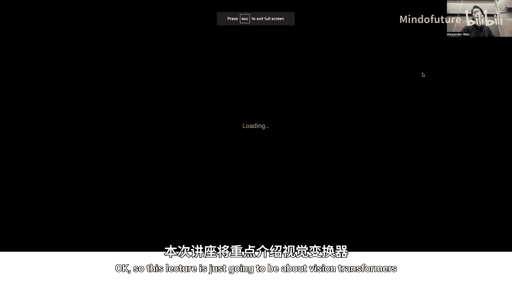
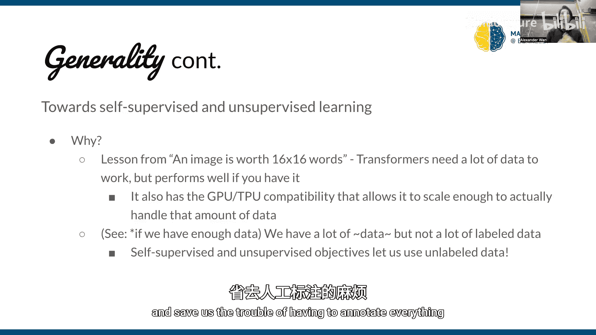
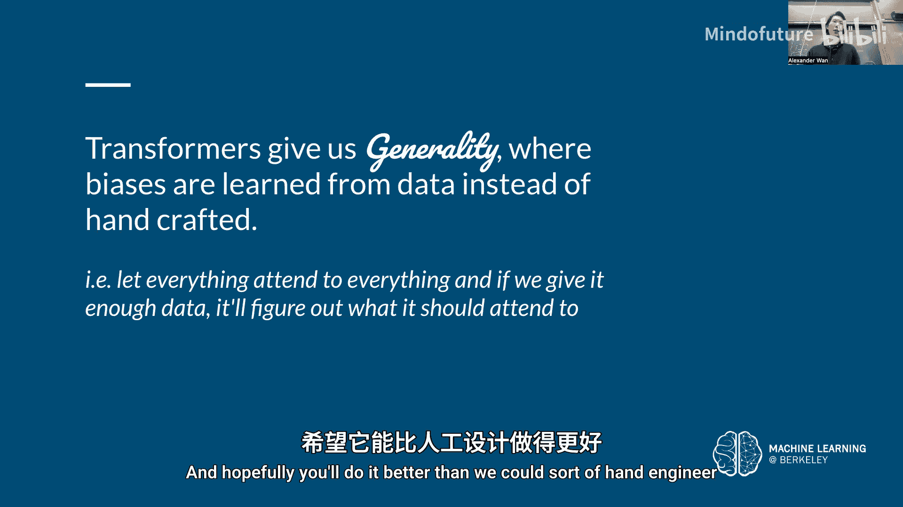
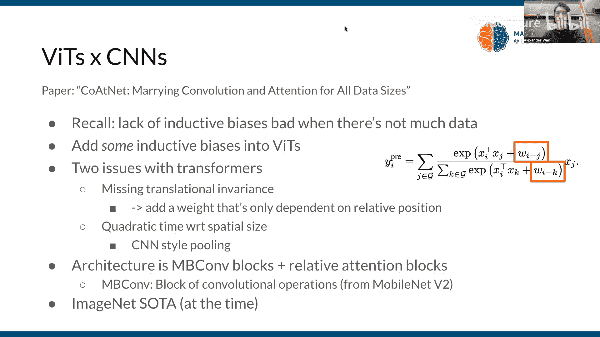

# 【加州大学伯克利】计算机视觉：视觉数据的深度学习 ｜ Cs 198 126： Deep Learning For Visual Data p15 P15_讲座15-Vision Transformers（视觉Transformer模型） -BV1Va8zzfEtk_p15-

开电箱。O嗯。Yep。So I don't， well， I might want to share reports that's why。Okay。

 so this lecture is just going to be about vision transformers。

I think so one thing I think someone on SM was wondering a bit about。

About transformers which sort of just sort of like clearing up some of the specifics and like having a bit of a more concrete example。

 I guess。So the idea like the highest level is you have some set of tokens like your seconds right like。

That's。Then you want to the objective would be the auto aggressivegressive objective， for example。

 so that would mean given the cat you want to figure out what the next to would be so what happen is you'd encode each of these word into embedding vectors and then。

呃。Input that into the large transformer and the transformer would output some set of embedding vectors and then usually you'd have also like a CLS stken right so based on the output representation of the CLS token。

You then。Use that to make the classification of what token would go next after these first two tokens。

 right？The way the attention mechanism works right so this transformer model has some number of blocks。

 transformer blocks and each transformer block consists of first the attention mechanism me like first the attention mechanism and then the the MPs the mod。

So。And then you have this input each combating goes through this。

And then you also have residual after each block after each click sub。

 so this then gets added to the algorithm and then this also gets added to the algorithm。Right。

 so the attention mechanism itself is you have like some black box function that converts。

Each of these embeddings to K QB right so that's key query value so that's works pretty like intuitively as you'd imagine with like a database lookup right so each embedding okay you compare it to all of or each embedding queue take the query of each embedding and you compare it to all of the key values of all of the other embeddings。

And then you try to find the most relevant keys out of all of the tokens。

 so it could be itself because this also has a key embedding。

Right and then you find the most relevant ones。And you take that value and then that becomes the new representation frame of course like this is all this is soft attention。

 so instead of like a hard lookup instead of just taking and copying the resulting value。

 you do dot products between all of the other events。

And then that way you have a probability distribution over which embeddings will be the most probable and then you can take a weighted average。

 so then you have like the expected most probable like value out of each embedding and that becomes the resulting point and then the multi layerar receptor just。

Apply the same linear layers over each of the resulting embedding vectors， so that just adds。

As a bit more a representation of power to the transformer。

So for VT specifically we essentially just want to apply this architecture from text where it was originally used and originally very successful and we want to apply it to images right so this is like hypothetically a very very intuitive motivation for why we want this architecture。

Right， it works well for one domain， we want to use it for another domain。So。

Transformers also have some really nice properties that would work really well for CV so this includes scal scalability right they're really computationally efficient as we talked about last time right they work really really well with GPUs and TUs which is great and also global receptive fields which is something that we'll talk about a bit after。

So yeah， I just went over transformer architecture a bit main thing， though， is that。

The way we pre process this text， right， So we start with just a string。

 and then we want to tokenize this。 So one way we can tokenize this is just by taking each word。

 right， So the becomes a token and cat becomes a token。

 and then we have some vocabulary that we can then。

Where we map each every single word that's within our vocabulary to some like index value right so our vocabulary might be like that I don't know hey some set of values right this is is going to be like a finite set of possible tokens that we can have。

All， so D what might be zero cat maybe one then when we go through our tokenization process。

 the would have zero and cat would have one， right？And then。To convert this to our embedding vector。

 we then have to look it up in some dictionary right so we'd also have this other embedding table where zero corresponds to some dense vector and one also corresponds to some dense vector right so that' that's how we convert our tokens to our then like input embedding representation。

So。How do we then transfer this architecture to vision， How do we transfer this to images so。

The one way is like to start off by thinking about what is like the simplest way to do this like the dumbest way to do this So one way would be just to flatten an image so we usually have like some like 16 by 160 image right we flatten that into a there'll be 256 length vector by 16 times 16 where each item in that vector would be a pixel value right but the issue with that is we can't just input that vector into this into this。

It's a transformer because color values are our continuous right we can't we can't really look them up in a table because then you'd have to have like an infinite length table it's probably possible right so that's we have to find some way around this well one way is to suggest pretend they're discrete right so like like in practice。

If images are stored in a computer they they're not going to be。

 you're going to have like infinite precision， right。

 they're going to be quantized to some amount and they're going to have a limited set of bits to store each color value right。

 So in that sense， you kind of have。You kind of have a discrete of tokens right so each pixel is represented with 256 values per color per color dimension right but that means that you have this huge vab size of 16 million right so you have like。

Might have your might have your like image。That's like 256。

Long and then each token so each pixel value is a token right that that's that's our assumption each pixel value is a token and then each each token has has 256 times 256 times 256 possible values because that's the number of color values there are in our representation so that's too much because we can't store like an embeing dimension of like 16 million。

So one way around this is to just like use less colors。

 I guess to instead of having a 24 bit representation。

 you have a  nine bit representation and eight possible values per color channel so RGB and you have eight possible R values possible。

tree values right this means you have a voc capab size of 5 to 12 that's la more reasonable that's definitely2 point so。

Like each color value and this representation this8 or nine bit representation。

 you look that up in your betting table to get instead of mapping each。

Each like word to an embedding vector， you map each possible color to an embedding vector。

 and then you input it。嗯。So another problem is time complexity。

 so recall that transformers are n squared with respect to input length。

And then also input length is n squared with respect to the length of each side of the image right so if you have a tiny like 256 by 256 image that's like an input length of 65000 right that's way too much for perspective the maximum maximum input length of B。

 which is another like transformer based what's a language model but its maximum length is only 5 to 12 right I think the maximum scene is like like 2000 so 65000 is way too much。

嗯。One way around this is just to use smaller images。

 just like make it 64 by 64 instead of 256 by 256， right？

And then the way it's trained it's trained like pretty similar to how language models are trained。

 which means it uses the self superupvised objective of given the first t minus1 tokens predict the teeth token right so given the first t minus one pixel values you predict that you predict the pixel value。

And that way hopefully you'd build good image representations which is good time so the good thing about this is that you have really really good image representations。

 so one way we can measure this is through semi supervised classification right so。

The task specifically is classification， but with a limited set of labeled samples so remember our model it's pretrained on unlabeled samples just like random images you can scrape off the internet。

 but now given that pretrained model we want to do this task where reclassify on a very small set of labeled samples。

And the way we do this is we just pass all of our images。

Through our model and take we take this output representation。

 where we can we can just like take this and like pull it or something。

And then we use those as input into our linear classifier。

 and then we only train that linear classifier to do classification on those labels and the only input features it gets are the output of the imageGBT of of the transformer output representation。

So because we only have this limited set of samples， limited set of label samples。

 we can we can't train this transformer that's just too large right we can only train this tiny linear classifier that only uses the output image representations in order to do classification。

 right？So in order for this linear classifier to do well。

 the output representations of the transformers need to be good enough that this like tiny reclassifier can can can classify images right that that the image the。

The output embeddings already have to be like linearly separable with respect to different objects。

 right it already has to encode what's inside images because this linear classifier needs to be able to use that representation in order to do classification。

 right。So the result is really good right it gets you know some really competitive results。

And without using labels， right， so it's able to get like 96% accuracy just with a very like limited set of image labels right？

So another way you can sort of look at this is with image generation so recall that the way we train this is is auto aggressive right given the first t minus one pixels we protect the teeth pixel。

So what we can do is we just run that over and over again on this input like max masked like elephant with butterfly ears。

 and then it's able to generate this elephant with butterfly ears。嗯。Wow。

 like with the understanding that like this is a weird elephant that has butterfly ears。

 And like this is image probably doesn't appear much in the training set， right。

 But it's still able to sort of infer based on context what's inside the image and and make these really good generations。

 So this this also applies for like droplets。 can it can sort of do this like pseudo like physics simulation。

 I guess and and these cat drawings to So yeah， I think this is what sort of cognitive tension with。

With this model and transformers apply to images。So the bad is that it takes a ton of compute right so they trained a 6。

8 billion parameter transformer and it was trained for 2500 v100 days so V100 is like a type of GPU and essentially they used a ton of compute and the transformer is only able to work on images with 64 by 64 resolution images right so that's pretty bad so like what's the point of this so the point is mostly as a proof concept right so this paradigm of transformers and massive selfsupervised pretraining applied to a completely new domain So we use this paradigm of like transformers and a ton of pretraining data unlabeled pretraining data。

With with text and that worked really well， but now we want to apply it to like images right so we see that it does work great。

 but we do need like a faster way to do it like this isn't going to work for for any downstream applications。

The same two as。What's the sort structure。So you wouldn't actually train the transformer。

 you'd only train the linear layer on top right and then you can just do like a normal I think they do like logistic regression so you can just do like your normal cross entropy objective in order to or to train your train your layer model except the model instead up taking as input the images it takes as input the output representations so yeah yeah yeah so you have a very small set of labels。

Yeah。So there are ways to make transformers more efficient like architecture wise。

 but recall call like a major appeal of using transformers that they scale gl well relative relative to the amount of compute you have right so because the architecture is so simple and because they're essentially just like huge matrix multiplies they work really well with PPUs and TUs so we're able to scale them really well with the sort of hardware that we have。

Um， so yeah， that sort of justifies why we might want to keep the architecture more simple。

 even if they're like n squared with respect to upper length。

So a maybe more practical solution is from this paper it's called an image speak today an image is worth 16 by 16 words。

 so rather than quantizing pixels we sort of downscale images by first splitting them into patches and then projecting them into our input and beddings directly so over last time with image UBT we sort of。

We pretended that our pixels were tokens and then we looked them up in a table and then we used that table to get our input embedding results。

 right？But now what if we just take our image， we split it into patches and then for each of these patches we do something like the KQV like projection。

 we just pass it through some linear layer and we take that linear layer output to use Azar inputbeddings so we just take that image directly。

 we process it a bit and then we use that representation as the representation of of that。

Of that part of the image right so our tokens are essentially the patches and the patches instead of looking them up in a dictionary。

 we just use a model， a tiny model to learn what the input representations would be。

And then we also do the standard stuff of adding like position embeddings and like the CLS token in order on top of our transformer。

Yeah。And then we let say。So some miscellaneous stuff for this architecture。

 so one thing is because we pretrain because pretraining like takes so much time we go through so much data。

 we tend to want to pretrain at a lower resolution first and then fine tune at high resolution we can also get patch representations using convolutional neuralarrow so it's more of like a hybrid approach I guess so remember this linear projection just passes the patches through a linear layer so that we can use a convolutional layer also works。

The task that they do the benchmarks on is to your standard like imagenet classification so。

Given so that's just image classification yeah， so the way they train this is they first do pretrain on like a massive data set So the thing about this is this isn't selfsupvised the way they do pre traininging right they have like this weird Google has like this huge like closed source like 3 billion sized like image classification data set where there's like a ton of images but labels are also like really noisy because some of them are like automatically labeled and some of them are like hand labelbeled so this is a bit different from from before and that we're pretraining with a supervised data set。

And then after we have our pretrain model， we can then fine tune it on that Co data set。

So this gets really really good results it was state of the art for Inet I think for barely but yeah。

 but the main thing is that relative to the previous state of the art so this is the convolutional neural network relative to the previous state of the art it is way more efficient so so this this tells us how much compute it uses and it uses like。

Like one fifth of the compute of the previous state of the art so the claim of this being a more efficient architecture is yeah true。

So sort of a quick aside on this term like inductive bias that we'll probably be using a lot they're essentially like assumptions that you make by choosing some model right so if you choose for example like a linear model then you're assuming that your data is linear right you if you their data is not linear and then your linear model is not going to work really well。

So。The claim right why vision transformers are maybe like better in the most like general sense of the word are better is because they're more general in the sense that they have less induct devices。

 right so。The reason why a lot of people are really hyped about vision transformers is because one reason is because they have less inductive devices。

So let's so specifically what they are are， for example， have。

I'll just go over I was like comparing contrast that the in bias that you have for CNNs versus for vision transformers so CNNs on the left we have。

The big two big ones are locality and two two dimensional neighborhood structure so locality means that。

Sort of image features that are closer tend to be like more biased towards like the model tends to be more biased towards image features that are closer together。

 so for example， if you have if you recall like the the sort of sliding window architecture of of your CNN。

The only way in a single CNN layer， the only way that two pixels can sort of interact with each other are if they're within the limited kernel size。

 right， because let's see。哦。Service。So you， you have your image。And then your CNN。

 we're seeing those。Is you have you have some like set of weights these get applied and it's like a sliding window factor so that you do the dot product between this and this and this and this this and this right so the only way that two pixels are going to interact is is if they're within this range right so if you have two pixels here and here then those get to interact right but if you have a pixel here and here。

Then those are those are way too far away， right those。

Those the output representation are still going to be on opposite corners， right。

 because it's limited by this tiny kernel size， which is going to be like five by five。

 like three right3 or something。Um， and obviously like two dimensional nearby structure if you're doing like a kernel with like 2D matrices that's that you're going to have。

 you're going to assume that your input is also like 2D right。嗯。

Other thing is translational equivariance so the thing here is like we apply the same weight matrix to each part of our image right so if we have an image feature over here and an image feature over here they're going to be treated the same way by this by this weights right because we're just applying it in the same way here and here so yeah that's another big assumption that's made so。

Whereas with vision transformformer， oh sorry。Oh， yeah， sure。Yeah。

 so remember like this will all be like flat out but。For a vision transformer， this。

Will attend to everything right so this will project this out to like K QB and then each pixel will also have like a K QB so we'll also have like K QB。

And then this query will attend to this pixel， this pixel and this pixel right then also attend all the way over here to this pixel regardless of how far away like each pixel will always attend to every other pixel or sorry each token or always tend to their brother token。

It's a computational。Yeah， yeah， essentially yeah。You up like different minutes。So you can say。嗯。

Yeah， so you do have different like functions for different features。

 but each of those functions get applied in the same way for each part of the image right。

So in like the translational equivariance appears if you share the same weight across positions。

So yeah， whereas if you have a vision transformer。sort of。

Each each position essentially each position is a unique token and each unique token has its own representation for key query value。

 so then each representation also depends on the token also you have like your positional embeddings as well which also affect your resulting representations。

呃。Yeah， so。That was CNNs and then you also have。The inductive devices for VTs the only ones that you have are sort of image patches。

 so like image tragedy if you're if you're splitting it you're splitting your image into patches andre you're assuming that it's going to be like a 2D image right and then。

Also like positional embedding so this is like don't worry too much about this but position embedding interpolation during fine tuning so what that is is remember that with this architecture you want to pretrain at a smaller resolution and fine tune at a higher resolution but the way that the positional embeddings are trained right' and trained they're trained as like an embedding vector right so so you're going to have like this limited set of positional embeddings that you're used to using for your model during pretraining but when you actually fine tune at a higher resolution that you need a more position embeddings but so how do you like transfer your old positional em bebeddings to this like new set of position embeddings you're gonna need to interpolate it between positional embeddings but don't worry too much about this essentially like the only inductive biases occur sort of at the input of your model like when you're like sort of preprocesing。

So it's much more limited than that of CNNs essentially。啊。

So what this sort of means for this architecture is that VITs perform a lot worse when there is not as much data and they perform better when theres a lot of data。

If you look this graph right so the X axis is the number of pre training samples the y axis is the sort of accuracy so the gray is cns these are just resonances and then the the blue green other stuff is VTs so in the beginning when there's not much data resonance perform better at the end when there's a lot of data resonance perform worse yeah so sort of why is this tradeoff happening with VTs and then sort of how does this connect to inductive devices so this sort of intuition is。

If we don't。Inherently bias the model towards any particular like mode of data。

 if we don't bias it towards images inherently， then it has to learn those representations from the data right so。

嗯。Whereas with CNNNs a lot of these biases they're already hand engineered right so if we sort of assume that like humans are dumb and like machine learning is smart then if you if machines if you have the machine learn its own representation if you have the machine learn its own like way of processing images then that might be better then if you have like humans try to try to engineer it themselves right so we can see some evidence for this with the type of with the types of。

Representations that are learned by the model。 So for example， you have。

The position embeddings so opposition embeddings they're just like learned they're initialized randomly。

 but even then they still you can see that they still sort of encode position on the 2D plan right because even if flying everything and input it into the model it' still encodes things like in with like two axies right。

Another thing is like if we look at the intention map。

 so another thing transformers are great at is or they're kind of okay at this。

 which is that attention lets us sort of see what the model is like looking at makes it slightly more interpretable in some ways so we can look at the attention representations and see that。

When you input an image， it tends to sort of look at the object and the image and ignores the background。

And we can see us not too sure where this is from， but you can see some of the representations that has are sort of encoding like lines and textures and stuff。

 sure it which are nice if you might sort of like recall sort of similar ones that are learned by CNNs。

 which is pretty cool。So yeah， the sort of takeaway from this is that transformers are able to learn。

Learn these biases， learn how to better represent images if we give them a lot of data right and it's able to learn these better representations because we don't bias it from the beginning right whereas CNNs if we bias it to process images in some way from the beginning。

 then it's not able to learn these better representations right。

So I mentioned this earlier at the beginning， which is another advantage the vision transformers also have a global receptive fluid。

Actually yeah， we kind of touched this， which is if you have。

Sort of something here and something here。If we want these two things to interact we can't do that in like one or two convolutional layers because after one or twovol because this kernel size limits us to only only process things within this tiny area right so we're going to need to wait until like the very end in order to have these two tokens relate to each other or or interact with each other。

Whereas with vision transformers， everything can attend to everything from the beginning。

 right all tokens explicitly sort of like interact with every other token。So from the beginning。

 this token can， if it thinks this this other representation is important。

 then it can just look at their representation from the beginning。

 it doesn't have to weigh all the way until end， right？

And we can see evidence in practice for this happening with this graph so the y axis is the mean attention distance。

 so this is essentially the distance between the original query and the key that it ends up using so。

The attention distance between here and here would be one attention distance would be like two attentions here would be like probably the max。

 right？嗯。And then you essentially average them and you weigh them by by like how how much they actually use it right so if if the dot product between distance distance high then this distance is a weighting so if in practice this token ends up really wanting to attend to this token then your mean attention distance will be really high if in practice this token like this really care about all the other token just cares about its neighbors then the mean attention distance is going to be really low so we see is in the earlier layers it does in fact use。

It does in fact use tokens that are far away from it right so we see in practice that the transformer does to take advantage of having this global receptive fuel。

So a couple cons for this architecture。Well， one thing is that the patches are not very fine grained。

 right？For something like segmentation if you want like this fine like boundary because because we segment it into like patches from the beginning you're not going to have a reputation of this right so your output reputation is also not going to be very fine grained and then that might prevent present some some issues。

Other thing is like find grain image classification and anything essentially where you need a lot of detail because the issue with BITs or this particular architecture is that you sort of just glb all the patches together so you might lose a bit of detail on that front。

So yeah， so the takeaway from from these two models is sort of this idea of like generality right so we we want to be moving away from。

TheIt's the it's the idea of moving away from models that have a lot of inductive biases and towards more general models right so any domain specific biases or domain specific like features should be learned from the data instead of being hand engineered right we shouldn't have models that are specifically made for images or models specifically made for text which it would be maybe a good idea that have models that are。

Specific to their models that can be used on anything and then they're only they're only specialized once you train them on data right so I'm sort of like holding it back a bit and saying like maybe this is a good thing because there's I don't like it's hard to have like hard evidence of which like research direction is is the best but some some intuitions on why we might want this include sort of just like the historical。

Aspect of like where where AI is going I guess like if you think what AI was in like the 60s right it was it was like expert systems right it was these huge essentially like dialogue trees or like if statements where you hand engineer every single possibility every single user input and then pre like if if the user inputs hello then you should also output hello right versus more recently with deep learning and stuff right。

Now that we have access to all this compute and all this data。

 we can take advantage of more learned algorithms。that learn their own features from data and we see that in the past they worked theyve worked better so sort of the natural progression to more and more general models。

 more and more models that learn from data instead of being hand engineered might be a good thing yeah。

嗯。So it also lets us ease the combined domain， so if our architecture and like learning scheme is general enough。

 then we don't have to craft like if we want to build a model that that does like image captioning right that needs to process both image and text information。

So if we have the same model and we were able to pretrain them on both image and text。

 then that's great we've like saved the step of having to like engineer an action model I guess yeah。

 so an example would be like Gato it was a model released think like 2 or2 years ago by Deep mind where they pretrained transformers on like text images like aari games and we all model of transformers which is pretty cool。

So another。Saing another reason why you might another like takeaway would be this shift towards more selfsupervised and unsupervised diet so this is learning without labels right learning without label data so a reason a reason might be like recall earlier right transformers need a lot of data to work but they work really well if we have it right so。

Transformers in particular have like this this GP and TU compatibility that allows to scale really easily with the hardware that we have right but the issue is that we have a lot of like。

Random data that we can scrape off the internet， but we don't have a lot of like label data or quality label data。

 I guess right so self supervised and unsupervised objectives that don't use labels would help us take advantage of all this like random data online and sort of save us the trouble of having to penalty everything。

 which yeah。

So yeah transformers give us generality and where biases are learned from data instead of handcrafted and it is we let everything attend to everything and if we give it enough data it should know what to attend to and hopefully it'll do it better than we could sort of hand engineer。

嗯。So I'll go pretty quick for these last couple of these these are just some specific examples of how maybe VITs are used in practice。

 so maybe this is a paper that's sort of moving towards what what I talked about in the previous two slides。

 which is，Emerging properties and self supervised vision transformers so using an architecture that's similar to an image is worth 16 by 160 words so it does the patch stuff and it also does a self supervised objective in learn of imageG so that's the first example。

So it's able to take advantage of all of this random like image data that doesn't have labels and is also efficient because it uses the patches right so what we found is it produces really good image representations it sort of does it in a similar way to before with like the linear layer but instead of a linear layer uses key nearest neighbors don't worry about too much but essentially it produces good enough representations such that like a weak a really really weak classifier can then use them really use those representations really easily to do image classification at high accuracy right？

Another advantage is that representations produced by this model can retain sort of scene layout information and object boundary information and so it might be able to use be used for like video segmentation so see that here so this shows the self attention on the CLS token on the last layer so the self attention weights sort of showing what the CLS token finds interesting with respect to the result the rest of the image right？

So we can see that even though it wasn't trained on any images sorry even though it wasn't trained on any labels。

 it still is able to figure out like what the interesting parts of an image are right so it's able to figure out like the bird or like the boat and ignore the background。

Without without any like explicit supervision of you to you need to classify birds or you need to classify boats just by training on random images and with this architecture it's able to sort of figure out these boundaries which for。

So yeah so another thing is that VTs are used a lot these days like this is the image chat leaderboard so this is just image classification took this sometimestime during the summer the screenshot so these the top couple models are all vision transformers so a couple things to notice is the parameter account which is this middle column right here it's all like 1 billion plus right so the shows that we can scale transformers really well can scale them really easily。

Another thing to notice is on the right side you have this like JFT 3 billion data set it's this huge like pretraining data set with like 3 billion images I think I don't think it's I don't think it's unsupervised but it has has sort of the weekly the noisy labels that we talked about earlier where like your labels are kind of bad but if you have enough images then they sort of like cancel each other out I guess。

Or it's more like there's still enough signal that your model is like able to take advantage of this huge data。

嗯，对。So you need a lot of parameters you need a lot of data and then you perform really well so how you actually get to this point like how do you get from the first architectures we talked about in the beginning to this like top one on the leaderboard so one example is just to make them larger and train longer so it takes the same architecture as image worth 16 by 16 words that's the patch stuff and then it essentially they do a bunch of test with different levels of training time。

 different architecture sizes， different amounts of data used to train。

And then they graph them and they try to see insights they try to gar insights into into how to scale these models and if they scale after after a while so what they found is that better representation scales with compute time model size and data size size so if you if you scale those things at the same time then you form better which is maybe a bit of a obvious result but。

Another thing is like。Large models are also more sample efficient。

 so they need less training samples in order to get the same performance right so you need to train them on unless samples in order to。

Or to get to the same format so that's that's another thing that you also see in text as well。

 like language models。Those have some engineering stuff just improve training performance and fine tu accuracy and their 2 billion parameter model ended up getting the state of the art on image type I think they don't have that anymore。

是， so。Yeah， so some graphs from the paper， essentially just saying。What we had earlier。

 which was the blue means like the more blue it is than the smaller models。

 the smaller the model you have， the smaller the circle， the smaller the data set you have。So。

 sort of on。And then the X axis is like training time right so on the top or more like top left if you have a really small data or it's a really small model doesn't really matter how much data you give it at a certain point for levels off right so that that's the model size bottleneck and then the bottom right if you have a large enough model。

But not enough data。 So this like tiny thing right here。 so you have a pretty large model。

 but a pretty small data set then then it tends to level off as well so。

If you scale up the three factors at the same time， data， model size and compute， but the same time。

 then you perform better， which is pretty cool。诶日相。

As the last thing is like vision transformers and CNN。

 so this is like sort of a hybrid architecture between those two。

 So recall that the lack of inductive bias is bad if there's not enough data right so it's often that you know you want to train a model but you don't have access to this like 3 billion 3 billion size data set right so solution would be to add some inductive bias into vision transformers So two issues with transformers is that one they're missing translational equivariance。

 So that's the that's sort of bad thing I talked about earlier but turns out like。

It's actually good if you don't have if you don't have enough data。

 right it it's still a beneficial thing if you don't have all this compute time for the transformer to learn these good future representations by itself。

 So how do we add this back into the transformers Well one way is to。

Add a weight value when you're calculating your attention weights。诶。

AndThis wave value is only dependent on the relative position。

We have this feature of this token right and this is projected to key query key query value and then we have maybe this token key query value。

 this is token in the middle， it also gets project to a key query value right。We have。

Our query value comes this key， query value comes this key。

And then we essentially the way like it tends to these tokens is by doing just the dot product between this key representation and this or this query representation and this key representation right so we essentially just add on this learned weight value that's dependent on the distance from here to here。

And that's also defined from the distance we're here here so for example。If you have。

 if you want to encode sort of this idea that let's say you want tokens that are closer together to be way more right you think that tokens that are closer together will naturally be more relevant or something。

So in that case， if you were to have just a vanilla just form learn that it it would have to sort of alter the representation for each of these key gray values right it also have to probably alter it for the positional embedding as small so it'd have to do that for every single one of these sos。

Whereas。If you have this learned weight value right， this learned set of like weight vectors。

 then you can just say like w0 equals to zero and w1 or w like or sorry like W0 if the distance between two tokens are zero then you should add this like huge weight if the distance between two tokens are small then you should have like a negative weight or something right so a lot you sort of find with images there's a lot of features that are that don't depend on their absolute positioning and only depend on their relative positioning and this actual weight vector is extra learned parameter lets you encode that really easily and like really efficient weight instead of having to learn it for all of all of your tokens。

So yeah， another thing that you need to change is the quadratic time with respect to spatial size。

Remember before that if your input sequence is 256。

Because the transformers O of n squared that that's kind of not great sometimes so one way you can sort of fix this is by pooling like doing max pooling or something after the output of each block and another sort of thing you can add is just to add。

Excuse me add like convolutional blocks in with transformer blocks， so just combine them。Yeah。

 so I think we probably make make more sense with for architecture。

 So for the beginning couple you have convolutional blocks because remember vision transformers。

 they don't handle long sequences well So you want the convolutional layers to handle the the long sequences and then after it's downscaled by by by a couple。

Like a couple of times， then you can use your vision transformer and then it might be fast and then。

Also notice the sort of dimension of each of these blocks。

 so I think this is the input dimension and the input dimension to each block is downsampled so you pool before each input which makes it a bit faster。

Yeah， so。To conclude vision transformers and they're associated like。

Self supervising like unsurprised training schemes。

Are sort of the next step in more and more general models and。General。

 meaning like less induct devices and less hand labeled stuff right and sort of transitioning from hand engineered features to maybe like vision transformers later on and also they also require a lot of data as transformers tend to tend to do also like Vs are really scalealable because transformers are work well with like our compute hardware and so they perform really well right we can we can scale them really easily with with our hardware and we can also。

Yeah， or yeah， we can scale them during training time really， really easily。嗯。I think that's it， y。

Does anyone have any questions？Yes这个 question。嗯。II think it's supervised， yeah。Yeah。

 because I guess the idea would be that you you don't have a lot of data and that tends to curve us。

Yeah， so you if you have any questions， feel free to ask on that stem I'll probably check that and yeah。

 answer any questions and stuff so。

啊。