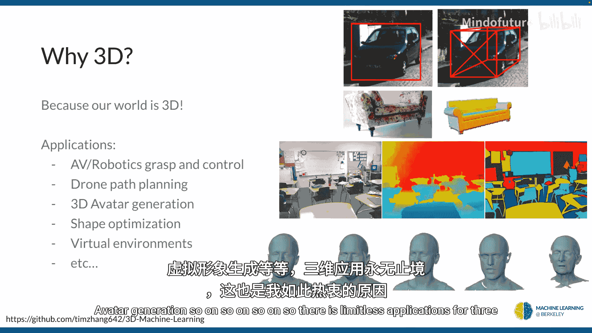
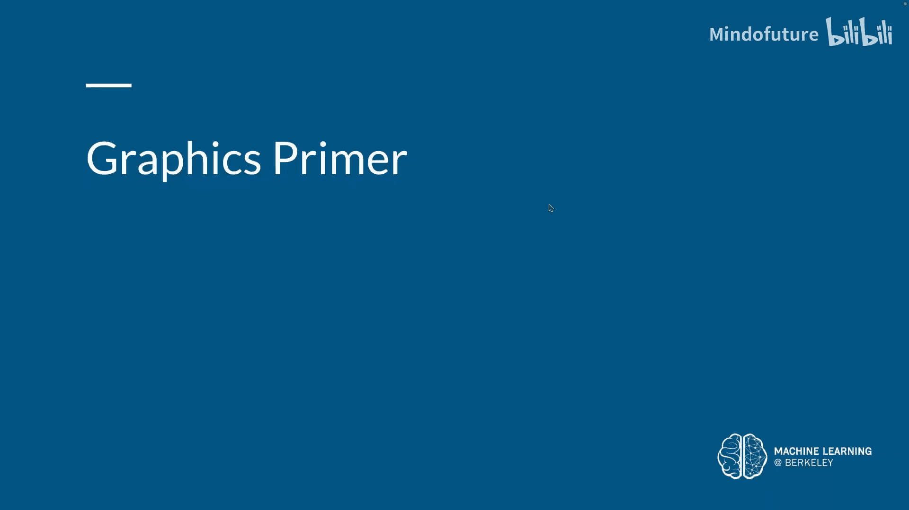
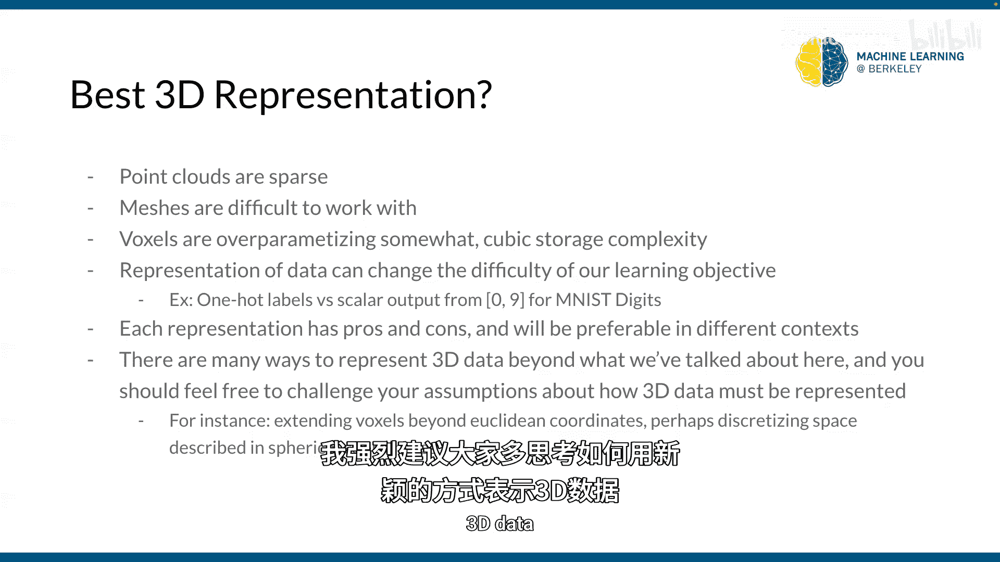
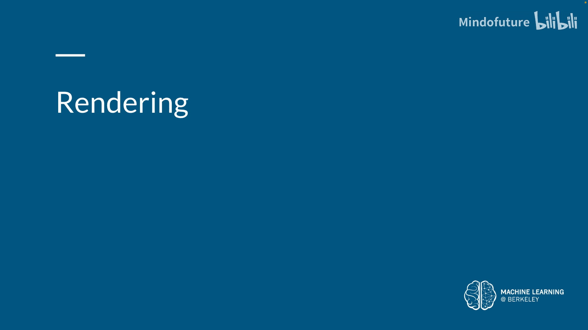
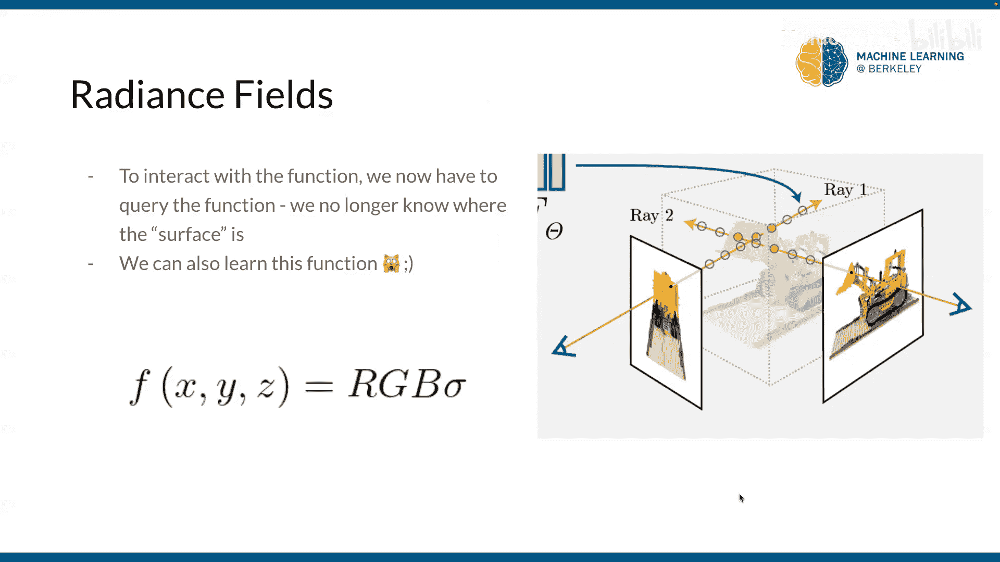

# 【加州大学伯克利】计算机视觉：视觉数据的深度学习 ｜ Cs 198 126： Deep Learning For Visual Data p17 P17_讲座17-3D视觉概览_第一部分 -BV1Va8zzfEtk_p17-

Yeah， definitely interrupt。Just ask questions。Yes。Yes。呃。So yes， this week。

 I think you guys already got an announcement， but we will be talking about 3D instead of self supervisorvising and the self supervisorvis will be moved through next week。

Co if you have any questions at any point， just like interrupt me and I'll be more than happy to answer and yeah。

 so we'll talk about going to three dimensions。嗯。So。就是。

Grow 3D kind of fact we've talked a lot about 2D like the entire dec I was talking about 2D computer vision and that's cool and it makes a lot of sense is like the way our eyes also see is also three dimensional and we just kind of guess the 3D structure based on like our sto vision and just like what we know about objects and so sometimes。

Because of that you can develop 2D images like' somebody by MC or and it'll kind of mess with your mind because you're just guessing into the 3D structure but it doesn't make sense because it's a flat2D image and so the reason we need to go to three dimensions we need to kind of extend is to prevent this we need to add。

A constitutionalent structure structure that makes sense。嗯。

The reason we need to do this is because our entire world is three dimensions。

 so pretty much there's unlimited applications of three dimensions from the metaverse stuff self driving taking cars and if you want to drive around them you need to know a three dimension opposition position of those cars。

Shape optimization， virtual environments。Arbit generation， so on， so on， so on。 So there。

Limitless applications for three dimensions， and that's why I like it so much。

Yeah。So a little graphics primary。How do 3D and that's just like how do you actually represent 3D data because like we can just use images and so one example would be 2。

5 d so instead so just during the pixels we also started in depth kind of like how far away the object is。

Point cards which is pretty easy you just have like a set of 3 d points in space and that becomes a 3G presentation then if you connect those points with like edges and phrases then it becomes mmesh and sos。

Are you kind of used all video games you've definitely seen measures before。嗯。

Another approach would be v sage vaw grids， which would be like the image equivalentvalence of gradient and then lastly we'll also talk about gradient fuels。

And so given those kind of structures， one thing we want to know is how do we visualize it。

 how do we。A render them how do we see it and so that brings us to like what is an image and what is a camera and so one common model that is like commonly used to teach this is the pinhole camera model and so the pinhole camera model assumes that light is a and theres like light everywhere it goes in all directions and to actually capture an image what a camera needs to do is it needs to filter out that is such that one point in space for response to one point in an image and then we create a sharp image of it。

嗯。So as you can see on top。If it take the top of the tree。

 it emanates light in all directions all over the barrier and if we just try to image the barrier we'll get like just。

A blur we won't see anything， so we use a pinhole， a tiny hole and the better to filter out light and then on the film we can get an actual image。

So that's kind of the basic of how imaging works and approximately how our eyes work as well。

And this is important because there'。Drives us to a kind of a model that we use for entering3 year objects in space in simulation。

So。好对不题。Trying to simulate all of the lightase would be invisible。

 there's infinite light in all directions， it would be incredibly expensive and inefficient and just impossible to do。

So what we do is we assume。All the light ray that don't make it to the camera just don't exist。

And so that would be forward rate raising we take maybe all other the points or maybe some points in space if we right to random。

We passing through the pinhole or through the pinhole， which becomes like our camera。

Through of the image grid， which is like the pixel grid。

 and that way we can calculate by each point kind of。Shows itself into image。

One detail that's important in simulation is that。We no longer have this notion of a film。

 we kind of don't place it behind the barrier， we place it in front of the barrier。

And the barrier of like actual pinfall is where our camera is now。

 so when we have the camera origin and the re directions。The pinhole becomes our camera origin。

 like where your camera is。And we have radio directions going from the camera through the image grid。

Does this make sense？Wonderful。But。One problem with this is like how do you know where to start the race your scene can be very huge not all points can make it to the pinhole to the camera and so we can do the opposite of that we can do backwards rate tracing。

So in this model， instead of going from the scene to the camera， we started the camera。

 we go through the image grid through pixels and we see where those arrays intersect on the scene。

And so this is backwards forecasting or trade tracing so we will see why this is useful later。

 does this still make sense。One shorter side is I'll use the。

Words rate racing and rate casting interchangegably， there's slightly different things。

 but you don't need to worry about that。Wonderful， so see you later。Versus 2。5D。

which is also known as RGBD and basically all this is instead of having RGB image you add another channel which is the depth and this can be depth from let's say some plane that you defined so kind of like an post graphic projection sort of thing or if you're taking like an image your phone can actually take RGBD camera by sending out。

P and I getting him back so。You know that the depth on the camera to the scene。啊。

That's kind of boring every single CNN that you've used so far can be just like converted to take three four input channels instead the three will work exactly the same way so nothing interesting here will move on to point parts。

Point clouds are cool so if you or if you're a recall familiar with sensors like Li or radar。

 they output point cloud so what they do is they send out a bunch of phrases in all directions and they get them back and they measure the distance。

And then knowing the direction in which they center rate and the kind of distance the rate traveled。

 they know where is that point is in place and they take all of these samples and they could reconstruct kind of。

A lot of points， a point cloud。嗯。So this is kind of gives us a general idea of where stuff。

 where the surface is。But it's still sparse like we don't actually know what's in between of those forms。

And so to actually reconstruct yourself as， we need to make some assumptions。

And the assumption we typically make is。Our point cloud is dense enough to the point where we can just linearly connect them and create a mesh。

So this is how it works， it's kind of similar to your typical like function interpolation that we learned just like connect it with lines and then connect those lines with triangles in your home mesh。

嗯，Does this make sense。嗯嗯。Yeah是不刚买息。所意识个对。How。Yeah， so you cannot quite do it randomly。

 you have to pick points that are close to each other and there's。

There is algorithms for triangulation， for example， delonia triangulation make sure this kind of a。

One of the best translation algorithms。Collorlys。Setets of points to make ranks between them。哦。Yeah。

Oftentimes you create a mesh by hand in like blender or something or after desk on your user that way。

 but you can also go from point files to meshes。Some properties of meshes is that well first' the graph right you have points that are connected by edges in between those edges you have placess kind of just like an extension of a graph in 3 space。

Storage device， it's always cleared。Usually and that's because like the surface of an object is in two dimensions so it's in square storage。

 but it of course depends on like specific of object you have how simple or complicated it is and so on。

啊。One thing is that meshes work well for smooth surfaces。

 but if your surface has a lot of like bes and vialts and it's like very ragged and high frequency。

 those typically would not be represented well by meshes you would need to absorb the resolution a lot and therefore the storage consumption of your mesh。

One more thing is that they're generally difficult to work with in machine learning settings。Because。

We don't have the best techniques to work with。Andin of graphs of the moment。

 so typically are the representations。Can be beneficial啊， depending本上我俾你。Does this make sense？我得说。嗯。

One side is like how do we add quality to mehe and so if you're familiar with kind of like the globe projection right you all seem like a map of a globe the common problem is like how do we。

Actually dry do we try it as like the circle but then like some parts get distorted and so on and so this problem cannot like be perfectly solved。

 but the way we typically do it is the。Take the polygons。On the surface in the al Robbson。

And we warbs them to like a flat 2 d image。And so here we have em mappinging between like every single polygon in an image to a polygon in a。

And so when we color the mesh， we see where it intersects， we take the polygon。

 we know where it maps on the UB mapped image and we take colors in them。こ。

So now we'll move on to voxels。So you're familiar with images。Kind of it's a discrete 3D space。

And you have pixels so what pixel analog of in3G would be a voxel or kind of just like Legos。

 so instead of having a two degree you know not having three degree and it's filled with voxels instead of pixels。

You can think of it as like aerobic cube or Legos or maybe Mincraft。

 was only like monochmatic blocks on it， so just single over。

Does this kind a be structure make sense？好的。啊。And so one quick note is that you can valize。

In a mesh so meshes typically represent at closed volumes。

 so if you want to convert it into a voxel grid you just place it on the voxel grid and for each voxel you can see is it inside or is outside of the mesh and we can set it to either exist or not exist。

And so from this， we can kind of。That are like that a workshop has several properties including like color and maybe。

Existent， so does it exist， which is one or zero if it doesn't exist in the was again。

Another quick aside is the translu war。Is how do we actually represent objects that are maybe like only sort of see through。

 maybe like stain in glass or yellow or something like that so。

Then we can derive something called density， which would be a value between zero and1 so instead of just having a binary value for a vel like if it's there or not。

 we have density like kind of a 0。5 would be we have a translucent voxel here。啊，你。Yeah。

 so some properties each boxel has。At density in a color。

 its storage would be in cubic because it's a great than three year space。

 so if an image is n by n it's just voxels n by n by N， so it's in cubeic。

 which makes it kind of prohibitive to use voxel grids at para。

Whether it's like now we can process images in like 1024 1024 pixels。

We can' really use v cells at 1024 by 1024 by 024 because that's just。Too big， not very efficient。

Yeah， and one cool thing is we can extend2D convolutions to three dimensions so instead of。

The conutional camera being like the 2G windows at your slide。

 it can become a 3G windows at your slide across the works grid and you can convert almost any CNN architecture to be a 3G CNNn。

Any questions about work？Wonderful。So now how do we actually increase the resolution？

We've talked about meshe which are you mentioned not very good for high frequency details。

We mentioned vmobil bills， which also scored cubly with respect to the resolution。

How do we do we actually have presentations that can？啊。They represent the high frequency details。

And so one solution that we came up with is called the radiance field and so radiance fuel is just。

 you can think of it as a function that takes xY z coordinates。

And it outputs the RGB the colorra and sigmas the density at that point。

And so F is just the continuous function that exists everywhere。

 or maybe we can constrain it to some like space that we care about。And it's sort of。

 you can think of it as like the continuous walk up thing。Does this。That presentation makes sense。

Theres a very see country， wonderful。And so。One thing that happens when we do this is we lose the notion of what a surface is so previously this works or grids like we had a defined surface。

 we could intersect it。With meshes， we can easily see that there is a defined surface that we can interscept。

 but with this gradient field， there is no notion of a surface there is nothing to intersect。

And so this kind of raises a question of like， how do you actually render it。

 how do you work with it？And so the answer is we。Sample it so when we cast the rain instead of looking for an intersection。

 we sample it at different intervals and then we use those samples to create an actual image。

And we'll talk more about wheelmeter rendering a bit later。Is this game wonderful。Okay。

And so kind of from all of this， what is the best tricky representational it's hard to say right we have point clouds。

 but the spae we don't know it's like actually in the points。Mehes other。

 but probably actually take advantage of the fact that we have edges and triangles。

And then walk also are great， but they're kind of over parameterizing the in cubic they have stuff inside。

 you though we usually just care about maybe the surface that we work with。嗯。And then。

Re just feels are great， but。We get't inter there connect we had the sample so there's。

Kin of pros and cons to each one of those and it is really important to think about the representation because for example。

 if you think back to the amnes digits， the representation matters a lot if we。

Set it to a10 label versus kind of a scalar between0 and9。

 it can make your task more difficult or much simpler。And so it's really important how we choose it。

And there's more 3 year representations that you did not talk about you can talk about likepherical coordinates。

 maybe some other guess space maybe some combination of the do and so on so and so on so right definitely encourage you guys to think more about like。

No all ways to represent 3G data。

Any questions about 3G data presentations？I will move on to rendering now。

So。Going back to Raycasting。So we have the forward requesting。

 remember going from the scene with the camera。We have the backwards ray casting。

 which is going from the scene from the camera to the scene and we kind of just approximate it because we don't have every single point going back。

啊。Yeah， so forward broadcasting we take， let's say a good example via point cloud for every single point in the point cloud。

 we go to the camera origin to the pin hole。Yes， you have for whenever we render。

 we have the camera origin and we have kind of。That's the directions of the is yeah。

And then we can calculate like where is intersect on the image in the pixel space。

OneNot for backwards requesting， which is very important is it。We take whatever we see first。

So when we go from the camera to the scene， whatever we intersect first is what we actually see so for example I'm seeing all of your guys with laptops but I don't see what's actually on the screen because first they intersectors the back of the laptops。

Yeah。And so。Kind of when do we use forward precaster， when do we use backward forecastcaster。

When we want to render point clouds you want to see kind of every single point on the scene so we have to use forward tray casting with they start to array at every single point in the point cloud and we go back to the camera and we see where the。

Where we actually want to draw a pixel for that。Borington a points well。

backwards recus with fundamental network working because。

We're basically doing heat to almost never fit any single point in space just because of slight imprecisions。

Okay可。啊。Yes， there's a rendering point cloud。And then when we want to render， for example。

 a mesh or a box of grid， we do the inverse， so we start at the scene， we start with the camera。

 we reiterate it。And wherever we intersect first， we take the colors as location and that becomes the colors that we actually like render on the image。

啊。To do this for every day， we can calculate three triangle intersections and it's。

Somewhat efficient。Technically， you can also use forward requesting so you can take the points in the mesh。

 you can rate them forward requesting， but we'll not talk about forward requesting for meshes because it's cut we kind of collaborative。

Yes。So if you're a geometry there with a match changes， which is kind of very common on video games。

 you can really do those tricks and then breakfastry customs just better。嗯。Yeah。😊，And so。

So Fred we talked about taking the first point， but if your objects are translucent。

We have to keep going。We are cast from the camera we see where we intersect first if this point is translucent we just keep going and so now we don't just consider the color of the first point。

 we consider the things we consider the density of the first point and the color of the first point and also the density like the second point that we hit and the density and the color width。

So and then we can do some maybe like clever。W the diveaging or some other kind of function to combine those two points。

And so on this diagram and you can see that because this are the camera。

 we go through the image grids through the frame。We help the object trans so we keep going。Yes。

 so for a v grid， it's explicitly we have like a density for a mesh。

 you can say like for every phase you can have also a density value and so on。Yeah。

And then you start to worry about why thera is like a different angle。Yes。

 so you cannot do backwards forecast casting with point clouds。

Because you will just never hit the pointss because there anything that in one space。

Well can using camera that。You can technically hit the point just because of like。

If you get numerically lucky but yeah you can really hit an infinitesal point in space。

 yeah exactly so most of the time you hit a face。Yep。

 and can similarly technically add like reflections so instead of if you're。

Addd similar of activity while you can like also bounce back。

 but like your image generating the image。The and then wherever you get back。Exactly。

And the pixel a lot you can be calculated is like an average of all the first point and then the point behind it。

 if you do like。O。And so we did that。Now we want to go to radi fieldss now we want to go to the continuous case where we don't have a surface and so radi fieldss can be used to create maybe something smoke how do you intersect smoke that's impossible because it's like not related。

It doesn't have a surface， it just kind of like has variable density at different points。

And so this is the anphyysic is kind of ray sampling， we sample different places and we aggregate。

All of these samples to create one pixel laundry。So rembling the way it works is we have a ready to feed backward recast into the scene and we go all the way through the scene。

And then， we sample。At different points on this rate。And we have， let's say n samples， right？And so。

We take each point。We pass it through the radiance field， which remember again。

 is just a function that takes xY， Z， outputs RGBD， RGB， and de to。

And so now we have let's say n sets of these colors and densities。

 how do we actually put them together？Into one pixel logic。

And so the way the answer for this is volume matter renderdering and we'll talk more about it。

Next lecture， but today I would like to give you guys just an overview intuition for what it actually does and so we have this equation CR which is the color at a given rate。

Is the summation。For all of the points。Or the accumulated transmittance for that point。

The beta for that point and then the color for that point。So。

What does that mean so GI is the like accumulated transfer。

 which is like the inverse of the stuff in front of it so for a given point if you think let's say it has a wall in it。

It will have very low accumulated transmittance because it has a lot of stuff in front of it so keyI will be really low for that pixel allow use for the example so it one hair high can have。

Impact on the output that you see。Beta I is just a function of density at that point。So。

If density at some point is very low， it's kind of like air or just smoke， it won't be very visible。

If。D a given point the sky， for example， if it's like a wall or。

Just the surface of the object then the sample will throw high visibility for the like high impact for the final color that we see。

Does this。E equation makes sense。They get the high level intuition for what each of these terms represents。

I'm sorry to。Yes， if you in the ideal case， you can take an integral over the array。

 but because we are limited to kind of just like limited by compute there samples。Yes， exactly。

Abit you bring together。In the continuous case， yes， it is an integral in the realistic case。

 we have to sample along the way。Yeah， typically the number of samples is actually like。

 but relatively high it's around like 256 point samples， which。Thats become kind of very slow。

When we consider like oh we have an image like a thousand0 pixels by a000 pixels and then for each pixel。

 we have to do 256 samples so that it does become expensive to render re fields。20。Wonderful。

 hope this make sense？And lastly， we'll talk a bit about differentiable ending。

Pretty much everything we talked about for rendering turns out to be differentiable。

But one thing you do have to keep in mind is that it's only differentiable for the stuff that we actually see。

So for mesh。The surfaces that we see， the we have positive gradient for those， right？

For vel renderings， the vels that are actually visible in the rendered image are going to get like how non zero gradients。

Araance fields， you can maybe think about those， but those actually solves a problem a bit because。

We don't just， we don't have a notion of a surface。Realistically。

 every single point that we sample will have some impact on the final cohort， so it will have some。

啊不 brilliant样。啊。Yeah。And so that's about it you don't need to know like the details of differential rendering just know that it works。

Yeah， the only the things you see actually for billion。You guys have your questions about the budget？

So the radio outside of。Yeah， it has existed for a long time is。

that's just going to be my perspective。拜拜系。N。By4。嗯。It's just。It fewew for see， right。

Instead of explicitly in。modelodeling it as a vel grid or a SM mesh we say what if we make it a function and for every Xyy point it has some density and it has a color so that's all the gradient field this。

我也不认不认识。So you can explicitly create a function， right？

You can if you make it function for like a sphere you can make it so that like inside the sphere you have density one and then it has some color right you can do it by hand right in yeah you can definitely can engineer it in next lecture we will see how to actually not cant engineer it so we model F as a neural network and it starts out it kind of just noise and then it learns like where density is non zero where the colors are and。

We can。Well show you how to actually make it learnable。我是。If there are no questions， yeah。

 the lecture is done in an ask session bank。好的。我他。Yes， so that's the against homework， right。

The transformers come pushed back one week not the gun。Awesome。

 thank you guys for coming and for watching。Don Thursday。

