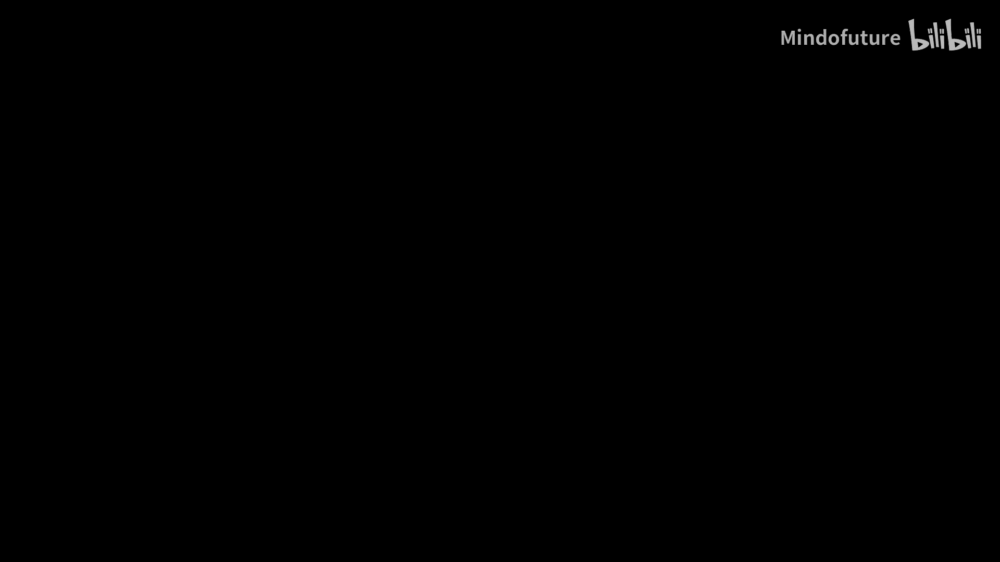
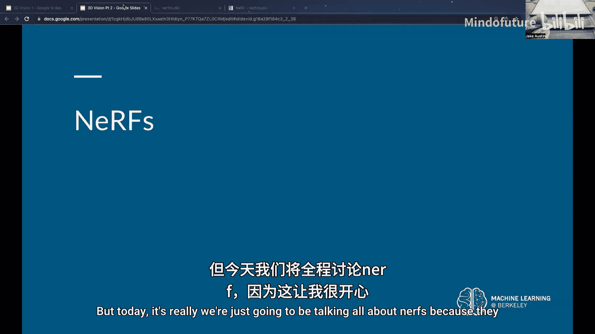
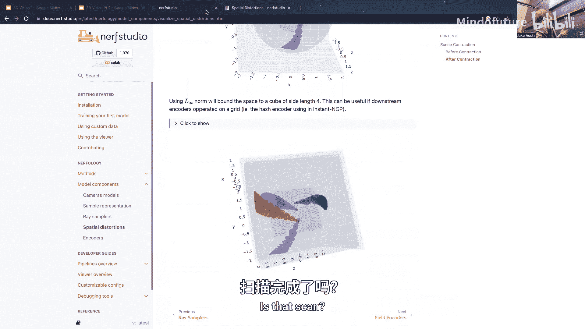

# 【加州大学伯克利】计算机视觉：视觉数据的深度学习 ｜ Cs 198 126： Deep Learning For Visual Data p18 P18_讲座18-3D视觉概览_第二部分 -BV1Va8zzfEtk_p18-

It's literally at the top。

All right。Yeah， perfect。Okay， so let's see with that。

 I'm going to jump into3 vision part two for which Mel and I have decided we love Nfs the most。

 so we're just going to cover Ns today。If if you want we do we did make a couple of slides on like monocular depth estimation if you want to come up and like check those out afterwards。

 but today it's really we're just going to be talking all about Nfs because they make me happy so。😊。

Yeah， so we recap N a little bit。The basic idea， again， you have a black box function。

That takes in your position in space， X， Y， Z。And it's going to output your color， your density。

And if we want to figure out what an object looks like from a given perspective。

 we're going to query going out from our camera from our current location and ask our black box function。

 what is the color， what is the density of all these points and trying from that sort of figure out what what is this image actually going to look like and that process is rendering。

That is the basic idea of what a radiance field is。The recap of volume rendering。

Color is the weighted average of all the samples that we take as we go out along the rays。

Your visibility is proportional to the density and inversely proportional to the amount of stuff in front of us so if we have lots of stuff in front of us。

诶。Like for the bulldozer after we've passed through the bulldozer。

 there's lots of stuff that was in front of it， particularly right here where the actual object was so even if this point right here returns a really big density。

Even at this point here past the bulldozer returns a really big density because there's a ton of stuff in front of it。

 we're still going to wait it。Super with a very small value。

And you can see sort of the intuition of this on the right hand side this is not particularly color friendly the top is supposed to be brown the bottom is supposed to be yellow I'm sorry orange。

So。You can imagine casting out a in a scene。And it passes through。And the first。

 it's going to pass through a brown object as we sample along this ray， as we sample along this ray。

The density that we observe is going to be very little and then it's going to spike。

When we're passing through the object and then the density is going to be very little again。

So we only really pass through one just brown object so the color we're going to return。

iss going to be brown and when we actually learn the ra field we're going to compare it to our ground truth image of this object and say like okay does how does the color that we came up with using our function compare to the real color？

And then the second example， just to hammer this point home that it's really only the closest thing to you that contributes to color。

We can imagine two objects in the scene， the first one will be orange。

And the second one will be yellow。We have a rain that goes through it。

Both these objects were going to sample a whole bunch。Right。

The first thing we come into contact with is this orange bowl。

And you can see the density spikes at the orange ball and then goes down again when we're in between when spikes again we hit the yellow ball。

The color we're going to return will be orange。Because all that matters is the color at this location here where the site first hit。

嗯。So like sure， we do hit a yellow ball eventually， but in this case， it is behind the orange ball。

So the color you get back is just orange。嗯。So yeah。

Do people have more questions on this intuition or yes yes for sorry his Yeah it's going because the density it's the first if the first object you come into contact with is like glass and it's not perfectly dense。

 you're going to get some contributions of color from that maybe you'll get like a weight of like one half and then the object behind it that's super dense is probably going to contribute to the rest of your color but because even though it's perfectly dense it's 100% dense because it's behind something else it's only going to get a weight of like maybe one half。

Yeah。Say it that again oh refraction yeah we'll talk about we'll talk about that a little bit how we handle like reflections and stuff like that。

Yeah that's a really good question we're going to talk about that in a little bit yeah it。

How are you are the object sitting with part of it Yes personally you just feel like a basic play。

And sometimes right little we can like an average of those two piece like you're saying that you want to wait yeah we want to wait it more and like how's that so。

Basically， what we're going to do is we have the densities say， okay。

Say we're sampling the yellow object here and y'll see this okayishsh， hopefully okay。

 so say we're sampling the yellow object here。First thing we're going to do is we're going to get the density like sigma in this case it's written beta beta is this it's。

A proxy for just sigma， so I'm just going to write sigma for now， so we get sigma I right here。

And we're also going to come up with T so how do we get T what we're going to do is we're amazing going to sum all the density along here。

 we're going to sum it all up， add up all the density and then take one over the sum of all of our densities accumulated up until here。

So if there's a lot of stuff right here。T TI rather， if there's a lot of stuff right here。

 if our densities in front of us are really big， that makes V value T super small。😡，嗯。

So tea is really big when there's not much stuff in front of us。

 tea is super small when there's like other stuff in front of us basically。

And you're going to do that by just summing up all the density that came before us along a red。

 does that make sense？Okay， party on。嗯。Any more questions？All right， party on。嗯。

So that is that is the intuition， whatever we hit first is going to be weighted heavily。

 whatever we hit later on， not as important。So what is the goal of neural radiance fields？

The basic problem is we have a lot of different images of an object like I just walked around an object。

 took a video and then I look at all the individual images that make up that video and I want to say okay。

 given all of these images。How can I come up with a neural radiance field that's going to be able to generate new views of this object？

That's basically the problem statement， come up with a neural radiance field so we can query at points in the scene and come up with new images too。

How do people feel about that？Yes， friend。How hard is it to get the ground positions and direction yeah because I see guys yeah it's pretty nontrial that we can find all the positions of all of these you know where the phone travels as it's moving through space there's some programs you can run that'll basically like。

Like if you have an object with really sharp corners。

 it'll kind of look at the position of all the corners as we move and sort of triangulate i'm not going to go into it too much。

It's the basic problem is like called structure for motion。

 like how do we figure out given like a video。Of like us moving around an object。

 how do we determine like some key points along that on that object？

There's programs that do it like Co map。It's really gross to run it's questionable whether or not this is cheating using these positions to begin with。

Yeah， it's a very difficult problem。Classes like 194 26 cover that classes like 280， CS 194 26。

 CS 280。Um， it's definitely， it's definitely non trivial， but for the sake of this problem。

 we're just going to assume that they're given and they're like pretty good。

experience it's really obnoxious to get it， but it's like it's doable and honestly I still feel like it's kind of cheating to have that to begin with。

 but there's there's。Some derivations of this that don't necessarily require this if you just have a continuous video。

Yeah， it's it's a real problem， but it's doable。And it's for the most part pretty accurate。

 it's like a classical technique that was long before the era of deep neural networks。

 so it's been around for a while。嗯。Yeah， good question。Are there more questions for you。

 yeah it's up。like you're aY， one frame at a time。Yeah。

 basically that's what it is we're just going to。You know like you assign the camera yeah。

 exactly yeah， when we have our image we're going to say， okay。

 like if we want to generate a video of a camera like moving around like this。

 we're just going to figure out where all the cameras are sort of in like a little circle out here to pick a bunch of those views along that circle generate images together and then yeah just play really fast and then we get the video yeah it's where and。

不多钱。I mean， technically， with your first camera， you can just assign it to the origin。

Like if we're if we're taking a video and like moving it around。

 like our coordinate frame is whatever we want it to be。

Like this object is still the exact my laptop is still my laptop， if I rotated a little bit。

 or if I if I assign my my axes to be rotated a little bit it's still the same thing so if your first camera you can technically just call it the origin。

嗯。Does that get at your question at all？Or does that it sort of it reminds me a little bit of like slam like some people simultaneous localization and mapping it's sort of like self-driving like if you have a continuous video of your car moving along how do you figure out where stuff is and where you are and in that problem yeah you do definitely take advantage of the fact that your second frame is going to be pretty close to wherever your first frame in your video is and just try and figure out like okay like how much do we move in this little one gap from our first frame。

Does that kind of get it a little bit， Okay， are there more questions？All right。Yeah， so。

So whether or not it's cheating， it still gives cool results so we're going to run with it and the paradigm is we have lots of images of a scene and had yeah。

 we have lots of images of a scene， we want to just figure out。

 okay from these can we learn a neural radiance field and then that would allow us to render new views if our neural radiance field is really good？

😊，So yeah， so like why why do we bother with 3D at all because it seems like。I mean。

 this is deep learning after all， why don't we just train a network that just takes in all of these different images？

Nope， come here。It just takes in all of these different images and just outputs a new image if you just say okay here are all of our cameras here are the locations where all these images were taken from here are our images predict an image given a new camera position that we're going to give you like why do we why do we bother putting it through this bottleneck of like learning and our rating feel at all that's sort of a pretty nontrivial question come here。

我啲。What's going on？Oh I'm on the wrong slide， that's cool。Okay。

 so why do we bother with this with this bottleneck why do we why do we bother learning a neural radiance field instead of just telling a neural network like hey。

 give me a new a new view of this object from this new position and the basic answer is like shape consistency。

Also sort of known as like inductive bias if we train a network end to end。

 just hand it a whole bunch of images of a scene and train it to predict new images of said scene。

It'ss there's no guarantee we can penalize it pretty heavily for warping the object between different viewpoints we can penalize it pretty heavily because we know like we have ground truth views of the object from different views we can penalize it pretty heavily if the shape is inconsistent across images generated of it but in test time there's no 100% bona fide way to make sure that the shape is consistent so on the right hand side this is something done just sort of janking something with stylegan there was no underlying three dimensionmenal representation at all is just completely deep learning end to end。

 no inductive bias you can see the hair is changing the nose is changing the mouth is opening like the shape is not consistent across different views。

on the bottom， we have a neural radiance field。Of a plant， and you can see。

There's like almost perfect consistency across the entire thing， well there has to be we've forced。

By putting it through this bottleneck by learning a neural radiance field。

 we've guaranteed that when we go to generate a new view。

 it is going to be consistent with the shape across all these different views we're generating does that make sense to people。

😡，This sort of motivate like why and it's it's not a it doesn't just apply to radiance fields like why would we learn a radiance field。

 why would we learn a mesh of an object， why would we learn anything why why bother with that if our goal is just to get new images of set object。

😡，And it boils down to wanting to make sure that this is consistent across all of our new views that this is。

Feaasibly an object yeah that's that's sort of the bottom line with this and we can use anything we can use meshes whatever。

 but just radiance fields give us some nice properties and allow us to represent super fine details like this。

So as some brought earlier， reflections are difficult and when I said that we take in position XYz and spit out a color and a density。

 I was kind of lying a little bit， so if you look at a mirror from two different angles。

 the color on the surface of the mirror is going to be completely different。

Because in real life light reflects and and in our little toy you know demo where we're。

Pretending that light just moves in a pure straight line through objects， you know。

 we get completely different physics。So when I said we're taking an XYz and spitting out color and density。

 I was lying a little bit， what we're actually going to do is take in XYZ and a viewing direction。

To our function。To make things a little bit more complicated， so if we now take in both position。

 this is a vector I should say。Of angles so now we're taking in a position in space where we're you know taking our our image from and also what the orientation of the camera is。

Which will help us when you have things like glare， as you can see in the bottom of this image。

 if we train a N without。We basically。Get rid of that term。

 the view dependence when we get rid of view dependence。

You get basically very matte looking objects whereas on the left hand side you can see there's glare from like the lighting on the left hand side we learn a radiance field that feasibly it looks like it has glare in the scene which is much more impressive and obviously things like mirrors would just be absolutely like impossible to learn if you don't have this viewdepend term so。

We're really going to take in X，Y，z and the angle at which we're taking this photo from。

Do people have questions on this because this is definitely a weird concept。嗯。Yeah， okay。

 if you have more questions later if you thought about it a little more， yeah what's up。I mean。

 we're going to assume like we have it， but you can yeah。

Yeah structure for motion is hard I I i'm going to gloss over that for right now。

 but yeah that's a really good question it's pretty nontrivial to both get the position of cameras in space when we're preprocessing all our data our video of a camera moving throughout space it's pretty nontrial that we can get both the position and the orientation of the camera when we're processing our data yeah are there more questions。

😊，Okay， pretty on。So let's take a look inside this black box F now。

 this is deep learning at the core it's basically just an MLlP。It's a pretty simple MLLP。

There's really only two parts to it we'll talk about positional encoding a little bit more but the thing I want need to take away right now is the first thing we're going to do is we're going to pass it through one multilayer percepttron one just basic dense neural network and it's going to output density。

And then we're going to take some intermediate activation from that multilayer perceptron。

And as well as our view dependence， which angle it's being taken from and we're going to use that so you get color and sort of the reason would we would bother passing in some of our activations from our density perceptron network into our color MLP is simply just because there's probably some similarities between them like if you have to answer the question like。

How much stuff is at this point in space， if you know。

 if you can learn how much stuff is point at this point in space。

 you can probably also learn color from very similar features。

Do people have questions on the basic structure of just throwing two MLPs。

 two multilayer perceptrons at this to just use Srf like a neural network， yes。Yeah， exactly。Yeah。

 the point， yeah， the density here should be the same regardless of whether my camera was here or here when it was taken。

So so that's why we't we don't want this network that's predicting density。

 we don't want it to have access to view direction at all to guarantee that there's no way that the shape can be inconsistent from different viewpoints。

Yeah， yeah。Will a single points the space be Yeah I mean about if we're if we have two cameras of this dozer one ray will probably go through this point and another ray might not hit that exact point exactly but it'll definitely get pretty close a single camera not no no no yeah unless you have some weird kind of camera that can point raise yeah your camera would be wild i'm sure I'm sure you could create one using a bunch of like lenses and stuff but but yeah it's not likely okay so again these are just MLP they're just dense neural networks very basically the first one takes in Xyz the second one takes in view direction as well as some of the intermediate activations from our first neural network just to sort of reuse some of the compute。

Yeah， it's。Going to allow us then to account for a little bit of view dependence。

 but the density is not going to be changed by your view dependence your viewing direction so。

This is basically what it looks like we're going to feed in， ignore the gamma for now。

 we're going to talk about that in just a second， but you're going to take in your position and space。

 pass it through dense neural network。At some point。

You're going to spit out at a very like second to last layer you're going to help with your density and then it's also going to take in view dependence immediately after that。

And then at the very end of the network we spit out our GB so we output density near the end of the network。

 but before critically before we ever take in but dependence。

 so it just means that we can reuse some of the computations between you know having to predict density and having to predict color。

So it's one MLP， but halfway through we output density and then immediately after take in review viewing directions。

But it's just a very simple hidden layer style。Neural network， nothing nothing insane going on， yeah。

So。What was what was the gamma， what is our what is this thing？

This P here in between our XYZ and the input to our network。嗯。

I'm only going to go over this very quickly so we can make sure to have lots of time to look at pretty photos and live demos and stuff but positional encoding what is it it's basically a little trick rather than just have X yz as an input to our network if we learn some kind of binary representation of X a pseudo binary I should say representation of x and y and Z our neural network is going to be able to create very very sharp decision boundaries and。

I'm going to skip to the next slide real fast oh where was it no here it isn't。

If we don't use positional encoding， if we pass in X lines Z raw instead of first positionally encoding them with some kind of binary ish representation。

 we get very blurry lines， we don't get sharp crisp edges as soon as we bring back in in the secondary to right image。

 as soon as we bring back in positional encoding， we get really crisp boundaries。

And sort of the reason in my mind for that is that neural networks are really good at like learning like logic gates。

 they can at least you can hard code all the weights and biases of a neural network with maybe like three little hidden units to make like an and gate or an or gate if neural network can learn a logic gate。

It would would be best if we can pass into them something that already looks like binary so that we can create these very sharp。

we can make use of the fact that our data is in a format that is conducive to and gates or gates whatever that's a very high level representation I don't want to spend too much time on this just so that we can get to the pretty photos at the end。

 but feel free to come up and ask more questions about this because I have a longer explanation I can give。

Yeah it's basically blurry or not blurry like all of these tiny little itty bitty details like sharp changes in our image correspond to high frequency details and just blurry things like a green blob for this dragon would correspond to like a low frequency detail it's it's a weird thing and again I don't want to spend too much time on it just for sake of time。

So feel free to come after and I'm happy to we can break it down a little bit more on the Blackboard。

So again， the different things we talked about。On the right hand side。

 we want to use positional encoding because it's going to allow us to learn very sharp boundaries between areas of this object that are extremely dense and then not dense at all otherwise we get this like smearing effect。

And we want due dependence because it's going to give us little effects like glare like reflection and stuff and that's what allows us to sort of mimic on the very left hand side。

 the ground truth where you can see the tread of this bulldozer has a lot of like glare coming off of it。

Which would very be very difficult to learn otherwise， so that's sort of。

Basically what a Nf is we've gotten through most of it， so enjoy some pretty photos。

On the left hand side is a radiance field where the cameras going through a pond and then back out again in a nice pretty valley on the right hand side。

 this was at one of my research meetings where we do N stuff so we all sat still while someone walked around at the camera。

And that's all of us and you can see on the left bottom left why radiance fields are important things like fire you can't really do it with a mesh something that's like semiC through it's very difficult radiance fields are really good though。

So I don't know， pretty photos， this is why it makes me happy。Um。So yeah。嗯。

So just some minor little details like sampling。If we sample sort of uniformly at uniform distances all throughout our object。

 that's okay， but it's kind of inefficient most of that's just air we can do a little bit better so instead of just doing one round of sampling where we're just going to sample all of the points uniformly。

Let's do two rounds。In the first round we're going to sample uniformly and sort of figure out okay。

 I think there's a bulldozer in this little middle region of the image and out here on the edges there's like nothing。

Sort of get a sense of like okay along our array where is their stuff and where is their not stuff like preliminary sampling and then after of the fact after we've maybe done like 64 I think was the standard for the original nerve paper after we've done like 64 uniform samples along this array。

 let's do 256 a lot more samples。Where we actually received some density where there actually was stuff to be sampled so it's basically just let's sample slightly more intelligently let's do two rounds of it instead and in practice as just a little detail sometimes we'll just represent the coar round of sampling the uniform round of sampling with a separate MLP。

So we'll learn two separate networks with the idea that are our second network that samples only around the edges。

Can spend most of its most of its network capacity。

 most of its knowledge just learning these fine little details and not because it takes time and effort to learn that 95% of the scene is error and we don't want the network to waste its time doing that we want all the crispy little details。

so。So for our loss function， we're basically we have ground truth images taken from different points in our scene。

 and we know what color things should be if we look at an image taken from a specific location。

We're basically just going to compare that we're just going to do an L2 loss just how close was our RGB values。

 how close did we get？This is the loss function we're going to use it's pretty straightforward the only note is maybe we can't we don't have GPUs big enough to sample every single pixel for every single image so we're only going to render maybe like 4000 rays or so and just compare those 4000 pixels and see how well they do。

And as a little note， there is no direct loss on density we train purely on how good our color is。

 and this is pretty nontrivial to think about the fact that we never constrain what the density is at any point in time。

 we don't ever supervise the density directly。And the reason this sort of is at a very high level again'm sort of rushing so we can get to the the fun photos at the end and the demos。

 but the reason this sort of is。I because if you want your color to be correct along this ray。

 the density better be correct too if our color out here is just noise。

 right because there's not really an object here。If our color out here is just noise and we predict really high density out at the very beginning of this ray。

We're going to get just pure noise our predictions are going to be garbage however。

 the tiny little contributions that got mostly shut out。

 but the tiny little contributions from out here that have you know correct density。嗯。Will。

We'll end up contributing back positively to our loss and our network will say， okay。

 at this point in space， you know where there actually was a bulldozer。

 if we had a higher density because we have the correct color out here and we had lower density out here where there was this garbage we would have gotten a better prediction。

嗯。I mean， at a very high level， gradient to San goesburg， volumetric rendering is very good。嗯。

Yeah i'm going to rush this a little bit more， but this is super non trivialvi that this works yeah。

That other depending on any other parameter yeah I mean our volume rendering function just a bunch of additions and multiplications if we from this position have array intersecting through a bulldozer and from this camera。

 we have array that intersects the exact same point on our bulldozer。嗯。

It's we're not going to get good results if we predict， you know if there's high density out here。

Before this point of intersection， you know， this point of intersection right here will have consistent color between these two or consistent is color between these two views。

So it'll learn like hey， like we would have had we would have had significantly lower loss if we just listened to this color out here。

 it basically just boils down to if you' have enough cameras。

 you can sort of imagine triangulating all of these different points all along our object yeah at some point No we don't yeah。

 we yeah， we don't have any yeah， it's not it wasn't a clever choice it's just we don't have the actual we don't have depth information。

So that's basically it， we're going to sample uniformly。

 we're going to get a rough estimate of like our density and we can train our course network by saying how well was its RGB。

 how well were the colors compared to the ground truth images？

We're going to use those densities we got to sample more effectively just around the middle of our bulldozer。

And pass that through a separate network that's really just good at learning these fine details just at the edge of our object and that's what we're going to output so that's basically it at this point。

So。Why does this work at all again we're sort of assuming we know camera positions it boils down to again just if you have enough images。

And enough different rays that correspond to the same points on the object the easiest way for the network to get low loss is to just output that your point in space where all these rays are intersecting on the surface of your object just output that this has high density and output the correct color that's like the easiest way for it to get low loss I want to get to some nice demos here so。

We have， I have a let's see if I can pull this up。This is a project I was working on it's basically it's not running right now so that's why it looks like this this was like a video my sister sent me out in like Padega Bay。

Basically just of come here， are're going to find the command。

Let's see if I can get it to run here of just a bench out by the beach and I just ran it through the prepro script that like this library that I was working on has。

It's going to load up the data here in the second。come here。There we go。

 we can see the images loading into the scene now。It's kind of hard for me to control that Im sorry。

It's a little bit on the slow side right now， but I'm just connecting。

To a server that's doing this for me。And in a second， when all of these have loaded in。

 we will see the scene start to render here and train in real time。

Um should be about done aren't that many more camera poses kind of ends about there。Everybody。'Yeah。

 you'll notice when we ran the pre processing script it got it kind of wrong so these were taken vertically。

 but you'll notice。When the data was pre processed。

 it decided that the up direction was cut to the side。

Didn't quite get it right preproces is hard so you can see it's actually starting to train here oh i'm going to set it to have very high detail and be very slow so it's not going to be training much so it's supposed to be stairs out here sort of on the beach and a minute here。

We'll start to see some stairs forming in the horizontal， there we go。嗯。

The original nervef took like three days to train。I mean very slow。我得。

This is using a derivative that our library came up with called Ner facto。

 it's basically just an amalgam of a bunch of different nerve derivatives。

Called like instantant NGP MitNerf。I'll come back so you'll notice this was taken I didn't really give my sister any instructions for this she just took one a capture this。

It's all pointed in the same direction， there's no information we don't have any images pointing behind us so there's kind of a lot of fuzz right behind the images there's a lot of noise that gets learned。

😡，In all the directions， all the areas where our model。You know。

Never actually saw what the scene looks like。Yeah， that's a good question in this case we've constrained the space。

Just because it's a little bit hard for a network to learn good values all the way up to infinity and back so in this case there is a bounding box put around it and anything outside the bounding box we're not going to query it。

Though if you want to do infinite scenes， some people do do that。当部分你说。Yeah。

 so what we're using here to represent so actually let me see if I can turn because it actually you can see out onto the beach a little bit and sort of supposedly infinitely away。

You can kind of see the beach a little bit there。So that's not just learning stuff at the edge of the bounding box in this case。

 we actually have something called scene contraction。

 so instead of taking in our positionally encoded x y z the first thing we're going to do。

Is we're going to warp x， Y and z， so instead of being out at like 100000。

 we're going to apply some like continuous warping of the space so that everything is sort of kind of close all the yeah。

 so the actual X y Z and values。That our network gets have been transformed a little bit and squished we we can track space down so it's close to the scene a little bit。

 it just means that we're not passing in values that are like a million because if a network gets a really huge value it's probably not going to do super well with that。

Like single one I mean you can just put a bounding box and just say we're never going to let the network query we're never actually going to train on any points that werequeried outside of this little cube around our object like you can do that but sometimes you want to represent things that are really far away this scene isn't particularly good so you can keep asking me questions here and i'm going to cancel and start one that of the campanilia that's a little bit。

Better。Let me see or another campaign that's out in front of Doe actually， where is it？O。

Maybe you load this sorry， where are we at？NoYeah， if the network gets a value， it's like like 100。

000 times larger than a value it's ever seen before in training it's going to just freak out and not it's not going to do very well so yeah the reason we would want to take all of infinite space and sort of contract it down so that all of space sort of fits in this little box is just to make sure that our network only gets values。

 it only ever gets values that are you know between like negative one and one or so。

Just so it's only ever getting values on the same order of magnitude so yeah we just sort of we apply this little math trick so every single point in our contracted space corresponds to a point out in like our real space there is oh if this if this isn't loading I'm actually going to go show you your throat it is loading。

Oh， but this one takes a minute， there's a lot of images of this。Where is it？

This is the library we're using for this。There's a really nice graphic of what it looks like so say we have this。

 we have this scene。And maybe these maybe these little cone objects continue all the way out to infinity right if we're sampling all the way out to infinity。

This y value has to you know our network has to be able to spit out good values good colors good densities all the way out to infinity that's just too much to learn so instead we're going to kind of。

Contract space a little bit。So everything fits within like this little unit circle and you can it's just a formula that takes in any given point in space。

And maps it into our little unit ball our norm ball and it's invertible so if we have our point in our little norm ball。

 we can figure out where it came from。In real space， you can do it a cube too。

Does that make kind of sense， does that scan？

Wass that and dough。Oh， I'm going to make sure I'm on the right branch too。

 but I think this is working。嗯。Yeah。So let me up the quality here。Yeah。So this is out on dough。

So you can see the Campanelia kind of up there。It's quite far away， we can actually move around。

So let's kind of we can we can exceed。The boundaries because we're using space where we're contracting space we can we can keep going the only problem is because we never had any training images that were out this close to the Campanilia our network is going to get progressively worse。

 the closer we get to it。And if we get to a point， if we kind of move a little bit to the left。

 you'll see it's not really learning the campania as much as it is learning a bunch of God rays that kind of look like the campania。

呃。So there's all of these these sort of godra of kink things and if we sort of back into our scene a little bit。

We'll see that。We'll see it come back into view but。Yeah。

So we can there's lots of different fancier versions of nerves that'll do you know space contraction so many so many cool advancements have been made that allow us to train this in seconds instead of days。

Yeah yeah a lot of really cool engineering has happened yeah there more questions comments or concerns because we're definitely at the end of lecture people just want to come in five and just look at pretty pictures with me i'm happy to do that but。

And there were more questions that were I didn't have enough time since I wanted to go over the recap of the nerves again。

诶。I didn't really I didn't really talk about like why necessarily why it's nontrivial that we can learn density like why does this work at all because it's we can come and chat about that too and I'm going to stop the recording here only people that come to lecture get the answers a。

