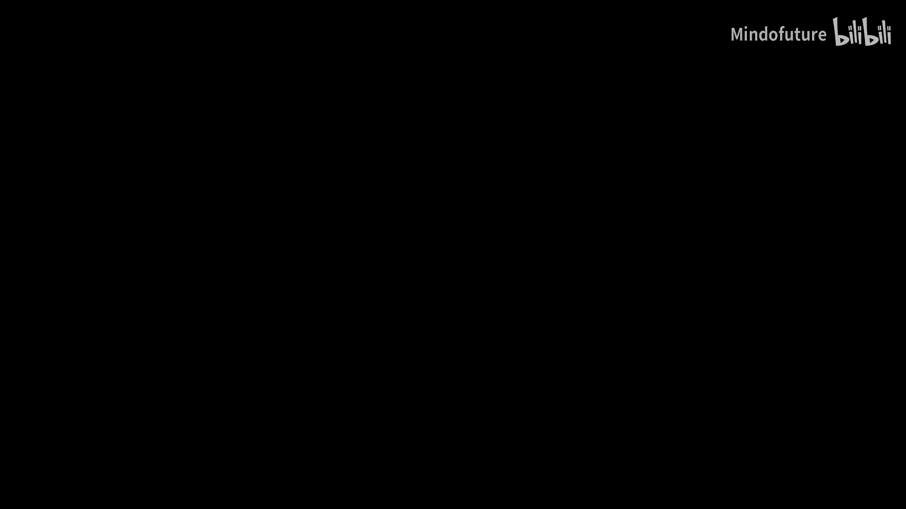
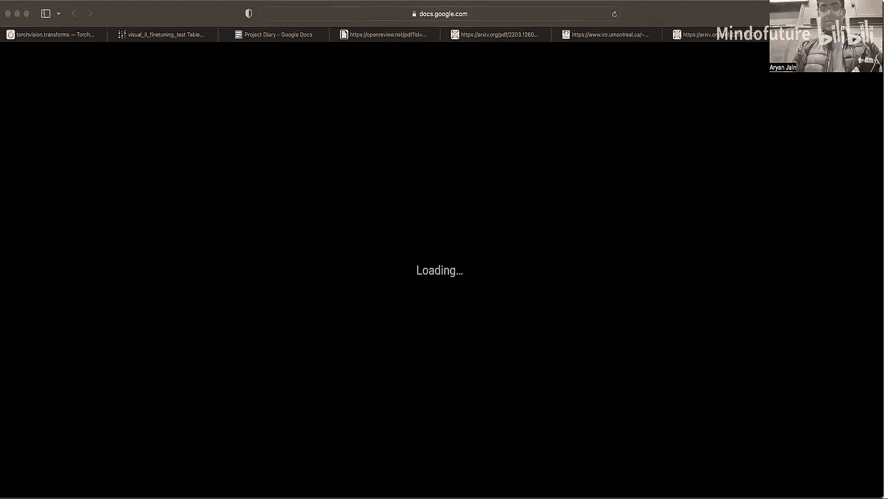

# 【加州大学伯克利】计算机视觉：视觉数据的深度学习 ｜ Cs 198 126： Deep Learning For Visual Data p19 P19_讲座19-高级视觉预训练 -BV1Va8zzfEtk_p19-

Good。

Yeah。So today's lecture is going to be on salt supervised pre training for a CV I kind of hint at this lecture when we covered the intro to pre training lecture in like V2 I mentioned that there will be a dedicated lecture that is entirely。

Going to be covering models that use SSL and CV。So since that inter lecture was a while ago。

Let's maybe go through some review of all the concepts you learned in back then。

So we learned that deep learning is representation learning。

 what deep learning is really doing is it's trying to extract these representations from your data that are meaningful in some way and can be used to solve some kind of like task at hand。

We also learned that。We can take representations learned from one network and transfer them to a different network。

 this whole process is called transfer learning。So there are multiple ways of doing transfer learning。

 you could freeze the first network and then take em embeddings from that frozen network and sort of like build another network on top of those。

 or you could fine tune the first network directly， those are both fine。And in either case。

 the network that has been alreadyly trained is called a pretrained network。

So why would why do we want to do transfer learning again we talked about how data that are huge and diverse can lead to better and more generalizable representations I think it's kind of obvious right so if you。

Take a model and give it。More examples and more and more diverse samples than the models intuitive going to learn more。

But sometimes if you don't have like these large data sets and you're only working with small data because this is a very real possibility in the real world。

You can't develop these。High quality representations from the Sxmal data set。

So what you can do now is you could take a model print on a big data set and simply just like ya representations from them and use that for a smaller network。

So we talked about。Why this is useful and today we are going to talk about methods that are dedicated entirely to training these models on like these huge data sets so they learn good representations that can be transferred down to different kind of downstream tasks later on。

I put this slide as sort of review， I think at this point people know what supervised unservised learning is。

If not， I would recommend， you know just pausing the lecture and going through it at a later time。

 but I'm actually going to skip。The slide and en and jumped directly into what self supervisorvis learning is。

So self supervised learning is。A branch of unsvised learning where。Again。

 you don't have any labels associated with your data。

 but what you do is you create labels from your data sets。And some fashion or or other。

 this is sort of what differentiates each SSL method from each other。

 like the way you create like this。These labels in the first place。And again。

 this is also a review from the C running lecture。Why this is useful。

I think it can be demonstrated by this analogy by Yoon the Coon。That he gave in his 2016 talk at Ns。

He。Said that， okay， if you look at something like supervised learning。

 your passing in is like hand labeled。likeThis like hand level data to the model。

 say pretty regularly if we're doing something like RL。

You're getting some sort of like supervision or some sort of like labels very， very infrequently。

 but if you're doing unsupervised learning， you're kind of like getting everything at once。So。

A common un superwes learning technique is say when you're working with sentences。

 what you can do is you could break a sentence up into like different words。

You could mask out multiple words and have the model predict the masked out words from the remaining sentence。

In this case， just sort of getting like this entire sentence as the input， but in supervis learning。

 you might just get a single label like okay， if when I'm training a model for sentiment classification。

 I would just get a label that says positive or negative。

Or if I'm doing something like something like RL， I might not even get like a vin label。

 I might just like get a single scalar label， like every like cause and iterations or something。

So what John Lean argued is that。And this sort of。In that sense。

 since you're getting the most information out of unsupervised learning methods。

That is sort of what forms the if you were to sort of view intelligence as a cake。

 unsupervised learning is what's going to form the main base because that is how you're learning the most things。

Their supervised learning and R is simply just like deicising and the cherry on top。

Like the main like the meat of the escape is soul coming from this unsupervised learning process。

And our goal is to sort of。Look at different kinds of unsupervised learning methods that are used in CV。

I think this is a pretty。Good quote that sort of summarizes this whole topic。

So Pier Sermony I think he is a robotics researcher at Google Brain he mentioned that if you give a robot a label you feed it for a second where if you teach a robot to label then you feed it for a lifetime so if you can and well this is basically referring back to social device learning because you are。

Creating labels out of nothing right and then you are training models in this process which lead to like really good results。

And that's sort of like like this spoil is like sort of all review。

Before I move on like specific kinds of methods， does anyone have any questions about this general concept of Sal progress learning。

Exactly， so if you look at this image over here， you can sort of view each。

Sort of like row is like the full input， but the blue region is what's fast with the model and it has to predict the gray region from the blue region so you're hiding some information from the model and has to predict the hidden part from the unhidden part。

So that's actually just one way of doing SSL turns out that there is a class of methods that don't necessarily follow this。

Eeroogram of predicting hidden stuff from the unhid and this is going to be。

 this is common something called contrastive learning。So at a high level。

The goal of contrastive learning is to。Is to optimize for something called similarity。Now。

 how do you define this notion of similarity it defined depends on the problem that you're working with。

But。What contrastive Hley is trying to do is it's trying to learn a log dimensional length in space where。

Objects that are considered similar are close together。

 whereas objects that are considered dissimilar are farther apart and the hope is that if you're able to learn something in space in this manner。

 then you must be learning something meaningful about the objects themselves in order to sort of like cluster them in this particular fashion。

So。Contrasive learninging was actually introduced a supervised idea， but it has actually been。

More popular in unsupervised approaches。And we will go through some of those like particular methods in the next few slides again。

I think I would this and draw this out to say that you have some like high dimensional space。

So you have an image， okay。Dog sitting there and it's like dog one， have say a dog。F over here。

 and then maybe a hat。Overcase， and this is like dog went off two and1 one。

What we want to learn is a space。Such that dog one and dog view。嗯。

retty much like next to each other and this like image for a cat is for the report。So similar。

 if you worked your house， say another cat over here。Then you want cash two to be closed to。

Have more， so you're trying to learn the like meaningful clear space in the sense。O。😊，So that is。

 I guess like one way of defining similarity。嗯。And how do you drain networks in this space and I what kind of objective do you use turns out there are many kinds of objectives that you can use I want to highlight the two most important ones in this slide。

So。You're going to have some input to your loss function what you're trying to do is you're also going to take in some positive sample and a positive sample and a negative sample your goal is to push。

Ebedding for the positive sample as close as possible to the embedding for the sorry。

 your goal is to push the embedding of your input X as close as possible to the input of the positive sample x plus and as far apart。

From the embedding of the negative sample x minus， see if you look at the subjective over here。

What we are doing is we're looking at the squared distances between the embedding of the positive sample and the embedding between the embeddings of the input sample x and the positive sample x plus n x if we are trying to maximize this intuitively we want to minimize the first distance over here while maximizing the second distance in order to sort of like have this like negation effect come into。

Come to place。This sort of triplet loss is actually what's used to train face recognition networks。

 like if you have a network that can separate who a person is and an image while looking at their face。

This is how those networks are trained。But you could go even further。So in the triplet laws。

 we are taking。A positive sample and only one negative sample。So intuitively。

 what's happening is you're only pushing your input x away from this one negative sample。

What if you want to push it away from all the possible negative samples now？😡。

That's that's not really possible because there can be like millions of negative samples right so you have to sort of like limit yourself。

 but the idea is that you could use more than one negative sample and push your。Input in this case。

 I'm going to use C for the context as far away from each negative sample as possible。No。This。

Loss looks way different from the loss of above。And in a sense。

 this loss should look very similar to how cross entropy and softmax is defined。So in a sense。

You could view this problem as a classification problem where you are trying to predict so if I were to given some input X。

 you are trying to predict what the， I guess like what the label of the positive sample is and you're going to treat that as like sort of the label of the of just like given context vector C and you're going to treat the labels of the。

Negative samples as the incorrect sort of like label。In a sense， so remember in classification。

 your goal is to map。An object to some label and this label comes from the data set。

 you have one correct label and every other label is considered incorrect。

 you're sort of like defining you're sort of like doing that process。嗯。

What those contrastive losses well， so you're defining the positive sample as the correct label and all the negative samples that incorrect labels or incorrect losses。

 for example。Any questions about the loss functions is that not？Sorry， go ahead。On super content。

 if we don't already know the classes that are in North。

 how do we decide whether something is a important or name？

We will actually get to that in just a second yeah but but the idea is that even though you don't have like these explicit labels。

 you can still like create labels in this particular way by taking something to be positive and everything else is negative。

So。Yeah， ge is some function that sort of compares to different objects。

 you could do something like coastline similarity， for example doesn't really matter too much。

So one model that uses an idea is。Called mo color momentum contrast。So what they do is they define。

Contrastive learning as a differentiable dictionary。So they say that okay， if I have。哦。Say inputs。

X1 to XN， what I can do is I could pass all this sentence through some T encoder as a query encoder。

 you get a K1 and P1 similarly I could do the same for like all of these inputs I can get like a K2 give you all the up to a KN and a QN。

So what I' want to do to know。I I can collect all my dreams and worries in one place。

And for each query。I define the positive P as the one that corresponds to it。

 if I'm looking at say a QI。Then I'm going to define KI as the a positiveitive sample and K1。

 although it can， other than KI as the negative sample。So my goal is to mount the query。For a given。

Sample X goes corresponding key。So this is one way of defining well this is how the authors in this paper define contrastive learning。

 now how do you get these key&Q to might pass those with a neural network。

 which can be subed by keyNQ to sort of denote what neural for the key and which one is for the query and so on。

Okay。No。We defined what。So， okay， we， we。Have this idea of what is considered similar and dissimilar。

 that's try to make it more precise。Incrtably， its being passed the same sample exc。

Through the same network。You're already been the same author， right？

So you're not required to use the same metric。But you want to use this networkcur learn presentations。

So in a sense， using Cs is kind of useless because we warned what network is developed like really representations。

 which we can then use for all kinds of very downstream houses。So how do they get。

Both the key and the query from the same network。Wripasing the singable image。Now。

 one common idea that is。Very popular and con with about children comes state and get vision is to。

Pasen the sand image but the get all options I to it so you can take say the image of a dog。

 you could it like add noise to it or you could drop and reize it。

Even though you like all kinds like these augmentations to your vertical input。

 it doesn't really change the semantic content of being right， you know that it's still image done。

So。But。Upon the augments changes the spatialial cultural of image， which means that if we pass in。

 say。We define the augment by like function V， for example。

 because this V this VI applies the I augment is example it returns。

 say a V of that dimension that's why using a V for U。

 I could pass in say a V1 and a V2 the same network F and get a key query in that particular way。

This idea is called instance discrimination because。

You are discriminating between different views of the same instance。

And this is pretty much how all CV networks define this like notion of similarity。

 so you want two views of the same image to dis similarar。

 but if you have two views from different images， you want this to be dissimilar in a sense。Okay。嗯。

So now we have all the ingredients we need to define this network。

 we know how to get our positive examples， we know to get our negative examples。

 and we can throw this into some contrastive loss that we had earlier and train network is in that。嗯。

There are a few considerations we have to keep in mind， so practical experimentation has shown that。

If you consider。A huge amount of negative examples in a single batch。

And you have to pick out a single positive example from this like huge pool of negatives。

You're going to get better representations and intuitive that's because a huge pool of negatives is going to make the task harder。

 which means the model has to work extra hard to pick out the positive from this like huge batch of negatives。

And this harder task of encourages better representations。However。

 this is also practically like not exactly defusible because do you generate like each。

 say negative example， like say each negative key， you have to run this image。

By this network like many times to like get all the negative examples in the first place。

And this can be very， very computationally challenging。

 so it's actually not uncommon common you have say。

Say 2047 negative samples and youll have 2048 I imagine running a single model definitely times for a single iteration in your training process。

 that can be very very intensive。So yeah， so this forces us to use like small mini batches。

 but that's not what we want， we want to use like large batches。So this idea comes up to mind， okay？

What if we pre compute all the keys and queries from this like single model。

 what if we pass an image。Take each view。Comp there is an extrad somewhere。Okay。

 this sounds like a possible idea。嗯。Maybe that's some progress so yeah you can do that so what you can do is you could store the precomp embeddings in one place and sort of like hold samples from that。

When you're sort of like doing this like contrasted learning process during the actual training。U。

 and you could store each all of these second beddings into like a large memory bank。

And I keep sampling from that， but what we are going to do instead is we are going to maintain a queue。

So。They're going to compute this emance and achieve what the definition is going to be on。

First in last out right sorry first in first out sorry so what's going to happen is that you can store these embeddings in this queue and as the model clinic progresses。

 you can keep from getting more and more embeddings and keep storing those at a queue again and again and once that reaches some capacity you're going to be the older embeddings from the Q at that point and the reason we do this is even mind that these embeddings are coming from this single network which is updating over time。

 the network is not static the network has like weights changing because of that propagation and stuff like that。

 which means that the embeddings on a previous time step might be very different from the embedding that from a more recent time step for example。

 so in order to maintain this like sort of consistency across time， we can't store。

Ebeddings from breakki far back in the training process。Okay。

 so that's a good idea and there's actually one final step before we get the whole mo model。Is。Say。

 okay， we have solved the problems like computing， all of these like embeddings and storing those in somewhere so we could use like large patches。

But。Thinkment what's happening during the training？Then you have a contrastive loss。

All of the negative samples are involved in the contrastive loss， right。

 which means if you take the gradient of it。The back propagation process must be applied for any negative sample。

Inside the bash that you're considering at a given moment。

Which means for if you have like say 2000 negative samples in your batch。

 you're going to have to compute the gradient from the forward pass for each of the 2000 examples。是的。

This like embedding network， right？And again， this is also very computationally infeasible。

 so we have only solved the problem of complain comes of forward pass。

 but not quite the backwards pass yet。Okay， so you might just imagine that okay， you're getting our。

Es and queries from these like embedding networks。What if we don't simply update the weights？

Of the key。Of the key encoder。This doesn't exactly work at all because。Again。

 there some cost like in consistency issues because again， you want the。

You want the key encoder and the core encoder to sort of be like the same network because you're getting your positive and negative samples by。

Again， if you look at the sponsors over here， you are passing each view the same network。

 which means that you can query accordance do the exact same。

Now this means that you could simply copy over the ways from the query network to the key network but。

This doesn't work because of the same consistency issue that we mentioned earlier。

 key the query encode is changing too rapidly， which means that。

The key encoder is also changing to rapidly and if you back propagate from an older version of some embedding that was generated by an older version of this key encoder。

 that can cause some like very weird gradients。So what the authors proposeose is instead of like changing the base of the key encoder too rapidly。

 you do like a very slow update。You take a moving average of the key encoder's rates。

And the updated query encoder' weights and set that to the key encoder' weights。

So in this particular way， your key encoder is not changing too fast but not too slow either。

 and you can sort of like get around this consistency issue by making sure you have a somewhat recent copy。

Of the Qri network， for the key network， so that the embeddings that you produce at a given time step are somewhat similar and this whole contrastive learning process can work。

Okay， any questions about how this model works at all？So what's happening is that。

There's key encoders like slightly lagging kind that query encoder， but as the training progresses。

 theyre both updated over time and the updates from the query are sort of like reflected into their keys as well。

 and it turns out this sort of process is like very。哦。

You can actually eagle like really good representations。

So here are some results from this from the representations and and how they were using like downstream tasks。

 so the authors trained this like。Just like process on the image and data set again。

 during the whole process， we never use any of the labels， we were simply taking。

The images directly and just working with their views。

 we never considered what labels that like each image had。And。Once this model has been trained。

 they were at。Either like find unit or use polyinate classification on something like ImNet or PasScal VOC。

 for example。And you could see that in pretty much all the cases。

 this moco model beat out all the previous models， and this turned out to be a very strong objective。

That people actually still use today， this paper came out in like 2019。

 which is actually pretty old when it comes to like deep learning considering how fast things move。

 but like this technique is like so very popular today。Any questions about localco before I move on？

If not。Were having to consider another contrastive learning method。

 so in my slides I have this other method called CPC。I didn't go over that in class。

 I have the slide for CPC in the presentation that will be shared later。

 but it's like skipped because I feel like CPC is not that important I didn't want to cover I didn't want to spend time on it too much。

But the thing is like CPC is also like a contrastive learning method。

 it's called contrastive predictive coding， which is why it' stands for CPC。

 and it's a fairly technical model。Similar to Moga， because moco。

 you had to have like this queue of for embeddings。

 you also have to like keep track of a moving average。

 just like a lot of like details to keep trackles。And coding these can be kind of hairy because all of like these like moving parts that you have to do。

Make sure they're actually there。So what people did in 2020 is to came up with this。

Method called SclLR， it stands for a simple framework of contrastive individual representations and they said okay。

 you don't have to do any of that。Technical stuff from before。

 and you can do like a very simple process instead。So you can take some sample X。You could sample。

Some data augmentation T from a set of augmentations。

 you could consider different views or effects what kind this like augmentation to them。

 so this is what yields like Xi and Xj because theyre like just different views of the same X。

You could pass each view through the。Encoder network， which is going to be represented by F。

 so it's performing the same function as a key inquiry encoder。

 but instead of taking two different models。And having them have like very close weights。

It is going to consider the same model the same instead of having maintaining like a separate key encoder。

 you're maintaining a single encoder in this framework。

And those owner yield the embeddings H and H for each view。Now。

 instead of passing in this embedding directly， the contrasts of loss。

 what you're going to do instead is pass the embeddings through a small MLP。

 which is represented by G in this figure over here。

To yield something like Z I and Zj and you're going to run the contrast of lots top of them。

 they actually found out。So it turns out that contrastive writing methods so far have been we're running the contrast of laws。

On the direct embeddings H and H。So far， but the authors of this found out that okay。

 if you pass these embeddings to to say a two layer MLP。

 those can yield even better results in the end。Why this is true is I don't think it's exactly known。

 but this is like this is more of like an empirical fact that。

And this like extra head onto with the embedded network can yield better representations。So。

This is a process that they use so again， they don't have to maintain like a moving average。

 they don't have to maintain like different networks。 It is like sort of like。

Go through this like process of both。Which means that。And they also argue that， okay。

 but do somebody of compensate for all the technicality。We do have to。

Sort of compromise when it comes to compute because this sort of technique only really works well if you use like very large bad sizes。

 which automatically means like more computation power and。Longer training time。

 so like you can so like a mo model could converge way faster than a Sr model。

 but if you train the SCLr model for a long time， youll get better results in the end。

So that is the compromise you have to sort of make when it comes to this framework。Again。

 they use a contrastive loss that looks very similar to the。And per loss I showed earlier this time。

 they also introduced this like temperature scaling term where they take。The embeddings from。

For's birds that take the embeddings。From the encoder network。They compute the cosine similarity。

 so same here is just like cosine similarity again it doesn't really matter what it is but。

Earlier models did not have the temperature term， so like if you go back to the。

If you go back to the loss portion that I shared earlier。

 we were just taking like this G function we didn't have like a scaling term in there。

 which means that our temperature Y default was one。

The authors of this paper found out that allowing the temperature to adjust。

Can give you like even better representations in the end， so they introduce this as a hyperparameter。

They also do some obation studies。And again。The notion of similararity for this model also comes from the fact that two views the same image should be considered similar and two views of different images should be considered dissimilar and the views are generated by data augmentations so they actually looked at。

But augmentations perform the best。So they have this table in the bottom left where the column represents the augmentation that they applied。

First， and that row represents young notion that they applied second。

 and you can see like which fear of augmentations sort of like yield the best results。Again。

Surprisingly， I didn't not expect this， but。Applying color this augmentation stuff like yield the best results。

 which。It's sort of unintu because if you were to say take an apple and youll change the color to sort of like green。

Then intuitive had rhnaism from a red apple， but they kind of showed that this augmentation still works the best。

 even though it might not make too much intuitiveitive sense。

And another thing that they sort of mentioned is。Using longer training sessions and using larger batches will get you like better presentations and sort of like show that with this sort of like bar graph in the bottom right。

 you can see that as the number of trend in epos increases， you see an increasing trend。

 similarly if you look at the batch size as that increases。

 you also see an increasing trend in that size。So let's see how well this model performs。呃。Okay。

 if you look at the table on the right， we can see that this model。

When you take your representation from this model and train a linear class on top of that for say image classification。

 you're getting the best results that you have seen so far。

SMCLR was also a huge breakthrough because it was the first time a self supervised method was able to beat a fully supervised method。

Typically when people train these like SSL models， what they what they do as a baseline is they take。

 say。A resonancesonnet model that is trained on INe in a supervised manner using the whole labels and they use that。

 they user their representations from that model as a baseline。嗯。This was sort of the first。

Method that。Even though it might not look like that in this sort of like figure over here。

 but this was the first method that was able to be like a fully supervised baseline on like Inet one classification。

I'm actually not sure why the results are just like 48。4 over here because。Oh。Okay， sorry。

 I missedread the table。So what the table is showing is if you take your representations from like this network and you fine tune。

 these like networks using just like one person of the total image that labels and just 10% of the total image that labels。

 you can see that sinceCLR performs the best， if you want to look at a direct comparison where you use all the labels for fine tuning。

 you should look at the chart on the left， which shows that。This。

 this biggest Scl model performs the best now there is a big sort of compromise that you have to make is that even though the Sclr for x model is able to be the supervised baseline。

 it is about。16 times bigger。It has about 400 million parameters whereas the supervised baseline only like about 25 million 25 million parameters。

 so this paper also showed that you need these huge models to learn better and better representations in a subjectidvis manner。

 and I think in it sort of makes sense the。The I like to think about this is。

If you're working with a supervised model。The supervision comes from the actual labels。

And since the label sort of like dictate what's going on。

 you don't really have to learn representations that are like too generalvisizable。

And you could fit those representations in a smaller model， but if you don't provide the label。

 you have to learn something more general， which means you would need a bigger model to sort of like fit that information in this is sort of how I like to think about it。

 this may be completely wrong， but I think this sort of explanation works in my mind。

Any questions about CCLR before I move on？Okay， I'm going to cover the final contrastive learning method today。

 which is funny because technically BYOO or build your own latent is actually not a contrastive learning method at all。

 it feels similar to one but it's actually not one。

So the way VY world works is you have some input image x， again。

 you'll pilot different augmentations to it and you generate like different views B and V prime。

 you pass those。The NV prime through some encoder networks and in this case we are sort of going back to how moco worked instead of seeing clLR we are maintaining like different encoder networks like for a key and for a query。

 but instead of calling it a key and query we call it a。

Target and actually don't quite remember what they call the other network。

 but we have a network and a target network。You take the representations from those again they borrow this idea from SCLs you pass those embeddings to another small network。

 say G theta and G theta and get like projection CNnc prime and you run your contrastive loss and stuff of these so in a sense this method is sort of combining。

What。Moco and SCLR did into this like single。Sort of objective， but it is also different in a sense。

呃。So CLR and Moco both use the negative。They both had this notion of ethnic examples they they took the views from different images as。

Disimminar。Embbeddings and they only took the view and they only took the abuse from the same image as similar embeddings。

This sort of concept does not really exist in VYOL。

BYOL doesn't really compare across different images in a batch。

 it only looks at a single image at a given time。And what it does is it tries to make sure that this。

Projection Z and this projection Z prime are kind of close together。So。Again。

 it doesn't consider any negative examples， it only considers like a single image at a given time and as such it doesn't really have any positive examples either。

 which means it's not really contrastive learning but even though it feels like contrastive learning because the techniques it's using。

 were're pioneered by models like Moco and MCLR， which are contrastive methods by definition。嗯。But。

What it's really doing is。How many of you have heard the term who's trapping the world？

So bootsrapping is a statistics term which basically says that if you have which of data points。

 you can fit a model to the data points， and then you can use the metrics from that model to fit another model and looking sort of like keep repeating this process。

So you don't really have like the true metrics from the citizen set before。

 you're using the estimated metrics from this like fitting like this one particular model。

To fit another model and like so on。This is kind of what BYO is doing as well。Theres。It's。

Maintaining two different networks。It's fitting。It's it's sort of。

So the loss function for BYOL is taking the the projections from both networks and sort of optimizing a loss function defined using both of these like projections。

 which means that the。Second network is sort of driving the supervision for the first network and vice versa。

How many of you have heard of deep Tea learning for have youF you RL？

This is exactly the same thing that happens in deep learning and this is sort of what the inspiration for VOIO was because the S was actually published by Dewind and like 2020 I think。

So。It uses this bootsrapping process to sort of like learn more and more to like build up these like representations。

And。Since it's not contrastive learning。It's pretty robust to changes in batch size and the type of augmentations that he used because MCCLR showed that certain augmentations perform better than others and you should always be using bigger batch sizes。

 but BYOL also works pretty well with like smaller batch sizes and you don't have to worry about what exact augmentations you choose。

Now this particular method is very， very sort of like chunky because of。

You're somehow learning these representations without any discrimination， for example。

 because you don't have any negative and positives。

 but you're still learning some really good results。

And why that exactly happens is actually not clear。

I know that there have been some critical investigations as to why VYOL works this well。

 even though there is like actually no contrastive running going on at all。But。It still works well。

 no one very sure why， and it actually beats MCCLR and the exact same results of earlier。

those the exact same benchmarks。Okay so that is it for contrastive learning I just realized I did not try the presentation that well because we're at 750 and I have like a and I'm only done with the first half of the lecture so。

We're going to move on to like a second class of methods I'm going to sort of like speed through them sorry about that I shouldt find this better。

This is a method called the D or the na water encoder so we are moving on from contrastive learning methods to methods that sort of。

Destroy the input in some way， but then you have to reconstruct the input to get the original input back and。

And then these sort of methods tend to work well with an auto encoder based structure because you could have the encoder taken the destroyed input。

and yield some embedding vector， and you can take the decoder。

 take the embedding as the input and yield the original image back。

 and then you could compare the reconstructed image with the original image and use that as a loss objective。

So one of the methods that people used in the early days was a den noise auto encoder where they took an image。

 they added noise to it， they passed it through a autoenr。

 and the goal was to predict what the deno image was。

And the idea for this network came from the human ability to。

Recognize partially occluded images orccleted images。

 so like even we as humans can tell that even though this image of a four has no added to it。

 it is still a four right but a machine can't tell that so we are trading a machine to sort of like do the exact same thing that we can already do naturally。

嗯。You have to make sure that you're adding the right amount of noise because if you don't add any noise then you're basically creating an auto inputter。

 but if you add too much noise， then you're making the tasks like unnecessaryces harder and your model won't learn anything so。

But it does mean that if your model is able to learn the huge amount of noise it's going to be learning some very good representations so you can look at these images over here。

 then you have no noise added。The representations that they get from the model are kind of random。

 they don't make human much sense。But if you add， say。But if you'd like to say。

 destroy half of the image。And you try to predict direction original image from that。

 you can see that the model is trying to learn something so if you you look at like each image on the right。

 you can make out like certain shapes being formed so like you can kind of see that okay this looks like maybe a nine。

 this looks like maybe a six over here it's trying to learn it's learning something meaningful。

Which is why this sort of like model works really well。嗯。

There is another model called the factino encoder。This was very popular back in the day because before things like modern techniques like add and batch arm。

 dropout， et cetera， et cetera were invented， training neural networks was incredibly hard back then。

Brain was very unstable， so like if you were to like say define a CNN and。

Take the CNN and pass in a miss through it and you just like run your normal classification laws like we do normally today。

 this was not something that people did back then because it was something not work which I know sounds very weird because this is what we are used to and sort of like。

This generationeration。So what people did instead was they would。Frain a denoizing auto encodeder。

 so again this is what the denoizing auto encodeder process looks like you have an image X。

 you sort of like destroy parts of that image， X to get like some x totally。

 you pass it through the encoder， to get some embedding， you pass the embedding through a decoder。

To get some。Prediction Z and your goal is to make sure that the Z is as close to Dx as possible and you can learn this like encoder in this particular manner。

 so what people did is they would like stack these encoders on top of each other so they would take DM imageX and train an encoder in this particular way。

 then they would take the embeddings from this encoder and train another encoder that would take these embeddings as input。

And you could like sort of keep repeating this process so you could like keep training encoders in this particular matter and you could like stack those up and the output of this chain up encoders is what you would consider as your final representation and this method actually turns out it worked really well back then。

But then modern deep learning became a thing we got things like batchstormm Adam that accelerated training even further so people got kind of like soft using this I only showed the D and SDA methods over here because。

They were like historically important， but even though people like don't use them anymore。Okay。

 so that's a pretty good idea it worked're kind of well back then see if begin extend this idea even further。

 so in a DAE we were adding noise to an image。What if we go like one step further and like just come really mask out parts of an image so like you take in this image of like two football players playing you completely hide the inner part like you just like zero it out。

You pass this like mask image to a model and your goal is to predict the unmasked region。So。Yeah。

 and this model is called a context encoder because the goal is to predict the hidden part from the surrounding context。

One fact， this work came out of Berkeley in 2016。If you guys know professor。Aliosha Rose。

 that's his lab that produces work。谢谢。😊，So again。You have to make sure that。

So naive implementation of this network would be to you simply like taking the mask image and predict like the mask patch。

 using some sort of like decomvolution network like you might have seen in the segmentation lecture or a dance lecture。

But and you might try to like take the L2 loss， the predicted patch and the actual patch and like try to minimize that。

 but that doesn't exactly work too well because。The L loss is a。

Manyim was in the old law sort of leads to the average quality the。Things that could have been。

 so if there are multiple possible patches that could go into the mass region。

 many us in the alos would like simply take the average one of those and yield this like sort like bur see under the al column。

So what the authors did is they combined。And they also added this like another network called the discriminator。

 which you might have seen in the danceAN lecture。And what this said is it would take the。

Purt a good patch and try to classify it as real or fake and this sort of objective sort of encouraged more realistic reconstructions and led to better representations。

Again， you can see that if you just use the L2 losss， you got some like very blurry things out。

 if you just use the adversarial laws， you just get like any realistic looking random patch in the center。

 if you take a combination of the L2 loss and the adversarial loss。

You get something that is both meaningful and realistic at the same time。This method。

Was kind of popular back then， even though the results were kind of uphor， so like on classification。

 it could not really beat an imagenet baseline that was strain on in a supervised manner。

But it was able to get pretty good results in detection and segmentation。 So I guess that was a。

There was some progress， I guess in that front。But。This method generally performed too well。

 and there have been further improvements ever since。

 the only reason I put this network in here is to talk about our next network， which is an MAE。

Now this is an important network because this came out only last year and this kind of blew out everything out of the water。

So an MAE。Uses a transformer backbone， so all the methods that you have been seeing so far use CNN backbones。

 so a mo model would use the encoder for the moCO model and the Scl model or the SCLR model was a re 50 for example。

What MA does is it replaces up bit of VIT。And it sort of uses the same objective as a context decoder。

You take in an image， you mask out patches from it。You pass the unmasked region to an encoder。

 you pass the encoded embeddings through a decoder。

 and your goal is to reconstruct your original image back and your hope is to learn some good representations in that particular format。

So the encoder works very similarative how where regular BIT works。You take an image。

 you like chop it up into like different pieces， you randomly mask out。

 some fraction of the only patches， and you pass in the unmasked patches for the encoder。

Just like how a BIT does it， I'm not going to go through all the text over there thinking were just your own time but basically if you know how BIT works at sea。

 you already know how this works。And then。What the decoder does。So again。

 keep in mind that you're only passing in the unmasked regions。

 you're not passing in the massed tokens because like there's nothing to pass it's masked out right？

What the decoder does is it takes the embeddings from the unmasked regions。

It adds something called a masked token at each index that was for the patches that were masked out。

 so you get sort of like this combination of masked tokens and the embeddings of the unmasked patches。

This is like sequence。And you pass this through a decoder。Which is， again， a very。

Simple value decoder that you might have seen again。

 it's it's another transformer which is defined very similarly to。

The transformer for the encoder there's an awful much difference between the two so you pass this through another transformer and you get。

The reconstructions now your goal is to minimize the alter distance between the reconstructed patches and the。

And he masked out and。Mass out patches and your your hope is that learn something meaningful again this is sort of what this process would look like so I have like multiple examples from the MAE paper the right column shows what's spread into the。

En coded， the middle column shows what's。Sorry， the left column shows was fed into the encoder。

 the middle column shows what the MAA predicts and the right column shows what the actual ground truth is and you can see that。

It's。Pretty close。It's actually learning most of the high level features that are in an image。Again。

 I'll probably。Leave it up like the next 15 seconds so you can like look at this even more。

So I guess like while the slide is up any questions about the MAE model so far？Yeah，あさて。

The class took， so in a transformer， you have say you have to sequence ones。Sa x one， next two。

 another there some next eight。You also say each。Thing and the sequence is going is going to have a token corresponding to it you simply what you also do is you can one you call the CM tokiken。

So then new pass just like whole sequence。Through the attention module。You're going have。

That like whole function mechanism， I can't think that this woman is wrong。

 so what's happening is as the model grooms more and more ship。

The hope is that this class token is a 108 over to like all and other programken that is set like capturing information log even to the whole。

So you could use the glass okay。And for something like classification。

 you just like you a sleep in a bed with the plants open。

Use that as the face where plus flare because the whole biette。

 this soan is going to have information about the entire sequence so doesn's attempting go。Again。

 I thought I had two sidess of these images， I guess not， so when MAA came out。Like I said。

 it's kind of kind of blew out all the previous small of water， the previous best was。An 84。

1% success or rather an 85。2% success on using a VIT large model， but。You can get up to like 87。8%。

Successed with an MAE and I think that to this date。

 MAE is still the state of the art when it comes to models that were trained avis model in a self supervised manner and then fine tune on image of data。

So。This is just results on Emissionnet， MAE also performed really well it was like when its representations were transferred out like downstream tasks。

So this could be something like taking the embeddings and doing something like detection and segmentation on theco coco data or using。

Or doing classification on say the places data set or the in data set or maybe even something as。

Passing the representations through the through different variance of the image of this set。

 so the image of this set has like about a million images and like1000 classes。

 there are variants of it that。Have sort of like adversarial examples in them so there are data sets like imagenet corruption which have like corrupted images the image from the imagenet data set there's like imagenet imagenet adversarial this imagenet sketch which contains like sketch versus world images the goal is to see that if if you were to train a model or normal imagenet how well does it perform on like these out of domain images and it turns out that MAE actually perform the best because like these are very hard to do well on and。

Yeah， you can see that the previous best results that I've。So know， over here。

 its sort of like beat everything so far。O。So why does it work well？

MAE uses masking as a predexx task。We already saw this whole maskking task was like very successful in NLP with BRT。

And that was actually the main inspiration for MAE。

 that's how the authors like chose this particular objective。

It also used a very high masking ratio so if you were if you remember the images that I shared earlier。

 you masked out like about three four of the actual image and you only had about 25% of the actual content and。

This makes the whole reconstruction task more challenging because the model has like less to go off of。

And as I sort of alluded to earlier， the more challenging you make a task。

 so in the case of contrast and running the one you can realize like is by making those your badge like really big。

 so you have a very high negative to positive ratio in the case of MA this was making sure that you're masking out a huge portion of your input so you're only working so you're only reconstructing。

With as little information as possible。And the sort of harder task pushed the model to learn even better and better representations。

The last part is kind of I just kind of throw there you don't have to worry about that。

 but MAE was designed in such a way that is like very， very scalable you could train the slack model。

For up to like a thousand0 epos and it doesn't really take that long。Yeah。So okay。

 we have gone through like these reconstruction based methods and we have gone through like these contrastive learning methods。

 which one's better。Turns out it's very hard to answer that。

So when you train these models in like the selfrov manner。

 there are two main ways to evaluate the performance on ENeck， for example。

 you could take the growth models。You could take an embedded causal models and train in a linear cluster of them。

 the product that was called linear probing， or you could take the models and fine tune them with original label。

 for example。And it turns out that those actually lead to very different results。

 so when you take linear probing， contrast to learning actually outperforms models like MAE。

 for example。But if you allow the model to fine tune and like pass gradients back。

Then MAE actually does much better。So why this is true is not something is known。

 I think at the moment， things like solar and area of research as to why this like image reconstruction objective is working better with fine hearing but not linear probing and like vice versa。

So a natural question to ask is， we know that when each approach still has its like own strengths。

 can you sort of like combine them in some way？And the answer is yes。

 so Google actually released this paper called Can， which actually came out last week。

I actually put the slide in like 30 per day because again。Yeah， this actually came out。

 I think last Sunday， and my background what they do is they train a single model that does both image reconstruction。

And contrast to running at the same time。So how this works is you take an image。

 you like generate two views of the same image， you mask out the two different views。

You add noise to it so in a sense that it also combines the denino as an objective that we showed earlier。

 and that's actually what stands， this is actually what canN stands for。

 the C is for contrastive learning the A sort of mass order encoder and the n is one noise prediction。

You take the noise patches， you pass it through an encoder， you take the embeddings。

 pass it through this like MP projection that we showed that we had for models like CCLr and VYO and you would run some contrastive learning loss on top of those so infoNCE is like one contrastive learning loss that I didn't talk about in this slideshow but it's just another variant of the losses that you've seen for。

And。You would use sort of your loss function would be a weighted combination of the inputpoint E loss。

 the reconstruction loss， E30 noising loss， and it turns out that this model problems really well。

So if you look at both linear probing and fine healing。

 this multiple does better than the best image reconstructioncon model。

 which is MAE and the best contrasted learning model， which is inR。

And you can see that she is like better results from。Compared to like all the previous models so far。

😡，So。Again， sorry before I move on to the summary， any questions about any of the models that I've talked about so far in this lecture？

Okay， so these are not the only models that we I could have talked about。

 I only have like 50 minutes which I sort of like went past， sorry about that。

 but there are way too many models out there。There are more contrasted learning models there are also supervised representation models representation learning models that work really well there are。

Models that train representations that are good for control tasks， so if you do R。

 then these models might be more a rally， for example。And I didn't really find to cover any of those。

 but I would encourage you all to like check it out in your own time at some point。Again。

 we have covered like multiple possible models， so in the lecture we cover contrastive learning and image reconstruction。

 if you also go back to the pre printing lecture when I introduce this like all results learning。

 byvents comments and objectives like rotation prediction and JigA solve and stuff like that。

 but also like yielded pretty piece of representations。However。

 we have barely scratched the surface here for a lot more in this area that。

Then what I've shown so far this is actually a very hot research area right now。

 in fact my research is also sort of like in this area at the moment。

You will have a homework that is based on this slideshow。

Your goal will be to take like these models like Moco or MA and then linear problem for C4 and prediction。

Yeah again these are all the papers that I from the all the models that I showed earlier we like check this out and yes for that that's it that's all I have for this lecture any questions before I end。

Yeah。Hey， I'm going to end the recording then。

