# 【加州大学伯克利】计算机视觉：视觉数据的深度学习 ｜ Cs 198 126： Deep Learning For Visual Data p20 P20_讲座20-图像风格化 -BV1Va8zzfEtk_p20-

Okay， let's get started thanks for coming everyone we'll keep this pretty chill today should be pretty fun。

😊，Lecture it's on stylizing images so just one brief announcement so we're planning to release the last homework pretty soon so keep your eye on on that and hopefully we'll send out an Ed post very soon for any updates as you probably all heard about the upcoming strike or whatnot so yeah。

🤧Okay。

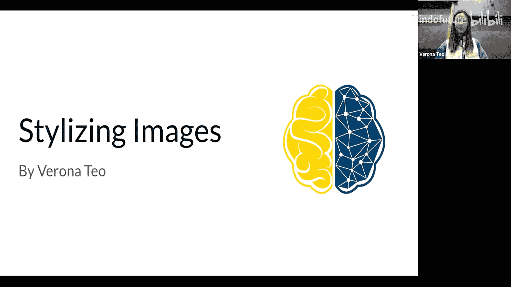

Cool so today's lecture is on stylizing images and so what we'll mostly talk about is image to image translation so what it is and some of the techniques for doing stuff for image to image translation and in particular I'll go a little bit more in depth about a。

Subtopic， as you can think of within image to image translation。

 so specifically neural style transfer。And then I'll go into a few models that sort of utilize gaAM architectures and then some other examples of how we might want to approach some image to image translation tasks。

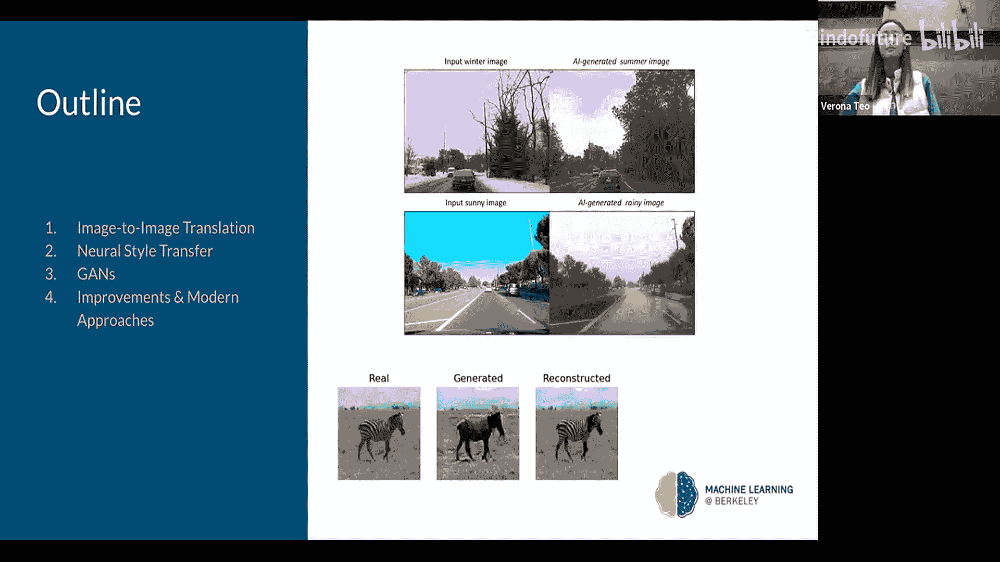

Oh。So。What is image to image translation so the general task is you want to take images from this source data set from one domain and you basically want to transform them。

To this corresponding image in another domain， which is what we call the target domain or the image in the target。

So the idea is that you want to preserve the contents of a particular image。

 but perhaps you might want to do something like change it into the style of another image so i'll show you a lot of an example soon。

 but that is one example and that's what we call style transfer and so that's sort of where the neural style transfer original paper sort of。

Is based on and some other common tasks that are related to image translation include sort of like image synthesis。

 or if you want to change a black and white image to a color image。

 that might be something you're interested in doing or you might want to restore a sort of damaged image。

Cool， so those are some examples。

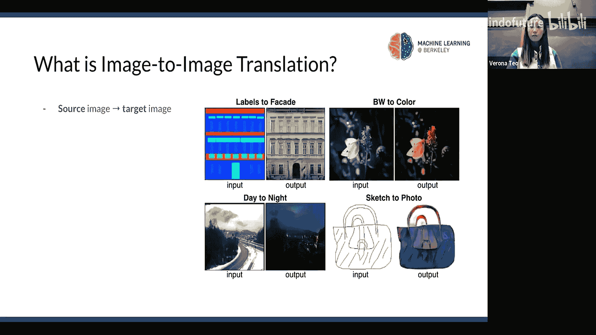

And so i'll talk a little bit about neural style transfer so the question is。

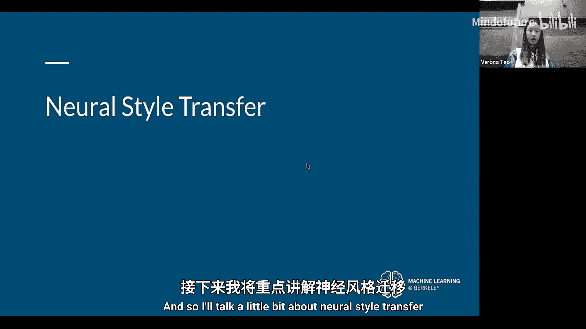

Can we create images based off of the style of another image and the answer is yes。

 so we call this neural style transfer and you can sort of think about this again as a particular task within image damage translation so。

Generally it's you can think of it as a general optimization technique used to take two images and you want to blend them together。

You have。3 inputs so the first main one is the content image so that's the image that you want to sort of keep the content of so in this case we have like a dog and so you want to keep the general form and the content of the dog but perhaps you might want to change the style while still keeping its general shape and idea that it's a dog and so in order to generate an image like that what we call the generated image will need some style reference image and so that's where we have a separate image in which we sort of base the style off of to create this new image。

U。So how do we actually go about implementing this so the general idea is that you want to optimize the output image so the generated image to match again the content image in terms of the content and then the style of the style reference image。

So we use convolutional nets generally to extract the relevant information from both the content and the style image。

 although there are some other techniques， but in this case for the original neural style transfer paper。

 they basically just took a very deep typical classification CNN。To do this。

So you have like your pre trained CNN with some additional added loss functions to basically do all of this to transfer the style from one image to another。

So this is going to be。A lot based off of what we've already previously talked about so there's not going to be too much that's really new in terms of the overall architecture。

 but I'll kind of talk a little bit about how it differs from like a typical CNN that we've seen。

Okay， so again， you have three main inputs， you have your content image。

 your reference image and then your generated image， so that's sort of your trained image。

So as you can see here， you have in this example， we have。

The style image is starring night and then you have some other content and then this is sort of what you already seen before in terms of CNN and sort of we'll talk a little bit about what the output might look like and what happens here。

 but the main idea is what we've。Sort of try to emphasize a lot previously。

 which is when you first start in your first few layers。

You have your low level features you sort of get and so that concept still remains in which you have your edges。

 your main。诶。Sort of low level features and then as you sort of go through。

You abstract and you have your higher level features and by the end you have your main like objects as you can sort of start to see from here。

So that still remains。Specifically with the original no style transfer paper they used a particular deep CNN VGG19。

 so I won't go too much into it， but it's just a very deep classification。CnN。

So the idea is you basically want to take your middle layers of your CNN to get both the content and style representations of the images。

 so that's sort of where all of like the key information is and I'll talk more about how we sort of get the content information or the sound information into in more depth。

But。You start with your input layer。and your first few layer activations again are your lower level features。

 like the edges and textures and then you sort of abstract away into the higher higher level features。

And so the idea is that what。Your input image， you want to try to match the corresponding style and the content。

Target representations in the middle layers。So we choose particular middle layers to or from the CNN to represent both the style and the content。

 and we get the intermediate feature maps。And。We basically calculate loss from that。Okay。

So since we have two main parts we have the content and the style our lots is going to be slightly different for the two so for the content image it's pretty simple we get the intermediate layer outputs and then we basically just get the Euclidean distance。

But the style loss is。A bit different and a little bit more involved and complicated。

Unlike the content in which you just basically return the intermediate layer outputs。

 and then you just calculate the Euclidean distance。And then just back prop on that。

 the style loss sort of incorporates what we call a gram matrix。

 which is basically a bunch of dot products and you basically sum over all the different layers。嗯。

So I'll talk a little bit more about what this is， so the idea is how can we actually measure the style similarity and sort of throughout all the different layers？

So we could basically calculate the correlations across these different feature maps throughout to understand the style of the image。

嗯。So。The idea here is you can basically take the dot product as we've talked about in the past to sort of basically see how similar our vectors are。

 and so the more similar our vectors the larger the dot product is。

So we can basically calculate the gram matrix per layer。And then。

Get this final final matrix so you take all of your。In this case， I don't think or yes in this case。

 yeah， using C that's sort of the。I think it's the depth。

And then you have so you heavier convolutional feature maps， so then you take for each。

Take all of the。Platined feature maps。And then of depth C， and I compute the doll product。

 which is what's going on here。And then you will basically end up with this gram matrix of size C by C。

 and then this basically gives us the information about。The content or the image。

 the style of the image。O。So once we've sort of gotten the gram matrix and the Euclidean distance from the content image。

 we can just do our typical backdrop。We minimize our loss。

 let's say using something like Adam that's fine， although I think the original paper used something different。

嗯。You add both the content and the silos to get the output image。

With the content from the content image and the style from the style reference image and then run your back and optimizer。

Okay， so this is sort of an example of what's going on here。

 you have some content image and then your style image and then this is your final generated output image。

嗯。I can just and then you can see like throughout what's sort of going on here， it's a bit small。

 but you can see that this is the original。Constent image and then as you iterate through you sort of take the style of the style image。

 but you kind of see how like you have the lower level features and then you sort of abstract in terms of the style with the the higher level features so。

That sort of concept remains throughout and it's pretty。Important。When you talk about CNN discussion？

Okay， any questions about this so far？Okay。So next。

I'll talk here's another example a little bit more about some GNs。

 so I know a few lectures ago we've had some in depth。

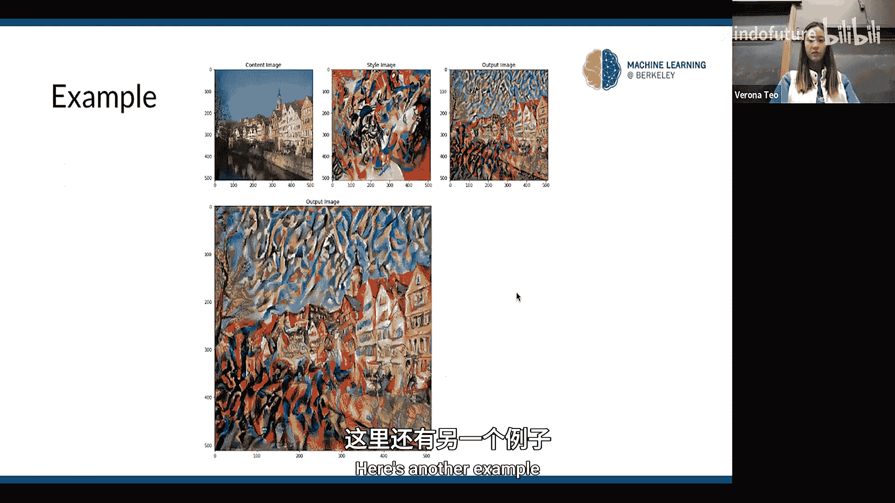

An end depth lecture about some the general architecture ofganNs you talked about stylegan cycleganN so i'll briefly review those again and then get into some different models that sort of。

Focus more on this task of image image translation。

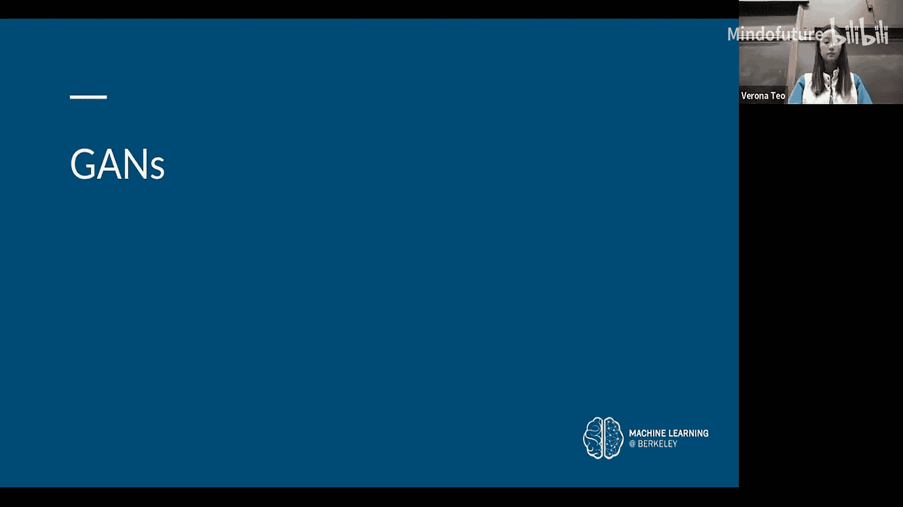

Okay， so the basic M has two separate。Parts， so you have the discriminator。

And the idea here it basically checks for what's generated。

 and that's just your basic classification。Convolutional neural net。

 so it's very similar to what we've used and for neural celltrans as well。

So the idea here is we basically downs samplele。And then we need to upsample so we have the generator portion。

 which generates the new。Instances。And。嗯。Yeah， I think that's all I wanted to talk about for review for GANS。

Okay， so we also talked about style again a few lectures ago， the idea here。Is that。

We basically pre process the lant for a network to use in the convolutions。And then we normalize。

 which is over here。And then we incorporate the style vector over here。Into the synthesis network。

And so the generator basically， it's pretty similar to a traditionalgan。

 except it does make smaller adjustments to the style parts。So for the style of each image。

 it basically。Just makes a small adjustment at each convolution layer。嗯。

The other idea that I kind of wanted to mention， I've sort of emphasized this already。

 but it has the ability to basically separate the higher level and the lower level。

Attributes within the image， so you can basically change some of the attributes without changing。

Others。So。Here isn a fun example。And again， just to be clear。

 the main changes are only to the generator， not to the discriminator。Okay。

So now talking about another。Paper and model it's called Ps to Ps。

 so this uses a conditional G that learns the mappings from the input image to the output images。

 so the idea here is instead of an unconditioned G it basically conditions on some additional information。

嗯。In order to generate the corresponding output images。嗯。So a little bit about conditional GNs。

 they're pretty suitable for tasks like image to image translation because it learns a conditional GAN。

 so we basically condition on an input image。And generate it。The output image。So。

You're able to sort of add some additional information like maybe some。Class labels， for example。

 to basically。Or data from like other modalities， which I'll talk about later in terms of multimodal outputs to basically generate。

 is it very much？Okay， so。I think that's mostly it for picks to picks， but the question is here。

Picks to picks so you can sort of think of it as like a supervised technique in which you have paired images so you have like。

You have like your。Content。It's not image and then you have like the generated image so it's these this kind of data is sort of hard to get sometimes and it's not as flexible in terms of what we can do and so。

The reason why I bring this up is because ps to picks is a bit limited and that it requires this pair data so the idea is how can we sort of build upon this idea。

Still using， for example， the conditional G architecture。

 but with unpaired data and so this is sort of what we talked about last time with cycle G。

so it's still similar in that it uses the conditional again。

 but this time for uned image image so unpaired data for image to image translation tasks。

And so the idea here is， okay， you have a horse and let's say you want to create。

A generated image in such that it's a horse， but in the style of a zebra。So the idea is that if I。

Sort of convert it back， I should expect a horse again。So。

That is the cycle consistency loss that cycle G utilizes。嗯。

So this is a little bit more flexible right so the idea here is that we can basically train without needing paired data。

So we can translate from one domain to another without this one to one mapping and so that's sort of where。

This kind of idea comes into play so you don't need to have a picture of a horse and a picture of what the horse should look like so like this image in the the data you can have just a bunch of horses and just a bunch of zebras separately so it's a little bit more flexible and there are some more possibilities for what we can do in terms of the tasks that we're interested in with the average damage transition so we just need the source in the target data set。

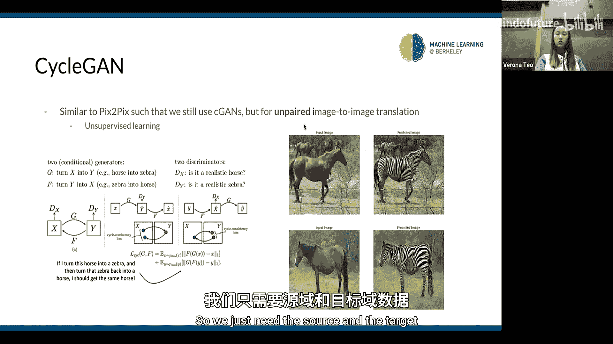

O。Any questions about？

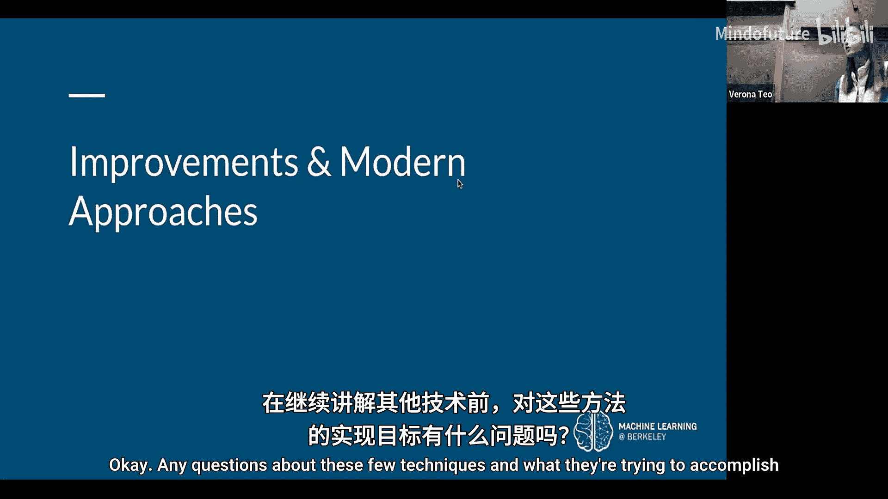

These few techniques and what they're trying to accomplish here before we get into。

Some other techniques that sort of improve upon this or offer a different perspective besides using GNs。

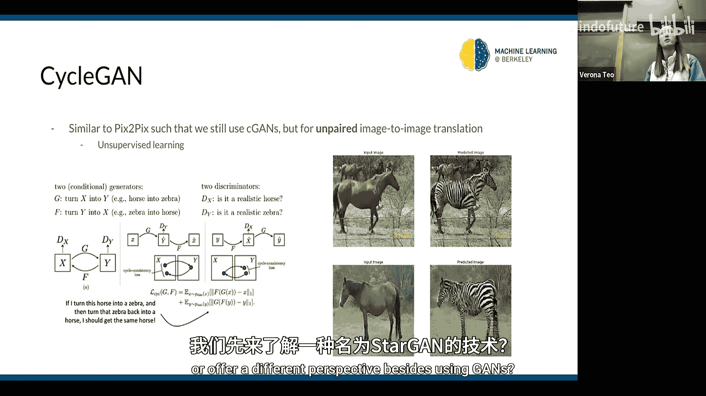

Okay。

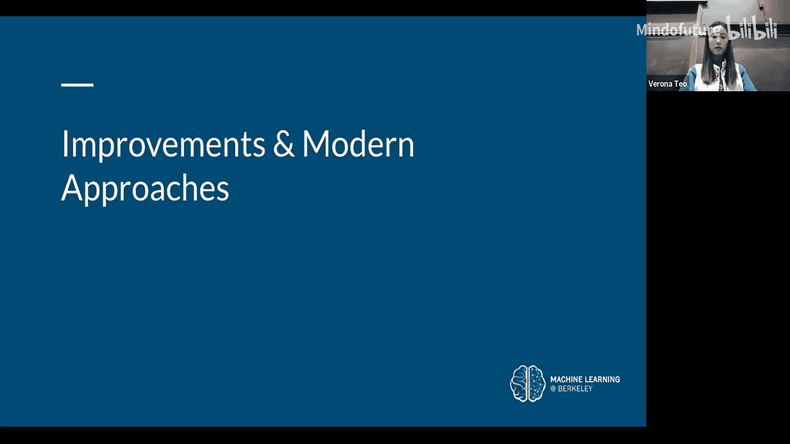

好。So there's something called stargan an idea is。Can we sort of。

Take from multiple domains so instead of just like one source。Domain and then one target domain。

 can we incorporate information from multiple domains？So。

We can basically train the idea that we can basically train multiple domains from different data sets。

And so this sort of tackles the issues of some of the previous models that I mentioned。

In which they're pretty ineffective when it comes to dealing with multi domain image translation tasks。

 because we would need to train basically many， many generators to accomplish that。嗯。And in addition。

 some of the previous models I talked about， they don't fully incorporate or utilize the training data。

So the question is how can we basically take all this data and additional data and incorporate information from so the key idea is instead of learning a fixed translation。

 the generator of this time takes。As input both the image and the domain information。

 so what that means is like they basically in this paper。

They labeled also like either a zero to one binary label or one hot encoded domain information。

 so to be clear what I mean by domain information is like sort of different domains in which you can sort of characterize them by different attributes。

 so for example， in this case you have like inputs of people's。Faces。

 and then you have attributes like blonde hair， gender， age， pale skin。

So instead of just learning like black to blonde hair。

 can you sort of incorporate other information so you take information or take as inputs both the image and the domain。

 so the different kinds of images that share this sort of attribute。Okay。嗯。

The other thing that I wanted to talk about is multimodal output， so what does this sort of mean？

Sot of with the previous models， they're sort of limited in that they only a small number of samples are represented in the output。

 so this is what we call mode cls。So。The idea here is that like cyclegan and ps to picks。

 for example， they sort of fail to capture in this， for example， if we use this as an example。

 the different kinds of scenes that you might notice here。

If we have like an input night image the idea is like can we sort of create pretty diverse outputs so P to pixels and cyclegan that was sort of like a limitation that some people noticed so the idea behind multimodal unsupervised image to image translation is can we produce multiple translations that。

Are one pretty diverse and two still pretty accurate and faithful to the original input。So。

An example of a model that is able to sort of accomplish this。Is bicycle again？So。嗯。

The idea is like we can basically model a distribution。Of possible outputs。In our conditional gap。

So we can produce outputs that are pretty realistic to the original input image and also pretty diverse。

Which is sort of what the others were lacking。But the question is like mapping from high dimensional inputs。

 which as you know images are pretty complex into high dimensional output distributions is pretty difficult。

 so how do we sort of remedy this？We basically。We can represent multimodal。嗯。

So like we can represent multimodality with low lant。Low dimensional latent codes。

So we can basically try to represent all of the possible outputs with the sort of distribution and we can basically use our generator from our conditional G and let it take in both the input image and some randomly sampled。

Laightent codes and basically try to produce a randomly sampled output。

So that's sort of what this paper was trying to accomplish so instead of just mapping the original lane code with the or with the input so remember。

I think it was with。Here。Um。With style gear， for example， we just have the latent。And the input。

 the idea with bicyclegan is can we basically also learn an encoder？嗯。

That maps the output back into the latent space and so the idea here is that you can minimize the probability of two different latent codes。

Sort of generating the same sort of style or the same kind of output。

So this sort of tries or basically helps with this issue of motor collapse。快点。Any questions about？

喂小ber。Or what it's trying to accomplish？Okay。And just one more thing。

 I wanted to keep today's lectures pretty sure we could sort of just talk casually about some of this。

 but the final idea is that we can， you know so far we've sort of seen architecture is mostly based off of our traditional XN classification networks and using GNs。

 conditional GNs。but we've seen vision transformers and what they're able to accomplish。

 but using vision transformers for tasks like image to image translation isn't very easy the nice part of again as you can imagine is the generator aspect of it and so the question is can we sort of leverage the benefits。

And what vision transformers are able to do for these tasks。

So there are some examples and techniques and models that have recently come out of like sort of。

Leveraging both the benefits of vision transformers with GNs so there's something called like。嗯。

I forget what it's called， but it's like basically vision transformers plus scanNs。

To sort of tackle these image chamber translation tasks。So yeah。

 basically there are ideas about applying them using transformer architecture for。Inage generation。

 though it's not as easy and straightforward as using events， for example。Okay。

 I think that's sort of like。Most of what I want to cover today。Yeah。

 I thought it'd just be fun to sort of。吃什么的饭啊。Images and what these techniques are able to accomplish。

嗯。So yeah， are there any questions？好。I know today is shorter。

 but we can also just like stay over and answer any homework questions that you may have or if you just want to sort of talk about。

Whether it's related to stylus images， which image transition or not。Yeah， I the。好。喂。Okay。

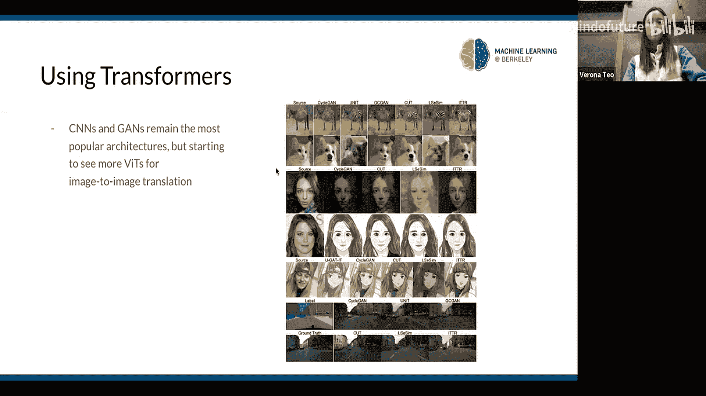