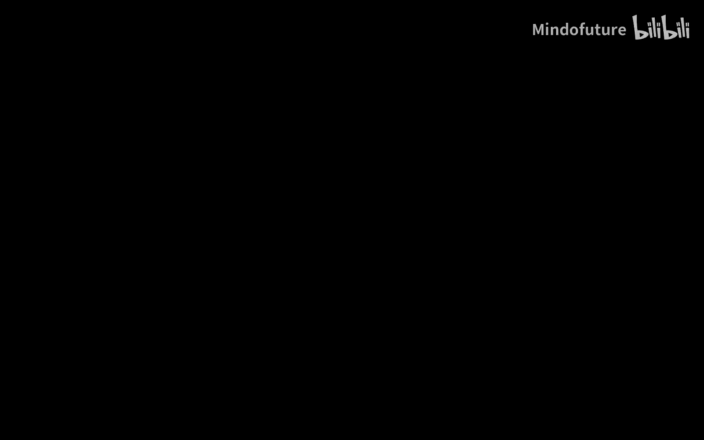
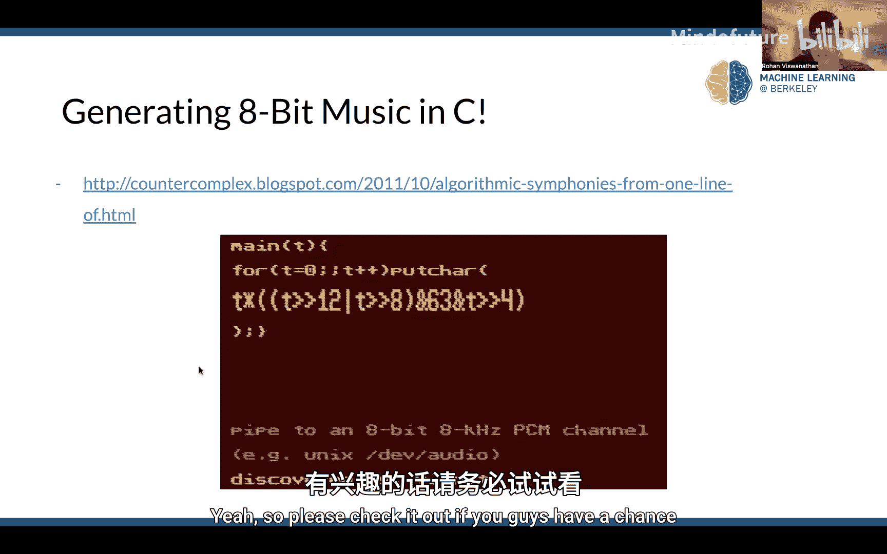
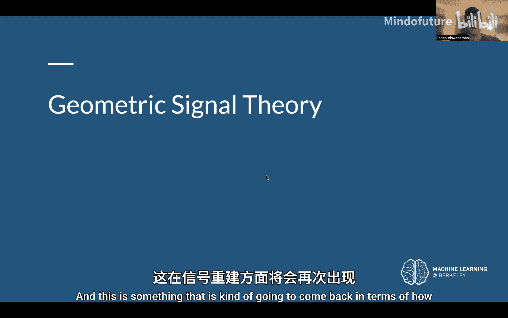
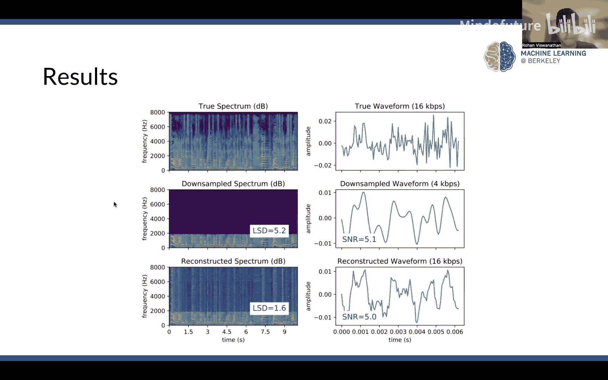
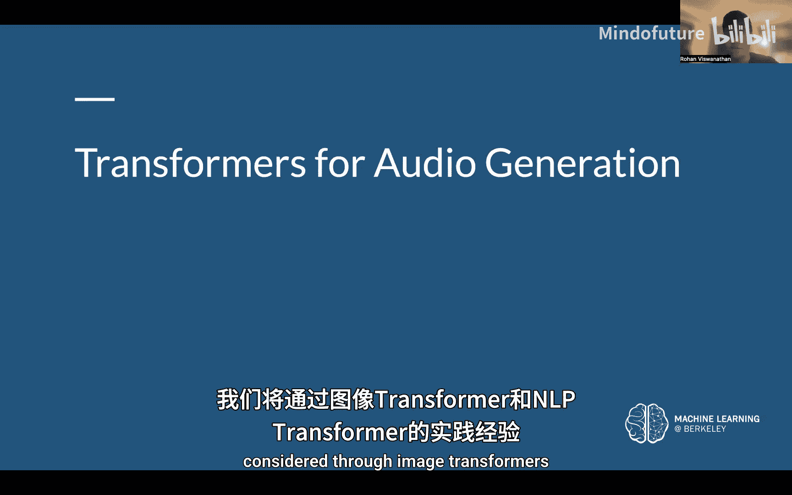

# 【加州大学伯克利】计算机视觉：视觉数据的深度学习 ｜ Cs 198 126： Deep Learning For Visual Data p21 P21_讲座21-生成音频 -BV1Va8zzfEtk_p21-

Hi today we're going to be talking about intro to generative audio this kind of deviates from what we've been talking about before。

 but we're going to kind of tie into the different kinds of models that we've been talking about as well as how they can be used for generative audio this lesson will first dive into some signal theory and then move on into things that we' more familiar with things like deconvolutions and using transformers for next note prediction。

Hope you guys enjoy。Yeah， so we're going to start with a soft introduction to digital signals。

 then go into some geometric signal theory， and with transformers and finally how we can kind of generate sounds using these。

So the first thing we want to talk about is how can we sample and quantize a continuous time signal right。

 something that's unique about music and audio in general is how continuous it is when you listen to like a violin play or a piano play。

 this is a continuous signal that you're taking in and your processing。

 which is not very easy for a computer to do， given that every operation needs to be on a continuous time signal。

 the way that we can fix that is through the process of discretization or to make an analog signal。

 a digital signal for us to be able to process the result of sampling is essentially taking a continuous time signal and discretizing it by a certain sampling rate the two kind of main ways that we can make our signal easier to process is one by taking samples at certain time periods and two by quantizing our level。

So instead of dealing with a continuous scale， we can quantize at certain levels， for example。

 a frequency of like two， four， six，8 hertz， what this allows us to do is come up with discrete points as you can see here。

嗯。Our analog signal is quantized and broken up into certain regions on the。

 I guess you could say the Y axis in this case applied over a time axis and the other hand we can sample at certain rates that gives us a time discretere signal combining the time discretere signal and the quantized signal gets us our digital signal where we have a certain sampling period so we know how far along the kind of time axis our measurements are and we know that our measurements are something that our computer can understand because they're quantized right this ensures that we have a numeric representation of the signal and greatly limits the amount of information that we need to process。

 which is incredibly useful for any type of audio processing application。

The next thing we're going kind of talk about is changing forms right if we want to go from analog to digital if we want to go from digital back to analog what are the kinds of ways that we can do this so the analog to digital converter uses something called the sample and holds circuit the details of which aren't incredibly important if you guys do want to learn more about DAX and ADCs you can take 16b as well as signals classes at Berkeley I'd highly recommend those and ADC converts an analog input to a digital output whereas a digital analog converter converts a digital signal to an analog output we can kind of start by talking about the ADC circuit so this uses something called the SARS ADC algorithm essentially what this is is a binary search to figure out what is my best digital approximation of my analog signal right so I have a continuous signal pass it through my sample and holds circuit which is。

actual circuit that you can Google but essentially what we do after this step is where we've quantized the signal in some way。

 shape or form so we don't have fully continuous values that we're passing into our SARS ADC algorithm and then from here we take in our input and our output is a discretized form based on the amount of bits of precision that we want to have so depending on whether we want a two bit approximation a three bit approximation。

 this highly depends on both the level of precision that we want。

 the constraints on our computing power as well as the initial form that we're trying to process the digital analog converter is kind of the opposite except here we use a low pass filter which is also covered in courses like 16b the motivation behind this is that we maintain a signal that's the pass band where we allow every signal to pass when we hit a certain。

Cutoff frequency， we wane our signal by a certain factor and that factor dictates the slope of this line and our signal will continuously wane after that cutoff frequency is hit。

On the right is kind of the picture of the approximation where we can approximate different quantization levels。

 different bit parodies based on the SARS ADC algorithm。

The next thing we're going to talk about is quantization levels right how many bits do we want to use to approximate a certain signal and the level of quantization here correlates very directly to the dynamic range of the signal that you're quantizing we know that sampling rate is measured in hertz this is covered in classic physics things like that where the frequency is one over our sampling period in hertz the quantization level as we know is measured in bits right so if if we have two bits。

 these are the kinds of bins that we can put our signal into if we have three bits we have a lot more position we increase the amount of information that we have you can see this here where you have a sample value which is your initial kind of wave a quantization value which is the quantized wave and you can see how the quantized wave becomes a better and better approximation and our error value which is the green becomes smaller and smaller as our bit depth increase。

Right so with a bit depth of two， our approximation isn't very great with a bit depth of three it's definitely getting better。

 our errors reduced significantly and our quantization is a lot more indicative of our sample depth of five where're really adhering to our curve now our error is almost zero and a bit depth of 16 you have an almost perfect approximation there is a tradeoff though the tradeoff is compute power how much time do you have to process this if this is something where for example。

 a lot of musicians they want to sample their voice and pitch it up very fast right what quantization level do do we want there do we want a lossless pitchup that takes an hour to compute or if we could do something in five to1 minutes that is a little bit lossy but not enough for the human ear to really comprehend is that something that we are satisfied with or an interesting proposition could be can we do a lossy pitchup with with by filling in。

the blanks in some intelligent way through prediction or kind of note fittingtting which is interesting consideration I think given the fact that audio is a continuous time signal the disretization process and the choices you make matter a lot and because of that this field is so interesting and there's a lot of really didactic work around how we can take these continuous signals。

 discretize them run some sort of algorithm on them and then reconinueize them so that the user can listen to the byproduct。

This is a very interesting theory， the Shannon nucleus sampling theorem and this is involved with a whole bunch of things in digital signal processing as well as really anything that you're getting a signal from and our sampling at a certain gr which in industry is almost every signal you're going to encounter so we know a signal can be reconstructed from its samples without loss of information if and only if the original signal has no frequency above one half of the sampling frequency so our sampling frequency has to be greater than or equal to two times whatever frequency you're trying to process if the sampling frequency is less than double of the highest frequency present alias signal will happen this asserts that you need at least two samples per period the aliasing phenomenon is incredibly interesting this happens both visually and auditorily and aliasing is an entire topic just based on self as you can。

See here your approximation gets very different as your sampling rate increases and decreases if your sampling rate is 0。

3 hertz you can see that the x axis is the pointer angle in degrees and as your sampling rate increases your approximation to this polynomial also increases where at one hertz you're almost perfectly fitting the polynomial on the points something interesting to consider is that at a sampling rate of 0。

3 you are fitting a polynomial because you're creating a polynomial through the points that you have however this polynomial is very not indicative of kind of the actual signal that you're trying to process right while we can see that this does kind of capture the trends of our data and that it falls when our data has fallen it rises when our data has risen this is a pretty bad approximation by all accounts。

You can see here the actual motivation behind the Nquist rate right at a continuous sinoidal signal。

 this our original signal above the Nquist rate， you can see that we have the I guess you could say the X axis。

Colllisions as well as our peaks and our dips so this gives us like very discretized information because we're oversampling right the undersled case is we have samples at certain points along this this axis given that we're taking samples at a certain rate that is less than double of the highest frequency so this is an example of where aliasing would be present at the NCquis straight so exactly at double the highest frequency。

You can see we have an approximation that kind of captures this trend if you fit all of these points you get a wave that is waning and rising at different points so above the Nquistrate you have like a very very strict approximation of the points at the Nquiststr you're able to sample certain points without losing too much information as in the undersampled case so this is a very interesting phenomenon。

Kind of talking briefly a little bit more about aliasing aliasing is the byproduct of poor sampling right so a lower wave resolution will result in a modified output signal as compared to the original input that we're trying to process we can see if this is our original input wave different frequencies approximate our input wave differently right this wave you wouldn't really think is indicative of the actual wave that we're trying to process this wave is one could argue even less indicative we're skipping a lot of points through our interpolation and this wave is the byproduct of a lot of aliasing right where we have a curve that is not representative of our sample at all because we're sampling at a rate that is not adhering to our aliasing law so frequencies that are higher than one half of the sampling rate will be automatically transformed to lower frequency。

That's where information loss stems from we take our low frequency and that becomes a product from taking our original frequency that's above half of the sampling rate and subtracting half of the sampling rate from it so essentially you can think of it as downsampling and contributing to information loss by transforming higher signals into lower frequencies。

So yeah there's a lot of literature about aliasing effects including spatial aliasing right you see that there there's a lot of different ways that aliasing takes place this is an original image if we do point sampling where we take certain points along this you can see that the image changes we get kind of the gist of this but this is a compressed image it contains similar information that allows us to kind of see what's happening but it contains this in a very compressed format super sampling is where you know this image is。

Take in this4 by four image and we're kind of running a kind of stride over top where we're losing some information in the background as you can see it really blends together but in the foreground because we have more information in our image we're able to have more information in our final image so this is a very very interesting phenomenon there's a lot of literature about about alias saying it's a problem that's very prevalent in any signals problem and something that a lot of academia is covering so I'd highly recommend checking out some of these links。

This is a kind of fun demo that you guys could dry out it's generating8 bit music in C this is kind of an add add on to this presentation it doesn't really contribute exactly to what we're talking about but I thought this was incredibly cool with one line in C you're able to generate melodies which is incredibly cool yeah so please check it out if you guys have a chance the next thing we're going to talk about briefly is geometric signal theory and specifically you know what a projection is how can be used to reconstruct signals and finally how that can tie in to reconstructing signals right we are also going to talk about using deconvolutions we talked about the unit architecture very thoroughly used for image segmentation we talked about it in our survey of computer vision techniques and is this is something that that is。

Going to come back in terms of how we can reconstruct signals。

So the inner product and projections right， we know that the inner product measures similarity between two vectors specifically you know if you have a vector x a vector y zero means orthogonal they're very dissimilar and a high value means that they're colinear that they're very similar to each other projections are an application of inner productss where one vector can be projected onto another vector and can you can kind of see what the projection is based on that the idea behind this is that and kind of reconstruction in general is that if I have two two vectors in the basis of a certain vector that I want to reproduce by using some linear combination of those vectors I can reconstruct my exact signal given that these are orthogonal vectors in the basis that I'm working in。

Yeah， this just kind of walks through an example of projection。

 the projection formula is the do project between x and y。

 this is I guess you could think of it as a similarity measure between these two vectors。

 you're dividing this by the norm squared and multiplying this back on x and through that process you're applying a transformation。

That allows you to shift this vector by a certain angle and then rescale it onto a given vector。

So projections for reconstructions right like I mentioned earlier。

 a vector can be reconstructed with a linear combination from its projections onto another set of vectors。

 if and only if the set used is a basis for those of you that have taken like math 5416 A and B or each127 the basis is a subspace that's covered by all linear combinations of vectors where the set of vectors we can say s0 to SN is called the span right essentially this is and representation of all the vectors that can contribute to a certain vector combination right so by defining a subspace of vectors of certain vectors linear combinations of these vectors can form any vector in the vector space that I'm interested in so given that a basis is required the set of vectors used must be orthogonal to one another and this is very important as it ensures that。

We're maximizing the amount of information gained right by having two vectors that are orthogonal to one another we know that there isn't any similarity shared between these right their do product will be zero so for example。

 these are two vectors whose dot product is zero so that fits and this really covers any vector in r2 E0 we can define as 10 so a horizontal vector e1 is01 a vertical vector if we look at where we we' trying to project some vector x onto the E0 space right？

We can kind of see how the math works out here so by applying this to the projection formula and solving out。

 we get x0 E0 right which is essentially x00 right given that we have no x1 component when we do our multiplication out the x1 component cancels out the result of this we can very clearly see with this example that when we're projecting a vector x onto E0 we get x in the direction of E0 right so we can see that this projection did work out as we're left with x x00 which is on the x axis I guess you can say so we have x0 and only the direction of or the components sorry of x0 in the E0 direction。

This can be used to ultimately reconstruct a signal right so for example。

 if I have you know the same definitions of E0 and E1 that form are our basis we want to take first the projection of x onto E0 and then the projection of x onto E1 right we have no information here about what you know like these these components are but by taking this projection onto E0 we get x in the direction of E0 and we get x in the direction of E1 so by combining information that we have right these two are our orthogonal to each other right they have no no shared information so if for example we had a basis that spans multiple different kind of spaces and we had a lot of information by taking the component of x on each of these bases。

that are orthogonal to each other every time we take this projection。

 we're gaining information about the vector that we're projecting right and by by gaining information on every you can think of it axis we can ultimately reconstruct our original signal right so we know that x is equal to a combination of the projection of x onto E0 the projection of xon e1 which equals these and this is defined as our total vector right x0 x1。

Where we have both components of our vector that we've recovered simultaneously by taking the projection onto our basis the result here is that as our basis differs as long as these are orthogonal vectors and they span the complete basis of a certain vector we're able to reconstruct this vector the idea behind the last two sections here was to give you motivation for how signals work and how kind of classical reconstruction can occur using math that we're all familiar with right this makes a lot of sense and kind of primes the water for what's coming next which is a more machine learningbased approach things that we're more familiar with perhaps in terms of how we can use those to reconstruct signals and ultimately how we can use those to generate audio predict the best kind of next node so。

Looking at kind of the next the next step here， we want to use deep learning for reconstruction right where we are reconstructing a low quality audio few。

High resolution audio right and this is this is the kind of model framework that we can use for this you might notice it really closely resembles a unit which is something that we talked about during image segmentation and earlier on in the class a unit can use a 1D representation of a subpixel convolution this is a special type of convolution。

A deconvolution sorry layer that does the same operation as a deconvolution does right we're essentially like upsampling and then it rearranges the pixels in a certain dimension what this does is you know it increases the entropy and thus the information gain that we get from this operation which is incredibly useful especially in this scenario where we're trying to kind of increase the resolution of a certain low quality image form so as you can see if this is our initial wave our final wave is much more populated right we're able to gain information through this unit process so the way that this works is our downsampled wave form is initially sent through kind of eight downsampling blocks right that are made of convolutional layers with astrive2 as you can see batchor is applied we're using a re activation function and at each layer the number of filter banks is doubled so that while the。

The dimension along the waveform is halved the filterbank dimension is increased by two You can kind of think of this like when we talked about the swim transformer right as we intelligently combine these shifted windows we're reducing the size our of our image but we're increasing the dimension the dimensionality of it we're doubling the dimensionality as we're having the size so we're not losing information but we're developing a new representation of these images same here we're developing a representation of these audio signals so as we pass through the bottleneck layer which is constructed identically to a downsampling block these connect eight upsling box which have residual connections to the downsling blocks you can see the residual connections here right what this allows you to do is it allows you to preserve features and share features that are learned from the low resolution representation of the image into our higher resolution output so we have a downsampled block。

Over here， which has the eight convolutional layers。

sorry eight downsampling blocks and we have the same reflected over here in the upsampling blocks the up the upsling blocks though use a subpixel convolution that we talked about earlier where we reorder information along a certain dimension to expand kind of the information that we get the final convolutional layer has a resstocking operation and it does the reordering operation following our subpixel deconvolution we also are able to generate our upsampled waveform after this restocking step and the loss function used throughout this process specifically was kind of a mean squared error loss function so by playing around with different kinds of loss functions and in this case we're just taking the mean squared error between the output waveform that's upsampled and your initial high resolution waveform that we。

ha as our training so thats that's the loss that we're considering by improving that loss function you might be able to yield better performance。

 but that's what the authors of this specific methodology did I thought this was incredibly cool as it kind of it parallels a lot of concepts that we talked about earlier on units the Sw transformer keeping residuals we talked very very very very in depth about how residuals are able to kind of keep information across solves a bunch of problems vanish ingredients as your network gets bigger and you're able you're able to use those in kind of reconstruction as well for audio which is incredibly cool Something else is that these kinds of techniques are used in a variety of ways to reproduce music from bands in you know the 1900s the late 1900s mid-1900s whose recordings may not have been preserved in full quality so by you know through the remastering process they're able to。

To kind of do things like this， so that the listening experience for the end user is improved。

So yeah these are some of the results that were found from this audio where you have a true spectrum and you can see the waveform here there the amplitude of the waveform over a time the downsampled spectrum has you can see it's capped at a certain frequency while the reconstructed spectrum after passing through the unit has a lot more depth your reaching higher frequencies。

 we're keeping kind of the downsampled spectrum that we know is accurate and we're able to kind of fill in the gaps in higher frequencies the SNR signal noise ratio goes down between the downsampled waveform and the reconstructed waveform as you can see the reconstructed waveform matches the KVPS of the true waveform we're adding kind of clarity。

 we're adding color to our downsampled waveform to ultimately get something that hope。

Res our true way form better。

All right we're gonna kind kind of transition now into transformers for audio generation right how can we use transformers to predict the next note for example。

 and we're going to go through this by looking at some considerations that we've considered through like image transformers NLP transformers and things like that right so notes to a melody right we want to take notes and for example。

 produce the next node and a melody we can use the transformer architecture to predict music notes our goal is to build a sequence model for music where we take an input sequence and predict a even target sequence right the two steps for' building this model are kind of the same two steps that we use for any transform model we want to convert our data into usable tokens which in the music realm does provide a different issue than it did for our other two representations of image and text we want to then build the model and train it to predict the nextken。

RightThe first step takes the form of converting data which is music files into a token sequence。

 which is individual notes right so eventually we want to start with with this kind of notes format and we want to tokenize it into something that our model can understand right this presents a unique problem that we're going to be talking about extensively。

But essentially with an image， for example， we talked about how you can flatten your pixels。

 you have your pixel values is that something that our computer can understand with text using a model like Bt or something you can create a 768 feature dimension vector that can be passed into to any models that you're training right which captured information in a whole bunch of dimensions right music is a little bit different and the reason for this is that there's a time series that you're not able to perfectly capture right what beat on my notes on is this an eighth node ch nodeote half node right what type and signature am I in there's a lot of considerations that need to be made。

 what key am I in。So the transformer music model is trying to do sequence generation through next token prediction right we have an end of sequence token and a beginning of sequence token right so given a certain input we want to be able to predict you know that this this will happen。

And we want to be able to get our end of sentence token as well so going into the actual tokenization right if we if we're tokenizing for example。

 a sentence， we have our vocabulary which you know we can easily mapped by a dictionary to certain keys certain values where where our key is our actual vocabulary and our value is associated with that so taking text as a music model is like a language model。

 we can tokenize this into you know a series of tokens that all correspond to our vocabulary which is very intuitive。

What we can do for music is we can approximate this。

 which is a series of notes in a piano rule or a graph that has our offsets and our pitches so our pitches span a certain pitch set and we want our information to be captured in multiple dimensions right we want the pitch of the note as well as the length of the note。

 for example， these two notes at the bottom they correspond to to E and A2 we want these to be half notes。

 we want them to last for half as long as our C4 that we have another notes in the middle which is going to intersect with the length of our bottom two notes that we're going to start new notes G andC3 and we have an Enote on top that also starts at the same time and that lasts two beats for our half note。

So。Yeah these are all important considerations that we want to make and these take the form of a piano role right which is a plot of frequency across time we know that a single music note is a collection of values。

 you can think of these are the different features that make up of music note right the two naive ones that you can immediately think of are pitch and duration but this can be expanded into multiple things right as shown other attributes you can use as part of our instrument type dynamics tempo can be used for a more complex representation taking something that is you know indicative of two features that represent music and really expand that into as many features as you think can can positively contribute to the representation we're trying to form multiple notes can be played at a single point in time this is polyphonny where you can have multiple notes you know intersecting each other we need to figure out how to tokenize this 2D data now this representation into a single dimension to be fed into our transforming model。

There is a simple representation of music notes right where you have values and durations。

 so you just have a value and then you have a duration and this is kind of a naive approach to how we can represent a certain music node。

So yeah there' are kind of different approaches we can use notes which is one to many where you have individual notes and you have many of them where you're trying to encode a single note into a sequence of tokens and combine the values into a single token right where you have C ch note D ch note E half note which as you can see here this kind of adhereears to you have two coordinate notes and a half note and the token has formed this is you have C and then quarter D quarter E half right but the problem with this is that you have a large vocabulary size where you have to keep track of all of these specific kind of subtokens where you have a C being mapped to a quarter node somewhere else you could have sorry somewhere else you could have C map to a half note etc etc and you have less control or predictions given that your vocabulary size will grow as you add notes right the other kind of thing is polyphony taking many notes and mapping it。

One specific kind of tokenized set where you play notes sequentially if it's separated by a SE a separator token If not we want to play all notes together right so this keeps track then of where notes will start an end right we have a series of notes that we want to play together and then a series of notes right we have a separator token and then another note that we want to play a separator token and then another series of notes that we want to play right as you can see here we have our our start token and then we have our our note here。

 our note here， our note here the you know this is a quarter note the8 this is a half notes double the length of a quarter note and we have our separating token right we want these to start together and we have our separating token and then we have。

And 62 which is this actual note representation on a piano so we'll only have as many notes as on our piano right we're kind of reducing our vocabulary instead of our vocabulary spanning each and every specific instance of a note we have our vocabulary just spanning the notes itself and we're kind of we're tokenizing in this way where we have separator tokens。

 we have our star token our end token and we're able to capture information in a very sequential and very structured way so putting this all together you could get your initial translation right where you have our our initial translation was a translation from this piano score to this tokenized form。

 which is very， very cool。Yeah so the next thing to kind of touch on is data augmentation right this provides an amazing data submplier to simply get more data a single song can be transformed into 12 songs of different keys which can help increase our sample of training data and generalized key scales and beats throughout a data right the more data you have the better your model will be and the more generalized your model will be right we've talked about this thoroughly with images as well for images that are small where you have a lack of information convolutions outperform transformers but when you have a lot of information right when you have a whole book that you're trying to process as opposed to like maybe a single sentence transformers will far outperform classical methods of both computer vision and natural language processing the more information you have and the more generalizability you have in your transformer the better it'llperform right we talked about Aham's razor we talked about how a generalized transformer a generalized solution kind of can fit the goldilocks of what we want in a model。

It's easier for machines to predict keys without flats and sharps， which has， you know。

 similar to what humans do， it's easier for us to focus on。

TheThe regular keys on piano so this specific example is trained on those however the glass and sharprks with specific augmentations and specific training processes can also be added to our vocabulary so for example this specifically I believe this uses like a music 21 framework but it's able to you know tokenize a certain item and then you're able to transpose this to you know a certain a certain amount of notes a certain key and this is the transposed representation so just by transposing you're able to increase your training sample size which is very cool and can improve model performance by aton especially given that reus transformers the next thing to consider is positional beat encoding right we want to include some metadata to feed into our model to give it a better sense of musical timing because the position of the token in our tokenized representation。

And doesn't correspond to its actual position in time， for example。

This is the same example where we have an item we're tokenizing this and this is the position of each token right but in reality token 7 is being played on beat1 right the token that index 7 is being played on B1 and we want a way to capture that information right so converting notes to tokens isn't a one to one mapping if we want to send our model the beat that are our music is following we can include this as metadata along with the actual tokens to get more contextualized information so now it no longer has to figure out musical timing on its own it can now have some semblance of which notes are on which beat right。

This is very cool because it also parallels other concepts that we knew in terms of positional structure right when we were talking about transformers for natural language right we were talking about how you know using some like sign and cosine functions we can pass in information about the positionality of our text so that our transformer model has some semblance of that right this is very similar except for music which I thought is very interesting。

All right the next thing we're going to talk about is teacher forcing right so when training transformers you want a way to mask information right you don't want to give the transformer all the information because then it won't really learn a very good representation of the data that you're providing right we want to be able to mask information that previously add as well as mask information that it'll have in the future right so we want to apply an attention mask to keep the model from peaking and essentially leaking information at the next token it's supposed to predict。

We can do this by kind of observing this model right so here we at each step the model can only see itself right at the first step where zero is a token you can see one is a token you can't see。

 which is a little backwards I know， but you're essentially。

Masking the every token except for yourself right here you're at the next kind of step you are able to see information you previously had and you're getting more information about the the current token that you're on and you're masking everything that's that's not the token you're on in the future and by the last step you're able to see everything right？

By applying in another mask， a window of size two here at the first step， you only see yourself。

 right？At the second step， you don't even see what token you're on。

 you only see the previous token at the third step， you only see the previous tokens。

At the fourth step you also only see the previous tokens so you're essentially enforcing a window size of two where you're only updating the information you see the prior information you see every two time steps right at the very end you can't see the final two bits of information and that lack of information is very important to a transformer as it allows you to predict several steps ahead and will ideally produce a more generalized model so this is a reverse teacher forcing where we're masking future tokens and potentially past token depending on what window mask we're applying but yeah this is this is another way to improve model performance and I think it's a very interesting concept。

So going into the actual transformer architecture this specific implementation used a transformer Excel which is a specific flavor of the transformer model this features right we talked about relative position encoding as well as hidden state memory Transformer memory specifically to this model enables very fast inference from music prediction right we've done a lot of things to optimize for our prediction we're including a beat embedding so that's not something it has to learn we're including information about the tokens that you know limits our vocabulary and captures all the information we want to have we're really only capturing two things we're capturing the pitch of the note depending on what node it actually is and we're capturing the duration of the node instead of having to reevaluate the whole sequence on every prediction you only need to evaluate on the last predicted token because of that information gain throughout the predictive process previous tokens are already stored in memory and we're able to you know get a sense of relative position with transformer Excel whereas vanilla。

transsformers will use absolute absolute position only it's important for using models to know the position of each token relative to one another because positionality matters right the order that you're playing the notes really is is what matters the most and this is an additional to our positional beating coding which which we're including for the model to have。

So I'd kind of like to end with a little demo generated by somebody who used this model to kind of predict the end of Canon in D major by Pocobel so here's Pocobel's Canon kind of in the spirit of Christmas coming up as well。

Yeah so as you can see there， this is the originalpocoballs canon and this is what's predicted where these little white and green notes are the original Pocoballs canon as you can see this does deviate a bit but honestly sounds pretty good so the transform model is able to to kind of do this next note next sequence prediction pretty pretty well which I thought was very very cool so yeah there's a lot to do in this field a lot of really cool things happening。

And yeah， I hope you guys learned something about generative audio today and are inspired to kind of give some of these things a try yourself。

Yeah， thank you guys for tuning in， have a good。

