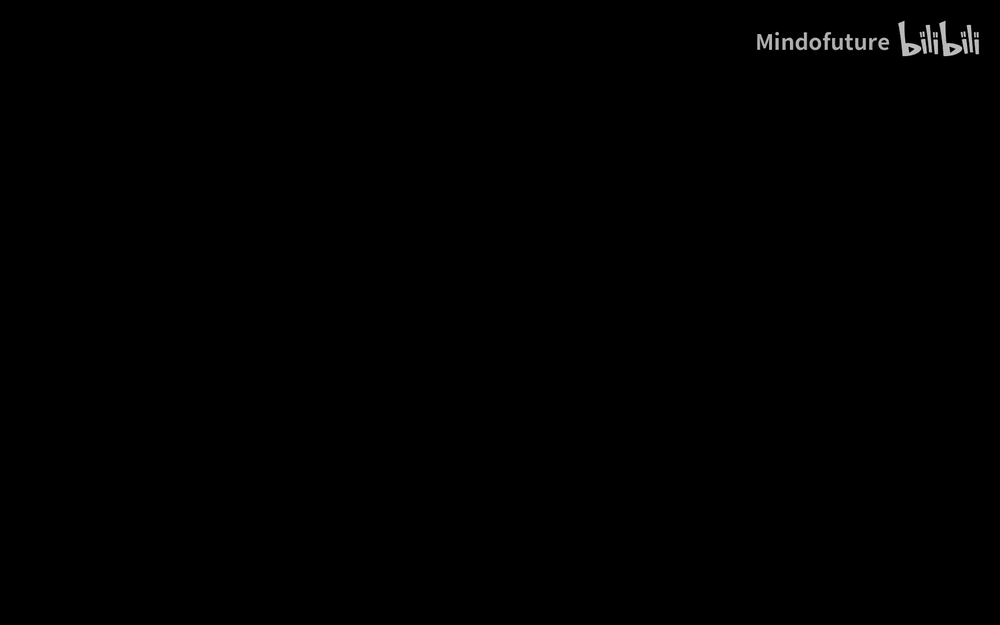
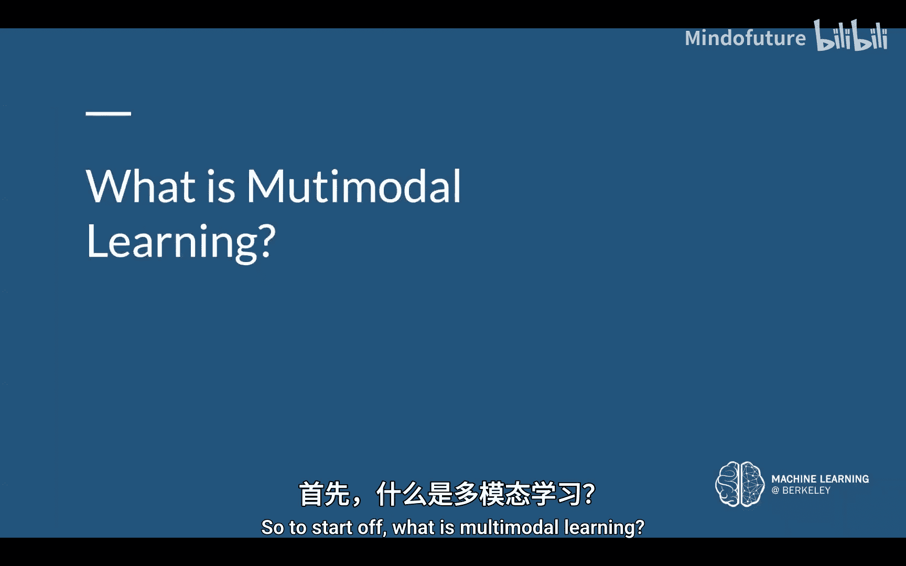
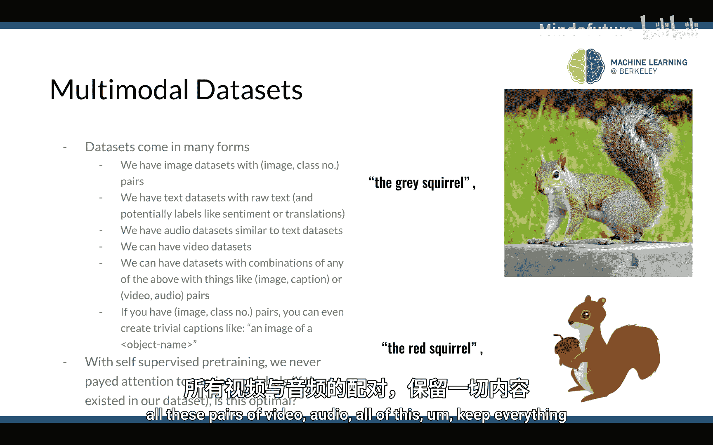
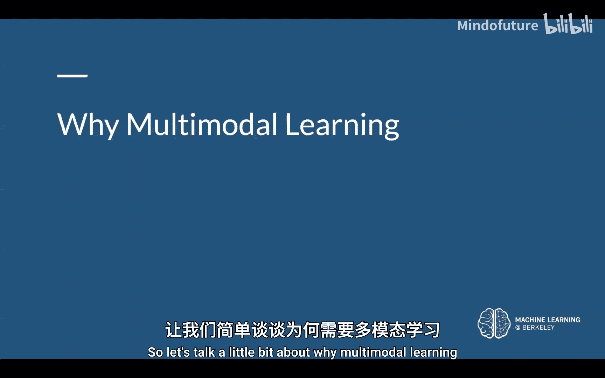
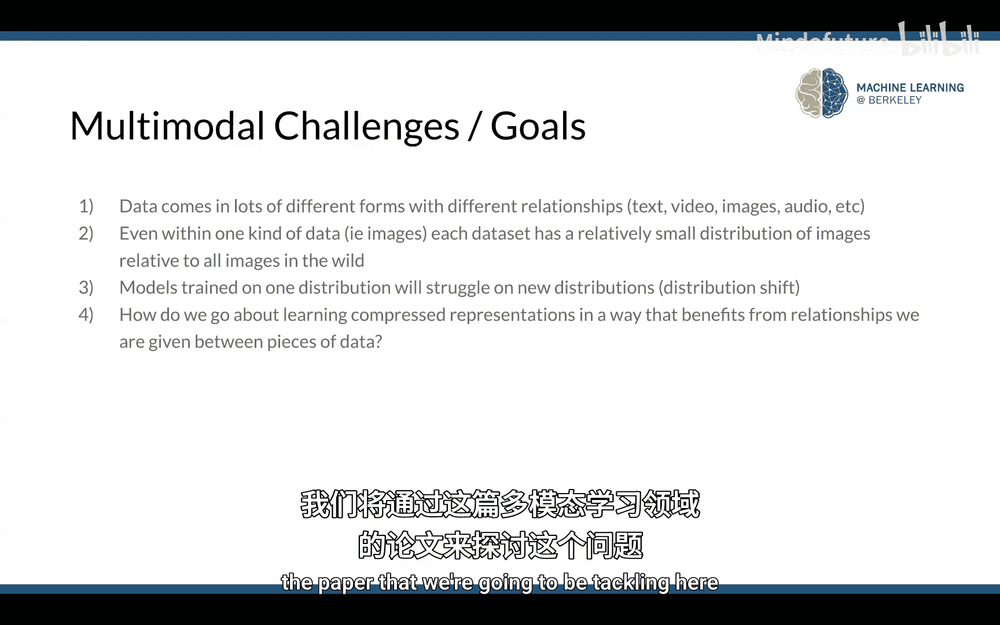
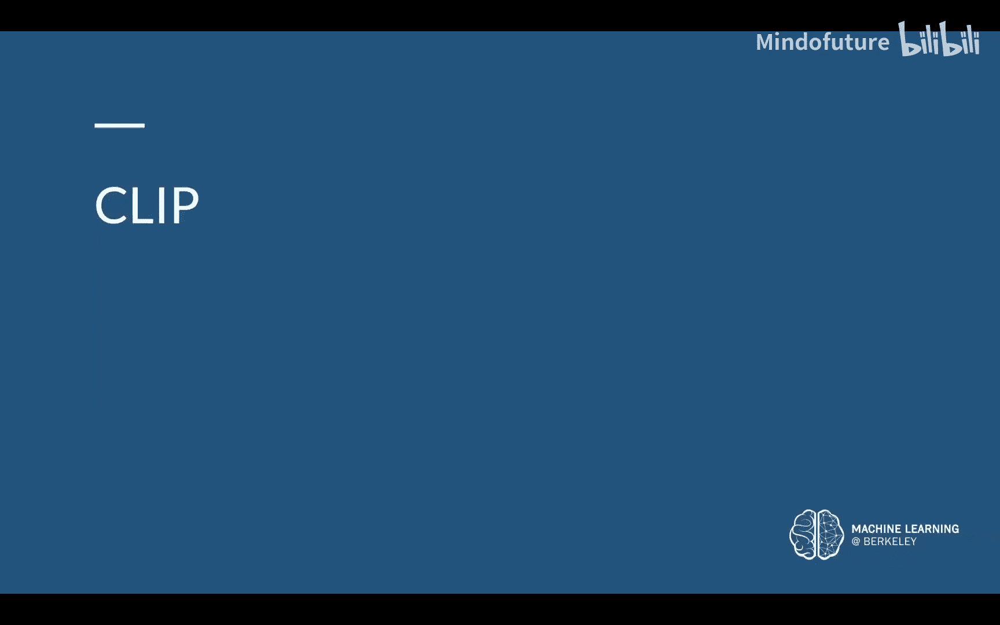
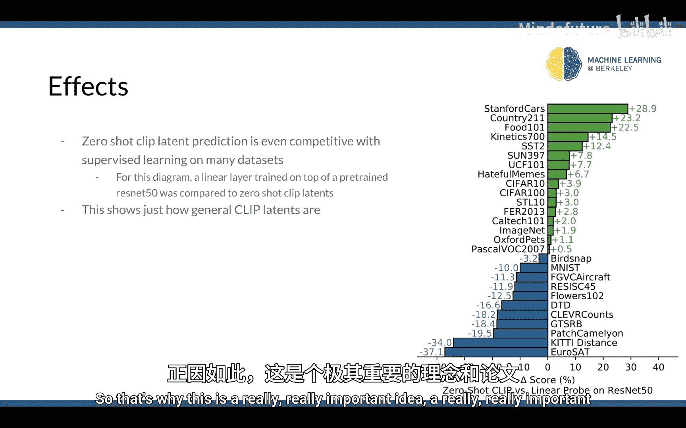
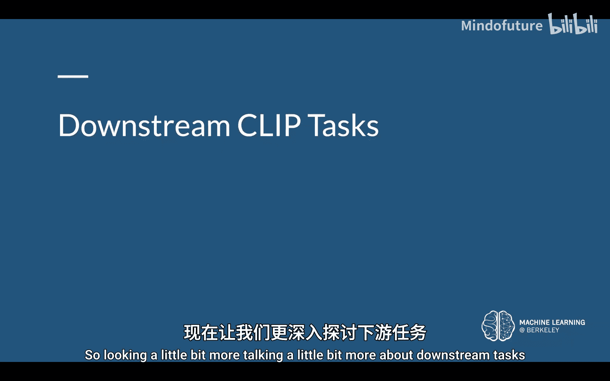
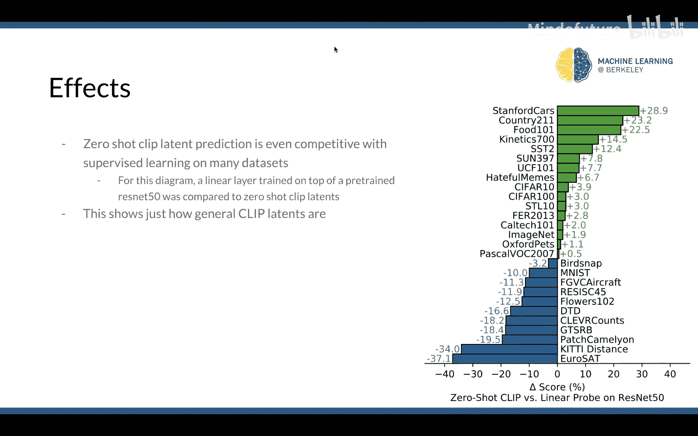
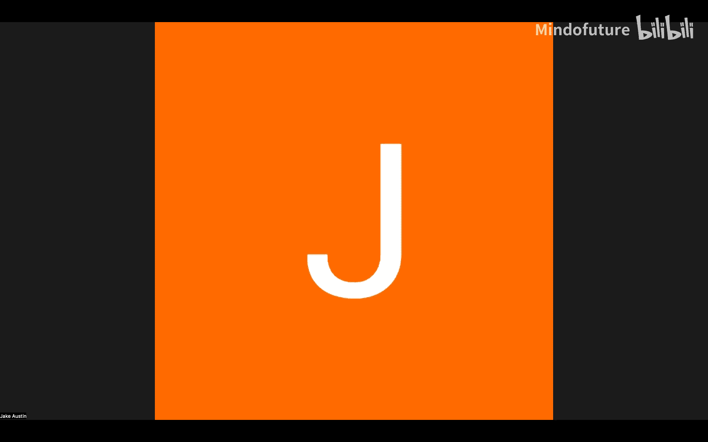

# 【加州大学伯克利】计算机视觉：视觉数据的深度学习 ｜ Cs 198 126： Deep Learning For Visual Data p22 P22_讲座22-多模态学习 -BV1Va8zzfEtk_p22-

Alright。So today we're going to be talking about multimodal learning。

Talk a little bit about what multimodal learning is and why we do it。

 I'll talk a little bit about clip and that specific flavor of multimodal representation learning。

And at the end， we'll talk a little bit about the downstream uses of clip。

 and what can you do with C once it has been trained。So start off， what is multimodal learning？

So you should start by talking a little bit about what multimodal is in the first place。

There's many different ways to represent the same kind of object on the right side of the slide you can see we have two different sets of text。

 the gray squirrel， the red squirrel and three different images of the squirrel。

 all in a very similar pose， similar features。So this sort of describes that we we can have text represented text representing our objects。

 we can have images of the object， can also a video of an object。

 someone talking about the object and audio clip of them talking about it or you know the object itself making noise right so there's different ways in which we can represent with data the same kind of thing and you know even objects that are of the same data type can all have little permutations as you could see these three different images of a squirrel are different in their style and the way in which the object is drawn right。

 not all squirrels are the same。The way in which we represent all of these can be similar。

But hopefully it also captures a little bit of the nuances and sort of harkens back to what we were talking about earlier the semester with word embeddings。

 where the objective was to take similar words and map them in a latent space to points which you know if the meaning of the word is similar is closer in distance。

Um so。To cap it off again， we have objects that are the same but can be represented in different ways and。

Objects even within the same data type that are different and we would like to capture these nuances somehow。

 as well as still capture that you know the object is the same。So for multimodal data sets。

 our data sets might come in many different forms， right？So I mean。

 we've talked a lot about image data sets throughout the semester where we have pairs of images and class numbers。

We can also have text data sets like on the right hand side where we have raw text。

 oh I'm sorry I jump gun a little bit， we can have text data sets with raw text and potentially you know sentiment labels or translations。

 we can have audio data sets similar to text dataset sets， video data sets。

And we can have data sets with any combination or pairs of the data types enumerated above。

 so we can have perhaps image caption pairs or video audio pairs。

 like on the right hand side of the slide， you can see pairs of images with corresponding captions。

 the first image is a picture of a gray squirl and accordingly we have the caption。

 the gray squirrel on the bottom we have a red squirrel and the caption the red squirrel。

And even if you have image class number pairs， you can sort of create trivial captions。

 even like an image of and then insert whatever the object name is。

And with self supervised pre training， as we talked about previously。

We never really paid attention to whether or not even if these labels existed， you know。

 what could we do with them， we always just throw away labels or any extraneous data corresponding to all our images because in self superupvised learning the goal is simply to figure out。

Or at least in the kinds of self supervising we talked about the goal was simply how do we learn from just unlabeled images？

But oftentimes throwing away all this extraneous data you know might result in less information。

 so is this really optimal to be throwing away all this extra data？That's sort of。

The the concept of multimodal data sets is we're going to keep all of this information， you know。

 all these pairs of images， captions， all these pairs of video， audio， all of this。Keep everything。

So let's talk a little bit about like why multimodal learning。

 like why is this a problem we really care about？

So。Our data can come from lots of different places and lots of different data sets like we've talked about INe。

 but you know there exists lots of other data sets some presumably that have images that are more cartoon like like some of these other images of squirrels that we have some are photorealistic。

 some are cartoons， some are sketches。Different data sets might contain entirely different objects too。

 right Iagenet has  a thousand0 different classes。But I'm sure there are other data sets that contain entirely different objects that are not an image at all。

 and you know furthermore imagenet as a data set， you know。

 of objects like this first squirrel where the object is you know front and center。

Never really containing more than one object， right？So we refer to these different。

you know changes these different these differences between data sets by referring to each data as having a distribution over possible images。

 so if we have a photorealistic data set like IageNet it's highly unlikely it's very improbable that it contains an image like the ones on the bottom of the slide where it's either a sketch or cartoonish。

So we can think about。Every single possible image has like some probability of being inside this data set and if it's like a photorealistic data set。

Then， you know， it's probably low， it's probabilistically unlikely that， you know。

 there's a cartoonish image。嗯。So。Each individual dataset sets distribution。

Frequently in machine learning is very small compared to what's possible。

 like we'll have data sets that are photorealistic images or have a data set specifically for cartoon images。

So let's start really why like why this is important to bring up distribution shift becomes a really big problem。

 so if you have a computer vision model that was trained on a photorealistic data like Imnet。

And you say okay， how well does it do at identifying what this image of a squirrel that's been hand drawn sketched we if we evaluate our computer vision model on sketches。

 it's very likely that we're going to do very poorly。And this is suboptimal， I mean。

 this image is clearly recognizable as a squirrel to any human。

We'd really like our computer vision models to generalize to all kinds of data。

And refer to this problem again as distribution shift in that if we train on a distribution of images that is more likely to be real than not。

😊，Where。IfIf we shift over， if we test on a distribution of data that is more likely to be cartoonish than not。

 we have shifted the distribution of data and we're going to do very poorly。

So this is a problem that we'd really， really like to solve。

 this is the problem with regular learning that multimodal learning is sort of trying to aim at in essence。

mSo。In the wild， you know across the internet， across all the different types of data sets that exist。

 there's incredible data diversity we have images of different kinds。

 different styles you know all over the internet。With all different kinds of objects in them。

We have so many different data formats and we have images， we have video， text， audio， everything。

And we also might have different relationships in each data between bits of data。

 some data sets might have pairs of images and object numbers， others might just have raw images。

 other data sets might have pairs of images and captions， others might have pairs of video audio。

 etc。And you know， not even to mention again that we can make captions trivially for， you know。

 if we have an object number， we can create text from audio。

 we can create images from video so there's all these different kinds of relationships that we can have。

The goal of multimodal learning is to figure out how do we use all of these different representations between the data。

 how can we throw away nothing？😊，Um， instead of what we used to do。

 which is strip the data sets for specifically the kind of data that we were interested in。嗯。

You know， in self supervised pre training for image， you know， computer vision models。

 we frequently just strip data sets to get unlabeled images。嗯。

And that's not necessarily ideal and the hope is that by using all of this data。

We can train on more diverse data。Traing better models what's more from more diverse data and you know by virtue of the fact that we're using。

Every relationship between every single bit of data in our data set。

Similar with representation learning， our goal is going to be to learn meaningful。

 compressed representations， at least in the context of the slide deck。Um，Of hopefully， I mean。

 everything images， text， audio， video， everything。Meaningful compressed representations。

So sort of sum it all up right we have data that comes all different kinds of you know forms with different relationships。

 text video images， audio。Perhaps paired， you know with relationships like。

Text corresponding to the video or audio corresponding to the video， text corresponding to an image。

 all of this。Yeah。It's also you know， important， you know。

 we have different different kinds of data even within data sets。Um。A our data sets？er。

As diverse as they can be there's still a very small segment of what's possible。

 every data set that exists is a very small slice of all the images that are possible in the wild that you might encounter just perusing the internet right？

modelsels trained on one distribution will frequently struggle on new distributions。

 how do we go about learning compressed representations in a way that benefits from relationships that we have between different pieces of data。

So this is sort of。What multimodal learning is， this is what we're going to try and tackle with the the。

Flavor of multimodal learning， the paper that we're going to be tackling here。

This paper， it's called Clip。

So。Clip stands for contrastive language image pretraining it's a relatively new paper although with how fast ML moves you know even a paper from 2021 is still fairly old and this paper looks specifically at relationships between images and text you can think about like Instagram where we have lots of image caption pairs that are very common in the wild and if we have image data sets with object labels we can also create some basic captions to sort of get us more data to work with more image caption pairs for our data。

And in this paper， they combined it with a very， very large data set of images and captions to get a ton more data than you could get from。

you know any any one data set imagenet or whatever。

 they had an enormous amount of image caption pairs from all over the internet with all different kinds of images in them。

 all different styles， all different modalities。嗯。The basic idea with the clip is that if we have images corresponding with captions that they are attached to the representations learned for both the image and the caption should be the same so we talked before about image encoders and a little bit about text encoders we're not going to worry about architectural details here we're just going black box just something like a vision transformer and then like a transformer that's made for like you know natural language you know takes in a sentence or in the case of our vision transformer takes in an image and outputs some fixed lightnt vector like 128 dimensional 512 dimensional whatever。

Takes in an image and our language encoder takes in text。

 and both of them output something like a 512 dimensional latent vector。

The idea is that if our image， if we take the latent representation of our image and we take the latent representation of the caption。

 we would like them to be the same。😊，Because the caption describes the image。They are。

 they should be semantically very similar。So ideally。

 the learned representation should be the same too。

And this will be despite the fact that the images are getting passed into one model and the text is getting passed into an entirely different model。

 I should note。These are not the same model， these are two different models。

 we have one for text and we have one model for processing images。

We want to compare and contrast all these different pairs。

 asserting that matching image caption pairs have similar representations and different image caption pairs have representations that are very far apart。

Again， to note there's no model or architectural innovations at play。

 we're just going to black box language transformers and vision transformers training them from scratch。

So here's an image of what C is doing and sort of the training procedure。So。

Let's look just first here at step one and this is directly from the clip paper。 so step one is is。

Really the meat of it， we're going to be pre training both the text encoder， just again。

 just like a transformer for natural language。And our image encoder。

 which is another just a vision transformer， both of them initialized from scratch。

 so what we're going to do is we're going to take。A bunch of image caption pairs。

 so you can see in the left hand side， we have a caption pepper， the Aussie Pup。

 which corresponds to the first image in the stack， which is an Aussie pup presumably named pepper。

We have a whole bunch from we have n different pairs of images and captions。

We're going to take all of these images。And pass them through our image encoder to get a bunch of 512 dimensional or you know。

 however， many dimensional embeddings。For one for each image， you can see that's where I1， I2。

 I3 up to IN comes from， same thing for text， which is going to give us you know 512 dimensional latent embeddings。

 T1， T2 t3 all the way to TN。Now remember T1 and i1。Came from an image caption pair that matches。

So ideally。If our latent representation of I1 is similar to T1。

The dot product between the two latent vectors， because。

 you know the vectors ideally are very similar， the dot product between them is going to be very large。

And ideally， if， say we compare T1 and I2。A caption that does not correspond to the image。

 so the caption does not describe was in the image if we take the dot product of you know these。

Encoded representations。Of the image in the caption， they should be very dissimilar。

 they should be hopefully even orthogonal to one another。

 and the dot product between the two should be very small or negative， perhaps。You should be very。

 very far apart。And the same thing goes for any other image caption pair。

 so you can see along the diagonal。Are embeddings for image and the text that are the same。

 So in the top left hand corner is the dot product between our matching pair， I1 and T1。

Which is the embedded version of the Aussie Pup named pepper and the caption saying pepper the Aussie Pup。

And the second element along the diagonal I2 T2 is the dot product between our image embedding and our text embedding or our encoded text and image text。

 I should say， our encoded。Text and encoded image。The dot products should the dot products is hopefully very large because the image is the same as what is in the text。

And hopefully our image and text encoder。Learn to output， you know。

Ebeddings that are very similar if what they contain is you know。About the same。

So every element along the diagonal corresponds to a pair。The dot product between。

A embedded image and embedded text pair。Everything not along the diagonal corresponds to things that do not match。

 things that we hopefully like to be very small。Given that these two embeddings are very far apart。

 hopefully。Um， what we're basically going to do is look at like any given。

 let's say just look at a column for now。The first element corresponding to the correct pairing is very large and ideally everything else is very small。

 it is very similar to like a classification task almost。

Or the output of our neural network is a whole bunch of logits。

And we'd like the logic corresponding to the correct class to be very large and all the other logics to be very small。

 you know， after which in image classification we softm and then just take like a。

Binary cross entropy loss， so that's what we're going to do is we're literally just going to look at this first column and we're going to say。

 okay， the correct label for this column is lo at zero and we're just going to take the binary cross sorry cross entropy loss going to do the same thing for the second column where the correct label set index1 and so on and so forth。

Okay。You'll also notice you can do the exact same thing for the rows just again to a。

Cross entropy loss where the correct logicit of the first row is the zeroth index Take the look at the the。

Index one row。And set the correct label to be an index one cross entrytropy loss。

Which has the effect again， this loss function of taking these elements along the diagonal and trying to make them as large as possible。

 the encoder for text and the image encoder are going to work together。

To try and get these elements along the diagonal。As big as possible， meaning these two models。

 the text encoder and the image encoder are going to work together。To make the dot product。

Between matching elements the same and non matching elements very small。It's the basic idea。

We have a text encoder and an image encoder that are working together to spit out the same thing if they have a true pair of data。

And at test time， if we want to do some classification on a new image， we're going to say okay。

This image that we're about to pass in could be one of the following， could be a plane。

 could be a car， could be a dog， so on， could be a bird。

We're going to create dummy little captions that say just a photo of a plane， a photo of a bird。

Photo of a car photo of a dog we're going to pass all of these fake little sentences。

 these captions that we've come up with through our text encoder to get different embeddings。

 So if the image is indeed a photo of a plane。It'll probably match the first text embedding T1。

If the image is in fact a photo of a car， it will probably match T2 and I should note I'm looking at this section here on the right section two create data set classifier from label text so on so forth。

 if it's an image of a dog it's probably going to match the label T3。

 it's an image of a bird it's probably going to match TN。

We're going to pass the image I through our image encoder。

 and we're going to take the dot product of that encoded image I1 with all of our different captions。

Which is going to tell us how similar is our image to all of these different captions we created。

We're going to see that。Our image after being encoded。Creating I1。

It's going to be very similar to T3 because the third caption we created was the caption quote。

 a photo of a dog。Because our text encoder and imaging coder have worked together to output the same thing。

When， you know， the caption matches the image。We're going to observe that i1 dot T3 is very large and everything else is very small and because。

Our photo most closely matches the text embedding。A photo of a dog we're going to assert that the imaging question is a dog。

 So this is called zero shot prediction， and it's going to be used to show that you know。

After we've trained our text encoder and our image encoder to output these 512 dimensional vectors that supposedly represent our。

Image in this latent space。It's going to show that these vectors。

 these encoded representations of text and image are extremely meaningful。

If we can correctly classify things in a zero shot manner meaning with no fine tuning with zero fine tuning whatsoever。

 if we can correctly classify a new image that we have never seen before。

 it's going to show you how powerful is this method。

So that that is basically the overview of clip in perhaps more detail than I needed。

 the most important things being clip takes two models， an image encoder and a text encoder。

And tries to make it so that the image encoder and text encoder output the same 50012 dimensional vector。

When the inputs match， pepper the Aussie Pup and a picture of said pepper。And。You know。

 dot products are very small when the two things in question do not match。嗯。So。Again。

 it's just a black box division transformer and a black box language transformer。

 the only unique thing that's happening here is the way in which we formulate our loss function。

 trying to push things that are the same very close together， pushing things that are different。

 very far apart and this is some of the pseudocode that was included in the paper。Take an image。

 a bunch of images， take a batch of text that corresponds to set images。

And basically just do a cross entropy loss on all the rows and all the columns where the correct answer is all of the blue elements。

The correct thing in which we're trying to sort of in this case。

 classify as blue and all the incorrect elements are in white。Yeah， so that is what clip is。

It's basically a clever scheme to take data sets with matching text。

And images and trying to learn latents from them that are going to be useful for classification or perhaps downstream tasks。

It's trying to learn a meaningful representation of text and images。So does this work。

 what are the effects？What we observe is that clip features are extremely robust to domain shift since C is trained on such a wide variety of data。

嗯。It basically means you can generalize extremely well。

 so clip features can be used to classify images as we see on the right hand side with extremely high accuracy considering that we have no fine tunening going on。

😊，So on the right hand side。We were looking at like fine tuned。

Classification of a ResNe 101 model that was pre traineded on ImageNe。

And on the right hand side is the zero shot clip。In this column over here。

 so image that accuracy on data it's never seen before。It is is really bad。

 it's not good for like sketches of bananas at only 25% of the time does it really get it right。

Or as clip。Which was pre trained on such a wide variety of data。

Generalizes extremely well and without any fine tuning， that any fine tuning whatsoever。

 we can still get like 60% accuracy on these sketches of bananas。You know， again。

 with no fine tuning， which is extremely impressive and and shows you just how。

 how generalizable all of these latents that we've learned are。嗯。

And zero shot prediction is even competitive across just a ton of different data sets。

 so this diagram again compares a linear layer trained on top of a pre trained resNe 50 compared to zero shot clip latnts。

You can see that even unlike IageNe， something as complex as INe， clip gets like 1。

9% better performance relative to a pretrained resnet 50 that's been frozen with a linear layer on top。

And it shows you just how general clip lants are that clip lants。Just again。

 which is just to say the output of our image encoder here。

Those outputs after we've frozen the model。And no longer pretrain it。Are extremely good。

 they're extremely meaningful。Making it extraordinarily easy to classify images or。You know。

 use these latents for any downstream task think of。So that's why this is like a really。

 really important idea， a really， really important paper。

So looking a little bit more talking a little bit more about downstream tasks。

 so we talked about classification， you know， we can use。

Cllip to classify objects we've never seen before， objects that come from wildly varying distributions。

that's one thing we can do with clip another another thing you can think of is say robotics where you know our robot has an image of the scene。

And from it needs to try and figure out， you know where is the object how am I going to path to it。

 how am I going to pick it up， we have a deep decision making network that needs some kind of。

Embbedded representation of the images that it's taking of this scene。

AndClatnts are very useful there， if you don't want to have to learn an entirely new vision model from scratch。

 you can just take clip latnts just a frozen， again， this frozen image encoder。

And just use it out of the box and just pass into your decision making network。

 these clip las and it actually works。嗯。Again， the idea of representation learning。

Is is applicable everywhere because these these latents describe these images extremely well the contents of them and this representation learning idea is sort of the core of like。

Text to image generation。Things like stable diffusion。

So it's basically everywhere and just because this makes me happy， I decided to include this as well。

This is also very much applicable in the world of 3D vision。Where we talked a little bit about Nfs。

You can optimize a radiance field。With the loss function being that we want the rendered image to match the clip latent corresponding to an input caption that we give。

 so say we start with literally nothing except for the caption washing blueberries。

And we want to create an object that looks like blueberries that are being washed。

What we will do is we will take。This caption washinging blueberries。

 put it through our clip text encoder。In purple here。Put it through our clip text encoder。

 take the 512 dimensional latent。Compare that to what our radiance field currently is。

 which will start out， it'll be randomly initialized。We'll render around an image。

 pass the image through our vision transformer， which is， again， the image encoder here in green。

Pass it through the image encoder for clip。And compare the lant。If our neural radiance field。

 reconstruction of the object is very， very good。Then the rendered image will have the embedding that will be very similar to the embedded caption。

And in this way， you're going to continue optimizing your gradient field。

Because every single step of this is differentiable from rendering out images。

 passing those images through the VIT， all of that is differentiable so we can back propagate from the difference between our clip embedding and our rendered image embedding all the way back to the parameters of our radiance field。

And you can see some objects that were generated。A bouquet of flowers sitting in a clear vase was the prompt given here and this was the radiance field that was optimized I should note this is extremely expensive to do because rendering out images within our radiance fields as we talked about is is not cheap。

But it's， I think， a really cool idea that demonstrates just how universal these clip latnts are。

That all we had to go off of was the clip embedding for the caption。

 bouquet of flowers sitting in a clear vase。And we were able to generate。You know。

 a neural radiance field。Whose rendered images？Also after being passed through image encoder。

 give us late that are the same the fact that it's it's clearly meaningful the fact that it clearly works is。

Retty， pretty incredible。So that is the overarching idea of clip we have。

Because we trained on such a wide variety of data。Because we used representations or relationships between different representations of the same bit of data。

 you know， captions and text。Because we utilized all the information that was available to us and pre traineded on such a wide variety of data。

 we have these latents。Genenerated for any sentence or for any image。

That are basically usable out of the box。Any any possible domain。嗯。

So that that is what clip is that's why it's important and that's some of the use cases of it multimodal learning is obviously much larger than just clip。

But it's definitely one of the。Places where this really this field subfield， I should say。

 really came to life。And it's definitely one of the more important papers since then things have obviously evolved。

 but this is sort of VOG for multimodal representation learning。

So yeah。

