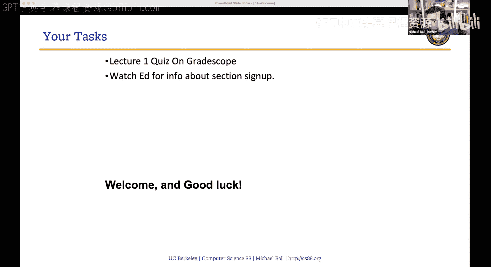
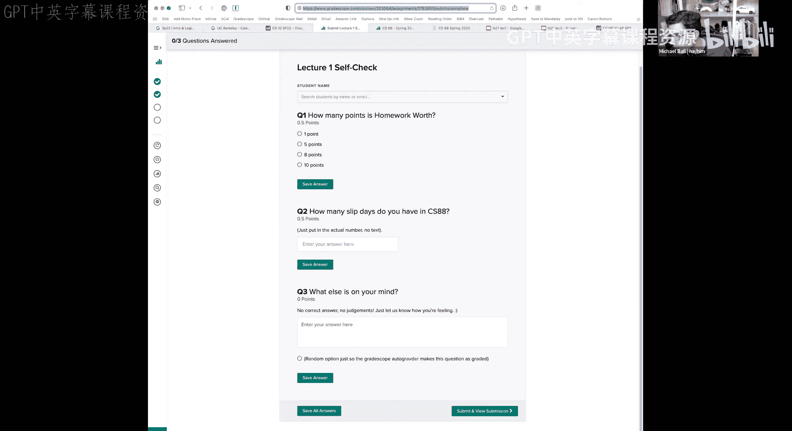
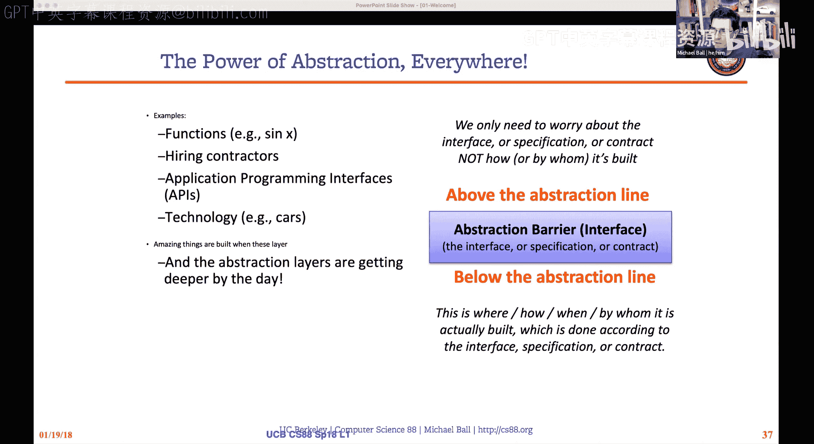
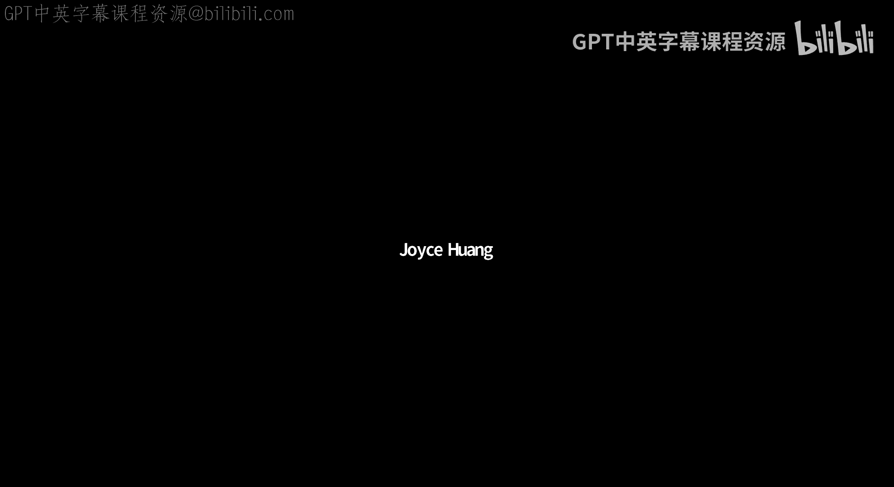

# UCB《数据科学中的计算结构｜CS 88 Computational Structures in Data Science 2022》中英字幕 p01 CS 88 Spring 2022 - Lecture 1 - 1_19_22.zh_en [BV1516iBfEVY_p1]

So。I think。Almost up one or most people found the Zoom link。And a few more people are still joining。

 so that's all good。But yeah， it's Berkeley time so we'll。We'll get started to everyone。

 welcome to CSS 88 today we're going to talk mostly about the course a little bit about one of the big ideas of abstraction。

But before we get into that。Just a general round of introductions for the course staff。嗯。Actually。

 so this spring， Gerald who I normally co teach with。

wa not available so it'll be just me as the instructor。

 but I'm Michael best way to contact me in general is probably using Ed。

 make a private post if it's something just for me or the or the TAs， but my email is there。

I will have my office hours up later this week。For the first couple weeks， of course。

 they will be over Zoom once the schedules are all settled down。

And then after that they'll be in soda， my office is currently 625 soda hall although again a new semester reshuffling so that might change it'll be all on the calendar when when office hours are all scheduled。

opsSo they might they're looking like they might be Wednesday sort of after class might be a good time。

But we'll see sort of exactly what that'll look like。Just if you're curious overall。

 you know my officers would generally be more conceptual than homework and project help。

 I mean I'm happy to answer those questions but sort of priority is big idea computer science。

 things like that aside from just teaching this class。

 I am really involved in helping your group of TAs。

 not just in CSA8 but other classes helping them become better Ts I work on building a lot of educational software so I worked at gradeS for a while。

I work on the software for CS10 which has its own programming language called snapap and some tools for web accessibility so if you like or beyond just sort of computer science if you're interested in stuff about the web the internet how that works feel free to ask ask me questions about that kind of stuff too as well during office hours so。

Beyond me， CS88 would not be possible at all without a really important and amazing group of teaching assistants and tutors。

I know not everyone is available during lecture time， but I know Matt is here， so Matt。

 you want to introduce yourself。Yeah sure hi， I'm Matt。

 I'm a third year computer science major and this is my third time teaching CSA8 I look forward to meeting all of you。

CoolAnd I don't think Srera is around， but she is our other head TA。

And she has also taught the class three or four times now and Matt and Sreya will be。

You know aside from teaching sections are also sort of the folks helping most with logistics。

 but everyone of course helps out yeah lecture slides are linked on the website they'll usually be up a little bit before lecture sometimes they'll be up right after lecture depending on how things go we have another really awesome group of teaching assistants Anli Che Lucas Jessica Minnie and Tommy of course over that are any of you。

😊，See。😔，Don't think I looking through the participants list， all right， cool。Oh。

 lecture slides posted are blank， I'll fix that after lecture。

PowerPoint did crash on me about four times in the past hour。We'll figure out what's going on there。

嗯。And then we have also。A great group of tutors I know Kevin。

 I say you're on if you want to introduce yourself。Hi everyone。

 I'm Kevin and my intro is there so I won't repeat any of it。

 but yeah I look forward to seeing all of you in office hours and possibly either loss sections or exam prep。

Awesome links and we have a couple tutors as well， Amit and hell and I believe for both of them it's their first time officially being on course staff so if you see them around in sections or office hours。

 make sure to welcome them as well。But everyone Encore staff is here to help you answer your questions about CS88 about computer science。

And of course， what either studying computer science or data science is like。

 or just Berkeley in general， especially if you are new to Berkeley。

 we're happy to provide whatever advice。Is there。Moving right along， we often start lectures。

 not always， but with computing in the news and these are topics that are。I think interesting。

 sometimes really relevant to computing or data science in particular。

Sometimes they're just something that we think you should know about。But they are oh， Aman。

 I didn't see you on video for a second， you want to introduce yourself before I continue。yeah。

 what's up my intro is there， I'm really excited to work with you all and hopefully I'll see you it in office hours or tutorning session soon。

Awesome， thanks。Yeah and we'll have tutors will be available throughout the semester。

 so they'll run exam prep sessions dedicated specifically exam practice problems loss sections which are sort of review catch up practice sessions so we'll have those up on the calendar as everything gets scheduled again first couple of weeks are going to be a little bit weird there'll be stuff remote and then as we sort of transition back in person we'll have some remote opportunities and some in- person opportunities and we'll try and figure out how rooms。

Rooms get scheduled since that's always a little bit of a challenge。And then one second we train。哎。

Yeah， and then。We'll have announcements or we'll have announcements for joining CSM and other sessions in a couple weeks once it's also shee。

 do you want to introduce yourself to？OkayYes for sure hi I'm she this is my second time Ting。😊。

It's going to be a really good semester， hopefully I will see you all in person and in lab as well。

Awesome， thanks。Cool， so。Yeah。You know hopefully in the next couple weeks we can be back in person stuff will still be available online and we'll have opportunities to participate。

 but you know as much as possible we would love to see everyone in person as well we do not have an official discord for a class。

But there may be some unofficial ones。But yeah。Moving right along the technology and the news story。

 this one was in popular science today or a couple days ago。

But you know has sort of been going around you may have seen it the Reichs museum in Amsterdam took rembrandt the night watch and they took over eightels and photos and created a。

A massive， massive image。 that is a。5 and a half terabytes in size。

 so that's 5000 gigabytes of data one of sort of the most detailed essentially scans of a painting and they're using it to you essentially better study you know sort of how how the painting was made and I think this is just one of those cool stories because it involves artificial intelligence which is heavily influenced by data science it's said a lot of programming it's a lot of additional technology of just figuring out how to set up control automate cameras programming that goes on there and of course art and art history so just one of those things where there are lots of examples of tying everything together。

And yeah， that is one of the goals of CS88 is we sort of want to introduce you to the idea of you know what we can do with computer science specifically we're going to tie that to data science in certain place in the course。

 but we're really going to focus largely on the piece of computer science and today we're going to talk a little bit about one of the first big ideas of abstraction。

嗯。😊，Yeah， and for those with。If you're worried about your background。

This course is absolutely doable without。嗯。😊，Without a programming background。

What I would say is you CS61A assumes you have some programming background。

 CS88 tries to slow things down especially at the beginning and reorder some of the topics to make sure that it's approachable but lots of students in CS88 come in with no programming experience。

So yeah when we talk about computer science what we're talking a lot about is you know what problems can we solve using computers how should we solve them and you know what techniques are the best way to solve them so a lot of CS88 you'll be doing a lot of programming but it is a lot about problem solving and techniques for problem solving so when we talk about something in lecture you'll be doing similar style questions in lab and homework and exams and。

You'll be using Python， but what we really want you to focus on are the techniques and patterns。And。

Kinds of tools that we give you rather than just the specific examples。

621A generally does expect some kind of programming background。

You can definitely do 61A without programming experience。

 but it's quite a bit more work and those who have programming experience tend to do better in NCA61A。

U。If you really like you know this idea of programming computer science。

 there are a ton of different areas and ways you could take it programming systems so how we build computers and our operating systems。

 the theory of computing artificial intelligence of course。

 security networking after you take CS88 there are tons of ways that you could take and sort of。

Fit in your your interests there are a lot of different ways that we could view and imagine what computer science and data science are。

 but one of the things that's fun about data science as a discipline is that it bridges a lot of what computer science has with statistics and math and with a lot of domain specific。

You know understanding of history of ethics of economics of whatever you happen to be studying and so for CC city8 you know we're going to stick mostly to the computer science side of things。

 but we'll definitely you know as the course goes along talk about。诶。Yeah。

 other aspects of data science， so why。Why take CS88 so in data8 or data C8 depending on how it gets classified every semester the system lists things slightly differently but in data8 you have hands on experience with statistics through Jupyter notebook you create and you explore statistics using programming in python and what you're doing often is。

You know， filling in content in a notebook。In CS 88。

 one of the things that we want to do is to sort of。

Step outside of a Jupyter notebook use a text editor Python files the command line and run and write programs on our own and we'll work on some larger projects so later in the semester we'll think about how could we build that table module that you might use in data8 how can we understand sort of what's going on a little bit under under the hood。

In particular， we're going to focus on some of the computer science concepts， things like recursion。

 object ored programming， higher functions， you may have heard some of these terms you may not have some of them are super mind debetting ideas that you're going to stare up for a while and feel a little bit confused by at first and that is totally okay。

 but what we are giving you then are techniques to solve solve more difficult problems to manage。

Complex programs with with some of these programming techniques and so throughout the semester we will explore explore some those and of course。

Our goal is to hopefully create some。Some fun projects， we do a project called Mas。

 which uses some clustering algorithms based on data gathered from Yelp about plotting restaurants。

 well build a project called ants versus some bees。

 which is a variation on plants versus zombies where as the project goes along you actually get to build an interactive game。

And so you'll have plenty of opportunities to write a fair bit of code。

 to play with the code that you write and so on。嗯。What what is CS88 like as a course ultimately we want you to learn and we also hopefully along the way want to collaborate with each other so many of our assignments our homework and labs are turned in individually but there are opportunities for you to work with others sew in lab it's totally collaborative you should be talking with your peers with your Ts with academic interns。

And discussing what's going on lab。For projects you'll be able to work on them in pairs。

 so we want we want to give you a chance to work with others homework assignments are completed individually。

 but you know there's plenty of opportunities on  Ed and an office hours and to get to get help and talk with others of course what that means is respecting others and having a supportive environment so。

诶。Inside CS88 you know that that's attending sections that's being polite on Ed when someone asks a question。

 of course you can always ask anonymously and you can reply anonymously but。

E is a really awesome space and we'll talk about that in a second and outside of CS88 we'll have CS mentors set up with tutoring sessions in a few weeks we'll have our own CS88 hosted tutoring sessions H can is the Es on our society and they will host some review sessions and have drop in office hours as well so there are dozens of hours throughout the week to get help and practice if if you would like。

诶。诶。Um。Yeah and sign up information is on Ed and also linked or should be on the first page of the website so i'm going to ask about 61 B we'll talk about that in a moment and then also kind of come back to it throughout the semester yeah so naturally with covid a lot of things are are continually up in the air so we're definitely going to be remote for the first two weeks we'll see what happens。

With announcements from Berkeley and whatnot。The goal right now is to have lectures in 245 Lee Kaing after that if you haven't had a lecture there it's a pretty nice lecture hall they will always be recorded and if I can support doing hybrid zoom lectures I would like to do that but i'm not sure。

😊，What what the room will provide or how well it will work I will say last semester hybrid lectures were a bit challenging to have them be interactive for everyone。

 but we'll keep playing with a format， but bottom line is you'll be able to participate in lots of ways。

嗯。So。Yeah， in general， just going over course things we want you to collaborate。

 you should definitely you know。When we tell you to work with partners。

 we expect you to sort of share in that work right， you're working together。

 both partners should contribute equally。But when it's an individual assignment。

 please don't look at someone else's code if sTA has has told you it's okay that's fine or if you have already turned in your homework assignment。

 you can help others by pointing out how they might debug something。

But not necessarily to give them the solution obviously。There are cases where you might not be sure。

 but you're encouraged to ask in。We have a set of skills for detecting too much collaboration in this course。

And。Um。So you know if we see something， we'll have a conversation， but for the most part。

 we really don't run into any problems with that， so you know I encourage you to find partners to work together when it's allowed and to help each other out。

So the way CSA8 works， two lectures and one lab per week。

 labs are a little bit of overview at the beginning and then the main focus of lab is concrete hands on practice with Python。

Labbs are not worth a ton of points， but you absolutely cannot pass CS88 if you don't spend the time doing lab work because that is while you will learned to program。

 that is where the labs will guide you through practicing concepts so just because they're not worth you know an overwhelming amount of points does not mean they're not important homework is an extension of the lab both sort of in terms of concepts and difficulty it takes what you've learned and applies that in a similar style of questions。

will'll have two projects that maps project and the ants versus on bees project both of those are really fun in particular there are projects where as you work through them you can keep building upon your understanding。

And the textbook， which will be linked， is called Composing programs。

It is the same set of text that 6 toA uses， we don't go through all of it。

 we go through it in a little bit different order， but each week on the website those readings will be linked。

嗯。😊，So。Yeah， labs or lectures Mondays and Wednesdays。

 some lectures will have pre recorded versions up ahead of time， so last fall and spring。

I'll have those lectures up we'll do pretty much the same stuff but you know basically I will always be here we'll do lots of demos andq& a time during lecture so for the first couple they'll be a little bit different but。

We'll try and spend a lot of time working through Python。

Labbs are going to be towards the end of the week of the semester that the time shifted around us not on Friday。

 thankfully， but there is a post linked on Ed and the website to pick a time。Yeah。

 I think we've got most of the questions answered in the chat。For waitlist students if you're。

I would I would wait to sign up for a lab time， but you can absolutely find。

 especially for the first couple weeks a Zoom link and join， we don't strictly。

 we don't require attendance for anything， but we do sort of track as a method of participation and understanding who's going to what lab。

But。A。You you know we sort of like to know who who we can expect to see if you don't watch any of the prerecorded lectures but you watch only the live ones that'll be basically the same if there's a chance or if for some reason there's no like live lecture that we can they just be a pre recordedcorded video we'll share that so。

The the way that lecture quizzes work and the way that assignments work is lecture quizzes are one point per lecture up to a max of 20 points。

 you can submit them for up to one week after the lecturers up for full credit after that you can get partial credit through the end of the semester but basically I think last fall there were 27 lecture quizzes and the 20 points counted so as long as you answered most of them pretty much everyone earns their full 20 points there I will say there are pretty easy 20 points to earn and the people who don't earn them usually are missing points elsewhere in class so。

You know lecture the lecture self checks are just there to keep sort of keep you on task make sure you didn't miss anything each lab is four points there'll be 12 of them and you get to drop a lab and homework is worth eight points same deal 12 of them and will drop one homework assignment。

For lab and homework assignments， you will have some slip days that you could use along with projects。

 but for the most part。You might use slip days on on projects。

 so we'll have two projects those total a quarter of your grade the way that CSA8 set up you have nine slip days throughout the course。

Any assignment can be turned in except for lecture self checks。

 which are open until the end of the semester。You can turn them up to three days late with no penalty and you just use your slip days throughout the semester。

 so you get essentially nine days of turning things in late however you want to use them。

If you go over。Your slip days will take off 25% for each day late。

 but what this means is that if you turn an assignment up to three days late。

 you will always get some credit for it and。For the most part。You know。

 if you're within that three day window， you don't really need to worry about any deductions。

But yeah， slip days are there for if you're just feeling sick。

 if you are just tired and want to go to bed， whatever that reason is， you can use slip days exams。

Were going to be primarily in person， but we will have remote options as well。

 we'll have one final one midterm。Our midterm will be two hours in mid March。

 I believe that's already on the calendar in the evening willll have。诶um。

The info about that when it gets closer， exams will be during a campuses time slot。嗯。

If you're taking the exam remotely， we will use zoom proctoring。

 essentially it's just open the exam online and turn on screen recording。

And we'll have info about that sort of closer to each exam。

 but for the most part it's not something that is too heavy handed。

 it's just a double check and for exams right now you have unlimited handwritten sheet sheets so if you want to write notes if you write them on an iPad and sort of print know sort of print them out that way that counts as well but they should be handwritten notes and we'll also provide a reference sheet for each exam。

All of the assignments we'll talk about in lab this week will lecture quizzes will be on grade scope and I'll show that towards the end of lecture but。

Labs and homework assignments and projects will happen through a tool called OK P that is very interactive that CS us。

But CS courses that Berkeley use， so that'll be where you get your scores。

So for those of you who are thinking about。You know， sort of where where you fit in with。Courses and。

You know what the best path is。Cs62A is sort of the main course it has this unit on interpretation and other programming languages。

 so essentially。How do you write a program that executes other programs？

That is the bit of CS62A that we skip in CS88 and so essentially by skipping that last quarter of CS62A we can stretch out the class content a little bit and apply it towards things that are hopefully a little more relevant to data science。

Cs61A no longer teaches SQL。Teaching SQL， which is a language for working with databases and querying and using data。

 that's sort of our last bit of the class， which is really relevant to other future tools and techniques of data science。

If you have taken data eight data8 does a little bit of introduction to programming using Jupyter notebooks。

 but you're not writing a ton of code on your own so in CS88 what you'll be doing for the bulk of the semester is is writing a fair bit of code on。

On your own and that's one of the different goals。 So if you like computer science and we hope you do you can。

Aside from the data science major and minor， you can also apply CS88 towards either the CS minor or the CS major。

The CS minor requires you to take CS61 B CS6 twin B should actually show up on this bottom part two。

 but if you want to do the CS major what you need to do is take this course CS47A。

 which is that fourth unit of CS6A so CS88 plus CS47A is the same。As a。

As a CS62 an a so if you're thinking about taking CSAA and decide that you want to later switch to computer science。

 that's a totally legit and awesome path and plenty of students do it。

 you can take CS47A to complete that work。We got a question about CS61b earlier and I think for a lot of students the second half of the course。

When we talk about data structures， object pointeded programming。

 we'll talk about these things called trees and linked lists。

 those topics are there to help you prep for CS6 B in a lot of ways。

 there' are some of the more advanced parts of computer science。

That are useful to understand and that CS61B really builds on so in the second half of the semester lost sections labs。

 the textbook just really diving into that is the best prep for a CS61B。U。And beyond CSai of course。

 there is the data science major， which is you know constantly growing still， but has。You know。

 a wide breadth of math， computer science， ethics， a domain emphasis which is sort of up to you and is a great way to sort of combine computer science with a personal hobby。

That's CS 88 we won't talk about data8 too much throughout the course。

 but we'll make references to it so if you haven't taken data8 that's okay。

 if you have taken data8 then there are parts that will feel a little more natural so what I wanted to do is。

To。Oh come on Zoom， oh you're going to make me do this in the website on。啊。嗯。Okay， one second， why。

 why did this not save？😔，唉。Okay。Oh。嗯。Alright， here we go。Okay， Zoom is not coop。All right。Okay。

 so Zooms。colaopborating and the choices are all wrong。

But A is labeled correctly B c d and E correspond to two three， four and five so yeah。

 how's everyone。Doing with data8。And again， you can respond， however you'd like， awesome。Cool。

 and yeah， a couple。Questions yeah， lectures will be recorded when we're back in person as well。

 so there'll always be a recorded option。Lots of good responses， awesome。

Most people have taken it in the fall it looks like or before， but if you're。

If you're not taking get8 and you haven't taken it， no。No worries about that。And now。Yes， okay。

 so one more question just because it's nice to sort of see is where are you sort of right now have you made it to Berkeley you somewhere else in California or the US。

系。啊。20。Cool， most people back in Berkeley。I see a few people are making it all the way to outer space。

嗯啊。Yeah， there's a poll if you want to just answer in chat。That's that's all cool， awesome。

 thanks everyone。Yeah， so hopefully we can be in person a few weeks。

When we're in class Ed discussion will be be a thing if we do lectures in person we'll usually have an Ed thread going for a discussion during lecture so if're in the if we're all on zoom zoom chat works but when we're in the room because it's hard to just have sort of a zoom call open at your phone we'll have Ed open Ed is really cool we'll have it set up such that you can embed Python in there you can link to。

Whatever you need， we can even embed videos and stuff like that。And when you click on a post。

 can even you can run Python codes。Anything else for a CS88 main thing you'll need， by the way。

 is just your laptop the CS88。org website。If you've taken data8， then you're used to using datahub。

berkeley is a site that hosts Jupyter notebooks， some of our lecture examples will be in Jupyter notebooks just because it's a nice way to provide Python code and example documentation of how that works。

And of course， Ed again， for discussion。嗯。😊，The slide should have been earlier。

One thing that I'll call out as we sort of wrap up talking about other class。

 we do have what we call EPA points， effort participation altruism。

These are essentially just a small amount of bonus points that we don't necessarily reveal。

 but throughout the semester for participating answering on Ed helping students out just putting an effort coming to office hours you know this is one of the reasons why we sort of informally take attendance but you can get bonus points there really。

Helpful， I suppose if you're sort of at the edge of a grading boundary at the end of the semester。

 there's something that can sort of nudge you over a boundary。So。

That is the gist of the class question about lecture slides， they will be linked on CS88。org。嗯。😊。

What I will do right now before we talk for it。About 10 minutes about。The topic of abstraction I see。

A number of people have found the lecture self check already， which is awesome。I am going to。

Let's see。Let me grab。😔，啊对啊。The link for that。So。And。嗯。If。诶。Well I will paste this in。

Chat right now and then I will change。I screen share really quick。

To be grade scope before jump back to PowerPoint so each lecture will have these self check questions。

There'sYou can do this now while I'm talking， but you can also fill it out later。

You know just very simple things， some of them will be about Python。

 some of them will be about a concept to just sort of see did you get what the point of lecture was my interface looks slightly different because I have all the instructor controls。

But。These are unlimited attempts we will after lecture I will publish the answers。

s that you can see if you got a question right or wrong and if you get a question wrong you can just try again as many times as you want if it says you're not authorized you might need to go to gradecope。

 co and log you in， but I thought it should ask or if you just recently joined the roster might take。

A second to show up I just tried syncing from B courses so if it doesn't work in the next 10 minutes post oned and we will add you with your like student and email address to gradecope hopefully everything gets resolved。

Ha。Yeah， if you could post a private note on Ed and we can check what's going on。

If you can't access great scope。But yeah， those are lecture self checks they're again meant to take only a few minutes for each lecture。

 but hopefully to review some concepts。With that。

。You know， that is welcome to CS88， good luck on everything。

And we'll take the last few minutes and talk about this idea that we'll come back to throughout the semester。

 which is abstraction and abstraction is one of those fundamental ideas in computer science that you'll hear all the time and what the heCC PowerPoint is up with you today。

U。I don't know why it's going to struggle with PowerPoint so abstraction is two things beyond just you know a style of art abstraction largely is this idea of detail removal。

And of generalization。And when we talk about abstraction。

 what we're trying to do is hide details that are potentially unnecessary or confusing that。

Make a problem easier to understand or something easier to solve if we think about a car a car generally has two pedals right there's an accelerator pedal and a brake pedal。

And so far， this interface has been pretty consistent for hundreds of years。Or 100 in some years。

 I guess not hundreds。😊，And you know， maybe maybe Elon Musk if he gets his way， we'll change that。

 but no matter how the car works or is built， you have two pedals。And for the most part。

 one makes the cargo faster， one makes the cargo slower。

 and you don't really need to know how the car is built to make that work and that's an example of sort of removing the details because as our car technology changes。

 the interface is still the same。Generalization is taking a problem and making it apply in。

In lots of different places， so you can think about something like those extendable shower rods that work for you know large showers and small showers。

You don't， you only have to buy one and you just， you know。

 get it lengthen it to the size that fits in your apartment。You're good to go。

 you can think about you a screwdriver that has one handle but removable bits that is you one tool that does sort of many different kinds of tasks in the real world there are lots of different types of abstraction。

 some map more cleanly than others to computer science。

 but what we're going to going to be doing is writing computer programs that sort of embody some of these ideas we're going to write functions that initially work you know on one kind of example and then we're going to extend them to handle multiple kinds of data。

So you already answered this in a couple different ways or said where you are today， in the chat。

 take like five seconds and say， where are you from， what's your hometown， you know。

 where do you identify？Awesome。This is always a fun experiment and this is one of those experiments that is way more fun in Zoom than in a classroom because I love seeing everyone。

Right， right their answers。嗯。Okay。Yeah。Awesome。Berkeley and Ohio， Arizona， youino， Bangalore。

 San Jose， Central Valley， China， Nepal， Hong Kong， San Francisco， Fremont， Pakistan， Azerbaijan。

 Egypt， Columbus， Mexico and LA， Pennsylvania， Philippines， I mean Long Beach， Spain。

 New York and the Bay Area， see this is fun， it also just makes me totally want to visit all of these amazing places。

 New Zealand， awesome awesome place，Yeah， and so this is a fun question because all of these are。诶。

Are totally valid answers to where you from they are also。

Come on Power point entirely different levels of abstraction some of you just answered China which。

Of course， is not just a country， but a particularly large geographic area。

Some people said San Francisco， which if you're following city boundaries is a pretty narrow seven by seven square mile range。

 nobody answered the GPS coordinates of their house。

 probably a good thing because we don't need to know that。But you know， all of these， you know。

 someone's in the Bay Area， all of these are perfectly correct answers。

But they have different levels of detail and in this case there's no you know exact right or wrong answer right however you want to identify with where you're from is totally up to you and sort of depends on the context。

 but when we're programming。One of our tasks will be to figure out what is the right level of detail for a question that we're answering when we start writing code that interfaces with other pieces of code。

 do we have a function that works on just one particular piece of information does it have to work on all kinds of information of I ask you where you're from。

And I'm trying to process this data to understand perhaps to build a map and put you know little markers on a map of the world or something like that。

 how do I go from this wide range of responses to understanding something in a programmatic way and understanding how to manage and use abstraction will be one of those things that that we learn over time of course。

When we take data science and programming and。The power of computation， we can。

Start to do things that are perhaps less helpful， so this is a site which is thankfully no longer online。

 although these same problems still exist there used to be a site back in the early days of Twitter called I canstock you。

Which searched for。Tweets where people tagged their current location and use the word currently。

 or I am at somewhere right now。And they essentially tried to show people that were not at home such that you could go find them places and just aggregate that information this is a pretty creepy use of taking you know information and tweet and aggregating in a weird way。

 but I think shows the point of when we talk about data and how we use it in general their ideas that sort of。

one has to be careful of。InIn data science in another domain， and this is a pretty common example。

 something like mapping where we're trying to present information is a really important place where we use abstraction to communicate ideas。

These are two maps。Of the London Under， one from 1928 and one from 1933。

And one of the cool things is the 1933 map。Is one of the first examples of what sort of modern transit maps start to look like。

It's very clearly sort of less geographically accurate， right？Every road。And system in London is。

 if you' ever been to London， I suppose， maybe perhaps in particular。

 London versus some more modern cities， but the roads are all not as straight as they would appear on this map。

嗯。But by drawing a map which has some most details removed it can be much easier to read and when we apply computation to it now maps like this or charts that present an overview of how we interpret and read data are often programmatically generated and so that's one example of talking about detail and will slides will be on CS88。

org but they are not yet there， or the file that's there is a corrupt file because I was struggling with PowerPoint this morning。

In in computer science， we'll finish with this idea that we'll revisit on Monday is this idea of abstraction being everywhere and so when we're building programs when we're interacting with the world we have to think about the interface between what should be presented to the user a programmer use as the inputs and arguments to their function。

And what should that barrier look like so we'll pick up with that on Monday labs will start tomorrow there are links oned to attend a lab this week you know attend。

You of attend a lab time that can work for you。That。嗯。

You know that that sort of just fits with their schedule。

 but there are sign up forms posted watch out for the homepage of CS88。

org because we'll be adding links there and there should be a lab on Friday as well the oh yeah there are lab start tomorrow and there are a few on Friday yes。

The page， let me pull it up。嗯。On。On tsad。org， there is a page called。Actually， do we not have？

Thursday lab times yet Okay this week sorry this week we only have Friday lab times。

 I believe someone can。Correct me。诶。If I'm wrong。So yeah。

 but the lab the lab assignment is usually out the day before。

there but the CS88 website has a Google calendar link which will be updated as we schedule officers and review sessions they'll show up there yeah sorry about that it's。

呃。Between three courses， all three of them right now have had class meetings rescheduled and moved around because everything has been changed around in the past few weeks。

So keeping things straight。But we'll probably have an additional lab timer two as well。

 so just watch out for any info on that。LB zero will be submitted so all labs will be submitted through OK P。

So therell be instructions in the first lab that help you get set up with Python and try things out。

嗯。The lecture quizzes are what will be submitted through Gradescope。And yeah。

 that's really all I have or that's where we'll leave it for today。

 and I can hang around for a couple minutes with questions。

Oh yeah， so labs。嗯。Basically。In terms of the correctness policy is。嗯。Yeah。

 there's usually four or five questions and we grade a subset of those questions。

And so if you don't finish the entire lab you can still get full full credit lecture self check quizzes are due one week after lectures assigned for full credit so on gradecope this one will say next Wednesday at midnight。

 but if you're like a little bit after that we're pretty lenient on the partial credit for self checks。

What is my favorite Taylor Swifiss song？嗯。That's actually a very tough question。嗯。嗯。

It also really depends on how I'm feeling。嗯。I mean so。2。I mean。

 fearless came out when I was in high school， so I've probably listened to that album almost as much as anything else and。

I kind of hate saying it， but the original recordings are better than the re recordings。

So there's a hot take to。To end lecture。If anyone。Yeah。But yeah， I don't know， it's a good question。

Awesome， thank you everyone and we'll see you。Sorry online next Monday oh yeah go ahead I have a four hour class on Friday so I can't make any of the labs Okay。

um our hope right now is that we will have a lab time available on Thursdays。

We've been trying to move get well。Yeah we're going to add one more additional lab section。

 I believe we just got approval to expand the course and I'll have to check with the Ts but。嗯。

I believe we are going to have labs that happen as well on。

On Thursdays now yeah so for this week is it okay if I don't attend yeah yeah attendance is always is going to always be a optional in terms of like。

Points or anything we like you to attend just because it's a chance to meet people but you can submit everything remotely for CSC8 and and throughout the semester we'll still have like remote participation opportunities for either some labs and office hours and stuff like that Okay thank you yeah hi professor I'm currently in the way this number five so I heard you that you got the approval for expanding the class so am I is there any chance that I get into this class。

If you're within the first 20 there's a there's a very good like you should be able to get into the class it might take a week but。

You will。You'll be able to get in。Oh， okay， okay， thank you。Yeah， the question in the chat。

 12 homework assignments and 12 labs and one is one is dropped， each homework is worth eight points。

The previous recorded lectures are。嗯。We'll add links on the website as we have them there's not really one for the first lecture that's that's that useful just because it's mostly logistics。

Yeah， and there will be all the lectures will be live with maybe a couple exceptions。嗯。But yeah。

 we have lots of lecture content。So for the labs if we come to the section where we actually do will we be going over the lab worksheet that we're supposed to turn in for the points or will we be doing something different and we're expected to do the actual worksheet on our own yeah so it'll be oh there's two things labs will be normally it's a it's a Python file that you turn in what most labs will be two hours where the first。

20 to 30 minutes will be。Review discussion overview and then the next hour and a half of lab will be work that you will turn in some labs will be able to finish them right during the lab some will take a little bit longer just depending on you know sort of either how you're feeling about that content or just you know what if it's new or something like that but yeah you'll have a lot of opportunity during that time to to work on the on the the homework that's actually do。

And then you said only a subset of those questions will be the ones that are actually graded will we know which of those no be no and so you just do the whole thing and then some of them that's always okay。

 thank you， yep， thanks。Also， someone asked about Taylor's version， but they drop now。

 red re recording is better。呃。I had one more question。呃。Yeah。

Question about not having a programming background。I think the first few weeks。

 there are quite a bit going on， but for the most part。

Students who don't have a programming background do just fine in this class I didn't have a survey question on that today。

 but。You know， the overwhelming majority。Of of the course well a almost everyone in the course is not planning to be a CS major you know a。

Minority do these like a significant minority do the gas minor。Um。

 but somewhere between half and two third of the class。

 I think usually haven't programmed at all before， maybe even higher than that depending in the semester。

So I think you'll find that you are in good company。

Or I should say haven't programmed before or only have data eight as the program experience。That's。嗯。

And if you're not taking data8， then there's a little bit more Python at the beginning。

 some stuff that you haven't seen， but for the most part。

 I think that people who are new do just fine。Okay。And if you have questions。

 by all means post them on a， come to office hours。

But I can assure you that you're not alone on that front。嗯。Awesome well thanks everyone。

 I will go figure out why PowerPoint can't properly save a PDF and upload the slides and we will see you all next week。

