# UCB《数据科学中的计算结构｜CS 88 Computational Structures in Data Science 2022》中英字幕 p02 CS 88 Spring 2022 - Lecture 2 - 1_24_2022.zh_en [BV1516iBfEVY_p2]

All right， there we go。Sllightdes are there。Or we'll be there in a second。苦ol。😔，嗯。Yeah， so。

We'll get started today continuing on with the last few bits talk about abstraction that we did on。

 thank you。诶。That we did on Wednesday。And then we'll jump right into Python and do some demoing in the interpreter。

I was going to say right now planning on being in person next week。

 we haven't heard anything otherwise that will change that of course。

 you know don't be surprised if we all get a Cal messages or something at like 1159 on Friday night。

But right now Wednesday will be remote next Monday will be back in person today's lecture again has a。

Well， if that has the answers on it the grade scope self check questions for。For today。嗯。

This was actually last falls competing in the news， but I didn't find anything necessarily cooler。

 soll leave I'll sometimes leave last semesters in if I like the story better than what I saw。

Just a really quick note。Microsoft has been working for some time on various forms of what they call the Microsoft adaptive controller。

 which is an Xbox controller designed for users with。

Have various kinds of motor and physical disability so that they can play Xbox games。

 so this one sort of adapts some of the touchpas and joysticks it's compatible with things like mounting on a wheelchair or。

With different inputs for switches that users might use。

 and so I thought this was a pretty cool story， unrelated to the fact that they just spent like $70 billion on Activision。

 but there's always something interesting happening with companies developing products that are hopefully meaningful to users。

With that we're going to talk about abstraction and then we're going to put abstraction to practice by working on primarily today functions creating and using functions。

 but we'll demo some other bits of Python if you've had a chance to do lab last week 50 is technically optional。

But that'll be sort of the best place to get started with messing with writing and using Python。

Sldes are。A little bit easier to read this time， thankfully。

Abstraction is the practice of two things， so detail removal and generalization where。We want to。诶。

Create some interface that hides exactly how it is implemented。And ideally， in some cases。

 we'll create an interface that allows us to solve more than one problem at a time。

Your the lecture self check the scores will be available after lecture， so as long as it'll tell you。

After lecture whether you got each question correct or not。

And thatBut I usually turn on the correct answers。After after the lecture is over。

 except for question two， the open ended questions。

 there's not really a correct answer so you don't need to worry about that one。So。

Again last week on Wednesday we did this where you're doing there's a lot of different valid answers for which。

We could possibly answer this and multiple ones can be valid。

But they're all given at different levels of detail and so when we write our functions。

 the challenge will be what is what is the correct level of detail so in。

In data science and in programming， what our goal will be is to in some senses turn a messy system。

 perhaps like the map on top。Into a more readable and more useful and easier to understand system like the map on the bottom。

And so where we left things。Was this idea of an abstraction interface that above the line we have how a function works。

 so we might say this is the s function， we could write a function that does any number of things。

And below the line we have how that function is implemented。

 so sometimes we could say that if you're hiring a contractor to solve a problem。

You tell them what problem needs to be solved。You know you pay them for the work。

 but how they go about and solve that problem perhaps is you know up to them to decide and you don't need to know the details right if whatever they need to buy whatever order they need to perform their tasks and you don't need to tell them do that you just say solve the job and so when we think about writing functions。

 that's what we will primarily be thinking about。If you've used。

Most websites that you use will use these interfaces called APIs or application programming interfaces and what it means is behind the scenes。

 there is a protocol for how one website talks to another website like when you log in with Google。

And these interfaces allow programmers to exchange information without specifying exactly how it gets exchanged。

Each website can then talk to each other in a way that sort of abstracts away some of those details。

 so there's lots of examples of abstraction in various aspects。

Of computer science and our goal will be。In this case， to write functions。That。

That put those abstractions into practice。Our goal here with talking about abstraction is that。

We can we can make systems that are hopefully easier to understand。

 but the one challenge that we'll have is。With too much abstraction， for example。

 we might forget how things actually work， so there are numerous examples of artificially intelligent based hiring systems that make decisions based on data that would be discriminatory and so if you don't understand how a system works。

Who could be subject to the bad decisions that a system makes similarly when we write programs。

 we can use a lot of code。That others have built and that is a very useful thing。

But we might find it challenging to then try and understand how to solve a problem when something breaks。

 we typically call those dependencies where if we depend upon someone else's code。

We then have to sort of resolve。Or we may have to resolve an error on our own that is more complex because we didn't build that system。

So that is。A little bit on abstraction。And。What we're also going to be talking about is an algorithm so building a sequence of steps and this is primarily what our programs will be doing is a sequence of steps to solve a problem and so throughout the course we will be building various kinds of algorithms that solve solve a question so。

嗯。😊，I'm going to go through some of this a little bit more quickly。

But what we're thinking about is when we talk about an algorithm as a description。

It's a set of steps that can be expressed。Within a finite amount of space and time。

 so the algorithm itself has to be something clear that we could write down。And。

Even if we need our algorithm could take an infinite amount of time to run。

 but our steps have to be clear， so what we're talking about when it comes to writing code is that when we write a program is you know that program has to be able to be written。

In computer science， our goal will be to write algorithms that are clear。So you may have seen this。诶。

Mathematical expression before six divided by two times the quantity1 plus2。And the question is。

 is the result of this operation one or nine？And one way to answer this question。

It's to pull a calculator。And what the calculator will tell you is the correct answer。Of course。

 it turns out that if you get two different calculators， you might get too different。

Two different answers。And what's going on here is that this set of steps。

 the algorithm PEmDAS that you might remember from elementary school， parentheses， exponents。

 multiplication division addition and its attractiontract as the order of operations。

Is actually ambiguous in a couple steps that is。Do you divide the quantity 6 by 2 first。

 are there implicit parentheses over there？Such that it is。3 times the quantity of three or is it。

Six divided by with implicit parentheses on the right hand side， two times three。Six divided by six。

And one reason， aside from pointing out that sometimes you have to be careful with even devices like calculators is that。

In computer science， when we talk about algorithms and one of the reasons that it's worth bringing up this example。

Is that。You， computers are very precise。Instruments in the sense that they will always do what you tell them to do not necessarily what you intend to tell them to do so as we're writing programs one of the things that we'll be watching out for is sort of are we。

Are we clear and precise in the programs that we write in the methods and tools that we use such that we get the result that we expect and so this is a little bit of a warning that。

Things can go wrong in unexpected ways。If if we're not too careful so you've seen lots of algorithms before I don't know why the box other the boxes are so if we want to add two numbers right we know how to take seven and8 that's five and we have leftover one we carry over the digit and we could keep adding larger and larger numbers if we have them。

This is a simple algorithm fat。Repeat until we have no more digits to carry on the left hand side that works for numbers large and small and so。

This is。One one way of thinking about what an algorithm might be it set set of steps。

 no matter what the numbers are， whether it's 7 and eight or 5000 and 3000。

Or whatever those numbers might be， we can apply the same set of steps。

We keep adding numbers one or one pair of digits at a time until we get all the way to the end。

That's one kind of algorithm it turns out， of course that computers they have a much faster and you know a more technical way of adding numbers internally。

 but the point being that we can write and encode algorithms on our own so if we were to use binary。

We could represent。The same kind of algorithm in a different way。

 but we' are not actually going to talk about。How this works today。One thing that is。啊。

Just worth discussing a little bit that will。Bate using throughout the course is。

When we talk about code， we're we are talking about the computer programming code that we write。

 but it's it's worth thinking about this as。A set of instructions that we're giving the computer to execute。

系い。When。If you did La zero， when you typed return， it should have been the first example should have been return 2022 for the current year。

That is a bit of code， it's two pieces that are instructions that tell the computer， hey Python。

 you now have a result， return this result back to， well， in this case。

 whatever the function was or in a set of like lab or homework that means return the result to OK Pi。

 which is the thing that's grading your homework。We'll often talk about data。And when you say data。

 these could just be observations， so 2022 could be a piece of data， your name。Whatever。诶。You。

 whatever it might be。That。That you have。And one of the things is this is the sort of theoretical definition of information。

 but information is just。呃。Storing what we know in a computer reducing it to some value that that can be computed upon so calling it uncertainty is。

Some of a misnomer， but it's essentially saying this is a piece of data。

That we have and what's pretty cool that we'll get to see in the next few weeks about computer code is that computer code can both。

B。诶。A set of instructions that tell Python how how they should execute your program and it can also be。

Data and information itself that describes the program so this example of DNA。

DNA is a makeup of who you are， but DNA's structure also encodes information about how it replicates and changes over time and。

You know how how DNA can sort of mutate so DNA is a pretty interesting example where it is both a of information。

About a particular cell or person， but it is also a series of instructions that describe how something changes over time and one of the really kind of tricky ideas that we'll get into is the fact that when it comes to writing computer code is we will write functions that return and modify and build upon other functions and so。

呃。Is this？Encoding of a Python program， data or code。Well。

 it's impossible to say when you look at it in this form but。😊。

It turns out it could be lots of things。We're not going to talk about how we go from Python strings to binary data。

 but this does highlight that there's a path together and if you think that it's cool。

 you should continue taking CS61B and CS61c。嗯。呃。嗯。😊，And。嗯。That's you know one way of doing it。

 but what happens when Python runs your program is it turns everything into a series of instructions that encode various kinds of data that are in your program and so when。

Let me take a look at the question chat。诶。嗯。おくさい。When we we have something like this。

 we have a bit of code which is both information about the code itself。

 but also a series it is yeah how can we have twos and threes if it's binary it's not compression but essentially。

If if you want to look up the Wikipedia article on how binary works is actually pretty good。But。

The the well depends on the format so if this is a number well that would all be zero but each digit from right to left is a zeros place a two's place a fours place an eighths place and so on and so you add up pairs of powers of two in binary whereas in typical sort of base 10 numbers we add up or zeros place or a one's place I guess we could call it that or1s place or 100s place and so on so there's kind of a mapping of1s places to twos places forest places that is the like 15 second definition of binary for anyone who's curious but we're not actually going to talk about how binary works it is just sort of a useful illustration of。

When we talk about code， what we are doing is taking a set of instructions。

The computer is treating those themselves as as an abstraction and executing them on your computer and later in the semester we're going to write code that modifies other bits of code or code that decides what should be。

What action should be taken？Based on other bits of code so our programs will get fairly complex so in Python we call this process a python interpreter。

Other languages use a slightly different set of steps that you might have heard call a compiler。

But what we'll be doing？I we'll be turning this or your Python interpreter in the background turns the code that you write into a set of instructions。

That get executed on your computer。That binary instruction that we called bytecode， but again。

 don't don't focus on on the terms too much on our computers themselves if you open up lab for example right you might have a folder。

With files in it， this itself is an abstraction of how the computer actually stores files。

 so the computer has many different ways of storing and organizing files。

 they don't exactly look the way that they do when you open up folders within folders but。

That is a useful abstraction because humans tend to understand， of course。

 how we might nest things together。Of course， in 2022。

 there's a good chance that many of us have never used actual Manila paper folders that inspired the folder icon。

But that's a separate discussion there。There's lots of examples of icons that no longer makes sense。

So mostly the big point of abstraction will be。That code itself is an abstraction。

 I think the best way to understand that is to start getting in to Python and we're going to talk about some of the basics of Python fairly quickly today and again you'll hopefully get to practice celebriies in lab and we're going to focus on are some simple statements。

 some variables and some functions。Yes， like what is a floppy disk I wish I had some over here。

 but yes， the the save icon in most programs is still a floppy disk which。

Yeah later if we have random time i'd be curious to know how many people have ever seen or used a floppy disk。

 but our icons are relics of computer I mean you know the the iPhone is still called an iPhone but。

don't call me because no one picks up a phone call on an iPhone anymore。So。Python。

Hopefully the goal of using Python is that。A lot of the text that you see。

Should look fairly intuitive to how it might happen。

If you're reading something in English or if you're trying to compare this to sort of an analogous math expression。

嗯。😊，Some of the things， this will very quickly get a bit complicated。

But one thing to just try and remember is to ask yourself。

What do you think should happen when you see something in Python？

That will be one of the goals so in Python。We will use these terms。

And we're not going to quiz you on them， but they are useful to understand what we mean by them and we'll keep revisiting this slide throughout the next couple weeks。

 so when we talk about an expression，What we're talking about is。

Some operation that results in in a particular value， so in this case， 3。1 times 2。6 one plus2。

Whatever。It could be。Now we're just talking about two values。

 it could even be the string hello plus the string CSd8 and we'll talk about what a string is。

 but a string is essentially just。Text that we treat as text。So in this case。

 the value of this expression is I should have picked easier numbers because I did this every semester。

 but 3。1 times 2。6 is 8。06。So the value of this expression would be the number 8。06。诶。

Slides are slides are not up yet there's a problem updating the website but they will be up later today and if they're in they should also be in chat if you joined late if someone could maybe re uploadload them I think you can re uploadload slides that would be。

太酷。😔，嗯。Yeah， so this first expression evaluates to a value 8。06。

 but whatever is natural that will be the result of the expression。

We have what we explicitly can call a call expression。

And call expressions will notice have this feature of having parentheses in them。

 so max parentheses zero comma X。This means that we are calling a function， in this case。

 the name of the function is max。With the values as arguments， zero and x。

And what will be returned is whatever number is larger， so we'll actually talk about。

How variables and functions work in a moment。Variables are also their own kind of expression。

Where the purpose of a variable expression is to return the result of whatever thing has been stored in my name。

 so if I say my name Python will replace that with the value， the thing that's my name。

And we have assignment state。Assignment statements are the things that make a variable。

 so we'll play with those。And then we'll keep building up the list。

 define statements help us create functions。And control statements are statements that give us a way of deciding what should happen in a program or for how many times。

诶。We will。Do some some computation our brackets。Call expressions。

Square brackets are not color expression， so those are lists and we'll talk about lists in a couple lectures。

嗯。So one thing that I want to just start off with before we jump into creating functions。

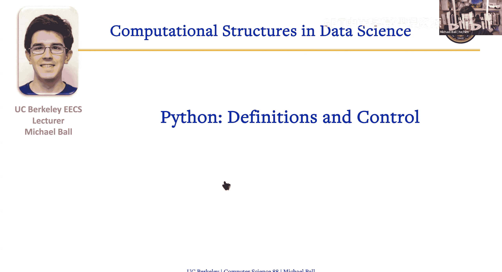

Is to just go into Python and start working with some expression。U。One thing to note。

Python to access a python interpreter， there's a lot of different ways that that you can operate something。

 but in。In the context of a lab assignment， you might often be working on a file。

 one thing that I encourage you all to do is to simply just type Python3 in most cases it could be Python2 or it could be just the word Python depending on how your computer is set up。

 but in Python3。We get a Python interpreter and whatever we write here。

Python will execute as code and return the results。One plus two， a very simple expression。

 takes in some data。Evaluates it and reports the result back， say hello。Plus CS。88。

I get the text hello CS88 back， of course there's probably no need to actually do this。

 but this in quotes is what we call a string。And so one thing that we've now seen is I can happen。

 I happen to be able to just add two strings together。

 Python just squishes them together into a new bit of text。And that's what it returns。

As the result of adding these two things together。啊。Let's see。

 I can make variables so our class name。Is the text CS88 and single verse double quotes。

 don't really matter in Python， I'll kind of use them interchangeably。But in this case， I could say。

So one thing I could do is I can ask for a class name and if you hit tabab in the interpreter。

 it'll try to autocomplete your variable and function names， which can be really helpful。

So if I access this thing called class name， I get its value back。I can then start to say hello。

As a string plus。Class name。And if I wanted to， I can even add an exclamation mark。

And so now I get hello CS88 again the same result as what I had at peer。

 but this time what I have this expression references this variable class name。😊。

And perhaps you can start to see。Where when we write programs。

This can be an interesting thing because。This right here suggests that I might do something where。

Perhaps。I can say hello Matt or Ho Sreya or you know Hello UC Berkeley or something like that instead of just hello CSID8。

And。😊，哎。One of the things that's nice about computers is that we can over time sort of just build the complexity of things。

诶。That are happening。So let's see a couple questions in。嗯。In China， oh， so grade scope。

Oh sorry I think I think it's four or five answered should be should be correct i'll fix the welcome video and right now'm using i'm just using the terminal program on on my Mac so'm not i'm not writing this in a file this is just open a terminal if you've installed Python3 on your Mac。

Just type Python3 and you get a blank。In essence， a blank Python canvas。

So we we had an example on these slides of the function max， so let's say set x to5。

 I'm going to set y is equal to。Oh， let's do three we have。Two variables now x and Y。

These just represent these numbers， and I can say。Max of X and Y。

And the max function that's built into Python does pretty much what we'd expect it returns the largest number of its arguments。

One thing to note for a function， what's going on here。Is when I have a function。It has a name。

We use parentheses。And these arguments are written and separated out by commas。

How did I know that max？Was a function that was in Python。It was on the slide。

 it was right there but。One way that you can figure out if something exists or not while you're in the Python interpreter。

 I will do this。Throughout class a little bit is the Python interpreter has this really cool function called help。

And you could just say help in general， and it will give you an interactive help utility to explore things that are in Python。

But I can also say help。Of Max。And it will tell me in sort of Python speak。

 how I can use the built in function max and what kinds of arguments the function max accepts。

The syntax and style and writing of help messages can be kind of technical。

 so the goal is not necessarily to take a look at this help message and understand all of the words here because there's kind of a lot going on。

But mostly to point out that there's at least a。A a standard way of looking for help in Python beyond just of course。

 Googling for the answer， but you know this tells us the what we want。

Right here it which is with two or more arguments， Max just returns the largest argument。

 so I could say max。If I hit the up arrow， by the way， I can go。

Recall previous things that I type so could say max 101。

 1220 and of course it should report back 20 because it's the largest of all of these。

All of these values。So。呃。This again is a call expression because I'm calling the max function。

 the others help technically a call expression because it is a built in function to Python where we call something。

Actually， one thing that's really cool， we'll talk about this in a little while about how this works。

But。Help of Max this is our first example actually of treating a function max as a piece of data where it is the name of a function that can be passed to another function how and why this works we'll get to in a later lecture well just to point out that Python is pretty cool if you have a name Max of something you can use it in many different places。

😊，嗯。How do you get away from？And without terminating， oh， if you're in。Help if you just hit oh okay。

 yeah， so you can hit Q if you're in the help， the interactive help。

Prom just tap the letter queue and then we'll exit it yeah sorry that's something that that is one of those things that you will kind of do intuitively as you if you start to use to help text。

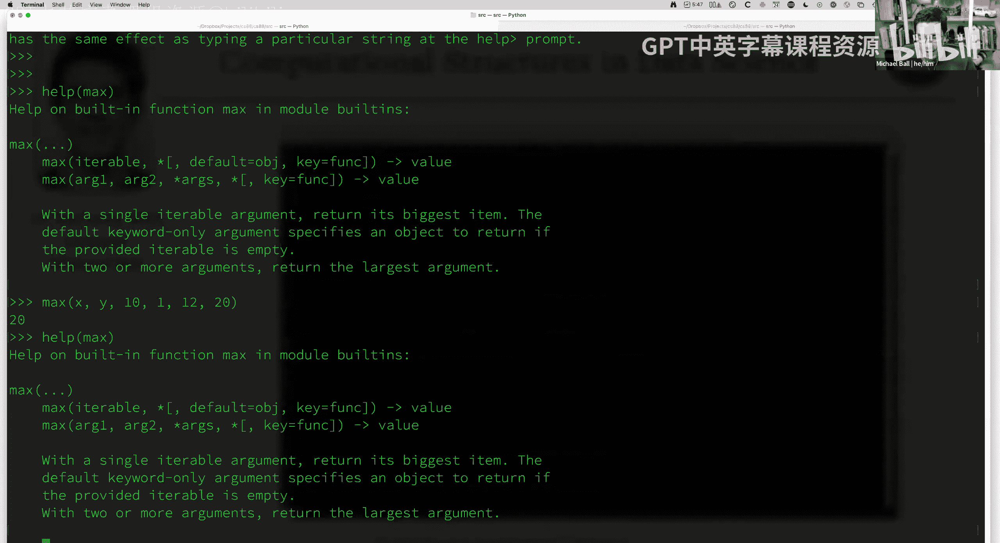

Yeah。😊，Yeah， and by the way， I see that some of you are trying things out as we go along。

 totally encourage you to have Python open and follow along when we get back into a classroom。

 hopefully sooner than later， you're all encouraged to bring laptops and type things out and follow along。

as well。So。We've covered pretty briefly variables， some expressions。

 now what we're going to do is write our own functions。诶。That will let us use， make some decisions。

 take some inputs， do things that are a little bit more custom。呃。The the first thing that。

We want to explore before get functions are what we call conditional statements。

Conditional statements we can think of。Then having the structure。If this is true。

Then I should do this。Otherwise， I should do something else。So if this thing is true。

Then our first statement should happen。Else。I should do some other set of steps。And。

With this one simple construct， we can make programs that accomplish quite a bit in a lot of different ways。

If else may look simple but。We will be using it a lot。Let's see one way that we can。

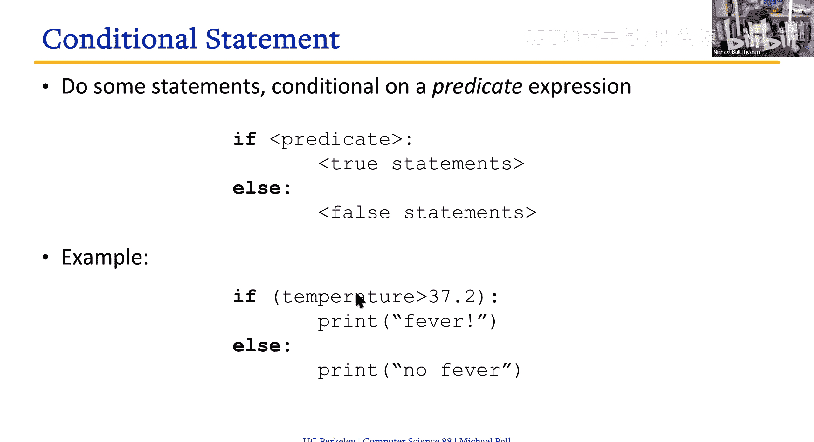

Actually， I don't think。

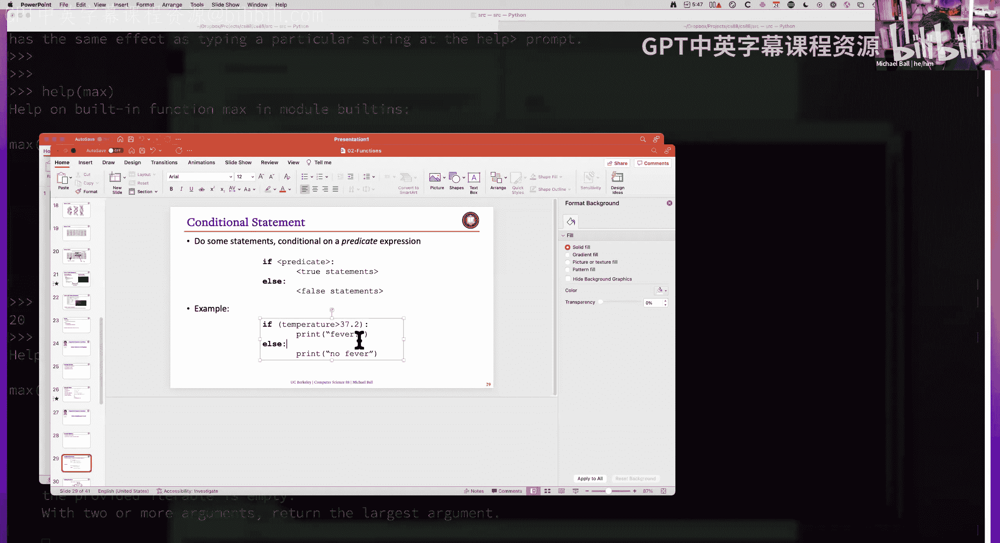

Okay。So。2。嗯。We'll start off with a couple simple expressions。

One thing is I'll just so x are values is5。If x。Is less than 10。

One thing that Python has that is a function is called print。啊。Is。

Print just will let us output some text to our terminal。So I can say if x is less than 10。

 print x is small。House print X is big。So。When we have an expression。In。And a Python。

Or a conditional expression， so when we have if x is less than 10， one thing to note about Python。Is。

The stuff that is inside needs to be indented， usually that's you hit tab。

 which typically would be like entering four spaces， but each。

Each level of indentation in Python will communicate something to us so this says this this line right here should highlight the first one so this line X small only applies when our if statement is true because it is indented in that block of code。

This line right here x is big only happens when the else condition gets executed。

 which if we hit enter one more time， what we see is x is small because we had this expression x is less than 10 what's pretty cool about Python and all programming languages is that these expressions are composable so。

If x is less than 10 is this construct， if with any kind of expression that evaluates to something that could be true or false。

So。Oh cool， figure good to that nice。😊，Whatever expression happens to be， we can put that there。

I could say if X， one thing that you'll do a lot just because this happens to be。A。

A common check is percentage line is the modulus operator， so x if I want to string x is。

Even not event。Ese。Print。X is odd。This expression says is the remainder of dividing by two， zero or1？

And so what we'll be able to do is say if x mod2 is equal to zero。Pnt。诶。

Print the fact that it is even， otherwise， print that it is odd。And if you're ever again。

 not sure what's happening here， you I say。Just the sub expressionpression。X mod2。

 we can always just type that out on its own， see whether the results is one。Does one？Equal to zero。

And of course， the answer is not now one thing to note。Again， something that as you see this。

It may read kind of intuitively， is this expression one double equal sign zero。

This is the expression that says does the thing on the left side equal the thing on the right side。

 my hands word backwards for most of you， that's fine。But in most programming languages。This。

Does a equal B， we use two equal signs and that's to distinguish from。

The assignment expression x equals five， so this is a check saying。

 are these two things the same value？So。Okay cool a couple things about what's going on so yeah so i this is this is all in in just a plain python session。

 so this is in terminal in it's not through any file but。If you're getting an indentation error。

 you probably have something。Like this。And。Well it doesn't matter what I print what this means is that inside our if condition we need to hit tab or four spaces to indent our blocker code so if I say if x is less than five I hit tab then I hit print。

X is I'll write this out。And in this case， if I just hit entered twice。

 I didn't write an else statement， so x being equal to five is not less than five so this did not execute any bit of code。

呃。Yet so in in the interpreter each line Python tries to execute it as you write。

 the note is that when you see these dot dot dot statements。

 it means Python is letting you build something up before it runs it， but the second，呃。诶。

The second I enter here at I haven't given Python any reason to think that I'm going to type more so it executes my statement lecture self checks are graded。

 but you can submit them as many times as you need。Yeah。

 so that's a little bit about conditional expressions and what we're going to do。

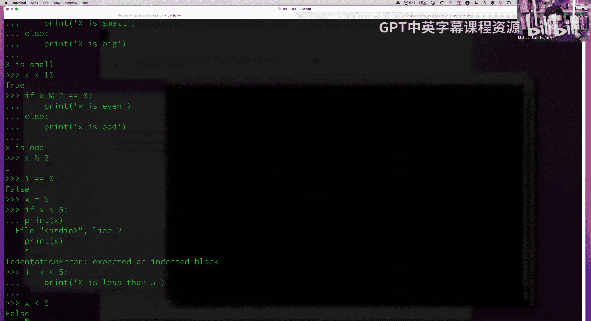

Is。Use these expressions in defining our own functions。When we define our own functions。

This is the bit。Where。There's。嗯。There's a little bit more syntax here to to sort of line up so in Python。

 we use this keyword def， which is short for define we give our function a name。

And optionally a list of what we call arguments。Or parameters to our function。诶。Deaf。Function name。

A set of arguments and we'll talk about how those work。This is in parentheses。

Followed by a colon and then the body of our function。啊。And what we do is we return。

Some expression that is the result of our function。Ideally， when we talk about abstraction。

 our function is going to abstract some more complicated operation。Into something that has a name。

Which makes sense。To someone reading this piece of code。

And functions should do ideally one thing well， so we want to keep our functions。

A little bit shorter than we might expect we want to compose functions together and we'll talk about using functions within other functions。

 so before we go on to max we'll do we'll define two。

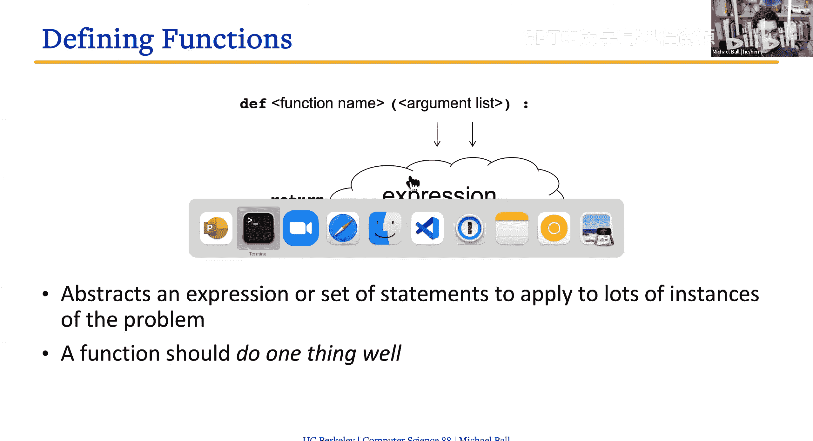

Two quick functions。If you're in terminal on a Mac， this should work on most computers as well。

 but I can hit control L and it just。Scrolls the screen up。

We're going to have a function called greet， so de。The name of the function isG。And。

We can let's call this a name。So。When we write our own functions。We'll see the keyword de。

The name of the function cte。Any arguments that this function accepts。

 so these will be pieces of data that give our function unique behavior。A colon？In Python。

 whenever we see a colon at the end of a line。That generally indicates that the next line should be indented that this is the start or the end of the line where there's a colon is the start of some body which belongs to the line above it。

 so I can say。Return。Hello。And I will do what we did before in this time name instead of our class name and our exclamation mark。

So whenever I say again dot dot dot， I hit tab sucks that this is indented one level。

And then you hit enter twice to tell Python that you are sort of done with your function。

How does this work now， I can say greet。Cs。88。And what the function returns is it returns the text。

 hellello CS88。So what happened here， this text CS88 became this value name by virtue of being insider function。

We have an expression like we saw before。Hello， plus our name。

And this special key word return says this thing is the result of my functionu whenever I get to the word return。

 Python says that's。That's it， I've got a result and it spits out that result。

This is our first custom function， a function called greet， which takes in one argument。

 which is a name。And all it does in this case is add some text together。

 but now perhaps if we one in tune， we can say。Greet， I could， greet RTAs。What's cool about this。

 right is。诶。Every time I have a function like this， this may seem pretty simple。

 but the text is always formatted in the exact same way。So。That is our function there。Yeah。😊，Yeah。

So a couple questions in the chat。呃。When you're typing。

 so I'll demonstrate this while making a new function called we'll call this my Max to distinguish from Python's function X and Y will be its arguments。

So when we're writing a function。嗯。What we can do is。Then we see dot to dot， we hit tabab。

If x is greater than y。So in this case， note that we hit tab once now because written the if statement will hit tab twice。

 return X。Else colon tab tab return why so when we get to the last set of sort of dot dot dots。

We will hit return again， and that will create and save our function， so what exists right now。

now we have a new function called my Max and if we just type this without calling it。

 Python tells me this thing is the function。It gives me this。

Kind of obscure set of numbers whoops which we are just going to ignore but we just right here we just hit enter twice to save the function so now I have a new function called my max which I can access in the same way that we did any other function by passing in the values X and y。

whoops，typo。If you ever get to a typo， you can type control C。

And that will sort of close out what you're typing。

So I'm going to hit my max x comm Y and I get the same results back。呃。嗯。嗯。嗯。Yeah， okay。

 so a couple questions and then we'll wrap up today's。呃。A today class。嗯。Yeah。

 so when we're the way to think about writing， so one thing I will say is that。

The process of writing Python in the interpreter like this is not meant for complicated programs most of the time。

What you'll be doing is when we're working on lab is you'll be writing a file， lab 01。pi。

 and you'll be running the file that way through the O program。But。When。呃。

How should have said this when we're working on on。In the interpreter these。

3 little angle brackets tell us that we're going to start writing an expression that Python will then evaluate。

 So if if it's in the context of something more complicated。呃。You know， if x is greater。

I keep using grid file all use good for。I can just print the value x here。

When I see when I see dot dot dot， what Python is telling me is that it's trying to continue working on on that same set of statements so I can say I don't know。

 this is not going to have。And well， we keep changing the value of big so when I hit enter right now。

 what Python is telling me is that I can keep。So I can keep adding additional statements that would happen when this else case gets executed。

So that's and then if I hit enter again。Python。Will， oh I did that backwards anyway。

 so I should have put X small here。呃。Since x is bigger than four。

 but Python will let us keep adding statements when we enter a line which has no text。

 then Python treats your work as being done with that execution。And then it evaluates the result。

So I would typically use the interpreter we use it a lot during lectures to demo code。

 but typically you're not going to write too much code throughout just in the interpreter。

 but it is a super useful way to try things out and and to figure out what Python is doing know if。

As someone is asking you like， hey， what happens when we do X Y Z in Python and you're not sure。

 the simple answer is to open an interpreter and usually try it out。

That's what we'll be doing there so let me go through。A couple。Oh， okay， so let's see。

Couple things in chat for the last couple of questions if you're saying yeah。

 so if you're trying to create a conditional statement and you're getting something that says variable is not defined it will。

呃。It would help to know what the name of the variables。

 but it might just be that you're missing something or that you didn't define something so yeah so。嗯。

There's also a question about why we have the plus in。In this case。

 so our plus here tells us that this text hello comma space。

Plus name is just combining two bits of text together。嗯。😊。

The lecture self checks by the way yes gradecope is correct they will be they're linked in the slides which will be at after class and there also will be linked right on the class calendar so it'll be it'll be there and you can submit them for a while so plus just tells us to combine two bits of information so there's that。

Then a couple more questions have we got。So why did my max of x and y return five and that's because earlier in this program I just defined the value x as5。

And why。As I think three， yeah， so all I did some time ago was say x equals five。Y is equal to three。

And that means that when I run my Max， we can think of this as saying my max of the values five and three。

And so that's what it's executing。Cool。Yeah， also I will check on let me check on the welcome video for。

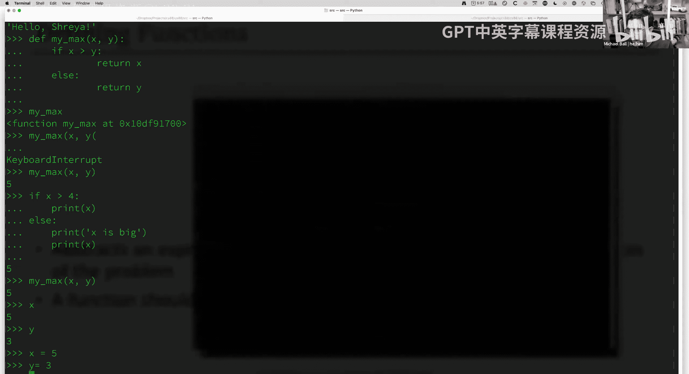

Oh， the the link to the video should be right below。The embedded video。嗯。Oh， an error occurred with。

 okay， that's a new error。

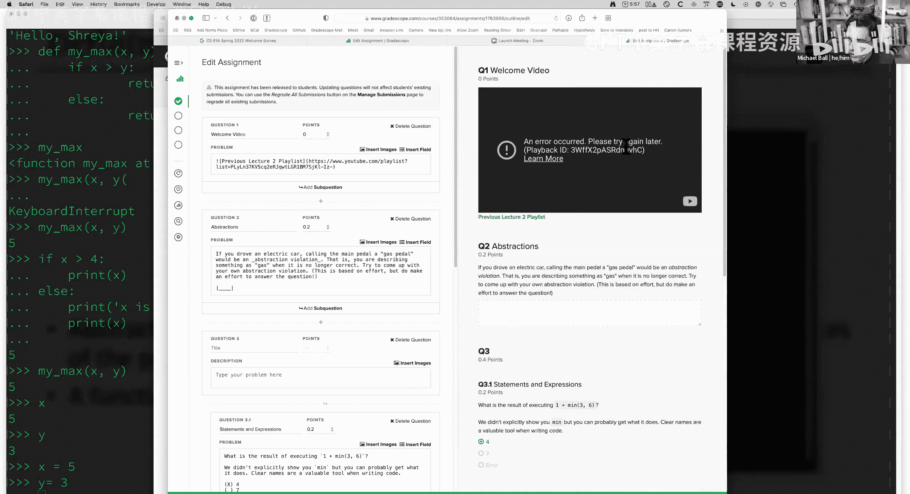

啊。

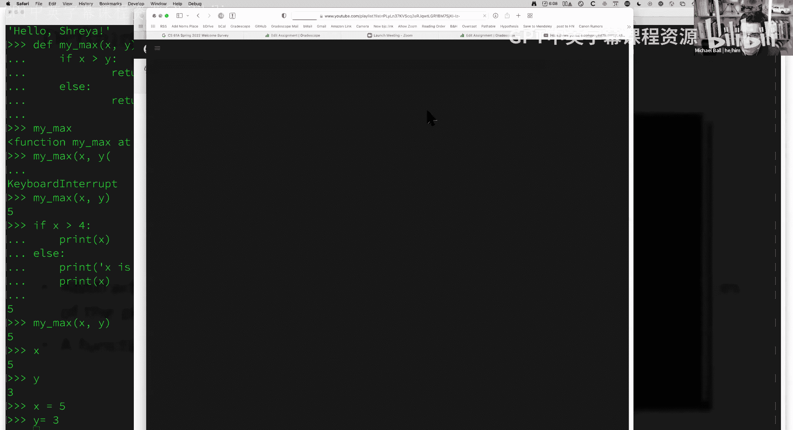

If you click on the link， I don't know why the embedding is not working。

 but if you click on the link。You should get。Access to the YouTube playlist。

It will require that you are signed in。With UC Berkeley， I believe， for it to work。嗯。

So that may be one thing， but there should be a link for the。呃。Yeah。

 so and if you still can't access the videos， let me know on Ed。And。But yeah。

 so so the I don't know why the embedding is not working。That's fine if let's see。

LetLet me just change this oh not gosh， not what wanted to do。嗯。Well so i've got my thanks。

 thanks YouTube you're really going to make me a。

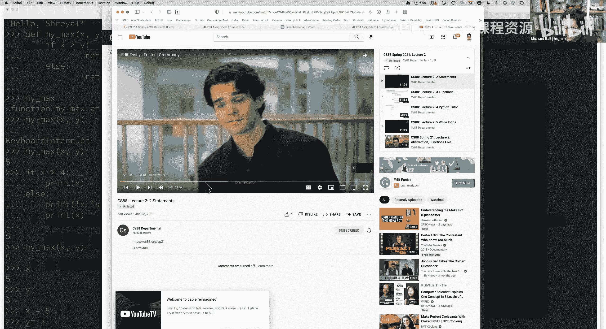

I didn't add a block around this。

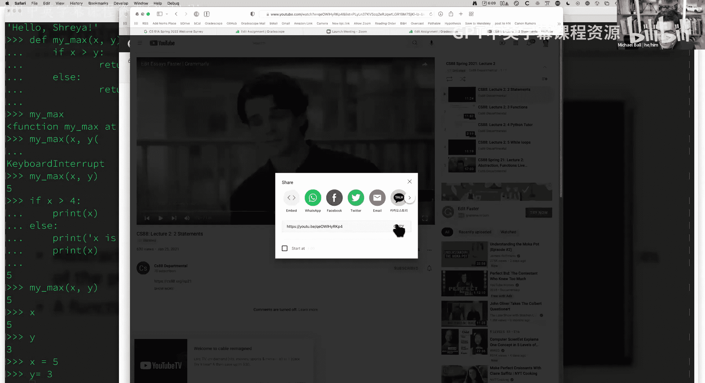

嗯。I don't even know why there's ads on these lecture videos。

 it's not like I'm making the money from the ads。嗯。You know， if they're going to be useful。

 like maybe I'd tolerate them。All right， okay。Video should hopefully be fixed。So yeah。

 good question on the end in terminal， this is not something necessarily related to class oh it's not in's on in this window。

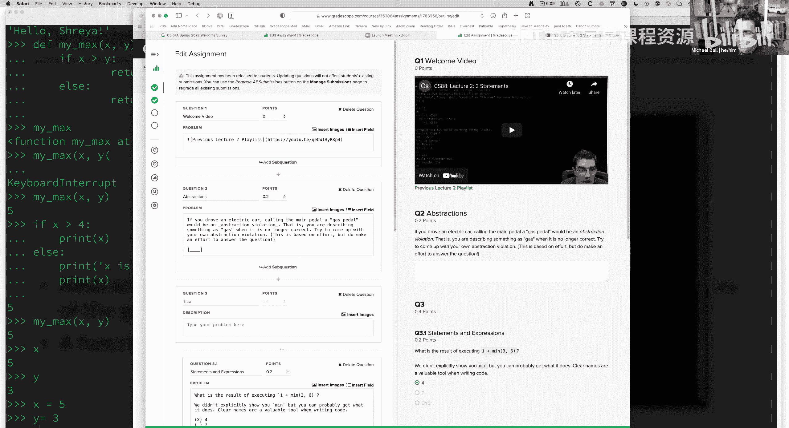

I can actually do this right now。So learning how to use the terminal effectively for anyone who just cares to stay on or walks this part in the recording。

Is absolutely not a requirement of。Of the course， but it is something where if you continue programming。

will。Sort of what do you call it will be a good skill that that you'll just sort of pick up over time so。

This。Environment text。This kind of environment is a Python feature called virtual end you don't need to do this at all for CSAA in fact I'd probably recommend that you don't。

 but it is a feature which lets you manage different versions of Python and the different packages and programs that exist。

I think it is worth mentioning for those of you that might end up taking other data science courses or if you get involved in research either explicitly in data science or maybe even in physics or biology this kind of environment helps you manage all the different kinds of packages that might exist so if this says end here it basically just means it tells me when I'm using this that what I have loaded right now or all the versions of Python and tools that exist for building our website。

And something relating to the tools is broken right now。

 which is why I couldn upload slides so that's what i'll be fixing right after lecture。Yeah。

 hellello Professor Wal， I can ask you a question， yeah， go ahead。So in my lab。

The function 2021 2022 returns 2022 and when I run the O pie。

 it says that it was expecting 202021 and because it got 2022 it was wrong。

Change the return to 2021 and submitted like that would that be a problem no that's fine if that's happening for。

If you could just post a note on Ed to double check that that is has been fixed。

 I apparently have an old version of stuff on this computer right now so that's why I couldn't updates otherwise check well yeah as long as okay Pi says you're correct it's good。

 we may have fixed that or something may not have gotten updated in the past day。But。

Don't worry about it， yeah。Okay， and for the question about lecture plays videos no you don't need to watch them all they they are just。

A separate version of the content for today， but embedded in the quiz just so that you have access to the same kind of stuff。

嗯。Shows Python instead of Python3 that it depends on what's okay so let me log out of this session you do want it to say what you want is when you type python for the version number to say something like 3。

6 or higher。So if I on my Mac。I believe this is the case although I' not wasn'm sure。Yeah， okay。

 so yeah， if I just type Python on on my Mac right now， it defaults to Python 2。

7 the Mac actually tells me that it's not recommended for various。Not super interesting reasons。

 but what we do want to make sure is that。This version of Python says something Python， ideally。

 they'll say Python 3。8 3。9， but as long as it's a number bigger than 3。6。

You are you're good to go it can depend on how your computer is set up whether python automatically defaults to python3 yeah then 3。

8。3 is totally good。哎。The video on the self check should be fixed now if you refresh。

 but there's also a link right below the video that will just open YouTube。嗯。Yeah， cool。All right。

 any， anything else？Awesome thanks everyone oh yeah go ahead sorry really fast just double check I tried to get with the video and it's still saying four to five questions answered is that fine Oh yeah that's fine don't worry about that yeah that's look good。

All right， thank you so much， have a good one， thanks you too。All right。

 see everyone enjoy your day and see you on Wednesday thank you， thanks。

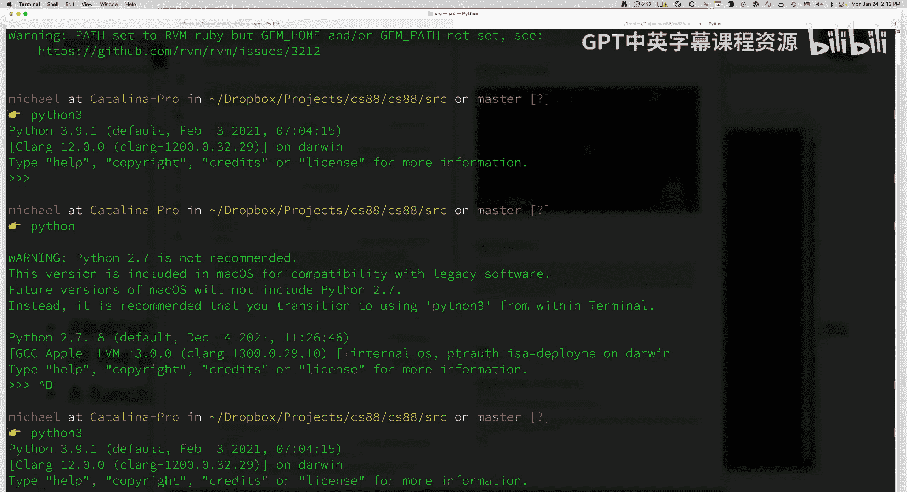