# UCB《数据科学中的计算结构｜CS 88 Computational Structures in Data Science 2022》中英字幕 p03 CS 88 Spring 2022 - Lecture 3 - 1_26_2022.zh_en [BV1516iBfEVY_p3]

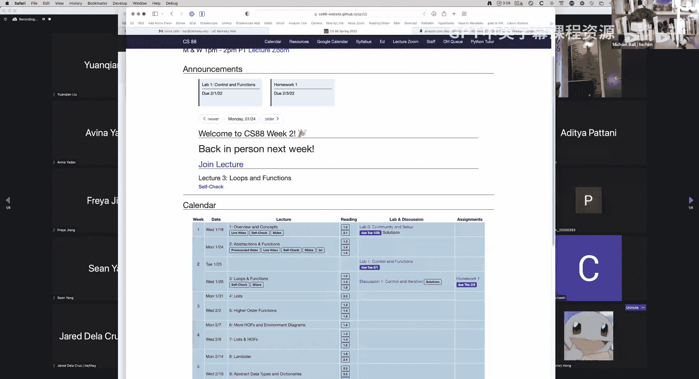

And before we get started。😔，系啊。Enable transcripts。And I set pals for myself。😔。

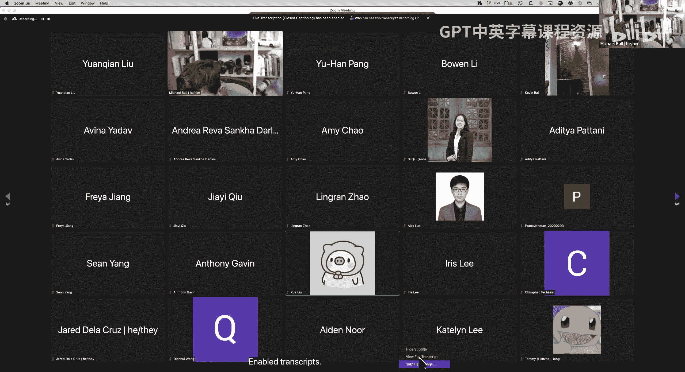

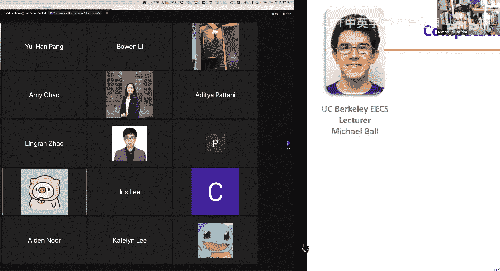

Cool。So。U。Announcements not too much going on yet， but we are going to be in person next week。

 so a big thing there。Means that if you could please double check。

You the CSA8 calendar for locations for office hours labs lecture will be 245 Lee Kaing that should be in the little calendar or the lecture slot on the Google calendar。

But you know， I think everything should be what's listed on Cal Central。

 but just to want to remind everyone that for the most part。

Things will be in person web lecture will continue to be recorded and available afterwards。

 we may or may not have a live zoom option available for lecture during lecture last fall that was a little bit tricky i'm not sure how the room will be set up this time if we'll be able to support that but regardless everything will be available after the fact。

CSAD as a reminder is a class， we do like you to come in person， but attendance is not required。

 all the work can be submitted asynchronously throughout the week and we should have some options for remote participation。

So。Yeah updates on that what we're going to do today is just continue sort of with where we left off exploring python and in particular today we're going to focus on functions。

And focus on while loops and if there's time we might get to four loops。

 but if not that's what we we'll continue next week hopeops so just to review so python we have expressions these are。

A。啊。These are Python pieces of code that evaluate to something it could be a number。

 it could be a new word later we'll talk about things like lists functions otherwise we have what are call expressions and this is where we are calling。

A function that returns a value。And we'll note that inside I call expression where we have function arguments。

 these things like0 and x， those are both their own simpler forms of expressions so。

One thing that we'll just notice over time， right we're just going to keep building up the pieces。

Oh come on PowerPo why oh， that's that's my it's just having the key。

Having my key my fingers around keys we have assignment statements and variables。

 so an assignment statement is how we assign。😊，A name to a value so the value or they name x is equal to the result of some expression that creates a variable named x that we just use by the literal character X if that's our name。

 we defined functions with the deaf statement。And we looked at control statements if today we're going to look at while。

 but there are many different options for all kinds of control statements。

Today again we're going to keep creating our own functions。

 we're going to hopefully then use a loop to execute the same code multiple amounts of times。

And then we're going to use a conditional to control when a while loop stops running。

We're going to basically be。Building up upon the things that we did on Monday。

This is where we sort of were on Monday。We have if。And else。And in this case， again。

 it's worth mentioning that wherever we see Python， we can typically just start building up Python。

 so if some predicate。This is a Python expression， and in particular this is a Python expression that should be true or false。

Python is pretty forgiving。If I say。If hello。Python won't yell at me。

It'll try and figure out whether hello is true or false and it has some consistent but kind of opaque rules for doing that。

 so you shouldn't necessarily say if hello but。These things are all something that's there is an expression。

Inside the body， so when we indent things we say that is inside of our if statement。

 so it is one level indented we have additional statements and when we say statements what we're typically talking about are。

Python expressions where we don't care about the return value necessarily。

 so x equals3 is a statement because that entire statement while it assigns a value。

It doesn't itself return a value。So within there， we could write。Yeah， whatever we might want。

Here is a simple check， perhaps。For whether or not someone might have a fever。

 this number is of course in Celsius since 37。2 degrees Fahrenheit would be pretty。

 pretty cold if it were your body temperature。So。This is where we were with function。

 so a function has a name。Importantly， Python， like many of other programming languages。

We cannot have spaces in our names， there are some rules for how we name functions they can't start with a number for example。

But for the most part， if。You want something that's complicated we'll use an underscore to denote multiple words in a function name。

But we have a name and we have a list of arguments so our list of arguments there could be none in which case we just have some parentheses。

With no options。And then we have this colon， an insider function， we indent everything by one level。

😊，And then we can return a value。Every function。Will return something sometimes you might o the return value and we'll talk a little bit about that。

 but our goal of making functions is to encapsulate an idea to do one thing and to do that one thing well so we want functions that are a little bit smaller and we want functions in theory that we can。

In a sense， composed with other functions that if they do one task well。

 we can take the result of that task and pass it to another function。So。This is a。

A fairly simple version of Python's built in max function。The arrows on the slides， there's kind of。

Hey， excusecus me， a few different ways to approach this。Wellll run。

We'll run through this example so one thing to mention。

Is that when we have arguments to our functions in this case， max x and Y。

They always sort of follow left to right， our first argument。Over here， 17， Ma star X。

Our second argument x plus6 maps to the argument Y and what you might already notice by this fairly simple example。

Is that in multiple places？On this slide， we're using the value X。

What you might not realize then is that。X can have a different meaning and a lot of different contexts and so one of the things。

That is really good about。The way。呃。Python works is that it helps manage all of that mapping of what variable maps to what value in what context。

 and there's some rules that we can follow to help understand that。嗯。

But there's an aspect of this process， which is also， I would say。

You could almost approach in a just intuitive manner of what you think should happen。

What we'll do right now is。Explore explore how this works。

 and then we'll talk about the rules for how Python evaluates functions。What it means to。

To use a new tool that we're going to call environment diagrams and we're going to revisit those in the coming weeks。

 but today we're just going to introduce them as as a useful tool so one thing that I want to do before we get into environment diagrams。

Is to just think about。What should happen？In this example。

And if you want to do the mental math and get a little bit ahead of me， I encourage you to do so。but。

诶。If not， just feel free to follow along so here we have a value X。

Or excuse me a variable x whose value is  three。That is our first statement。

 it is an assignment statement。And now we have a new value。A new variable Y。Whose value is four？Plus。

 the result of some expression。Max of the value 17。And x plus6。呃。

What should the max is 17 and x plus6 be， well first we have to figure out what x plus6 is。

That is three plus9， excuse three plus6， that's nine， B max 17 and9 is。17， so we have four plus 17。

Times of value 0。1。Whatever values we picked doesn't matter。

 I should really update this example to be a little bit easier in mental math。

 but we have 21 times 0。1， so we have 2。1 is our value of y。And now we have three。Divided by。2。1。

Which should give us。1。5 something。

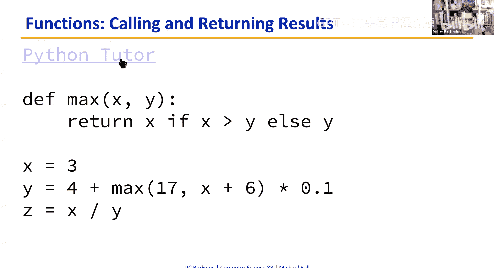

So what we'll do right now is。

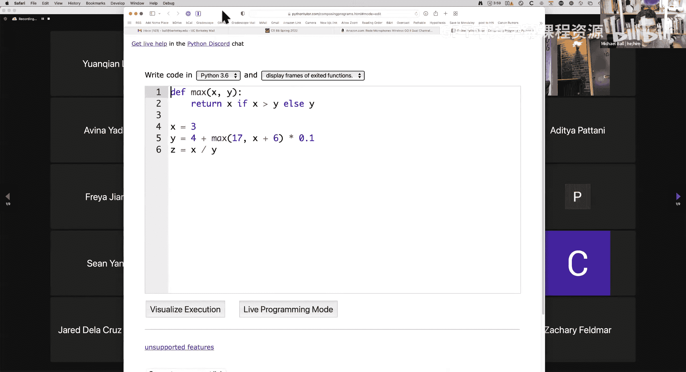

That was not what I wanted to do。What we'll do right now is use this tool called Python tutor to run this code so actually before we before I run Python tutor。

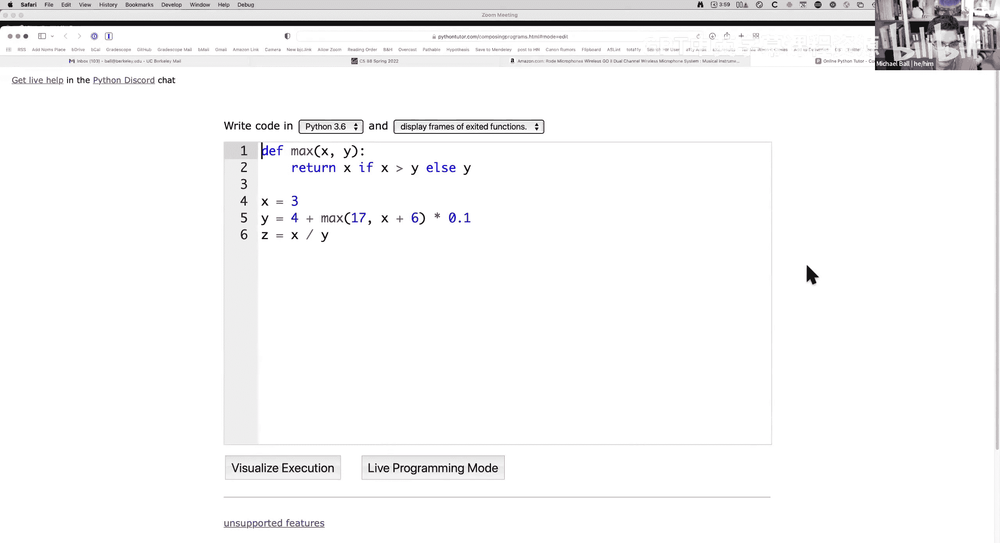

Let me go over to a terminal。

And。All right， whoops。Python 3。And one second because。This is okay， there go。

Now I can see everything。Oh， you're going to tell me that。Things are not pasting correctly。

 aren't you Python？

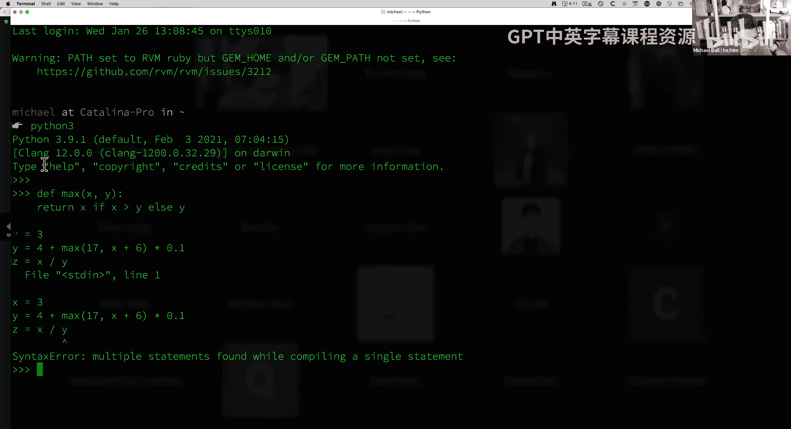

Yeah， okay。

啊。This。So sometimes the interpreter is。

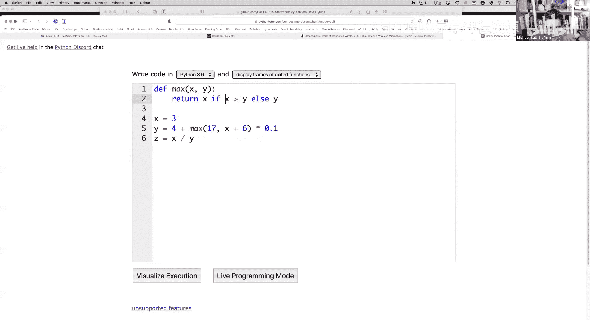

A little picky。

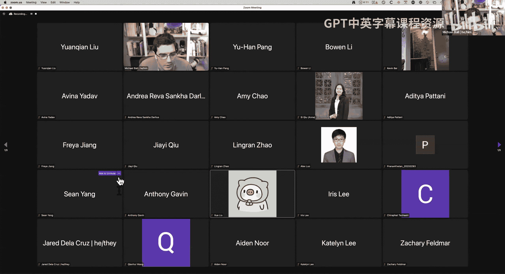

Oh， fine， okay， so we'll just write this out。好。看有了啊。嗯嗯。Okay， there we go， we have our max statement。

We have x equals three。Y equals4。😔，Plus。Max of 17。X plus6。Times。The quantity 0。1。

 we have z equals x divided by y。One thing I will mention as well。

 I am putting spaces between my operators here。I think that is easier to read。

 but you can omit them if you prefer I might say if you prefer to make life harder for yourself you can o them。

 but nonetheless it works so one thing to make sure that the interpreter when we assign a value。

To a name， so when I say z equals x divided by y。Python has executed the statement。

But it doesn't show me the result， so if I just type the letter Z。Oh， I totally did my math on guy。

Yeah， 0。52 that makes more sense than 1 0。52。Z， in this case， has a value。Of 0。52， Y。

 like we mentioned， has today I。what do I get？Oh， it did the。

It did order of operations differently than I expected， that's what happened， that's fine。

Because that makes sense。So。Um。But I say， before I did mental math all wrong。So yeah。

 in each of these cases， Python executes the statement， it does the work。

 it doesn't always show us the value in the interpreter。

 but we can inspect and get it back the question for ourselves is。When we have a value。

Of something like X。When we say。X plus six， we can understand that this value is9。

 but we'll also notice in our max function here we have our own values x and y that return。

Different different results， I also want to mention really quickly that the way that this max function is written。

I don't know why the animation。Disappeared。But。This is a way of writing a statement in a just a more compact form。

 so I can say if x is greater than y。Two indentations。Turn X。Else。

Return why so if you're perhaps wondering。What was going on up here？

That is just shorthand for an if statement where we just return an individual value so those two。诶。

This work correctly。Let's see yeah， so if you're pasting into the interpreter。

 what happens is sometimes the interpreter does not give you the return statements correctly and the easiest thing is to just retype the code or paste it in line by line。

There are。Yeah。If。Depending on what's going on。You have what。

Okay yeah it's a little hard to debug comments of things going wrong。

 I would just double check how you are indenting code to use I typically just use tab when I'm in in the interpreter and make sure that you're also not missing any colons at the end of your if or else statements those are typically a couple things that can happen。

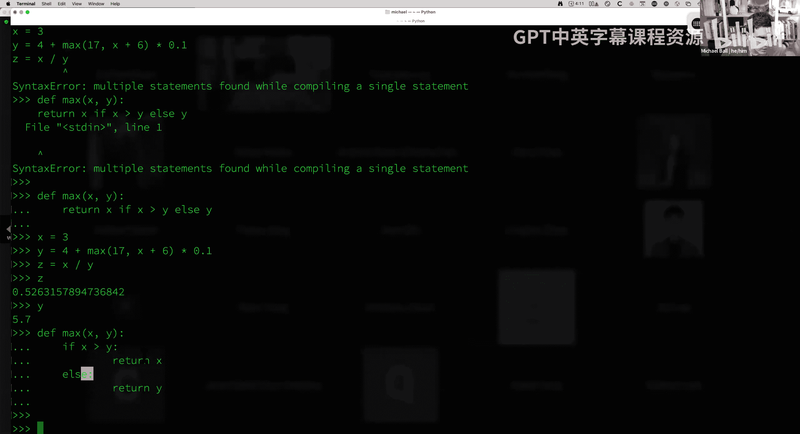

So。If。

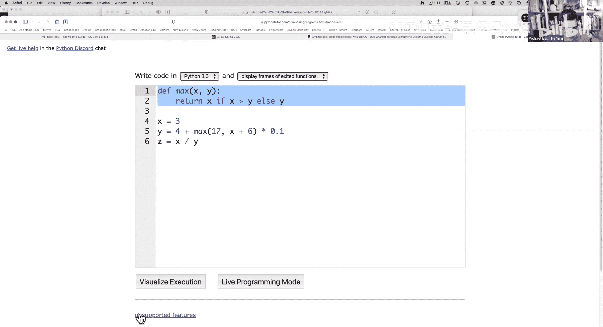

If you start to recognize， in this case， the Board of Op， you can kind of do the mental math。

 figure out what might be happening。In a simple statement like this。

 but in this example what we have right now。I we already have an x out here。

 we have an x insider max function， and it turns out that they can represent。Different values。

At the same。Sor of at the same time and so one technique that we use is I should not delete that is this tool called Python tutor you can get to it。

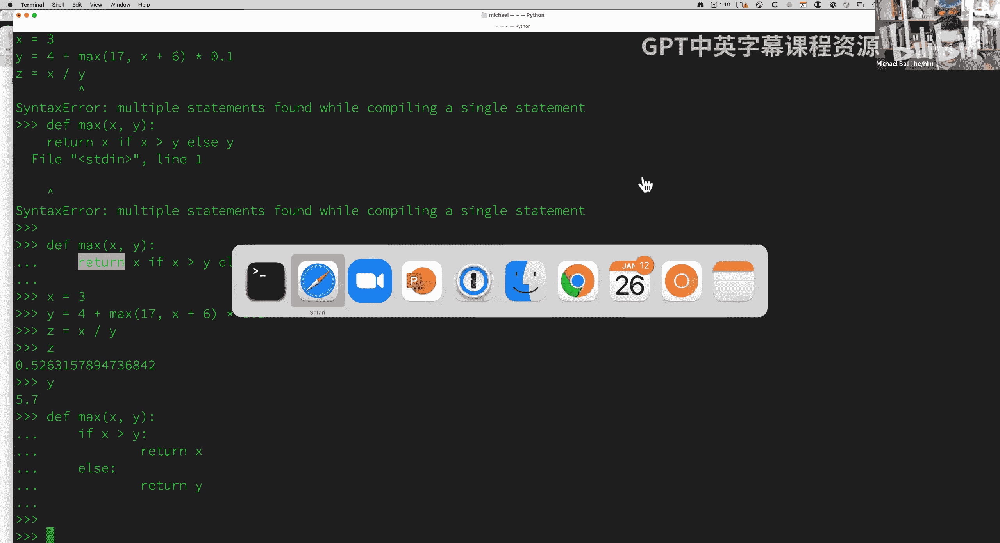

It's Pythonttor。org or excuse Pythonttor。com， I think PythonTuttor。org also works。哎。

The other short link is tutor。cs61a。org。Redirect you to the right spot。

With with a blank window and in the slides sometimes we'll give you links that come pre filled out with with the code blocks so what we're going to do is visualize execution。

And walk you through the model that Python Tutor uses。So。One thing to know is every time。

Python executes a line of code， it'll do something to update what we're calling the environment。

 so on the left hand side here is our code on the right hand side。

 we call this the environment and that is a representation of what are all the things that our program knows about。

So here we say deaf max， so now we have a new object。

 a new item in what we're going to call a frame and there will be a lot of new words here don't get too hung up on them but sort of in this box we have a thing called max that thing max is actually a function。

And it is a function whose name is Max with arguments X and y。

In the coming weeks we'll talk a little bit more and work through things like parents and en numberumbered frames and so on。

 but environment diagrams will continue to be a useful tool for studying so line by line we just executed line four pretty simple in our frame we say we have X it has a value three。

So in this model， we have a name for something。And it's value。

And one thing that environment diagrams do is simple values。

 what we typically call primitive values go directly in this box。

Complicated values have an arrow pointing to them so。

How how and why this works we'll spend time in the next couple weeks with different kinds of data。

So our next statement we。呃。A few things happen here。

 so what we're doing right now is we're evaluating four。Plus the quantity。Or plus the result of max。

Of 17 and x plus6。What's happening right now is inside the body of our max function。

 we now have a new frame， So one thing to note about functions in Python that implicitly。

You can kind of assume that this happens。But making it explicit。

can get a little bit tricky is when we're inside the body of our max function。

 what Python actually does is it creates what is called a new frame。

 but in this case you can sort of think of it as a special box that captures what's going on just inside。

Are particular functions in this case。This happens to be frame one。

It has this syntax or it it has a name max because we're inside the max function。

 it tells us our parent frame that happens to be where we were before so what I am done with this whole max thing。

Where do I go back to？And when I make that new frame。

This function has arguments x and y what are the values of x and y so in this case x is now 17 because that is the first argument here mapped to the first parameter of this function here。

This value x plus6。Remember outside here， exit's3 over here we going still say x3 x plus6。Is。Three。

Plus the value6， so it is9 and nine maps to the value of y。

Will you have to know how to draw environment diagrams。

 yes and we're going to spend a lot of time drawing environment diagrams but。

Drawing environment diagrams would be。呃。啊。Will be something back。That we spend time on。In this case。

 yeah， so in the frame F1， we're inside the body of the max function。

 and so far that's all Python computertor is done because we're clicking through one at a time。😊。

So when we click next。We get to the next line of code， one Python tutor has a red arrow。So。

In this class， when you draw environment diagrams in。

In some of the worksheets in lab or perhaps on an exam。

We're only really going to be focusing on the final product we're not going to ask you to draw all the steps。

 but while you're using Python tutor what you'll know or what you'll notice is that when we have a red line this is the line that we are going to execute next so if it says return and we have a red arrow by we haven't actually done that return statement yet and Python tutor only lets us execute line by line it。

So it won't show us individually the comparison that's happening here。

 it treats this as as one statement but。So some for some programs。

 a lot more will happen on a single line than others。

 but in this case what we could say is we return the value x。If x is greater than y。

 else you return the value y。Return 17。If 17 is greater than9 that is true so what we do is we return 17 when I hit next what we'll notice now is the arrow moves down just slightly below that return statement so we have。

Gotten a return value。For our function。So the return value。Of this call expression right here。Is 17。

When I。诶。When I click next， what Python Tutor goes back to doing。

Is finishing off completing line five， giving why the value of 5。7 so if we go back previous。诶。

So how do we know what's going to happen next， so if we know that this function returns 17。

 we see that its parent is the global frame。So we have Max。

So we have to figure out where in the global frame what was I just recently in this case we kind of just have to know a little bit that we're on line five。

 but we can look for what called the function max inside the global frame in this case we only have one call so it's not too messy if there were multiple calls to max On  five this might get a little more confusing but fortunately we have one call to max。

We return the value y then is the quantity4 plus max of 17 times 0。1。Why？诶。So。诶。Yeah。

 so I got a question in the chat， I thought why would be 23。

Assuming X will be updated so when you say why one thing that i'll ask is which value of y were you expecting。

To be changed in this case， one thing I'll mention is。

Python is actually following order of operations， so it's doing 17 times 0。1 first， so we get 1。

7 plus4。That's what the value of y is 5。7。Again， we're not going to give you too many examples that have multiple math steps in the class。

 but simple numbers are。Can be useful to illustrate certain properties。

So we've gotten a value for y and now we just have one last line of code to execute。

So that is z equals x divided by y。So in this case， what are we doing， we have three。Divided by 5。7。

And that is where we get 0。52 as the value for z。And that is。The end of this little six line program。

Yeah， so why， yeah， so this is a good question。I that I got on private messages， why doesn't？This X。

Change from three to 17。嗯。😊，And。This is something where environments help us。Well。

 so I'll say there's two reasons， one of them is sort of just thinking generally about what we might want a computer to do。

And the second then is thinking a little bit about how the environments help us。呃。嗯。

Help us sort of answer that question so why doesn't this three in our global frame？Become 17 well。

One of the things that we talked about and we could think about this in terms of abstraction。

 we can also just think about this in terms of。Having a program that's going to be doing a ton of complicated things at once。

 so your computer。嗯。You know， while it's on zoom right now right you are typing in the chat。

 you probably have Python open， you're looking at my screen。Maybe you're playing a video game。

 maybe you're on Facebook Messenger， I don't really care， whatever it is。

It's doing all these things at once and it turns out that as humans we're often not very creative people。

 so we'll have a lot of things named X in any one program or we might want to just reuse the same name for other reasons and so every time we make this new function。

The arguments that are in this function。They essentially live inside just that function。

 so the variable x。Inside the max function is different from the variable x。

Outside of the max function and this is so that we can keep。

Different things straight at the same time， it also turns out that in a few weeks， we'll see that。

We can have multiple functions， multiple frames of the same function。Inside python the same time。

 which each have their own copy of a variable with a different value， so in theory what we want。

What we can kind of think about is。Our computers are going to try and keep copies of data around such that things don't overwrite each other。

It is sort of one reason， but what also happens in Python is every time I say call a function to make a new frame。

Python is going to give me new names。Or excuse me， if I use a if I reuse a variable name inside that frame。

 it's going to start by just using。诶。Giving me。Ex what Python is going to do is it's going to assign that name only within that frame such that this original value three still exists and we'll draw the rules specifically in a second。

So let's see。嗯。Yeah， okay， so a couple things。From a few different private questions。

 all of these are good questions， by the way， so if people want to type them publicly that's also encouraged so。

Yeah。Yeah the table on the right is an environment diagram so the question is so the de statement yeah what is what does this line do so line one for one of those questions is just the thing that tells Python this is a new function I can say de max I could say de。

Hello， whatever logical set of characters makes sense。

 this thing will become a function with that name。Everything that is indented one level below。

Is the body of that function？And so when Python evaluates line one。

 what it's really doing is it's looking at lines one and two together to say， hey。

 you told me to make a new function， I'm going to make a new function whose name is Max。

That accepts two arguments， X and Y。So the question is why？呃。I got a prior question。

 which is where did 17 come from in this discussion？Inside here when we say max of 17。

We have a new value x that becomes 17 and so。Some of you may think like， well。

 of course max or excuse me x is just in this max function。

 there's no reason for a 17 inside here to affect this x equals 3 and sometimes you might find that you have just a very intuitive understanding of how that works other times you might want to explicitly sort of draw it out which is 17 here。

Is this X inside this frame F1？And when we make a new frame， they are separate objects， so let's see。

Yeah， so one thing is， yeah， good question about chronologically。I don't。

So one thing I'd say is we're not going to get too advanced with。嗯。

With multiple things happening at the same time。But yes。

 I would say chronologically is a good way of thinking about it。

 the more precise way to think about it is sort of one statement at a time。

 so you know it executes line four。😊，AndThen Python starts to execute line five once it's finished executing line four。

 if there are multiple things on line four， it could take multiple steps to do that execution。

 but it will go Python will go essentially from the top of your program down to the bottom of your program in order。

Along the way in larger programs， most of the code that we write in CS62 a or excuse CS in CS88 and in CS68 like your labs。

 your homework assignments， most of these are in one file so there's not too many things happening at once our projects so we haven't talked too much about the projects in this course yet but。

You'll start to see them in a few weeks， we do the same projects as CS62&A or slightly different versions of them。

 but those projects will have multiple files， most of the code though in those files is supporting code but Python when it gets to a function。

 it can look for that in a lot of different places。

 it can go to another file it came and go to your operating system where the internet to get a result and typically Python will wait until it gets a result before continuing on。

Outside of this course， there are there are ways around that aspect。F。嗯。For exams in this class。

 we won't have calculators。嗯。But we'll try and make sure that you don't need to do anything so like on an exam I would not put 0。

1 as。You know as an option here， I would also say that I think in this example。

 i'm going to edit the code really quick line line five right here is really making sure that we have parentheses around。

😊，This expression because。According to PEmDS right multiplication should have happened before addition。

 so in this case it's not just going left to right。

 but Python does know that the order of math is that multiplication happens first。

 something that I totally messed up 10 or 15 minutes ago when I first read the problem and just went left to right。

Python will totally apply the multiplication before it will apply the addition。

Because that's what we were told in elementary school。And incidentally。

 that's what we'll forget to do and why we have computers to do things for。

 so on an exam I wouldn't worry about an example that that deals with something sort of that nitpicy needless to say if you mess up mental math or you mess up order of operations。

 that's totally normal doesn't make you a bad programmer。Doesn't make you a bad person。

 it's easy to screw those things up it's why we have computers solve those problems because humans are fallible。

Yeah， so that's a little bit on an environment diagram。What I will say is。

Environment diagrams themselves， they will， they will definitely。Don't know， why did I？哦。Oh。

 I know what I did， but I actually drag things in the wrong order。I was done with me。

 so we'll go back to the other slides。So。Environment diagrams are something where。They。

They will feel like a lot of steps。And for the first few weeks。

A number of you will definitely feel frustrated by the rules that we're presenting that it is nitpicky and detailed。

And。😊，I think you're totally right to have that feeling。

 but what I would say is to try and focus on using them as a piece of organization is look at Python Tutor for simple programs that you think you intuitively understand the output。

To see how the environment diagram works， and then you will approach a program that is a bit more complicated。

 especially in the next couple weeks when we get to some really awesome tools called high order functions treating functions as data passing functions around as variables。

And as arguments to other functions returning a new function， in those scenarios。

 environment diagrams really will help clarify what Python is。😊。

Is doing and one thing that i'll mention is the environment diagrams are an approximation of how Python works they are very close they are executing that code。

 but occasionally you know the visual output will be a little bit funny so if something doesn't make sense。

Please feel free to ask so environment diagrams we have frames。Frames map variables to values。

Every function call gets its own frame。For built in functions， Python Tu won't show them。

 but a new frame technically exists。The global frame or just global is the starting point of a Python program so whenever you type Python3 in the interpreter。

 whenever you type Python3 OK pi that program starts whatever it may be with a new frame with a new set of values basically that's starting from scratch and populating whatevers in your program。

The parent frame。Is if it's not the global frame it's where that function was defined so when we have functions inside of functions we'll see why this gets a little trickier。

And we have a frame number， so we saw the F1 F2F3 that is the order in which frames were built not necessarily directly what the parent order is so again don't worry about some of the complexities here we're going to revisit this all in a few weeks。

Just a reminder that a variable is the name of something。

Whi has a value and if you mess up those those two of occasionally that's totally okay so here are the written steps for for drawing an environment diagram we always have a global frame。

we。When we evaluate statements or assignment statements， we always evaluate the right side first。

 so we figure out what's on the right side。Whenever we call a function， we make a new frame。

So calling a function in particular is making a new frame。啊。

Whenever we have a primitive value so that's a number， a boolean value true or false， or a string。

 we will write that value right inside the box， these are simple expressions。

When we assign a value to anything else that that value goes on the right side of an arrow so we say。

If I go back to the environment diagram， we don't have any complicated values yet next week we'll look at lists。

But the first thing is this is。A ranabout way of an assignment symbol book what we assign。

 we ballot the name max。2 a function， which goes on the very right hand side， so Max。

Points to a function。Whose name is Max？嗯。I don't know if we have anyone in this class named Max。

 but that'd be a。That'd be fun。And on the right hand side will list any more complicated value。

 so primarily for us next week this will mean lists and we'll talk about lists then。

 but it could be it could be anything that is not a number。A string， so text or a blame value。

 true or false。When we call。When we call a function the name of the frame is the intrinsic name。

 so this name will revisit what that means， but usually what that means is。

This name over here where it says F1 max。Is the name of the function so for right now you can assume that these three things sort of line up max。

Max。And Max。In a few weeks， we will break that assumption。

 but we have a name here and that just helps us keep track of。

So which actual function are we evaluating？呃。And the parent frame is where the function was defined so in this case。

 and most of the time， but not always that will be the global frame so。

This frame this function max was defined up here， so its parent is the global frame。And。Oh， come oh。

 wire。Okay， something is wrong with the PowerPoint animation。

 so number eight is not appearing on the actual slide in presenter mode。

 but it's there in the notes one important thing again we're not going to get to this one today。

But next week is if the variable isn't in the current frame。

 we will look it up in the parent frame so today the values x and y。

That we are looking at always existed inside the frame of the function max。

 but sometimes they won't be there and we have a way of finding a variable。Who'se value？

Is actually somewhere in Python， but not necessarily。

An our current frame and so we'll use that as as a way of looking at values so there are a couple links for additional resources on environment diagrams you're welcome to read them now。

 but what I would say is give yourself time we're going to be revisiting these rules next week with with additional examples so with。

The last five minutes。That we have。What I wanted to introduce are while statements。

And there's actually a question， I think maybe at the end of Tuesday's self check like you can go back or excuse me。

 Monday's self check on grade scopepe， which you can go back and complete if you didn't already sort of guess and figure out the answer。

Wch if you did， that's totally cool。So。Last bit of new bit of Python for today， so a while statement。

 a while is a way of repeating some code until some condition is satisfied or is met。哎。

We can say while some expression is true。Do this thing。Once this expression is false。

 we will continue on with the rest of our program。And so。呃。We're going to see。

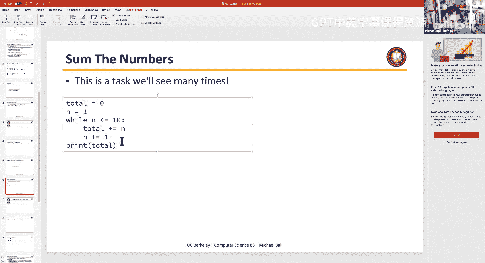

How。How cooperating？啊。Nope。If you have a Mac and you see the screen text in the Python interpreter。诶。

That means that means you're going to get an error when you paste things in so that's fun so what we're going to do right now is we're just going to sum some numbers up together。

We have total。We have number sQL to one。And what we want to do is sum the value of numbers from one until 10 and we're going to keep we're going to keep revisiting this because it's a useful example to think about what different types。

Our structures python gives us to solve the same type of problem。

 so as i'm writing this we're going to finish this example and this will be where we leave class today we have two variables total and number。

While our number is less than 10， we're going to have an indented body to this function。

And inside our code， we're going to say total。Is well let's we can say plus equals n。

 this is the same thing as total is equal to total plus n both are exactly the same plus equals is just shorthand。

For take the current value。Increment it by n。Now。My value n， I need to increment by one。

And when I am done， this should work without hitting enter again， I can print。V value total。Oh， no。

 you okay。If I don't paste it in it'll make you put a blank line okay。Fine， fine， fine。

 Will abide by your silly rules。So fix the while loop， while n is less than 10。We add n to our total。

And we increment n by one， both these things need to happen such that our while loop。

Actually will satisfy its condition。Enter。喂。啲。Oh， I'm sorry。 that was my bad。While。

Num is less than 10， but I don't know if anyone。Yeah。

I renamed it and I was not looking at the chat while I was typing， but yes thank you。

 those of you who caught that while numb is less than 10 shoot hold on。Well then is less than 10。

Total。Plus equals nu。N么。Plus， equals one。There we go， thanks， you will very often。

Do something like this where you just give a variable a different name wonder why something doesn't work and it's just that you have things named incorrectly or have a typo if you spend more time than you feel like you should on this don't don't be too to hard in yourself because it is it's pretty normal so what we have here while numbers while our number is less than 10。

Increment our total by the current number and add one to the number。If I say total。What I get is 55。

The summation from one to 10 of the numbers one through 10 in inclusive。

Is 55 that is not something worth memorizing， but we'll come back to this problem enough that if we oversee a result that's different。

 when I hit enter， what is the value of me right now？

Doess anyone for the last second one I guess what numb is cool？Numb is 10。Or excuse me， number is 11。

 sorry， but this is。Numb was 10。So while numb is less than or equal to 10， I totally。

Mised what I was going to say there is。I'll leave with this while numb is less than or equal to 10。

 we add to our total10 so our total is plus equal 10， so 45 plus 10 is 55。

Our number plus equals  one so 10 plus equals 1 is 11 and now we get to the value 11 is less than or equal to 10 this is false and that is when our wire loop will will execute so I went through that a little bit quickly and I did go over by a couple minutes but we'll pick up with a few more loops。

On on Monday and we'll at we'll also look at other ways of writing loops that I think are much nicer than wild loops。

 although while loops are a super useful concept but yeah that's a bit of Python for today。

 thanks everyone and if you can on Monday， please do try and come to class I think it'll be a lot more fun to see people in person。

If we can， but if you can't， the recording will again be available。Thanks everyone。

Can I ask a question real quick， ahead。So I won't be able to attend like the lab session I sign on tomorrow just for the one time would I be like lose point for that or so we don't we don't track attendance or so we we only track attendance just for like participation and understanding sort of who comes but it's not it's not graded in any way Okay cool as as long as to finish up the lab that will Okay cool thank you yeah thanks。

Co on。Was there another question I saw I oh well that was it awesome thanks everyone see you next week。

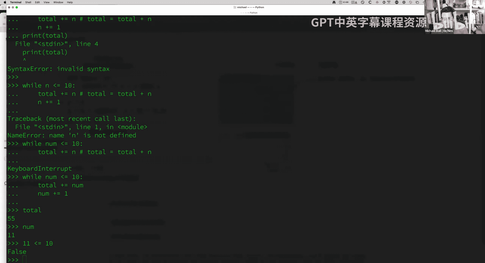

嗯。