# UCB《数据科学中的计算结构｜CS 88 Computational Structures in Data Science 2022》中英字幕 p04 CS 88 Spring 2022 - Lecture 4 - 1_31_2022.zh_en [BV1516iBfEVY_p4]

All right， cool， so I think we're good。This semester will be fun because my 11。

 12 and  one o'clock are on all three opposite corner of campus。

Could not have been a better you plan for turning back to in person but that's right so looks like most people came here today which is pretty awesome the goal will be to have hybrid stuff up and running labs and office hours will sort of be default in person but we're going to be trying to accommodate remote students as much as possible we've also had a couple GSI changes so you know as things sort of settled down we'll make sure that the calendar on the website is up to date but as a reminder。

If you are not feeling well for any reason please like do stay home I've gotten like a dozen emails today from both CS88 and CS10 and other things there's no need to show up。

 you can earn all the points by watching the videos by doing self checks by turning in your assignments so attendance is not a requirement。

 obviously I think it's helpful and I'm glad that everyone is here。

 but please do not feel compelled to come to lecture solely for the purpose of attending just because so。

With that out of the way， we're going to continue where we left off last week and we're going to be talking about four loops and lists。

 so four loops and lists I think are two of the most useful kinds of structures that python gives you they。

Are ways of handling。Just about。Any situation， sometimes for better and sometimes for worse。

 but when we talk about the idea of having a generalization that allows us to solve a problem more long way。

Ls are going to be one of the main ways。😡，GoodThat we can address that。2。

Python lists are pretty nice in that among the programming languages that you will hopefully have a chance to use if you time as a programmer lists in Python are super flexible so they are their own data type so we've seen things like integers and floats we've seen strings we've seen boolean values functions are their own data type we'll talk about that specifically in a week or so but lists are new data type and lists or a data type that allows them to contain other types of data so a list in Python can contain just about anything that you can imagine and they can be zero items to a million items in theory you can think of them as being as long or as contain as many items as you need。

 but practically speaking your computer actually has a finite amount of memory so at some point Python might yell at you。

One thing to note about lists and I promise you you will screw this up at least once and probably dozens of times throughout the point of programming in CSAA and beyond。

 but the first item of a list in Python is item number zero this is not true of every programming language but it is true of most of them and it is incredibly easy to mess this up and start counting by one and get the wrong item so if。

If you're not getting the results at any point in time or if you see something on the slide and you're not sure why it's item A instead of item B or something like that。

 remember that we're going to start counting at zero and we'll keep reiterating this。

 but it is something that everyone messes up at some point in time because it is not the way that we have been trained to think our entire lives。

up。And finally， we'll talk about lists being mutable and what that means。

 but lists are really powerful tool because they let us change the kinds of data that they hold and well look at examples of how that works。

Things that I've said that will work on today list can hold as many elements in Python the official type is called a list。

 but if you've used another programming language or you've heard the term an array。

 they are typically a pretty similar type of idea。Ls group a bunch of items together so while lists and Python let you mix and match all kinds of things we're typically going to use them to contain a similar set of ideas so a list of courses that you're taking might include CS88 and data 8 and math 1 B or something like that and so they're all three kinds of courses you could of course include a list that says CS88。

245 Li Ka Xing data8 in。Wherever it is know 150 wheelheeler， but in general。

 when we think about building programs that are coherent and usable。

 we want the items in our list to sort of have a consistent purpose and。

We'll explore just how flexible they are， but one of the great things that is true of Python。

 which is not always true over the programming languages lists we can add as many items as we need without rebuilding the list when you take CS61b hopefully you'll take CS61b you'll learn that it's quite an ordeal sometimes to expand the number of items in your list so。

A little bit of review of what we've learned so far so every data type has a set of functions。

 so these are things like addition subtraction that that we might do。We have integers。

 we have numbers， we have strings and functions。And each of these data typess。

Has a predefined set of operations our functions have a predefined set of data that they operate on so our main and our max functions operate on integers and floats print takes in whatever the heck we want to print and it just spits it right back out and of course our own functions will depend on what we're going to do so。

This is what a list in Python looks like， most importantly is benoted by square brackets at the beginning and the end。

 so open bracket and a closing bracket。In Python， things that are square brackets are lists。

 there are other types of data。That we'll talk about either later today or on Wednesday called tuples that use parentheses。

 but what we'll be looking at is square brackets and items are separated by comms so again a little bit of syntax that if you mess up python will yell at you for but。

Starting opening bracket， ending with a closing bracket and separate your items by commas。

And then we'll start demoing some things。in a little bit。

So square brackets actually serve two purposes。For list and Python they will let us create a list they are also the way。

That we can access items in a list what we call indexing， so we'll see an example of that。

Very handy function that works a lot like strings， the length function。

We can combine this together with the plus function。

Min and Maxs we can actually pass lists of data to as well。

 and it turns out that they know how to handle lists of numbers。

And a couple of functions that I would not recommend you necessarily。Memorize right away。

 but we will just use in the next couple lectures it is really useful to turn text into a list of letters and words and to turn a list of letters and words back into a single string of text so in Python。

Two really common functions that we use are the string dot split function。

 so I am taking CS88 we demo this turns that split， splits it into a list of words。

And we could take through verse operation， which is string。

 join and give it a list and turn our sentence back into。A single excuse。

 turn a list into a single sentence。

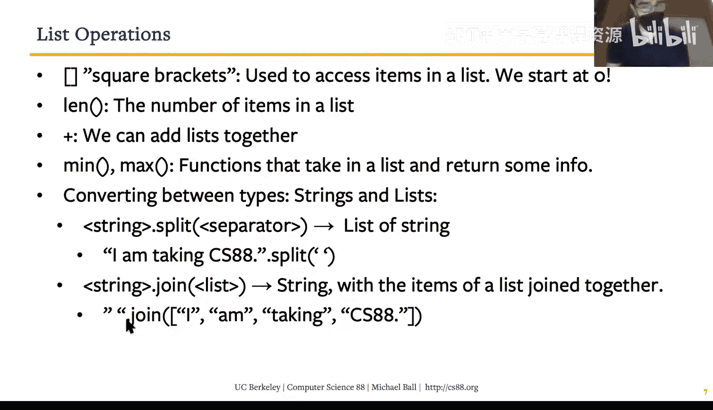

我不然啊。嗯。是。So so far this is。Just a variable。Why is T not arguing？Okay， there you。

And we can split this so split will take in a character。

 it just finds that character and every time it finds， let's say in this case a space。

 it'll make two items。So in this case， we get a list。And we can。呃。Sign that to a variable。

And of course， we can go backwards with joining。The data。

Join the operation one thing that you'll note is I use the name LST in Python the word LIST is reserved so you don't want to name your list exactly list so you'll often see CS88 61A and sort of other examples on the line use the term list to just describe any generic list that might be used some of the functions in homework we' have the name LST and it is not a typo it is very intentionally leaving out the letter I lest Python complain so。

One thing to note。Is。嗯。🤢，So in me just scroll let's see。用。So。Sts and lists。

 we can talk about why later probably on Wednesday。

 but they operate pretty similar so if we have the length of a string。

We've seen that this just returns the number of characters that are in the string。Similarly。

 the length of our list。Oops。We'll just return by the length。

Or excuse the number of items that are in that list and one of the things about Python that as we're going through this is helpful to sort of think about is。

Does？Does the operation that I'm doing potentially make sense on multiple different kinds of data？So。

呃。You， I mentioned that we could。Add list together。呃。Yeah， I don't know if this well。

 but I we need another sentence。So if I want to just combine two lists。

I can use the plus character and then it will return a new list。

 which is a combination to previous lists。And so one of the things is that data that in Python has potentially a similar type of function will let you。

Well let you use the same operations of course， if I were to try and do something a little ridiculous。

喂。Divide one list by another Python says okay these things are list types and I don't know how to divide one list by another。

 but you should kind of start to conceptualize the idea that as we learn how to do multiple of different things in Python。

 if it is potentially logical， there's a decent chance it'll work。

 not everything Python has its fair share of illogical decisions， but。

Most things we should get in the habit of having them work。listist zero。

 does anyone want to shout out what this should return？coolol yeah， so again square brackets。

 we will access items of a list Python then allows us to。嗯。Yep okay。

 that was not what of as I say so if we have a list of four items。

 three is our our last item of the list since we started zero whenever we go beyond the end of the list I was going to the the opposite order。

 but that's okay Python gives us an error message that says list index out of range。2。🤢。

Two things here to note is。The term index is used all over computer science to refer to the position of something in a set like a list and typically if we're talking about lists where we're doing this based on a numeric index and out of range just means we've gone beyond the end of a list so in Python。

This is something that you'll see pretty frequently and very often this is a case of misaligning something that starts with zero versus one。

 or perhaps if you're writing a loop， something like while index is less than some value or less than or equal to some value。

 all those conditions right here， if you see an error like this。Our。

Arere useful things to to look for soops no now that works Okay。

 well that's not the one to complete a couple tricks。在。Let'sく that。

A couple tricks of indexing and Python again， these are not things that you need to memorize。

 but are worth being aware because they will show up in a few other places。

H you could index backwards on Python so negative one is the last item of a list this is something that's just really handy if you're exploring some data if you're trying to figure out what。

What exactly is going on and of course because。This space right here。

Is valid Python but we could write any additional functions or calculations in here that we might want to use so one thing that you'll see as well。

Is negative one works pretty well， but another really common。

A trick to get the last item is list length of the list minus one。

 so that's in this case going to give us four minus one and this is basically how you will or one way of addressing the effect that we count starting from zero in Python。

All of these little tricks here are things that are worth demoing， worth seeing。Over time。

 they will become more intuitive and you'll just get used to them。

 I wouldn't necessarily say that you need to memorize。

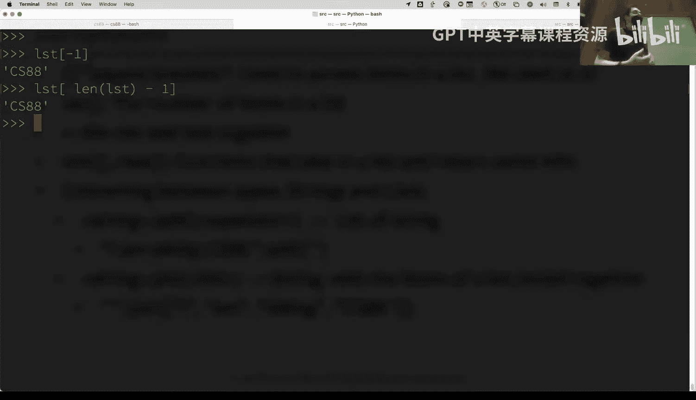

You， all of the。All of the things that that you can do with the list or the ways that it works。

 but it is useful to be aware of them Similarlyly， we are just scratching the surface on what lists can do。

so。Again， I will point this out because。No， thanks， Safari。Not what I want， there go。嗯。

We will definitely get to things like using append and remove throughout the semester。

But if you're working on a problem and you're trying to figure out how to solve it。

 I would definitely take a look at what are the things that I could just do with the sometimes these are ideas for how how you might solve a problem。

 of course in labs we'll try and go over all the things that are most important。

 like we'll get to the sort function later， which is pretty handy。嗯。

Some of them are pretty intuitive right just reverse a list it's worth noting that in Python we talk about how lists work that we'll talk about what things modified lists and return new lists so we'll get to some of that in a moment but there's a lot of good examples and good documentation so I've linked them in the slides but docs。

pyython。org is your friend there and the other trick of course is help。

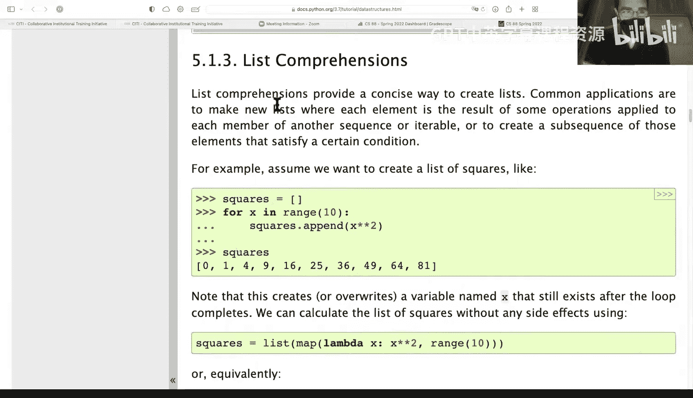

This time we want to use the actual name list and right in the Python interpreter。You can pull up。

All the examples of things that are defined。And there's other ways of。You know of getting that。

 but again， documentation and the help function are。

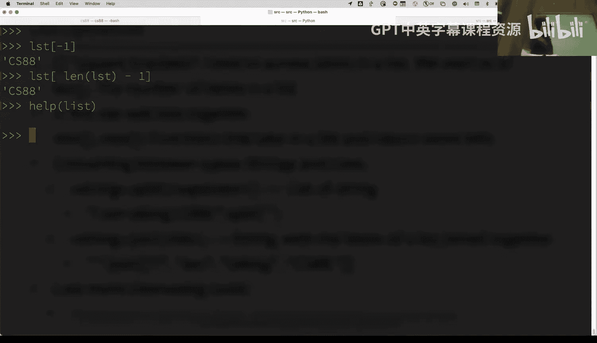

Two super useful things there as are run through。Yeah。Oh。

 would have been nice if the slide had built effects？So。

We mentioned the indexing and again today we're going to go through using lists and then getting into four loops。

So one of the most useful features I think that Python has and it's pretty interesting if we look okay。

 I think it's interesting， some of you definitely don't care。

 but if you look at the development of programming languages over the past like 30 years since Python sort of was around some of the features that Python supports here really innovative and have been influenced and have helped influence a lot of programming languages and so this technique of slicing is a way of accessing data。

In a list by specifying the range of items that。We might want to return。

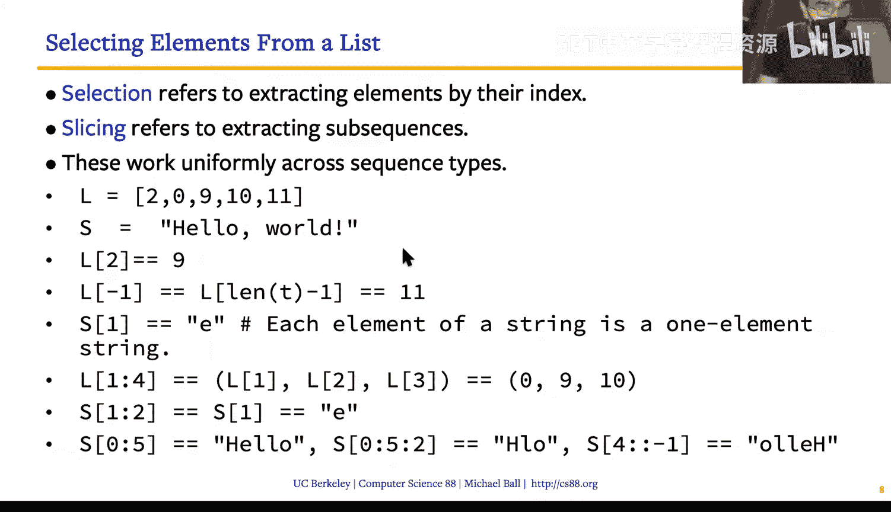

不是啊。So。呃。I's going to see if this。with kind of my examples today。

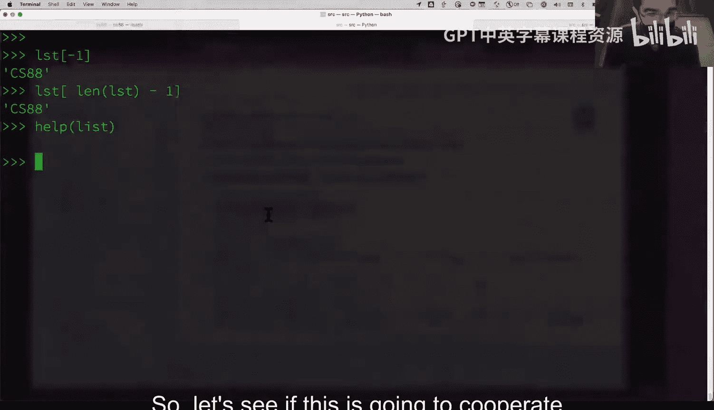

2。One of the nice things about slicing again is like other Python features。

 it works with things that are lists。Andon。And of course， I only copied one line。So。Thank you。

 there you go。So we'll go through。The way thats  slicing for Python is instead of just selecting。

An item one at one time。Plaacing allows us to。あ。嗯。Slicing on last like multiple items at once。

 so let's say we wanted items two， three and four， you could of course write one。Plus L。Two plus L。

So actually you can not do that carefully。Because that would add the numbers to you want a list。

There's a few different ways to do this but that we did want to。😊。

So that's what count numbers had future in our research。

And you can quickly see why out this something tedious if you wanted lists of lots of different items and so and Python。

We can extend this syntax， so we've seen L of1 is the value zero。Two。

 so we use the column so we can start at one。And stop。

 and this is where Python likes to get a little bit tricky。呃。

If we want to stop and include items one， two， and three， we have to do in Python。

Let's not make a typo first， but what we have to do is tell Python to stop at a value one higher than we expect。

So again， this is one of those cases where。Things are going to be easy to make routine mistakes that are worth looking out for so when we slice data in a list。

 what we're saying is wehab a starting value。In this case， index one with the second item。

And a stopping value which actually is in mathematical terms it is exclusive。

 so it is everything from one up into the value four so that's one two and three and we exclude the last value so one way to otherwise remember this is if we slice from one to four。

4 minus one means that we should have three items in our list。

 so if you're kind of just doing the subtraction of you know where do I stop where do I stop。

 how many items should I have it makes sense from that perspective but we started at zero。

We end at one minus the sort of stopping value in our list。

And this is how slicing works on lists because lists。And Pyth and strings are similar。

We can extract a sequence of characters from any string as well and the structure is exactly those same so our second character。

 so this was hellello world so no H that would be index0 ELL or the same set of items。

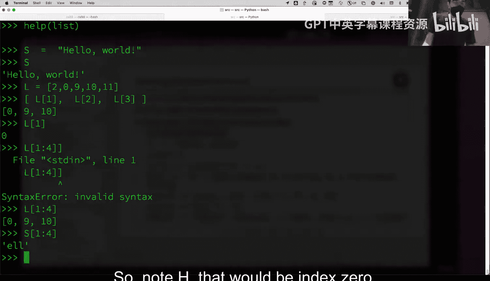

That is a little bit for now on the mechanics。

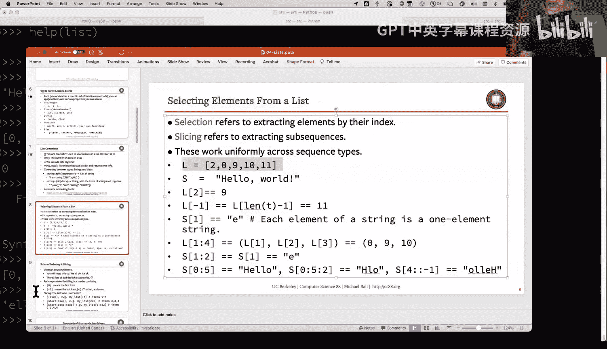

We' usinging less and there were。Some zoom chat questions。

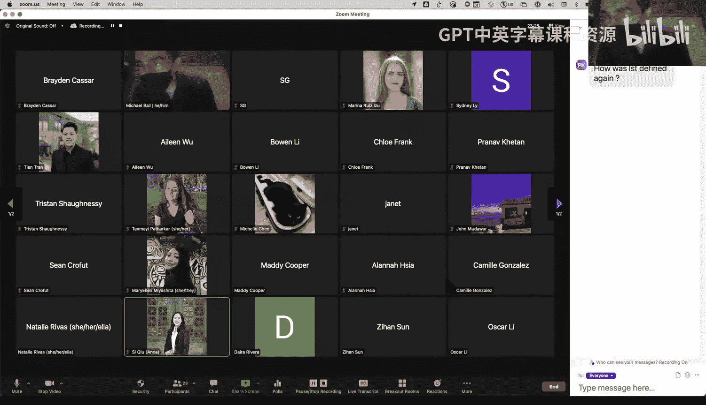

对。Okay， yeah， so I'm going to pause for a moment and。Questions on creating a list。

 accessing items in a list， slicing things like that so far。

 and if you're in the back of the room you may need to wave your hand a bit because it's kind of dark back there and I really eyes sight。

 but I see a question over here yeah。Yes。不是关。Yeah， so the question is just toine from how will slice is we include we start up。

We excluded the very last values so going from one to four is items one two and three and we'll see that this maps to other properties in Python as well one thing is so let's see let's look at the length。

Of L， so the length of L is5。One way to think about why this works is。Is this allows us？

So remember that if the length of L is5。The last item rate is。

Is index for and we'll just write elegant so we can verify so we have。2，0，9，1 11。

Just some random sequence of numbers。The way that Python's list slicing works。

 it allows us to write something I guess from zero to five。

 to write that correctly gives me the exact same so starting from zero。

Ending to the length of a list because we stop one value before that represents items at01，2。

384 so this is sort of a trick where if you're kind of thinking about you know how do I how do I know what works and what doesn't another way to write this perhaps is zero poll。

Lne Capel。Same thing right where lane of L just executes for trends value5。

 you can think of slicing in this way where we exclude at last value but it turns out that a lot of other programs as things get a little bit more complicated some of these techniques will be helpful yeah other questions。

Does someone right here？啊 no啊。Is that a hand in the middle of it there？So yeah， go ahead。

I thought I saw a hand in the middle of it。在。Yeah。

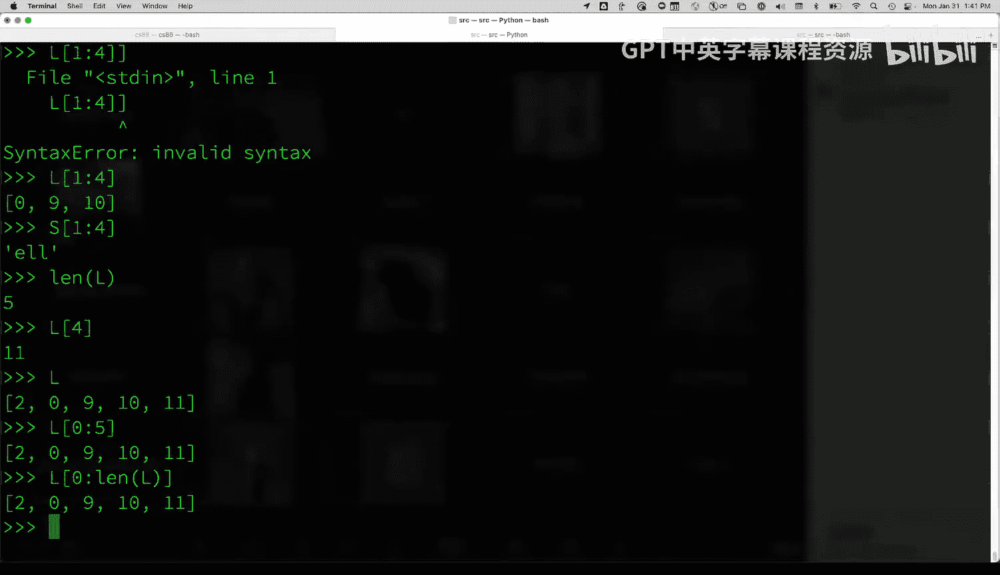

Which line？YeahYeah。Oh yeah， okay， cool so that's。That is going to be the next thing that。

I was going to talk that so I just hadn't gotten there yet。I think it's worth。

When when we talk about Python and some of the features like slicing and this will tie nicely to some of the functions that we will。

Wrap up towards the end of lecture。There are two。

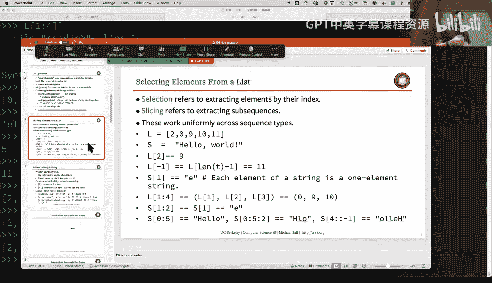

I should say there are three forms。呃呃。Actually written all right well that's talk there are three ways to think about how we how we index and slice data so we can。

We can index data just at a single value， we can slice data from a starting point to a stopping point and there's a bunch of tricks in Python which allow you to sort of say something is optional like we don't actually have to specify the starting point or the stopping point Python will just put default values in but the last thing that we can do is start stop and step and so。

This becomes a really useful way of saying， how do I get a series of numbers？That。

Access certain data。 so what were the example that we had on。

On this slide was the string Hello world， so zero， five and two。

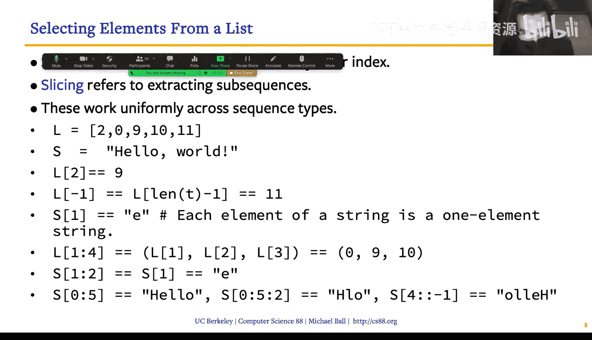

So what this is going to do。Is。We're looking for the values starting at index zero。

Up until index five， so which means our last value would be four and counting by steps of two so that really means we have zero。

Plus two is two plus two is four four plus two would be six so that it is beyond the end of our range so what we get here are。

This is equivalent to if we just write it out S zero。Plus。S2。Plus， S。4。

And that is what the last value is essentially a step value。And this allows us to do some。嗯。

Somewhat interesting and。Sometimes useful and sometimes useless things so a really common trick in python is that we can change the order in which we step by by using negative numbers so in this case before I return think about what。

Actually， before I do that。No， okay， it's not actually not work that way。嗯。你钟爱。Oh yeah， okay。

 that's why。I do need to reverse the start and stop values because。So。One thing to know。

 right is if I wanted to go backwards， I could go backwards。

 but of course now my start and stop values。Are off by one， so if I wanted to do this。

You have to say from four。你给你讲啊。What why don't you like that？翻。Oh okay of fine。

 I know why it doesn't like you， but that's not worth getting into all right。

 we'll ignore that example。Going backwards with negative values is something that is not。

 I don't think it's super useful， but it is something that you will see in a couple assignments and it is something that definitely gets mentioned in the Python documentation。

One thing that Python does， which is really common。Is if you want to reverse either a list。Or a。

Let's actually do this first。So L， what？L and L。Colon， colon， negative one。These two operations。

What it。Yeah。没有。Yeah。All right。Okay there so these two operations using splicing by negative one is a typical way of sort of reversing data in Python and what Python does if we ever leave off a value so we leave off a start and a stop it fills them in with the beginning and end values of a list so this is one of those tricks which we'll just come in handy in a couple cases of reversing a list and importantly what's nice here is when we reverse a list in this way。

The way that we've been doing things with slicing is we are always returning a new version of that lists。

 so we haven't affected。Our original data in any way。 so what we'll try to do in CS 88 is。

When we use list， we'll do things like use listlic。

 which don't affect the original values in our list。You may have seen。

When I showed it in the documentation。Of course， if I type it correctly。你嗯死吧。The reverse function。

If I call reverse。This modifies our function in place。And now if I call it again。

To get back to the original list so Python has a lot of ways of working with lists some of them a little more intuitive than others。

 it has a way of using functions like reverse that modify that data directly。

 but also slicing which returns copies of data that will be really really useful。

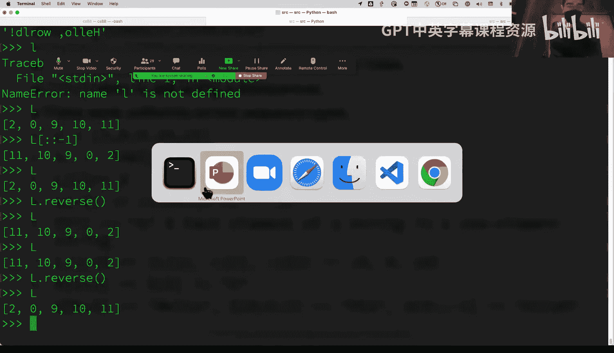

嗯。Actually let's go ahead and。So do I have。我。

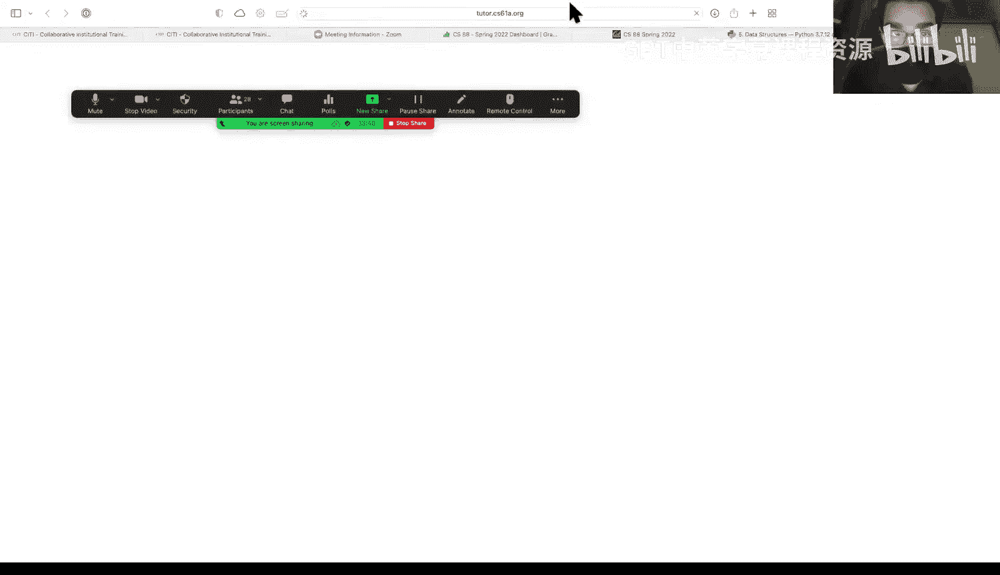

So。嗯。

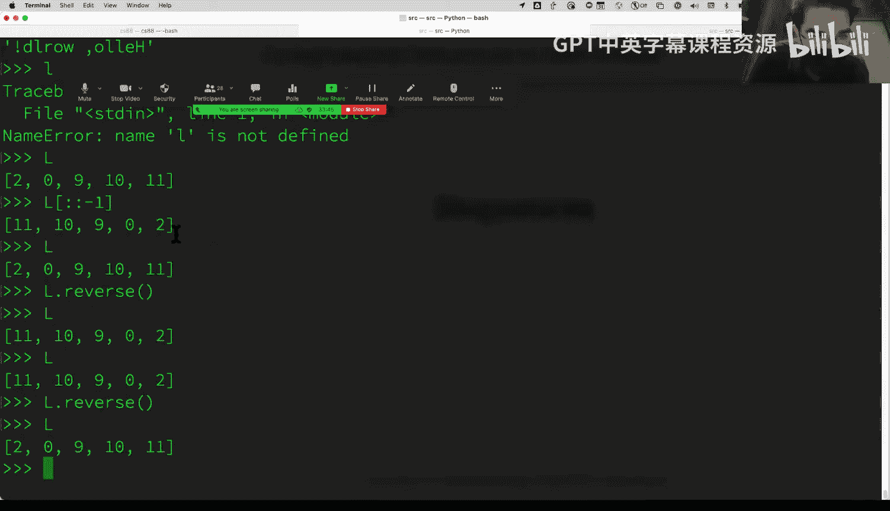

So in Python tur。Yeah。We're going to assign a new variable just so that we could see this。

A little more clearly or actually， know what we'll do is。We will first just print this value。の杯。你呀。

哪喂。So。😊，We'll keep getting to practice with Python Tutor。

 but Python Tutor is really nice because thearrow metaphor that Python Tutor uses。

Will help visualize some of the things that are going out so when I assign a value L to a list Python tutor shows me a list on the right hand side and what is useful here is that each itemable list is its own little bucket。

For today。We're just going to stick individual values in buckets。

 but if you kind of think about everywhere in Python tu that there's a little box。

 there could be an arrow later in the semester， we'll get into lists that are just full of little arrows pointing to all sorts of random things。

嗯。But if we print that， we execute the next step， we have a。

We slice our list in a way that reverses it， we print that value。

 but notice that the thing on the right hand side over here。Does not change。The next step。

 we execute our function， and it shows that this list。Over here。

 the items are now in the reverse order。With Python tutor。

You will sort of learn over time the rules in which if I say list do do something I am probably modifying the value of that list。

 if I say list slice I am returning a copy some of those rules that Python has。They are consistent。

 but they do take a while to internalize and so what I would recommend is going through and using Python Tu when before you click next is to ask yourself what do I think will happen on this next line but after that is you'll have a sense of sort of building up the intuition for what Python is doing with lists。

So。And。In the last few minutes here， we're going to talk about。Sequences and for loops。So。

We've seen now two types of sequences in Python， we've seen strings and lists。

And what we're going to do right now is introduce a third special type of sequence called a range。

 and the range will feel very familiar after having just talked about the way that we do。

List slicing， so all of these sequences。Have a。A series of common properties。

But some of them can be infinite。2。Some of them can be have a defined length。

Sequences can be mutable in that we can change their value。

 but some of them might be immutable like a string。

 but what is consistent through all of them is that we can iterate over the values。呃。Of of each。

Sequence， so。

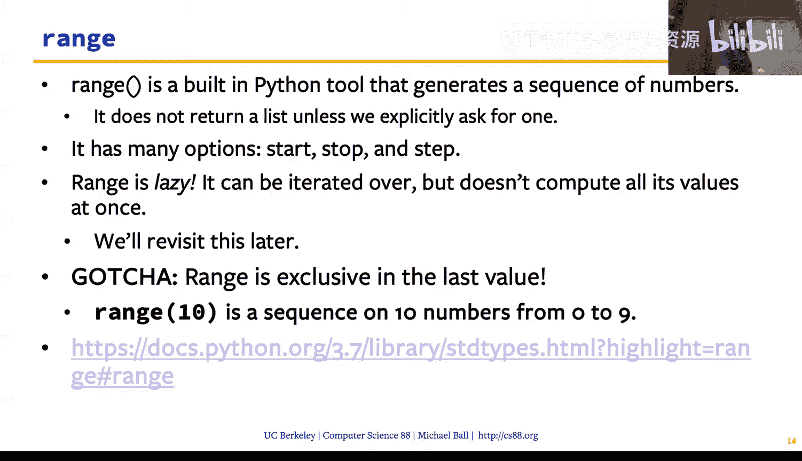

The first thing we're going to do。Is just demo the range function。

And then we're going to actually use the range function for some useful。Useful tools。Range。还有。Okay。

 why。One sec。Yeah， okay， that was。Ignore that result because that was。

That is not what should have happened because I opened Python too。

Admittedly this is the one case where Python 2 did something more easy in Python 3。

 but I want to make sure they'm demoing the right thing in Python3， when you type range。

 you will see something which is not at all very helpful。2。

As it'll just spit back the range and it will add the starting value if you left it off。

 but the range in Python is。Is a really awesome tool what is cool about Python 3 that Python 2 doesn't do is like。

I can do something like this。And Python 3 actually does not try and calculate the entire set of however many numbers that would be。

 but what we can do with a range is use the function list。So this is Python's way of saying。

 give me a new list back to say range， and I'll put in the zero here from zero。去看呢。

This is how I can get a list of the numbers zero to 10。And initially， this seems like。You know。

 a fairly simple tool for things to be built in to a language。

 but it's something that we'll start to use。All the time， so。Again。

 we can do things just like we can with listlic。Where it can say。

 give me the numbers from zero to 10 with a step size of two and notice here exactly in the same way that when we slice with lists。

 we leave off the last value。Would they range？The last value is also exclusive so listlic has a start a stop and a step the range function has a start a stop and a step and its behavior should be。

Identical in those cases， so the numbers that you get back from range will be the positions that listlicing would accept。

Range itself as a sequence， I don't really know you know how many times you do this but。

I could do something like。From zero。To 10， step size of two。And ask for what。呃， the。

Item index three would be so because I've told you that this is the sequence。

 we can use square brackets。To access the items of that seaboards。

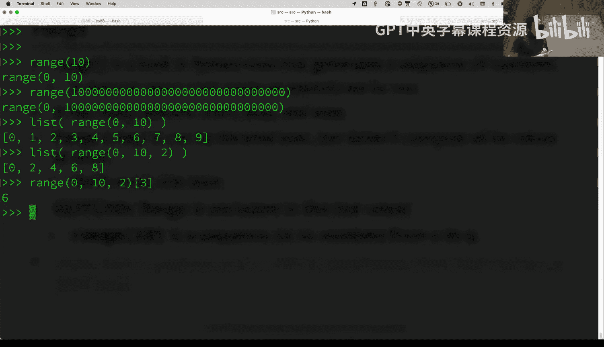

Now。What becomes most useful， we're actually going to skip tuups for today is we'll talk about them in a couple in a couple weeks。

 what becomes most useful with range and list in particular and indeed all sequences of Python。

Is the for loop and the for loop is， I think what is one of the。

Niceer ways of controlling and how we access our data。

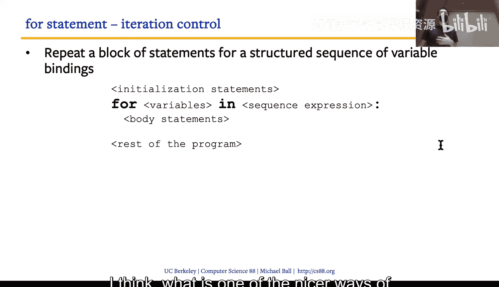

The for loop is pretty。Pretty simple in the way that it works in Python， but quite powerful。

 so we can say for number。In this case， we're defining a variable that lives only in the context of a for loop in some sequence。

 so in this case let's just say range of 10， we end with a colon again and we indent everything by one tab in this case all I'm going to do。

Is print。Our number。So。A for loop in this case is going to be one of the standard ways of accessing values。

In a sequence。Let's typically say one item at a time the nice thing is that this structure。

For some item in our sequence is something that we can repeat across any type of data。

 so I could say for character in S。Great。Car。Oh， like， that's right because new。

So now that I have a legitimate value S。I can go through。Eleement by element。And of course。

 with a list， we can do the exact same thing， but now I need a list。So， let's see。Someone。

 give me the name of a course。Maths 54， good option。Okay， we only need three courses that's。

 you know， that's a good course load。Or courses in。

So one thing that I'll say are we with our last two minutes？So when we're working with for loops？

So you will often see an expression like this， which is for course in courses it is very helpful as you write programs and as you read code to very carefully pay attention to the pluralizationism so for course in courses is。

Of course， if I type that， right？Should be a hint that each item course is one item of this list。

And courses is a set of data which has multiple things in it， so what we can write now is print。

I am taking。Plus。Of course。And now we have a for loop， which for each iteration of our for loop。

 we get one course at a time and we process that data so this is the first introduction to。

For loops and lists， but together these two things will combine to let us do quite a lot of powerful processing of data of all sorts。

 so we'll leave it here today， we'll pick up with some additional tricks for lists and functions on Wednesday and we'll see you then。

Thank you。Yeah。问题上。Yes。

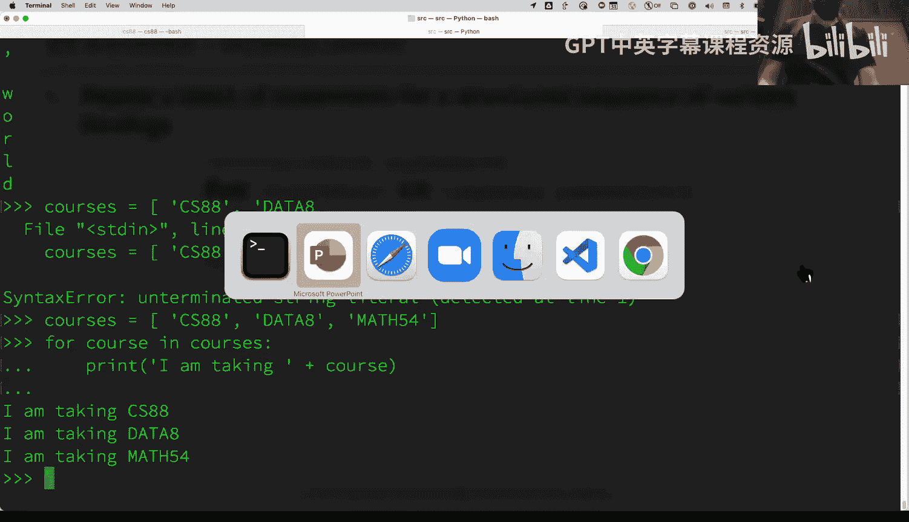