# UCB《数据科学中的计算结构｜CS 88 Computational Structures in Data Science 2022》中英字幕 p05 CS 88 Spring 2022 - Lecture 5 - 2_2_2022.zh_en [BV1516iBfEVY_p5]

Share the Zoom screen。

Go back to PowerPoint。嗯。Yeah。Okay。Unfortunately， it seems like I need two microphones right now to make this work with Zoom。

 but that's okay， we'll keep working on that。So。😊，This week， we're going to， oh gosh， okay。

We're going to lower that volume a bit and hope this stabilizes。This week。

 we're going to continue with using lists for a little bit。

And then we're going to talk about this topic， which is pretty integral to CS88 and CS621A and sort of the。

In some ways， you could say the history of what makes computer science unique at Berkeley and it's this topic of higher order functions。

Hirer functions are definitely on the list of somewhat mindbending topics things that today there'll definitely be times that seem a little bit confusing a little bit like why the heck would we want to do this but hopefully through the course of the next couple weeks and indeed the semester you'll come to see that techniques of using higherer functions are super powerful and enable us to write some really cool programs so just general announcements。

Most of these were just sent through Ed， or I think both of them were sent through Ed as email blasts。

😡，Please do keep up with Ed you use Ed for all all of your private communication there's a private post mode。

 you can be anonymous when it's public， most things can probably be public on Ed。

 you but if it's something sort of logistics， whatever feel free to make that private Ed is much better than emailing myself for an individual TA because the entire course team will be able to see it and so someone else can respond more quickly usually than one person。

😡，But the main things that I want to highlight is there's one form for all assignment extensions so。

If if you need an extension that is somewhere between one and three days that's what your slip days coming in for regardless of sort of what the reason or need is。

 you can just turn in an assignment three days late and you will get credit for it if you exceed your slip days throughout the semester it's typically not a big deal but you always still get some credit for turning an assignments we want you to be in a position for CS88 where coming to lab coming to lecture are super important they definitely help you learn but doing the assignments is where you will spend your time learning and struggling through them and submitting and resubmitting and so there is never reason CS88 not to turn in an assignment。

You know you will always get some form of partial credit for training an assignment as long as like that submission is open so if you do need an extension beyond three days。

 please ask us the sooner the better obviously that helps us plan that helps us check in with you we're generally going to be you know easy going on extensions but we want you to ask for them so that we can check in if it's you know something that is。

A little bit longer， but also on the extensions form， we will ask you。

 you know how many days do you think you need？😡，You know be reasonable。

 assess your own situation and we will work with you on that， but for the most part。

You know that should be pretty easy going CSM section signups start tomorrow so CSM is CS mentors which is an undergraduate student organization in the computer science department they volunteer their time for tutoring help sections are dedicated groups that will meet starting weekly to review CS88 so each of the loative courses has CSM sections but throughout the semester CSM puts on other events things like resume workshops interview prep whatever it might be and they're a great group of folks they're often the people who are volunteering their time before they join course staff or take on other opportunities so if you'd like additional help it's definitely a great resource to check out but by no means required。

So。With that we're going to wrap up one additional thing on lists and that this is this tool of list comprehensions beyond talking about list comprehensions we're not going to do too much of them today。

 but next Monday when we talk about lists and higher functions we'll come back to list comprehensions。

 but they're super useful they tie in with lists and four loops so we'll finish this up before getting on to the topic of higher functions so。

List comprehensions are a Python feature that allow us to build lists what we can say in line。

 so in one line of code we're going to do that and we're going to use them as an expression which returns a list。

And then we'll look at how we can filter lists using an if statement within a list comprehension。😡。

All。L comprehensions， one way to approach them is you can think of it as an inverted for loop。

So normally we say four item in list。Do something in a list comprehension。

 we say do something for item in list， but crucially what's different is if we notice at the beginning and end of our list comprehension。

 we have these square brackets。And the idea here is that we sort of let we say we can let the data dictate the control that's happening so in some ways this can be more concise than a for loop and otherwise it's just an alternative to a for loop。

And then we'll look at what happens if we add an if statement in the mix so today's lecture examples are all in this hot stop p file which there's a version on the website and Ill upload the modifications afterwards。

 but what we have right now。

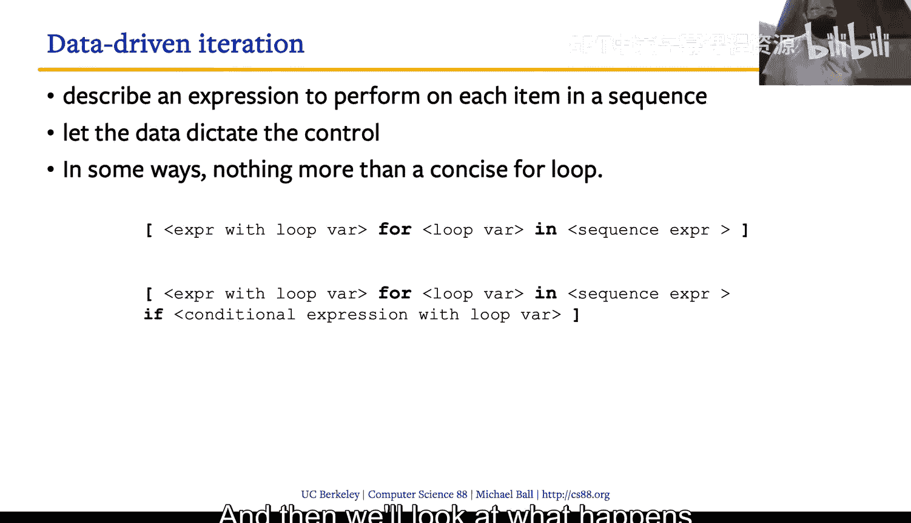

Is this list of courses？And。This is just so far any standard Python list。

 nothing super special about this。Well this comprehension。

 what we said was we start with square bracket or with square brackets at the beginning and the end。

 one thing to think about in Python is that the syntax is consistent in almost all the places and so if we see square brackets。

 we should start thinking list。And I can just say print。Course。Or course。In courses。Now。

 this is not necessarily the best example of a list comprehension because we'll see what happens at the end。

But what we get back is we print the list of courses like we would with the regular for loop and then we notice something else additional happens with a list comprehension what we get back is actually a result that is itself a list so let's call this thing useless because it is indeed a useless list。

And because the result of print print evaluates to none， this is just a Python thing。

 but what a list comprehension actually does that can be super useful。

It takes the results of that left hand expression and puts it as an item in our list。

What we might do is let's say we want to know what departments am I taking courses in this semester and you'll notice that this list of courses I specifically put a space between the department and the course number just to make this easy but that's not the only way that we that we need to do so let's say I'm going to make a variable called CS88 just to demonstrate what we're going to do。

So CS88 is going to be courses of zero。

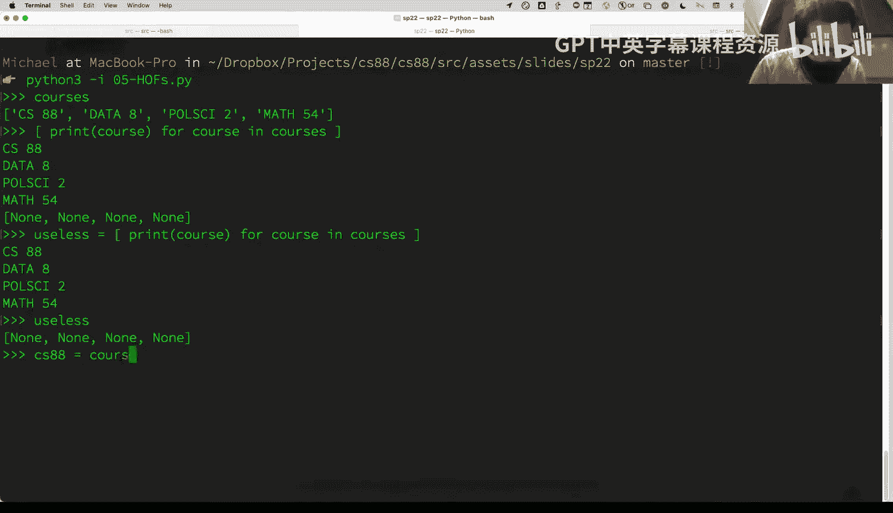

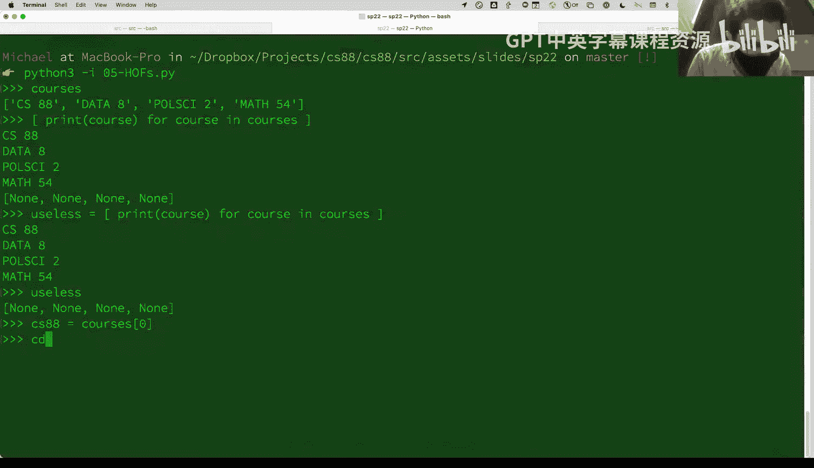

So。But this is just the string CS 88。 if I want to get the letters CS again， handy trick here， split。

By space。So that gives me a list of two items。And to get the CS。

I just accessed the first item of this list。What we can say is I now have a list of courses I have some expression that I might want to do for each item of this list。

 how can I use lists and for loops and list comprehensions to make this process a little bit easier so we can。

We can first think about。What happens if？We were not going to use a list comprehension and I wanted this resulting list of。

Of departments， so I could say four。See in courses。Normally。

 I would recommend that you use the word course， but what the heck it' a demo。Departments equals。呃。

We can do this in a couple ways， but we could say。Departments。Plus， the list of one item。

 which could be。诶C。Got split。By space。Rrackacktets， zero。And I need it。She had a type it there。

So for course and courses， departments equals。Our list。Plus an additional item。王。Oh。

 I had two typos in the line。We're just going on。All right。

 we'll start this again for seeing courses。Departments equals departments。 split。

Type it all correctly。And now with a regular for loop， what we have here， hopefully is。

A list that has our CSs， our data， our polyci and math， so our original list。

Was this list of courses and we're trying to go from a full list of courses to just the departments you can kind of think about right if you are given a report of data splitting some data aggregating it in some way might be a pretty common practice。

And if you're just sticking with a for loop， and that's all you know， this approach works fine。

 but you might notice that it's kind of clunky to say take a list。

 add an item of an additional list and do it that way so what a list comprehension does is it allows us to in one expression take the work of that for loop and return a new list so。

The one got you those that we have to think a little bit backwards in a sense。

 so in this case C dot split。Of our space， item zero。嗯。For C and courses。

And now when we execute this list comprehension， we。What we get back。

A just the list of departments we never had to make a list beforehand we didn't have to extend or append or add any items to our list and so what's nice about a list comprehension it says is take this thing on the left hand side。

 stuff it in the value of an output list。And that's where。

How how a list comprehension works so essentially we can think of them as just another form of a for loop。

Questions on this example so far。And if you're in the back。

 feel free to just shout out a question if you have one because it's a little dark back there。

Or the side or wherever， was that a question over here？No。嗯So。

This is one example of a list comprehension， the other really useful thing that list comprehensions allow us to do that we'll come back to next week。

 especially is a way of。

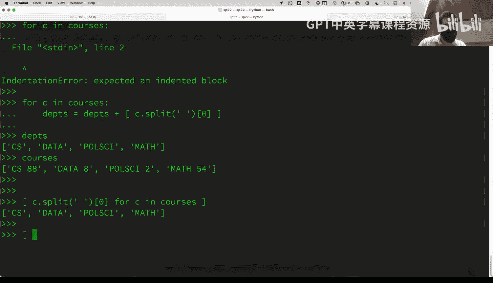

Of filtering data。 so initially what we have here is expression。For some variable in some sequence。

What we can now say is some expression for some variable in a sequence。If some condition is met。

 and the way that this will work is it'll take our list comprehension and it will return us only the items for which this conditional expression is true。

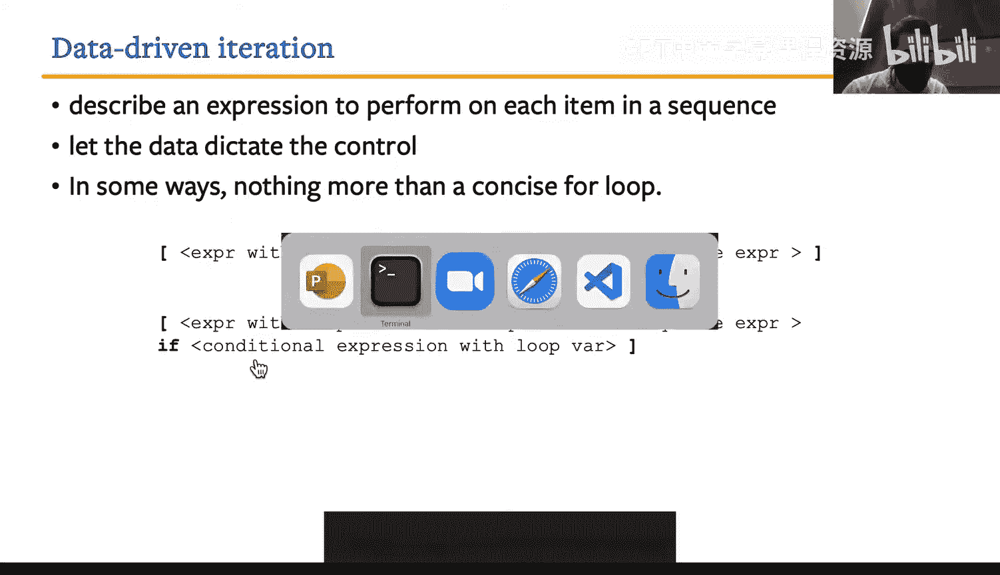

So。Actually， our list of courses。呃。嗯。So let's say we wanted a list of even numbers。

So we're going to start off with our number and this is one of the things that can be interesting about thinking about how list comprehensions work until you know what you're doing you might have to sort of write out the idea。

Or think through it in another way because our first thing is we want a list of numbers。

 so our variable name will be number。for。Number what gives us a list of numbers。

 let's say range of we'll do 20 in this case。And if we want only even numbers。

We can add a condition like if number。Maud。Maud， too。Is equal to zero again。

 mod  two equals zero is the the shorthand check for is this number even？And if we execute that。

 we get zero2，4 and so on all the way up to 18。A list comprehension lets us do。

Something like both process a sequence of data and modify that data and also filter that data in in a single expression so if I wanted to I could combine these things so that。

Maybe I want。The list of numbers， which are even numbers squared。I can do something like that。

 what if I want， let's say lower div courses？Yeah， we could say is equal to。Of course。Or。Course。

In courses。If and one thing to remember again is our conditional expression。

 we have access to that same variable that we define， so if course dot split。Actually。

 this is going to be a little bit messy。Because we need to make this an integer for what I wanted to do。

 so if our second argument。Is the course number if our integer is less than 100。

This should be lower divs。And that returns all of our courses since this list is all lowerative courses in Python I wish the cleaner。

 but if I want to compare the text 88 to the number 100， I first have to convert it into an integer。

 so Python makes me do that step， but list comprehensions are a pretty useful tool。

 you'll use them in labs in general what I would say。

Just to note on you know one of the philosophies is the labs and homework assignments are teaching you a process for thinking about problem solving and so sometimes we'll say solve this question in a single expression and outside of CS 88 there's very rarely a need to。

You know to write just a single line of code to answer question whether it's a research project a job interview you know what have you multiple lines of code is is totally valid。

 but when we do ask you for a single line solution what we're trying to get you to think about is what are the tools that Python's giving me and that we've taught that help perhaps abstract some of the additional work away or that help you。

Use you know some of the these tools that we're trying to teach and so if something involves a list if we say do this in a single line。

 it probably means a list comprehension is is a tool that you would want to sort of reach for at the same time you can always write a for loop first。

 understand how the for loop works if that's more comfortable and then translate your code into。

Into a list comprehension so that's a little bit about how list comprehensions work they are a super useful piece and you will hopefully have a chance to practice a fair bit so we'll leave it there but questions on how any of these examples work。

清。Oh， yeah， go ahead。Oh， right here。Yeah， that's so。

What we have right here is CS88 is just so course right will be each item of this list。

So CS88 will be our first course thought split。Is going to return a list of two items so one will give us just the second item of the list so that's all it's doing so this is one of the things that I will say is I can absolutely do this on one line if you wanted to write a for loop。

Where you first said course number equals course。 split and then say if course number is less than 100 or something like that。

 that would be a totally valid way to it， but yeah， this is just a shortcut to extract the text 88。

Other questions， yeah， is there one back there in the middle where is that it no， that's just。嗯。嗯审判长。

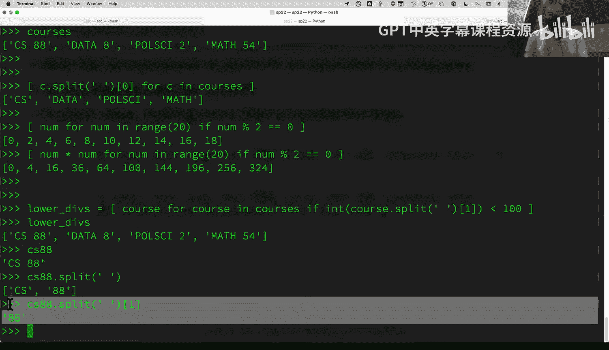

All right，So on Monday， what we will be doing is taking the list comprehensions。

And turning them into higher order functions that operate on lists of data。

 but before we talk about higher order functions that operate on lists of data。

 we should just talk about higher order functions more generally。And。Hirerer functions。

 what we're going to do here is。We're going to create functions that accept functions as an argument to another function。

And what we're going to do is treat that function as a piece of data itself that can determine how another function operates。

And I have used the word function like 500 times and so what we'll be doing is。

Really just sort of taking all the power that Python gives us as a programming language and using it to write code that can change how a program runs automatically so in our first lectures on abstraction we talked a little bit about code as a form of data and one of the things that is super useful here is recognizing when we have a problem that we're trying to solve。

😡，That is similar， but a little bit different and higher order functions are a way。

That we can take common problems and abstract the logic such that we can solve a similar set of problems with very similar amounts of code without duplicating all the effort and that we can take one problem solving technique and modify ever so slightly to a new set of problem so when we say higher function what are we talking about we're talking about one of two types of functions in Python。

The first type is a function which accepts another function as an argument。

 and so we'll talk about what that means。And the second kind of higher order function is a function which dynamically creates and returns a new function。

 so you can build functions， you can build functions that build functions in Python and of course you can have a higher order function which combines both of these things takes in a function。

 returns a new function using that input and we'll actually see an example of that。😊。

Before we get to actually playing with higher functions。This is mostly for reference。

 but Python has a whole bunch of modules and some of the stuff that makes the examples easier rely on modules which are built into Python but not include automatically。

 so when we say import some module name that just gives us access to a library of code and import in Python supports a bunch of different syntax features that sort of shorten what's going on so what will typically say is from some module import some functions X。

 Y and Z。And that allows us to use these functions in our file so that Python knows about them we're going to stick to built in functions and Python in this course。

 but outside of CS 88 you might use Python to do something like build a website you process some data so you will often see things like import NI。

Import a project called flask which helps you build websites。

 so you can use imports for just about anything， but we're going to stick to a few common functions so there's a math library which has some handy functions like pi and square root and an operator's library which has functions like add subtract multiply and divide as actual functions so。

We'll be seeing that in some of the code。So here's a perhaps interesting example， again。

 if you haven't taken calculus the particular math here doesn't matter too much except to say this is an example of a problem。

Where what we're trying to do in each of these cases is sum a bunch of numbers and if we look at this here on the very left hand side of each of our three examples we have is a summation from one to five。

Of some function of k， so in the first example。This is just the sum directly。

 so just we could say that's an identity function， we just say it's k， we have the sum of k cubed。

And at the bottom what we have is the summation approximation for the value pi。

 so if we sum up MF numbers we actually get a more accurate result of pi the fact that this happens to be the term to to get the value for pi is irrelevant。

 but the point is we can see on this slide that what we're doing is。One kind of problem。

Where we are adding numbers together but doing it in three slightly different ways and we about these are three slightly different ways。

 but of course we can imagine just about any possible representation of some way of adding up numbers to K so。

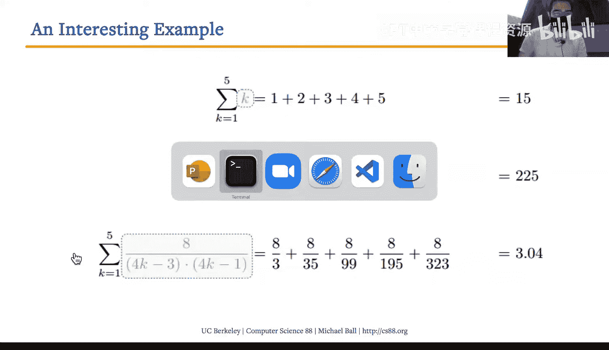

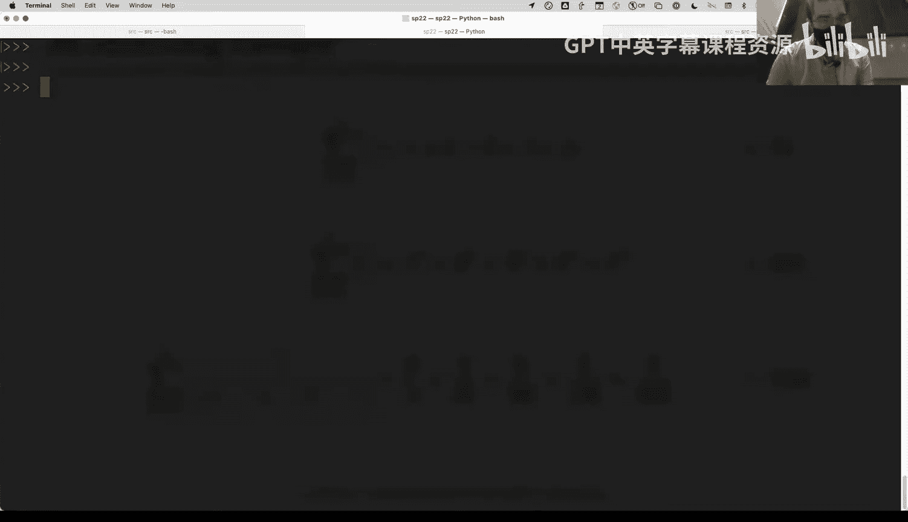

I am not going to write all of this from scratch right now， it is linked in the file on the website。

 so I'm going to do some。Hoping and tasting。Before we get to the higher functions。嗯。

It's worth thinking about how would we solve this？In。

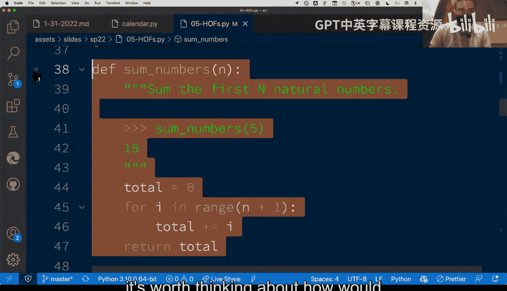

You know， in sort of some normal way and so we've learned about for loops we've learned about range。

呃。So you might have an initial approach， which is just for ion range of n plus one。

Take a value total， increment it return the total， and we can actually see that sum。

I have numbers this way。five。This gives us 15。we can put in any value we want。Again， I said earlier。

 sum from 1 to 10 is 55， we'll keep coming back to this in various ways because it's a pretty useful example。

Yeah， this is I think easy enough where if we have one for loop one problem that's that's all good but on our slide we had the sum ofqubit numbers so we could take this python so this is where some of our imports come in let me just do that before I。

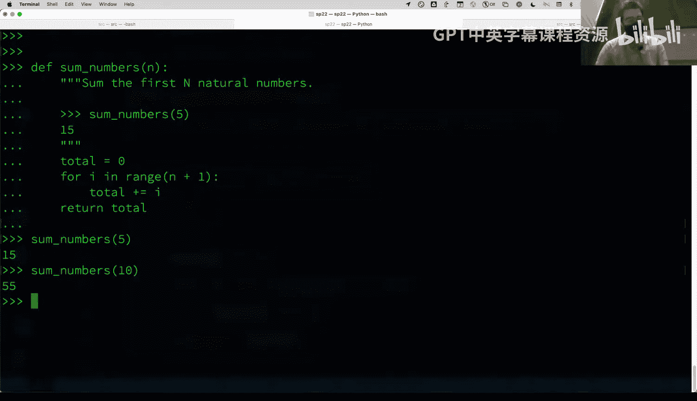

run into。

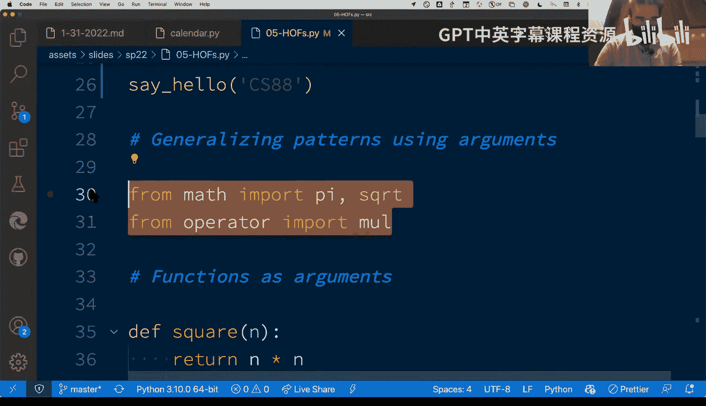

Un necessaryces error message。

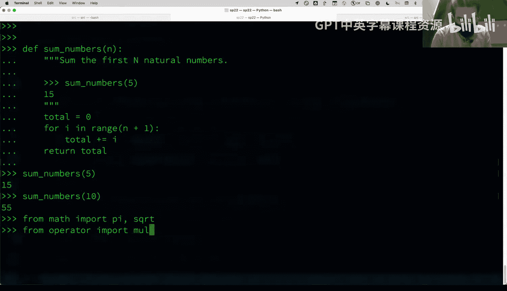

嗯。Actually， where is。Today I not。Whereas power， actually， yeah。

So we have a sum of cube functions that was on the slide。

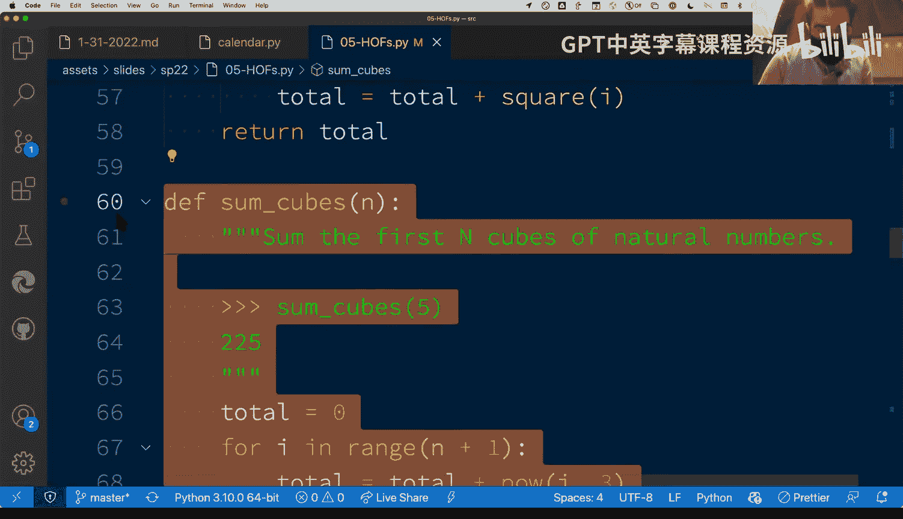

And are some of cubes。If we look at the code。Well， first we can verify that it is。

Going to give us the same result as a slide， but if we look at our sum of cubes function。

 what we might notice here is that we have a bunch of lines of code。😊，You know。

 each of these is four lines and only one thing is different， right instead of saying。

Total plus equals k now we have total plus equals our power function and so if we start to write code like this where you say。

 okay， these four lines have the exact same shape， whether it's two or four or in some cases 20 or 30 or hundreds of lines of code。

 if these four lines have the exact same shape， maybe there's some way of taking what is happening here and pulling this out and abstracting it in a way and so。

Higher order functions。Allow us to。To solve this problem in a really nice and elegant way。So。我。

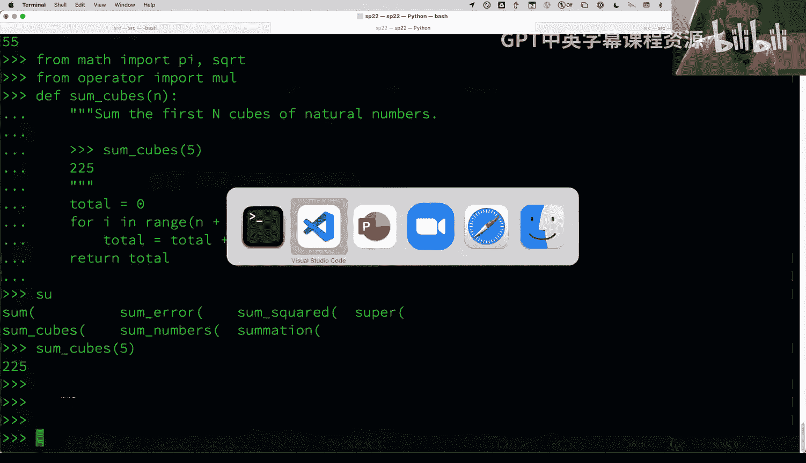

How do a higher functions do that？So， the。It's actually just right。

 we're just going to paste this in for now， this is our general summation function。

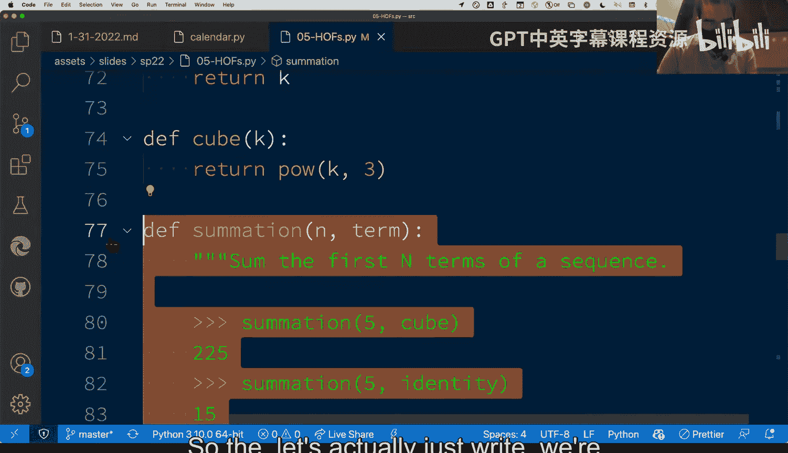

So the first thing that we might want to think about is if I'm trying to。

To take the K term or the power term and make it more generic。

What do I need to pass in to my function？And。In this case。

 there is a way to do this in Python and it relies on treating a function as a piece of data and what's cool about Python。

is。That。Whatever we say something like print。Not that it matters。But if I say。Print hello。Great。

I get the result that we expect。But what happens if I leave off the parentheses Well。

 Python in this case tells me that I have a built in function print。

But what this actually means is that print is just another variable。

 just another piece of data that we can access and so if I don't do anything here， this。

 this name print。😡，Is in fact a function that I can pass to another function。

 it is just like any other variable， I can in fact do something like if you're lazy。

 which is a totally fine attribute to have。They can say P is equal to print。And then I could say P。

 hello。Of course， I typed it again， but whatever。And that is one way of I wouldn't call this this is not a higher function。

 but this is treating functions as a piece of data that that we can manipulate and so what Python allows us to do essentially is just by leaving off the parentheses。

We have access to treating a function as a piece of data。

 and so that is a really useful tool if I were to evaluate P。

 Python knows that P happens to just be the built in function print a fair warning though you probably shouldn't alias all the functions to one letter terms in your programs。

 because it'll make sense for just about five minutes and then very quickly become confusing。

 but sometimes it's a useful thing。To make this exercise work。

What we do need are are a couple functions that we can pass into our our summation function。

 so we have seen if we want to keep something there's a built in power function。

 so let's say we power of three。And two。This is going to give us nine， right？嗯。

3 squared is nine in our summation example。We had。We had 27 because there were cubing numbers。

What we need to do then is figure out well what how are we going to call and and access the。嗯。

ByThe function that that we want to。

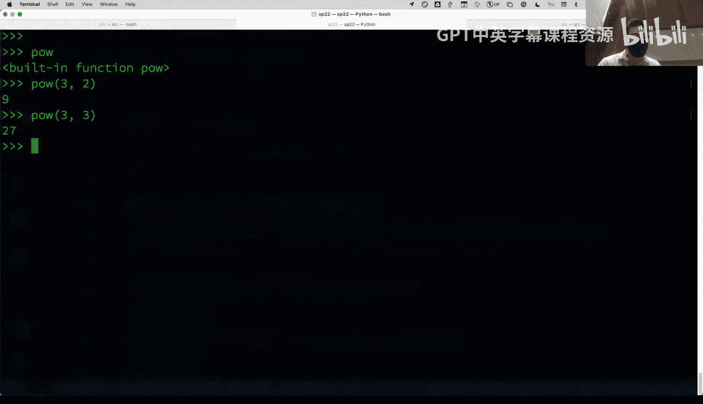

That we want to use。And inside our summation function。

 I'm going to hop over to just visual Studio code for a moment。What we actually wrote was。

For I range n plus one total of term plus I so what we have to think about here is what should what arguments should my function be called with in this case。

 if we're summing the values from one to n for each time。

Our function needs to accept just a single number， or that's the easiest way to make this work。

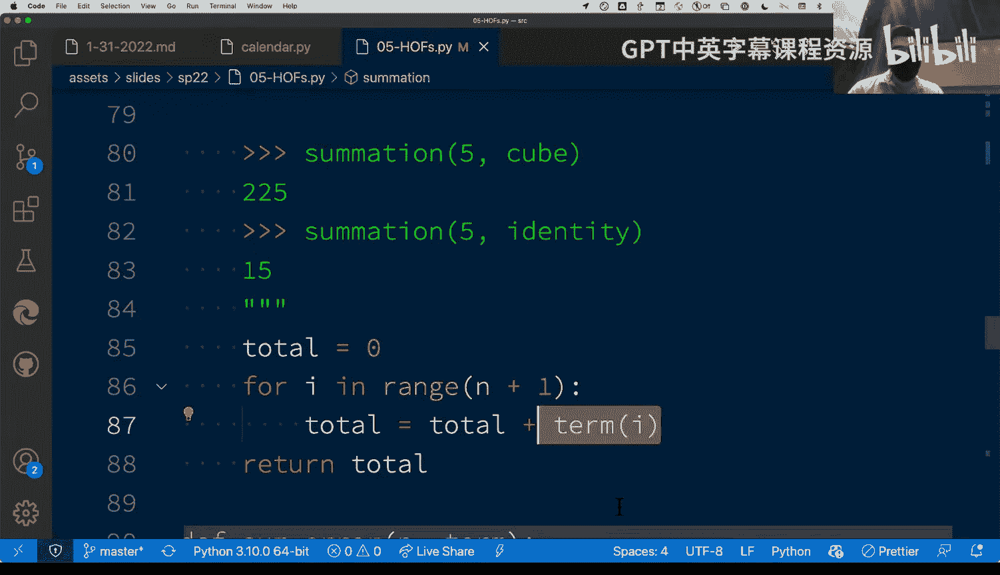

So how do we get？How do we turn this power concept into a cube function？

We do something which is pretty common if we went to cube X。We can just return power of X。

To the power of three。And of course， cube。Of three should be 27 still。

Cube on its own now is a function cube。And。Because of this。

What Python allows us to do is say summation。From one to five。Using the term cube。

And what we should get back is the same result 225。

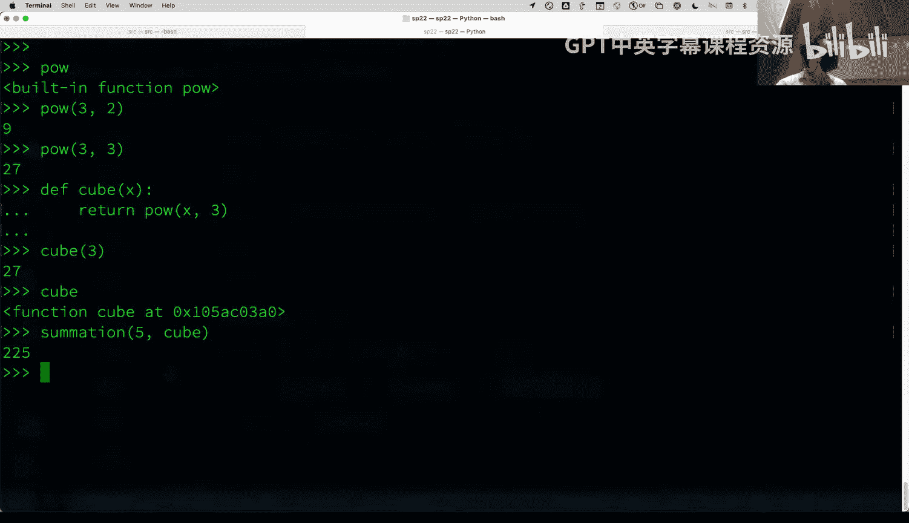

So。Why， why does this happen， Well， cube is a。Cub is an argument here， which becomes the name term。😡。

and。You might have noticed， get out of the way is。How do we call a higher order function well we just put parentheses on it and we call it like we would any other function。

 so this is our first example of passing in a function as an argument。

Later deciding to call that function and then using the result。

That is the gist of passing in a function as。as a。嗯。As an argument。Before we move on。What is。

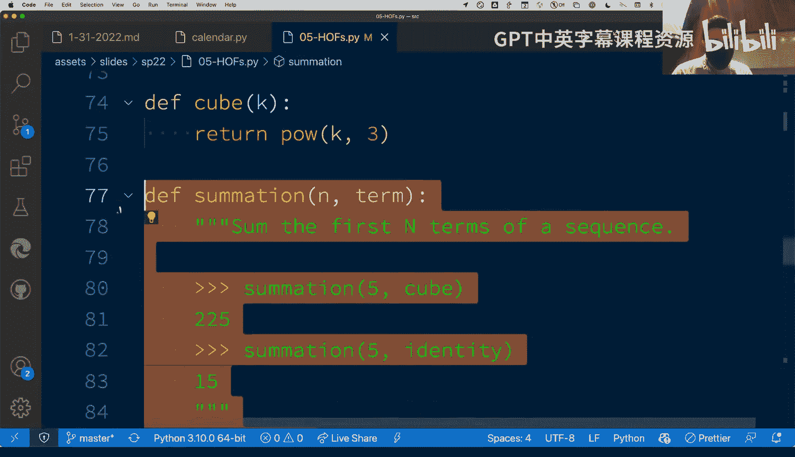

What we can do。And we'll come to that example later。好。

Is we'll take a look at how Python Tutor represents。Our， our results。 So again， with Python tutor。

 be aware that。A lot of times the steps will seem quite a bit longer。

Because it is really executing every line of code。But the nice thing is that when。

When we start executing with Python Tutor， what we start off with is actually。

 let me go back one step。So呃。Read the bottom is whenever we have a function。

 Python Tutor puts that function on the right hand side because it is something that is more complicated than numbers and strings and Boolean values。

And so inside our summation function， it's our first step， when we have an argument。

 we'll notice that what Python tutor does is draw an arrow from the argument term to the function cube。

 which tells us that these are the same whenever you see the word term， that means cube。

And so when we get through executing this loop。So we'll start off a total。

 now we have a value total equals zero。Inside our for loop， we start with I zero。

And now we get to calling a new function cube with the value x of0。And so this should just return。

Zero in Python Tutor。And essentially now the rest of this example is just adding values。

 calling cube， adding values and calling cube， so if we jump right to the end。

 what we would see is every single call to the function cube。

And at the very end the value that gets returned would be 225 Python tutor by the way。

 if you don't use print or you don't assign something to a variable it's not going to show you the final result so if I wanted to do this again it's probably was saying print of this result or assigning it to a variable but if you're just in the interpreter you would would see the result so that is our first harder functions example questions so far on what's going on here。

是。😔，I can't see someone's hand， please do feel free to shout things out。Oh yeah。

 was there hand over there？Or go ahead if your hand was up， wasn't true of someone。

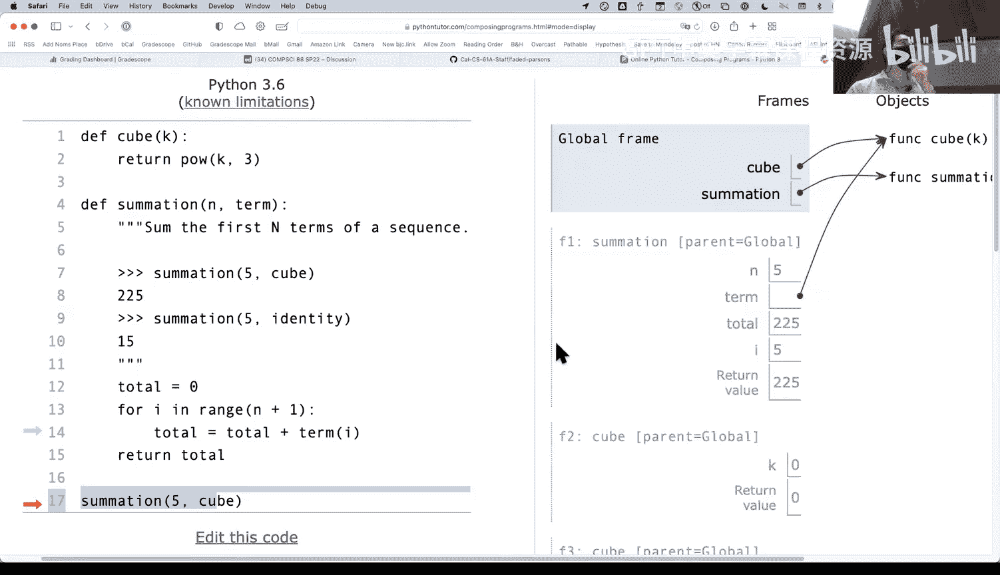

没有。So。

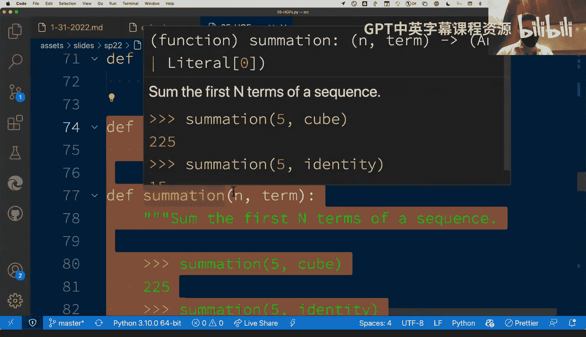

In this case， we've done one we've passed in one function of。Of of cube。

 but we can pass just about any function that we'd want。 so in。哎。In this case。

 we have from the slides。

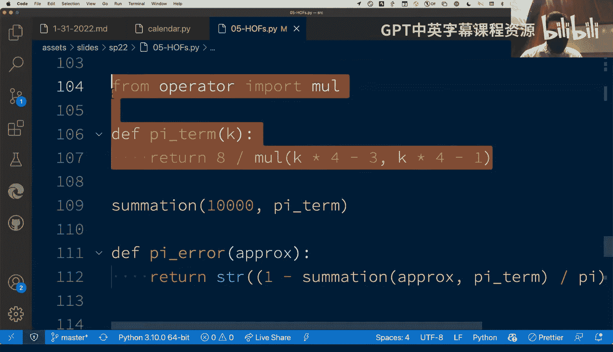

呃，第。The expression。That represents。The calculation for pi， so we could just take that。

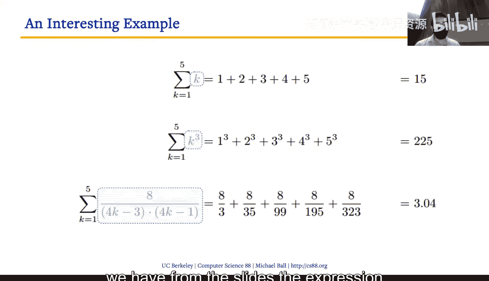

Paste that in。 And now every time we we want to calculate。

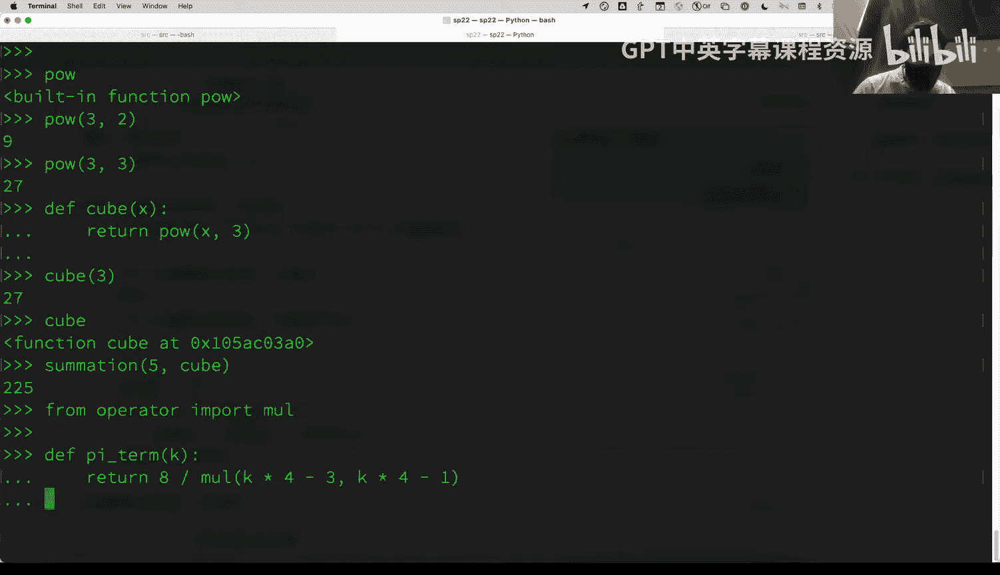

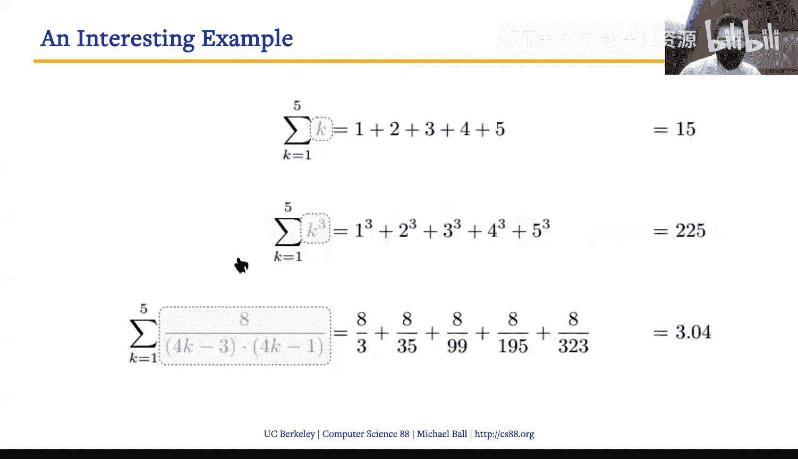

Come back here。Now， every time we want to calculate the value of pi， we have the same summation。

 all we have to do is change one。

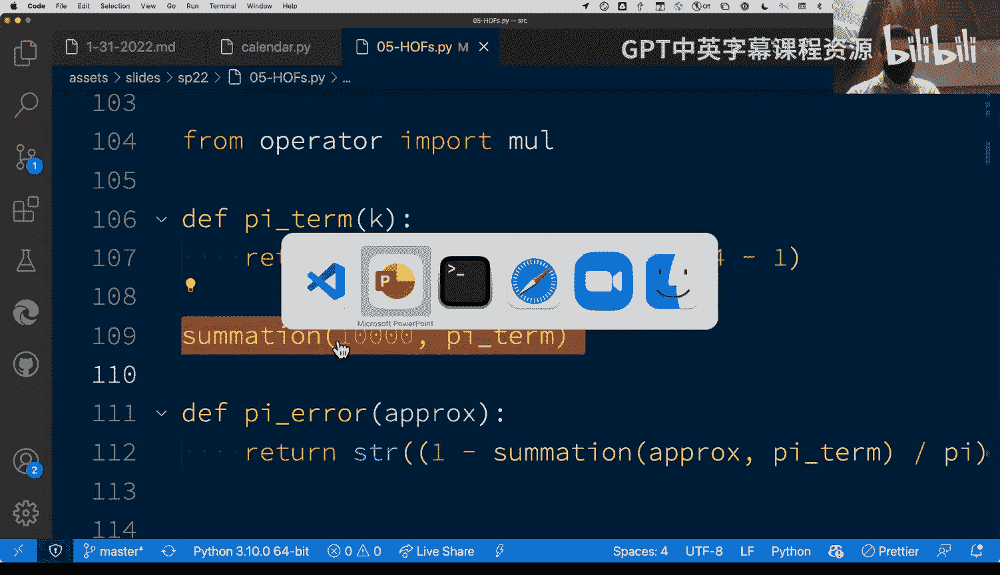

One argument。To show that that works that did。Okay， that did not work。嗯。

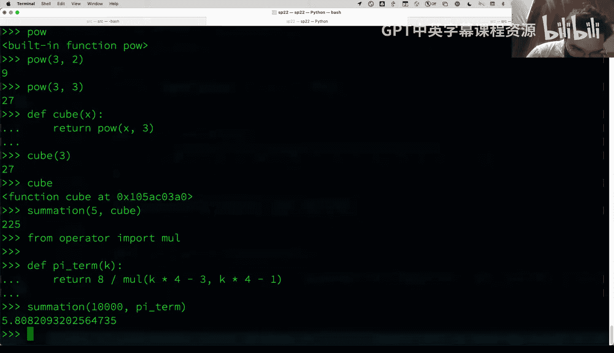

W they're not giving the result tax， okay， I'm going to have to come back to that。So。

I don't want to debug that in real time since there's another example to get to。

 but I will look at that after lecture。

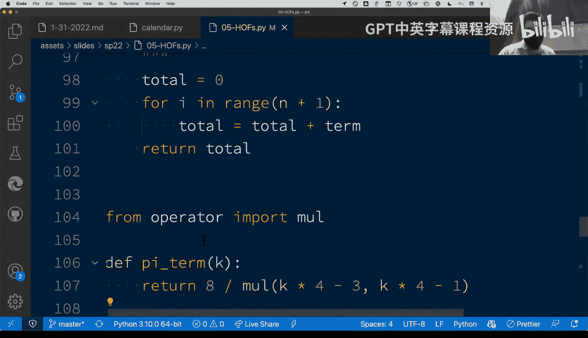

So passing arguments to functions is all right。Is it really useful tool？

But the other example that we could do is adapt all of this to returning a new function that we have built dynamically。

And together we can combine these two ideas with some more some more complicated functions。

 so in this case a higher function， we're going to focus on the second part now a function that returns a new function as a result。

And the first example is a function that。We're going to call less than or equal maker and this introduces two concepts。

😡，In sort of in one function， which is。Inside this new function less than our equal maker。

We can say define less than or equal， which accepts some value。

And we can return that less than to equal function， so in Python。One of the really useful examples。

And we'll see if。

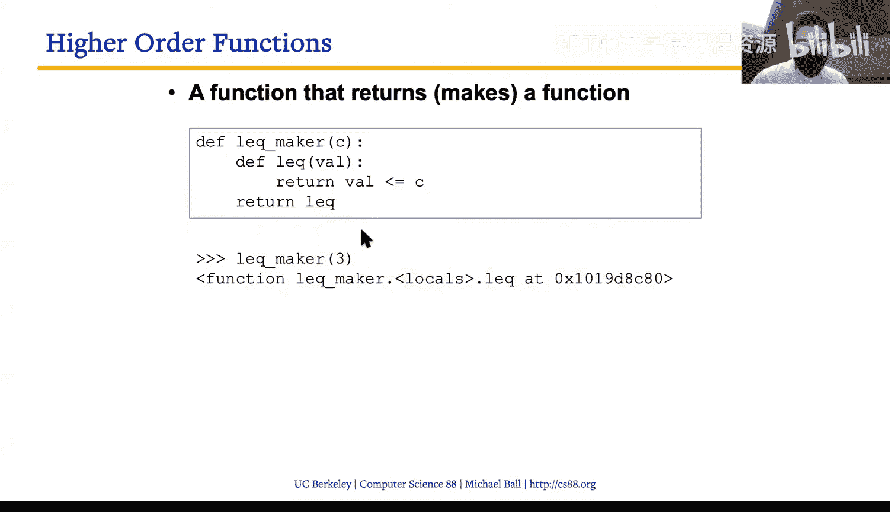

So， do I have。

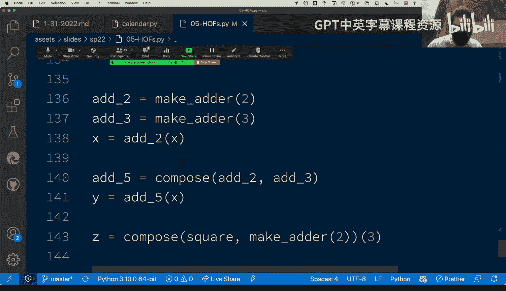

Why don't I have this one on the file？

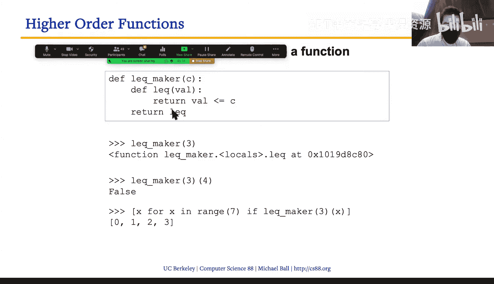

All right。We'll see if this works， may not cooperate with me， okay， perfect。Yeah the way for now。

 so in Python。😊，It is totally valid for us to define a function within another function。

 we can do this as many times as we need， although hopefully it's not you don't do this more than let's say two or three times。

 but what this allows us to do。Is。Is create a function。In the slides。

You could say less than or equal to three is equal to less than。Or equal maker of the value three。

And what's interesting about the way that inner functionss work？Is similar to variables？

This inner function LQ is not available anywhere except within our less thaner equal maker function itself。

Oh， what this is doing right now is taking an argument of the value three。嗯。Inside there。

 we execute our first line， LAQ。Which defines a new function。

 and then we just return that function so if we want to call this now we can say less than or equal of three before we actually call it if we just evaluate the result。

 we do see that it's a function。2。In fact， Python remembers where it came from so less than or equal maker will tell us that there are local variables。

 The name of this function is inside here LAq。 so if you had。

Some really complicated structure you could actually decide which hired to function to return。

And to access this value， you can say less than or equal。Of three。And let's pick a value like five。

5 is not less than equal to three。So the result that we get is false and so Python。

 when we use higher functions here。Lets us encapsulate the logic of an inner function and then later return it。

Perhaps， again， the。

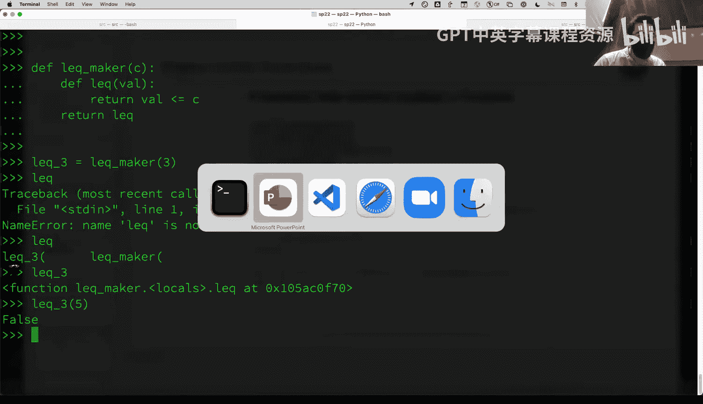

The best way。To visualize what's going on here is to say less than or equal of three。Is。LA Qmaker。3。

And we can print this result。Less than equal 3 of the value5。

And we'll visualize what's going on here。 So again。

 the rules that we talked about last week willll come back to them in the next couple lectures as well for environment diagrams。

But Python is again following all of the consistent rules with a twist now that we have functions that live only inside functions。

Again， we get through our first line， less than an equal maker， we have a global function。

 which has an error on the right hand side。When we call that function。What happens is。

But we now have an argument。In this case， C， whose value is  three。呃。Insider function。

Lessoner equal maker， we define a new function， lesser equal and notice how on the right hand side。

 this gets a。A new arrow pointing at it that is a new function that Python now knows about。

The return value is that exact function， so the arrow points the same object。

And now the next line of code， when we go ahead and call this function。We have our value。

So notice the function name here is LAQ so pointing out that the thing that we're calling is this function on the right over here。

Its argument is vowal， which is five。And what we return is is five less than c and so what's what's interesting about Python tutor and what is definitely subtle is that。

What's going on right here where it says parent of frame one means that in the same way that。

We have access to data in the global frame。This LQ functionops。

Right here has access to all the data in this frame f1 because that was where it was built and defined and so this allows us to do something like。

Create a hydro function。Which encapsulates that data without revealing it to the outside world and so。

With呃。嗯。With higher functions like this， we can start to build up more complicated programs。

 so we can say。You， is something less than or equal to each item of a list？

And with a loose comprehension， you would be right in saying that we could have written this out。

 you know just with a regular less than we're equal to expression on the right hand side。

 but what it will allow us to do is start to pass these functions into other expressions where perhaps functions only only make sense so。

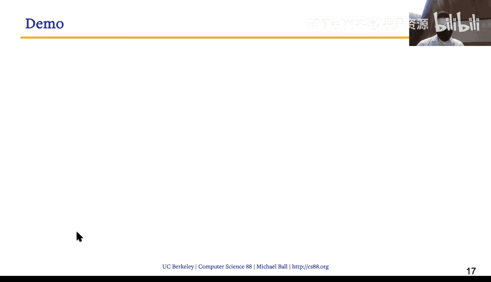

That is。Les than or equal maker and we'll do one more example。

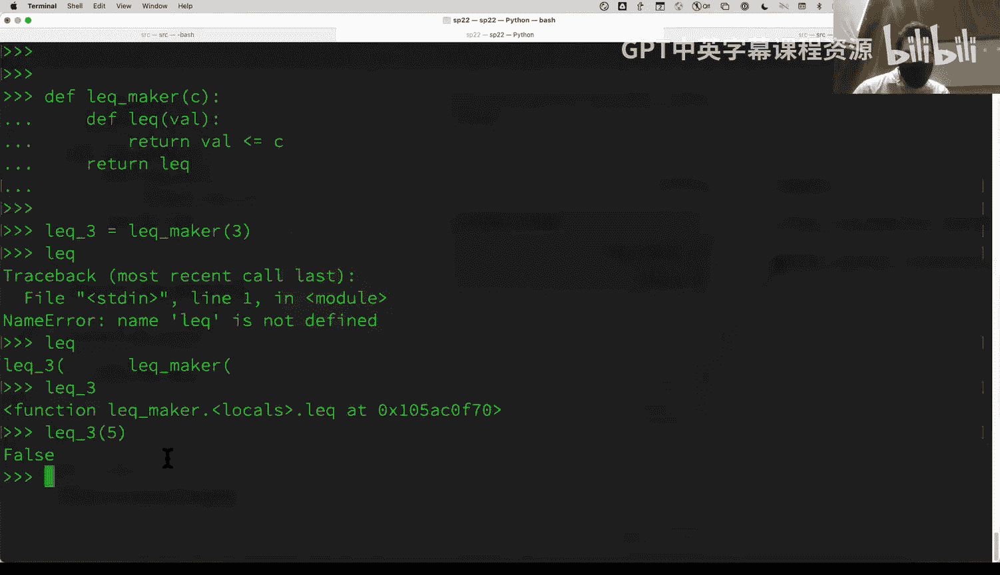

呃 at the。

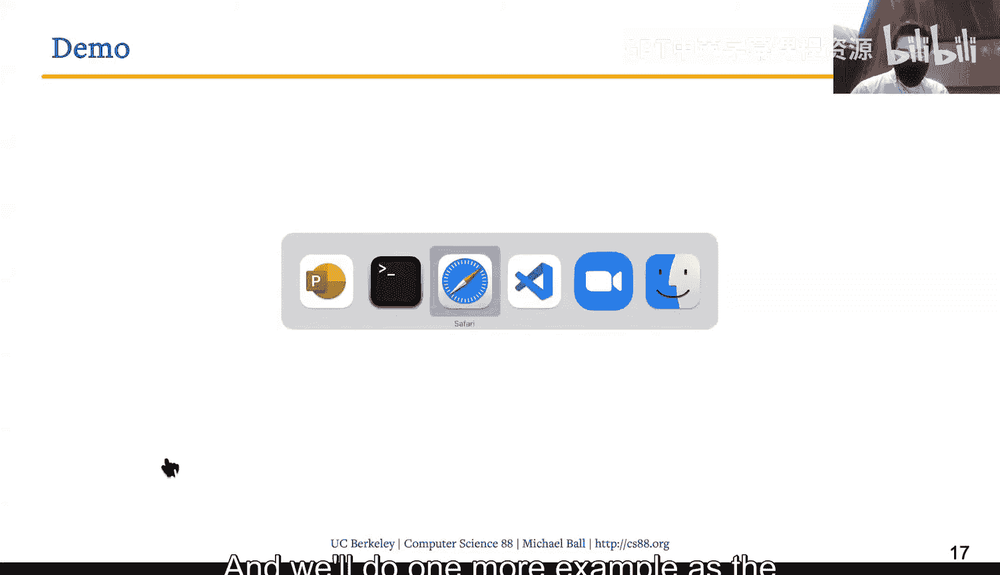

As the very last。嗯。Way of composing functions。 So this example， there are。

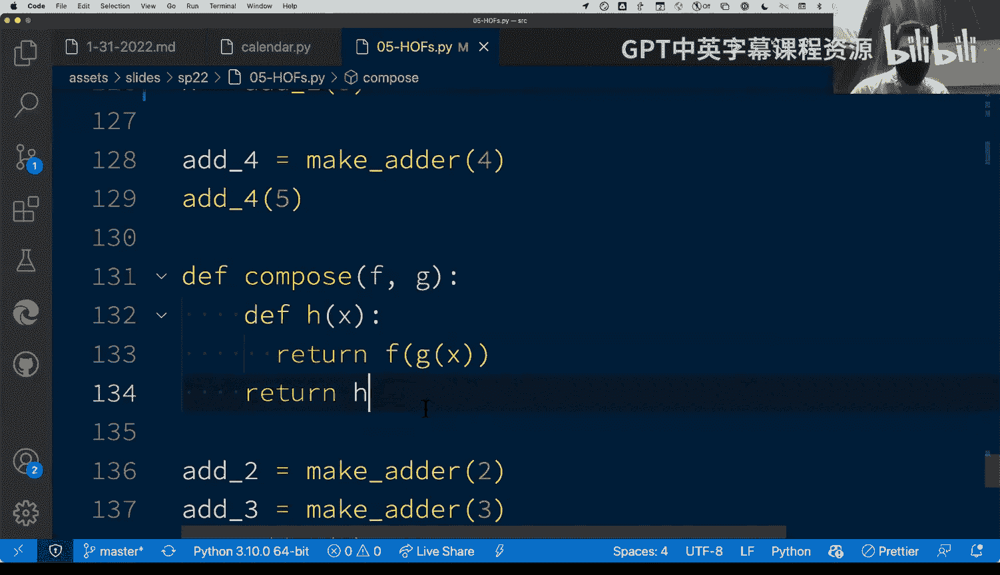

嗯。I is going to be in the slides and there is an extended Python tutor environment diagram for the way of composing functions。

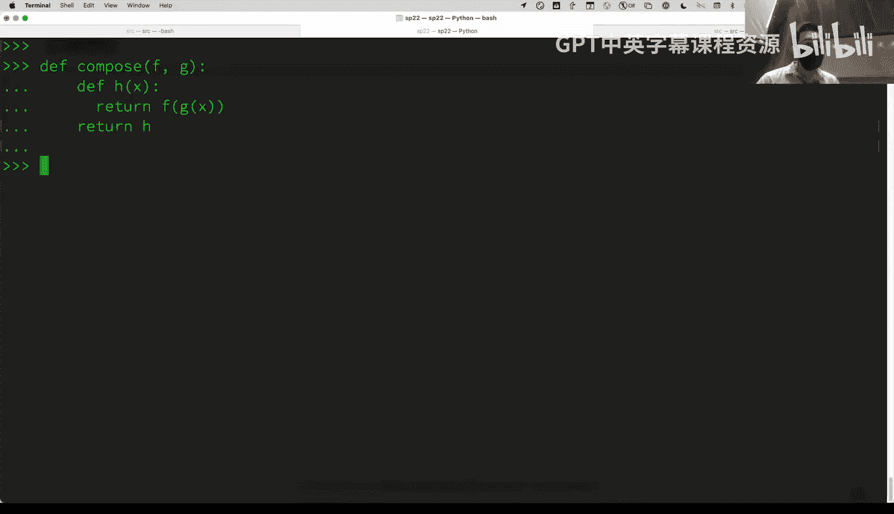

But。And actually， before we do this， why don't I？Give ourselves make at。 So in this case。

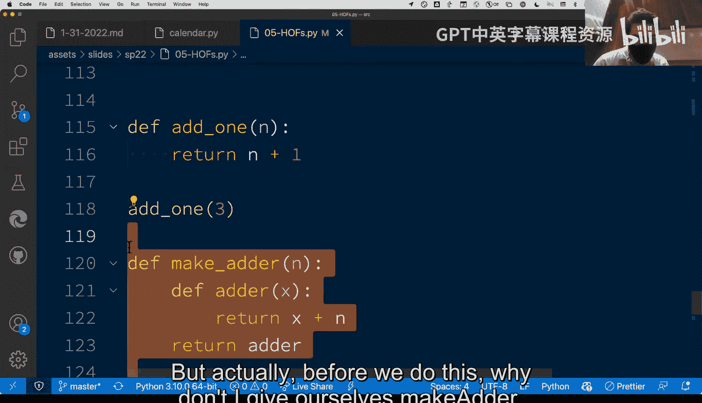

The example that we're going to do here。Is to use an add function。

So make adder is just going to return two values so add。呃。Right here we have a function add for。

And all it's going to say is this is make adder of four。With some value。

And it will just add these two numbers together。And so far this is。

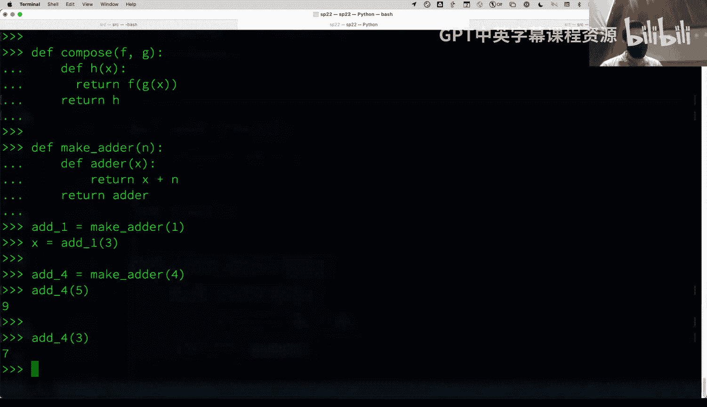

A pretty straightforward function。But what we can start to do is to compose these values。

 so let's say we wanted to add the example on the slides here are two and three。

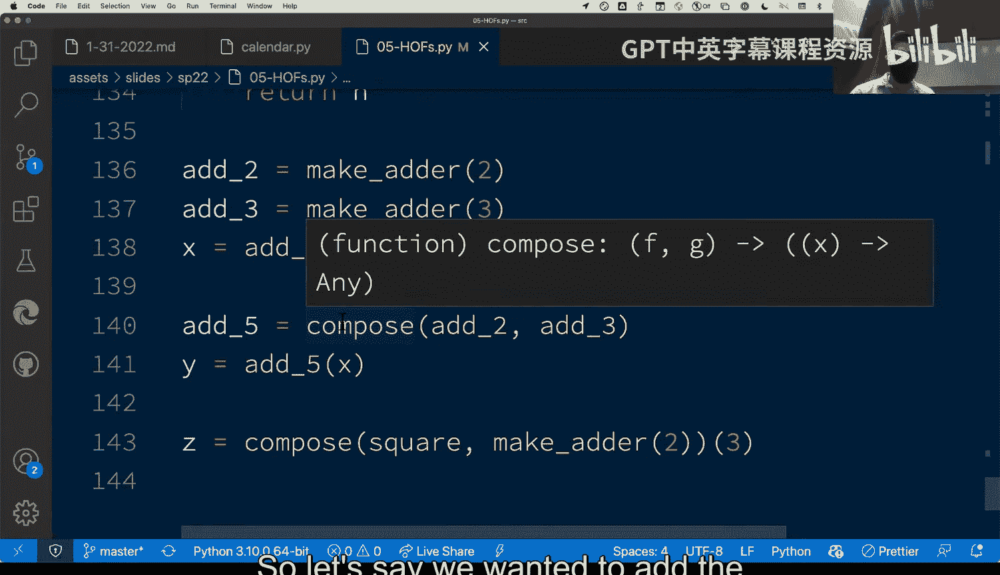

But we can add what I have here， do I have two and three， now I'll just copy that back。

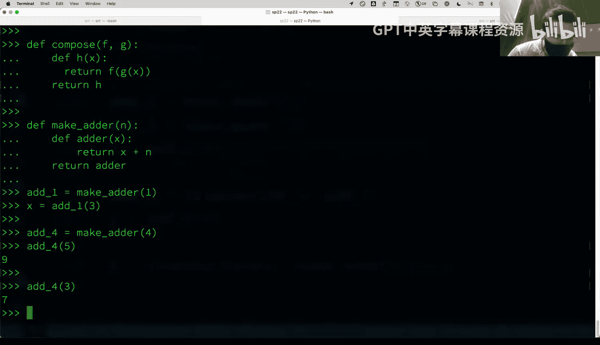

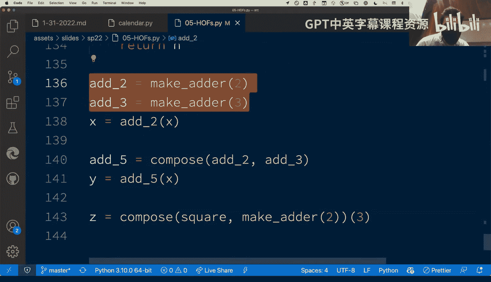

So if I have two functions add to and add3， one way to think about this is mathematically I could compose them together such that add two plus add3 is add five and again if we're talking about simple addition。

 this is not something that we're necessarily going to do。呃，也。All the time。

 but what we would probably do is compose some kind of more complicated processing alongside perhaps something else so add five is the same as composing。

Andposed。呃，对。Add two and add three。And so now if we ask for add five of the value 10。

 we should hopefully get 15 back， which in that case we do。And。

That is a way of taking harder functions both as input。

Combining them together in an inner function and returning that function as output。

 this is an example which is going to be linked on the。

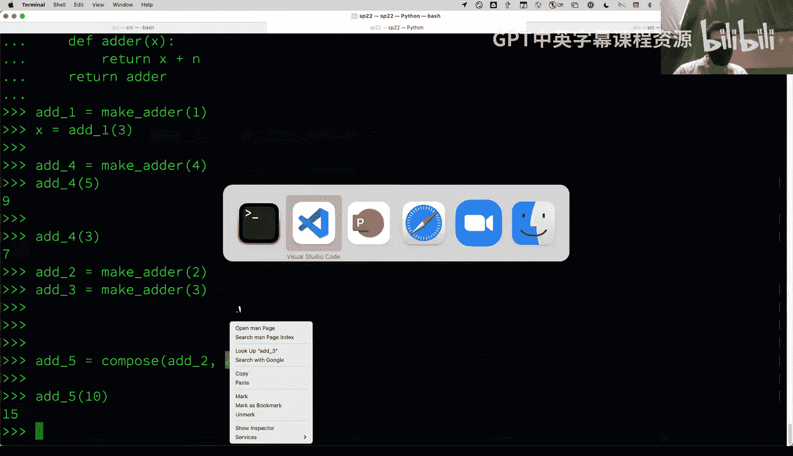

哎。The last slides of Python tutor thanks PowerPoint so we'll be revisiting this over the next couple weeks when we get to other types of functions so composeose is a pretty hairy example it will come up in lab but take some time and play with this step by step and we'll come back to this next week as well。

Yeah。Yeah。Okay。我。

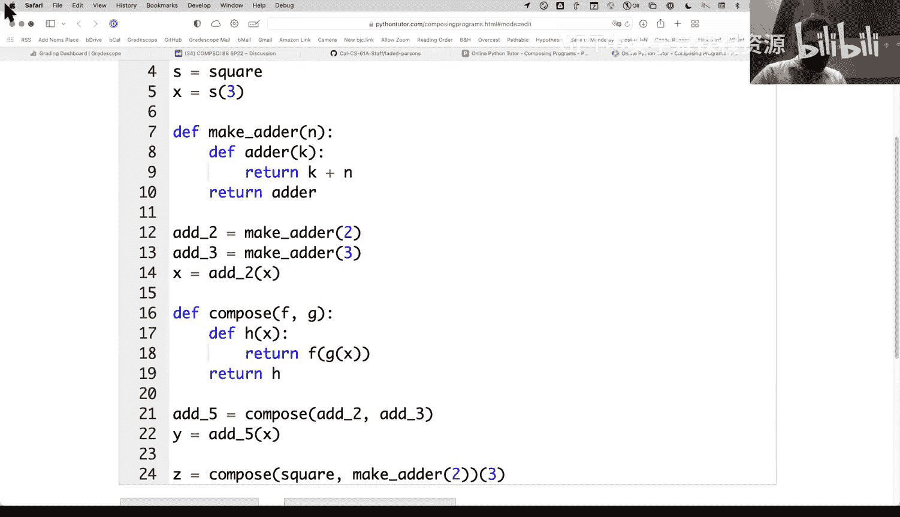

嗯。对。嗯。嗯。그。Yes。不是。Yeah。啊。All right。Thanks， everyone， I will see you later。

