# UCB《数据科学中的计算结构｜CS 88 Computational Structures in Data Science 2022》中英字幕 p06 CS 88 Spring 2022 - Lecture 6 - 2_7_2022.zh_en [BV1516iBfEVY_p6]

So that was fine so we're going to do things a little bit differently than what was on the calendar I think think about last semester of this topic I swap lecture six and seven basically so today where we're going to talk about our lists and higher functions and then on Wednesday。

And we'll come back and talk about environment I and some of the other parts of the process。

 so what we're going to do today is I think a really fun topic。

But we're going to talk about three really useful hiring functions of Mac click reduce。嗯。

M and filter in particular are useful and we'll see how they're analogous to list comprehensions。

Reduce is a different type of function entirely。And it has its own sort of set of mechanics that we'll work with。

So we'll spend our time looking folks。And one of the things that's useful about these hydro functions。

 map filter produce is that they let us apply a function to a piece data。

 so now we're going to take a function as an argument to another function and process a sequence of data in that way。

 what note if。嗯。Yeah。Yeah。T。Yeah。All right， so one of the things that I will just warn you ahead of time and we'll see。

 but when we use map and filter， we need to always use we don't need to always use。

 but we'll often be using this list function of Python so that we can see the results as a list in the same way that we've seen this with R。

And so。What we're going to do is individually practice using map， filter and reduce。

And then we're going to combine them into。A final example that we can call acronym to build up an acronym from a sequence。

Of words。That is。2。That will be the task of what we're going to do today so map in a lot of ways we can think of like a list comprehension。

Except。2。On this apprehension， we say it's sort of written into the definition here。

 we could say x for x in some sequence。A map function allows us to apply a function for each item。

In a particular sequence so if we think about let's say have a list of numbers I want to create the square of each number we could write a for loop that does this we could write a list comprehension now map will be another tool that lets us do something like process all the numbers importantly in the list comprehension we typically think of going through a list right one item at a time。

Map will do the same thing。 So whatever sequence you get back out will get back some transformation of each item of that sequence。

 and so perhaps the best way。To demonstrate some of this。Okay， why the effect its open。

 not thought is to。

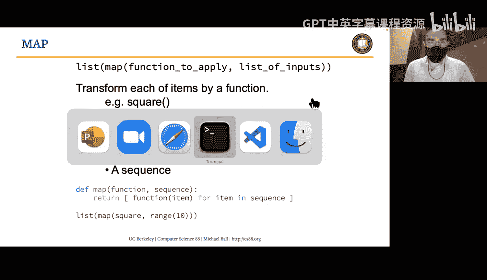

诶。I'm just going to give it， let's see， okay。Yeah actually。不种。Start with。See in here。

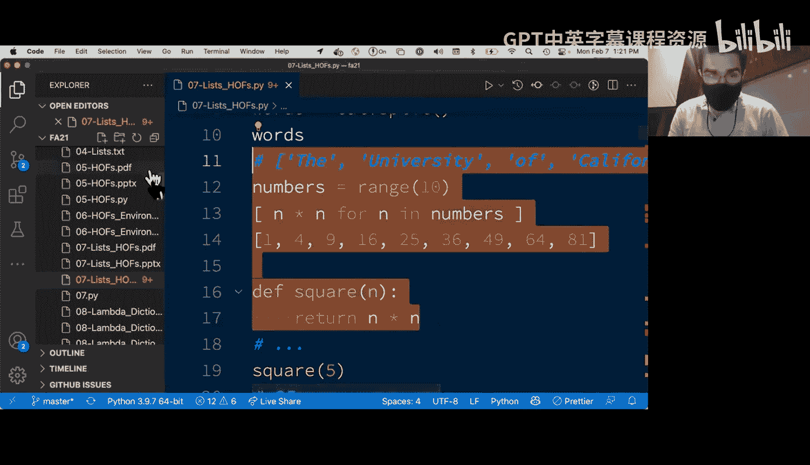

。Oh， that's not right。You want to do inside Python。是。😊，呃 in。嗯。In the example so far。

 what I just pasted in is we have。Numbers， which as a range。Of zero to1。嗯。And in our for loop。

 we could write something， excuse， our list comprehension， we write a version of a for loop。

 which is n times n for n in number， so this would just give us back right zero times zero。

 one times1， two times two， and so on。And this is really useful。

 but one of the things that is particularly interesting about map is that it gives us a way of transforming a list or' turning a new list。

And doing it sort of on demand。What given what I've defined here because this will become useful is a square function。

This works like you to expect right if I say square of two， I'm just going to get four back。

 that's not doing anything particularly special， but what we can do now is we can use this new function called map。

And map takes in two arguments， the first is going to be this function and the second is going to be a sequence。

We can say map of square and whatever our sequence happens to be， in this case， numbers。

And what we get back is。But in the same way that range gives us back just an output that says， hey。

 this thing is arranged， map is the same thing it says， hey。

 we've got a map object doesn't really tell us much about what it is。呃。

And so what we can do is we can use the list function so that we can see the output of everything that is in our map output and what we can see is that these two lists are the same。

At the same set of data so why does map do this well in the same way that range if we ask for a range of like0 to1 billion it doesn't calculate a list of a billion numbers map is the same thing where we can ask it for a map of whatever we need to and it doesn't calculate all of the data until it needs to so if we say list we're telling Python hey I want these results right away and so while we're doing this。

We'll often we' often use the list function to see the results right now how this works we're going to put that aside for probably like six or seven weeks until after the midterm or so and in second half of the class where we'll actually see how we can make functions like map and filter that calculate data on demand and this is a really useful technique because it allows us to handle larger data sets it allows us to。

Spread out the time that it takes to compute something such that if we're doing a lot of processing on our computer perhaps or we're working with larger data sets。

 we can spread out some of that workload in general。

 the point of writing like writing fast code is not the point of CSD8 or 61A but these techniques will show up later in other classes in later data science and computer science classes so they're useful way of thinking about things。

So。What else is worth mentioning here？Oh。Sometimes while we're learning things。

 this list comprehension can be a nice way to visualize what's actually happening because we can see。

Each explicit computation。嗯But。What's also nice about map is we don't have to think about defining a variable inside of a list comprehension or for loop we don't have to think about exactly how that function is called。

It just happens to be handled automatically for us。Again。

 if we wanted to compare perhaps more directly using the square function， we could say square。呃。And。

4。And in numbers。And this would again be sort of some idea so again what map is going to do is take one item。

 apply that function for each item of the list。Regardless of what that function happens to be。

 we've been using numbers， but we can apply this to。

A a word a list of words a list of whatever data might need to be later we'll see how we can use things like filter as as our sequence so any sequence there is valid and let me。

Hle Zoom chat。好了我。W's just an hour。は right。CoolYeah and for zoom slides will be up afterwards so questions so far on what's been happening with with Matt before we move on to a couple other examples。

Yeah， but a front。好。Yeah， so what Matt is going to do is in the same way that we have a list comprehension。

 like let's say， there is my cursor。So。If we take a list comprehension like this。

 we say square of n for n in our numbers list， so the numbers again is just the numbers zero through 10。

 approximately0 through nine。What MA is going to do is apply our function square for each item of our numbers list。

 so we could say。呃。We'll make this be a list so that we can see the output list map。

 we could say square。And if we give a list， let's say just one， two。And three。

oops we need another parentheses what we get back is the square of items one4 and nine we can any function that takes in a single item。

And returns another item is a valid function to。To put in map so let's say we have something let's just call this useless。

I' goingtaking some value x。And。Our function is just always going to return zero。

So regardless of what we put in。This useless function takes in some value and it always returns zero。

呃。We can pass any function that looks like this into our map。Just by passing the name。

remember from last week when we talked about using functions as a piece of data by leaving the parentheses off we' treating a function as a piece of data。

Where we're not using that function yet to calculate the results。

And what we can do is say map this function over this list， and this case once again。

 if forgotten on parent parentheses， what we had is a list。

3 zeros because all this function does is for each time it's called a return zero。 So map。

 we can think of it as a way of。Of essentially in some ways。

 a shorter version of a low comprehension of all sort of list comprehension that。呃。嗯。

That that will happen what we can say is lazily or what will happen is on demand so that's why I may need to explicitly call the list function a couple more。

嗯。Questions on zoom that are related yeah。嗯。Yeah so this is a good question will the values of the list change and in this case so a couple of people on you're asking you know if I if I pass in a list here。

All right do the values of the list change and the answer is no and we can verify this by let's say my numbers。

Equs， we'll make a list。Of numbers。Because we need an is。So this list is the number zero29。

And we can see that。In this case。Let's。Yes。Let's map our square function。Over this list。

Close our parentheses again。And we can。We can view that our our original list doesn't change so what's happening here so whenever this is one thing that is useful to know about map is whenever we use a map function。

 whenever we use a list comprehension， we are returning a new set of data that is a model。

It is applying that function， but it is not modifying our input list， so we can square each number。

 but our original list is still the same。Well， no matter how many times。We run this。

We can do this as many times as we need our original list will stay the same so that's something which is really potentially useful for us to and the same way where if we wrote a for loop a for loop is always going to excuse me a list comprehension is always going to return a new list if we write a for loop where we are adding elements to a new list we could write it that way as well so。

Cool， let's see。嗯。Yeah so that's a little bit about how map works the actual Python definition is quite a bit more complicated。

 but if you're thinking about how would I write this myself。

 the simplest way to think about what map is trying to do is this list comprehension right here so function of item for each item in whatever our sequence happens to be。

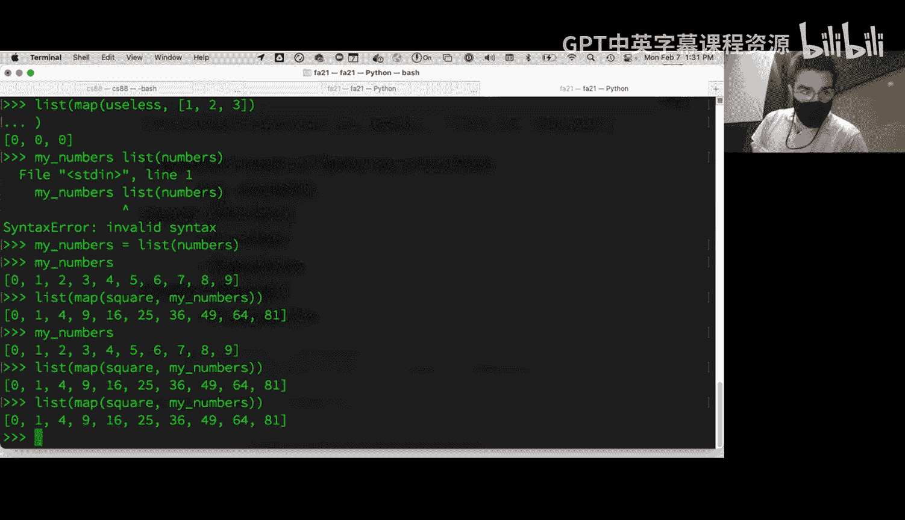

And this is always going to output some new sequence which looks like a result that function call。

 but other questions about math。And if I'm missing someone's hand， please feel free to shut out。不是。

Anything else。Yeah。Yeah， so a good question in zoom so our map filter reduce built in functions map yes。

 the built in functions reduce we'll need to import。

 which we'll get to that later in a few minutes so。

Map is applying an item a function to each item of sequence filter is。呃。Applying a function。

 but instead of。嗯。Instead of returning a transformation of that item filter like it says will filter the results in the list so what this says is our function should now be some kind of aredicate function that returns for false。

And what our function will do。What our filter function will do is keep the items aware that result will be true。

In this case， filter is never going to modify our list or is never going to change the value。

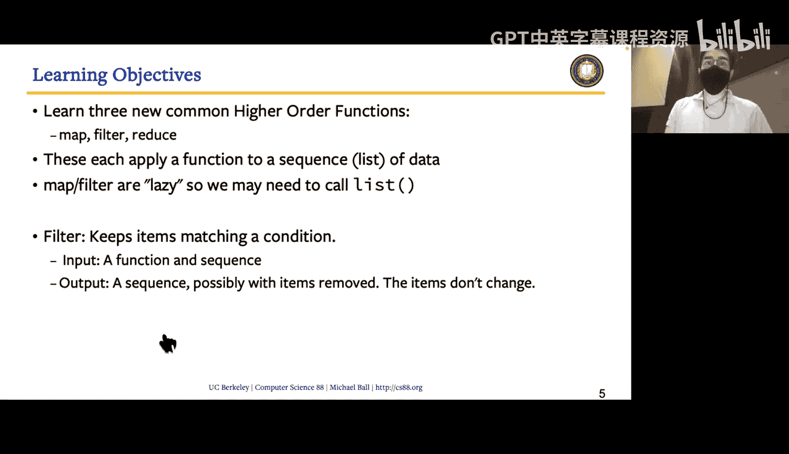

When I output something so this file will be available。

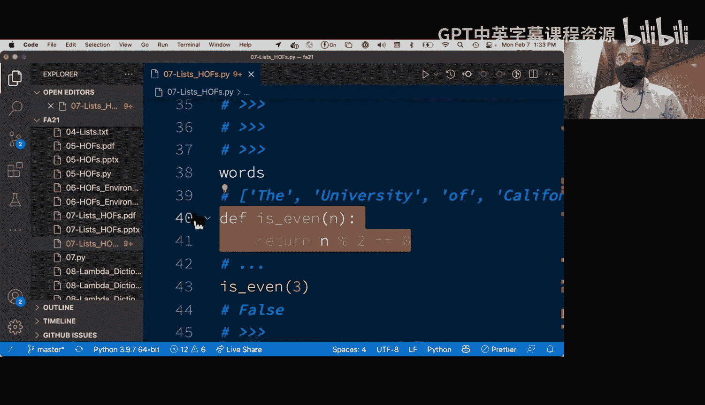

Afterwards as well。So before we write a filter function。We have a really simple。

Is even function right this is something we've done in love if bot two is zero。

Then a number is even otherwise it's all so one thing that we might like to do is to say can I keep all the values of my list where numbers are even where numbers are bigger than a。

Pay certain size。So again we have our list of numbers right numbers are still arranged。

 we can make it a list。But in this case， what we want to do is。

We went to filter to find only the even number， so filter is even。Over our sequence of numbers。

And again， filter like map will give us a filter object back。If we're working in the interpreter。

We usually want to return。A what。A list。So if we say list of filter。When we get back is zero， two。

 four， six and8， the numbers in our sequence that are of course， only even。呃。

This is the same thing as n。Or and in numbers。If。诶。But is。

Even N so we could directly translate this into a list comprehension。

Where instead of having a function on the very left hand side right here。

 what we have what we do is we color function is is even with the if condition so in a same way for a map we can apply a function sort of on the inner part of our list comprehension a filter function we can make the same analogy by using if with the list comprehension so map and filter both have very very direct analogies to to our list comprehensions。

Yeah and so a couple questions in zoom yeah so can this function only be a booleyan Python is really forgiving if we return something that's not a booleyan value it will do。

Something predictable， but in general our filter function should only be a bull so one thing can notice right is that this list of items。

0，2，4， six and eight， these are the exact same numbers， zero， two， four。

 six and eight that were in our list of numbers。All the filter function is doing is saying。

 should I keep this or should I throw it away and so if we pass something that's not a bullolean pth then we'll try and figure out is this value closer to true or closer to false？

And it won't yell at you， but in general you should stick to functions that are always going to return of the values。

So。

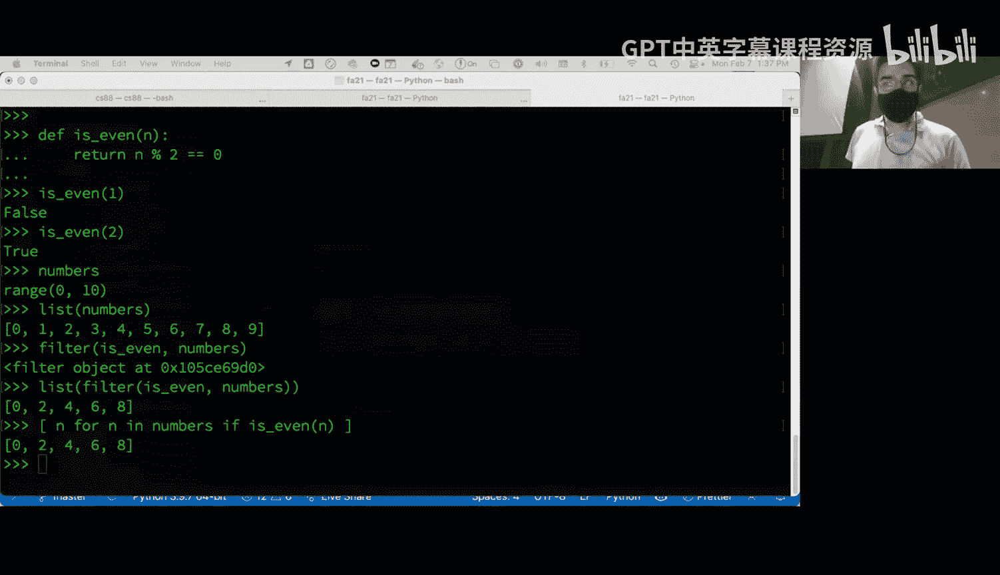

Filter as。今望台风。小先。Okay。2。Filter again， looks very similar to map if we think about how we might implement it。

And。It works in pretty much the same way with the exception that the function that we're trying the transformation that we're doing is removing items from our list instead of giving us different items。

Of our sequence so map and filter， I would say， are two functions that you can think about have very clear analogies to list comprehensions。

They do different things， but they workt in very much the same way and both of those are built directly up byon just type map。

 you just type filter and so on and。

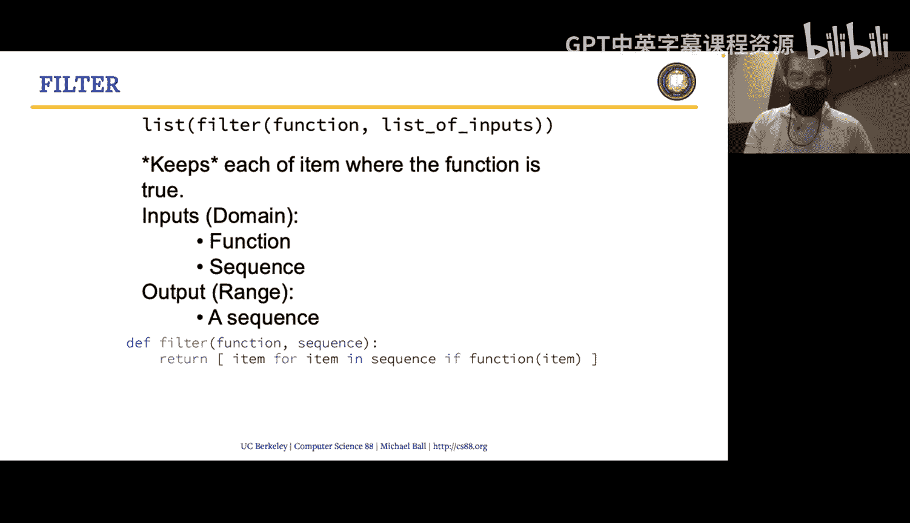

Like we've shown before。You can say hope。filter。And what I get back is some notes about how the filter function works in Python we'll talk about why things show up as classes later on but。

There is some， if you were to scroll through some additional documentation there。Yeah。

 so questions on filter before we start playing around with a couple different things。

Questions on Zoom about how filter works， anything that hasn't come up yet。是。是。Cool。

 so one of the nice things about map and filter and and the same thing with reduce is that。

They enable us to compose operations really nicely， so what if we said。What are the lists？

OfOr what are the squares of all the even numbers in our list？

Of numbers and so we could start to build up operations。That。呃。

That let us sort of stack ideas together so we're going to do one thing here。

 which is so I can say filter is even over our numbers and of course Python tells me that this is just a filter object I can't see the results yet。

 but one thing to know is that in the same way that range is a range object that we can use in right in a for loop。

I could say。呃。Let's call this events。Right， I could if I want to for even in。Evens。

You can print each number so again if we think about this in the way that in Python things that are sequenced。

 we can iterate over them get pass into a for loop。I could do the same kind of thing。

 what I can also do is map over this sequence of even numbers as well。

 so if I wanted to say square only the even numbers I should be able to write something。Like list。

 again， I'll make this a list right now， map square。Instead of mapping over my list numbers。

I'll map this over my list of evens。Oh， okay， come on， Okay， we're going to。2。嗯。

Once you compute the result of a filter function or a map function， Python。

Turns it into an empty list， so we're going to have to start that again。So。

If I want to map over a list of even numbers。I can say evens is equal to a filter and I can map over that sequence and now what I get are just my even numbers zero two four six and eight and just the squares of those numbers so that's one of the nice things about map and filter。

Then later on reducing that by breaking down each individual function right here。

 so our square part is even we're going to look at things like the first letterible word。

 we can take。Or can take really small functions and start to compose them together into solving more complex problems。

嗯。The question in Zoom chat about none， if you could post a little more detail。

 I can maybe answer that after class I'm not sure where that's coming up。Yeah。

 so in this case what we did first is we filter the result。

 then we spread the result and we can compose them this way so before we move on to reduce questions on map filter or composing them together yeah question up here when you did that list。

The empty list。いた。Yeah， so。This is one of those things that I think is personally kind of annoying about the way Python works。

So if I ever say data is equal to filter。呃 is。Even over my list of numbers。

What Python is going to do is it's going to not it's because I need to call a list to see the results it's the making this computation so if I say data。

It tells me that it is a filter object if I say list。data。

Oh what Python does is it now does that computation right。

 it runs the filter operation it returns a new result and now if I look at data again。

It's still a filter object， but because it's already been computed。😡。

When I ask for a list again Python thinks that there's nothing left to compute。

 so we have to in a sense create a new version that filter or a map once we've done that computation。

I wasn't intending to demo on this。This uses a tool inyon Python called generators so if you're curs you can read more about how generators work but essentially later in the semester we're actually going to look at how we implement generators and how in our own code we can control whether or not when you get to the end of a generator Python just says I'm done or when you get to the end of a generator Python could have decided to be helpful and start again but I have disagreements with why Python is implemented that's one of the fun things about programming is you'll learn where you get to have disagreements with all of the languages that you learn but yeah so this is just a Python thing where once you've got a result if we want to start over when you make a new instance of a filter。

And for the most part， honestly they I'll say， this is really only an issue that you run into when you're using the Python interpreter and when you're demoing code。

 if you're just writing a file or you're working in a home assignment。

 you're not likely to run into a pattern where you're reusing that same filter operation very often。

And so thats that's what happened there， but yeah， good question， other questions on map and filter。

嗯。Again again， if you' ever missing someone's hand， feel free to。Shut it up。

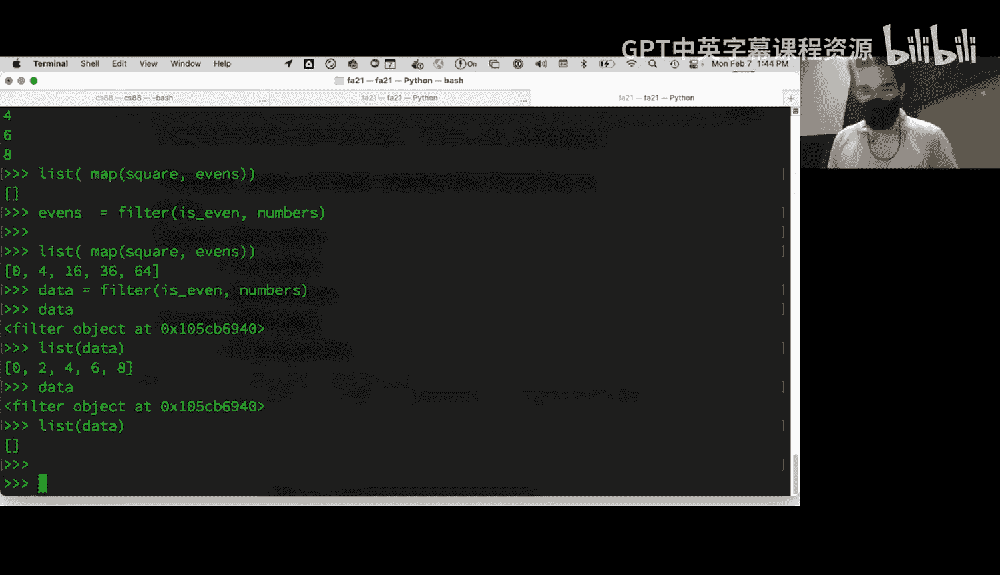

嗯。So map and filter directly return a new sequence of data。

Rather that are the result of applying a function to an individual item at a time reduce changes the game on how this works and so reduce is。

One of the more complex of the three harder functions to think about， but it does enable us to。

Solve some really interesting problems。Reduce has its roots in sort of the histories of functional programming and it's one of those things where。

It's definitely， I would say， not the most natural function to use。

 but there are certainly places where it can really be a very useful way of thinking about solving a problem。

嗯。So what reduce allows us to do。Is combine items of a list together。

In the past we're looking at with a list comprehension with map， with filter。

 we're looking at one item of a list。whatever a sequence is at a time with reduce we're now going to be considering two items of our sequence at a time and repeatedly applying that operation so in some languages reduces called combined because it takes a list and it combines items to reduce them down to a single value in some languages it's called fold because you're sort of like folding data on top of each other is a pretty common word although I think a little bit less intuitive。

But the way to think about reduce what？K。It's a really helpful monitor here and now PowerPoint is just being picky with it。

With reduce， it looks very similar we're going to say reduce function over our list。呃呃。

Of inputs to that function， but instead of being a function like square that takes in one number at a time our function that we're reducing our reducer function is going to need to take in two inputs at it time and because of this our actual sort of simple implementation is a little bit more complicated but we'll we'll start to build up to that so perhaps the best way to do this is to just demo。

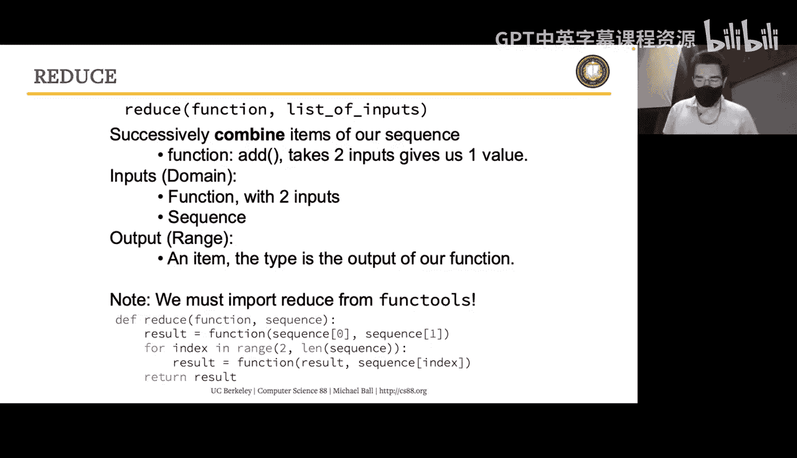

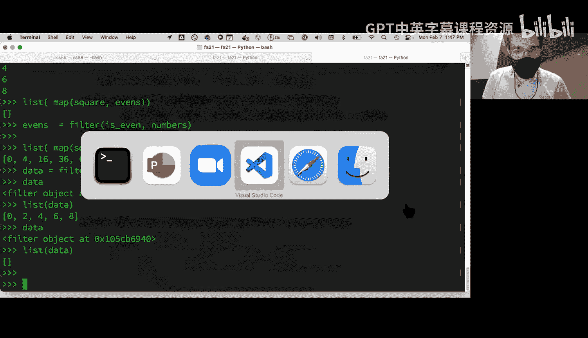

Demo using reduce。So reduce is the one function。That we do need to import so it's built into Python。

 but we do need to say from funk tools import reduce otherwise we will not have access to it so if I just go ahead and type reduce right now。

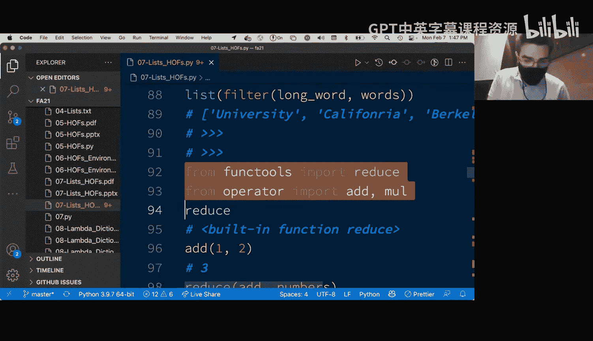

It says name reduce is not defined。So now I say from font tools， import reduce。Now I have access to。

Our reduce function， and now it says built in function movies。Reducuce works again in a similar way。

 except we need a function that takes into arguments in this case I've imported the add and mole function so。

We've seen a before right， but add takes in in this case two arguments or more。

 but we're only going to care about the case where takes in two arguments， says one plus two。

Is equal to three。And now what we can do is say range not range reduce of add and。Remember。

 our numbers is the range one to 10。So when we get or excuse me， zero to nine。

 I should have set this to be1 10。Just to verify that again， right we have。呃。List of numbers。呃。

We have zero to nine so if we add these all up and least some of these numbers is 45 I should have made it include the 10 because that's a little bit more common of a sequence to numbers of but what is reduce doing in this case so。

Let's say we have this idea of a result reduces going two items at a time。

And saying that a result is equal to our first two values zero plus one。Now our results is equal to。

2。Our result plus two。Reult is equal to result。Plus three。Result plus four。

It's taking our function two items at a time， or it starts with two items and continues applying that to the next item of the list。

 such that at the end of it what we end up with is the combination of adding all of our items in our list together so。

that is one way of。Using reduce to combine items。And a list together。

There are a lot of different things that we can reduce， but most commonly we're doing things like。

Adding multiplying one really common operation is we have our min function right。

 so min of one and zero， this thing is going to give us zero。We can reduce。Using。咩呢？

Over our list numbers。Andsurprisingly， our min of that list is zero， we can。

 of course do the same thing。With max so max will give us the largest value and what we're really doing is taking functions that are good for processing multiple sets of pairs at a time and computing that result so reduce。

呃。Reduce works in a similar way to map and filter， but instead of giving us a list back。

 it gives us back a single value。So reduce is definitely a little bit trickier so what questions do people have about how reduce is working and then we'll do another example and this time we'll use a series of words instead of numbers because that will hopefully illustrate some differences。

Questions on reduce。嗯。Oh yeah okay again functions single input。

Yeah that's a good question so in this case， no， there's not a good way。To handle this。

 so let's see what happens。So if we say reduce with our function square。

We get squared takes one positional argument， but two were given。There are。

With reduce you need a function that always takes in two arguments there are ways around this but they essentially involve creating another function so later in the week and next week we'll talk about another kind of prior function called lambmbdas which there are tricks of sort of working around some of these things but reduce always needs two pieces of data and this is actually perhaps one of the more helpful error messages it tells us that it's a type error which means the type of our function doesn't match the type that reduces expecting and that。

Square is a function that only takes one argument， but we tried to call it with two arguments。

 so Python will try and catch an error like this for us。In this case， yeah， that's a good question。

Other questions about how reduce works。你想你叫什么咩？

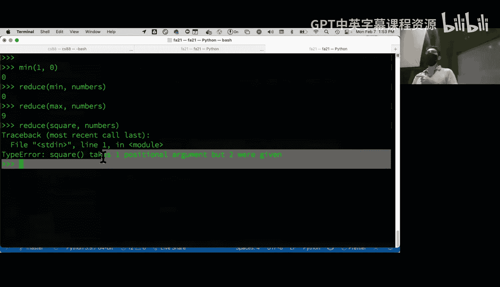

W。So。The last example that we're going to work up to with and we're going to use all of map filter and Red such that we can solve this problem together is we're going to take a phrase like the University of California at Berkeley。

And turn this into the acronym UCB。And。😊，I think this is one of the cases where this is a really nice way of a。

 it's a problem that is somewhat practical and that you might in a series of you working with a set of data。

 you might need to take some data and reduce it down to some condensed form。

 but this is also a good example of think about how we can go from。

One sequence of words to another sequence of letters。

And not just write a massive for loop that looks for letters of certain words or something like that。

 but break this problem down into very small chunks which are individually composable pieces and if your pedance is technically an initialism and not an acronym unless you really want to refer to to Berkeley as Opa but that sounds terrible so we're going。

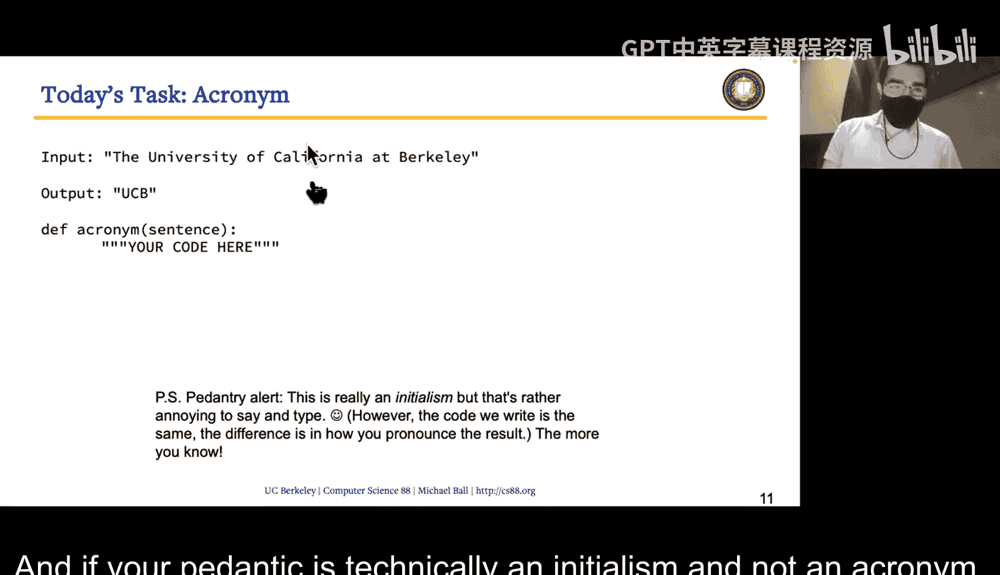

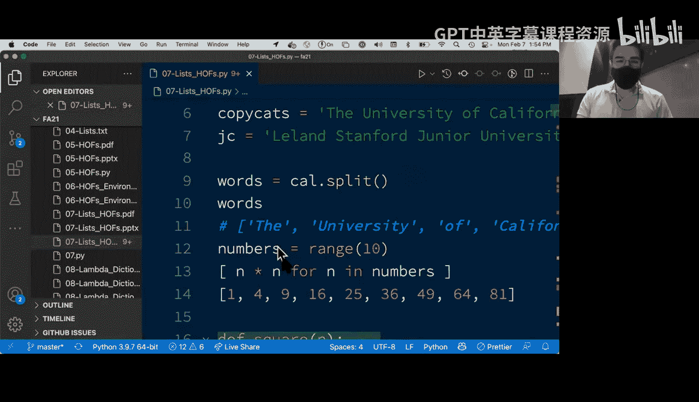

We're just going to say it's UCB， so we're going to do it on three。

Three different schools is our task of。Of building an acronym。So。😊，One。

There's a few things that we might imagine that we would need for an a right one is we're going to need。

呃。Now we're going to need to figure out which words should be in our acronym。

 we're going to need to get the first letter of those words。

And we're going to then need to take that string of letters and combine them back together into a single sentence。

呃。Let's。Let's first just put a function called first letter。

And it's going to take an individual word。And we're going to return。The first letter of her word。

 which is just word bracket zero， so you may。Remember from an earlier example that we've done this。

 but strings can be indexed in the same way that list can be because strings and python are also a sequence of data they are a sequence of the characters in that string。

 so if I say the zero。What I get back is。啊。Just the letter t so this is going to be a useful thing and what we might try so we might think about now what happens if I list。

Map。First letter。Over our sentence cow。And in this case。Something weird happens we get back。

We get back every single letter and this is because a string of text is itself a sequence that can be mapped over so mapping over a sequence or a series of one character strings returning the first character doesn't actually help us much so before we map we actually need to do。

We need to。To turn this into a list。So。嗯。看到。Words。So we're going to return。

Words that split again this is just a useful trick it happens to be helpful in a lot of scenarios so two list。

呃 cow。And now we have a nice list where each word is one item of a list。

And we can think about how in this scenario， we might want to list。Map。Our first letter。

Over this and now we get a series of T U O C A and B so in this case。

 if we're thinking about our acronym report we've made quite a bit of progress in you know let's say a couple function calls。

A single line of code and now the question is well how do we get rid of the T the O and the a it turns out that there's not a perfect function that will give us the acronym that we want。

 but we might say。You might have a function called long word。Word and so。We want to know。

 should we keep a word if the length of a word is greater。

Than and three characters and we're just going to pick right into three characters because it happens to work for our example。

 so we're going to say list。Filter。AL word。Over2。L。呃 cow。And now what we get back is University。

 California and B so。Now we can see why thinking about things in this way of mapping， filtering。

 and reducing can be really helpful because。Now that we have a filter。

 we can take that result and we can map over it so now we can map。Actually， we still on our list。

Get back。咩啊。Would we want to map our first letter？Over air filter。That worksop。We don't want first。

 we want first。No matter。So we first filtered to get the list university California and Berkeley。

 we mapped our first letter to get UC andB and now what we want to do is reduce them together to get back a single word so we're going to。

呃。So we can reduce。And we'll finish this up in just。So we're going to reduce。

And the function that we're going to use is add。And if we add two strings together。

 we get the acronym UC and B， and this is a way of using three different functions proposing them together to。

The Bill of A so we did that pretty fast we'll revisit this a little bit on Wednesday before taking in some more examples of our function so see you on Wednesday and let everyone。

嗯。Okay。Thanks everyone on'm team。

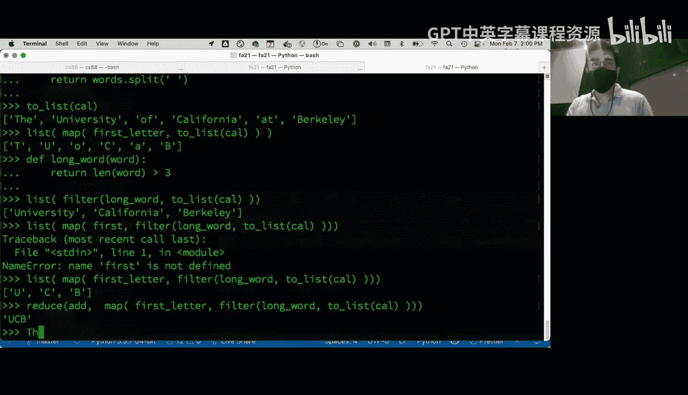

是么。