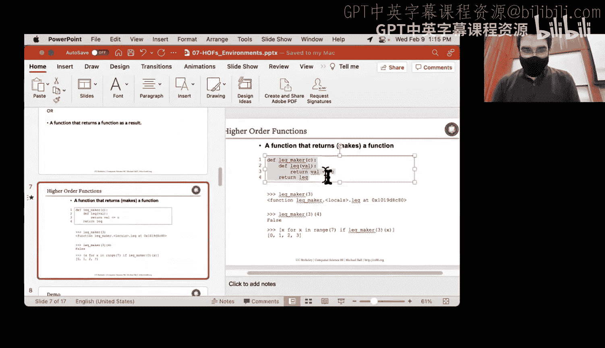
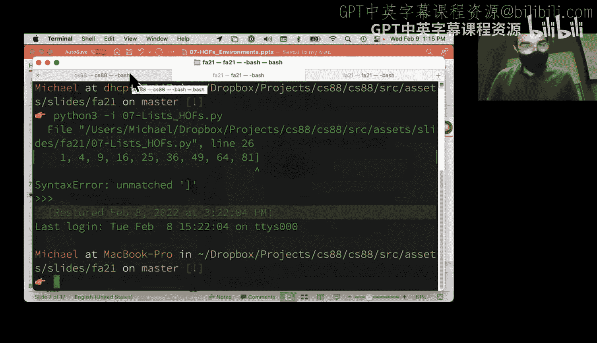
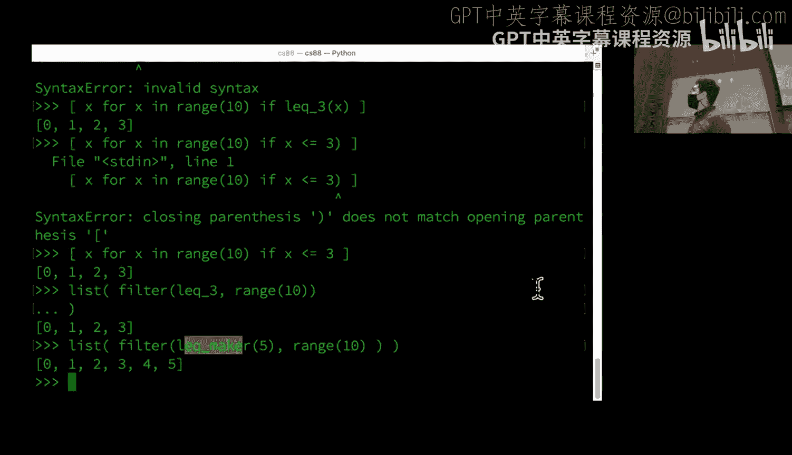
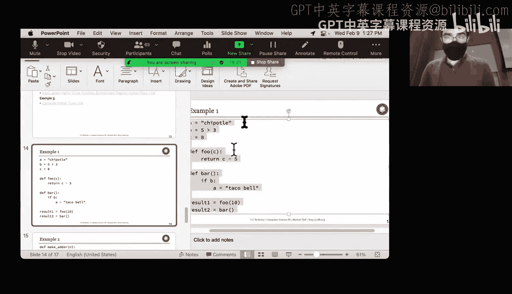
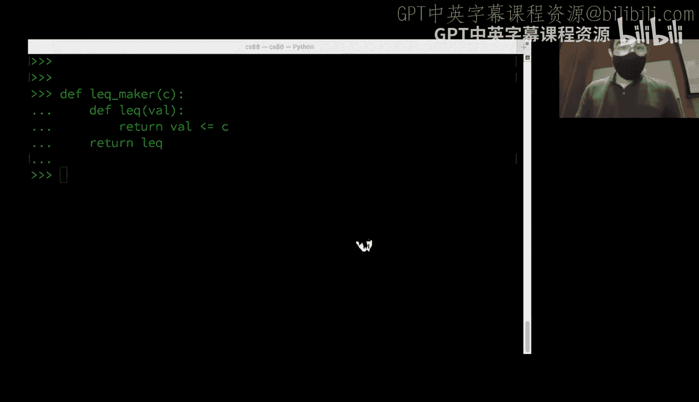
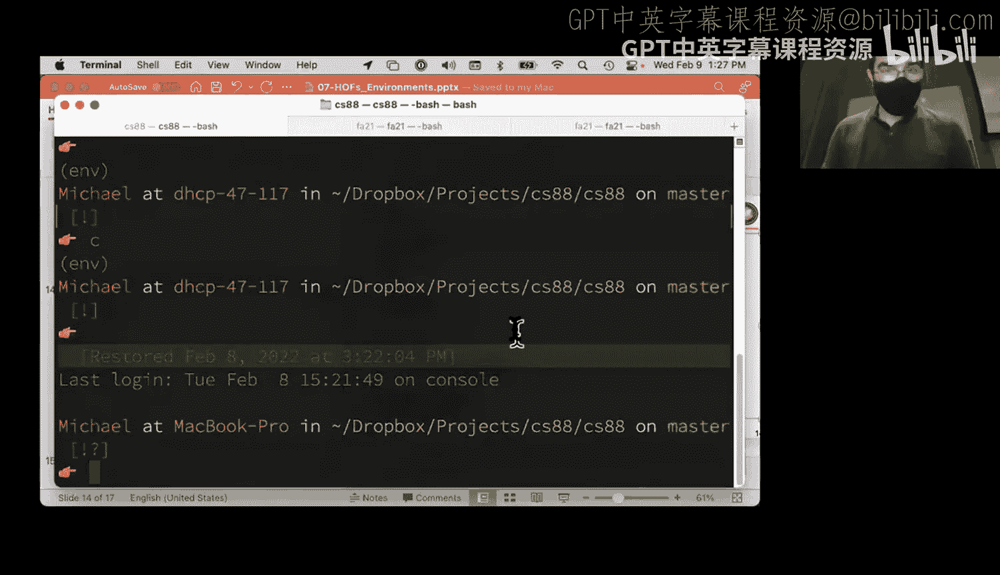
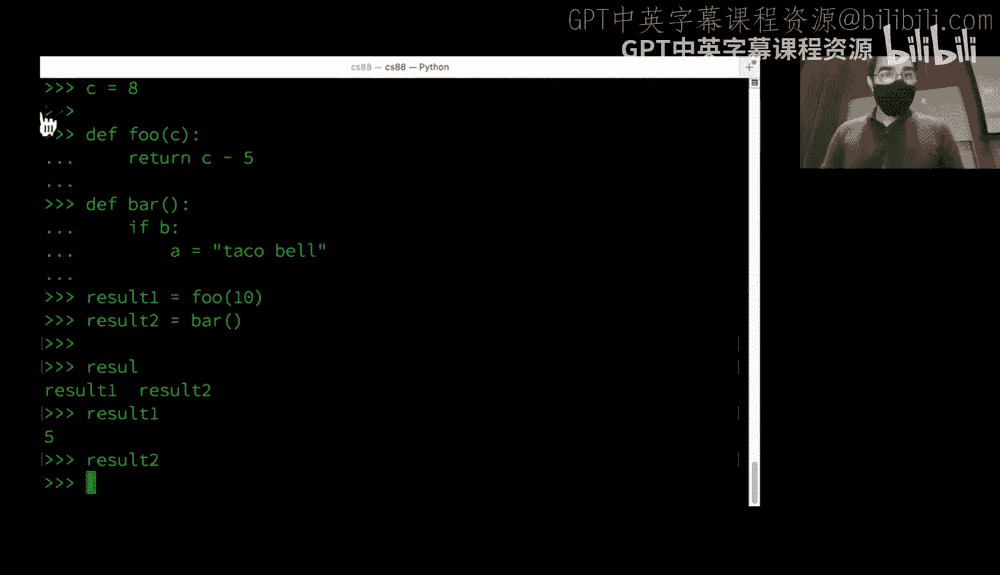
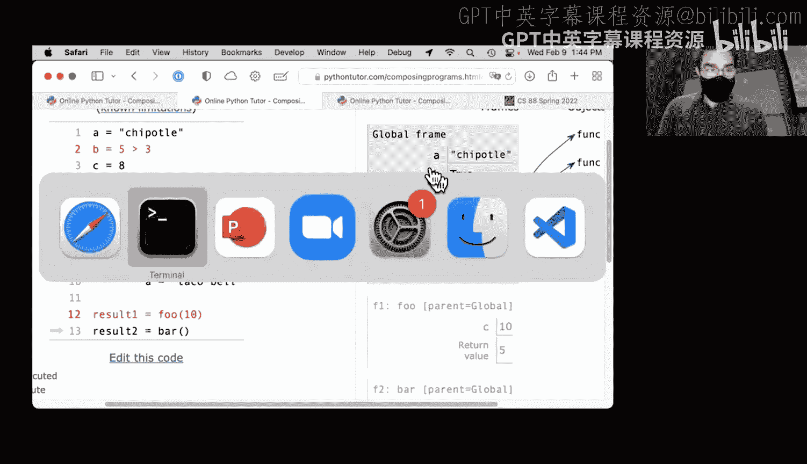
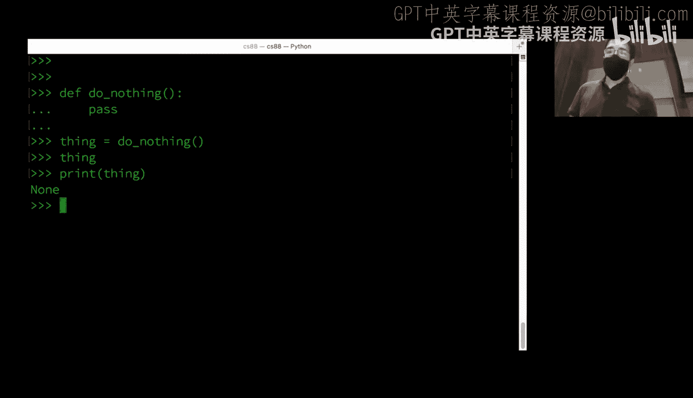
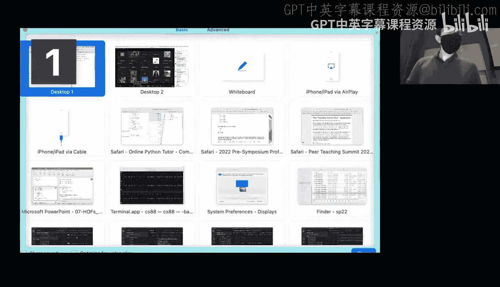

# UCB《数据科学中的计算结构｜CS 88 Computational Structures in Data Science 2022》中英字幕 p07 CS 88 Spring 2022 - Lecture 7 - 2_9_2022.zh_en [BV1516iBfEVY_p7]

All right， cool。One day by like the end of May， this will all be easy and make sense。So。Today。

 we're going to talk about higher functions and we're going to sort of continue on with。

Some of the uses of hydro functions， we're going to start a little bit just reviewing the examples from last week。

 and then we're going to go into mostly some exercises of working on using environment diagrams。

As a means of understanding how functions and how they work。

 so we're going to spend a lot of time just going through a few examples today。

 including one of the ones that we did last week so。呃， yeah。Basically。

 what what we've been talking about with higher functions is that we're using all of these functions again as a piece of data that control。

How how another function operates that give us some flexibility we've been on Monday when we did things like map filter and reduce。

What we did。Was we went through， and we。Passed in a higher function as an argument to another function。

 so map filter and reduce each take in a function as their first argument。

Today we're going to look at a little bit of that， but what we're also going to focus on is this aspect of functions that return a new function。

 so a function that in a sense， dynamically makes a new function that can be used or makes a function which behaves differently than perhaps something that Python already knew how to do so again。

 we have two options right functions that take up functions those are things like map filter to reduce that will also be the third example today。

 the compose function which we didn't get to last week。And then finally。

A function that returns a function as a result so some of our harder functions do both of these things。

 some of them do one or the other， but what today we're going to focus on are functions that return a new function so。

😊，Starting off， this is an example。That we talked a little bit about last week。

It's this idea of making a function。Called。Lesssoner equal maker。Where？

You know where do we see something like this Well so less thaner equal maker is is itself a function and inside there of less thaner equal maker function it has a less than or equal function which returns whether some value is less than or equal to a sequence so when we call this function what we get back is a function as a result so less thaner equal maker of three。

😊，Is a valid function called， but what the result is is a function that determines whether another。

Another number is less than or equal to three， so is the value for less than or equal to three in this case the answer is no so this function report false but because this is a function。

We can use this in a lot of different ways we can say x4 range。One second Oh。

 are the slides not shared to zoom， sorry about that The projector reset them Let me。There we go。

Let me know if you can。Now I got the。😔，Can appear。W， thanks。Hey。

 having two monitors means at least I can see the Zoom chat now， so that's progress。So。In this case。

 we have lesser equal maker and we can use this inside something like a for loop。

 so perhaps the best way to do this is to actually leave the slides for a moment。

And yes， PowerPoint， I know you're unhappy with the spelling of every single word that we use。嗯。对。

Oh yes， let me see if I can。嗯。Rome controls。啊。Okay。Look to you。Yep， no problem， don't know why。

One sec。And。I'm going to。All right， that's okay， cool。And。

Where did。😔，Okay， here we go， here's our Python interpreter。In this case。

 what we want to do is mess with this less than or equal maker function and for this one we're not going to put it in the environment diagram and Python tu。

 but we'll do a few more results This also I think demonstrates where things like map filter reduce。

Can be useful examples。So we can have some function we can call this less than or equal of three。

Is an LQ maker of three。So one thing that I'd say is there's two pieces to to all of these examples is when we're naming things with intention is to。

Use the text of our variable names of our function names in a meaningful way right if I say that this function is called less than or equal3 it is probably a function which is trying to determine whether or not something is less than equal to the number three in a couple of examples today we'll look at setups of environment diagrams which have moderately pointless variable names and function names and while this is something you shouldn't do normally。

😊，YouRem useful information and names is a way of sort of falling back on on the defined rules of Python。

 So you sometimes。What I like to say is just you for an exercise like this is sort of think about intuitively what we're trying to happen。

 so is if we have a function less than equal to three。If I say five。

 should I expect the result to be true or false and based on the name without understanding any mean about how this function is built。

 we should expect this result to be false。Of course。

 we should expect if we say zero is less than equal to three。That that result should be true。

where and why do higher functions come into play， well in on the slides。

 we do something like x for x in let's say a range of 10， now1， 10。

 if less than or equal to three of x。And whoops， needing my variable x right there。X for x and range。

 if the value is less than a2，3。And so of course we get back the numbers zero， one， two and three。

One of the things that is sort of nice about if we didn't have a harder function。

 I will say is we could do something like this， right if x。Just less than or equal to three。Oh。

 whoops， forgot to delete that。We could just directly write the expression， not use a function。

And have a list comprehension and so higher functions in this case really sort of illustrate where certain types of programming methods or paradigms where we're working with functions as a piece of data lend themselves a little bit more easily so one way to translate this list comprehension is into filter that we talked about on Monday can nicely say filter less than or equal to three。

Range of 10。And of course， I'm going to just directly make this。Into a list。

So that we can see one more clothing parentheses。And so if we say filter western equal to three range of 10。

 I think in some ways， you know， this is a little bit of a comfort with how you feel about something like filter but。

This is in some ways a little bit more clear of an expression of what we're trying to do is we can filter based on some function。

 whatever sequence of data we have and so this is where higher functions really come in useful and in particular returning a function that does something。

Different so if we wanted to， we could say， let's again make this a list just for convenience list。

And we could say filter。That we could say。And this time， if we wanted to， we could say LAQ maker。

And let's say。fi。And range。Let's still go with 10 for this one。Whos that our filter。

And so now it's easy when we make a。It's a little bit more clear， perhaps when we make a variable。

to say that you filter less than equal maker of three， but anything that returns a valid function。

We could pass in here as a result， and so this is the value。

Of having something like a higherer function， which can。哎。W can return a result。

And so。On this example， again， if we go back to the slides， what we have here is。

This less than equal maker function returns a function that just all it is capturing here is this variable C is now a variable that we can use inside our inner function。

Before。Before we formalize this with some environment diagrams。

 I'll take a second for questions on anything that we've done so far。

Questions on zoom and if I'm missing someone in the room， feel free to。Just shut it out as well。

Sooom questions。Newing questions， yeah， cool。嗯。Again。

 we've introduced environment diagrams a bit so far。

 and so what we're going to do now is just practice using environment diagrams as a mean。

To answer some of these questions so really environment diagrams the weight approaches are a tool to understand the code they are meant to emulate the process of what Python does。

 but of course they're not exact so。Perminology in this case is definitely useful to be aware of on something like the midterm or final。

 we will have an environment diagrams question and we will use these words in the description of the questions we're not going to quiz you and say necessarily like what is the meaning of a frame。

 but if the question says，Draw a frame that represents x， Y or Z that is， of course。

 helpful to know what we mean by that。 So when we talk about frames。

Framees are a way of keeping track of the variable to value binding so when we say name x equals5 that variable x is bound to the value five and frames help us keep track of the variables that exist in that。

In sort of that box at a time， so what we'll see is each function call gets their own frame。

We've seen the global frame， which is the start of our program。

 so we often call this global for short but。The global frame is the first thing that we'll say in an environment diagram。

 it corresponds to things that don't happen in the context of a function and when we say，Deaf。Foo。

 we're defining a function named fo inside of our global frame， if we say。

Deaf yo LQ with insider LQ maker function that will be inside a different frame so。

The global frame is the thing of the top。Every function or excuse yeah。Every function in every frame。

 except for the global frame has a parent frame， so this is sort of where。

Where was this function called what data does it have access to before it and when we start talking about nested functions。

 this will become useful and we'll see some examples of that。

Each frame has a number and this number is just meant to keep track of the order in which your frame was made。

 so when we call a function we make a new frame that starts off at F1 that start we make a new frame f2 and so on when we're outside of a frame we don't reuse numbers ever。

We make new frames that have new numbers， and this helps us keep track of separate function calls。嗯。

Just a reminder that a variable is the name， so x is a variable through。

 it could be a variable and did value5， the fact that it is a function， those are values。2。

It is very easy to swap these two to save value instead of variable to say variable instead of value。

So if you find yourself doing that， just take a step back and。You， just double check think first。

We've gone over some of these steps there in lab， so I'm not going to go through them all right now。

But I think the most important thing to make sure that we do is we started the path with a global frame。

We evaluate the right side before we evaluate the left side。

 so we go sort of when we're looking at an equal statement， we go right to left。

 this is a little bit different from how you read about things。

 but if you think about if we say x equals5 plus three。

 we have to figure out that5 plus three means eight before we assign that value to the name x。

And importantly， when we call a function， we make a new frame we don't show。

 and Python tutor doesn't show the frames for primitive built in functions to Python。But internally。

 they do exist， but what we're really focused on are the functions that we build ourselves。

 so the rest we'll kind of see intuitively as we go through these examples so。

What we're going to do now is spend。呃。Most of the rest of lecture time just going through three different examples of using Python Tutor and and using environments。

 what I'm actually going to do before we jump into Python Tutor。

Is just play with some of these examples in the interpreter and talk about。嗯。嗯八对。Okay， Zoom。

 you are taking over too much。All right， soe。

Yes。not that。

No。All right， so。Here's the case where the values。And the names that we use are just kind of random。

 so on an exam。You might see an environment diagram question like this where。

Our goal will be to sort of fall back on what are the rules of what Python' is doing when we try and draw this environment diagram。

The first thing to do is just sort of take stock of what do we know so we have this thing a which is a string with the value chipotle。

 we have B， which is the result of the expression5 is greater than three so B is the value true one thing that I always like to do as we're reading through code like this is。

If there's an expression like this and this is where。

I highly encourage everyone to take a sheet of paper and start drawing things out whether or not you're going to follow the environment diagram rules specifically or whether you're just going to draw things out as a piece of notes。

 but when we see an expression like b is equal to five greater than three。

 just cross up five greater than three or place that with true so that you don't have to think about what that value is。

嗯。😊，C is equal to the value8。And one thing that you can do is when you know a value rate。

 you can start to。If you're sure of that， you could just start to make notes of sort craft things out。

 replace something with that value and so on， so we have three variables we have a function fo。

Which takes in one argument， C？We have a function bar， which takes in no arguments。

But it does rely inside of this variable。B， we have A' is equal to Taco Bell。And we have two results。

 so we have result one is equal to F of 10。And we have result two is equal to bar。

So far code executed， no errors， when we're looking at environment diagrams we'll try to be clear about whether or not there could be an error。

 so result one we get five。TheThe way that C is working here。

 that may be or that will be something to focus on。

 but if we just think about fo without thinking about the context of this C up here。

We have two of 10， we have 10 minus5， we get five， so in some intuitive sense。

 you think that's probably what's going on there。And for result two。

We have we don't have anything that is。That is reported back so let's jump over to。

Python tutor。Not the one。And I'll make this。😔，A little bit smaller for now。嗯。

And and we'll step through step through this code so the links for these are all on the slides if you have a computer out or if you're at home。

 you can try and follow along with。As we're stepping through。And when we make a global frame。

 the first few steps is to just take stock of what all our value variables are。

 so I'm just going to step through the first few lines。A， B， and C， again。

 Python tuder will make sure we just put the value there for B。呃 we。Step through。

 remember that functions are a piece of data like any other variable。

 so in our global frame we have a variable through whose value is a function also named true。

In general， this name of our variable should match the name of our function。呃。

We have now a function named bar， Okay， come on out of my way。

This again points to something on the right hand side， so again。We did this before but strings。

 Boolean values and numbers， they go on the left side， those are values in our frame。

 all other more complex objects so functions， lists will get to dictionaries next week are a different type of data structure later in the semester when we get to classes those are all more complicated structures and pretty much everything that is a more complicated structure goes on the right hand side where we draw an arrow from the left hand side。

 the right- hand side。And not for this example， but for other examples this will become important as an distinction。

 so now our first step we're going to next so the red arrow as always our next line of code。

Result is equal to F of 10。Now that food is a function， we make a new frame。Every frame has a number。

 a name， and if it's not the global frame， a parent。This is our first new frame， so we get F1。

Its name is the name of this function， so what function do we just call we call B few function。

Where was this food function defined well it was defined up here in the global frame and so that's what we start off writing on our Atlantic code if you'd have a chance or haven't had a chance to look for your past exams the exam prep sessions led by tutors we'll go over them but on an exam we'll typically give you。

Some amount of information for a frame like this so we might omit the frame number。

 we might omit the name of the frame or the parent frame or depending on how difficult the question is or how short it is you we could just give you three blanks but we will try to set up sort of something that looks like the structure so you don't necessarily need to remember that and when it comes time to the exams we'll have plenty of opportunity for reference sheets in that case but what we have here is。

This variable C。So one thing to know when we make a function。

 what we always start off with before we get to any。

Any of the body of the function is each argument becomes a variable within our function that we have access to so we have now。

A variable C whose value is 10。And note that we have a variable C whose value is 8 in the global frame。

As long as we're talking about what's going on in frame one， this C whose value is 10。

 the C whose value is 8， there are two different things， they don't interact with each other。

So the next line of code is where we'll go， which is the return value c minus5。And。Oh， okay。

 next so now we're inside the frame。The next line of code is the return value。

What is the line the line is c minus5 and how do we know which c well we can look up what is happening within our our frame。

 so if we didn't define or if we didn't have an argument name C，We might get a different result here。

 but this C is 10， so this expression will become 10 minus5。

 which of course is the return value of five so when a function executes。We go to the next line。

And now notice that in our global frame， we assigned a new variable result one to the value5 and so we continue on there in this case。

 we don't have two functions that interact with each other so when we make a new frame。

We're just going to go back and follow the same rules， depending on you know how complicated。

Our environment diagram might be instead of this being a new variable。

 we could potentially change the value of something else。嗯。

Yeah so so really each question is something that will have to step through on its own。

 but so the next one result two is equal to bar which takes no arguments so again this is a new frame so we increment the frame number by one and its name is bar and its' parent。

Is the global frame。And in this case， there are no arguments to the function。

 so we don't start off adding any variables or any sort of information over here。

This is where going next is inside the frame。We're now going to evaluate the expression if B。

 so what we have is if。B and what is B， we can look it up again if that's true。And。

Now our next statement。Make this a little smaller so less scrolling our next statement is now a is equal to taco Bellll。

 so what happens here？So Python Tutor， when we click this。

 a couple things happen at once because we get to the end of a function but we。

Whenever we say equals within a frame。This is one of those rules that is really easy to forget。

 but it's crucial to how Python works to how pretty much any modern programming language works。

 there may be some weird languages out there that don't do it this way， but when we say。

When we say a equals taco Bell， when we say x equals whatever inside a frame。

That variable exists now inside only this frame F2， so a equals talk about is a new variable A。

 it has nothing to do with Chipotle up top。It is now the last line of our function。

So the return value of our function becomes the value none， if we never specify a return value。

 Python always ensures that a function returns something， which is the value none。

And for our last line， we。We now finish the function bar。

 result2 equals whatever the return value is， which is none。 So in our global frame。

 we add a result2 with a value of none。And that finishes the environment diagram for this question。

 so not too many lines of code， but still quite a few steps of going through yeah one by one so that there are a couple questions in zoom chats I'll take those and then we'll take some questions。

U from the room and then we'll just keep doing some more practice。嗯。Yeah。

 why is B not defined in frame2？B isn't defined in frame two because there's no argument to the function。

That is passed in that would be named B there's nowhere inside frame2 that says b equals x Y or z or maybe some other value so because we never say B equals with inside the frame F2。

We're not redefining what that value be is， but what Python is doing and this is something that if you sort of try and remove some of the rules。

 I think sometimes we can have an intuitive sense for this， which is to say I'm inside the frame F2。

 I don't have a thing named B。We can I go find be valued for this thing named to be well our parent is the global frame。

 so I'm going to look up all the variables that I know about that we're already defined find in the world that I sort of know about which in this case is the global frame and so there's no B and F2 but Python says okay there is a B inside the global frame。

And so we will use that value for the name B， and so we say if B， which becomes if true。

 and that means that we execute this statement。Questions in the room and there's a yeah。

 right up front。Yeah。Yeah， so。So inside our function so yeah。

 the question that was asked in the room for those on zoom is what does it mean when we say each argument becomes a variable that we have access to so inside like a line five here。

Thisis function fo it has。呃。So the terminology， not something that really matters。

 but when they are declared on this line， at this point C is technically a parameter。

 10 is the argument， but we mostly use arguments and parameters interchangeably。

 but the C is an argument to this function。Whose value becomes 10。 So when we call fu of 10。

 what we're saying is that this thing C。Has the value 10 and so inside our frame we write c is equal to 10 so even though we didn't explicitly say C equals 10 with inside F because it is declared and defined at the start of our function。

 it's something that belongs inside inside the frame for that function yeah that's a good question yeah and then another question up front here。

So when you said that。ign。Yeah。This only。Yeah。答。Yeah。Hello。Yeah， so this is a good question。

 so the question is on online 10 here。A is equal to talk about if we wanted to change the a outside of a frame in which is currently equal to Chipotle how do we do this I'm going to give you two answers。

The short answer is。You should almost never do this because it can get really confusing really quickly。

 the more complicated answer。Is that Python and we don't explicitly cover this in CS10 I think some of the slides will have a reference to this and there will be an extra credit option in a later project the ants project towards the end of semester but Python has two commands。

 one is called global and one is called nonlocal and if I say global a this tells Python I want to do something like modifying a variable named a inside the global frame we don't explicitly cover all the rules of using global and nonlocal because it only takes a couple small examples for things to get really hairy really quickly so should you one thing that I'd say is。

The way that I like to approach this is， you know when we say functions should be small。

 they should do one thing well， part of that is not relying on data from the outside world。

 so like bar is not really a great function， bar modifying because it relies on this value B bar modifying B value A would make make it even less of a not great function。

 so that's why that's one of the things that it just becomes confusing besides I would argue that in the case of this example。

 there's really no good reason to replace to pull it with Taco Bellll but that is besides the specifics of。

Of how environment diagrams work。 Yeah， here's another good question on Zoom。What is result？

What is result to why is it not an error and what is it return none。

 so this is just one of the ways that Python works。No matter what we do with a function， over here。

嗯。啊。As long as we have a valid function。So Python has this keyword pass。

 which you'll see in homework a couple of times， just to make the assignment valid。

 but pass essentially means just skip。嗯。Hiss。As long as a function and Python executes correctly。

 it will always have a type of value that's returned。And in this case。The interpret is really funny。

 it doesn't show us that something is the value none。

 or it tries to show you that something is the value none by printing nothing。

So what we would say is if we print the value thing。Every function。

 if there's not a return statement the result of that function is none。

 you could always explicitly say return none and in some places in a couple of the projects you'll actually see that。

 but none is a perfectly valid result and value。In this case。

The function doesn't return taco Bell because an expression in Python doesn't have any any result。

 so an expression or I should say an assignment expression so saying a is equal to taco Bell assigns the value taco Bell or excuse me assigns oh yeah。

 the value taco Bell to the variable a but that itself doesn't have a result。

So this is in contrast to some other languages， but the。

The value of this expression right here。It just doesn't exist in this function because it doesn't have a return value or return statement。

 the end result for result two is none。But yeah， these are these all good questions。

 other questions about this example， and if you're in the back feel free to just shout out because it is a little dark back there。

The questions， anything else up up front again。Yeah。好，现在。喂。Yeah， yeah， that's a good question。

Let's just go ahead and try this out， but what you're if I heard you write what you're suggesting is is correct so the question is what happens if we say return a within our frame bar should we see the return value be Taco Bell and Taco Bell show up in the global frame and indeed that is what should happen notice how we add an additional line of code。

嗯。Now we have an additional step。So inside bar。B is true， so now we execute this next line。

 we have a is equal to talk about。Next line we return Taco Bellll。

 so the result of bar is now the phrase Taco Bell and result2 becomes taco Bell and our variable a of course is still unaffected because we didn't use that at all within within our global frame。

 so yeah if in a normal case we went to get this result，return a would be the thing to do， but yeah。

 that's a good question。Other questions with this example。Again， if。If I'm missing your hand。

 feel free to just shut it up Any additional questions on zoom。Oh nice。

 someone on Zoom also just askeds the same question if we return a yes， cool。Oh yeah。

 in the back there， was that a hand？but yeah， two people ask the same questions at the same time。

 and I can tell you that this is almost what's always happening if you have a question。

There's like a very high probability that someone else in class has a similar question。

What we'll do now is go through environment diagrams for a couple more examples。

 and then that's where we'll leave it for today where we have that soap。

This example over here is make adder， so make add almost。

Exactly the same as our lessoner equal maker example from before。

 But in this case of comparing numbers together， we're just adding them together。 So again。

 this is one of those things where。And CS88 right we're teaching you a lot about computer science。

 but we're also giving you a bunch of techniques for hopefully solving different kinds of problems and one of the things that over time they'll start to realize is。

This example right here looks an awful lot like the lesson than or equal maker example。

 we're just applying it in different ways and so one of the things that I' would encourage you to think about is have I seen something that has just a similar shape to this problem before and what I mean by that is we've got you a function on the outside。

We've got a function on the inside， they each take an argument， we return the inner function。

A lot of the same type of mechanics here are happening with the less thaner equal maker function。

 but now we're adding numbers and so。Oftentimes being able to rely on some of that experience will get you most of the way even towards answering what a particular question is。

嗯。And actually， for this one。吓。Close to that。嗯。That's all right， cool。

 so because this is pretty similar to less than an equal maker。I'm not going to paste it in。

In terminal， but the code is available there to Pa。

 but we can kind of just think about what's going to happen right is we start off with n of some value 10。

We have add two， so now we're making a function。That is make adder of two now we have this function。

X is equal to add2 with thevalue five so we should somewhat intuitively just based on the names expect x to hopefully be the value 2 plus5 and x should be7 we have this mess with n kind of in the middle over here and so that。

The trick again， is to understand。How should， how should an affect the result will？Will x be 7。

 will x be 15， what should n be and we'll figure that out as we go through。

 but if you have a sense as we're going through this think about well the final value of x。

 what do you think that should be？Again， our first step， global frame。Make adder is a new function。

 so we draw an error on the right hand side。嗯。We have a new variable n whose value is 10。So。

We do that and now we're going to be。In this case， in our environment diagram。

 returning a new function here， so F1 is make adder， parent is global。In here we have a value n。

A variable n with d value2 again， if I swap variable in value。

 it'll probably happen and the result a return value。Actually。

 before we return it we have we call a function called adder。

 so on the right hand side here we say adder is a function adder。

 one thing to note on the right hand side。Is Python tutor will help us try to remember what the parent frame is。

 what these functions look like， so function of adder takes in an argument。Its parent is F1 is the。

As telling us where later on， it'll help us remember where should we look up some values when we're trying to figure out this function at。

 so now we have a function on the right hand side whose parent is not just a global frame and this will become a useful bit of information as we continue on。

And now that I saw that you can perhaps see where we might be going。

So again we have a return value the return value is this exact same function。

 so again it's pretty common in scenarios like this to see us define something that something goes on the right hand side or I guess this way opposite。

And and then we have two values pointing at this function。

 so now the next line that we'll execute will be line seven。So line7。

 we said add two is equal to the result of make add， so again。

 add two is a new variable in our global frame that again points at the object on the right hand side。

And so we have a bunch of arrows all pointing at the same function。

And now we have x is equal to add to with。V value 5。So now we're going to make a new frame。

 so we're calling a new function。So we have a new frame。But what function are we calling add two？

Now the question is。Why does this thing say adder and F1 so we have a new frame F2 that part makes sense so this name here actually turns out to be the name of the function that we're calling that we look up on the right hand side。

So we're calling a function adder。Even though the variable name is F2。

 the function that we're calling is actually the adder function。

And what parent frame are we calling it from， the parent is F1？Because right here。

This thing is the exact function that we're calling when there's only one function that we have right here。

You know， this kind of makes sense。Perhaps that。There's not too many options of things that we could decide that we're wanting to call so now we have k is equal to5 why is it k well that is the argument of this function so adder of k。

We're going to return now K plus n。So that's the next line。We say next and the return value is seven。

Why did we get the value7？For this expression， well， in F2。

 we we know that k is5 that's been defined and passed in。

The question now is what the heck is N and where does n come from？

And this is where keeping track of our parent frames really matters and where this line n equals 10 is really just something to in this case。

 sort of throw you off， but the same story as before，I'm in the frame F2。

 I don't know where this thing is N。 So what is my parent frame， My parent frame is F1。

I go look at the frame F1。Do I have a variable named n that I can rely on and it turns out in this case there is a variable named n in the frame F1。

 so what do I do now I say n is equal to2。😡，In this case， we have five plus two。

The return value of that is seven and the fact that there was an n here just doesn't even matter it could have been called。

Something else it could have just not been present and it didn't affect the result of our function at all。

That is， now we have our trend value。And so our final step in this is our global frame。

 x is equal to seven。That is。That is the second example of a higher function questions how on how this one works。

Any questions on？系。This environment diagram。So the main thing that I would say here is making sure that whenever we're looking at a frame for a function is that we're very carefully paying attention to what the。

The parent frame of our function is so this last one is。Also shoot has an error in it。

 so we'm going to fix that really quick。嗯。哦。Because make add was not defined。ButNo。

 that's literally not what I all right。I'll try to。

Go through this with just a couple minutes left this last example of compose。

 I think is worth thinking through。On。On your own it is quite a few steps。

 but really what we're doing here is we're taking the same exact rules and we're just applying them a few more times so one thing that i'll highlight as we step through this really quickly。

Is。that。Again， we have make adder， it's a global frame。

 so now we have an add2 function which reports which points to a function on the right hand side now if we make an add three function。

What we're actually doing is we have a new frame F2。

 we have a new adder function on the right hand side， and this time it's parent frame。

Is now F2 instead of F1， so each n that is captured in these frames is because。This adder。

And this adder each have different parent frames and that's how there can be multiple values of n in use at the same time。

 and so once once we know that this problem is not too different than。

And the other than the other examples we've done， we now just have yet more steps of composing functions together。

 so this whole example is quite a few steps so it takes a little while to go through in detail you'll notice that when we start combining and returning functions we get lots of arrows that's somewhat to be expected。

But now we have we've gone through pretty much all the rules of environment diagrams。

 so use them as a tool for understanding Python， use them in the lab and we will see you all next week。

Thanks everyone。

