# UCB《数据科学中的计算结构｜CS 88 Computational Structures in Data Science 2022》中英字幕 p08 CS 88 Spring 2022 - Lecture 8 - 2_14_2022.zh_en [BV1516iBfEVY_p8]

There we go。😔，嗯。Let's turn on。嗯。Right。All right， so today we're going to。

Talk about lambmbdas and dictionaries sort of tying up。The recent topic of hydro functions。

With Lambdas and then dictionaries will be a little bit of a separate topic but they'll lead into Wednesday's discussion。

嗯。😊，And these two things together are。Orre really just some of the。

I think the way to think about them are。They're really useful tools for things that we can do in Python that will hopefully in the end。

 simplify some of the operations that we might want to do。But in the meantime， they are sort of new。

New concepts， so lambmbdas are a new way or new to you of writing higher functions。

They are especially great for simple short functions we talk about using things like map filter and reduce。

And。Lambdas allow us to do things like define a function in line without necessarily having to say deaf new function。

 they're great for short expressions and we'll see a couple examples of those。嗯。

And one particular note about Lambdas that just in the case of environment diagrams。

 Ladas themselves。嗯。Don't have a。They don't have an intrinsic name so in an environment diagram they'll always say lambmbda。

 this is something to just watch out for when looking at an environment diagram。

But lambmbda is themselves essentially the way to think about them。Or。呃， just。

I think the simplest way to think about them is they're shorthand for writing functions anything within reason that you could do in a one line function in Python you could do in a lambmbda and if you do it in a lambda you could do it in a regular function in Python。

 how to use them really just depends on the context of what you're working on so the syntax and Python is Lambda colon and then the arguments or the expression。

嗯。That we have。 And it's essentially a translation of。A def statement。 So in this case。

 we have an add one function。 again， this function is。Pretty simple deaf add1 with some argument， V。

 we return V plus1。In our Lambda function， we have our name。

 this is what we call the variable that we'll call our function， our keyword Lambda。Our arguments。

 colon and then our expression， notably with the lambda function， we leave off the return statement。

And the reason for this is that lambdas always return the value of the expression。

 So that is one thing to pay attention to。And perhaps。呃，Thats。干嘛？

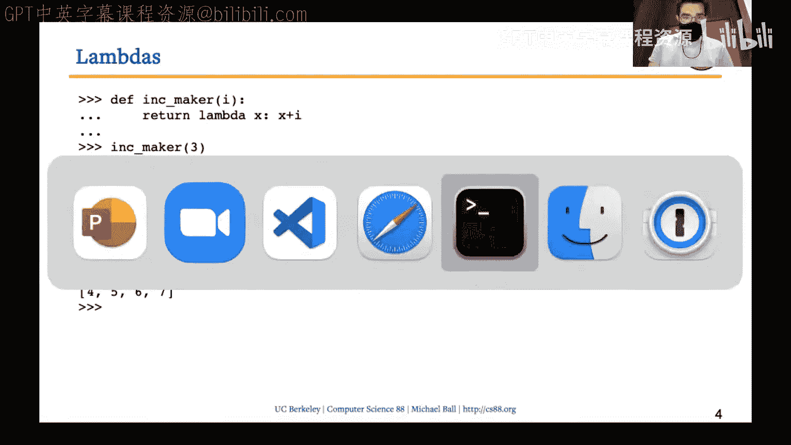

是。H you。

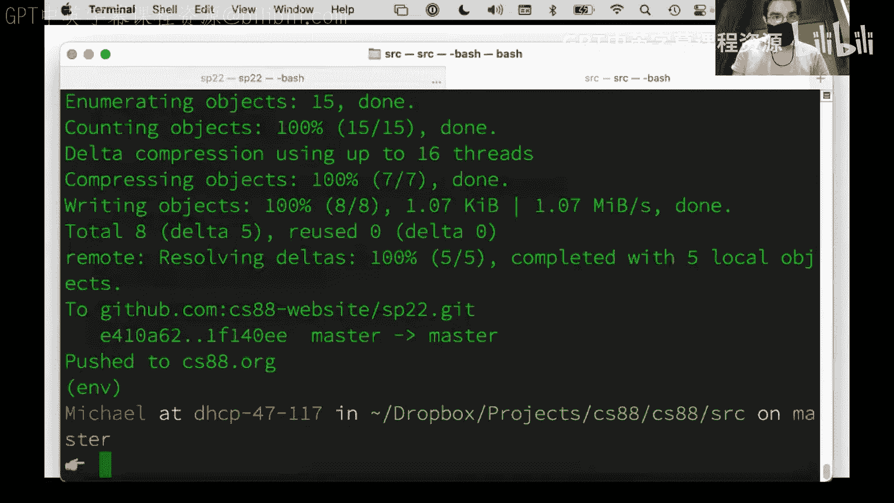

All right。So。2。We'll start looking at a couple examples of lambda functions and the best way to think about this is whoa。

 okay， one sec。

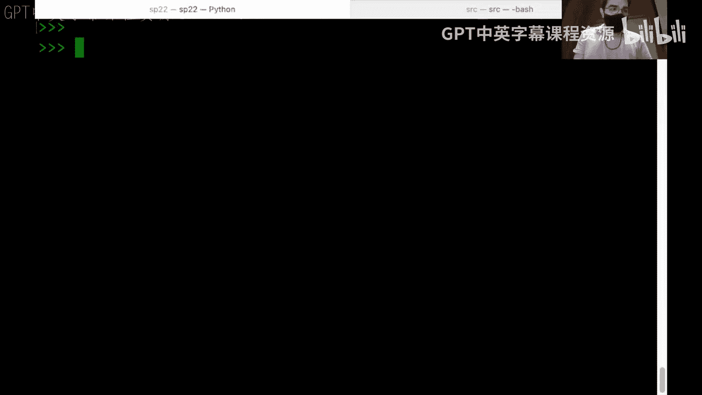

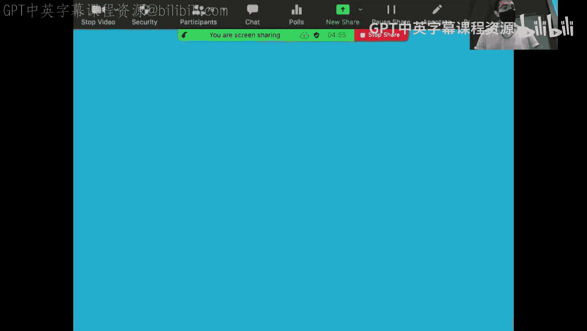

Where did。Oh， that's hold on。啊。Why are my slides？😔，Suddenly on a different screen。O。All right。

 I have no idea why that happened in the middle of。

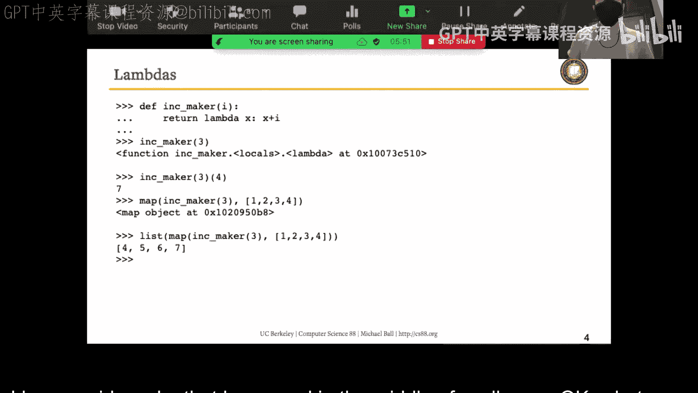

。Okay。嗯。Well， now， okay， whatever。And if you get a PowerPoint。Oh， fine。 Okay。

 we'll deal with that in a second。So not。嗯。Not sure whats happening anyway。Back to Lambdas。

 so when we're working on lambdas we might have a function。Like we can just call this say hi。

For name。And again， this one will just return a string。系。Plus， our name。So if I say。食嗨。2。CS88。

This this is something we've done before Michael the screen is black for people in Zoom。嗯。嗯。

You can't oh， you can't see my screen， okay。嗯。Wい。Wait。

 then what is Zoom sharing if it's telling me that it's sharing the screen？嗯。好。No。Okay。

 can someone confirm that a。Cool thank you yes， we see it now。Okay。

 don't know what's with the projectors today。啊。Okay， so。

So far this is the same example now the trick is with the lambmbda expression is。

We just essentially use the keyword Lambda， but leave off the return statement， so Lambda。

We have our argument name， so this would be our the name let's type that correctly name and hi。Oh。呃。

 plus。Her name。And with a lambda expression， we can call it the exact same way。As any other function。

But in this case， we say。嗯。We just we only use one line to define it。 Now， in this case。

 what we're doing doesn't typically。Seem like it's much of a benefit。

 and if we're just writing one line functions， you know perhaps lambda expressions don't really change things。

 but where lambda expressions do start to come and useful。😊。

Is when we start thinking about things that we've done before， like map filter and reduce。

Before if we wanted to choose map， we had to pass the name of a function。呃。Into into map。

 right we had to say square， we had to say。Add one or whatever it was that we're doing in this case。

We now get to say。Let's say we want to just return the square of some number。

 we get to say lambmbda n。And。Times， and。Range of 10。Close that closer map and close out our list。

And now what we could do in one line， we could write a lambda expression that takes in a function。

 that is a function， which takes in a number。And returns the results so like。

Like any other function map behaves the same way， it just happens to be that in this case with the lambda expression。

 we get to。Passive function in line in sort of one step， so that is。The main benefit of lambmbdas。

 but they do show up in。

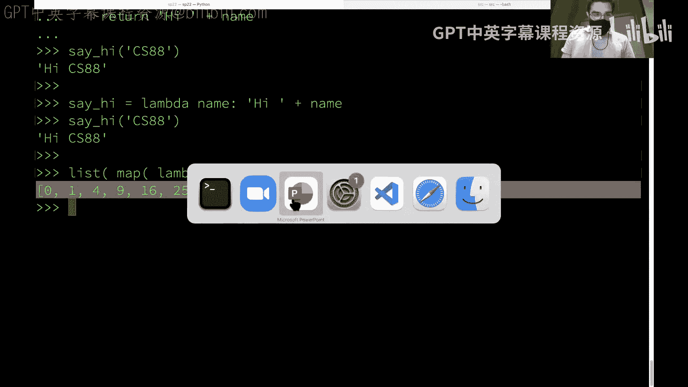

啊，使 getた喂。Oh， don't。 Okay， PowerPoint， you're gonna。是。Oh， I'm what's going on。 Okay， maybe let's go。

嗯。One side。Okay， where。That's not doing it。Why did this change all of a sudden？嗯。嗯。嗯嗯呢。Right， well。

 okay， if PowerPoint is。Going to not cooperate with me。啊但。Well just。

Deal with this so that everyone can see these same slides。At at the same time。All right so。

With our Lambdas， we can pass them into our harder functions。In basically the same way。In this case。

 I did a map in the Python interpreter， but any higher function。Which takes in。

A function is the argument we could pass in a lambda so where we used less than an equal maker rate we。

We explicitly assigned in the previous example a value to the function less than an equal maker three。

 we could just pass that in。Directly into our filter expression。This way。

 we could instead directly use a lambda。 So the most common example， I think， where。

Outside of practicing using harder functions。We really see lambmbdas。

Are cases where and this will show up in project one。

 this will show up all across places where you are manipulating data sets to access。

Some property is we want to take a common operation。

 perhaps like sorting a list and change how it operates。 So there are some examples on the slide。

 but we're going to。

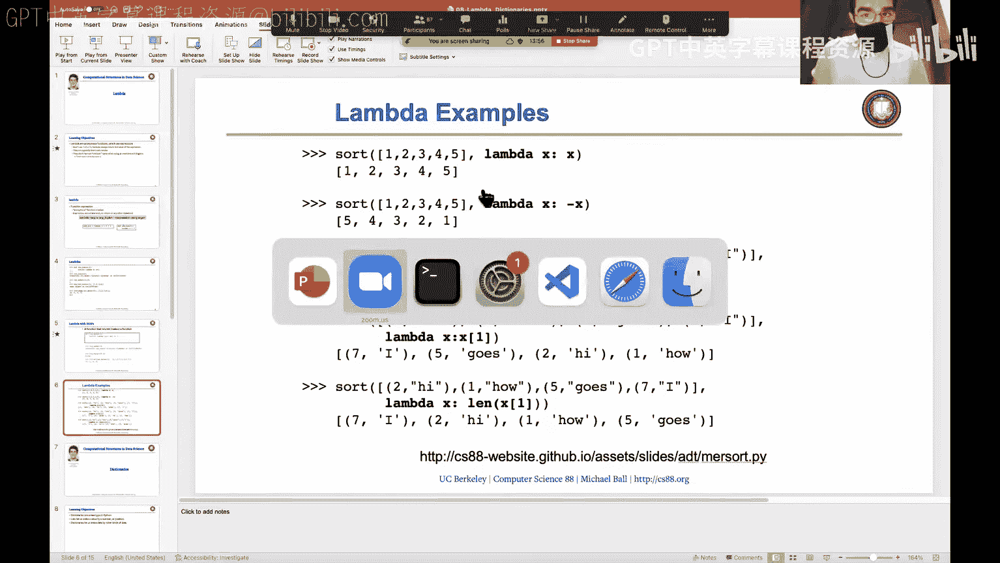

啊。嗯。You， fine。 I have to have it on the screen now。Okay， so。Yeah。

So we're going to make a list of numbers。We'll actually make this a list。

Let's make this a list from 1 to 20。啊。And。We can just verify right this is a list of。

But number  zero to 19。Python provides a handy function called sort。And in this list of numbers。Well。

喂。Oh sorryrry yes sorted there's multiple different sort functions。

 So our sorted function in Python you if our number is already sorted。

 it's not going to do anything for us right this is already in the order that that we want to make But if we think about an operation like sorting and this is where。

Again。The goal of CSAD is not just a program， but to think about how we break stuff down into smaller problems is that。

Sorting a list from one to n in order。Is in many ways， a。A way of sorting the problem by any metric。

 but perhaps the metric is something different， so what do I mean by this。If we say help。Of。Sored。嗯。

Our help function actually tells us there are two things that we could do。

With our sorted function so it says the first argument is something iterable so again that's our list the second argument is this thing that it's calling a key and the third argument is what we're going to do。

 but in the more sort of generic way is you could actually tell sort to just reverse the list for you so if you didn't know anything about lambda you could say well I could sort of list reverse it that's fine but what sorted allows us to do。

Is say。Sort my listed numbers。By some key， so whenever we see this syntax。

What we're saying is there's an argument called key and it can take in some value。

 so on our slides here。

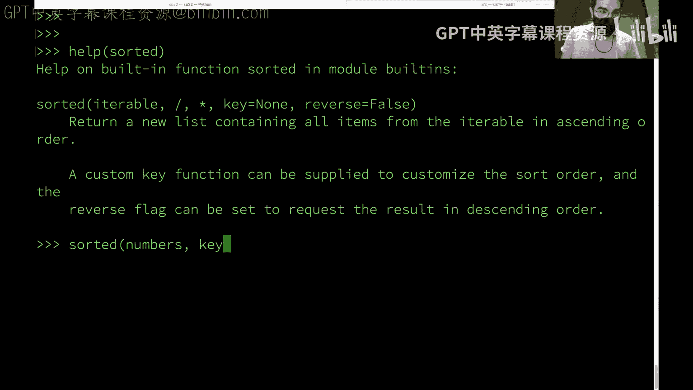

嗯。We can also we should be able to leave off the name key since it's just the second argument。

 but we can start to。Think about what are all the different ways that we could sort different kinds of data in an order that we want based on a property that's not just is a less than B。

 and so one way perhaps to reverse our data。

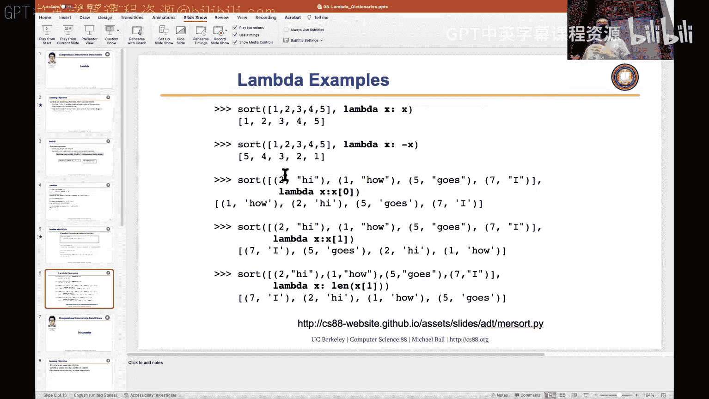

Is to say。Lambda of whatever value we want， let's say n。And we could say negative n。Oh， you don't。

 Okay， wait， why don't you like my。对嗯。I'm going to be picky here。Oh， because。That example。

There we go。So what have we done here we've told our sorted function to sort based on not just n。

 but now the inverse of n， so if we think about is a less than B。

 this just sorts things in the reverse order now if you saw up here。

Sorting on an inverse operation is probably not the most useful thing because we could just tell our sorted function to reverse the list。

 but this enables us to do perhaps some other clever things like，Let's say n mod 2 is。Equal to zero。

And this will do something interesting right if we say sort based on the function is this thing even in this case this happens to put all of our odd numbers before our even numbers this is kind of an odd way to sort our data。

 but perhaps you want to split a list into two or three components you could use a special sort function now why the sort function behaves this way on this kind of data。

Is particular to how Python works so if you're curious why it's going to pick evens before odds or excuse me odds before evens in this case。

 you can look at the documentation but it has to do with essentially what the return value of our function is and there are different ways that you might want to customize that。

嗯。But with。诶。With all sorts of data and Lambda expressions。

 we can start to do things like thinking about how do I take a generic problem like ordering a list of any kind of data from a to Z from one to 10。

Perhaps it's a list of rows in a table in data eight。

 you might want to order those rows in a table by not just their individual value。

 but a particular key in that table where if you've taken data eight rate tables。

Each row has multiple columns， so you'll often see that doing something as an operation or column in a table perhaps uses a or one way to do this is to use a Lambda expression。

on。On that data， and let me make sure that I can now see。嗯。Soong cha here。嗯。Okay。Yeah， okay， yeah。

 so the question in and Zoom chat is when do we know when to use something like key equals lambmbda？

Or how to how to call this function so the sorted function in Python。Okay。

 whatever auto settings this computer swap to now are really messing up。

 So in in our documentation for the sorted function。This will show up by a few different ways。

 but Python has this way of specifying an argument which says key is equal to some value。

 and so when we call our function we could say key is equal to an lambmbda expression。

We also in this case。should be able to just say。Oh no this sort okay， the slides aren't wrong。

 I thought that okay， I will fix that afterwards。嗯。So。

If we say key is equal to some value then Python uses that as as an additional argument inside the function。

 so there will be a couple examples in I believe the map project that uses kind of syntax the ants project after the midterm will have a couple more examples that's something that you might see but we're not going to necessarily test you on。

But in this case， the。The documentation for the sorted function that exists in Python will specify what this function should look like or what it should do。

Outside of this sorted function， there is a list do sort function that Python provides NI。

 if you've used it for data 8 or another course， has its own sorting functions which often accept this same kind of structure as an argument。

And this is where Lambdas as a concept are particularly useful， so in， let's see。诶。So。

That's actually not a great example。Well， that's okay， let's see， we'll come back to that later。

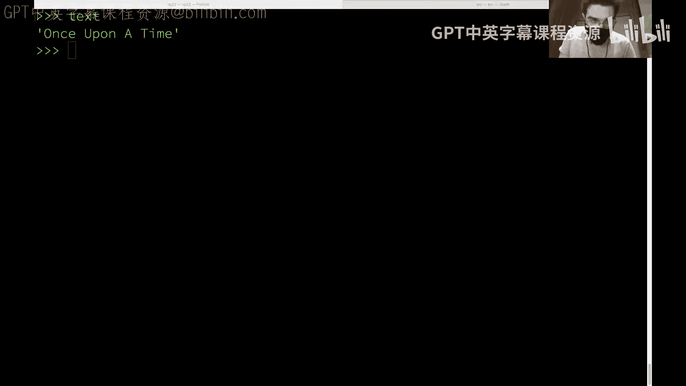

就。Oh okay I know it's yeah okay now I know what's happening with these slides I will fix that afterwards there are multiple different sort functions in python so this is one that was imported but i'll fix these to use the default one afterwards。

But in any set of data， there are lots of different ways。

That we might be able to pass in a Lambda as a function。

 so sorting data is one of those things that's really common in the Maps project。

 you will use a version to access data from a dictionary which will be our next topic。

 but before I go on to that questions about how Ladas work and any of the examples。

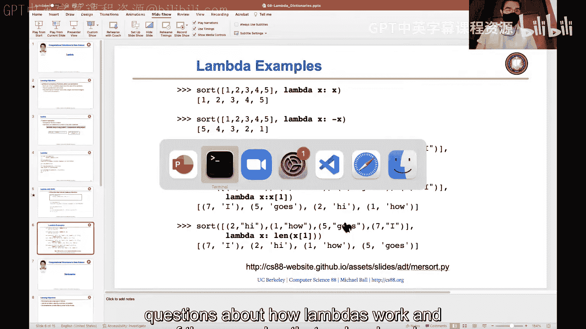

呃。That that we've done here so zoom feel free to drop them in the chat and if anyone in the room has a question feel free to。

是。Questions about Lambda so far。次拜 no。嗯，Okay。Zoom Cha， okay， cool。Oh yeah will yeah。

 here's a good question the chat will when we pass in a function to the sorted。

When we pass on a lambda to the sorted function， will it return all of our numbers。

 why is it returning？嗯。Both the even and odd numbers this example yeah so passing a lambda to the sorted function should always return all of our numbers or all the data list the sorted function is just trying to say put these things in order based on the results of calling a a different function so after you call some function。

Try and put the data in。In some order， so in this case it's not like a filter where if we filtered the data。

 we would only get half of the results， but sort will our sorted function in Python will always try and return all of the data in in our list。

It should never leave anything out。护色。

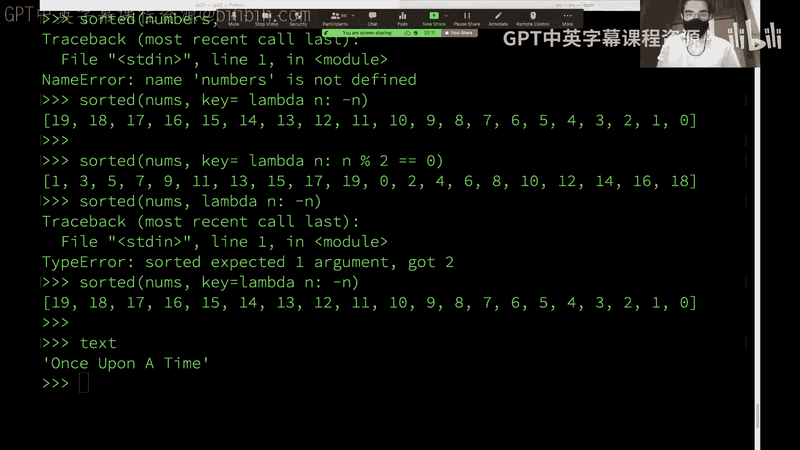

哎。So the next topic that we're going to talk about today then are dictionaries。And dictionaries are。

The way to think of them are a really useful type of data in Python that lets us associate some key name。

With some value。And。When we use a list so far we've indexed items in a list by position right so we say item zero。

 item1，2，3 and so on dictionaries now let us access data not just by position but by some name so we'll map will'll create a dictionary that represents some complex object we can think about how we might structure you know a piece of data if we talk about a course a course could be represented as a dictionary which has a name like computational structures and data science it might have a course number like 88。

 it has a department like computer science it might have units in this case three right and so a dictionary allows us to structure a data in ways that give us。

Both names and values。 technically speaking， dictionaries don't。

Allow us to do anything that we couldn't do with a list of data， right if I had a list。

Representing the string CS88， the department computer science the number three。

 I could put all this data in the list， and I could know it represents some information about a course。

 but knowing that the third item of the list happens to be the number of units that a course is offered at might be kind of weird so dictionaries will allow us to。

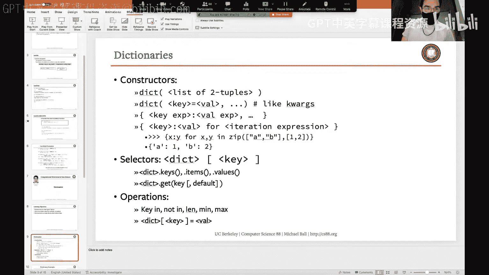

Associate names with values。 And so before we。See， where are。

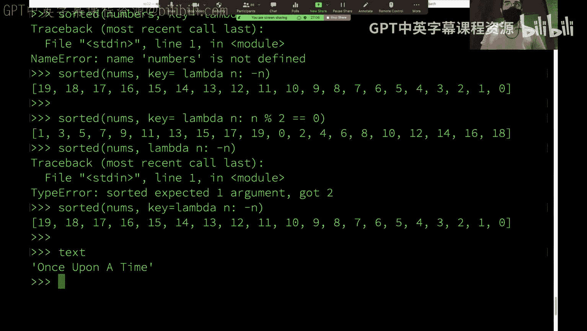

Okay。That's not exactly。😔，Where I wanted that screen to be。But fine。We'll put this up here for now。😔。

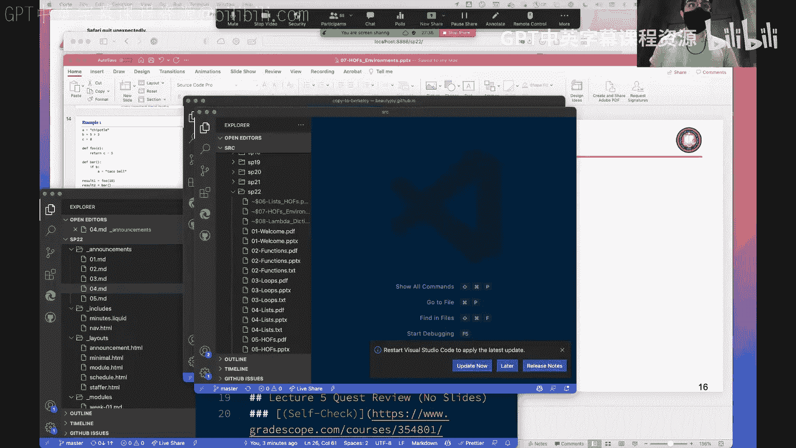

嗯。Right， well。

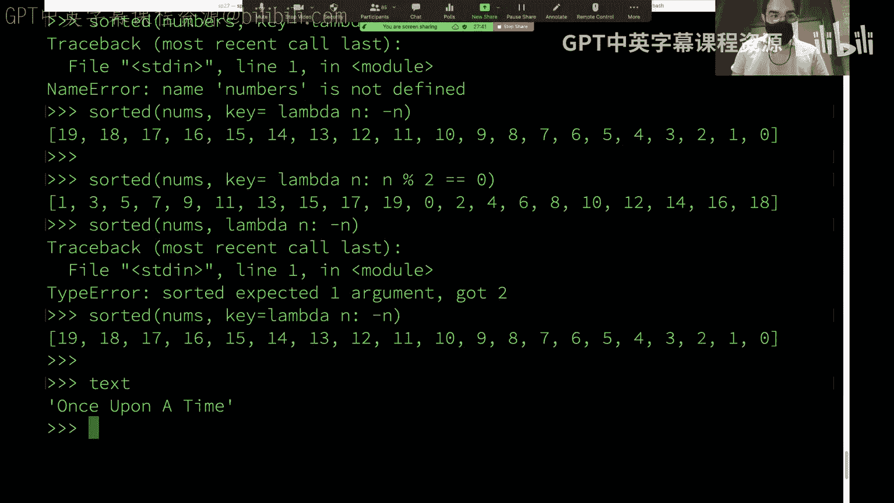

All， so。But in our Python file， which should be up on the website and that I。For some reason。

 cannot pull up right now。 And the text editor is frozen， has some of these things defined in it。

 So a dictionary。Is。呃。Is a new data type in Python， which instead of using square brackets。

Now uses curly braces and I clearly。The location was。I forgot to update that， but that's okay。

 this class moves around， so we could say if we make a new a new dictionary。嗯。

In the same way that we make an empty list with just empty square brackets。

 a dictionary I can start off with empty curly braces。嗯。But。We might have。

The way that we do this is we might pick any sort of data and we associate them with a key colon and a value。

In， actually， I should not。What的。h。Okay。What sortrt of autocomple thing。All right，Yeah。

Name will be a string， we use a colon。So this gives us a new dictionary which has one property。

 which associates the text name with the value Michael these are。

You can almost think of them like variables， but they're not quite a real variable right the variable name is data and inside data there are there can be multiple properties inside of course there are multiple properties。

 so with a dictionary。呃。How do we access individual data？Well， we use our square brackets。

And we say coursese square brackets and instead of zero， one， two，3 or four。

We pass in whatever the name of our key is， so so far。This makes。

This is pretty much like treating something like a list of data。

 but instead it's a collection of named items。And if you use dictionaries just in this way。

 they basically operate like lists that you access in a different way。

By dictionaries themselves also。Sup iterating in a for loop。So if I say whoops。For entry。

In our course。We can print。Entry。And in this case。When we do something like this。

 we get just the key that the the key of our of our dictionary so again， we'll use the terms。

We typically refer to this thing as a key。And the value is still the value。And with dictionaries。

 aside from iterating over them， we could do lots of different things。So we could say。

 let's actually say this key。Dictionaries support something really useful in our for loop now。

 we could say for key comma value。Yeah。啊，我。Oh， fine。 You want me to， okay。Hello。

And is a problem with using the interpreter。Wait， why don't you。哇。

Why don't shoot like what I was doing？All right， I will skip that example for now。

And figure that out later and update the notes。But why。All right， python。So。

There are a lot of different things that we can do in with with our dictionary and one of the most。

Important things。To think about it is if we access something in a dictionary。

Let's say we access something。Like。Okay， what has going on with my term on today if we access something like a property like a title。

We get this error that says that it's a key error and it just tells us the name of the key that we are trying to access in this case。

呃，V呃。All this is saying is that the thing that we're trying to access is not in our dictionary。

 so this is in the same way that if we access a list index， which is outside the range of our list。

 we get an index error。Which says index out of bounds this just says key error title it's not super descriptive。

 but it should tell you that the thing that you're trying to access does not exist in in your dictionary however dictionaries have some really。

Really nice features。嗯。We'll get to that later。That allow us to access data。in a safe way。So。

Dictionaries support this get function。And dictionary。ge will safely return。The value none。

 if nothing is returned， so again， if we say that get what's represented there is the value none。

 but the interpreter doesn't show it。嗯。We should then be able to say。嗯。

The get function allows us to do something like specify a default value。

For dictionary so if we say get some item and it's not present we can still return a particular default value these things with dictionaries are。

They start to enable us to do things like when we access a data set， so in the MAped project。

 which is coming up。fairlyly soon the the way that the data is structured having access to getting it by the multiple properties that could exist on so the maps project is working on a set of restaurant data and plotting out。

Restaurant reviews in geographic regions so things are grouped where restaurants have a name a review has like a number of stars there's some review text each restaurant has a location which is an X and y coordinate pair and so using dictionaries。

Will help clean up some of the operations that you might do on that data by organizing it a little bit more cleanly。

Okay。嗯。

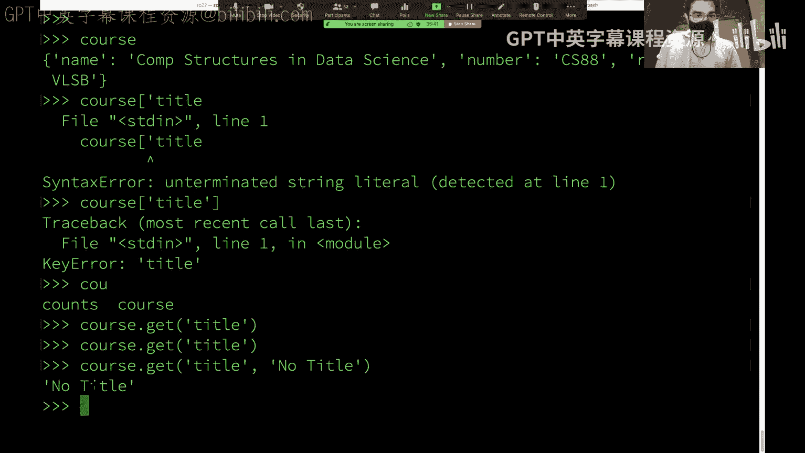

没有看 on。And again， this was。哎。嗯。Wait a second。 that's。嗯。吓。O。There you。嗯。Okay， cool， so dictionaries。

Have a bunch of common operations， we will look at creating them with a dictionary comprehension in just a second。

 but there are a few different other functions so we can call dictionary dot keys to get just the keys。

 we can call dictionary dot items。To get。嗯。The啊。The items should be a list of pairs and dictionary values to get just the values in the dictionary。

O's see， okay， question Zoom。Can you， can you， let's see？For the question Zoom。

Could you use the function get that has the value in that argument and return the key So in when we call dictionary dot get。

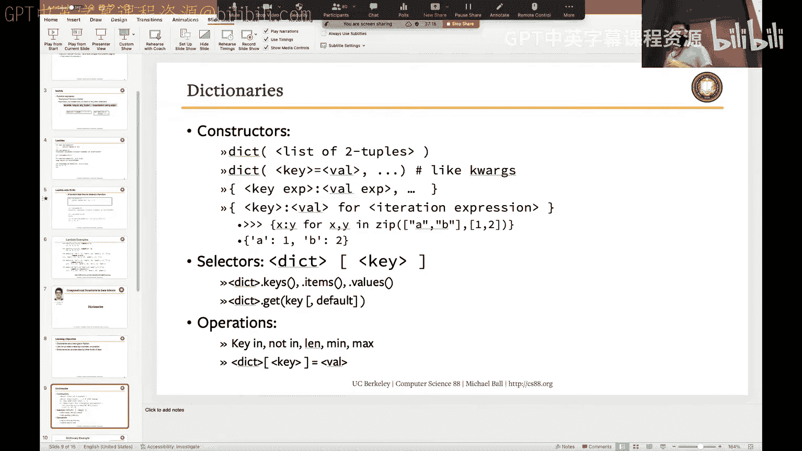

With。啊。With a second argument that argument is going to be whatever we choose。

 so typically you would choose some default value， so again this makes not much sense in the abstract but something that you might see so we have our data object。

 which is just my name。呃。You might be working on。呃。

Some project which tries to aggregate and score data。

And so a really common thing that you might see is dictionary。ge。

I have some score with the value zero indicating that if I haven't rated whatever I'm rating or or if this algorithm hasn't scored you know some object yet that that its starting value is is something like zero so this is。

A pretty common operation for for getting some data but what goes in the second argument here can be whatever you want it to be so it could be zero。

 it could be the string title， it could be the string score。It could be。

You knowWhatever makes the most sense for your particular program。

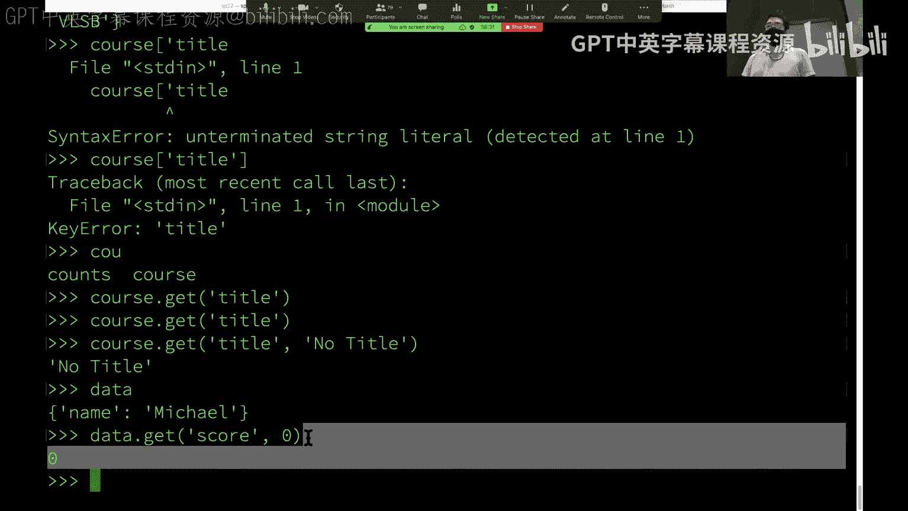

So。哎。Cool， okay， we'll do that next。So the other last couple examples with dictionaries。

 and now I am actually going to try and pull up。

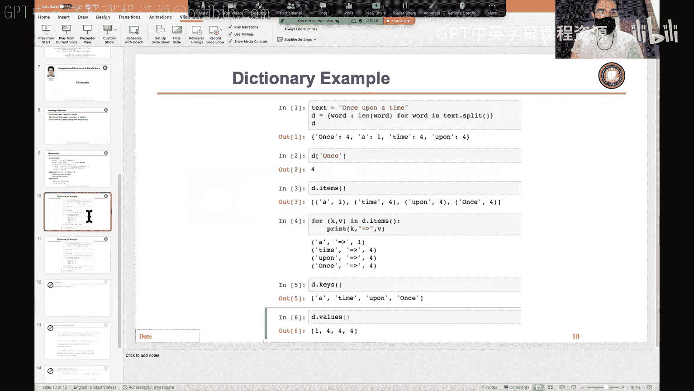

This file。Okay， there we go。嗯。All right， well。Okay。Allright， one second。

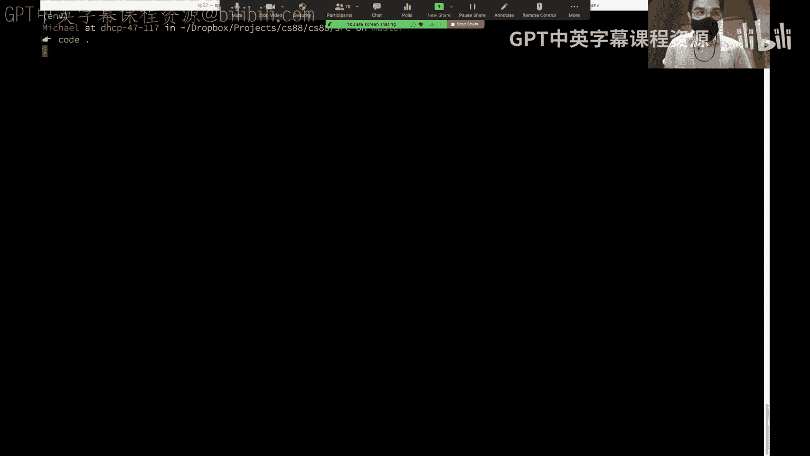

完了。This computer really can't handle opening a text file。All right， okay。Here we go。

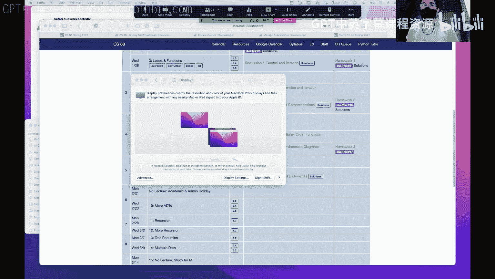

Now， now I think we can finally。Finally make this work。

One of the useful things about dictionaries is that over time。

 they allow us to accumulate and store and aggregate data in a few different ways， so in this case。

We have our text， it's the phrase once upon a time。Again， we'll use the function。Text。Not split。

To make a list。One type of program that you'll see get used as examples in a few different places is the idea。

Of using things like words as a means of doing frequency analysis or understanding some distribution of text in this case。

 instead of counting how many words or in the sentence perhaps。

 although we could do that and different。You know， a different kind of problem or we're just going to count the number of letters of each word in。

In a sentence， maybe that would tell us something about you know the the particular style of writing or whatever it might be。

 so we've seen less comprehensions before where we say。You， item for item。In some sequence。

In this case， we can do a dictionary comprehension， which works very much in the same way。

 but it will use curly braces。Instead。Okay， there we are。

 those curly braces instead of just a an expression， and we say are our key colon value。For word。

And whatever we want to do over here， but in this case， we'll be doing text thought split。With。

An empty string。And because we assigned it。We can now。Look at what our count dictionary is。

 so in this case， we get a dictionary back with our four values。

Each of them has a key whose value is the word and the value。Which is the length of the word。呃。

Let's see， things that we could do again counts。诶。是的。

So just some of the final additional operations that we might do count。ge of keys。

 returns just the keys。Countstock get。Of items。Is counttative items is maybe one of the more interesting things is this returns all of the items in our dictionary。

As a as an object which has two item pairs so the。There should be a shorthand way。

So let's see actually let me do this so I queueed one there should be a shorthand way to avoid doing this。

 but if we wanted to iterate over keys and values in our for loop， the other way to do this。

Is counts the items。So this。Okay， no， I did not hit。Well， I guess I did it。Thanks。All right。

 so for key value。Now。We print our key and our value。Oh， come on。

 How many typos can I make in my line today？嗯。然，这个是么回。Right， so now if we do this。

 we say it for key value in。In count stock items now if we print them。

 we get everything together there are a couple shorthand ways of working with dictionaries and for loops。

hich I have clearly forgotten， but this is another one of the ways that this function allows us to treat each set of items in our dictionary as a pair。

And so that is one thing， one final thing that we can do and the last function that we'll just demonstrate on。

On this count is just getting the values。Which。Will give us a function as we expect。

 just the values of our dictionary， and then let me spend the last few minutes。On a。

A couple questions。Yeah， so this is a good question in chat， so they failed to themselves。

 but it said so is get creating a new key。And no get never creates a new key。

 it just returns the value， but if the key is not there。

 it returns none or whatever default value you provide to。To get questions。

With the last couple minutes， questions in the room on anything dictionary yeah up front。It is hurt。

在身区个。That's fine。Yeah。Yeah， that's correct， whoops， aside from that。Oh， sorry。

 because this is counts。Yeah， so yeah good question。

 so the second argument in do get is only useful if we don't find a result for whatever we are trying to access。

But yeah， good， good question， any other last questions on dictionaries？Yes。All right。

 then so on Wednesday we'll talk about abstract data types。

 which we'll use dictionaries as a means of organizing and structuring some data and hopefully the projector setup will work better on Wednesday。

Thanks everyone。

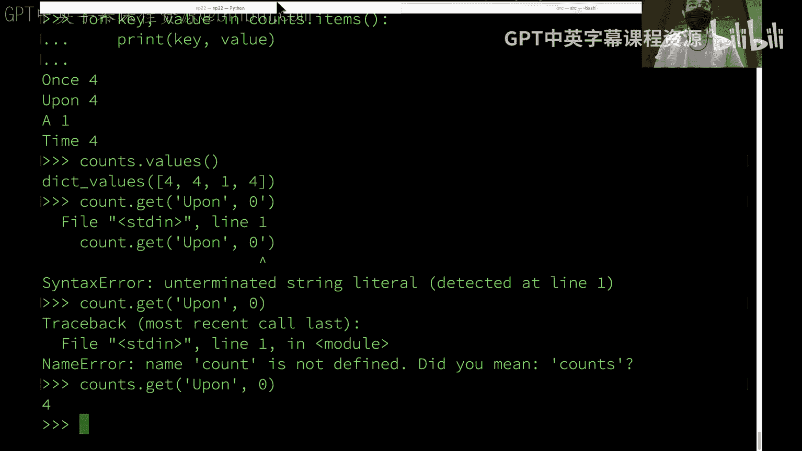

Yeah。