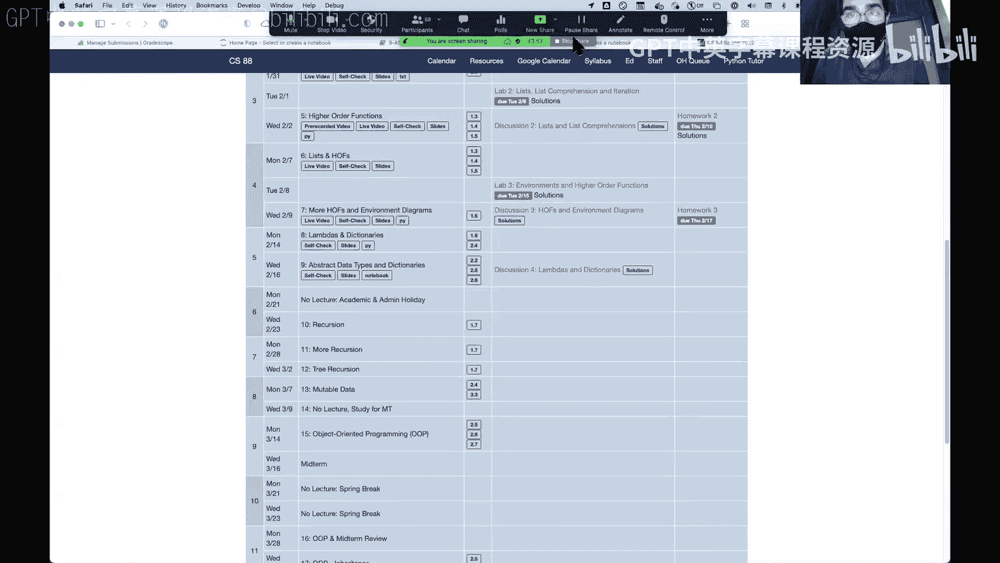
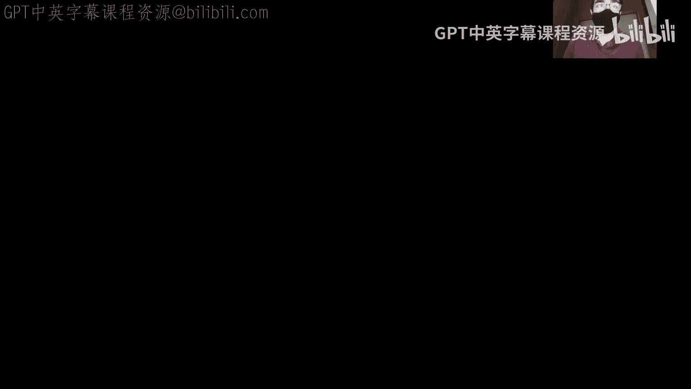
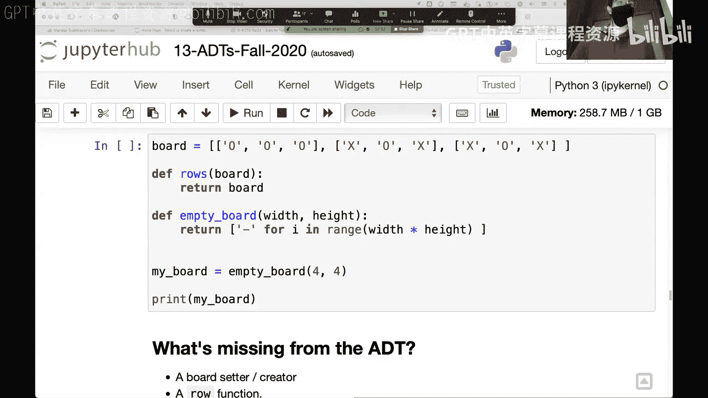

# UCB《数据科学中的计算结构｜CS 88 Computational Structures in Data Science 2022》中英字幕 p09 CS 88 Spring 2022 - Lecture 9 - 2_16_2022.zh_en [BV1516iBfEVY_p9]

不。Its 1111 all right cool so we'll get started today so today's topic just if you had a chance to look at the website。

 by the way， I shifted around the next couple lectures to better align with things before the midterm so this semester will probably have one lecture on abstract data types。

But we'll go through that today and the process of going through abstract data types we'll look at another use for dictionaries before we get into content。

Just some announcements to be aware of these will all also be going out on Ed over the next few days。

 but just to give you a sense of where things are the midterm is Wednesday 316 7 to 9 pm the schedule needs to be updated exactly we probably will not have a lecture that day just to give everyone a break so that you could study and review but it's a two hour midterm this class there is only one midterm exam and one final。

And if you look through the past midterm that are on the website， they're on the resources tab。

It should feel pretty similar to those past midterms。

 essentially midterms in CS 88 are a fair amount of writing Python code， but in a scaffolded manner。

 so we'll give you the template for a function， well sometimes ask you to fill in just a single line。

Sometimes we'll just say， hey， this function is like three lines of code。

Fill it out sometimes it'll be know complete fill in the blanks there might be a couple multiple choice questions there will be some completing an environment diagram so we will usually give you some code。

The structure of an environment diagram and then ask you to fill in certain pieces of the environment diagram。

 but we're usually not asking you to create an environment diagram from scratch that specific style has changed over on the past exams。

 but this time it'll look much more like the fall 21 exam。

The rooms I think we have confirmed but we'll put those out know closer to the exam。

 I expect most people will take the exam in person， but we will have an option to take it remotely。

Where you can take it in know your preferred location。

 if you do that we will be using zoom proctoring so you turn on screen recording and turn on video recording and we use that to sort of review an audit for academic integrity。

But most people you know take it in the room to our exam right now the policy for the semester is five devil sided cheat sheets of handwritten notes so that's a pretty good amount you could write whatever you want we will also be providing a reference sheet I forgot to write that on the slides。

But that's that's generally the option there so just want to put that on the radar it's a month away basically so there's plenty of time to study the tutors hold exam prep review sessions and those are you know usually a little smaller than a normal section and they go over you know over the next few weeks specific problems from previous exam so if you want the practice for that take a look at the CS10 or the CS88 calendar on the website because there are exam prep sessions there。

And finally， the Maps project will be going out soon。The Maps project is a project which。

It takes restaurant review data and has you plot it on a map。

 does a little bit of data analysis The point of the project is not necessarily the data analysis。

 it does use this really popular technique in statistics and data science。

callled K means clustering and the project sort of walks you through how that works。

 but really it's a good opportunity to practice with Python to do something that's a little bit visual to work through a larger project that involves a couple Python files that has code where part of the time that you'll spend in the project is reading through the code that we've given you compared to homework assignment or lab where you're mostly just filling in functions so。

Watch you out for that it will be a partners project as well partners are not required。

 but if you would like。To work with a friend or an enemy I suppose it's up to you。

 you get to pick someone in the class to work with if you want to work alone that's totally cool too。

 but the Mas project is pretty fun， it's got you a lot of practical examples of how you might use Python。

 how you might apply the techniques that we've been learning。So。啊。

Today we're going to talk about abstract data types。😡，And。

And a lot of ways the first half of this lecture will。

 and maybe to some of you even the whole lecture will feel like we're not necessarily learning something new and that is okay the point of talking about abstract data types and one of the reasons that we talk about right now is we're really going to focus on iss not just what is the syntax of Python but how do we use the tools that we've been given。

To build functions that help us understand our code that help us better understand the problems that we're trying to solve。

Really what we're talking about is using functions and these can be any functions in a particular way that helps us structure our code such that we give names to meaningful kinds of not just kinds of data but kinds of ideas so we're going to build off of Pythons built in types going to use lists and dictionaries。

And structure could in a way that helps us define how we think about an object and then the idea here is that this will lead into some of Python's built in tools called object oriented programming which give us new kinds of syntax and new kinds of structure for thinking about the idea of what an object might be so。

Again， in the class we talk a lot about creating abstractions and in a lot of ways。

 computer science is the study of creating abstractions of being able to compose smaller problems into bigger problems and being able to decompose big problems into a bunch of smaller problems and abstract data types are a way for us to create lightweight abstractions。

That hopefully help make our code make more sense。We're going to focus on most of this idea of taking compound ideas so something like a person。

 a course which has multiple components to it， even we'll start off with just a point on a coordinate plane and representing something that has multiple values to it in a single in this case using a single function。

Why do we do this well in the case of something like a contact。

 we might be able to represent the pieces of a contact with an array where there's a first name。

 a last name， a phone number。Whatever it might be， and so our goal will be to take something like a function called contact name。

 which takes in some piece of data called a contact。

And use that instead of doing something like just saying item zero of a list。And。

When we're working with small examples in our home assignments。

 writing something like item zero of our list really makes a lot of sense， it's fast， it's easy。

 but as our projects get larger，And you'll have the opportunity to hopefully sort of。

Feel some of both the pain and value of this approach with the maps project is that saying context zero or saying restaurant review bracket zero doesn't actually tell you what that thing represents right what is item zero of this list。

 I it a name Is it a number is it a dictionary that represents a whole person。

And so you know while we're working on homework assignment that zero may make sense right it's a simple single self-contained function。

 but in a larger project littering our code with list colon brackets or square bracket zero。

 square bracket one and so on can get messier than we think in particular one of the things that's really hard to emulate and of course like CS88 where you're learning so much at the beginning is。

What happens in three weeks or three months or maybe even you know this is a fulltime job in three years where you write some piece of code and it's running and working and you need to come back to it to make improvements you know further down the line and you look at that code and you see。

Crap I don't remember anything that i've done and so abstract data types become this really important piece and what we can call self documenting code or sometimes it's referred to as literate programming where the code actually reads in a very clear way to to the meaning of it there's a second advantage here to abstract data types that will illustrate but。

Is one of those things that you know takes time to put into practice is defining an abstraction barrier here will allow us to do things like change your implementation so if we run a website。

The underlying structure of our data might change over time， someone might decide。Well。

 we need to upgrade from one version of a database to another。

 maybe we get something that's faster right and by having these interfaces that we start to build we can。

We can save ourselves some effort by creating abstractions that nicely adapt so how should we think about this well。

呃。At the beginning of the class， we talk about this idea of having abstraction barrier where we have。

Some way of building and representing an object and some representation of that object that is sort of shown to the outside world。

 And so our goal today will be to think about。How do we represent a piece of data like a contact or a course。

 we'll hopefully look at a tick ta toe board example。

And how do we define the types of things that we want to do with that board？

We can say that we can construct data， which means making a new board。

 making a new representation of our contact， making a new representation of a point on a plane。

We can select data so this think of this as reading just the name of some value。

 getting a particular space in a board。We can operate on data， adding two values together。

 updating someone's name， maybe appending an email address to a contact。

And then our abstract data types often have this external representation think about when we print a function in Python and actually one of the things that we'll learn in a few weeks is how to really customize how functions get printed。

 but if we want to print something or display it to a user how do we actually think about，😊。

You know what is a useful way of interpreting that data if we have a list of multiple values Python knows how to just print all the values of a list。

 but maybe we can do something like think about a nice representation that really displays by the most useful information so we're going to to start to explore some of those concepts the terms here are meant to be a guide as a way of breaking down and think about them but I would not necessarily try and memorize all of these terms。

 although constructors selectors and operators will be things that we'll be using there is one model to think about this called core。

And again， this is meant to be more of a of a mental model than something that you need to memorize。

 but the way that core works is we think about。呃嗯。The compute and the operations so compute says。

How should we perform operations， How should we think about the。Using a program to build some data。

 we say operations are the things that we do with that data and the boundaries between some of these definitions can be a little bit loose。

 but the idea here we want to think about how do we separate the kinds of things that we want to do with our data from the underlying representation can I use a list can I use a dictionary all of those things are probably valid but the interface that we build we should separate that out and beneath all of this is just this idea of evaluating that the computer knows how to evaluate dictionaries it knows how to evaluate lists。

It knows how to add numbers， it knows how to turn all of that stuff into data that it can operate on。

And so what we're going to do is build on top of that level。

What is probably the best thing to do right now is to jump into this notebook。

 the slides also provide an introduction to the topic of this notebook。

 so for those of you who have taken data eight，Jupiter notebooks will be pretty familiar。

You use a lot of them in data 8 in CS88， we don't use them as much。

 but they do provide a nice demo interface as well so。No， not that。Iide so if。If you haven't used。

 is this not going to show up in the center of the screen， oh， there you go。

If you haven't used it before datahub。 bekeleyedduu is the sort of homepage for Jupyter notebooks。

 I've already been signed in， so it just shows me all of the notebooks that I have books are various versions of class notebooks and。

Small projects and stuff。 but what there is here is there's a button to upload a file so you can upload or you can download the file from CS88。

 org。And upload it here and when you do that。What you get is。Is a Jupiter notebook。

And for those who haven used them before， Jupyter notebooks are a really cool way of combining text graphics。

 sometimes interactive widgets with Python code。And so this provides sort of a nice description to see how we might update something over time。

The lecture notebooks that we use， most of them include this handy utility that imports the doc test module and gives us a function called test。

 which allows us to just run doc tests with inside a notebook。This is not something。

That you are expected to understand or know how it works。

But giving ourselves a test function can be useful because inside a Jupyter notebook。

 we can't do something like type。Python 3M doc test to make it work correctly and the notebooks unfortunately don't support OKP。

That's a little bit about notebooks， just a handy note you can。Click this run button to run a cell。

You can also hit command enter。To run a cell， you can just hit enter to edit a cell。Escape。

To leave a cell and air keys to move up and down a notebook so if you've never used them before。

 it is a little bit of a different interface， but it's a pretty nice utility so。All the other way。

What is our goal today right now we're going to build a really simple abstract data type that represents a point on a plan。

 so just an X Y pair of values。And。It seems almost redundant in some ways to build a whole abstract data type for something as simple as a point。

 there's literally just two values here， but it turns out that starting with something simple is hopefully enough to illustrate why。

嗯。Hey， an abstract data type can be useful and it makes the functions that we're going to use。

To illustrate how a point works。Really， really quite simple。In this case。

 when we first start thinking about the idea of a point。We have。

We really have three things that that we need to understand or care about we have this idea of how do I make a new point right what is what is the thing that takes two numbers and turns it into this idea of a point object。

Then a point， because it has two particular values， x and y， I need a way of accessing x。

And I need a way of accessing my y values。In this case our。

Our point is a really simple two item list its item zero is x， item1 is y。

We define a function called point， this is what we would call our constructor function because it builds a new point。

And we then define two selectors I've written these as lambdas just to illustrate the syntax and why sometimes Lambdas can be really useful for tools like this。

His， they're just。You know， handy。Ways of saving some writing of code。

 but X in this case is just a function。Which returns the first item of our list。

Why is just a function？Quix returns， the second item of our list。

Off the bat our point abstract data type is not really super complicated it's not doing much。

 but when we write our code now， what we get to say is。Let me。

Let me write something like origin is equal to 0。0 comma 0。Whereas before， you know。

 I might have written。Origin is equal to just listist zero comma 0。For a two item object。

 you could argue。That。You know， maybe a list of two values is pretty intuitive。

That in the way that we've all come up through school right that we say x comm a y that most people would read this and you understand that。

 but by at least writing the word point，It starts getting you as the reader of code or you as the author of code in the mindset。

 that the thing that I'm going to be working with。Is not just a list， but it is a point which has。

You know， some meaning to it， such that when we later do some operations on this data。

 they have more intentional meaning behind them。So we're going to start off with three points。

 these are just arbitrary values to illustrate the types of things that we might want to do。

They don't really matter except the origin， having the origin be anything other than 0 zero would probably just be wrong。

In our mythical world of whatever flat land this happens to be。The origin of our grid is0 zero。

 my house is this value five comma five。And the campus is at the point8 comma 9 so that we have a。

A few。Well points to work with so because these are just lists。

 we could we could print them and evaluate them。2。We can。And actually once before I continue on。

I'm going to go here。And。嗯嗯。All right， I'm going to clear output just as I go through this。

 anything that I show up will not immediately reveal what the purpose is so。

By using an abstract data type。It doesn't prevent me。

From writing something like my house where bracket at zero。

But I don't necessarily know as the author or as the reader of this code that that may be perhaps that that's X so what an abstract data type really allows us to do is to take something。

Like this idea of。Of accessing an outivist and give it a name of a function。

The x value of this thing in my house。is。Is what we're trying to go after and so right off the bat this is I think the most important thing that if you could take away from your own projects from the course that the names that we give to things really do matter that they communicate a lot to us as readers and what as you go through more complicated projects you should also see is。

In in the maps project when it's out， you know when something says that is a restaurant or something says that it is the score of a restaurant review。

You ask yourself yo what does that name actually represent right if I see something that says X of my house。

 you should start to interpret that that is an X value versus trying to figure out you know the structure of the data sometimes you will have to double check that this function X right actually does the correct thing that like there's not some weird bug here but we should be able to read this and assume that the thing that we'll get back is the x coordinate for。

You know for this helps， I will also note that the particular names that you choose are really up to you right if we call this X versus x coordinate up to you whether or not you want your code to be a little bit more wordy you know different。

诶。Different people sort of err the line on that spectrum in different places。So。嗯。Yeah， so we can。

 of course， print and inspect data。One thing that we might start thinking about is if we wanted to inspect data from。

An object is， you， should we turn this into a function that just prints this nicely？In this case。

 we're not going to do that today， but I think this further illustrates the example that if we say x is some x coordinate of my house。

😊，That that's what we're trying to to access and we can be a little bit more assured that that's likely to be correct。

 even though it's not necessarily guaranteed this syntax by the way。

 is just something that you'll see saying F before a string is just a way of dropping a variable inside curly braces without saying you know x plus y and so on so。

呃， yeah。The one thing I'll say is another term that we use， we talked about abstraction violations。

 so if I were to just say campus。呃。Actually， this should say print。If I wanted to get， let's say。

 let's make this D Y coordinate。For once。没有。😔，There we go if I wanted to get the y coordinate by directly accessing the structure of our abstract data type。

 this is what we call an abstraction violation and what we're saying is that we have a way of getting that data in this case a y function。

 but instead we're directly relying on the structure of our data to。

To access that data and so that's we would call that an distraction violation in practice。

It's a little bit， you know， there are times where it can be very clear that this is some abstraction violation and other places。

 the boundaries will be a little bit more fuzzy， but we'll try to call them out as we see them so。嗯。

2。Before we continue on to building some operations on these point objects。

 I'm going to stop and see are there any questions so far about this idea of naming functions。

To things like that or just I guess， any questions so far about a notebook or something like that。

And zoom seems pretty quiet as well， but feel free to。Drop things in the chat。Questions， oh yeah。

 up front， yeah， go ahead。Yeah。Yeah， yeah， so the question is to clarify what what the abstraction violation is here and yeah it's it's directly accessing item one of this list when we have a function called why that would provide。

Youep that option， so I could turn this into print。喂。Come on campus。

And that should do the same thing。And really what this。

 why this matters is because at some point when we talk about the representation of our data changing。

We will see why having a clear function to handle that representation changing makes some sense。2。

So one thing that we can do is we could start to build operations that you know access and manipulate our data and this subtraction formula just implements a pure distance between between two points so if I say what is the distance between 01 or if I just want to subtract 0。

1 and 。2 it gives me a new point with the x and y value subtracted of course in this case we've written it all using。

Absstruction violations and。This is a good first attempt。

 This function is correct if we run this function。We print the result。

We see that we get a new point by subtracting campus in my house。

 we get three negative four that is actually correct。

But the downside of something like this as well and I will say this is the downside in general of using indices as lists when things get complicated is that。

It's actually pretty easy to perhaps slip up and say let me access item one instead of item zero of the list and if I do that now I get a different result。

 but just by looking at this， you know it might not be clear。

To to off the bat that' saying p1 square brackets1 is incorrect when it should actually of course be zero。

 so I'll fix that up。So how do we。How do we fix our abstraction violation Well， in this case。

 we just switch every time that we're using。How directly accessing a list to use a function X or y in this case what we see is we have x of P2 minus x of P1。

 y of P2 minus y of P1。And。That is。In。In pretty much every case。

 a more clear way of structuring your data， and we'll actually see why in sort of a made up world where this makes a lot of sense。

I'll also note that there's one other abstraction violation in this function。

 which is to directly return a list。Even though points right now are always represented as lists。

 we should still call the point constructor that gives ourselves a new point。Because。

That might not always whoops， no。Go w into anything。That might not always be the case。

 so we can subtract things。And when we do that， we can。Get the different values。So。嗯。

Why again then do these different functions become useful well perhaps one of the more useful things that we might do with our abstract data type is to compute the distance between two objects and again the math here is just the distance formula the math is not at all the point of this example I'm using the word point way too many times but once we have nice functions。

We can say the difference between two points is to simply subtract them。

 to implement the distance formula。Now we square x square y。Star star is 0。5。

Is a shortcut for the square root of something， but that just implements。

The the distance formula and in this case again， hopefully seeing something written out where we get to user X coordinates。

 we get to use a subtraction function。We prevent some additional mistakes。

We can verify that this works by running this code。We see that the distance。Between。嗯。

These two values is。Is listed as。F so。hy。So。Why does why does being sort of very deliberate and rigorous about our selectors really matter？

Let's say we want to do something。A little bit weird。

 and instead of representing a point as a two item list。

 we could represent a point as a string of let's go here a string of two numbers， X and y。

And we'll start to do this。 It's worth noting that every time we redefine point in a notebook we'll need to。

Re rerun our code to create a new version which access this so so now our values origin my house campus。

Are no longer a list of data。They are a string which represents the number five space and the number five or more appropriately。

The string of our x coordinate space， the string of our Y coordinate， and as formats go。

 this is a pretty terrible way of representing data， but it is functional。If we try and run。

Our function right now。A distance formula no longer works， right， we change the format of a point。

And now things like subtracting， calculating the distance。

They all break and in a lot of ways we should expect this to break。

 but what it turns out is nice about this is that。By using abstract data types。

We can get our distance formula and our subtraction formulas working again。

With only redefining how we access。X and y， so we're now going to say。

We're going to split the string into two parts。Turn that thing back into a number。

So now we have a new X and Y function， and so I can say print。Actually an in， if I say x of。My house。

I get B value five back so now that we've defined x and y again。We can access our values。

It turns out。That。Now if we rerun。Our。Our formula， we get the same result before。

 so what happens here is。We。嗯。We can。Take our。We can take our same operations our subtraction or distance that take two different value that take our functions x and y。

 we can change the underlying representation and all we need to do is instead of rebuilding subtract instead of rebuilding distance we just update our x and our y functions to match that implementation and so with only three or four functions right maybe this isn't too big of a deal but with。

Four or five or dozens of functions that might happen in a larger project。

 being able to only update a small handful really could save us quite a bit a time。Okay， yeah。

 so there's a question on。Says wouldn't this return error since x and y are not defined so as long as we say this function X and this function Y。

Are defined as。You know as this lambda or if we wrote de x de y， then anywhere we。

Let's see if we scroll all the way back up here。Then anywhere where we might use our functions X and Y。

 they'll have Python will give us access to the most recent versions of our X and our Y functions。

 One thing I'll note about a notebook that can make certain things a little bit funny is we can start running cells out of order so when we're using this notebook interface right D the most recent cell sort of just updates whatever Python knows about。

In a normal project， we're not going to start writing a bunch of code， change your implementation。

 and then rerun that same kind of code， but the notebook format kind of allows us to demonstrate what kind of format that might happen。

嗯。We now have points。Which again， if we inspect these points。呃。

We can see that this campus is still the string。Of of eight space nine。

 but we can access the x coordinate and it turns it into in this case 8。0 because。

We specifically turned it into a decimal value number， but everything else。

We can do a subtraction between。Two different values and we still get。The the correct result。So。嗯。嗯。

That is。嗯。That is really the main reason why we would think about writing。

Or one of the main reasons why I would think about writing and using abstract data types this is just here for reference again that if we change。

These functions here work the exact same way without rewriting them just because we simply updated our X and our y functions。

 and so we say that our operations here are above the abstraction barrier because they rely on the abstractions that we have built and they make use of them。

Any questions about the point data type so far？Yeah cool so。

I'm actually going to skip over dictionaries since we did most of that on Monday。

at least the in to it， but just to illustrate the same example another way， dictionaries。

 I will note that if you use them properly。They they do reduce the need in certain cases for building our own functions right by naming the keys in our dictionary in a sensible manner。

 they give us a lot of the benefits of an abstract data type。

Without necessarily making as many functions， but they can still be a nice thing to wrap our dictionary operations in functions so if we are making a point well whether a figurative point or a literal point object the structure here is probably the most sensible thing that we could do which is to say I'm going to represent an X Y coordinate pair is a dictionary of two values X and y whose key names are in fact just simply X and y so I can make。

AA new dictionary。I can make some new points。Now when I inspect a point and I print it out。呃。We get。

 we see that the underlying representation is a dictionary。

 and in this case I'll make it clear right， I have redefined our X and y functions to access the right values。

And once again。I can try and subtract two points by using the distance function。

We're turning the result， and we still get the same value。 So in the span of a few minutes。

 we've taken something sensible， we've turned it into something ridiculous。

 and then we've turned it back into something sensible。 And all the while。

 these same distance and subtraction functions。didn't need to be updated and didn't need to be changed because we gave ourselves。

An abstraction barrier of just three simple functions。That is。嗯。That is how we could use。

Our abstract data types and what I'm going to do。Right now then is see if I have。

Let me stop screen sharing for just a moment。

嗯So I can get that out way。我爱你。Did I not， I closed the window that I had open earlier。😔，ButOkay。

I'm going to combine these notebooks after class。Cool， so。I think I forgot to save my changes。

That's great。So the last example that。嗯。I wanted to talk about and this kind of goes into。

And actually， before I do that， let me resshare this screen。

哎。The last example that we'll spend some time with is a previous midterm question。This was from。

The spring 2020 midterm。嗯。This would be a midterm that was given like four to8 hours before I hell broke loose under some otherwise incredibly tense conditions。

Yeah， things have been exciting two years。But in this midterm。

What we did was after seeing abstract data types， the question was。

Use your knowledge of abstract edit types。To build some abstractions that。

Do something like solve a game sotic ta toe is a pretty simple game and there's a lot of different ways that one could build atict toe game in Python。

And so the nature of this question was use your knowledge of abstractject data types to complete some different functions。

Our goal in this premise of this game is to write a solver that solves atic ta toe and I'm not going to go through the whole question right now so that you can still read through and practice it on your own。

 but I do sort of want to illustrate sort of。The ways that we might think about this。

 so we've given some functions。That you need to complete this and we're going to tell you in this case that all of these functions are correct。

We have a function called all four are equal， which will determine if four pieces of a game board are the same。

 you can see that that one is a pretty simple function。There's a column function。

 which gives us a particular column of a game board column one， two or three。

Or I guess actually01 or two in the way we've written this and a diagonal function。

 which gives us one of the two diagonals of our game board。

And the nice thing about this abstract data type is we don't actually need to understand how our game board is implemented by using functions like this。

 we can think about the higher level of solving the game oftict toe。

Without particularly understanding how our game board works now it turns out that you know in order to sort of build this notebook and write test cases that you we can demonstrate things we've chosen that a game board oftic ta toe will exactly be implemented as a list of lists so in this case it is a list of rows。

For those of you who have worked in a data science context with some other forms of matrices。

 youll probably be aware right that we could structure these things as a list of rows or a list of columns and keeping that straight can sometimes be a little maddening and so this is another place where。

Using our abstract data types can really help so one version of this function says can we determine if there's a win in this game just by directly accessing everything in this board and if we do this。

We can define our function。 here's where the test function。Why oh did that oh， I opened the new file。

Excuse me for a second， let's go back and redefine that。Okay。

 now we've got our function now we can test it。It runs our doc test。

 it tells us this function is correct。But it turns out that reading a function like this is kind of impenetrable right there's so much accessing of data in a list we could easily have made a mistake you know two test cases it's pretty good that we didn't but the task that we give on an exam like this is to。

Use some of these functions and on an exam you'll see in past examples that sometimes we actually show you the implementation and sometimes we just show you the doc test of like here's what this function does without knowing how it works。

 but in order to make this notebook work you know we have to we have to actually implement them at some point。

嗯。But you can see how a column works here。And so。In the task of the question。

 there is the ability to clean up。呃。Our our game board by。

By changing and by using an abstract data type that really dramatically shortens this so I forget in this function exactly。

How much starting code we gave you， but on an exam。

 it would be pretty common to take something like this。Where we might have left。Something。Like。有。呃。

You some of these rows blink and it would be your task to fill in those two rows of the function we gave you something sort of like。

Yeah， I forget you can look at the exact exam， I forget exactly how much we scaffold it it but。

That would be the process on an exam is to go through， read through and say， okay。

 I understand what a column is theoretically right it's a set of three values。In this case。

 we cleaned up the all four equal piece to take in a row or a set of pieces。

And a particular player so that you don't have to just directly pass in foreign values。

And now when we look at this code。What is trying to happen here？Is a lot more clear。2。嗯。We can say。

Is。嗯。Or any of the rows equal or any of the columns equal and are any of the diagonal potential columns in this board are the same？

That would be the goal of a question is taking an abstract data type， reading through it。

 putting it into place and a function。And。And doing something like that now part of the other question。

 and I don't remember exactly how far。We went with this ADT。

But part of the other way of thinking about is how could we represent some additional functions to clean this up a little bit more differently So we might have a function that represents an empty board instead of saying for row in board recognizing that our list is a list of lists it might actually be more appropriate to build a function called row number which gives us rows01 and2 or something like that。

 So yeah， I don't want to go through the the whole question exactly as is in case you'd like to。

Think through it yourself but that's the idea of ADTs it is a pretty simple concept in some ways with a little bit of vocabulary but hopefully a really powerful one in terms of thinking about how to structure your programs decompose them and build things that are a little bit more maintainable and readable so we'll leave it there for today a reminder that Monday is a holiday so there'll be no lecture on Monday function means I'll be here on Wednesday and that to just pay attention to anyone's office hours and notes on the Google calendar in case you stuff is shuffle around。

😊，Thanks everyone。Thanks， Zoom。

