# UCB《数据科学中的计算结构｜CS 88 Computational Structures in Data Science 2022》中英字幕 p10 CS 88 Spring 2022 - Lecture 10 - 2_23_2022.zh_en [BV1516iBfEVY_p10]

Zoom probably not unless there are really some special circumstances and anyone who has DSP accommodations you will get an email specifically about alternate exam times for that so。

Today's topic is。think one of the more fun。Examples of of recursion and of。

Excus of computer science and that is the topic of recursion it's definitely mind vending it's definitely going to be a little bit tricky but。

I think one of the cool things about this is it is a new way of thinking about how to solve problems。

 it is a tool that when you learn to use it you will find places to apply recursion and there are classes of problems for which solving them recursively can be so much simpler but before we get into talking about recursion I want to。

Demo。A part about why I think。Recursion is a cool tool without necessarily talking about recursion。

And a little bit about why。

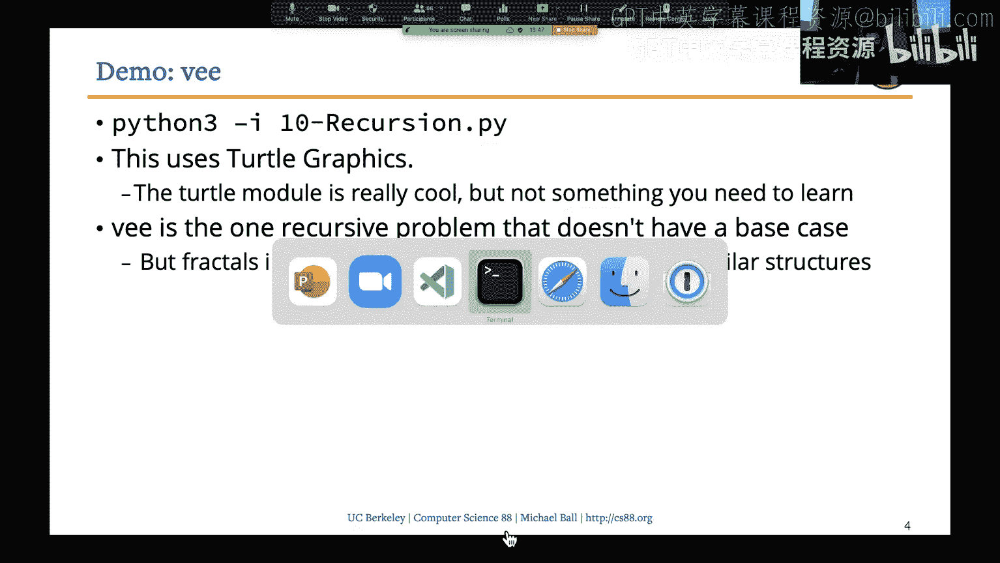

Just computer science can be really fun。嗯。How this works。

 there's 100 lines of Python or so that help do some of this drawing。Um and。

You can look at those they're not terribly hard to understand。

 but they're not the point of the demo so this is a program called V。

The origin of this program goes back to teaching people programming in like the 80s by one of the guys who has actually contributed ideas and tools to the CS10 curriculum。

 so in very weird ways it has interesting ties to Berkeley and the way that this program works is every time we hit the space bar。

It draws this V。And what you see printed。At the top。

Is a list of functions that can be drawn at the end of the V。

 And so it's a little bit hard to see on the projector。Let's get that over here。

 but we have a triangle， a dot and a square， so whenever we get to the end the V。

 we can pick a function from list of functions， draw a triangle， draw a dot or draw a square。

Incidentally， this is also a really cool example of higherer functions that we can pick a function from a list in this case randomly。

 decide to execute that function， and we get what is， in the case of this program。

 just some basic art in the terminal behind me or behind the window。

 it is also just logging what functions it's drawing as we draw them。So far。

 this is a pretty simple program， the little sprite tool moves to the left。

Picks a function comes back， moves to the right， picks another function and so you know it's kind of interesting。

 But now what we can do if I hit the up arrow in this program we see that two different functions are additionally added to this list of functions So now we have the function triangle the function dot the function square and additionally we can pick our function V which is the function that makes the V and we have another chance of picking the function V again so we added it twice just to increase the chances of getting something a little bit more。

😊，Sort of interesting， so we hit space， we get a little simple view like this。

That one we get a different kind of V。That was not so bad。

You can just keep putting space and seeing what happens。

 and so each time we get to the end of a branch， we pick a random function from our list of five functions。

And what's different now。Is that by the time we get to an end of a branch instead of just drawing a triangle。

 a square or a circle。We can draw instead。Another version of V。And。

And what I think is fun about a program like this and why we talk about recursion as a tool is a。

 this is a。Gets into the class of sort of computer generated art and some of these are。You know。

 it's hard to call that art in some sense， right， that's not very artful， but some of these programs。

Start to look very interesting and I only had three options of you different shapes that could be drawn here。

 but you could expand that in pretty significant ways。With this program。

 there's two things that I think I want people to take away with。

 which is for those of you that are artistically inclined。

 there's so much that you can do with computer generator aside from the point of recursion today that can be a really fun and interesting way of playing with things。

 but in this case this problem is trying to generate something like this where we say from the beginning。

I want a series of dots and triangles and circles and squares at these positions on a screen。

And at these X， Y， and Z steps。You know and go this way go that way doing that entirely in an iterative approach that we've been learning right now would be really difficult right it would be a lot of loops。

 a lot of just step by step by step and in some sense there's nothing wrong with code like that but。

By taking an approach by using recursion now as a tool。

 there are whole classes of problems that enable us or enable us to solve them in a much simpler way in a much more concise way and so actually before I pull up the code。

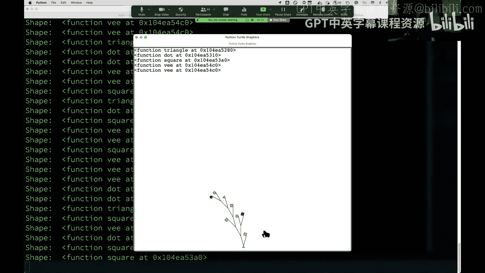

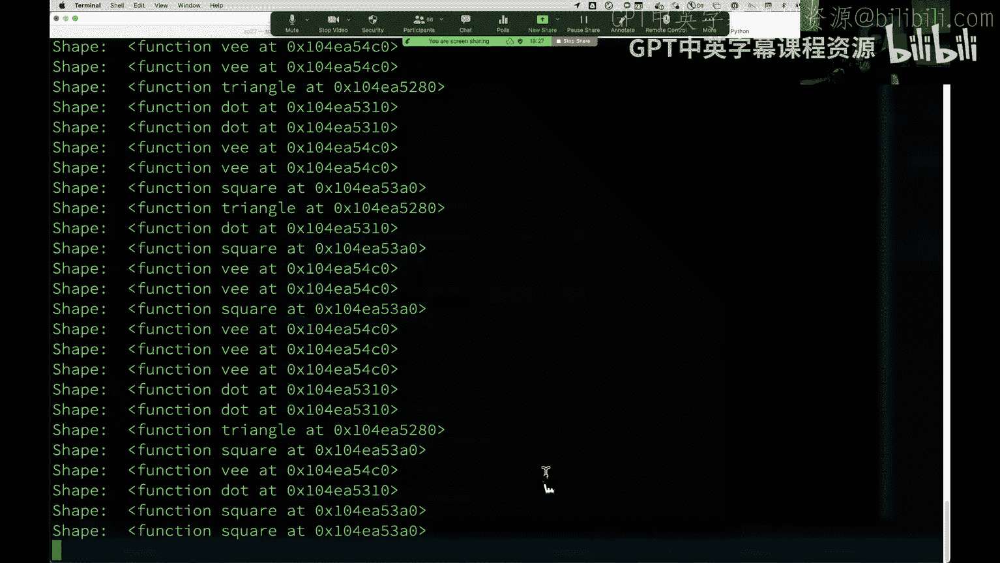

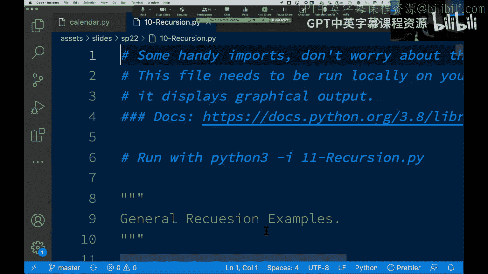

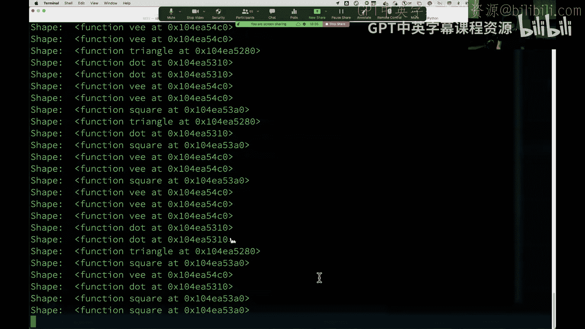

嗯。What new let's go back to this what I want you to also think about is when we' look at a problem like this where are the pieces that the problem of drawing this really complicated tree break down into things that are much smaller versions of the same problem so when we talk about writing small functions when we talk about breaking poems down to steps this list of functions sort of helps us think about what are the types of things that we're doing but it's worth thinking about the fact that this little V this one set of left right movements at the bottom is one v this big thing over here is one whole V。

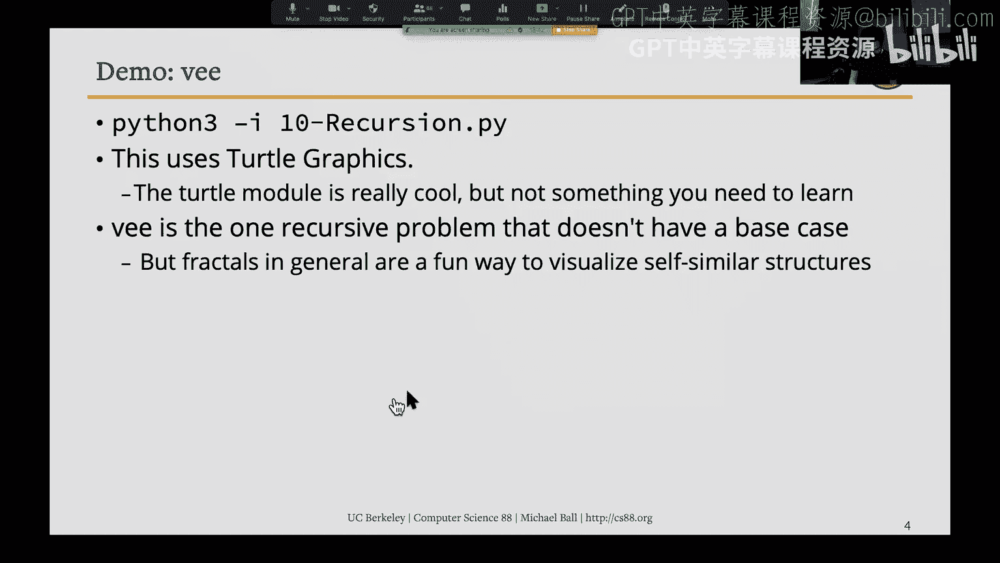

This little offshoot these two branches right here are also one smaller V itself and each of these problems has a very similar shape right they go left。

 comes back， it goes right but what we're doing is essentially the same type of movement the same type of work at a smaller step and so hopefully this is a demo that can spend some time playing with。

But you can also start to think about the ways in which we take problems and we'll be breaking them down into smaller versions of themselves in a few weeks after the midterm we'll talk about this idea of trees as a way of organizing data and they won't be so randomly generated because we want to sort of meaningfully organized data but。

They will be another tool that we get to use in that process。 So yeah。

 this is a program that that you can play with。 I' will just briefly show。

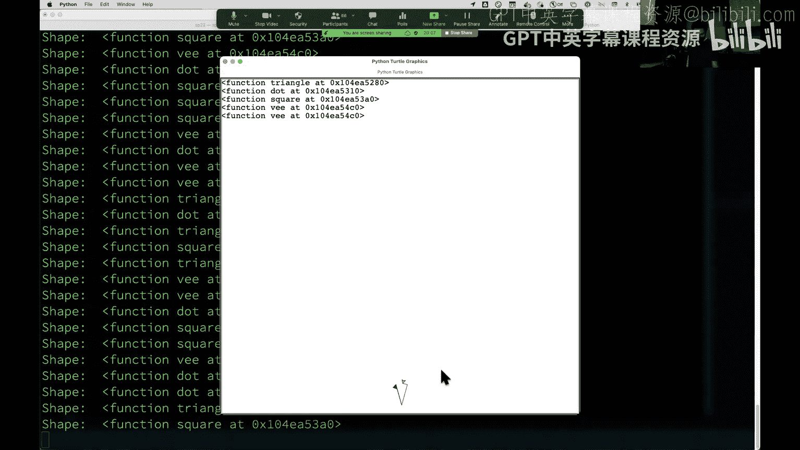

The fact that in this file， there's a couple other examples。 We'll do some of them， but。

This that's the reset function。嗯。colorss。I list of functions。But yeah， our entire V function。

 if you're curious and want to read through it。You know， it looks kind of like a lot。

 but it's really only。About a dozen lines of code we say which way we should turn in which way not and all this uses a library built into Python called Turtle graphics。

 which is just a really simple and fun interface for for making some animation so turtle graphics not the point of CS88 but if you're interested in playing around with Python there is a lot of fun experimentation to be had there and I am actually I'm going to drop this link。

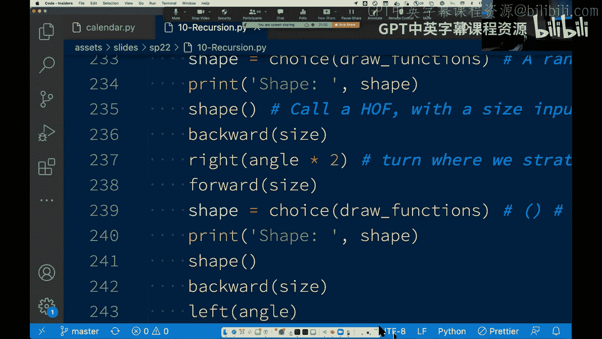

If I have it still， not my email， that's not really helpful。嗯。

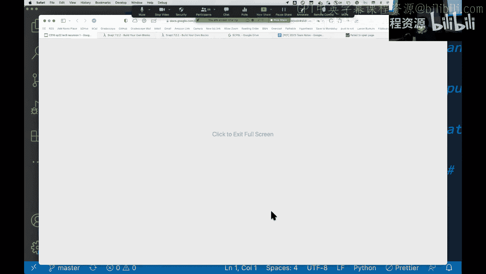

， okay， so。嗯。

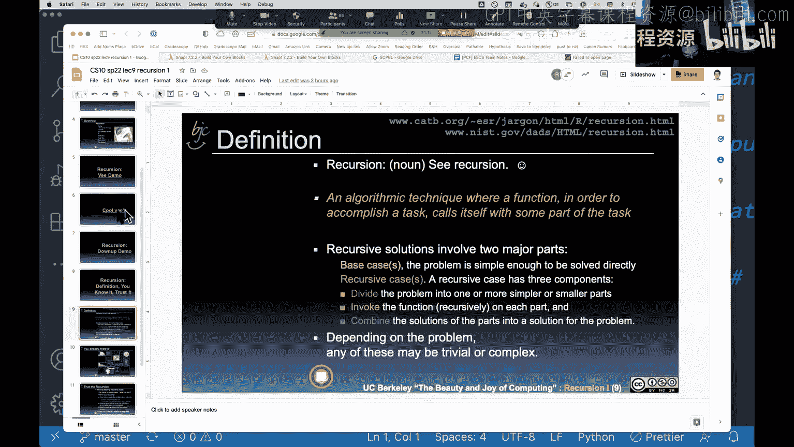

I'm going to drop this link in the slides for CSA afterwards， I've got to edit it before。

 the program that CS10 uses is called SNAP， they have a website of all these bunches of projects and I'm not going to run this right now。

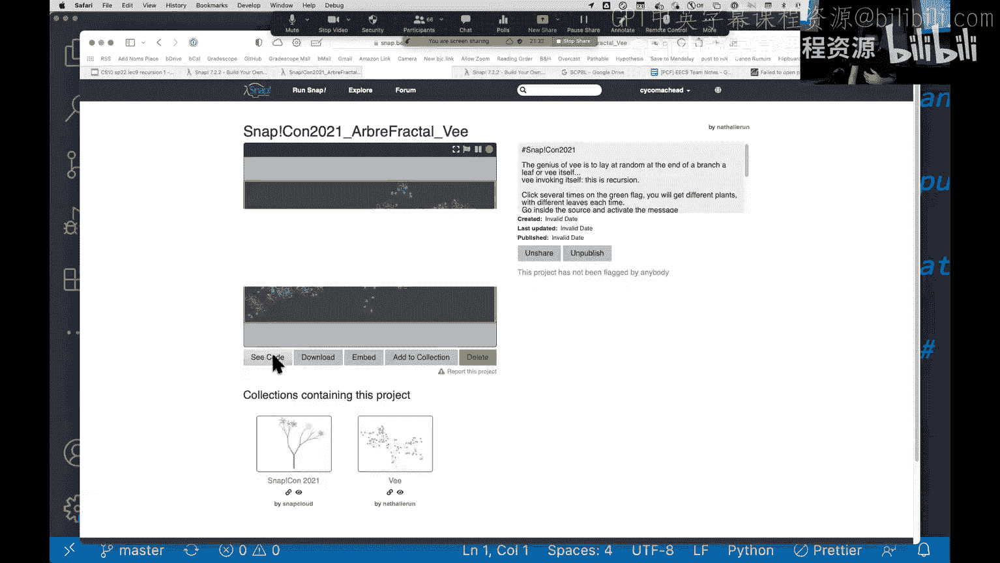

Because this one takes a little bit a little while to run。

 but this was done by a mathematics teacher on Reunion Island who she teaches incredibly crazy difficult math concepts with high school students and this program that she built is taking the same ideas and tweaking the geometry a little bit so instead of turning putting what are arguably much nicer and much more visually appealing colors of light blues and purples in a black background and this is the type of stuff that you can do with recursion that you really just can't do in any other way so if you find the next youth。

Lecture is really difficult and you're sort of motivated by visually interesting things。

 maybe this is some motivation to think about all the things that you could do。呃，With啊。

With recursion or just one of the things so before I continue on does anyone have any questions just about this demo or about sort of what was going on at a high level again the drawing code the the tur graphics not not the point of CS88 but but there for you to browse。

But questions about the idea of sort maybe picking a function from list or something like that。

Anything on Zoom。嗯。

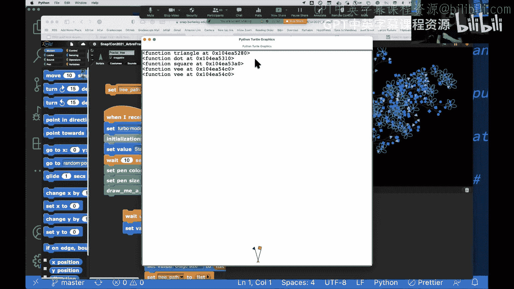

so。嗯。So one thing I'll note is that V itself is this example of recursion where we're picking a problem drawing a very simple V left right and redrawing it again this is the one。

Type of recursive program that doesn't have an explicit base case and we'll talk about that in a moment。

Why， why do we do this， why do we go to this demo well I think it's really cool at one aspect， but。

In a lot of ways， there are processes and structures for which a recursive implementation nicely models the world around us。

And in a couple lectures， we'll talk about the Fibonacci sequence。

 which turns out to be one of these sequences that shows up all over nature where the Anthfibonacci number is the sum of the two previous numbers and we'll talk about why that's a recursive definition later。

 but sometimes it becomes a really useful tool to understand how to implement those。嗯。Sometimes it's。

Really a much helpfulr way to understand how we might implement or think about a particular problem where we let the size of the problem sort of dictate the recursion so we'll look at sort of exempt that so what is the definition of recursion the definition of recursion is to see recursion because what we're really saying is we're referencing an idea or definition of itself within itself and so a function that's recursive is like any other function in Python。

Except it makes a call to itself so oh that should be。

Is should change that to 10 so this is what we did for the demo key commands if you want to put it them space will draw C will clear it up will add the V function to the list to make it recursive and down we'll remove it from the list so there's that。

So now what we're going to do is instead of building this up from scratch。Is just。

Talk about the idea of dysfunction， which is。One of the simplest ideas of a acursive function that we can do called countdown。

Countdown。呃。

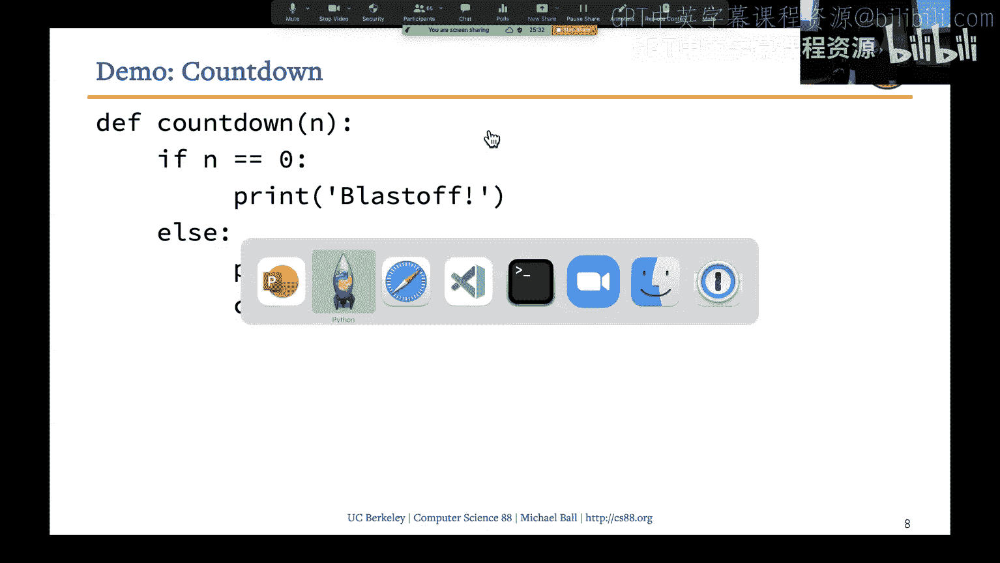

Is。So。系嗯。

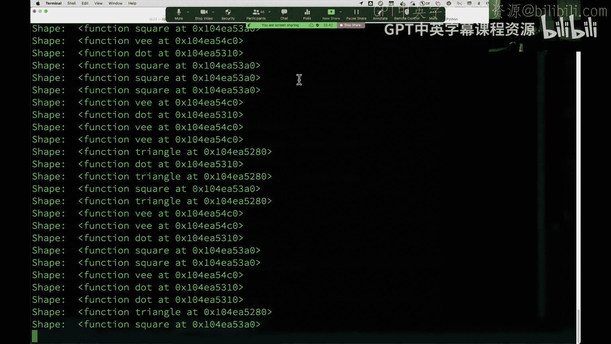

Okay。喂。请。There we go， so if you open this and then you just close the window without hitting control C。

 you'll get back into the interpreter。I should probably add like an explicit close command。

 but I was too lazy to do that。Our task right now is this function countdown。

And so countdown does something。Really simple， it takes her number 10。Printnce 10987654321。

 when it gets to zero， it prints blast off。This is a function which。

Is one of these huge kinds of functions that we could write in a for loop。

 we could write in a while loop， we could use range， we could just count from。

 you know I equals 10 I minus equals1， we could write a function like this， dozens of different ways。

Heck， we could probably even figure out a way choose a list comprehension or a map or whatever else we want and make this work if we really really wanted to try。

 but this is a function where itself makes sense to also explore how we think about。

A problem that we can translate into a。A problem which can be defined recursively and so one thing that is is interesting about an example like this is a you're going to definitely feel for the first few examples of a problem like this that you know what a while loop is probably easier a for loop is probably easier and that's totally okay。

But in a few weeks， we'll get to problems where。Leaning into the recursion makes a lot more sense。

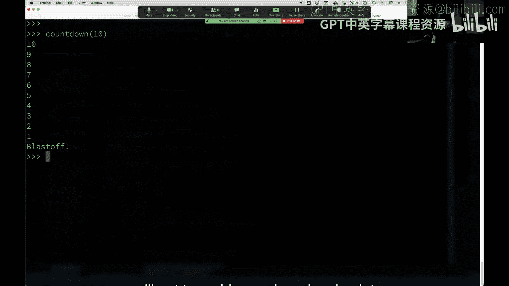

嗯。One of the things that we're looking for when we write code recursively before even think about implementing it is what is the problem that we're trying to solve so in this case。

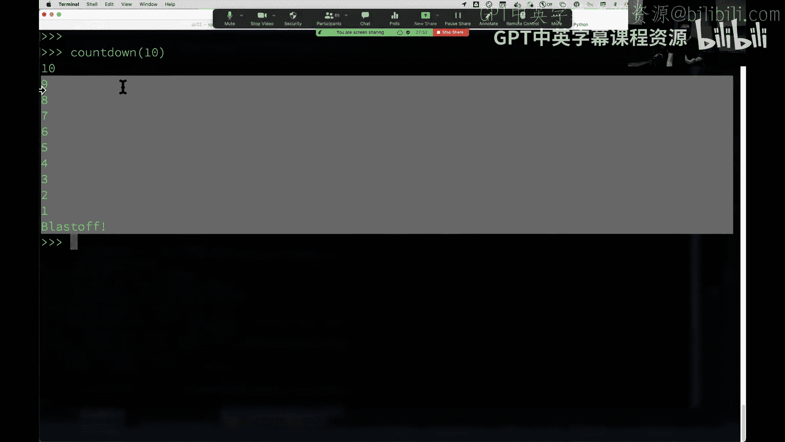

The problem we're trying to solve is counting down from 10 until we say blast stuff。

Does anyone have a guess of what a simpler version of counting down from 10 and saying blast off might be。

 you might have seen it if you got a hint from the code， but if I'm counting down from 10。

To one or 10 to zero， whatever want to say it's the end。

 what is a simpler version of this problem than counting Gu from 10？

What's slightly simpler than counting down from 10？

It's going to sound really stupid when I give you the answer。So if you have a stupid guess。

 stupid guesses are awesome。Anyone have a guess of what might be a simpler version of counting them from 10？

So what is one smaller than 10？Nine， yes， good， good。嗯。

9ine is indeed one smaller than 10 so what is a simpler problem of counting down from 10 well。

 it's counting down from nine in fact we can do something like this， I could say print。😡，1。Countdown。

9， and aside from the fact that I'm running this in interpreter where I can see each call， right。

 I can。Oh and thanks zoom I also see the a couple of responses for count from nine in the chat awesome Yeah。

 so in this case， the problem that we're thinking about is if I want to count down from 10。

Counting down from 10 is actually not too different than doing something with the number 10 and counting down from nine。

And this thing seems like a weird。Sort of a weird way of phrasing it。It helps us think about where。

As we're writing a problem。We can。We can definitely think about the ways in which we can break that problem down small and small pieces and why does why does this matter well let's let's try and write countdown from scratch。

But we're not going to write it。呃。All the way for now。

 So we said that counting down is like doing step one and then finding out what we'll do for step two。

 So in this case print。10 or excuse not 10， print n。And then we'll say my。Countdown。Of n minus-1。So。

In this case， we'll say my countdown of 10。We'll print 10， we'll call my countdown of n minus1。Yeah。

So we're going to start with 10 right here。Before I hit Enter。

 does anyone have any questions about what I've just written？

Who raise your hand out it virtually on Zoom if you think that this function is going to work and it's going to count down from 10 and stopping at one。

Cool， but a couple of votes are stopping who thinks this function will give us an error？

Will this just sort of blow up in our face？Okay，Go a few votes， good some votes for errors。

Who thinks that something else entirely might happen？Cool。

 lots of votes for something else entirely does someone want to share what they think will happen？

Yeah告 ahead。Yeah， an infinite loop yeah and that's actually totally correct in this case。

 so what actually happens error error turns out to also be a correct response because Python has protections within Python to protect from infinite loops so that we don't like exhaust all the memory on our computer that would be that would be unfortunately bad。

If you're curious， you can actually exhaust all the memory on your computer。At some point。

 your computer just restarts itself and gives your a warning and says something went wrong。

That once happened when I was doing some data processing on Google Sheets。

 me images and Photoshop there's lots of ways in fact to make your computer really run out of memory but that's not the point of today's lecture soyon Python helps protect you from some of those things but it does in fact count down from 10 to one it just doesn't stop at one and why is this well if we think about what's happening here。

Our first version of acursive function like this， every time we define my countdown。

We say my count of 10。We execute the next line， we print our number， we say my countdown now of nine。

The way to think about this is if we fall back on the rules for environment diagrams。

 every single time we reach this line of our new function call。

 we just execute that function and we continue making a new frame， we run code line by line。

 we get to new function call， we make a new frame。And， you know the。

The work just keeps going on like that。Before we work on fixing this。

 any questions so far on what's happened， and I promise you， if you have a thought of a question。

 there's definitely people who are probably having similar questions but also not asking them so questions around recursion around what the heck has been going on are all fair game。

It was back no。Questions so far。Zoom， any questions？Feel free to raise your hand。Or type in the chat。

For signal for yeah， go ahead， you can unmute as well Okay， cool thanks。Type in the question。

 no problem。What。So what I would say here is。Okay， that is a great question we will get that。

To it in second what I would first say here about recursion is that。

The thing that we're trying to focus on here is taking this function， whether it's called countdown。

 my countdown， and using that function as a part of the solution to our function。

That is that is our goal when we're talking about recursion， so the question is。

What is the difference between using loops and using recursion。

 And this is a really great question because we can write。whoops， if I。嗯。I find my cursor back here。

 right？I could do something like for I in。Range。啊。1。Zero， negative one。Right， I can say print。爱。

Print I， and now I can just print。W off。So if I wanted to write， I could write this enough for loop。

But what do we mean by using why do we use recursion。

 why do we use loops for a problem like this example。

There's really not a huge difference between using recursion loops。

 they're both a pretty short amount of code， arguably the clever for loop solution with range negative one is a couple lines shorter than a recursive solution。

 but the number of lines of code is often a poor reason to judge a particular solution。

And as I say that， I do recognize that we sometimes ask you to solve things in a particular line in a single line of code。

And that's mostly so that if we ask you to do it， we're trying to get you to use a list comprehension or something。

 but outside of CS88， judging code with the number of lines that it takes is generally not a useful tool。

Inside a classroom， we do as we say not as we do， tends to be the goal sometimes。嗯。

Why so what is the difference here well the difference is with recursion。

 we don't actually need to use an explicit loop like for for a while so we。

If we go back to fixing this， so I call this my countdown。And we'll just redefine it again here。

So the question with recursion then is how do we control when our function starts when it stops in the same way that we do with a for loop or a while loop right here we know that this thing goes from 10 to one going backwards。

So in my countdown， how do we？2。How do we control when something starts and stops Well。

 this gets us to one of the most important ideas in recursion that we'll talk about is actually we're printing that returning something。

Is what we call our base case。嗯，嗯 whatever。So our base case is a point in time at which we decide to no longer have a recursive function call that we say at this point。

I'm declaring that I have no more function calls to make。And by not making a function call。

 we can see。That our function will just stop executing so we can say else。What do we do here。

 this was our main case right， we printed n。And now we have my countdown of n minus-1。

And assuming I didn't make a mistake， which is sometimes a large assumption。Cool。

 get 10 to one and it says blastov， so what's the difference here？Instead of a loop。

 we're using a conditional like if， if else， whatever it might be to decide that we're just no longer going to take that next step and so。

That's really how we control our starting and stopping values with recursion is we start from some value。

 usually this is a function input like n and we stop when we reach some condition at which we no longer decide to make a recursive call and we'll see lots of different forms of that so yeah great great question in the chat。

Other questions about how how。没。Yeah。大拜。不。嗯。那个。开始。这。I prefer。看。He嘿。语。嗯。哦。也是。嗯好的。是的。

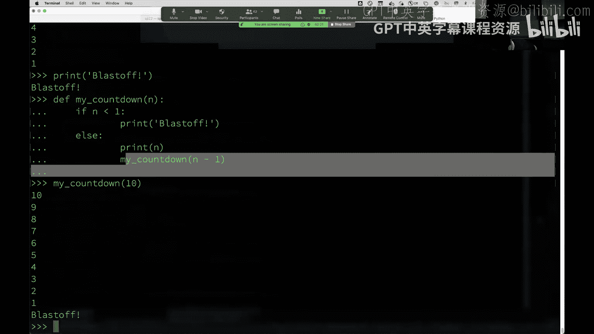

。别是。嗯。什么。都是他。Okay， that。Well， that broke that or。Okay。Fixed。One thing， hopefully。Okay。

 now you can hear and this is。Oh， shit。

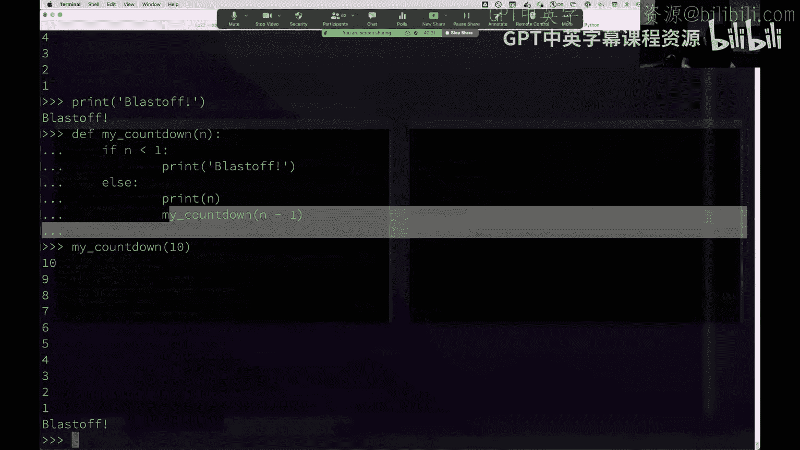

嗯。None of these lecture halls were really meant to have。

Four different cables and to do hybrid teaching。whole semester is just going to be a comedy of errors。

 that's okay。嗯。😊，All right， sorry for the Zoom folks， one thing went wrong， fixed the power。

 then another thing fell。

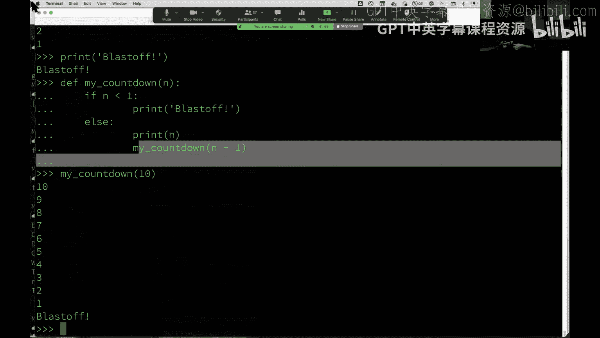

And now we're back to normal， hey， at least time at least this time。

 my computer remembered the screen position so。So we're all good there。嗯。😊，All right。Where were we？呃。

也。It turns out my computer wasn't getting enough power and then everything was slowing down so question is are yeah。

 a recursive function is a special type of harder functions so in general recursive functions are not necessarily harder functions。

In the case of V， they can be where we're calling a function from a list， but in this case。

 our countdown function。It's not a harder function， it's just a recursive function。

 it is calling itself。😊，But it's not doing it in a way where that function is being passed in as an argument。

 it's not returning a function， there are cases again like the in there are cases where if you look at some past exams when we get to the topic of trees where you can have a recursive function that takes in a higher function so you can do like a map over some recursive function。

 there are places where you can mix them， but in general there are two separate things。But yeah。

 it is a good question。Other questions so far on recursion or some of the demos today？Questions to。

Cool， so。With that。And I spoon。

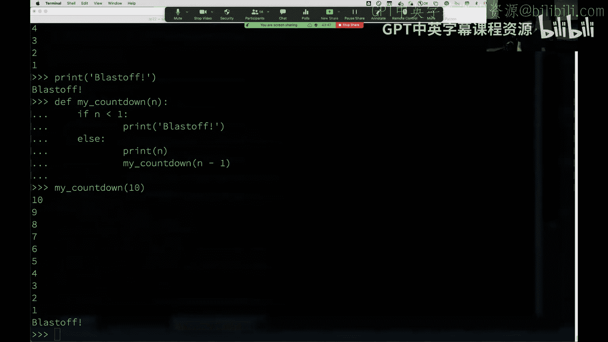

2。不这。This is yeah solution to account function， one thing I'll mention。And。外地人呢，我的。我 don感觉。Yeah。W。哎。

我。对。没有。开庭之前。还有不。走。嗯。可以。对定。嗯。嗯。是。嗯。Yes。他把。🎼Hows these two things in some。s basically。好大招我。

That we don't need to do anymore。 When should our program stop。When， when are we done， what。

 what is the smallest version。Of something that happens in the case of countdown thats just n equals0 in the case of V。

 it's a little bit weird that it's essentially we have no more needs to draw。

but every recursive case。Has three components in some form。The divide the invoked we combined。

 and so I will go back to this page and we'll talk about what those are。嗯。The fight is by far most。

Important thing to understand。With our person procedure， which is。2。🤢。

How are we going from n or how are we going from 10 to9， or how do we go？😡。

From one problem to one solve problem in this case。

 have you go from 10 to 9 it's a pretty precise step right N to n minus1 that works out pretty well。

 In fact， N to n -1 is a really common way and a lot ofcurive problems。

We're not going to do the trade。喂。8被查。You can think about how6。So6， I'm4。做完了。是3在。one。

And so it's just。🎼Some you actually。喂。Yes。没8。妈。不懂。不是。Sure。中国。他不。这样。这。はちょっと。The。对以的。是吧。我不。放屁。他。Print。

嗯，这。最情佩待。🎼Okay。他。嗯 that。走去。走。拜拜。妈。It。我这个。嗯。原。我。叫什么？Yes。Yeah。Yeah。

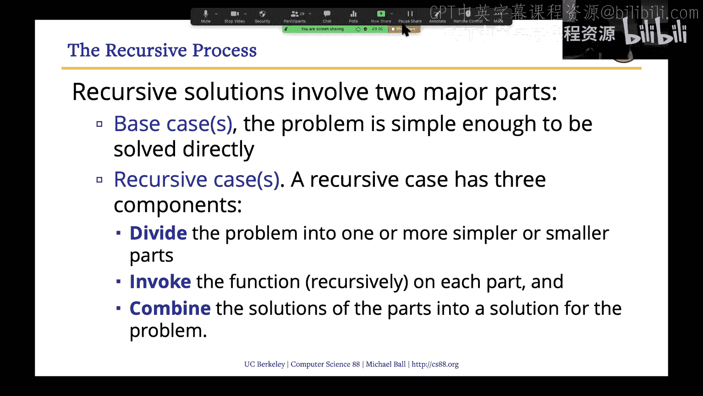

我们是。不。哦。

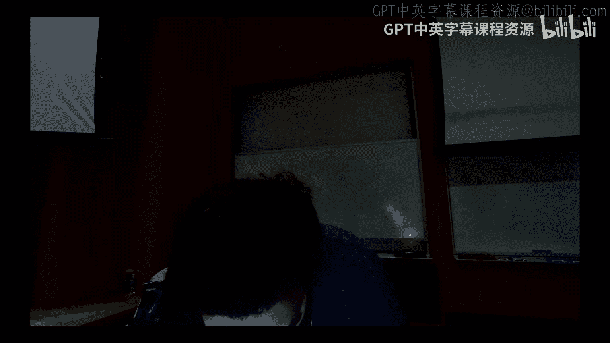