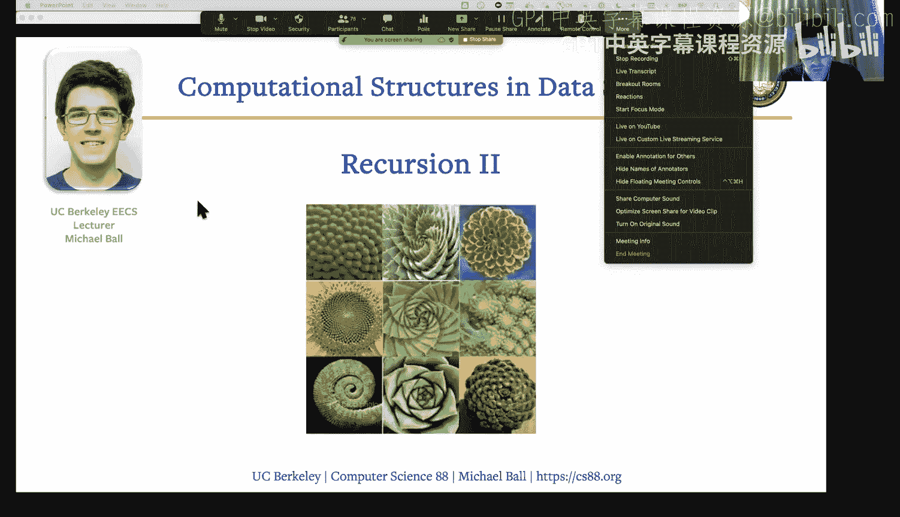
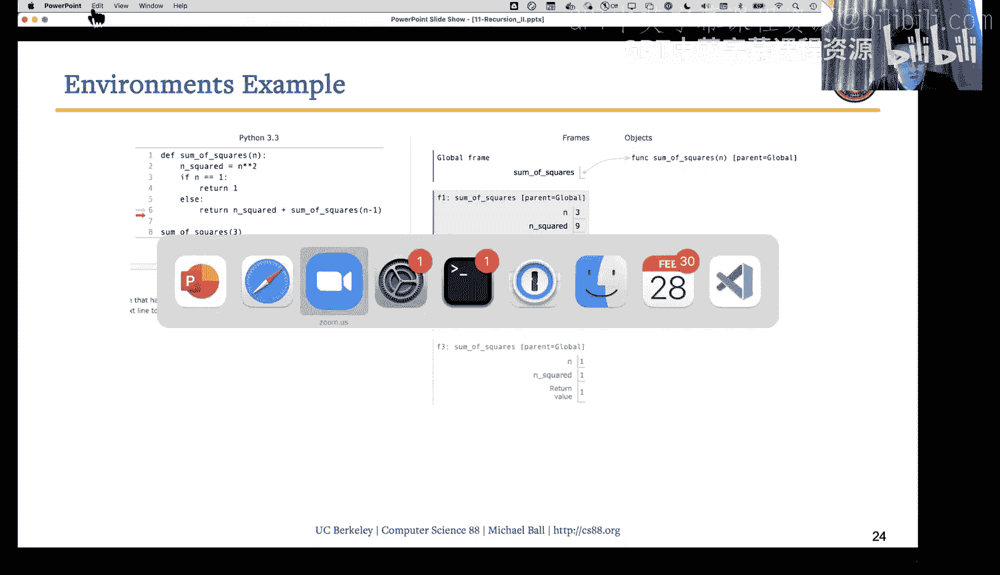
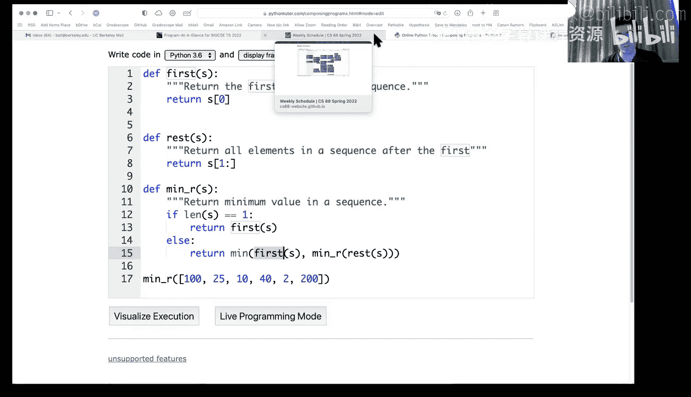

# UCB《数据科学中的计算结构｜CS 88 Computational Structures in Data Science 2022》中英字幕 p11 CS 88 Spring 2022 - Lecture 11 - 2_28_2022.zh_en [BV1516iBfEVY_p11]

Okay。Cool， so we'll get started today with。Talking about recursion part two。

Oops。Zoom to put the keyboard track up ons place。Right。Cool， so we'll start with recursion part two。

 but before do that reminder。B thing this week is naturally the Maps project。

Which is due Friday night if you have slip days。you have your're three to use automatic anywhere between one and three days of an extension。

 there's absolutely no need to fill out the extensions form。

Just submit the assignment late we'll keep track of them for you there's nothing to worry about I do want to remind everyone though that if you click on the Google calendar schedule on the course website。

There are a bunch of officers and project parties this week。So please keep an eye out for that。

If you're looking for some extra help， you know there's。Lots of opportunities for that this week。

Maps。Maps is a big thing this week。And yeah， if you need slip days。

 feel free to take advantage of them if you need more than three days。

 please do use the extensions form， we're open with reasons。

 it doesn't need to be that complex but just the sooner you could fill it out the sooner that you know that you might need help or need an extension。

 the easier it is to put them in。So that no one needs to sort of panic at the last second and if。

On the note about extensions， it's often much easier for us to just give you a two or three day extension initially。

 oh thank you if that's what you'll need instead of trying to repeatedly enter 24 hour extensions。

If an extension would be helpful do use the form， our goal is to always have you complete the assignments to actually you know spend the effort that it takes to work on them rather than to just rush through or forget to turn them in so。

With those logistics out the way。We're going to continue on with。Recursive functions。

Last Wednesday when we introduced percursion。We did a couple examples where we looked at a sort of visual fractal of sort of seeing how there are parts of a tree that are kind of similar we talked a little bit at the end about this idea of a base case and a recursive case。

And so what we're really going to do today is spend a bunch of time working with the base case。

 the recursive case， comparing an iterative solution to a recursive solution。

And then we're going to think about how we apply recursion to lists and also other sequences。

Here's sort of where we left things off on Friday。Whenever we think about recursion。

We're really focusing on two main parts of the puzzle， our base case and a recursive case。

 don't know why that's two。But our recursive our base case is essentially what is the simplest piece that will solve our problem directly。

All of the examples that we're going to do today， they kind of concern the sort of if we're thinking about a loop。

 what would the starting point of our loop， potentially what would the ending point of our loop be you could order your solution either way。

 but we're really trying to say when we think about a problem，You know， the sum of some numbers。

 the smallest item in the list， the largest item in the list。

 the first of something the last is something well。

And all of these things we're talking about a range of items in the list， a range of numbers。

 and so what we're usually focusing on for the base case is。You know。

 what if what if it's a one item list， what if it's no item list。

 what if the number is zero or the largest possible number that we have to deal with and those are all the types of things that tend to make up our base case。

Our recursive case is the part where we make our recursive function call and we'll step through what that looks like。

 but we're really looking at to。To do three things here。

 which is to divide the problem into smaller parts and so if we have a base case which is a one item list right let's say is our base case and we'll actually look at an example that our divide step is how do we go from a list of 100 items or 10 items or 1 thousand0 items whatever it may be to get towards a one item list。

How do we go from？A very large number to get to a base case of zero the division step is is going to be how we how we approach that invoke is the word for just making our recursive function call so when we had our countdown function invoke was just the calling or countdown function。

And without the invoke step， we don't have recursive procedure。

So that's going to be the most important thing there。And finally。We have our combined step so。

In in the examples last week， the combined step was sort of just print some data， see some results。

 but today we're actually going to take the return value of a rehearsive call and add or multiply or combine that value with the result of some other calculation。

And so we'll look at both of those。Here's how we can think about a simple simple task and what we're going to do for this first example is。

Compare something like summing some numbers and we'll step through this in in a little more detail than is。

But if we understand this example。We can start to see how we can apply all these same tools to。

To pretty much any other recursive problem in this case。

This function is just summing the numbers one to n， right we start with zero。

Our range ends up with n+ one， so we are including n in our sum。

We simply just take our value s incremented by each number in our sequence。

And that's all we need for a question like this so we can of course turn this into a while loop in a while loop we don't need we don't use the range function。

But we keep track of， let's say， some value I where we increment its result。

That should price say I is less than plus one。But that's。Oh okay， yeah， never anyway。

 we can we can can if we can turn a for loop into a while loop。

 those two operate basically the same way。But。Thing with recursion。

We essentially take what is a while loop。A for loop。

And notice how each of these have a start condition and what is essentially a stop condition built into the range。

 a starting condition of I equals zero， a stopping condition when I is equal to n。

 and we turn these into a recursive function。Which has no explicit loop but。The same number of steps。

So in this case。If we say the sum of n， if n is equal to zero， we return zero because our base case。

In this case， it's going to be the smallest possible thing that we can imagine summ。You。

None of these function functions properly handle negative numbers they all start at zero so where does our for loop start where does our while loop start but we start at zero so in this case it's pretty natural to think that our base case is the smallest number if。

If n is0， the sum from zero to zero。Is， of course， zero。And how do we handle this afterwards？Well。

 the sum of。呃。The sum of our two numbers is n plus the sum of n minus1， so if you went from zero。

You need to notice this case that we're doing i plus one。

 and if you look our range was from zero to 10， perhaps。We're really zero to 11 so we can include 10。

But you might not。What might feel a little bit weird in this example is。

Why we are doing now some of n minus1 and this is one of the tricks of。Of recursion。

That that will play with and that will sometimes take a little bit of time just to see， which is。

It is often easier with recursion to sort of invert the direction of our math， so to speak。

 the direction that we're solving the problem to start with。

What is this sum from zero to 10 well it's 10 plus9 plus8 plus seven rather than zero plus one plus two plus three and so on and that's because it makes our base case much easier。

ToTo conceptualize such that we have。A base case of zero。

 we can divide the problem into 10 plus the sum of9。And so on。

 and so that is a direct way to translate recursion。Of course。

 this is kind of a cheat sometimes for if we're just summing numbers。

 we will perhaps want to use a formula。But in this case， our goal is to practice recursion。

What I want to do。Actually， before we do one more example。

 does anyone have questions on this example， and then we'll do a very similar example in a little bit more detail。

Questions looking at Zoom。don't see。😔，Don't see any questions yet on Zoom。All right。Cool， so。诶。

In this example， we're not going to。We're just going to start off with the recursive version instead of summing the numbers。

Directly， we're going to take the sum of squares， so one square， two square， three squared and so on。

So if we suggest breaking this down to a recursive procedure。

 how might we think about this well again， our base case is going to be the smallest number。

 which is valid in our sum。In that case， we might say if n is less than one， return zero。

Functionally， this is the same thing as saying if n equals zero for one of our problems。

N less than1 n equals0， all of those are valid base cases in that case， of course。

 zero squared is zero sew turn zero。And else we have a recursive case。

 the sum of squares of n minus1 plus n squared， so again。

 if you're doing this from one the sum of one to 10。

This could be the sma squares of nine plus 10 squared。But we have the same property of。

Taking a recursive call， which is n minus1， our summer squares of n minus1。

And making sure that value n is decreasing in the direction of our base case。

Now in both of these problems， we're explicitly combining the data together using the plus operator。

So the result of this function plus some other calculations gives us our three parts in our recursive case。

 so we invoke the recursive call， we have divided our problem and we combine them together with a step each the way。

But in a similar way， we could have written this recursively。Where。We start off with the value zero。

 same as our base case。In this case， when we said n is less than one， we could start with range one。

 range zero， wouldn't really matter since we're adding zero。We end at the value n plus one。

In a recursive procedure， that is often a little bit more implicit， right。

 we start with n and so when we say n squared。And if we go back here。

 this n squared is essentially our starting value in a for loop。

 we explicitly say that n plus one is the ending value。And then we have a loop over this variable。

And。Those those are the same。Components that we have our in our coast case。Once again。

 they base case， simplest value is zero。呃。We divide into a simpler solution of n minus1。

And we combine the simpler part with our base。So。We have our same components here。

So why how do we visualize that a question like this works properly？

Our sum squares of three is going to be the same as the sum squares at two plus three squared。

 which of course is the sum squares of one。Plus two squared plus three squared。

And each of those calls， we can break it down into a simpler recursive case。嗯。And if we wanted to。

 we can compare these to our iterative approaches。One thing that we'll practice with a little bit throughout today and through the labs。

Is noticing that。When we write our recursive procedures。

We have a lot of flexibility and when we translate something from iteration to recursion。

We can write something like the sum squares of n minus1。Plus n squared。

Or we could write n squared plus the sum squares of n minus1。

And for most recursive problems that weight will' encounter。

This particular ordering doesn't actually matter too much whether or not we perform recursion first before combining the values。

Or whether we take some value and then perform the recursion。After this n squared。

Both these are valid options。Like many things in computer science。

 there is more than one more than one correct answer here so we can。呃。You， we can write this out way。

All right。In。In our recursive or excuse， in our iterative procedure right， we start from zero。

And we increased till end in a recursive procedure。

We are often starting from n squared or starting at n the largest value and going down towards our smallest value。

Before we look at a couple additional things， are there any questions so far on how this summer squares function works？

No questions， you got， cool， how are we going on that？All right， so。

One thing that is worth paying special attention to with recursion is what happens if I say？

N squared as a variable with inside our sum of squares function。

Do we think that this will work cool and actually let's see， we've got one question here。

Let's see one so let me pop open。😔，Z。What's that？A so。The question is。Oh yeah。

 so the question is how does essentially how does the function summa squares n minus one change what's going to happen with oh in this case with with the n squared term yeah so this is this is a really good question so how many people think you can either thumbs up thumbs down or yes no react to this。

How many think that this version of the function？Works correctly。

As we make successive calls to some of squares that will have the right value for n squared。

Do we have anyone who wants to vote yes or no on whether or not this function works correctly？Cool。

Go it got some thumbs up。Do we have any no votes who think that this function might error？那。No。

 no votes yeah， but a couple a couple votes of events of it'll work okay， cool so。

It seems so far that the consensus is this will work and so the question chat is。

What happens with each n squared do we get essentially a copy and？

Perhaps the best way to demonstrate this is to go through。The Python tutor version of this function。

In fact。Instead of opening it。嗯。I'll just use the versions in the slides since now we're getting ads。

 even though it won't be quite as alive。😊，The way to think about what's happening here with n squared is that every time we make a call to the summer squares function。

 we get a new frame and within each new frame， we have a new set。

Of our local environment type work environment。Our local variables and so if we use this with an environment diagram。

 each frame in our environment should indeed have its own version of n squared and so。In a sense。

 this is just like any other function call， the one thing to note is that when we do practice recursion with environment diagrams。

 we'll start to see that the list of calls。Can get pretty long and so。

What we're really doing here is just applying the process of calling a function， but doing it in。

 let's say， just many more times than we might within a loop。Importantly。

 what what's worth making sure about is this last step here is that as we make a recursive call。

 we make a new frame， we do all the computation。And then that final step。

 when we get this result variable where Python tutor says here's return value。

 that return value automatically gets returned to the parent frame。And in this case。

 everything is the same as integral function call with the minor tweak of the function that we happen to be calling is you know the same function that that we just defined with a different set of arguments if we always called our functions with the same argument value we wouldn't get very far in our problem and so because of that will' eventually stop with the base case so in this case。

What are we looking at here？We're going to do our simple problem some of squares of three。

 I'll show you a different example of a different visualization tool that we can look at that that sort of more clearly shows return values but doesn't necessarily show what's going on within the environment。

And I'll note that in this case， while we're looking。at our environments。

 we're extracting a local variable here to make it very clear what happens with this value n squared。

 but whether we have no variables or we have a dozen variables， the process here is the same。

And then we have another question here so yeah yeah how does the function， this is a good question。

How does the function decrease n each time without a while loop that decrease in value n comes from the argument。

N minus one insoma squares so let's actually look at what those values are so step one here right we draw a global frame。

We define our function， some of squares， and that points to a function on the right hand side。

Our first call is sum of squares of three。And so in that step， we make a new frame F1。

It's in the global frame。And what we have here is n is is three so right our the arguments passed to a function become values in our environment diagram and the next step here。

We now go from we evaluate line two， so n squared is now the value。

Excuse me the variable n squared is our is our argument n squared so three times three is9 and so in our frame F1 we have now two variables in scope。

 we have n of three。An n squared of nine。Now， because n is not equal to one。We go to the next line。

And we'll make a new。A new step in our environment diagram。Note that our frame now is F2。In our。

Parent frame， because this is still where we define the function。Is our global frame？

But now when we called our last line， so the little greenarrow right， the last line we called。

We said sum of squares of n minus1， so n was three。Minus1 n is2。And we stepped through this。

And again， we get n is2， n squared is four。In。Doing it this way will feel a little bit tedious in that we're going through every small step。

 but hopefully what you can start to build is an intuition that every time we make a new frame just because the function is the same。

Notice that this n down here， this n squared our next n and our next n squared。

 these are all living in a sense， in entirely different frames that Python is keeping track of separately that it can manage。

A nearly infinite number of copies of the sum squares in practice Python will protect you from definitively exhausting your computer's memory。

 but each of these frames can hold its own individual copies。

Of of these variables and so right now we haven't ever returned the result of one of these frames yet notice that as we approach this line。

Before we can even continue returning， we still have more calculations to do so as we finish。

Our next frame。What we now end up is in。From within F2。What we end up with is a new frame。

F3 where n is equal to1。And。As we evaluate this line， we'll see hopefully now that。

We set the variable n squared to one。And now we get to the interesting part where。

We have online four。When that's our next line that we evaluate and now when we move it along。

But we can finally get to the return value。of one and so as we return。

 what we should hopefully see is that we can go back up each frame to compute our final result。

And so let me take a look， actually， let me finish going through this and then we'll take the questions in chat。

And as a reminder， after I take questions in chat， if you'd like to raise your hand and read your own question。

 you're more than welcome to。We've got line four here。We finally get to return one。As we return one。

We exit what was frame three。And we return the value one as a result of this line here。

And so now we get to compute。N squared， which is four plus the sum squares of n minus1。

 so in that case the's somewhat squares of1， the return value of this frame。

4 plus one is5 and so now we have return value。For frame two。That means that when。

We exit out of that frame， it finishes， we're now back up in frame one。

And so now we have our value n squared。Plus the result of the sum squares where n minus1 was equal to two。

 so the result of frame two so we have nine plus four our return value is then 14。

And at the end of that， we get 14 as our final value for these summa squares from one to three。

And essentially we can do that with three steps of different recursive calls。嗯。Me。

Go back over here and take。

Once second。

It's just。Let's take a look at some。Some chat questions up here。Yeah， so a question is。

Yeah so it's almost like storing the values of each recursions in a new frame and the original and is divided up into the simplest form we we go back into the sort of original creative frames yeah that's absolutely correct The way to think about recursion is that。

呃。As long as we are making a recursive call。Something that is shrinking the size of this problem。

 we can。We can go through and。Eventually hit our our base case of course， it turns out that。

We might not always hit our example base case。Let's see once I need you know。no这。嗯。对。So if we。

If we were to open up a Python tutor， let's go backwards。

Where that link actually see I still have it up， I guess I do。 So what we're going to do is。

Is look at this Python tutor for that's question。We're going to edit our code。

Instead of saying in minus1， we'll just say sum of squares of。And。Okay， cool。

So one of the nice things is python tutor will actually detect in this case that we have infinite recursion and it will sort of warn us and so we're obviously not going to go through the exact steps of everything that happens here。

 but what I want to illustrate is that regardless of。

Whether or not our recursive call is properly configured what Python is trying to do is always going to be the exact same thing as we step through。

 recreate a new frame。In this case， because we're no longer doing I remove the n minus one so this function is not going to work correctly。

 n is always going to be equal to three and so every time we create a new frame。

We just keep going back and say n minus sum of squares of n。

 sum squares of n and at this point without the n minus one right you could hopefully imagine that。

That the number of frames that we're creating here will just continue on until Python tells us that。

We've run out of options。Yeah， so can I explain what Python does to go from F2 to F1 and go through again。

 yeah absolutely so let's let me go through and fix this really quick so we can visualize a properly working function。

And then also what I'm going to do。Its just before we continue on there。I'm going to pull a new。

And different tool for visualizing recursion。In this case， we're going to start with our normal。

Our normal function calls where we have。The sum of three。

We're going to step through and I'm going to just quickly step through until we get to our final framework where n is equal to one。

In our final frame here， we've now just called sum of squares with the value one。

And what our goal will be。Is to just step through line by line。 So n is equal to one。

 we set the line n squared is equal to。呃。So now we equal the value one and now so we get to our condition if n is less than。

One return zero， so actually this will create one more frame excuse me in this version of the code。

This one again， has a slightly different condition。The't one of the slides that。But in any event。

 it now works so now we're considering sorry the n equals zero case will be our last will be our last。

Function call here。Some of squares of zero， n squared is zero， if n is less than1， this is now true。

 we will return zero。嗯。One thing that。Is。great about Python tutor's visualization is。

This is something where。In the case of Python Tutor。It doesn't help us too much。

With what's happening， but when we say return zero here。This frame executes and in。The next step。

 we then need to figure out whatever called。Whatever was the piece that called and is equal to zero。

So if we were to go up one level of the frame on。啊。You know what。One sec。你位。Yeah。Okay。Now。

 Im going try this again because。All right， my my frame numbers are not showing up when I'm doing this live for some reason in the way that they normally would。

呃。And the frame numbers are。Very， very helpful。H。对。

I'll have to see what changed with Python Ti so that I can make sure that for future demos。

 the frame numbers show back up again。But in this case。

 what's happening is whenever we hit return at the end of our frame。

We always continue to the previous frame in。That that was just in use essentially so when we。

 if we were to have a lambda function rate。When that returns。呃。In that context。

 we would have gone up to whatever the previous frame was or put our value there。

 so when we say we're to zero here。哎。We now end the next line essentially will be to sort of end this function。

Python tutor sort of indicates with a red arrow right beneath little green arrow when we're returning and we're done with a function。

That。The next thing that we go back up to is。Is finishing up line six and this happens to be in what we can think of as sort of one frame above。

In CS61b。This can formally be called the stack， we don't talk about all the properties of what the stack is。

 but you can loosely think of it as a sort of a stack of functions that the last thing that we are doing。

If you sort of have this visual metaphor rate where from top to bottom， like Pythlon Tutor has。

We have these stack of functions we keep adding things to the bottom of the stack and the very last thing we've done。

Is the thing that we continue on to the next step so。We remembered that n sum squares of zero。

Returned zero， we return one and now we keep adding with the previous values and so as we continue this way。

 the return value we always stick on this last line of whatever we are on in the previous deck and that's that's essentially what happens with Python2 to the visualization is not the most perfect。

 but we're always going to be focusing on sort of what that last line was。

I hope that helped this is one of those things that takes a little bit of intuition to practice with。

Before we continue on。What I will also show is。呃A。A similar tool。呃。

That's now linkeded in slidess called recursion visualizer and actually let me change this to。

LetMake this a little bit bigger for this。Accordinging it changes this to three。

 so we'll be doing the。The same number of steps。So the recursive visualizer doesn't show us everything in the individual frames。

But what it will show us is。As we go down making a recursive call what the arguments are。

And so we get all the way in this case too。These sum squares is zero。

We return the value zero from this function。Then this helps to sort of directly point up to what was the call and what frame were we in so we can mean about these in the same way Python tutor each of these was exactly a frame from the top down。

But in this view， it's just making explicit of just the return value。

 so zero returns to sum squares one。sma squares of one returns its value one to summa squares of two。

 which is two plus one squared returns its value5 to sma squares of three and the final result then is 14 so two different visualizations。

Yeah， there's not necessarily one perfect visualization here。

 but the logic of what's going on is exactly the same。嗯。Yeah。

 so that's that's sort of how to think about that Any questions so far on。On this function。嗯。Cool。

 or let's see if nothing else。Right。In that case， what？呃。

We'll do is we'll go on and we're going to take a look。At。

AnotherAnother example here where we're going to do recursion on a list。And so。

The goal will be to find the smallest item in our list using recursion。And。

When we think about this now， instead of doing recursion on a series of numbers where we go from let's say three to one or three to zero。

 we're now going to think about giving a list of as many items as I need。

How to go from a really long list。To a really small list。And so in this case。

These are two really helpful functions that will help us think about how to break up this problem。

 we're going to say we're going to give you a function called the first item of the list。

And a function called the rest of a list so item one or excuse me first is just s zero and the rest is S from one to the end remember that these are just python shortcuts for slicing a list or any sequence that that help us break this this。

Case down。嗯。In this case， we're going to find the small stimulusuluis so the minimum function so what are some suggestions for a potential base case what what might be something that represents。

呃，嗯。A base case for a list of items。Feel free to unmute or drop some things in chat Okay I got one vote from private message。

嗯。Feel free to respond publicly as well。All answers are good answers。

Let's see if we can get a couple more votes for what might be a good base case。In this case。

We don't need to consider negative value， so that's a good question。

 but it won't actually affect the response for this particular function because of the way that we're considering just the structure of the list but not the values of the list themselves。

Okay that's a good question all right so I did get a couple votes in chat for base case and one that I got was when the list is empty when the list is empty。

Is a。A really natural solution for most list recursive problems。

 the other option for a recursive function is when the length of a list is one between one and between empty。

It really doesn't matter too much which you choose the recursive structure looks the same it turns out that。

It's for the way that we've written our recursive case here。

 saying length is equal to one is a little bit simpler。

But a list of one a list of zero items are both functionally pretty equivalent cool so does anyone have thoughts on what we might need in our base case？

对。What are some things that we might need in our base case？清。Any takers？All right， well。

So in this case， what is worth thinking about is given the tools that we've suggested of using first and rest。

How do we think about the smallest of？Of these two items。And this is one of the things where。

Let's sort of jump in logic that it takes with recursion and sequences of data。

And sometimes you're a little bit different， so there's no great way to reveal this all in a bunch of steps。

 but we'll spend a bunch of time with the last few minutes working this so。

A recursive case for this one is the minimum。Of the first item。

And the minimum of the rest of the list。Well let's think about that。The minimum of this whole list。

Is the minimum of the first time of the list and the minimum of the rest of the list note how we have。

A built in cult to Min。And how we have a recursive call here to min are our minimum function with the rest of the list as its input。

And so in this recursive example。What we have here is。A way of。嗯。Of doing this with。

Different two different calls so what。I'm going to do right now。Is。Let's actually just copy this in。

2。To a Python tutor instance。嗯。And。We will will go through and step through this code。As。

As the last example here。So in this case， I'll give it a list of a few different items。And we have。

Our。Are functions that we'll define here。So。Note with Python tutor， okay， cool now。

I got a new link so don't and now Ive i've got a。I've got our frame numbers back。F1 here。

 min R our input variable S for sequence。Is a list of six items？And as we go through this。

We step through a code our length of our list is not one。呃。Can I click？Shoot， sorry。

We stepped to our code。We make a new function call with。Our first function。

 so when we use helper functions we're going to end up with quite a few calls here so note that our first function。

Is just returning 100 our rest function now returns a new list。Of 25 to 200。

And so now we'll note that next time， actually let's step back right here。In frame three。

 we called min R， excuse， frame four， we called Min R again。

With our parent function with the function 25 2100 as our list。And now inside min R。

With with the list of。Our list of five items。We'll step through once again and we'll find the first item。

And then we'll find the rest so this is where Python tutors example can be a little bit。

Poedantic in terms of stepping through each item with first and rest so that next time we go through and we get another called the min are。

If I。Make sure that we look at this arrow over here where there is a lot of scrolling we see that the list is shrinking by one。

Each time and so。I'm just going to jump ahead really quick so that we get the result。Where。

60 function calls or 61 steps in 17 frames is kind of a lot for a list of five items。

 but we but what we can see is doing with the list is by using this idea of our first item。

And our rest of the list。We're successively shrinking down the list。Into。Smaller and smaller items。

 So the final result that happens is at some point we say what is the minimum of。

Some particular value。But like the minimum of。2 and 200 in which case that's two and at some point then we say what is the minimum of two and four would be the first item of the list excuse me 40 and of course that's two。

And now as we keep stepping up through， we have the minimum of what came before 4010 and the previous minimum results。

 which was two and we step up the list and we have the minimum of 25 and the previous result which is two so Python tutor is。

Pretty good at。Showing some of that code， but if you want to look at just。

They return turn values again。 the link to this is in the slides for sum of square。

But make sure that the minimum example in there。For a cursive visualizer。嗯。嗯。All right。

Cursion visualizer may not be working on this function all right i'll say if I can get a link to this after lecture。

 but essentially what we're trying to do。Is go through and shrink our list one by one。

And at some point that way， our function here is。Comparing two values at a time。

 and that is the practice of。Of working through。A recursive list example on on Wednesday we'll do another example with lists and with multiple recursive calls。

 so we'll get a lot more practice with that。

But I'll stop it there for today。Thanks everyone， and if anyone else has questions。

 I can hang around for a few minutes。Yeah。