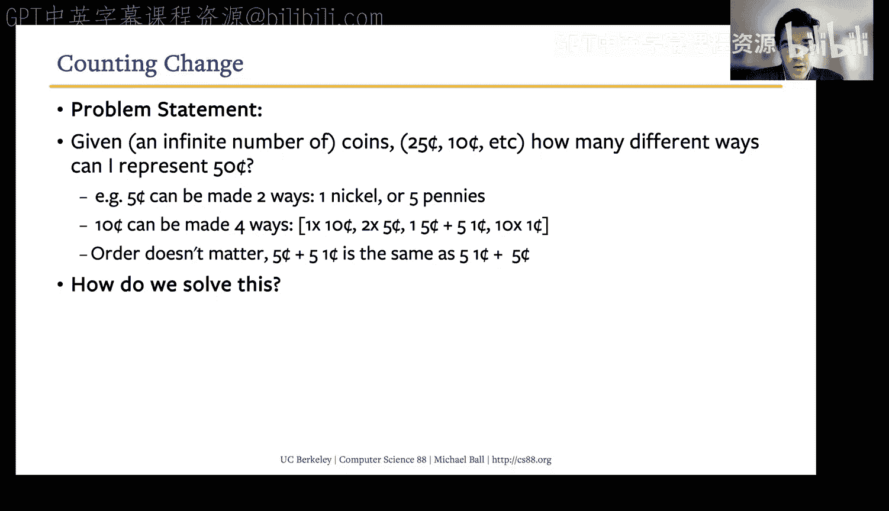
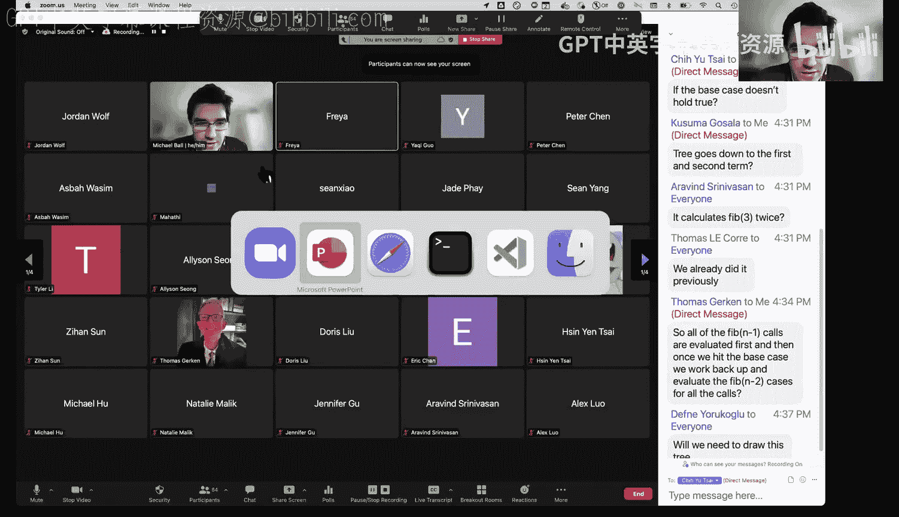
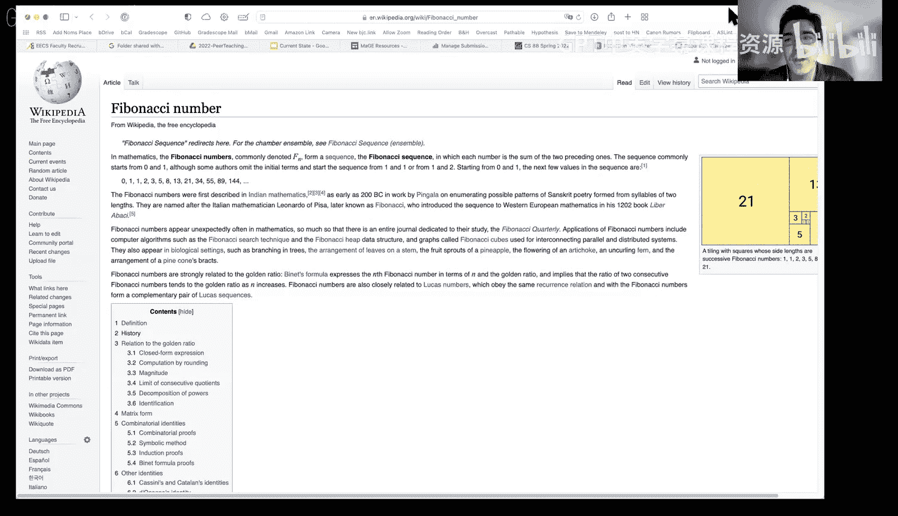

# UCB《数据科学中的计算结构｜CS 88 Computational Structures in Data Science 2022》中英字幕 p12 CS 88 Spring 2022 - Lecture 12 - 3_2_2022.zh_en [BV1516iBfEVY_p12]

嗯。All right， so it's Berkeley time so we can。Go ahead and get started today let me。Oh。Let's see。

Thank you。Today we're going to talk about。The same sort of types of functions that we've been doing with recursion。

But we're going to do it in。呃。In a series of functions that use multiple recursive calls and so what we're going to start off looking at is the Fibonacci series。

 which you've probably seen in lab and or homework assignments， there's one example。

I believe early in the semester， so we'll look at that and then we'll also。

Talk a little bit about a couple other tools， one of them is the QuickSo algorithm which we're not going to necessarily try and go through all of the code for。

 but we'll look at sort of why it's a useful example。Of this topic today that we have。

 which we're specifically calling tree recursion。And。

What we're really trying to do when we have something that is。

That we're going to call tree recursive is have a series of multiple recursive calls that allow us to solve a problem in in a way that really for some of these problems would be much harder if we just had for loops and wire loops and the reason that we tend to call this tree recursion is that when we look at drawing out sort of the path that this function takes。

 it tends to look like a tree and so in a couple examples when we see that。

Hopefully the reason for calling it a tree will start to make sense。😊。

But there's a lot of examples that we can imagine why。Doing something recursively。

Is particularly nice or is a sort of easier framing than just using a for loop and so before you even get to sort of。

Real code or a real working problem。I think it's worth thinking about just。

Some of the things that we do on our computers or on websites that if we had to write a program to solve would also lead to this this naturally recursive process and ZWops one of those is this idea of think about the way that you have files and folders organized on your computer。

These could be directly on the computer， but it also could be files and folders within something like Google Drive。

And in the system， right， we have this hierarchy where we have folders and each folder contains。

A series of subfolders。Which of course may have one or more subfolders and some of those things also have a series of items。

That are perhaps inside each folder and the question is。

What if I want to find every single file in my file system or in my Google Drive？

And do something to that right， maybe you're writing a program that tries to find the most recently edited file or you're trying to write something that aggregates all of your files based on some type of information about the file name or something like that。

Whatever the task might be， you need to go through and find。

All of these files and figure out how to do something with that。

You can start to imagine that we could just write a for loop。You know， for everything。

In this directory。Do some action and going then that path is actually a pretty good inclination。

 but what will happen at some point is。You'll need to process。

A subfolder you need to take in another case。This model about thinking of files and folders sort of nested in each other is a really good model of thinking about the types of tasks that also lend themselves to recursion so there's a little bit of sample code this sample code doesn't do anything the functions that are implemented don't exist in Python but if you're to write this as recursive function。

We might say process this thing that we can call a directory or a folder。

For every item in that directory。If it's a file we can treat it as a file and if it's another directory we can recursively call our function process directory and so in this what we sort of have is。

Now inside one folder here。We can have multiple subfolders。And each of those。

We could be calling a recursive function multiple times in a row。

This drawing of the diagram here doesn't quite look like a tree。

 but really it's the same type of thing where given a certain scenario。

 we could have multiple recursive calls in order to solve a single problem。And so。That's。

Mostly here just a thought experiment， but to point out that as we solve these problems。

 there's lots of natural examples as well that sort of illustrate the types of things that we might solve recursively。

The first of these， and this is one that we'll spend a little bit of time going through is the Fibonacci sequence。

And the Fibonacci sequence is probably one of the most famous number sequences that exists。

It's commonly named after Leonardo de Fibonacci。Who discovered it in the。16th century。

 but the origins of the sequence actually go back to an Indian mathematician Verrahanka in。

 I believe the。Third or eighth century， but somewhere between。

500 and1000 years before the sequence has its origins。

It turns out that the Fibonacci sequence itself models a lot of natural properties。

 but it has this really nice definition because of that， which says。Let's say。The n fibonacci number。

 so's case let's say five is a sum of the true previous values。I had this value five in our sequence。

 so one， two， actually let's so if we count from zero to zero， one， two， three， four。

And our fifth value， our fifth value in the Fibonci sequence is the sum of the fourth value。😊。

And the third value so each number is a sum of the two directly previous numbers。

And we have two sort of starting conditions。The zero number in our sequence is zero。

 the first number is one。And it turns out that。This property of。

Something being modeled on the two previous elements。

Shows up in lots of places such as systems that experience growth。

 certain animal populations tend to grow at a rate。

 which actually models this leaves on plants for certain species of plants tend to appear in patterns that model the Fibonacci sequence。

So this property of having the n item be related to the nth minus one and the nth minus two items。

Is a really common pattern and what's on the slide here is just sort of a couple different visualizations of the Fibonci sequence so it has this pattern。

😊，W which makes a shape called the golden rectangle and then also the golden spiral。

Where the length of。Of a side in this rectangle is the sum of two previous values。

 so there's a lot of different ways that we can visualize it。Including putting it on a。B。

 I don't know who found this， but this one feels very， very appropriate。呃。🤢。

The task then is how do we write our Fibonacci sequence， so typically we call this fib of n。And。

As we're working in recursive function。Of course， we're going to need。Our。

Our base case in arecursive case。What is a good value in this case for a base case。

 then we get a couple answers in chat。不。What are some potentially good options for a base case？Cool。

A vote for zero， I see a vote for zero and one， do you have any other votes for what might be a good base case for this function？

A vote for two what are we comparing to these values？

I think I know where some of you are going because we've done this before。Okay。

 and is less than two is one。All right， cool。Yeah， it turns out that there's a whole bunch of ways that we can write our base case for this pretty much all of them are valid rate。

 we could say if n is equal to zero or n is equal to one the simple one is that we could say is if n is less than two。

 return n so where n is zero， we get zero where n is one， we get one。

And that tends to be a fairly straightforward base case and then the question is what's our recursive case and this is the place where being able to have a problem。

Whatch we can refer to as naturally recursive？Is super nice because if we look at these previous slides。

 we have sort of the mathematical definition as a series of equations。

If we sort of just turn that into function calls up here。

Our recursive case sort of falls right out of that that otherwise what we return is fib of n minus1 plus Fb of n minus2 and so at each level。

We have。Two function calls。So FIBA4 is the same thing as FiIBA3 plus FIBA2 and of course。

 to get those FiBA4 of three and FibA2， we have to make additional function calls to。

To get the results， so before I continue on。Before I talk about why this really looks like a tree。

I'm going to take a second and say， are there any questions so far on this idea of solving a recursive Fibonacci puzzle？

Any take on questions， if not， no worries but。Cool，So why do we call？呃。Oh yeah。

 could I explain why why Fibonacci is naturally recursive？

Why is the Fibonacci series naturally recursive， well it's written down the formal definition of the Fibonacci sequence is that the n number in the Fibonacci sequence。

Is a sum of the previous two Fibonacci numbers？And so。

When we say something that like that that it is naturally recursive。

 it means that the definition of a Fb of n is defined in terms of n minus1 and n minus2 so it's in relation to one other in the case of something like a directory example。

I would also say that a lot of these problems are naturally recursive in that what it takes to process。

A series of folders nested within each other is also pretty similar to what it takes to process one folder with a bunch of files and it turns out that we just keep repeating that process for a bunch of nested steps。

Some problems will be。Exactly written in this format where it's it's really easy to spot that something is recursive and if you ever find yourself in a situation of。

Yeah， okay， it looks like this problem is kind of tricky to solve。

But maybe there is some relationship here， that is a really good hint that recursion is a tool that we should use to lean on and to solve this and so really that's why we spend a lot of time thinking through recursion。

And in particular， what I would say is the types of problems that we're looking at with tree recursion today are problems where given their current definition。

 a solution with multiple recursive calls is actually much nicer than trying to write something purely iteratively or without as many。

Howevercursev calls。We're going to go through and visualize。The recursion for。嗯。

For the way that that feminacci works and so actually before we step from the beginning。

 if we just look at the end result of I'm going to switch to。To an interactive version of this。

This is why we call this tree recursion is that if we start from the top and sort of draw all the。

All of the function calls in a more graphical way。This looks like an inverted tree of sorts normally in the real world our trees grow from a single point to the bottom right and spread outwards。

Computer scientists have。A weird habit of drawing trees from a single point at the top and spreading out downwards。

But in computer science。This thing is is an example of in particular we might call this a call tree where it shows us all of the function calls of。

Of the result of computing fib5 in a few weeks， we're going to look at。

hom data structures of trees where we're going to not treat these justice function calls。

 but as a piece of data that we can store and operate on and so one thing let's just worth a thing about is when we have this recursion。

SoSo of how does it relate to solving a particular set of questions？

Computing the answer and returning results， so we're going to step through this。

And you might notice that even for。A value is relatively simple。As Fibo 5。

There's still quite a lot of steps going on here， so we're not going to go through exactly。Every。

 you， every single step but。I do sort of want to highlight as we think through this。

 what's happening in our code， right？So。The website for this is recursionvisualizer。com。

 it's the same tool that I linked on Monday and again sort of treat it as a lightweight alternate view of environment diagrams。

 but the model is pretty much the same so FiIA5。N is right not less than two so the very first thing that we try and calculate is Fb of n minus1 fib4 and we'll notice that as we keep doing this FIb of4 we try and first calculate PhBA3。

 which means we then need to calculate Fb of2 Fb of two now calls Fb of n minus1 and so。

And each of these。Sort of bubbles on our tree here。

If that's equivalent to a new frame where we keep stepping through our code。

 we get to a new function call and what's changing here is the argument and finally in Fb of。呃。

Of one。This green arrow shows the return value。So we'll note that5 of1 is able to return right one right。

 and it's less than two， return n。And Fb of two now has an additional function call to make。

 so inside the Fb of two function。What we have here is fib of n minus1。

 so two minus1 where8 fib of one plus Fb of2 minus two or fib of zero and so。

We make that function call， we sort of go back down a level to calculate fiBbit zero FBA zeros value is of course zero。

 so now we calculate one plus zero FIBA of two returns one and PhBA3 now has to go back and after completing。

The n minus one case on the left。It now has to complete the Fb of n minus2 case in which case would be。

This Fb of one。The way that you can kind of think about this right is everything maps on the left side。

Is the fib of n minus1 call everything that's on the right side of a particular little bubble is the or sort of the right U side is the fib of n minus2。

So FIA3 is FIA two plus fiIbo1。This， of course returns。Oh there we go， that will return one。

 tibit three is then going to be two。Fib4 now has to calculate Fb of2 it will notice that we go through the exact same set of steps。

 so FIb of4 is now two plus one is three。And FA5 is now FA 4 plus FIA 3。

 and so we'll do the exact same set of steps just to get this answer。AFib of。Of two。

And so at the end of the day， we make a whole bunch of recursive calls they all finish returning the value up to their parent frame。

And the final result for FiIA five is five。So。That is that is why we call this this whole process tree recursion is because at the end of the day。

 if we were to draw this out， we get sort of this nice tree like view does anyone notice。

Something that might be a potential problem or challenge with a。

A process like this for calculating Fibonacci number so anything about this tree that seemed sort of like an interesting property。

啊。When I。When I go through this process， so now that I've calculated FIBA4。

 does anything come to mind as I keep doing this for for FIBA3 that that might be a concern or that might be something to note？

About what's going on here as I went through all of that。Any potential challenges or？

Or thoughts come to mind。So the base case， yeah， that's a good suggestion is。

Is that the base case is correct， but yeah， now a few people are spotting it。In a function like this。

 one thing to notice is that yeah， we've already done all of these calculations right we on the left hand side over here。

Of course， to the computer left and right doesn't really matter。

 but at some point in time we calculated FIA3。AndNow we have to go through and calculate FiBA3 all over again。

We're going to revisit how we actually analyze and talk about the time that it takes to run a function like this。

 but what I will say is that recursive fibonometry， this definition which is nice and simple。

Is terribly inefficient if we let's change this to calculate fib of six。

 you you might notice now that as it builds the tree。We have a whole new set。

 we already did FiIA four over here， so now we have our FiIA five。On the right hand side。

 we have to copy all of that work all over again。Sometimes what we happen to be aware of。

 depending on the particular kind of function is that there is not a particularly efficient definition for solving the Fibonacci series and we've already done all that work previously in CS88 we don't care about the efficiency of your solutions like getting something that works that produces the correct answer is always the most important thing there's little value in fast code like you that gives you the wrong answer right that just doesn't seem to be super helpful but what I will point out is that sometimes as we're going through exploring how function works。

 it's worth thinking about。Does it really make sense that all of this work is duplicated does it really make sense that we should calculate a value over here and then later come back and repeat the entire calculation from scratch and it turns out that in practice no it does not make sense that that we repeat all of that work。

That。We can we can we have tools of which we can solve that code duplication or at least that calculation so we'll talk about how to analyze that in a few weeks by kind of like just sort of putting it out there that you can think about as we're solving some of these problems we'll look at how we can write a more efficient version later on and if you continue on to take CS62 B。

You'll actually learn about a whole bunch of tools where without even changing the way that we write our function necessarily in CS621B。

 you'll learn about some tools to optimize that process。Yeah， that's the recursive Fibonacci。Series。

 any questions on that before we go on to a couple other problems that that we'll be looking at。

Yeah yeah so this is a good question chat so are all the fib of n minus one calls evaluated first and then once we hit the base case we work way back up and evaluate the Fb m minus two calls yeah that's absolutely correct whenever the way to think about this is。

😊，Actually let me go back to the browser view。Just so I have the code is that。

Whenever we see a function call like this， so our return statement is return Fb of n minus1 plus return tip of n minus2。

We're always going to have to solve that Fb of n minus1 question first before we even can continue on to know what's on the second side of that plus argument。

 that Python says， oh I've been asked to compute Fb of let's say four。

Now I've been asked to compute FIbit3 before I can compute FIBA3。

 it turns out that I actually need to compute FIbit2。

And so Python is always going to make a new function call。

Up until the point that we hit our base case and that that function returns a result and once that result is returned right。

We just essentially could say if this were Fb of one。

This value essentially just becomes zero plus whatever Fb of zero would be。

 which in that case would still be zero， but yeah the way that this function is written。

 it's always going to solve the n minus one case first。Before solving the n minus2 case。

Yeah if we wanted to write I could swap these where I say a fib of n minus2 plus of n minus1 because we're just adding numbers together that wouldn't change the correct results。

 it would still be entirely correct function but the order in which we solve things would be a little bit different so you can't always rely on n minus1 being the thing that's computed first。

 you do have to sort of check does this n minus1 actually align with the way that the function is written。

 but in this case we're always going to have to complete that set of function calls before we return back with a final answer。

Yeah， good question， other questions on Fibonacci。Yes。Yeah。Cool。All right。

Oh will you need to draw the tree on an exam you will not need to draw the entire tree。

 what I would say though is that it is really good practice to be able to draw something like this I mean。

With six。With Fb of six， you're looking at。Something like 5050 bubbles around so we would ask you to do anything like that on an exam。

 but what I would say is that。It is useful as a skill to be able to draw this in terms of debugging your own code of thinking through problems。

 but what's going on here is really not。Too much different than a condensed version of an environment diagram where。

The green arrows are just the return values。Which the environment diagram doesn't really show you。

What the return values are or excuse it shows you the return value of a particular frame。

 but it doesn't necessarily draw the arrow to the frame where it was called so if you can draw an environment diagram you could draw a tree like shape but it's not something that that will quiz you on I do think it's useful as a tool to be able to practice with with something like that but yeah。

not。Not necessarily anything that that you need to study and in this case the green and black arrows are just coloring to help they're not necessarily。

you know， a formal language for how we communicate something。

 they're just there to sort of make the distinction of what function called what and what the return value was。

Yeah， other questions。我 sir。Hopping back over to some slides。

Now is I want to look at a similar type of tree recursive problem that might not appear。

This one perhaps might appears as naturally recursive。At the beginning， but it tends to model。

A lot of different functions。That。Ar tree recursive and。

And that we can apply this same kind of thought process to。This program is called Counting Change。

And。All right。The idea is given in this case we're going to say an infinite number of coins theoretically。

 so in a series of denomination， so if I have quarters， if I have dimmes。

 if I have nickels if I have pennies，Using all those coins。

 how many different ways can I represent some value like 50 cents？We could represent 50 cents。

With a nickel， so 15 cent books。

好玩啊。This I'm going to fix the slides really quick because the value on there is。Is wrong。

 that example should say how many ways can I represent？

呃。How many how many of them ways can represent 10 sets so we can represent 10 cents with two nickels or one nickel and five pennies or we could represent 10 cents with one dime we could represent 10 cents with just 10 pennies right and so。

呃。You know assuming we have all these coins available。

 how are the different ways that we could find different ways of making up that change。

 you could imagine right that if you were sort of stocking a cash register before we all just started using Apple pay that that would be something that you might think about is do I have enough coins to make change。

But it turns out also that after we go through the recursion for this problem。

 we'll look at another example or two where the logic is almost exactly the same the question is how do I think about all the possible ways that I could represent some change？

Let's say in this example。We want to try and count the change for 25 cents and we're only going to use the coins。

 quarters， dimmes， and nickels。This problem is definitely one of those things where。

It's much easier to draw the examples if we pretend that pennies don't exist because you can imagine how many more ways we could count to 25 if we add in a penny。

How do we think about？What are the types of things that we would build up to this function？

In a recursive way。There's really。A couple different ways that I like to think about going from。

Problem statement to writing an open ended recursive solution， which is。

What are sort of and our simplest problem？What are the things that we can return as a function so remember that we're not looking at returning the list of coins that make up a solution。

 although that is a sort of valid alternative to this problem。

 but we just want to know that count how many different possible ways are there。

And so something like this suggests that our base case might actually be I return one if I have a valid representation for the amount of coins and change that I need to。

Have everything add up to。And if I can't represent by value， I return zero and so。

The result of our base cases will become something like either zero or one。

What represents a valid count and what doesn't represent a valid count we'll sort of get to in a moment and then the question is。

How do we think about？Building up our smaller problems， right if our goal with recursion。

Is to imagine taking this task and break into smaller pieces。

How do we decide what's a smaller problem？For count change。

I think if you spent a bunch of time thinking through this， you know。

 you could maybe come up with something on your own， but this is one of those problems where。

It helps to work through a few examples before you start to see the patterns。

 so if this seems like a totally wacky idea that's that's definitely okay so how do we think about break up account change will you say。

If I have if i'm trying to represent 25 cents using a 25 cent piece。

 I essentially have two options do I use the coin or do I not use the coin in counting this representation so one step is。

Can I represent 25 cents using a quarter？And if so。

 that means I now have to figure out do I have zero sense left to represent or how do I represent zero sense。

 and it actually turns out that's going to be an interesting case to think about what perhaps a more reasonable example is。

Let's say I'm trying to represent 25 cents and the question is。

 do I use a dieme and if I say should I use a dime now the question is how do I represent 15 cents。

Uh in all the other ways， so've I've said you know。

 I can use a dime now how to represent 15 cents using dimmees and nickels。

Or I could say how to represent 25 cents using just without using my dime。

 so I'm going to pretend this coin doesn't exist， let me find other ways of representing that。

On this logic of do we use a coin or do we not use a coin？It's kind of a weird one to think about。

But。When we we draw out or when we look at the code and look at how the tree sort of draws out。

 I think will' start to make a little bit more sense。So the question is。

 what do we actually think about our base case？What are the ways in which？This program。

It tendends to work out。It turns out that。Our valid base case is if we think about things as using a coin。

 so I can represent 25 cents。Using something like a dime。If I keep subtracting that value off。

 eventually I'll get to zero。And if I subtract off 25 cents minus 10 minus 10。

And minus five to use two times in a nickel。I would get to this value of zero and that's going to be something where we have a valid count and at this point anything else will be invalid of course why is it that way。

It's。It's probably a little bit easier to think about in that code。

 so let's go through the code and then I'm sure there are a few questions on how we can think about the different ways that we can imagine working through this。

😊，Our count change function takes in two arguments right it takes in our value and it takes in a list of coins。

 so what are the denominations of coins。That are。Aowud。And so we have two base cases here。

 the first by returning zero saying this is not a valid account of。

Of possible ways of sum to to our value， so if our value is less than zero。

Or we have no more coins and we say we can't represent that value that there's no way we can take a group of coins from nothing and represent a value and if a value is zero if a value is less than zero。

 we've done something weird where you know there's no amount of coins that adds up to negative5 cents right that's just not something that that you can really represent but。

If we've done the math， if we try and add up to zero sense， then we see that that is a valid way。

Of using our coin count of counting change choosing and coins that we have。So in this case。

 we have two potential options for our recursion。And this is where the logic gets a little bit interesting。

 but if we spell it in code， I think it starts to make a little bit more sense so we say。

 are we going to use the coin？If we use a coin， we count change。And in this case。

We subtract off the value of our first coin， and we try and keep counting。 So in our example。

 where we're trying to count。25 cents。Using a list of quarters our very first。

Thing that we might try is to count 25 cents。Using a 25 cent piece and of course。

 that would subtract off to zero。But what that means is that is a valid。呃。

Now a valid potential path towards counting up the options our second option is the number of ways that we can count change without using our first coin so how could I count to 25 cents。

Using only， let's say dimmes and nickels or dimmes， niels and pennies， whatever it is in our list。

And now that we have two values， you basically sum them up。Of using a coin。And not using a coin。

Before。呃。Before we continue on and look at the tree， does anyone have questions about？

What the heck this function is doing or the kind of problem that we're trying to solve and then we'll take a look at stepping through this code。

Yeah okay yeah so this is a good question what does the value value equals zero return one if there are no negative value coins。

This one is kind of a。An interesting case to imagine。2。

And it gets into sort of how do we think about representing， you know。

 how many different ways are there that you could count to zero？And。

That particular question is a little bit funny to answer， right？

How many different coins does it take or how many different ways of coins can they represent counting to zero。

 and we can essentially say that there's one way。To represent the zero case， which is。

We can always represent zero in one way with no coins。But practically speaking。

What this value equals zero？Case represents。Is。Is what happens in a recursive call when we subtract off our first coin so count change。

Of value minus coins of zero。 So if our value is 25 and the first coin。

In our list is a 25 cent piece。Then what we end up with an expression is 25 minus 25 and the result。

 of course， is zero and what that means is that。We found a way to represent 25 cents using one 25 cent piece and so that's why we we return one there we have this negative condition right because in this doc test we actually include a 50 cent piece as an example。

Where。Actually sensor trying to count7 cents， it doesn't really matter which coin we choose right。

 but you can imagine if we have an expression we're trying to represent7 cents using a 10 cent coin subtracting that off we'll get a number less than zero and so that's why that one is invalid but only when we get to exactly zero do we say that this is a。

呃。A valid means of。Of counting that something is representative。But yeah。

 it's a little this one has a little bit of a leap of a thought process。

In terms of solving the question， but yeah。Good question。

 Other questions on on count change before we look at the。The tree that gets built。All right， so。

Incount change again， the trees can get a little bit big。

 so we're not going to step through all of it。But we will。We will go through。😔。

AA little bit of the interactive part of this tree and so in this case。This example。

 we're trying to make 25 cents。Using only quarters， nickels and dimmees。

You are welcome to put pennies into this tree and see how it changes。嗯。

But I'll just drag slow over here。Here's our first case on the left。

 which again is going to be our first recursive call so count change of。

Our value is 25 our list of coins is 25， 10 and 5 so how many ways can we count to zero since using these coins。

 this is sort of assuming that we've used our quarter。That turns out to be one way。

 the next question is how many ways can we count to 25 cents using only dimmes and equals so only using coins which are smaller。

And that leads us to the question， how many ways can we represent 15 cents？

Still using dimmes and nickels， so this branch。Is。诶。

Is sort of taking the idea that what if we used a dime， you know。

 how many ways can we count to 15 cents？And this kind of the logic for this basically says。诶。哎。嗯。

Something like。If we look at this simpler problem how many ways can I represent five cents using just a nickel and of course there's only one way that right we have a five cent piece we have five cents to be represented we only have one option there but。

This question is sort of the same。Trying to represent。

25 cents using all these coins is the same as trying to represent a bunch of smaller denominations using smaller sets of coins and that breaking the problem down into smaller pieces。

Is what allows us to to have a recursive function that that correctly handles all of the possible options and again this is actually a fairly tricky problem because what you're generating is and I'm just going to ship to the full tree。

呃。🤢，Even if you don't write this recursively， what you're sort of trying to consider is all of the possible combinations that can happen in a particular function right how many different ways can I represent 25 cents given three or four different items。

 how many different ways。Kind of represent some value given some other list of options and so it turns out that while you could write this with some while loops the code is much easier to reason about when we have recursion involved and so。

That is。I think count change is probably one of the trickiest problems from sort of a mental perspective that。

That we'll see this semester。So that's a little bit about how that works and then what I'll do for the last few minutes is as we go through this。

嗯。呃。This count change function is almost exactly the same as another function called count partitions so how many different ways could you partition a set of numbers there's an example on recursion visualizer for that。

 but in this case instead of having a bunch of conditionals we really just allow our recursive calls on our base case to determine when we should stop so。

The last minute or two， we're not going to go through。The full algorithm。

 but what I do sort of wanted to show is。How to visualize something else that's tree recursive a function called Quick sort so the idea of quick sort is take a list of numbers that are in you sort of a random order。

And put them in order from smallest to largest a quick sort works by taking any random value from a list。

 they call it the pivot。And we split this list into two parts。

 a smaller list and a larger list and then we recursively keep sorting those smaller and larger lists so again we have this idea of how do I sort a list data well I'm going to figure out how to separate the list into two parts I'm going to sort half of it and to sort the other half and how do I sort one of those hals well I keep splitting into smaller and smaller halves of data and so quick sort。

We can take a list。Let's say lets said numbers pick some value like three。

And split the list into smaller bits。And keep splitting the list of data。

That that we're sorting by into smaller and smaller pieces and so quick sort goes through and it has two different function calls where it。

Takes the same process。Process of。Of having some piece of information， making two recursive calls。

And combining the results of those multiple acrescurive calls。

The exact code is actually not terribly complicated， it's not something that。

That you need to fully understand for CS88， but if you want to。

 it's definitely an interesting function to play around with and in this case。

 the result instead of returning just an individual number。

Is the result of combining multiple lists together。

 so we still use a in Pythons and we can append two lists together that way。

But what Quickword allows us to do is。Taken a list。Whether small or large。

Break it down into a bunch of much smaller parts。And and put them back together in a list of of sorted values so again。

 the reason to show this is to relate this thing about。How do we？

How do we take a problem that is fairly complex， like putting a bunch of numbers in order。

 whether it's5 values or 5，0 values。And having a method that that really solves and breaks down other problems。

 I'll just say that if you're interested in something like this。

 this is a great case as well for CS6 to1b。Quick sort as a tree recursive function happens to be very fast so again we're not going to talk about why it's very fast in this course。

 but I will just say that in terms of implementations for sorting data quick sort does actually a very good job and the fact that there's a lot of function calls is just relative to the fact that there's actually sort of a lot of data to be sorted so yeah we'll end with a couple different recursive functions but if anyone has questions on。

This or account changing example， I'm happy to stick around in。And that yeah。

 so quick tour is quick tour always in ascending order。 yeah。

 that's like good question in the implementation that。That really needs skip information by them。

Quick sort yes so far is always in ascending order。

 but if you actually look at the code that's provided。

 you could if you wanted to swap a couple operators such that you could reverse the order。

 and we're not going to do it this semester， but in some semesters we've actually written a sort function which takes in a harder function as a function that you could call。

Like Pythonons built in sort method to change the sort order。

 so this implementation is not that fancy， but with a little bit of code you could actually make it make it pretty fancy。

5。Awesome so I'll leave it there and i'll take whatever questions others have online so yeah here's a good one is we're using recursion and storing the value the fastest way to solve a Fb of n this is a really fun question we'll come back to this in a few weeks it turns out that the nth Fibonacci number has a mathematical formula that if you allow yourself to round the result to an integer。

Get you the exact answer in a number of square roots and multiplications actually since。

We're at the end。嗯。let me just swap back to the browser。😔，呃。Assuming。

Some of this loads yeah there you go the Fibonacci number article Wiippedta is。

Like ridiculously detailed in the amount of math that it goes through that we really don't care about at all for this course but。

诶。There are。There's a couple formulas in here that give you sort of a one step way of calculating so that's that's really the fastest way to calculate the n of option number it turns out that we can write it iteratively starting from zero and one summing values until we get to n is a pretty fast way。

And then in CS61 B you'll actually learn the technique for storing the result of the recursive calculation。

 looking at it up from saved sort of memory and then just returning that result without making additional recursive calls and that is a really useful technique so you'll get a chance to sort of explore that it's called memorization。

Like memorization， but with no R。That you could you could sort of take a look at if you're curious。

 but yeah， there's lots of ways to speed up functions like this。

Yeah， it's a good question。Cool， anything else？Yeah， the dictionary technique will eventually。

 still slow down a little bit in Python。There's a couple ways where you can actually。呃。

Do this memorization outside of the function call where there's some tools in Python that even prevent a couple more function calls rather than just。

You know sting it in your own dictionary up and I don't remember off hand how to do it， but there's。

Yeah， that's usually a pretty good starting point at optimizing our curive function if you don't have any other tools。

 but sometimes rewriting a function or finding a formula is。becomeses the real answer。Thanks。

 yeah a question， yeah， you too see you。

All right， see everyone。