# UCB《数据科学中的计算结构｜CS 88 Computational Structures in Data Science 2022》中英字幕 p13 CS 88 Spring 2022 - Lecture 13 - 3_7_2022.zh_en [BV1516iBfEVY_p13]

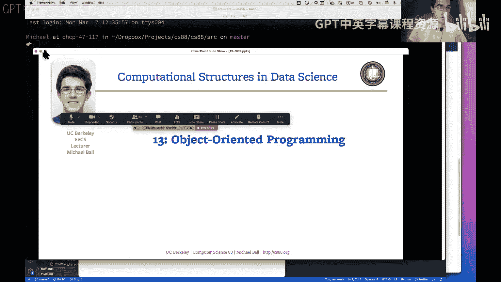

。I assume most people are aware， but mid next Wednesday。

As the terms it's going to feel pretty similar in style if you're taking it remotely。

 there'll be zoom proctoring， I believe all the instructions have gone out for the sign form。

 but essentially if you prefer to take the exam，For whatever reason。

As long it is as as long it is is during one of the。Assign times。Conflicts， but for the most part。

 it'll feel the same as looking for the past mid terms that are online。

It's going to cover up through。All right， we'll try that。So。Midterm， generally。

In terms of content wise will be。Everything through object rendered programming through today's lecture essentially we won't do inheritance。

 we will talk about it on Wednesday， but it won't be covered。

 so use inheritance in Wednesday's lecture as just making sure you understand the basic concepts of object rendered programming because there is。

Still kind of a lot going on there so with that we should just probably get into todays today's topics。

So when we talk about object training programming， what we're going to be focusing on today is。

Sort of the why of why we build objects this way， but what we're going to be doing is really spending our time thinking about three primarily new features or new tools in Python that we have to manage this so one of these is going to be the keyword called class so it's a new bit of Python syntax a special method called in it so that's underscore underscore in it underscore underscore there are a lot of underscores when it comes to object printeded programming and Python and this concept of self so we'll talk about what all of those are but those are the three things that I think are worth focusing on so。

What do we mean when we talk about object branded programming？

Part of the goal of a course like CS618 is to expose you not just to these ideas of computer science of just learning and getting a lot of practice with writing and programming。

 but to recognize that there are different ways in which we can build a program in the same way that we use list comprehensions and we use map there are also different styles of programming so object oriented programming。

Is one of these sort of major styles that aims to solve problems where we think about representing structures in the real world and mapping those onto code so objects themselves are a kind of data structure they let us represent some idea let's say a car is a common example that we'll use today a bank account and they let us organize the types of things that that data might need to be related to so a bank account might have a balance a car might have wheels or passengers all those kinds of things。

So we say that those things are state and objects also have methods of something that you can do to a car a car can perhaps drive。

 it can stop， it can go a bank account who can just deposit or withdraw money and all of these ideas allow us to structure a code in a way that is hopefully more readable。

 more maintainable and to clarify the relationships between the various kinds of functions that we'll be using。

So along the way we're going to talk about classes today and what a class is on Wednesday we'll talk about the inheritance and how we build connections between objects。

 so Python fully supports object ored programming。But it's not necessarily its primary purpose。

 if you take CS62 and B， which is in a language called Java。

 you'll be spending the entire semester implementing object oriented design concepts because they're core to the idea of Java's language whereas in Python they're there we'll see how these are all built into Python but most of the code that we write in CS88 is not necessarily in this particular style。

 so。When we talk about a class， what we're talking about is a special kind of object in this case in Python or in Java that represents the idea of something so in this case a class like that's drawn here represents the idea of a car and what we're going to talk about as a distinction between a class and an instance of a class so we can think about a class as a template perhaps for。

For all kinds of cars or a certain subset of cars that it represents some abstraction on the types of things that a car might have so。

A class can have attributes。These are variables that belong to， in this case， all kinds of cars。

They can have methods so in general we're not going to again quiz you on terminology but we'll try and use the words that program issues and so classes have methods。

 methods are just functions that happen to belong to a class so they work the same way。

 they take input and arguments and they return some output or not。

 but if we say something as a method we're generally talking about a function that is applied to a class。

And the the combination of attributes and methods sort of define the behavior of a class well we can think of a class and the same of this sort of has an outline here as as the template for for what something might do so in this case。

The attributes of a car that are shown are things like fuel or speed。

 those would be just variables that can be applied to a car and methods are functions that will perhaps manipulate those parameters or return some some new data so。

One of the biggest distinctions though， with opportunity programming is that。

We take this idea of a class and we turn it into objects which are instances of this class and this is where when we built abstract data types right we had a constructor function。

 we can kind of think of our class as a new kind of constructor function that we have a car class。

And we can turn a car class into three or four or 500 or however many we need different kinds of instances of cars that each have their own set of attributes。

 their own properties that may or may not be shared and one of the distinctions that we'll learn is how to decide what does and doesn't get shared between let's say this mini car and this beetle car that these when we implement an object vered program design。

 will have a common set of methods， but the properties within them will be different perhaps they have a color property which could be green or blue or red or something else。

 they probably all share some property like the number of wheels。

 which should be for those can all depend on the different types of things。So。😊。

What we say is objects are concrete instances of classes。

 so a class a class itself is a construct that exists in code an object is an instance of a class and again the terminology here is to just aid in making sure that when we make a new class when we see a new class we can be specific about which things are so classes have states they next week we'll talk about mutable data and building the functions in ways that we can change the data and functions but classes。

Generally we can say that there's something where we can change them or maybe we can design them in a way that we can't change them。

 so a tuple in Python is its own class， which is designed to be immutable such that you can't change the properties。

 but a list is a class in Python that is mutable where you can change those properties and in most cases will be working with classes that allow us to change their properties。

Remember that when we talked about functions that one of the goals of CSD8 is writing functions that are small and composable。

 that we say functions should do one thing and they should do that one thing well。

In general when we talk about objects， objects should have a clear and specific purpose and they should the methods that they contain should each be small methods that do one thing well and that it's much better to have different kinds of classes that represent different kinds of objects rather than one gigantic class perhaps that can represent everything else so again all objects have attributes。

We manipulate these attributes through functions， which we call methods。So。

What does that look like in Python with a preview of sort of what's to come？So in Python， again。

 indentation will be important here， we have this new keyword called class with a lowercase C。

Separated by a space is the class name in Python， all of our class names that we create the built in ones get an exception for weird reasons。

 but all of our class names in CSA8 will start with a capital letter and again this is one of those things where class names start with a capital letter。

 other function names our methods do not start with capital letters。

 this is one of those distinctions that is built into Python which once you know to look for it can help you reason about the code that you're working with though。

Class with a class name and again that's always going to be capitalized our colon and inside we have the body of our class and so the body of our class when it's indented are all of the methods the attributes any data that our class holds that are specific to that class and are encapsulated within a map on Wednesday we'll talk about using parentheses as a way to control inheritance and allow a class to start with with a preexisting set of conditionsians but we'll get to that。

On Wednesday。Our first class and we'll open a Python file in and play with this is。

Something that we're calling base account there are a couple different versions of this class。

 sometimes it's just called bank account sometimes it's called base account the base name implies that in the future we're going to change this to have multiple kinds of accounts。

But whatever we name it， the class name goes at the top， an insider class。We have functions， which。

Only live with inside this class so this account name method so functions within our class we typically again referred to them as methods this account name method I can't call it globally in Python。

 but whenever i'm using an instance of our base account I will have access to that method most of the methods。

Will look just like normal Python methods， but what we also see here is this special syntax called in it。

 so in it is a method which again starts with two underscores， ends with two underscores。

 and this is the。呃。Defined by Python it is a special method that whenever we make a new class is the method that is always called first and so this is in a sense our setup method。

 it's shorthand for the word initialize or to set up the class。

H and what the structure of our in method does is it allows us to take in arguments as data that that will become specific to the class so what we do is all of these are。

Are methods that exist in the class。Inside our class we have access to or excuse inside our methods。

 we have access to the attributes that live within our class and we do this by using a special argument called self so each one of our methods。

We'll take in this argument called self it turns out that self is more of a convention。

 we could name this thing S， we could name this argument thing but you should never name it anything other than self because it just gets a little bit confusing so what self refers to is the object that we're dealing with so in our class and we'll look at a couple examples of code but the keyword self is。

It's going to allow us to。To distinguish between one base account from another base account and so self dot name or self dot balance is a property which exists on one instance of a base account。

 which may be different between multiple instances。So。

And we reference those properties by saying self dot thing or so self dot name， self dot balance。

 we can call methods by saying self or object dot method name， self dot method name。

 whatever it might be。All rightSo here's how it works。

I would say my account is equal to base account of the name， this case John Doe and 93。

Where do these values come from？Well， in Python， when we make a new class。

We never have to pass in this argument itself as as the programmer using that class when we say base account of。

Of John Doe in '93， that self is implied， Python does some transformation behind the scenes and so what we have are two arguments。

 John Doe， which is the name 93 is the initial deposit to this account。

 is the second argument to this init function。As init function runs。

 this basic account now has one attribute whose name is John Doe， a second attribute， balance。

 whose value is 93。And that's just at the end of the first line。

 we then get to say my account should not withdraw。

And that value 42 is the argument to our withdrawal function again， takes in self， takes an amount。

 and we don't have to pass in that keyword itself so we say the amount here is 42 and we do 93。

Minus 42 and that's。

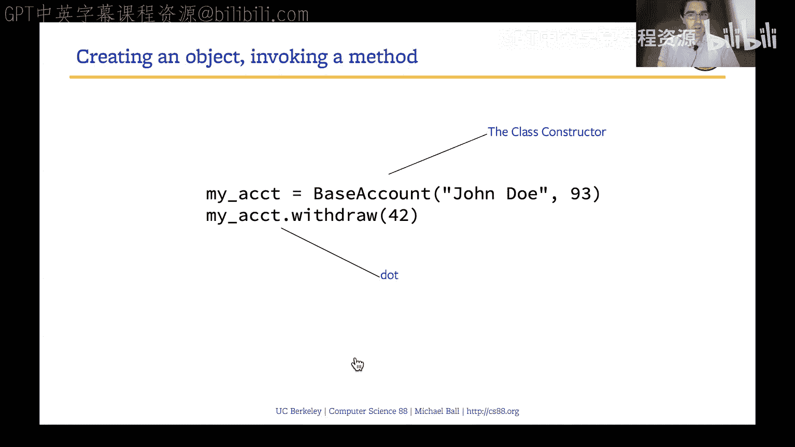

好 about嗯。That's our first instance of our class。 So let's go over to。The Python interpreter。嗯。

Allright。Okay。All right， so we've opened up a Python file for this lecture。

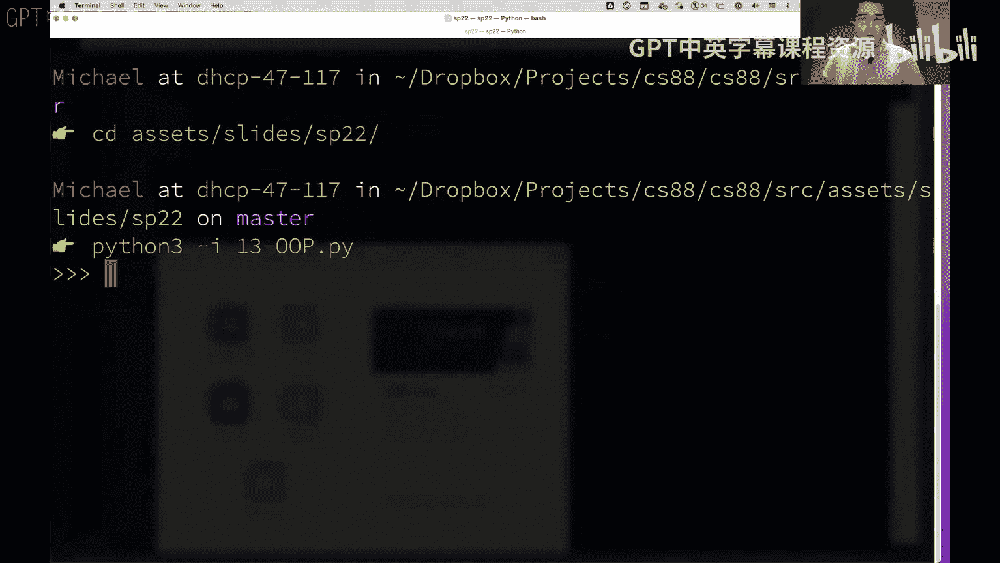

And let's take a look at what is in our file。So。Come on。

So we have a couple classes in here that are just examples of things that we're not going to go through today。

 if you're curious on how we might translate our point abstract data type into an object oriented class。

 this is here in the file we're not going to go through that today。

 but this is sort of a translation of the work that we did a couple lectures ago。

To translate our point into a sort of simple class with two attributes。

 but in this case we're going to look at our our base account and there's a couple of things in here that that we're not going to get today。

 but are perhaps useful useful examples of。Of。🎼Things that we might want to do with accounts so we'll build up to the other examples in this file later in lecture and then in the next couple lectures。

 so our first thing we're going to say is my account is equal to a new base account called CS 88 with $100。

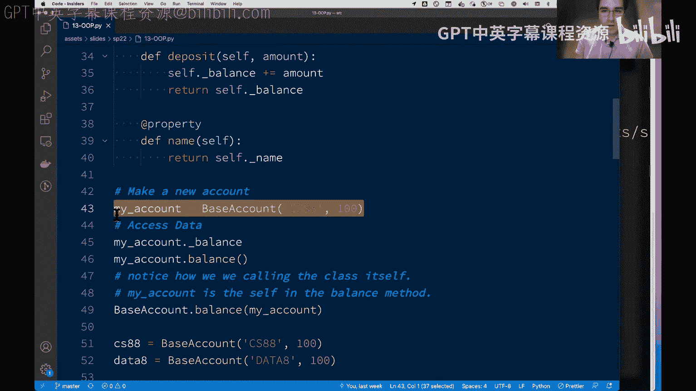

嗯。When we evaluate my account in the same way that we get something you know like。

If we type map right， we get some default value Python gives us。

Some information about where our thing is defined so it's defined in this function main which is just how Python works it's called a basic count it is an object at some again memory address this is the class auditory version of the type of syntax that we've seen before。

And now what I can do is I can save my account and I can access。

All of the various properties perhaps that exist on this account so if I say my account underscore name I get CSA8 in this file I've named some of these properties with underscores this is just a general pattern this doesn't change anything in Python a single underscore just tells programmers that this is something which is internal to the class itself。

 so if there's a property on a class I can。I can access it so I have my account。呃，的。

So dot will access any property， balance is also defined， so the balance is still 100。

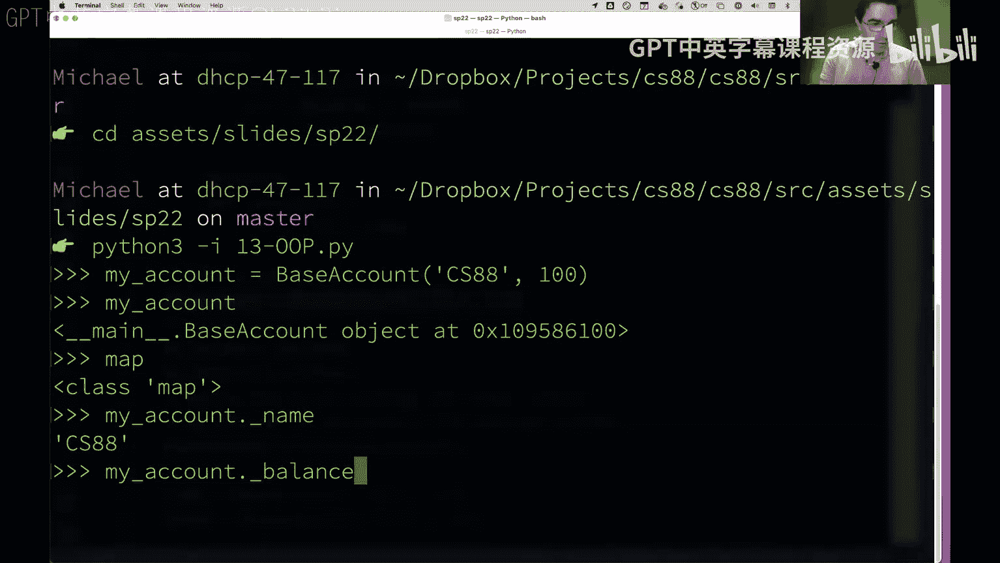

If I look at the file。What I can see is this is basically what was on the lecture slides that we built a new account。

 we assigned a value name， we assigned an attribute balance。Based on those。

Two properties which are passed in and of course， this version has a bunch of different methods that I can access so I can say my。

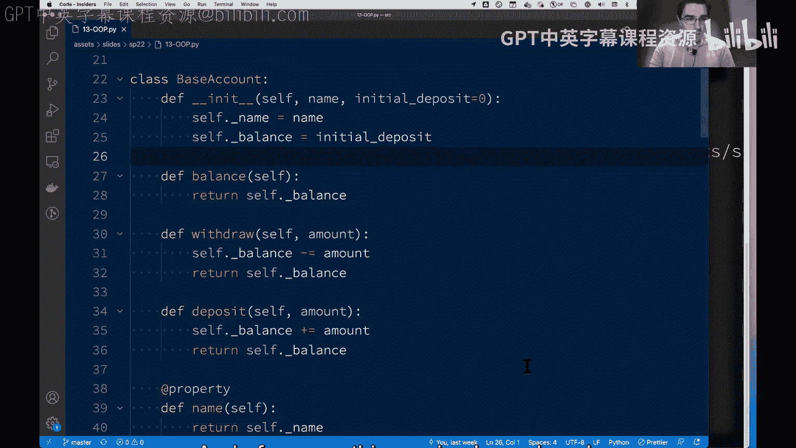

Account。If I type it correctly。Dot balance and balance this way is a method here， which again。

 a method that takes itself always refers to that object。

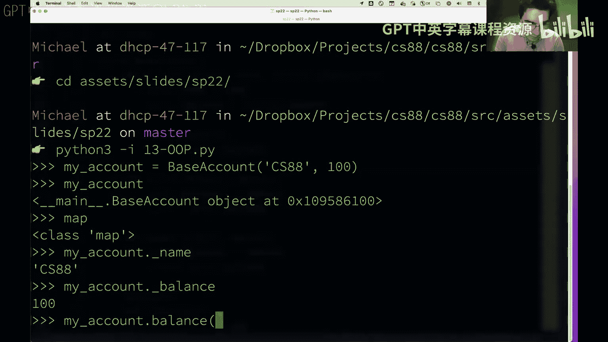

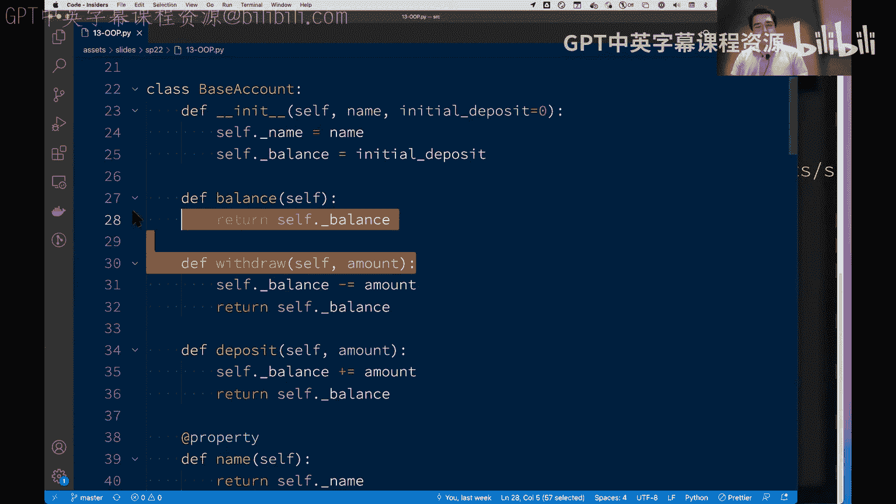

I can call it with no additional arguments。And it returns that balance so again。

 the most important thing to remember with an object in Python is that this first argument self that exists。

As the first argument to all of our methods is implicitly provided by Python。

 it is unique to each instance of that object so that's why I distinguish one base account from another and when I use a method I never have to。

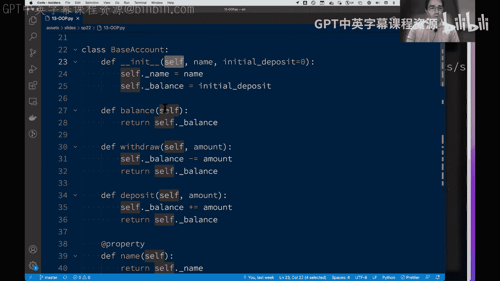

I never have to pass in self Python does that translation for me so I'm going to stop there This is a。

Pretty solid introduction， but the three most important things we've seen are the init method。

 the class syntax itself。And i'm sure there should be some questions so this idea before we've even gotten to sort of modifying accessing some properties questions on this this structure either on zoom if you have them feel free to。

诶。You know， start asking questions or in the room are there any questions， yeah right up front。This。

Yeah， yeah that's a good question so what's the distinction between these last two。

I had two calls so underscore balance and balance with parentheses so my account underscore balance。

Is。

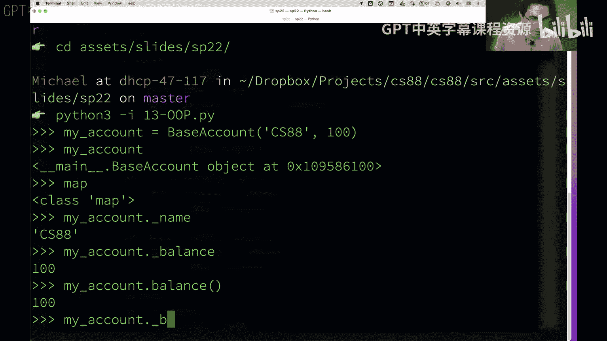

Is accessing a property？Or an attribute of this class， which I've defined when I create the class。

 so I could name this whatever it might be。You know I could name this just B I could name this value and balance itself is a method which then just returns this property。

 so this is often a way when we write or when we build classes in Python in other language in other languages that sort of separate the values from building an interface to how they get used。

 the fact that they happen to be the same name just sort of makes it consistent that this allows us if I say my account。

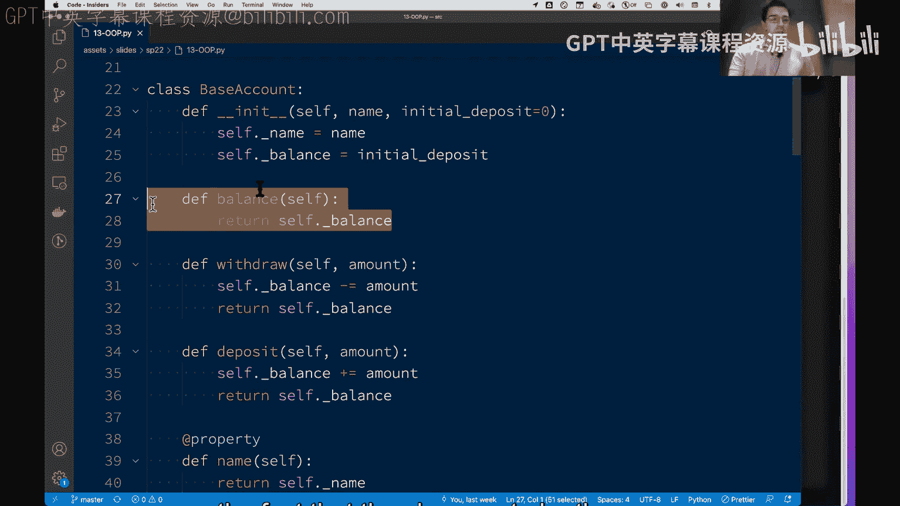

嗯。嗯。I said， my account。呃。Well that's why if I say my count balance one thing to note is if I don't use parentheses right。

 this this is a function that I could treat as a higher over function because I have not called it so。

What we often want to do is use。Use functions as a function such that we have all the advantages of perhaps using something like a map function or somewhere else to have a function that calls something for a really simple class like this one could argue that our balance function is not necessary。

 but what you'll often find is just to be consistent classes will define those functions。

 but that's a little bit more of a stylistic styllist of piece。

 but you'll definitely see this pattern in the upcoming projects after the midterm。

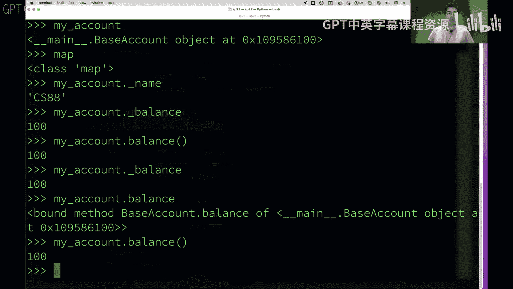

Yeah， okay， so here's a question in Zoom。What would calling balance of my account do so this is a good question and let me just write it out so。

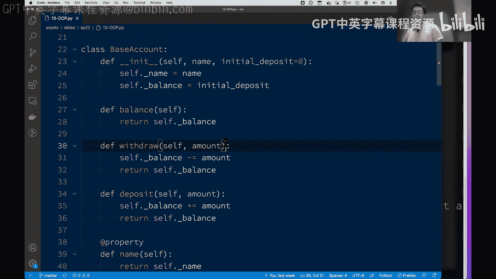

So the question。And Zoom is asking what would happen if we call a balance of my？

Account like this does anyone to guess what what is going to happen when we execute this line？

So if I just type balance of my account， what might happen if I execute this line？

So I want to just shout out a guess。啊。An error， right and do we have a sense of why the error might happen？

😡，Its。Yeah so we didn't specify a class right so what we get is this idea of balance is not defined。

 but what this question is asking is actually a very interesting question because what I can now say is base account。

Dot balance。And base account dot balance is actually a thing right base account dot balance is a method attached to this base account。

 So if I were to say base account。

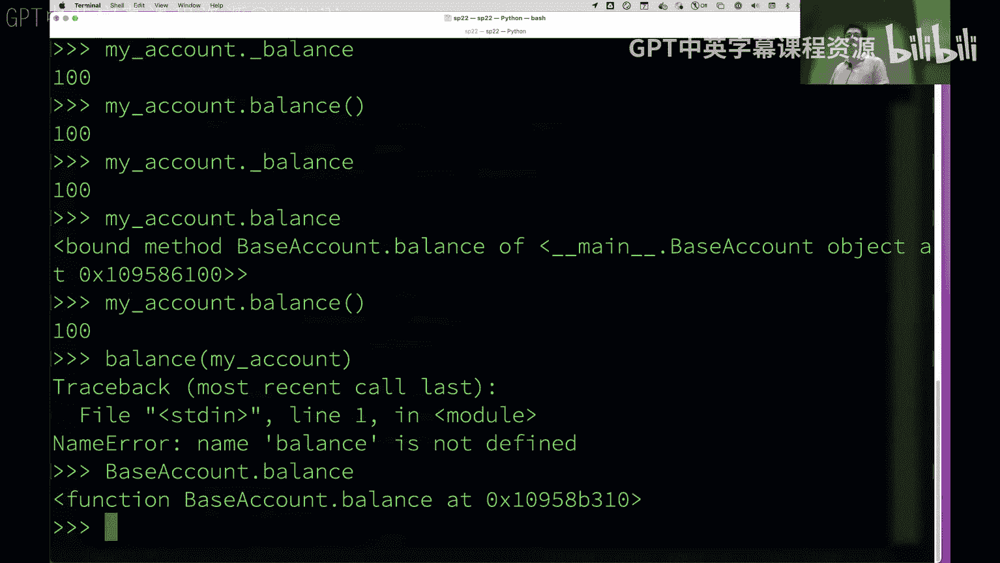

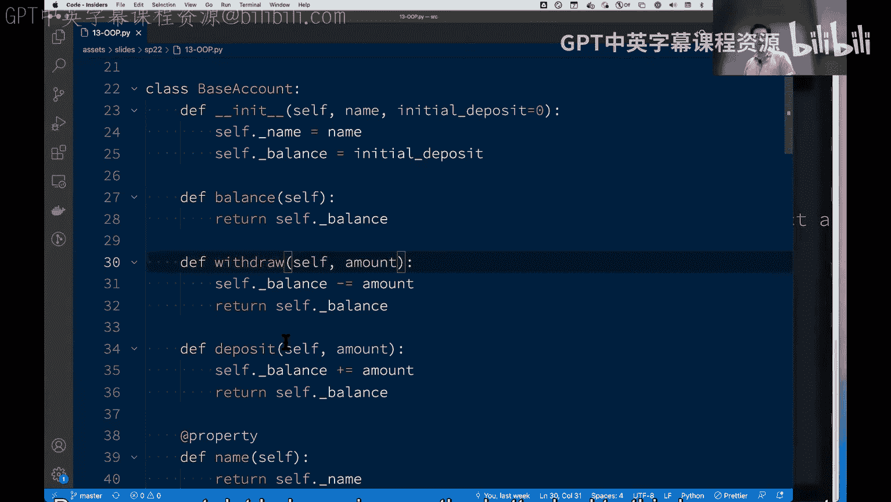

Dot balance of my account。What I actually get back is the right value and this is one of those interesting questions where。

You should almost never write Python code that looks like this。

 but this is how Python internally goes from my account dot balance to。

Base account dot balance where this value becomes the thing that is self within within that method so what python is doing here is we can call this method directly by calling base account dot balance and if we do that we have to pass it whatever the thing for self is so python does a whole bunch of work behind the scenes to translate。

Calling my account do balance to make sure that self is the right value and if you kind of want to implement that yourself you can turn it into a function called by directly calling the method through through that class but why that works and how Python does this is sort of beyond the scope of class but it is a very interesting question of how to how to pass in a method to the class yeah so if anyone on zoom has follow up to that i'm happy to answer it a little bit more but yeah other questions in the room or on zoom about what we've done with。

With classes so far。The question who。

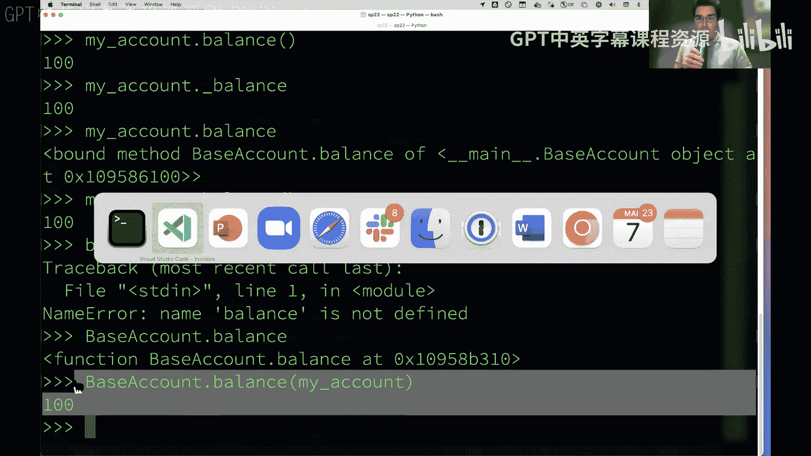

All right， so we' had one class。We've accessed。a method。Now what we can do is。

But at least' also worth illustrating Ray is。I'm just going to make two new accounts。

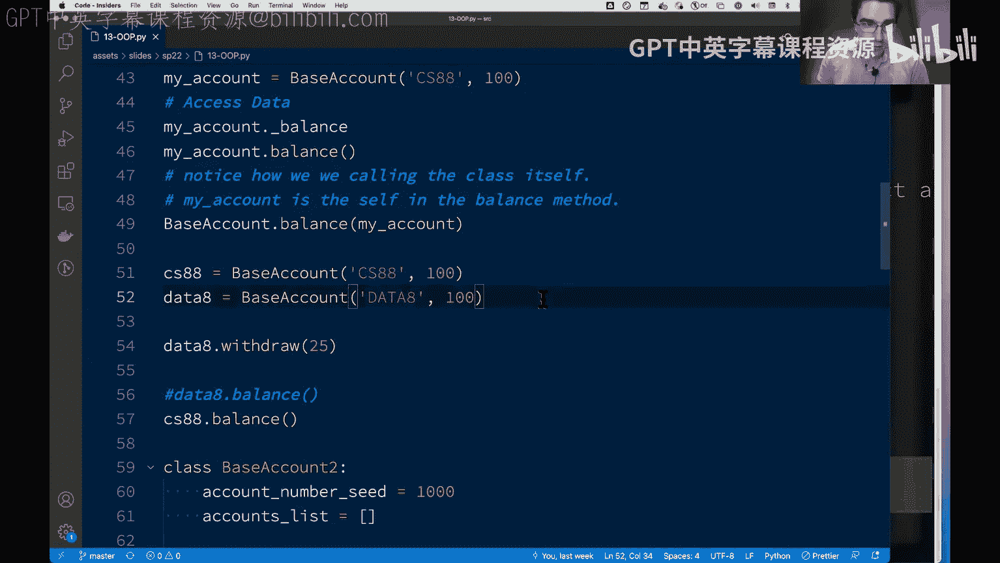

Here our file。We have two base accounts， CS88 and data8， they both of course have $100 to a balance。

In this case， it's just worth mentioning that。And actually， let's say。Dot name。N CSs88。 name。

Right that by accessing the name property of these two different objects。

 the values and the attributes that they contain are in fact distinct that if I change the name of one of these objects right the other one is not affected and when we're in a world where we're managing multiple instances of similar types of ideas so you might imagine。

In a world where there's a bank right you have hundreds of thousands of customers。

 each of those customers has one instance or maybe more of an individual bank account。

 but the ways in which they operate the name， the balance， adding， withdrawing money。

 if it's a savings account right， something to calculate interest， all of these functions。

 do the same type of things， but they need to operate on different sets of data。

 and so what we're doing here with object jointed programming。

Is really trying to build some structure using functions and methods to sort of build that structure in which we can have multiple distinct objects like a data8 object a CSA8 object。

That have a shared set of functions and methods for which they can use and so that's really the goal here with object related programming。

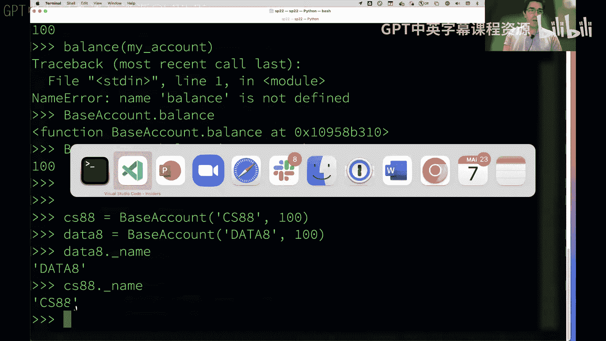

We've we've done all that so just to make sure that we're on the same page and stepping through a few more things so in this case。

 we have our initialization method。One important thing to make sure is that our initialization method in Python always implicitly returns none by calling base account of let's say CS88 in this case。

 Python is doing all of the work behind the scenes to create a new object to actually。

 if you take CS61B in CS61C， you'll learn a little bit about how the scene to be implemented。

 but to make the space in our computer's memory to say this is where this bit of data will live。

So that's what self represents and because we have self。

 we never need to return the actual instance of the object itself。

So a little bit more about how Python treats attributes so in this case。

The underscore the single underscore that I used is mostly just the stylistic choice it says that this thing is generally internal to the class。

 but Python doesn't do anything special with it however in Python double underscores at the beginning or end of a method name。

Or an attribute name do have a very special meaning and so there's a link that really goes into all the details。

 but when something starts with two underscores in Python。

What it generally means is that this thing is private and that it's not to be accessed outside of the class and so what do we mean by inside and outside。

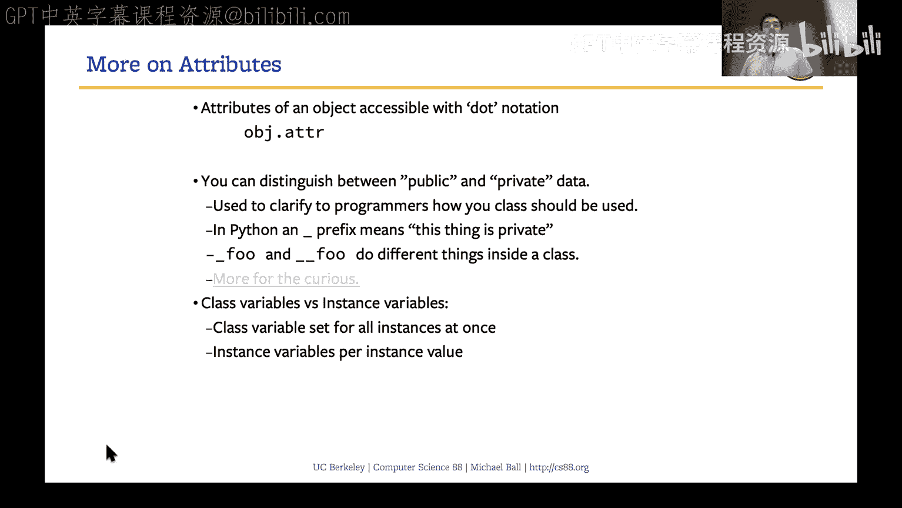

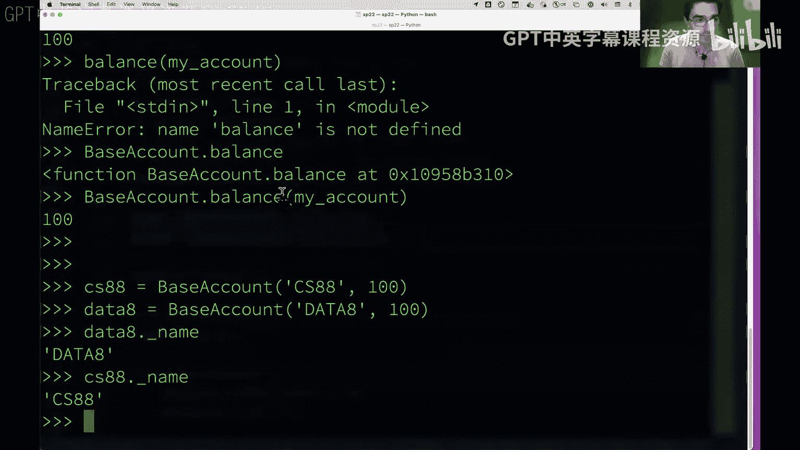

So let's see we should have。So we have a little test class up here。

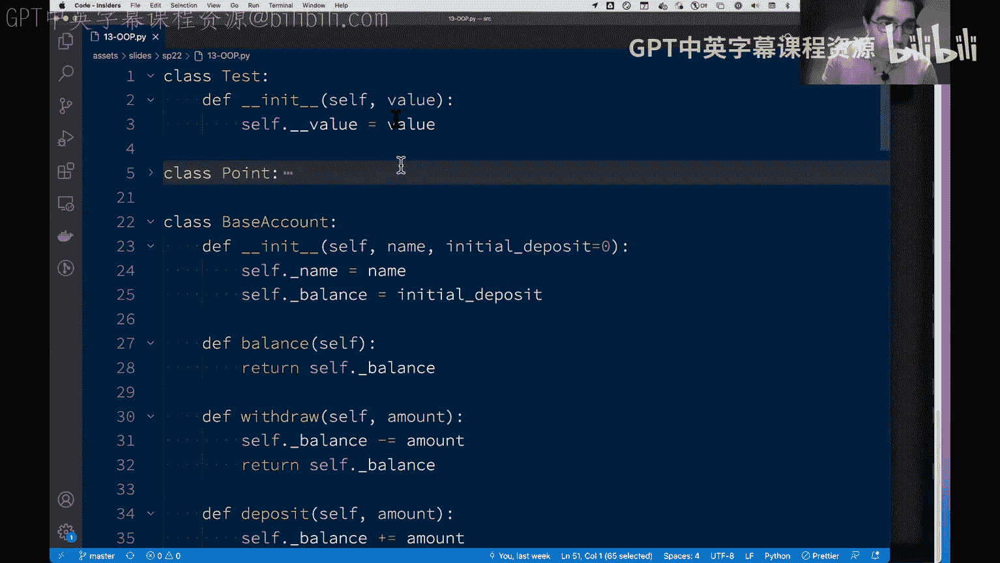

So， let's say。So we have a new test class， this thing just has one attribute called underscore underscore value。

And if I say thing do underscore value。What's app parentheses there。

 what it tells me is that the test object has no attribute value。

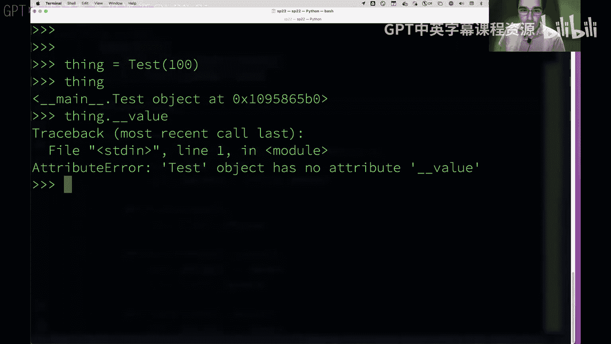

But if we look inside our test class。What we see is that this this attributing system what we should probably do perhaps is show what we mean by inside and outside so inside our class we can add a method called show。

Value。Self。And what it return， we return itself。就。Yeah。

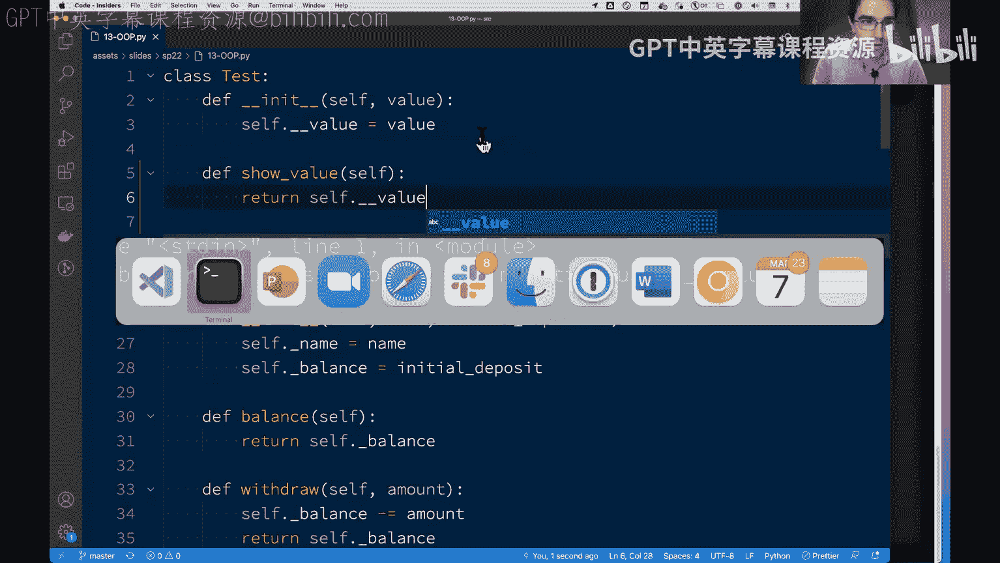

So。We'll reload the file。We have a new thing。We still cannot access our value。

 so we're kind of just where we were before。But now if I access this method called show value。

 what I get is 100 so in Python you'll see this in some of the examples in lab and in a project is a double underscore Python will say。

This thing can only be accessed from within of our class。

 so anything that lives in a method within this test definition can access that value。

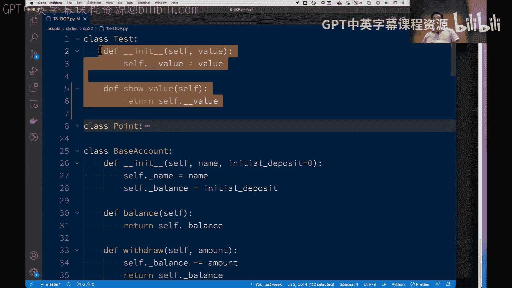

But anything that lives on the outside so now that I'm using that class Python will say if it has two underscores it's private it doesn't exist。

 it turns out that because Python is a language that lets you do just about anything there are ways to get around this so if you're thinking about the security perspective or using this to sort of build a system you can access that data if you really need。

 but it's more about communicating to the programmer that hey。This thing。

 shouldn't be used from you as a value outside of a class in this way。

 you can loosely think about this view of saying thing dot value。

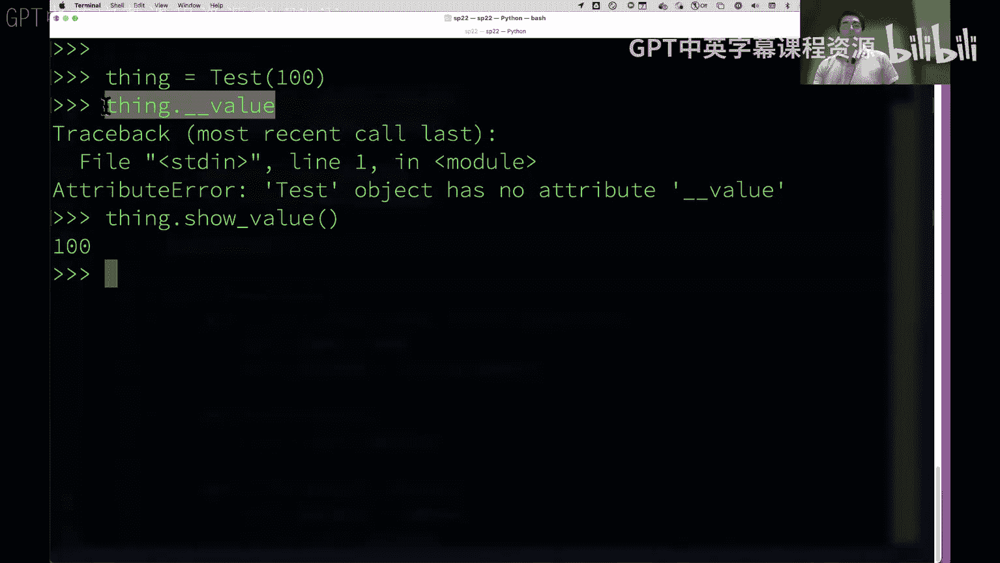

And in the interpreter this way， or using it in a method as a kind of abstraction barrier in the same way that we do with abstract data types separating that world。

Yeah and so the question in zoom chat was why did we have two underscores before calling attribute that was just because inside our own class here on line three we actually named the attribute with something that was double underscore so in python just be aware that double underscores have a very specific meaning they do change the way that a variable or an attribute on our class works and if we do that it means that we can only access it from within that class so。

That is something which is a useful trick when you want it to be and slightly confusing when you come across code that users in unexpected ways。

 questions on this example right here， yeah right front。多个。あ、そすご先生。

And Singapore support can be access。Yeah， so a single underscore is just a convention yet。

 we can say like right down here with our base account where balance is a single underscore。

 Python doesn't do anything different， it's just a convention that maybe you shouldn't do this but double underscores where Python will illustrate or we' actually try to modify how your class works to protect to sort of protect you from accessing data that you perhaps shouldn't。

And that is one of the things with object programming。

 the distinction of what is internal and what is external we're not going to talk about in CS88。

 but in CS6 B， you might spend a lot of time discussing sort of why we might want to pick attributes that are visible to this outside world or that we say our private and some that are public and really that's all about communicating to other programmers。

How and why we want to design our process， how we want them to be used if you start looking through Python zone help documentation。

For various classes they'll give you a sense of what things might be private a about class and what things might be public yeah good question so far yeah other question up front。

没有。对嗯。So do you mean like if I？If I did something like。呃。This。

But when you say two variables of the same name or。Thank to the。哦。

Oh yeah yeah so so what I mean by inside is everything that lives within our code defining the class。

 so inside here inside our test class definition， we can use underscore underscore value as much as we want Python won't give us an error but the second we try and say something like。

呃。Okay， come here。The segment try and say something like thing dot value this is now right outside of our class definition。

 we're just using that object that so we'll get an error so you can kind of think about this as when we did higher order functions right and inner function only was all the data of that inner function was accessible inside that function but the outside world couldn't see any of our inter functions private values in Python work in a slightly similar way where Python is actually doing some sort of magic behind the scenes to prevent this attribute from working correctly yeah another question of。

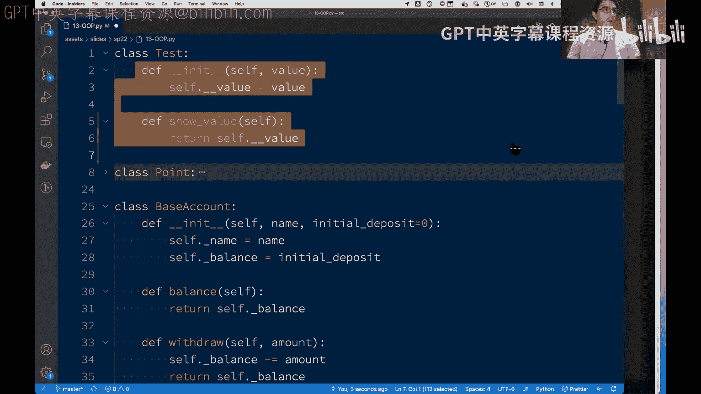

Yeah。あそ。Yep。Yeah yeah yeah that's hi so the question for those on zoom is if we do this what we're saying is we can't access our value we can't say underscore underscore value directly。

 but we couldnt we could instead make a method that just returns that result and that's actually exactly what this show value method here is it just returns that result in this case if we're just displaying it this result we need what we might have any other method inside our class that increments or decrements or modifies that attribute and in that case within our class it's just any other attribute that exists but。

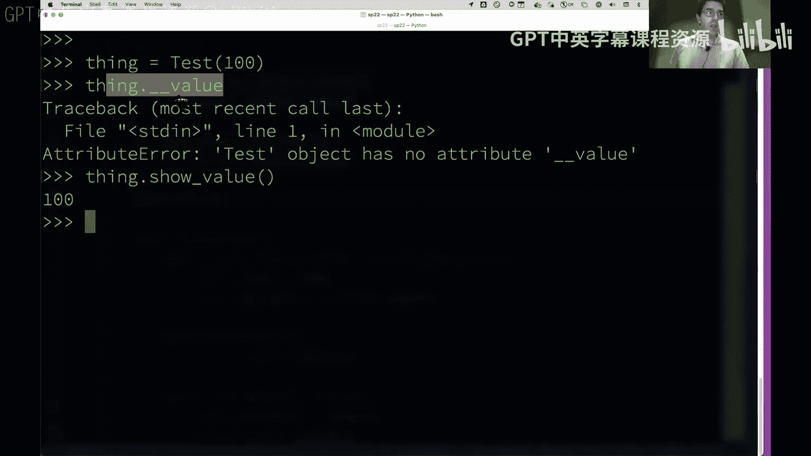

Outside of the class， Python takes some protections。

CoolOther questions about this distinction of private and public attributes？Co so。

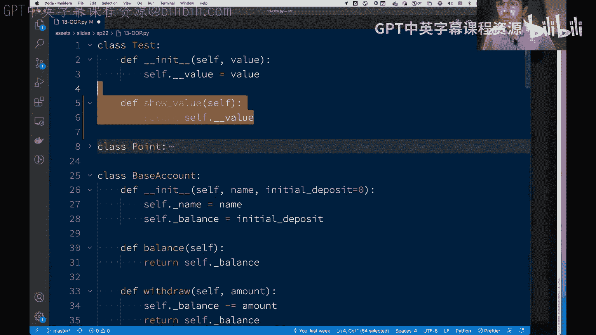

We'll go through the last last couple of examples okay so this is what we've done so far so again with some private attributes if we're using a single underscore this is just a convention。

It doesn't actually change the way that Python behaves。

But with a double underscore we're actually changing the way that that python behaves so with the last few minutes and we'll pick this up on Wednesday。

What I want to introduce is this notion now of sharing data between multiple classes。

 so there's a lot of different ways that this can be used and abused but。

What we want to start off with is just think about let's say I have these two。Different accounts and。

The goal is to have some sort of information perhaps about our bank that knows what。

 let's say the current account number is， such that every time we make a new account。

 we increment that account number by one and in that case what we want to do is share some data not between all instances over objects。

And have that that information always be in sync right we don't want to ever have to say。

 let me go find every bank account and update some individual attribute to sync that data because that would be a little bit messy or we might forget to update an account and so the way that object oriented programming handles this is。

It introduces this idea of what we can call class attributes and class attributes instead of belonging to an individual object belong to the class itself。

 so this case。Our account number seed is a class attribute on our base account。

 so if we pop back over here。

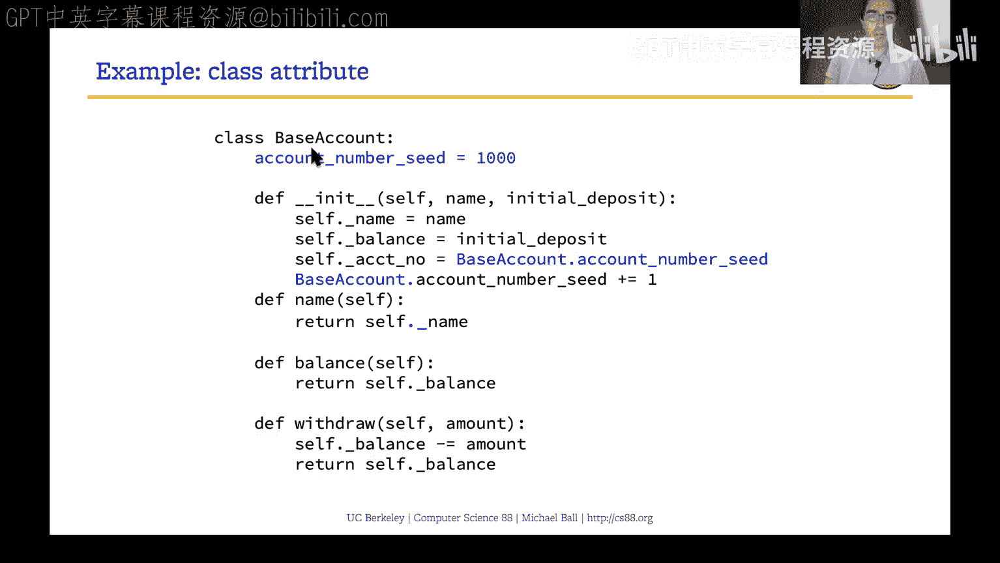

All right。诶。In our file， we're going to call this base account two just so that we can distinguish them in code。

AndWe've actually added two class attributes for now。

 but what we're going to focus on is just the first one is account number see。

Our class attribute allows us to say every time I get a new instance of an object。

I want that value to sort of be shared across all of them。嗯。We're going to。Make two。

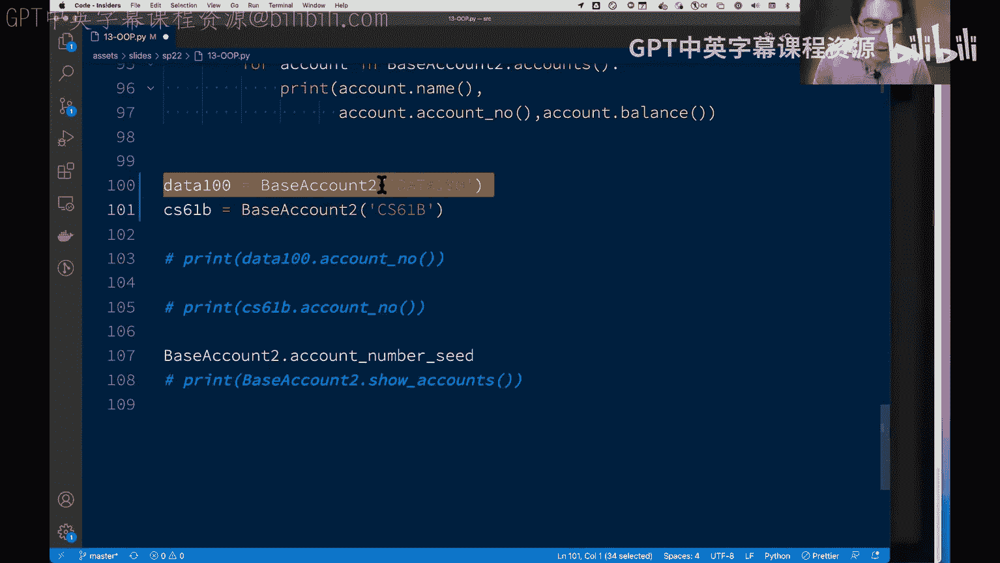

We're going to use two different classes here。

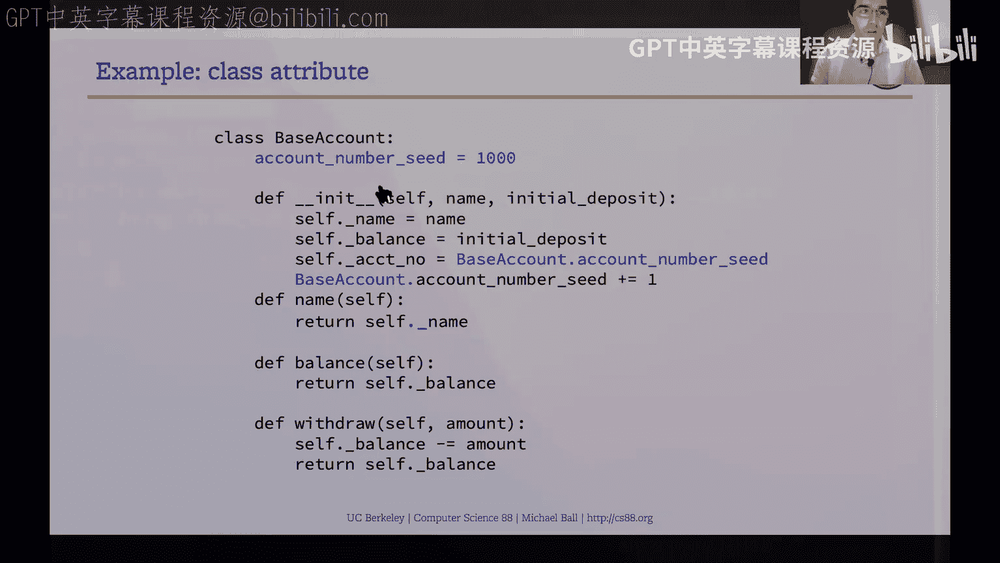

Now i'm using classes in the sense of classes at Bkeley not Python classes we're going to use two different class names so CS61b and data 100 with our base account two class to make。

To illustrate this idea and so what we want to look at here is how this idea account number seed gets shared across multiple multiple classes so we can get each function each class here has an account number function。

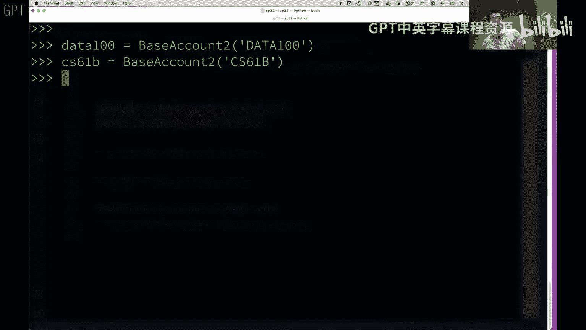

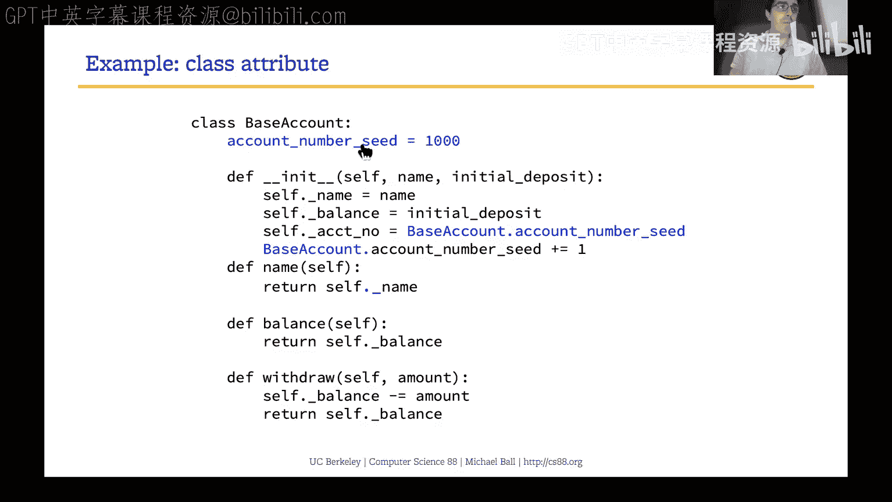

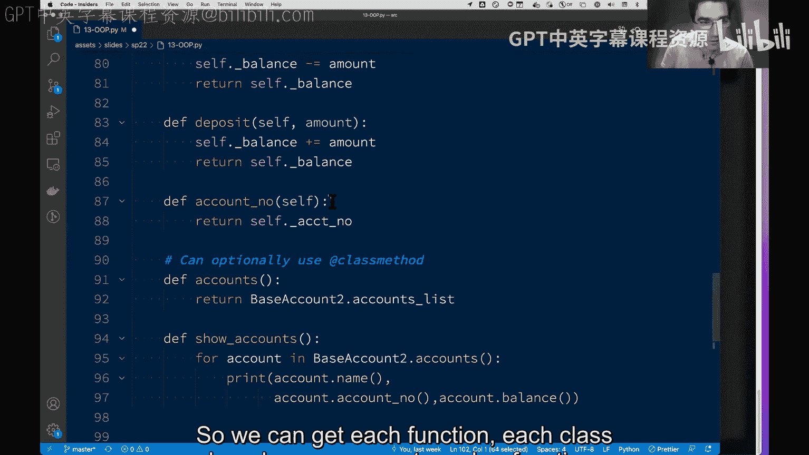

Let's see let's not keep swap through slides so if we could say see us， let's actually give data 100。

A account。Number。Is it the full word？Oh， it is the full word， okay， that's what it is。

So data 100 has a method called count number。Which returns its own value。

 which is saved as the property underscore count number， but where does that data come from？

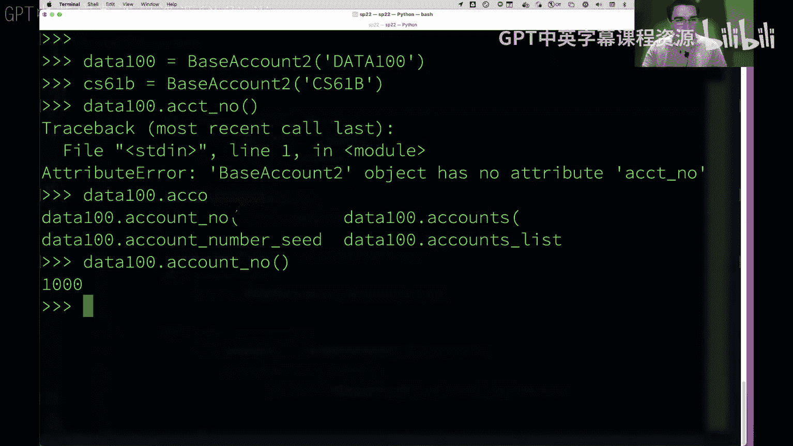

When we make a new instance of our class， we save account number as a value from base account to do account number seed。

 we then increment that value。Of account number seed every time we make a new method so we could see that the two classes that we made in a row and we'll just finish this up that will be it for today。

 CS 61b。

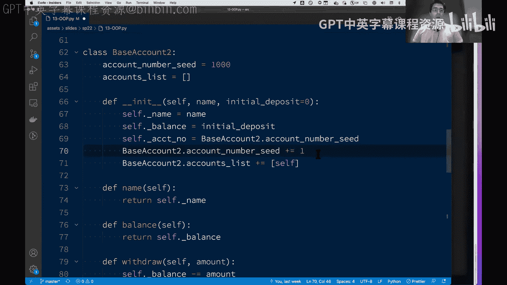

Account number is 1001 and base account two has a。This。

Property called account number seed that's been incremented from 1001。

 1002 because every time we make a new class。

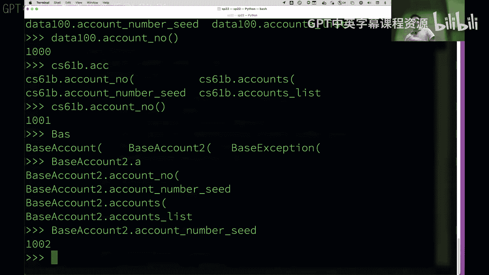

This data lives not within our instance but within base account too so that's an introduction to moving data from a class from an instance to the class itself whoops so on Wednesday we'll play with this example a little bit more and we'll talk about how we get classes to talk to each other class attributes will be in lab this week and are potentially a topic for the midterm Wednesday's topics of inheritance will not be on the midterm so that's。

 just a minor distinction worth knowing。嗯先。Yeah， go ahead。Yeah。WhiOh， yeah。Yeah。

 so this line right here takes base account2。 account and proceed and changes that value every time we call the init method by making a class。

呃你 it is好好。Yeah， yeah， once per let's see right here。

 this is one call to the in function and every time we make that call another it's a cult to the in function。

有哋要上嘅。Yeah no yeah， the init method is only called whenever we make an actual new instance by saying basic count two and all caps with whatever arguments we need。

veryYeah， thanks。Anything else on Zoom？Oh， questions if you have a time conflict。

 there should be a pin to post on Ed about times with a form to fill out。Yeah。

 and you should be getting an email after you felt that form from staff this week。你好。

And if you don't find the form of please post a private note。

 but it should be pinned towards the top of head。Awesome， thanks everyone on Zoom。

 I'll see you later this week。

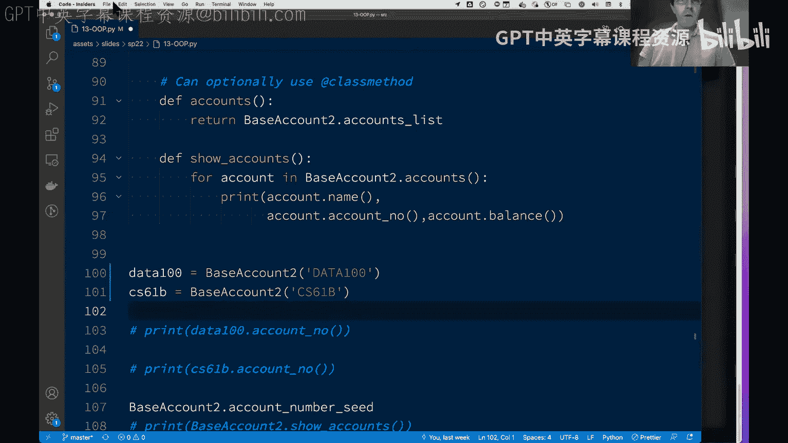

可一个。

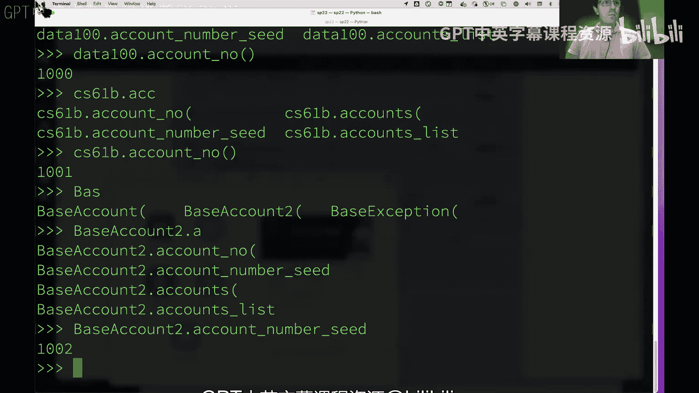

Thank you。