# UCB《数据科学中的计算结构｜CS 88 Computational Structures in Data Science 2022》中英字幕 p15 CS 88 Spring 2022 - Lecture 15 - 3_14_2022.zh_en [BV1516iBfEVY_p15]

A is go over。

，I have four questions that were posted on Ed， so we'll go through those。

 go through a little bit of my thought process and solving them。

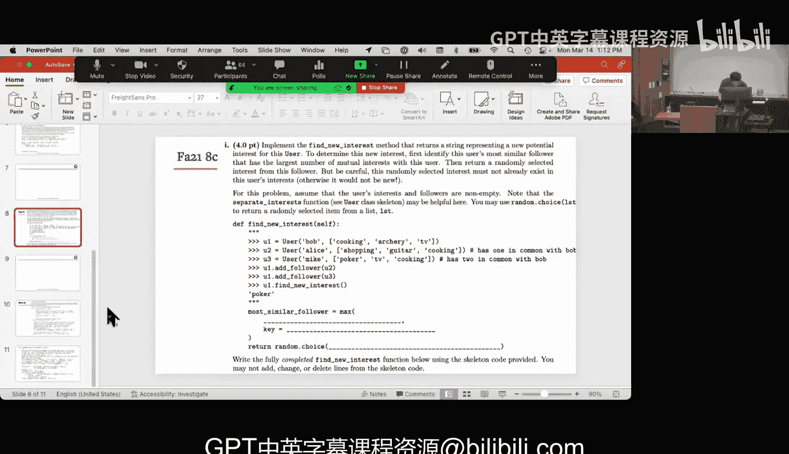

And， and sort of just， just step through and think about that fair warning on。呃。Let's see。

 Let me make that。 Yeah， so fair warning on some of the questions。

 It's been a while since I have looked at past exams。 So oh， thank you。

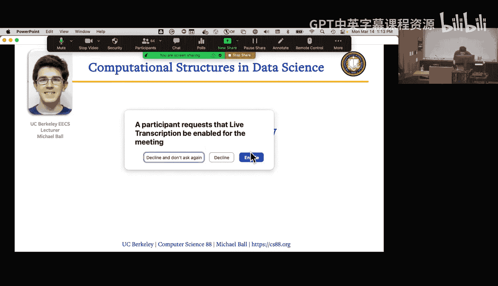

I am also a little bit rusty on some of these but the goal here is to think about just how we really break down problems what we would look for and so on。

 So just reminder on midterm logistics we will have another edpost probably tomorrow if not early Wednesday morning with rooms and assignments like many classes we do have two rooms right now and I think we will need to split people up into two rooms based on the number of online exams and whatnot so do watch out for that we'll do based on the last digit of your student ID because the rooms are not evenly sized so they will be the first part of the midterm will be making sure you go to the room which is you know that we tell you to go to。

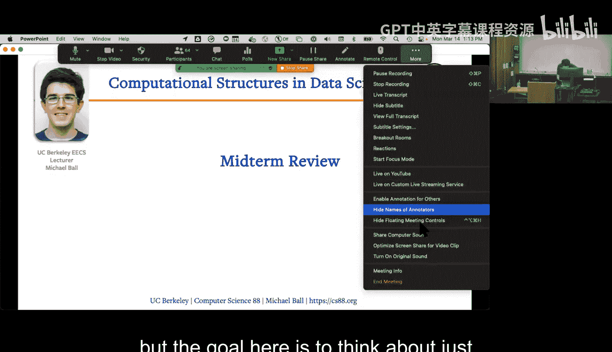

But generally， that's not too much of a deal。Otherwise。

 the way that the handwritten notes work they are unlimited handwritten notes。

 I will caution you though， that you probably don't want more than like three pages of handwritten notes the point of writing handwritten notes is to help you study。

😡，And writing so much that you don't sort of。Yeah， that you're shuffling through things that you don't know what you have and so on is。

That that can become counterproductive so take notes write down whatever it is that might help you it could just be references to Python bits it could just be you know study techniques I would not copy entire problems although again it's your time。

And then just a reminder that if you are taking remotely， there are Zoom proctoring procedures。

 but the gist is really， if you're doing Zoom exam， open up the exam tool。

 turn on screen recording and so on， and it's not too big of a deal。

If you have remote accommodations or additional time， you and you want to double check those。

 there's the post on Ed， but otherwise logistics should be pretty simple for the most part show up to the room。

 take your exam and so on。I believe yeah question on zoom we be able to see the CSA8 reference sheet I believe it was linked in a recentedpost if not we'll make sure that it is up later today。

 but it it's pretty。It's a pretty dense sheet of Python materials。

And if not I can I can find it afterwards， but yeah， so my general advice for the midterm。

As overall don't rush， I suggest skimming through the overall exam first just to get a sense of what's there。

 this is sort of up to you， but in a two hour exam or you know three hour final my general advice is to get a picture of what the whole exam looks like before just jumping in you don't you know how you pace your time is up to you。

In general， my feeling is that as long as you're aware of the order that you're working on things。

 it's totally cool to go do questions out of order。

 if you have a topic that you really get right like if ADTs or lambdas or classes are your thing。

 like tackle that question first get out of the way， focus then on the other questions。

If environment diagrams are your thing like。The past your exams right。

 you could probably figure out what would Python print is question number one environment diagrams or question number two。

 the rest of the exam is。You know all about filling in various coding questions and so if one of those two things is your thing like do question one or two first if you hate it you know do it at the end so you don't have to think about it but you know。

Follow go in a format that I think sort of works for you when I solve the question in general is I would say read to the question first you know just read it through once don't try and necessarily figure out what it's。

哎。Super you know asking you to do then go back look at the doc test what are the functions that we're providing you trying to do so regardless of the instructions just input output。

😡，You know what？What are the mechanics of this question， and then I'd say then give it a second look。

And figure out is there a technique or a path to solving this question that I should probably get in the mindset about。

 so I'll talk through a couple of those and how I think about that and probably the best way to go about that。

Is to start actually let me see in the room。If。I set this to computer。

Hopefully that will make screens easier to read。😊，But is thinking about a question like this。

 so this is from spring 20， this is question number six。嗯。😊，So。

Yeah there's usually a little bit of backstory， some of this is helpful to you。

 some of it might not be you can do all of the questions without the backstory but there are usually suggestions and sort of thinking about the problem so you are a data scientist hired by UC Berkeley to find the largest room on campus in order to schedule midterms your job is to return the room and its capacity the data on all the rooms plus capacityities in a weird format of three element list with a first element is the room the second element is the capacity in the third element。

Is either the rest of the data or none assume that the capacity of each room is unique so this is you know that last bit assume that the capacity is unique that's just telling you that you know you don't have to worry about certain kinds of edge cases again if there is an edge case that we want you to know about you know that'll be in the problem but in this case what we're just trying to think about is what are the types of things that we're trying to solve for so。

We haven't done any questions of this format this semester so there won't be one exactly like this。

 but the goal of this question。Is to we've given you a set of lines as a starting point for this question and your goal is to use these as your scaffold and place them in the right order so in most questions in the recent semesters we've given you the whole scaffold so in this case you have a starting point of a scaffold it's just shuffled out of order so there's an extra step of figuring out you which way which way to begin but。

What I would highlight here is to think about is what is the structure of this problem and what is it asking us to do so we have a few things here one of them is again just listing out the shape of the list。

So we have room a number and then another nested list or the value none inside our starting code。

 we have return a pair of room zero and room one。We have。

an assignment largest left is equal to find the largest。

 and if we note here our find largest function。Wops our fine lus function is the name of the function that we're solving。

Immediately now what I should start to be thinking at as I look through this question is。

I have find largest as my function name I see somewhere in the code that we've given you a call to find largest。

 so this immediately means that recursion is going to be a technique to solve this question and importantly the other way that you could recognize this let's say we didn't give you the call the find largest but you know you were thinking about how should I solve this we haven't talked about this explicitly yet which is why we would tell you from midterm that this is recursion。

 but if you think about this structure that we've set up we've said each list is a three itemom list where the last list is in the same shape so we've got room number and another list of room number and another list of room number where we have this sort of infinitely nesting set of lists that hopefully suggests that this thing is。

You know a the setup of this problem is that our data is recursive where we have lists within lists the structure of those lists is the same。

 so when we talk about problems being selfsim this is a selfsim recursive problem so that's I think the most important thing to recognize is in this question is。

嗯。You know。Is。What kind of path are we taking we're taking a path of recursion？And。

How then do we solve this problem？How would I go about think about this so remember when we talk about recursion now that we've identified the path。

 the next most important thing we could do is identify our base case。And our recursive case。

And without even trying to write code， what I would start to do is just to sort of scaffold what I'm thinking about。

 it might be helpful on the exam to jot some notes on the side。You know。

 if we gave you the lines out of order what I know some folks start doing is actually just writing on the side like one。

 two， three， four trying to order the lines before writing them down this midterm。

 you won't have any sort of you know scrambled sets of code but what I'd started to be thinking about is what is our base case。

 what is our recursive case how do we break those down well。In this case。We have kind of a hint here。

 so our base case and our recursive case right they usually come with two different kinds of conditions。

So looking through here。A， there's a couple things that we can point out we could say so largest left is equal to find largest。

 that sounds like our recursive case。We have if rooms two is equal to some value。嗯。

Have to figure out what to do with that we have if largest left of one is greater than rooms of one。

 so remember that in this list problem we have three values。

 index zero is the room name index one will be our and index two will be another list。

So in this case for our line down here。We're comparing the capacities of rooms。

 we have two different return statements。And then we have our two else statement。

 so somewhere we have if else and then we have if else again。

So maybe before we even start writing code， right， we're just thinking about like。

What what are the ordering of the lines of code would we how do we start to set this problem up one trick that you can always do regardless of whether the code is scrambled or it's you know a problem where we've given you a blank line or some blank lines of code to fill in is you know figure out what dependencies have to happen so one thing that we can tell based on on an example like this is our second line largest left is equal to find largest that line where we where we assign the name largest left right that has to come before our second conditional statement here so。

You know already if you're kind of just thinking about like I've got this many lines of code how do I put them in order that's that's going to be one piece in this case what with a problem settled like this。

 these are the only lines of code that you need to use。

So you don't have to write any additional code， you have to essentially order the code and then fill in。

A few different line。What do we think this looks like well the first thing i'd say is finding our base case so when do we when do we stop having some kind of recursion in this problem it's going to be different right for each kind of problem。

 but the hint here is that in the example we have a list of。呃。

Room number and then another nested list and it'll say and the third element is either the rest of the data or none so right off the bat we say something is some data or none we're talking about recursion I'm going to assume that without thinking too much through the problem that our base case is going to be this line if rooms of two is equal to none。

That means。We have。we've got our base case in this problem， if rooms two is equal to none。

And when we have our base case， what should we return， well。

 the largest item of a one item room is just， let's say our first return statement up here。

 room zero， rooms one is probably something that we could return。

Otherwise now we have a recursive case， so now we've got if return else。

And now we can think through a recursive case and in this case。

We're going to start probably with our line of finding the largest。

 and then we have to figure out what do we pass in as a recursive call。

This question is pretty interesting in that。F largest of this data structure。

 the thing that we recurse on is always going to be item two of our list because that is the part that separates one room from the next set of rooms。

Without， if we're just looking at， let's say。know。If I zoom back out， then I can highlight this line。

I get my cur in the right spot， but if we're just looking at this structure right here right room number and the data the recursive part is that nested list。

 so without even even if I don't necessarily understand the setup of this problem I might be able to just think about。

I've got room numbered nested list， the recursive part is the nested list。

 so what goes into my recursive call just the nested list separate out one instance from the rest and making that separation is really the trick of most recursive questions。

 whether it's item zero and out of one items zero and one versus item two。You know。

 fi of n minus1 and fi of n minus2， whatever that separation is。

 that's what we're looking for when we try and figure out a recursive call。

That would then probably be the thing that I put in here is rooms two and now I just have to figure out I've got a base case。

 I've got a recursive case。I've got this other line down here。If largest left is greater than。

Current rooms of one so now what I have to think about is what am I comparing here when i'm comparing one room called largestrg left I'm comparing the capacity of that room to the capacity of another room and looking at the doc test and reading the description what we're really trying to figure out is just which of those two rooms is bigger。

And then what do your return and so that suggests。We have another else case and two return statements。

And so。嗯。You could write this without so so one thing I'll note is on the description here the else is optional so you could write this with if else or just without if else。

 so the solution we we chose not to use if else but if you wanted to you could figure out where right after each statement you could indent if else and in this case what we're doing is here is the full solution to this if。

Our base case， if rooms2 is none， we return the room that is in the list。

Then we make a recursive call by completing that line using rooms two。嗯m。😊。

If largest left of one is greater than rooms of one。

 we can just return the largest left room and then otherwise again we have the same return statement return rooms zero。

 rooms one。So this is a valid solution to this question。

 I'll note that because we gave you some blank lines here right where there's a couple return statements a one of them we use the same return statement twice so return room zero rooms one there's kind of a hint there that you can just copy that same structure and there's another return statement that's totally blank and so this case return largest left there's actually a couple different ways that you could write that right you can recognize that largest left in this case is exactly a two item list that is the name in the number but some people wrote return largest love zero comma largest left one。

And in that model that's a totally correct answer， it's just a little bit more ver for both than necessary。

 but with a scaffold like this with some blanks， there's again more than one correct answer and as long as your code is functional and addresses the question you would get full credit。

Oh yeah and then okay so as we're going through this there's just a question zoom chat is the midterm usually curved and CS88 no assignments in general are not are generally not curved the class is set up such that like the grade weights and the averages whatever points you get you can look at the syllabus those are the points that you need to get to a B。

😊，In most cases， if you assume that you can get 100% on homeworks projects and labs。

 then a 65 to 75%。Range on an exam will put you in that B range just based on the number of points。

 but yeah in general exams are not curved if we have a wildly difficult exam which has occasionally happened then well adjust the scores of the exam by dropping a question or something like that。

 but for the most part the score you get on the exam you know should just correlate to to your grade before go on questions on on this problem so lists recursion。

Are sort of the main ideas here of a question like this？

Any questions in the room about thinking through a problem like this。Any questions on Zoom？

Thinking through is。Cool， so。Moving right along fall 2019 question number six， yeah。

 this is a pretty interesting question so。哎。This is a setup again， about lists。

 data abstraction and higher order functions in this case， so long before NBA 2K came out。

 those a much more version of the game called NBA 1K they stored players information in the list and people who played the game would draft a team of these players。

 a team score would be the sum of all individual player scores and a and a player score would be the sum of points rebounds and assists multiplied by the team skill factor of the team that they play for。

Fill in the functions below to calculate the teams score most of these functions can be written one line you will get credit for using a function correctly even if your implementation is not complete so one thing to note here is this one is a pretty like for midterm this is a pretty tough question there there is kind of a lot going on and again what the goal here is to focus on is what are the structure of the lists what are the structure of the functions that are being provided。

And because there are multiple parts of this problem。

 what the exam is letting you know is that if you answer you a later question correctly using one of the functions provided but your previous responses are incorrect you can still get full credit so we're not going to penalize you if you get part A of a question wrong and then you use that information for part C you can still get part C fully correct so in this case what is our setup。

Use the following code as a guide in your functions so we have a list of teams。And a team is a。

Is a pair of data so it's a name and a skill， which is a float and then we also have lists of players。

So a player has a name， a team。And three different data values their points the rebounds and their assists so again。

 in this question， you might as well substitute points rebounds and assists for x。

 Y and z the fact that this sort of has the NBA premise。You know。

 doesn't doesn't really matter too much what we're essentially saying is we've got some data。

We've got you some。We've got players we've got teams and we've got data about a player and data about a team and pulling that data into the right order and right position is going to be the goal of this question。

 so I don't have。

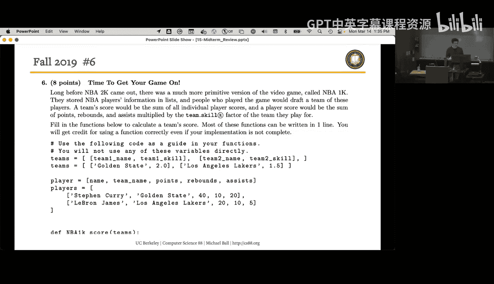

The solutionution up here， so actually let's go to。A fall。2019 all right。And。Okay， unfortunately， oh。

 I only have the solution， so I can't fully walk through this without。嗯。

WithWithout revealing the solution， so we'll just kind of talk to the solution in this case because I didn't have。

Time to find the。呃。Can't you collapse？

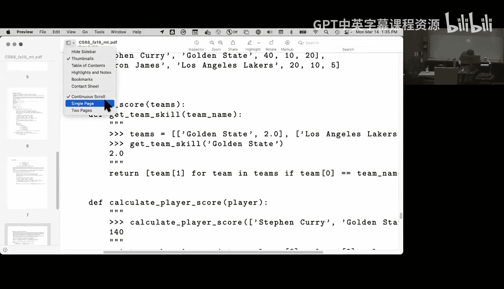

No， no。Oh， there we go， first thing。

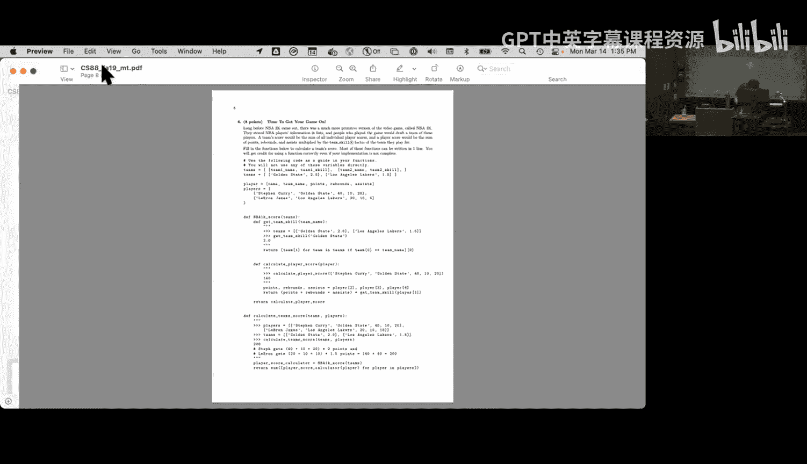

All right， so。嗯。So what what are we trying to think about for this and this one the higher function structure I will say is definitely a tricky setup so we have a function called NBA 2K or excuse me NBA 1k and this takes in a list of teams。

So again， a team is just a list of nested lists。Which have a string in a number。

We have a team called get team skillkill。And then we have a function called calculate player score。

And note that these are nested in the。The NBA 1 K score。 and。

 and I forget now what we let me actually see really quick if I can find。

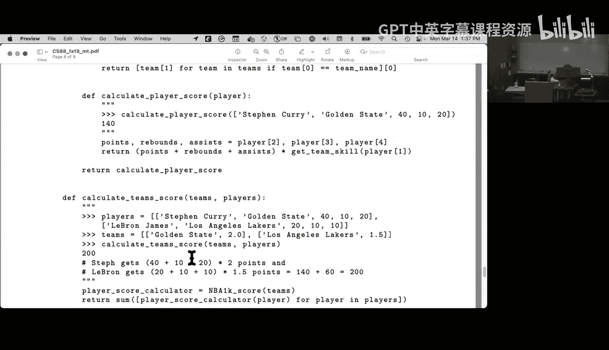

Do I have。

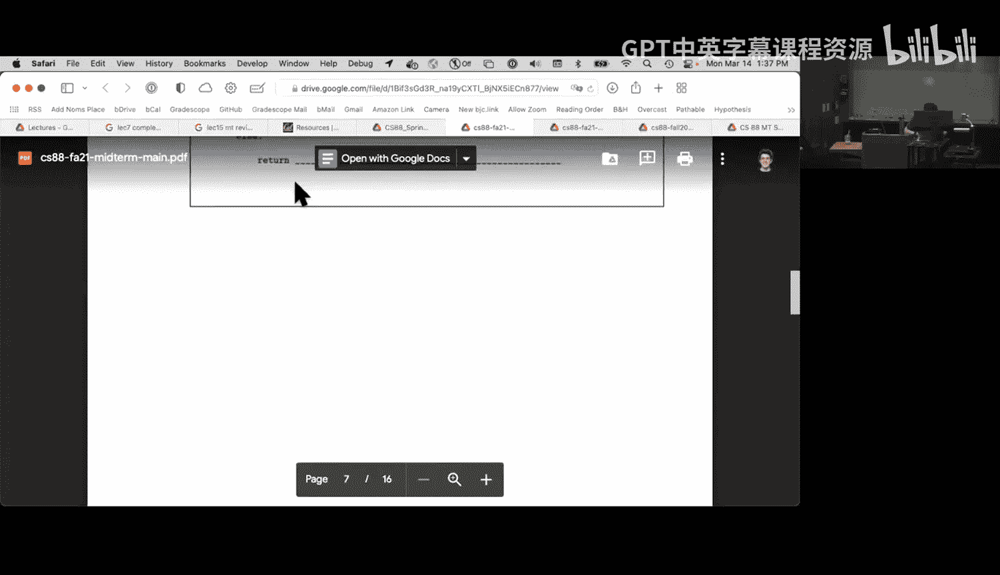

This is fall 2019 is the B version on the website。😔。

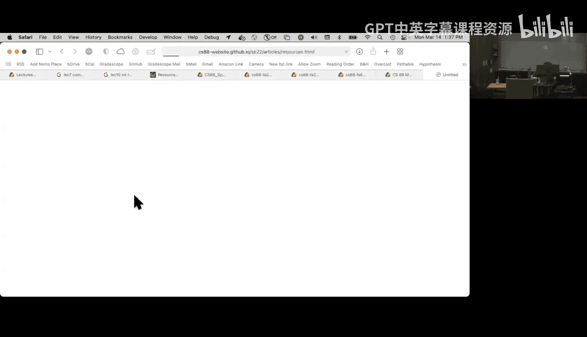

Oh good， we'd do the blank version on the website of this， okay。啊。嗯。So yeah， okay， cool。

 so what we've what we've given you to start with is。

A function NBAA 1K score note that this returns the function。

 calculate player score so we're dealing with lists and higher functions here and then in in the second part what we're trying to do is actually calculate the score for an individual for a team given a team name and a list of players and in this case we're going to set this up such that we do it in two parts where we find a player score calculator and then we'll have an additional function to return。

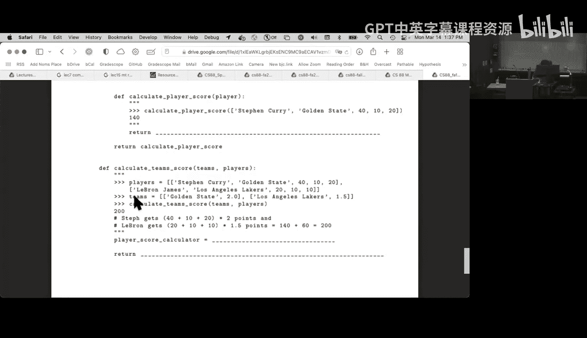

2。How would I approach a problem like this so one thing is to recognize that we're dealing with lists and higher functions and that the interplay between those two is going to be a little bit tricky for questions like this most in the second part and so what I would focus on here is how do we think about solving these first two parts of this question so again we have a function called get team skill。

And what we can see is that this function is asking us to do something which is。嗯。

Not terribly clever， but there is a little bit of a trick here so。

G a list of lists return essentially the skill for the item which is named Golden State。

 so if we put in Golden State， forget team skill。We have to return just the value 2。

0 and notice here that we're returning a single value。When we otherwise have lists of lists。

Because this is an inner function， we can access the data in our parent function teams。

And so this question we can write as a list comprehension。Where we say。

Return the team skill value if the team item one is equal to the team name。

 which is the argument to this function and because a list comprehension returns a list and we want an individual number back we have to return the first item of the list to sort of unnes it there are a number of ways to write this expression as well if you used filter and you return the first item of a filter instead of a list comprehension that would work totally fine。

There were， I think， a couple solutions that used reduce which is a little bit more complicated。

 but if you wanted to use reduce that would be totally fine and there were a couple people who did manage to sort of use a for loop and write it not in one line and you they basically found a solution that if you did it if you solve this question more than one line you would get partial credit for us like if you really need to and you can't write figure out the full solution you could write a for loop and。

系。You and solve the question that way， but basically any valid solution that was one line would get you full credit here and if you had a more than one line solution。

 you would definitely get partial credit。呃。So。The next part of this question。

 calculate player score takes in a player。And we have to return their their overall score。

 so a player is a string which has five values so that name。their team and their。

There are three points of system rebounds。And so to figure out this。

 we have to figure out what is the formula and again here the question tells us， let's see。

Where is this。So yeah a team score is the sum of all individual player scores and a player score would be the sum of points assist and rebounds multiplied by the team skill for the team that they play for so what we want to or our three values of our list are points assist and rebounds and then we have to multiply those by the team skill factor so now the question is。

How do we take in the data for a player， which is given to us？

And then figure out their team skill part of the way that we will try to set up questions is that you know on an individual or on a macro level of the exam while you can do questions out of order。

 you should definitely try and do an individual question in order from top to bottom because they do tend to help you think about breaking the problem down into inter componentsonents so。

Part of this question is fairly sort of fairly straightforward so the sum of points assist and rebounds or items index two。

 three and four of our list so we just want the sum of those the solution here took the step of assigning them to multiple values。

 we gave you two lines， you didn't even need to do this one and two lines if you didn't want to。

 so some questions we'll have a restrictions some won't but we have points assist and rebounds here。

And then the question is how do we get the second part of this which is multiplied by the team skill and what we should be thinking about is in the previous part of this question we just filled out a function called get team skill whoops this one which returns an individual number that we can multiply and so the question is we multiply some sum by some team skill how do you find the players team and their team is of course item index one of this list so in this case we just multiply these two values together so the first part of this question is。

Really about working through this understanding what is the setup what are the items of a list and to some extent just keeping track of which function takes and what arguments and if you've got that the individual logic for these two parts is not meant to be terribly complicated the second part of this question is where things get a little bit tricky questions so far on this question before we go on to the calculate team score method。

哎。So calculate team score。 So this is where the。呃。The idea for this problem gets a little bit tricky and there is a little bit of working backwards on how you might approach your question like this there's sort of multiple different ways to think about this。

 but what we start off again here is looking at the doc test we have a calculate team score method we taken in a team and a list of players or sorry we' taken a list of teams and a list of players so the same type of data that we've been working with before we can see that in in this function call here we have our two lists。

Teams as a list of lists， players as a list of lists and again。

 players and teams right they can be all sort of intermixed here。

This list includes players on different teams。And so if we say calculate team score。4。呃。

What happened？So if we say calculate team score for our list of teams and players。

 we're going to return this sum total value of all team scores so one thing again to recognize is what this is showing you is that we're doing some math here so。

We're summing up a bunch of things and then inside this function。

 the only hints that we give you is this thing called player score calculator。

And then a blank return line。The question is trying to set up is that we need to sum some data across some lists and in order to do that what are we trying to sum we need to sum the results of player score calculations and so the question is how do I figure out what a player score calculator。

Represents。And for that part， you kind of have to look at how do I calculate。

 you have to ask yourself so how do I get the。You know the ultimate result calculated score for for a single player and in this case what we have here is we have a previous function NBA 1K score and in there it returns a new function that calculates a score for a player so NBA 1K score how do we call that。

NBA 1K score takes in a list of teams。And。And this is the part where。

Taking a step back really just drawing things out with a set of hire functions can be really helpful so NBA1K score we pass in list of teams because that's what its function signature is asking for whether or not we should do something with an individual player right now is sort of before we figure out the actual solution you might sort of be wondering。

Now how do I figure that out Now the next step I'd say is okay we know how to call NBA player score with iller teams we know that it returns a function because this line was given to us called calculate player score and one thing that you might notice is calculate player score and player score calculator they are different wordings but they are communicating the same idea so in this case you know it's not an environment diagram question we're not trying to be pointlessly ridiculous and so you know the wording here is actually a hint that says these two ideas are are the same thing and so another question is how do I go from a function no quit。

How do I go from a function called player score calculator to the individual score for an individual player？

And if we recognize that player score calculator is the same as calculate player score。

 calculate player score back up here takes in a player。

 so we might need to do at some point in our function player score calculator of player so that gives me the sum or that gives you the total score for an individual player now the question is what am I supposed to do with the score for one player in this case。

Our goal is to to just sum up all the scores of all the players and that is。

That is the way that this question is set up。And so in this case， again。

 you could do this in multiple ways you could use reduce。

You could use some with a list comprehension， so some player score calculator for player in players an acceptable version of this would be map player score calculator over our list of players that would work correctly as well and then you could sum that up you could reduce with add instead of some there's probably half a dozen permutations of solutions that you could come up with for this question but one this one is definitely a little bit tricky in that what you have to go through and figure out is recognizing that you're summing overvalue to get those values that you're summing up。

 you need to use this question in the previous part and even if you got this part wrong you could still get the second half right just by sort of filling in the blanks of what the function signature。

And doc tests suggests。this is definitely one of the trickier questions there are like five or six pieces going on but that is how I would approach that one any questions on on the prompt far yeah in zoom chat yeah there's a question about the list but you' all figured it out so that's good。

Yeah， question on any questions on this problem？

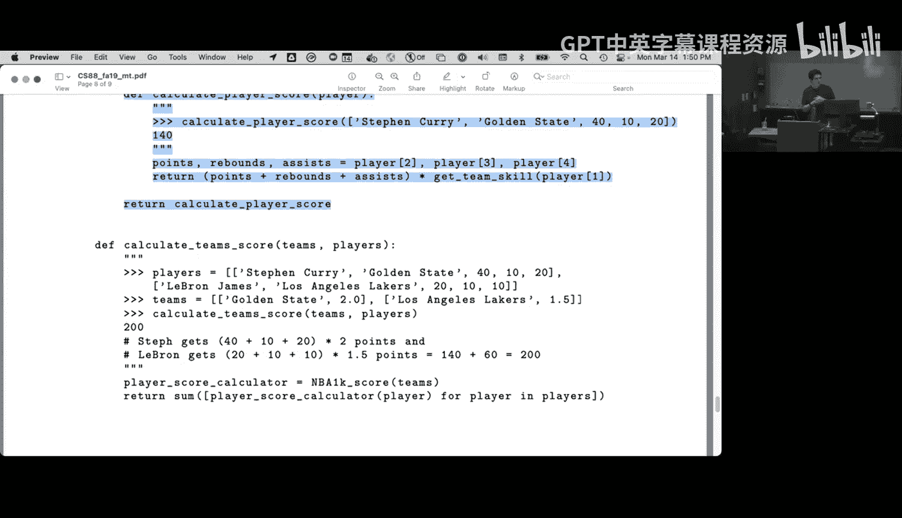

Cool so we'll do one more really quickly and if we have time we'll do a second the last question that I saw on Ed before lecture which was another spring 21 so this one fall 20218 C。

嗯。We're implementing a find new interest method that returns a string representing potential interest for this user to determine this interest。

 first identify the user's most similar follower that has the largest number of mutual interests with this user。

 then return a randomly selected interest from this follower。

 but be careful the randomly sex must not already exist in the user's interest otherwise it would not be new。

For this problem， you consume that the user's interests and followers are not empty， again。

 just setting up some edge cases that you don't need to worry about。

Note that the separate interest function。From the user class skeleton may be helpful here and it says you may use random dot choice of list to return a randomly selected item from a list so again this is just telling you that there's a couple things that you don't need to worry about there's a couple places to look for help。

And this is another piece where on an exam， we're saying you need to pick a random item from a list。

Picking a random item from a list is not a terribly hard thing to do is evidenced by the fact that we can just call random dot choice。

 but that's not something we expect you to memorize so often on a midterm there'll be one or two places where we say use this function' here's how to use it but it's not something that we expect you to know random dot choice I believe shows up occasionally in a couple like one place one or two places and maps it'll probably show up in the ants project but。

Again， the point here is here's how you pick a random item list。 We told you about it。

 your job now is to go and use it。 So let's actually look at the rest of。

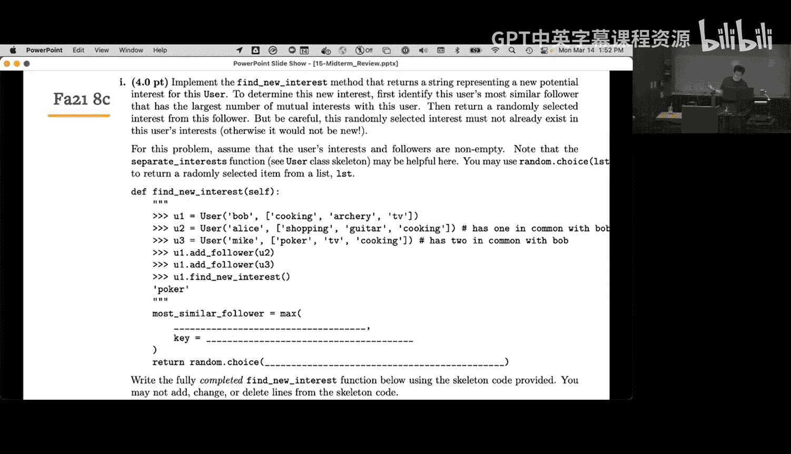

Of the question from fall 2021。Do I not have， okay。Fall 2021。So。😊。

This question is definitely a little bit long， so i'm not going to go through all of it right now。

 but what we what are we trying to figure out here so。

This question is definitely a pretty tricky or pretty involved question so we have。

Users where we're working with followers and we're trying to find sort of the intersection of things like interests。

The thing to always remember is what is the class that we're working with and what are the attributes that it have so user has a name interests and followers which are lists。

 what are followers a list of。They should be a list of other user objects。

So as we're thinking through this， just trying to think about what are the methods that exists in our classes。

嗯。And。And then we have some methods， so we have ad follower mutual interests。

 separate interests and this is a case where。And in part C we have fine new interests so as we're thinking through this there is a note here which says the implementation for separate interests is not shown。

 but we can assume。呃对。That this function takes in another user object and returns a list containing all of this user's interests that are not shared with other users。

Again this is a case where we're telling you here's a function here's how it works。

 you can't necessarily know how it works and you just have to sort of think through its its function call and then use that function so in this case。

Again， I think this question is a little bit easier if you take the time to do A and B first。

 so each of these。And B are really only a couple lines。

 but they get you in the process of thinking about what this function looks like。And then。

And now we have to work on find new interest。In this case。

 here's another good example of using higher order functions。And lists of data。

 and this happens to correspond with。嗯。😊，呃。呃。With an opportunity question。In this case。Do we have。

So when we did this question， I think last fall， we more explicitly talked about using the key argument to functions like Max and min。

So I don't think we've talked about quite this one quite as much as an example。

 but I do remember that was a little bit more emphasized last semester。

 so what's going on here is we have we have to find a most similar follower。

And then we have to return a new interest from that most similar follower and what I'd say here is even if we don't understand the max call right now this question is set up again where there's sort of two things that we have to solve for right we have to find a new interest and then we have to find the person that is most similar that we would then pick the interest from so we've given you the variable most similar follower so the first thing that I might actually do in solving this problem。

Is to figure out。What is the return statement we've told you that random do choice will return a random item of the list。

 So now the question is what list goes in。You know what list goes in inside here and we know that it should probably be something based on a most similar follower。

And what list of that well what list from the follower it's a list of their interests so we need to figure out what what interest should we suggest the text here suggests that we use this separate interest function。

So right here we probably have most similar follower dos interests and do I actually have。

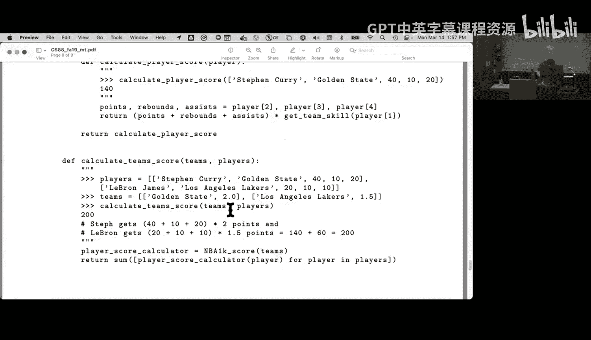

The solutions for this one up， no， I do not。

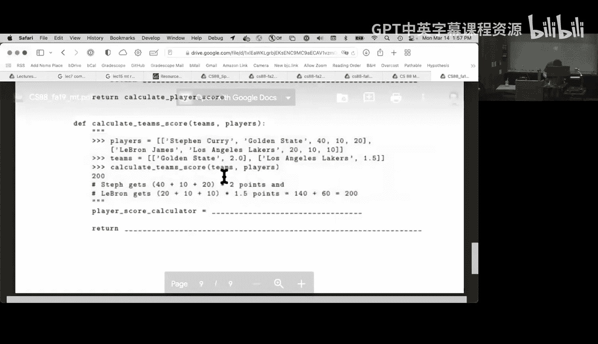

。So we'll pull these up here。😔，啊啊啊。Just so that。哎。

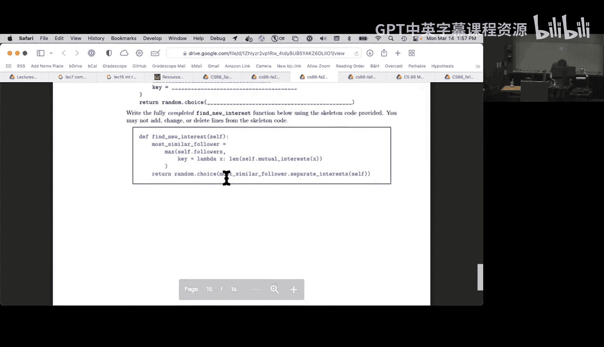

So for oh gosh。

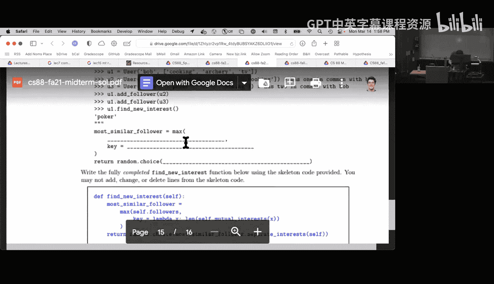

嗯。So in this case。We can figure out that the return statement in this case is correct。

 so how do we call this we call this on most similar follower do separate interests of ourse we could call self separate interests of most similar follower so again even in a constrained solution like this。

 there are more than one ways to make a call you know using object brand programming using lists and so on。

And the final bit is how do we figure out this max statement？

How do we figure out what who is our most similar follower and this part is the trickiest part of a question like this is you're using object any principles。

 but you also have to figure out sort of the pattern and I think this is a good example of using higher order functions。

And lists of data in sort of different ways。Our most similar follower is a person that has the highest number of shared interests if we think about the functions that are exist in our。

What do we call in our class then we do have this function called mutual interests that returns a list of interests if we say that the most similar follower is based on the length of that list we can write as a key to a map or excuse me a max function select。

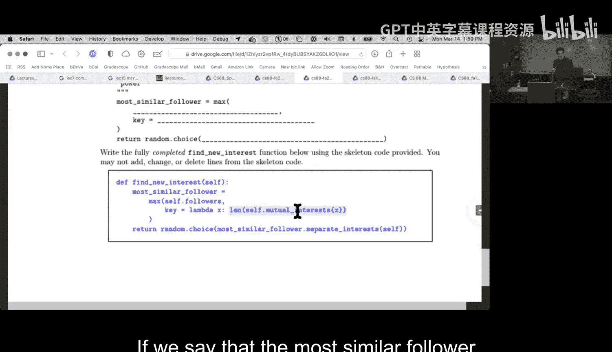

A follower。Who's？Where the length of the list is the largest value another question is what list do we use and again we would look at our class to figure out what properties give us a list of followers in this case self-dot followers again for this question what I'd say is that like this line right here was probably one of the hardest bits of the entire midterm last semester so if you got anywhere close to that you got partial credit if you just got self-tht followers if you just got part of this line or most of it you would get partial credit for that but this question right here like every midterm has one or two bits that are definitely harder than the rest thinking through the logic of taking the maximum of a list based on another list and a lambda function is a is a pretty involved concept so yeah this question is probably one of the hardest in the list and that's hopefully a helpful way of approaching these things。

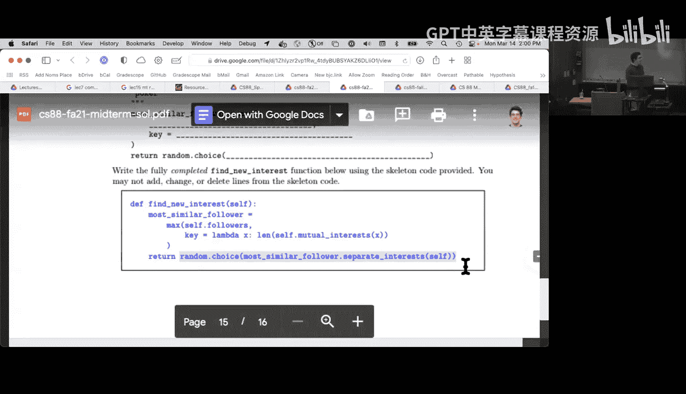

Yeah again reminderer no lecture Wednesday， you know midterms are late so go get lunch if you don't normally get lunch。

 take a break， rest up， but good luck and we'll see you at the midterm and again please do wear a mask if you haven't wearing a mask because you'll be enclosed space for a couple hours but。

Don't stress too much Yeah， good luck everyone。

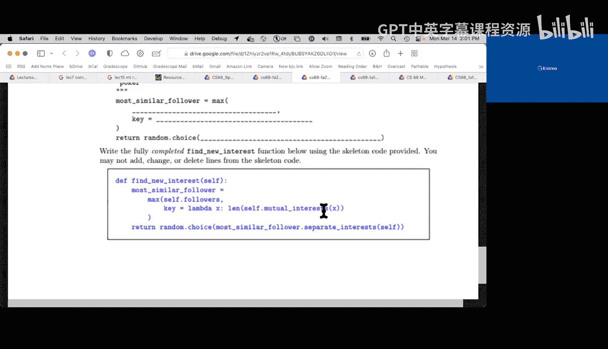

Thanks everyone on Zoom。

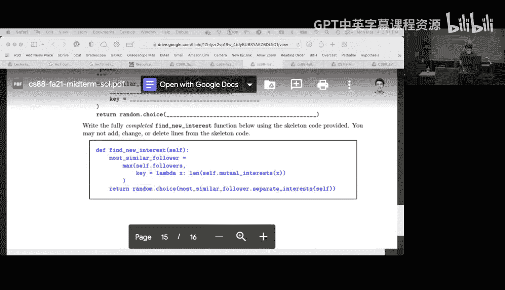