# UCB《数据科学中的计算结构｜CS 88 Computational Structures in Data Science 2022》中英字幕 p16 CS 88 Spring 2022 - Lecture 16 - 3_28_2022.zh_en [BV1516iBfEVY_p16]

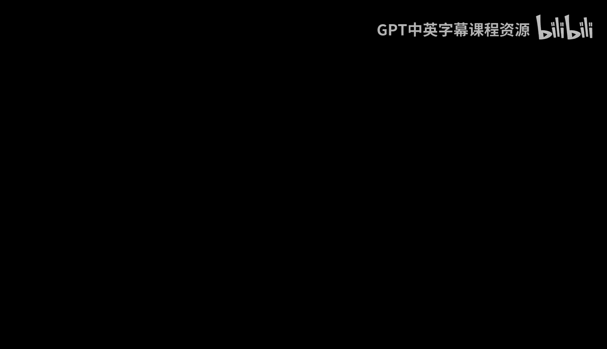

All right， sorry for the delay， our faculty meeting。Went a little too long。So let's get this。Set up。

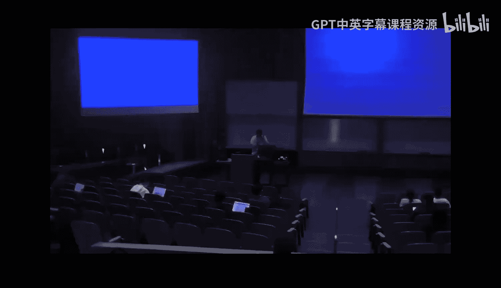

All right。And one。Tastic。Okay。Okay。Hey， what about。Okay， so。No， I like week 15。

 everything will be easy and then will' be time for summer。So。

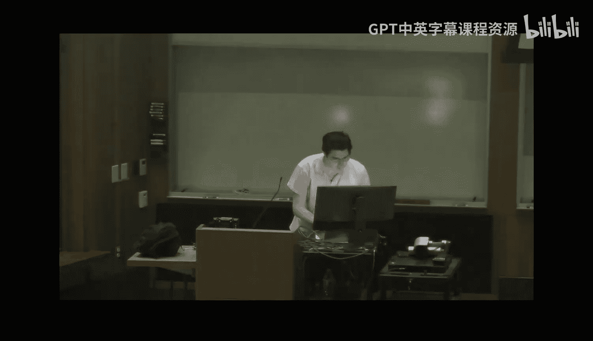

How this is going to go？All right。

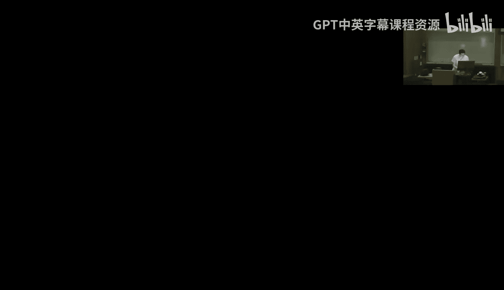

IThink Zoom can see everything now。's that？是。Yeah。All right。

 so before we get into sort of lecture today。These slides should be updated on the website for those on zoom yeah I think they're there I so I just want to coming back from spring break we have about five weeks left of class。

It's definitely。You know I think sort of that home stretch for everyone and so in CSA8 right now what the last few weeks are going to look like is one thing is the ants project which you may have heard about it's the same project that CS6 Boai does a little bit earlier in the semester we do。

Basically the same version of that project that will be out in I want to say。Next week。

 maybe late this week， but you'll have a couple weeks to work on it again in partners if you'd like。

 but that' will be a tool to practice object oriented programming。😡。

And it's a version of the game plants versus zombies。

 but really just to give you a sense of building a project that is a little bit larger that has multiple files where part of the time is reading and understanding the code as well as practicing with object relateded programming what we'll be doing today we're going to tie up a few ideas around data types in mutability and functions。

 mostly what we're going to do today is formalize some of the things that you've hopefully seen so there'll be a little bit of review at times and then maybe a couple new ideas。

In the next few weeks we're going to go into some of the other big ideas in computer science。

 so we're going to talk on Wednesday about efficiency。

 sort of how do we understand how fast our programs are without necessarily using a stopbox or why we don't want to just use the stopbox then after that we're going to look at things like linked lists and trees which are two types of data that we can build using object oriented code。

And in particular， these two topics are things that are really useful if you're interested in going on and taking CS6 to B so just sort of setting up。

 we're going to keep practicing with object trended programming。

After today there won't be too much object stuff today just a little bit and then those topics sort of lead into CS6 and B so if you really think you enjoy the next couple weeks that that sort of could be a sign about where to go with data science or computer science and then finally the last couple of weeks we're going to transition and talk about。

😊，Programing paradigms， sort of how we think about styles of code and then why learning SQL is useful and important and how we can think about a language like SQL and of course。

 if you hadn't had the chance to use SQL yet SQL is perhaps one of the most useful and important tools when it comes to doing data science of various sorts and I see that the zoom camera is。

呃。Messing up so we'll switch that but yeah the last couple of weeks we'll transition we'll talk about SQL learning how to write and read and do some stuff with sQL is a pretty useful tool it's not the main topic of CS88 but it is something that sort of fits into this idea of Python is but one of many types of programming languages SQL is another and it happens to be particularly well suited to data science so that's where we' go。

Today we're going to take a little bit of a step back and talk about things that you may have implicitly seen throughout the semester。

Some of these things you may have seen know as early as like。You know a couple months ago。

 what we're going to talk about mutable data and what we mean by that are things like lists where the data of the contents of a list can change。

 but we still have that same name with in Python with updating data and so what we want to distinguish today is between。

😡，When we are。Modifying an object like a particular list versus when we are returning a new version or a copy of that list。

 there are hopefully a couple places in the Mas project that you all did where we kind of just avoided this by always returning copies of list or when we use the Python map function or list comprehension we always return a new version of a list and so what today want to do is talk a little bit about when are we modifying a list and when are we returning a new list and how do we distinguish between those。

AndIn particular， this seems like a little bit of a subtle thing。

 but we're going to talk about two very specific Python operations， one is called is。

 and one is called double equals or just equals which you have probably used。

 but talking about why those work the way that they do。

Just for a little bit of review right an object is sort of this bundle of both data and behavior。

 we have a car that can have methods and attributes， lists are objects in Python。

 they have a bunch of behaviors like append extend sort and of course the data that is contained within them。

 each object is of course a class。And everything thing that we've used in Python so far some kind of object so strings are built in object lists are built in object。

 tuples are built in object and so on all of these things have attributes and then we use of course methods。

So。Objects generally fall into two types of categories and this we haven't really talked about before。

 but we may have implicitly seen is some objects are mutable where we can change that value without changing or without creating a new version of that object and oftentimes we don't necessarily need to think about this when the write code but as programs and projects get larger this will become more important and when we say something is mutable it means that we can change those values of that object without reassigning it without using a new equal statement。

And we have immutable objects， so these are objects。😡。

Like we'll talk about a string where if we want to change the value of that string。

 we have nothing else to do but to say name equals and reassign name to a new value。

And in particular， we're going to explore this idea of an identity。

 which will hopefully sort of explain。Some of the ideas behind what the opaque numbers at the end of python's strings or python's output information look like so this is a string right it's called course CS88。

We can do a bunch of things with that object， some of these we probably have seen before。

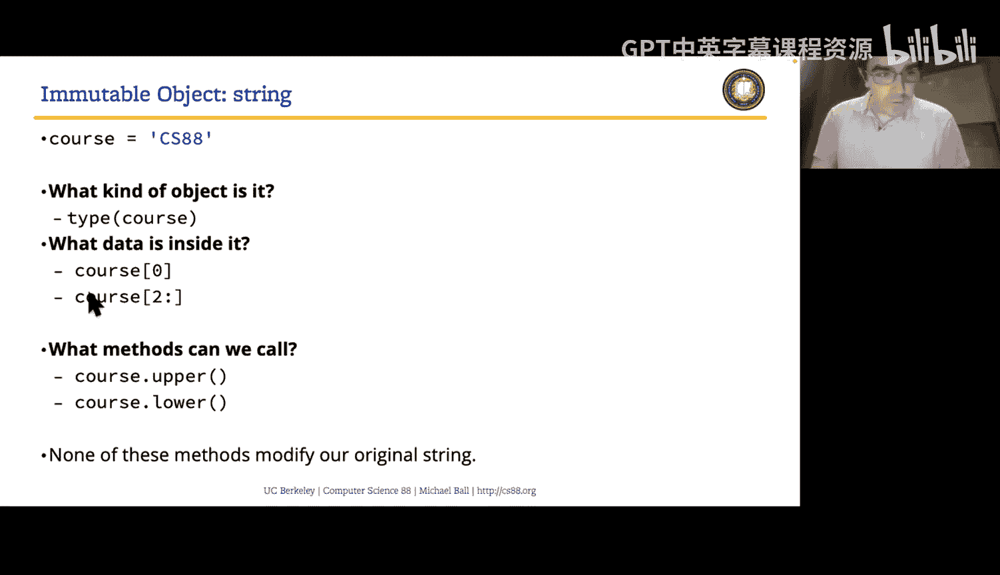

Others， perhaps not。But if I go over here and say Python 3， right， course is equal， oops。

 if I say equal to CS 88。I can always ask for the type of something。

 this is a function that we don't necessarily explicitly teach about in CSA8。

 but it's super useful to be aware of what kind of class is a thing that I'm dealing with。

 everything in Python has a type。I can ask for the type。Of like 100 tells me that it's an integer。

 very useful tool a wall debugging。But what this also perhaps will tell me are things that I can do with this type。

 so because this is a string。I know that I can do things like slice it。And I happen to know。

Perhaps that wellness case calling the upper method won't be very interesting。

 but it could perhaps say course dot lower and it will change it to a lowercase version。

 strings of course support a bunch of methods that might make sense for dealing with letters right uppercase lowercase and so on。

 there's various forms of title casing even if you want to deal with text。

But one thing to know about strings is that they are immutable and what this means that every time we modify or we want to modify a string。

 what we're doing is we're creating a new version of that string and in the interpreter。

 it turns out it's a little bit hard to distinguish two things that look identical but are in fact different。

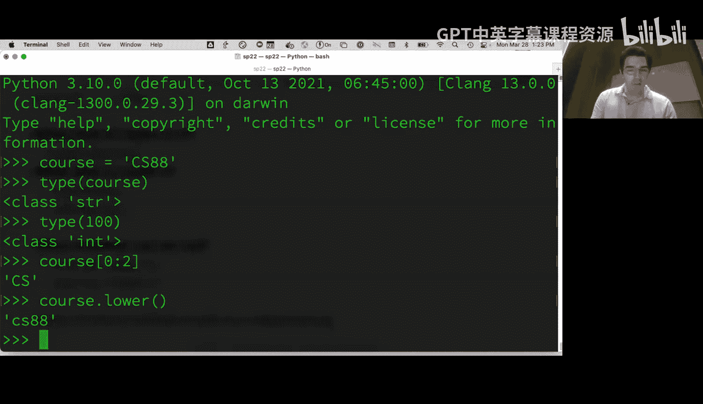

We're going to explore this by distinguishing between some different types of data so up until now。

If。I。So actually， before we go on， actually let's just demonstrate this right if I say course not lower。

😊。

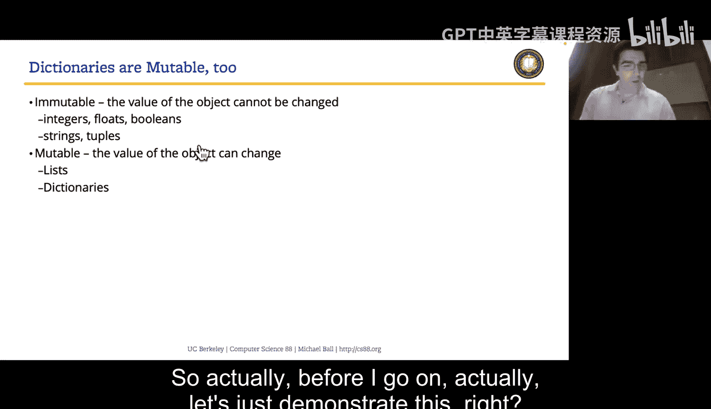

And I check the value of course， we can see that course is still。

The capitalized version of CS88 if I want a lower case version of that。

 I could say course is equal to course do lower。And。In this case。

What we get back is CS88 lowercase like we would hopefully expect based on the previous examples。

But the question sort of becomes。What if？What if reassigning or rebinding this value to this name course is something that we don't want to do？

Or what if we have a ton of data like a list where maybe making a new copy of that list is just prohibited for some reason。

 maybe it's like thousands or millions of data points in some kind of set。And so far in CS88。

We've set things up that you can mostly avoid。

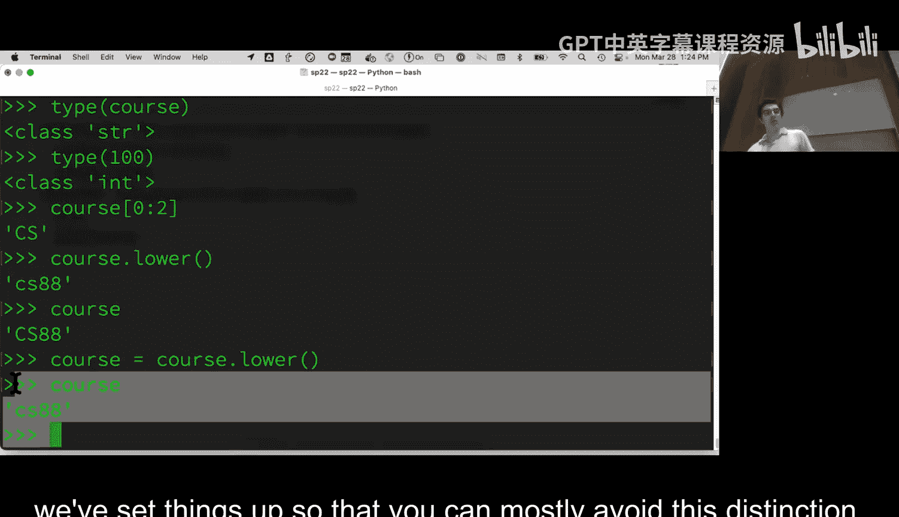

this distinction， but today we're going to look at are the fact that most of the built in stuff that you do in Python so that's strings。

 integers， floating point or decimal numbers bulloles and two poles which we don't use a ton。

 but we've seen in places all of these things are immutable which means that they once we've created them the only way to change that value is to reassign the name and we can think of this。

I sort of what happens in Python tutor， it's not a perfect example。

 but things that typically go you on the left side of the frame as a distinct value。😡。

Those things tend to be or those things are always immutable and when they're on the right hand side where we draw an arrow to them。

 some of those objects are mutable， some of them are immutable。

 but we'll see examples of how to distinguish， but for now we're just going to have to sort of tell you what things are mutable and immutable and the two primarily mutable objects that we work with N88 are lists and dictionaries and what this means is that once we've given a name to something we can change that value as much as we want without reassigning the name。

😡，Yeah， oh and a question in zoom can I explain what the the the function lower does so lower is。

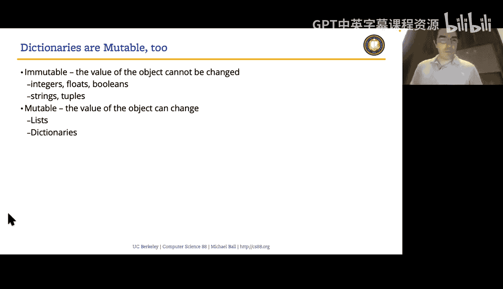

呃。Well， actually let's just I already lowercase this string。

 lower is just a function that exists on a string。That simply takes capital letters and turns them into lowercase versions of letters it's not something you necessarily need to know or memorize。

 but just to illustrate that each type of data in Python has a series of operations that perhaps makes sense for it right there isn't necessarily a lowercase method for a list because what is the lowercase of a list we would have to know something about that list so。

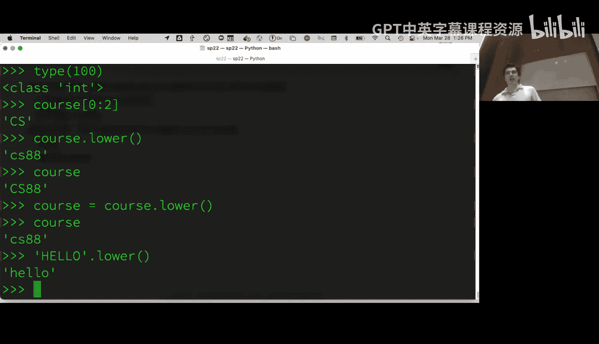

So what do we mean by saying that lists can be mutable and immutable well or that lists are mutable and other things are immutable primarily what this means is that if we take a list of something in this case。

 a list of numbers， we could say 1234。Of course， we can access values by slicing。

And what we've seen before perhaps implicitly right is that we can say a list in this case index two is equal to some random value like elephant。

 why you would to replace the number three with elephant is beyond the point of this lecture and we get。

😊，A version of this list that has the numbers one， two， elephant and four。

 but importantly in doing this， what we we haven't done is we haven't reassigned the list itself。

We've just modified that compound set of values， a list is the same list that was defined up here at the top。

You've probably done this a little bit more with dictionaries in some of the labs so just to illustrate the same way that in a dictionary。

Where we have both a key and a value， we can add an update keys where if we。

Insert or delete keys in a dictionary。That's something about dictionary support。

 we can change the value。Of a key itself， so if I just want to change any particular value dictionaries give us lots of things that we could potentially modify。

 but in both these cases，Without reassigning the name。

 we are able to modify the contents of those objects。

 so before I go on any questions sort of about these these two types of things that we've been able to do to lists or dictionaries。

CoolSo。We've already seen most the dictionaries， but just to point out that with any given type of data right。

 there's a whole bunch of things that we can do， we can construct them， we can select data。

 we can operate on that data。And our mutable objects will have types of functions that we can classify as things that mutate or modify that data in place。

 so in a dictionary。That's again our bracket notation。

 there's also methods like set which we don't necessarily use very much， but they exist。

 so dictionaries have all of these types of functions。Now， it turns out with a string。

 it's a little bit hard to to show something that doesn't exist， but if we。呃。

If we were to try and you kind of just have to trust that， you know， perhaps。呃That。呃。What。

Yeah what's sort of on the slide here that this is a more fundamental limitation of something。

 but in Python， if we ever try to mutate data。

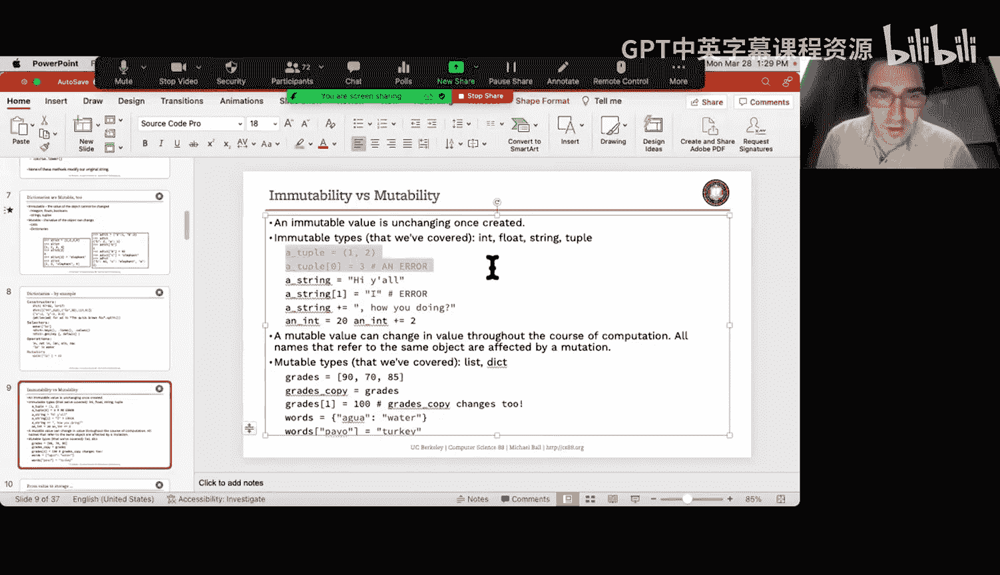

That。An object doesn't support we get this error back so。In this case。

 it tells us that it's a type error， so this is a tuple the Tupple object does not support item assignment。

 which is really just a way of telling us that we can't modify something like a tu's value in a string we could see the same type of action。

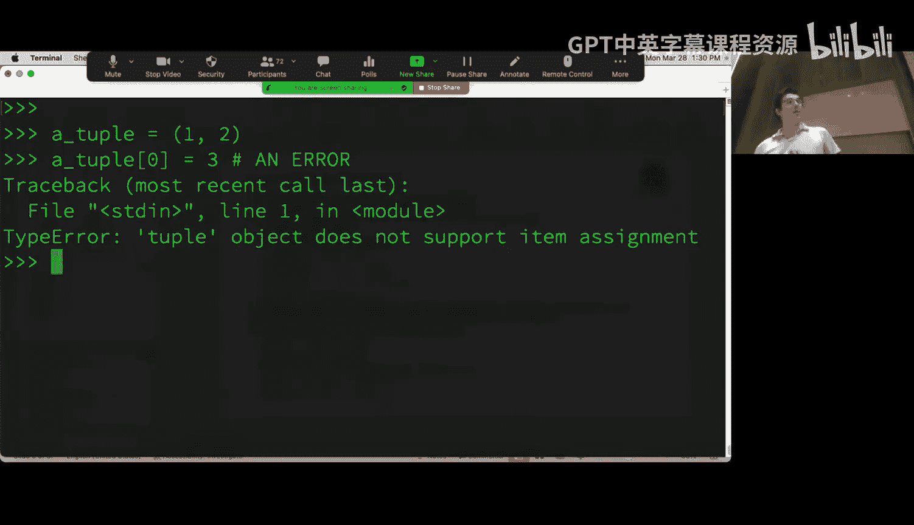

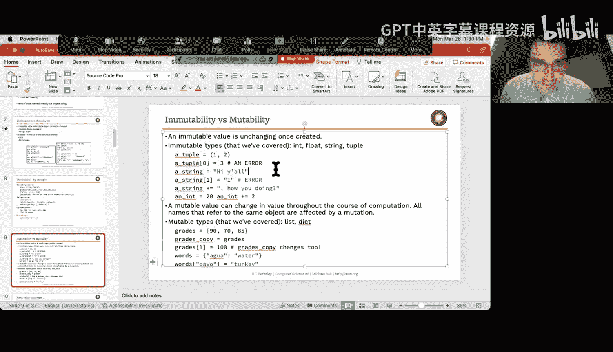

In a slightly different way。Where。If I take this string， I try to assign some value to it。

 I get the same here telling me that something doesn't support item assignment and if we think about objects and object render programming Python。

 this is because the way that Python has set up their objects。

It's sort of built into to the fact that we can't there is no function to call。

 which lets us assign some value， of course。This is where things get kind of interesting in Python。

Is I can now do something like a string plus equals but in this case， the string， how are you doing？

And in this case， when I get the string back， I have a new version。Of this strain。

And what Python has decided here to do is to return an entirely new version。

 remake that object behind the scenes and。What we're going to do now is use some tools that Python gives us to sort of demystify what's happening。

When we do something like this and。In particular， I'm going to use this example of plus equals a lot because it can illustrate in Python where there's some really unexpected edge cases when it comes to lists that modify lists that that you might not expect so when we're dealing with the string we don't ever think about the fact that we can't。

when we say a plus equals B with a string we just get a new string back it combines two pieces of text together。

 it all works probably like what we'd expect when it comes to lists immutable data the behaviors will start to get a little bit a little bit more interesting and so I'm not going to run through all of these。

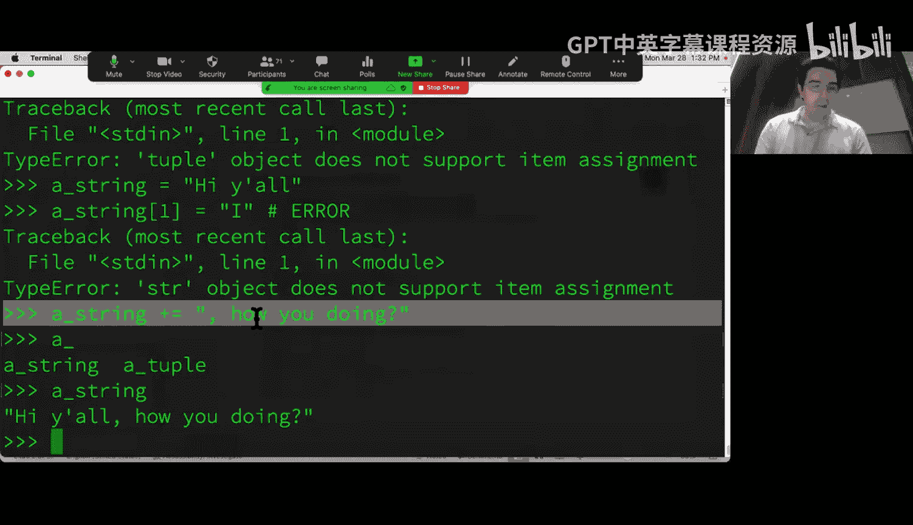

But those work the same way。JustHide this for a second。So in Python Tudor。

 this is sort of a very rough representation of what's happening。呃。🤢。

Or sort of a different view of the types of things that you might see in Python tutor。

 but we always have this idea of some frame right and our frame maps。

A value or excuse a name in this case x to the value this case a list one2 and three and on the right hand side we usually draw an arrow to things like lists that we say are compound types of data so this list is a representation of the items one to and three and they're shown separated this way just to make it a little bit more clear as we modify things what might happen and if we say y is equal to six in our frame because y is a simple primitive value。

We say y is six， we just draw the value right inside the box。

But as we go through now we start to use operations like x of1 is equal to y what we end up doing is in Python tutor we can replace the value on the right hand side with whatever was on the right hand side of our expression so in this case x of1 equals y that means x of 1 is equal to6。

 so we take our list and Python internally without ever making a new X。

Without ever making a copy of this list， it just changes one single value and if we have three items。

You sure Python could make a copy of the list， but you could imagine why if I had a lot of items that might be a little bit slow。

 So what Python gives us is a whole bunch of tools to modify。Are lists in place。

 And you've seen some of these in lab。And so in this case， we'll go through。Just a couple of。

Brief examples with Python Tutor。So we're going to start at the beginning。So in this case。

 we have two lists。Right， S and T。As we append to the list S， we go from， let me just go back。

 oh sorry， those two main steps back。We have our two values。We append， we can add a value for again。

 that just inserts a thing on the right hand side。Now， if I say S dotta pen T。

Notice what happens here is the last item of the list。Instead of being inserted at the end。

 we have a pointer to。To this item， and if I now say t equals zero。

This is where Python gets a little bit tricky in what it's bitten doing is t equals zero takes that step of reassigning the value T。

In in our global frame， excuse reassigning the name T to the value zero in our global frame but。

S still maintains this last bit of its list that is this inter nested list and at this point reassigning T doesn't change that pack so we're not modifying S we're still only ever modifying。

This value T。But what's happening here is that when we work with lists。

 the rules at which Python uses。Tend to be。A little bit。嗯。呃。

I should I say they tend to be a little bit obscure or a little bit invisible and that is as that item exists at the end of our list。

 Python's not going to modify it we could verify。What happens？In X。喂，等。Okay， that's the same link。呃。

嗯。喂。哎。Okay， I'm going to skip this example and pixel the slide later。

 but what I would show here is that the extend function in Python。

Also works in different ways is that extend takes a list and deliberately makes copies and one of the things that you'll see with lists and Python。

Is that the objects and the types of functions that Python has defined really distinguished between whether we are making copies and whether we are modifying something in place。

Here is。呃。Here's another good set of practice to this one。Should give us a sense。

Of you know what's going on here and this is something where you'll see code that works like this fairly often and hopefully the variable names are not as deliberately opaque。

 but S is a two item list。T is also a two item list。And if we say S dot pop。

 we reassign T and the P method because it modifies a list。Pop。

If we just look at the list S in last step is2，3。Pop just removes the last item of the list and returns that value so again in this case we're just eras T。

We're not actually。啊。Doing anything useful with the fact that it was a list before because we can reassign them。

 but our S stop pop method。Takes our list S and it does modify in place without ever reassigning that。

What I would say for it。Some of these examples is the important thing is to be really careful with。

How and when we modify lists， I'm not going to go through the remove example。

 but remove is just a different function that will instead of removing the last item。

It finds the value and removes something that is equal to that value。

 so these are all methods which take a list。And they allow us to modify its value。So。Okay， thanks。

 Python Tutor。Why。Why does this example work？😔，All right。Fun。

 I'll have to figure out whether those don't work。嗯。

So our first example in the slides it's probably fine we don't need to run through it， right。

 but this is if we are。If we're just dealing with numbers。

 we always replace our values on the right hand side of the frame within our frame when we start using lists and we start assigning two subsequences of lists。

 it's really important to pay attention to where each arrow points and to what thing are we are modifying so in this example more so that the second one doesn't work。

 the important thing to note here right is that X and y now point to。

The same exact list on the right hand side so if we modify x we modify that same list。

 if we modify y， we also modify that that same exact list and so。Let's see well this。

Will this one work。So that is one thing to be aware of。Actually。

 before I talk about this strange case， which is today is a lot of strange cases of how we work through and think about lists。

 does anyone have any questions on just this idea of modifying this data in place or about an example that。

They could see。Any questions on Zoom so far？啱啱做嘢。All right。Our next example is to talk about。

What happens when nest mutable data inside mutable data。 So what I've told you before is that。哎。

If I were to。Let's say。Write something like T。Of two is equal to。Well， let's just say 99。This line。

Right here， right？T is a tuple in this case， if I try to assign a single value that would air out。

 but what happens if I stick a list inside of a tuple we'll notice on。Our environment diagram， again。

 we have arrows with things that point to other arrows， so our tuple。Is。

T on the right hand side we have two values one and this other thing that's a list in the past we haven't paid quite as much attention to the fact that Python writes the type of data or excuse Pthon tutor shows us the type of data whether this is a list or TL when we're specifically looking at notation。

 this can become really important。So we can't assign a value， but if I say t of one。

 so t of1 should be this list right here。Be zeroth value。We'll now update 299。

And the second value can update two problems and this just illustrates the fact that what python gives us protections from from changing data within a tuple。

 it doesn't extend those protections sort of deeply nested if I stick a list within a tuple。

I can still change that list if I stick lists within lists， of course。

 well lists are always mutable but I can mutate the inner list separately。

 I can mutate a list within a dictionary separately from just the dictionary itself。😊。

And when we build our own classes in the ants project。

 you can mutate the attributes of those classes independently from one another。

 so this is something where。哎。Hopefully in cases sort of outside of CS88。

 this is not something you need to encounter too often。

 but it is something worth being very aware of that as we deal with mutable and immutable data。

Python will let us do things that can be pretty dangerous so all of this leads to the question how do we know when something is the same as one another and。

For this。

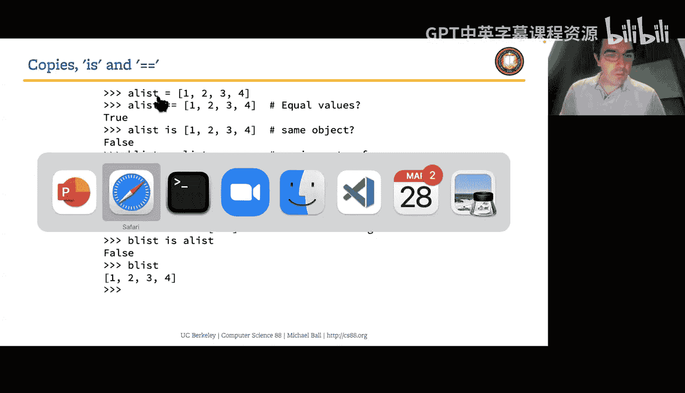

I'm going to open up。嗯。Our。

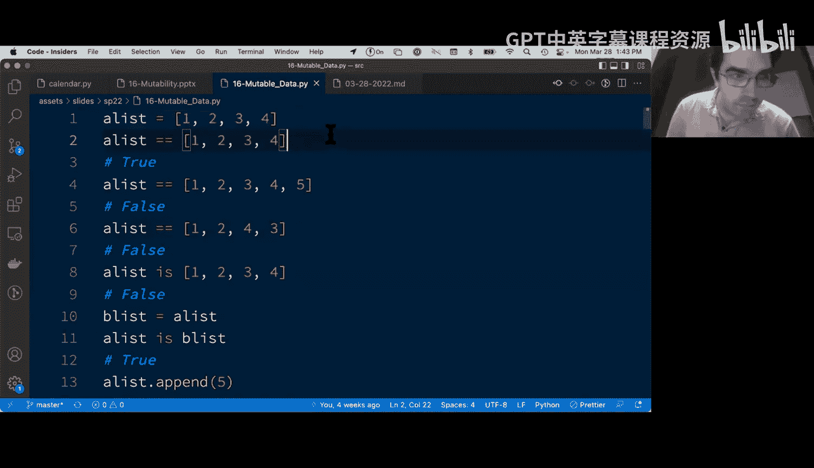

The example for。呃。The example file for the lecture and figure out that that did not copy everything that's good。

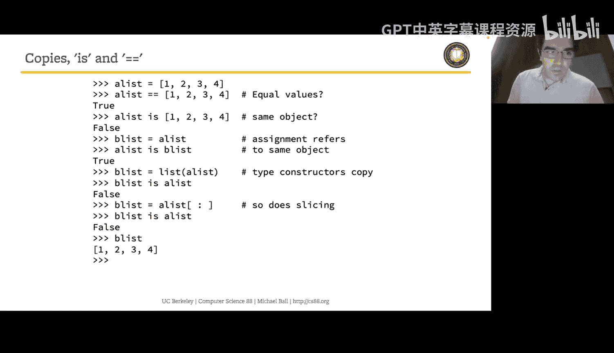

So。So in this case， so far we've seen the operation rate， a equals equals B。

 it tells us if two items are the same thing。And this for the most part should be pretty straightforward right。

 we've got a list one， two three four on the left hand side， we've got a list of 1。

2 three4 on the right hand side。And the equality operation does what we want most of the time it tells us are these two things logically the same do they all have the same values or the values in the same order now the question is now that we've been talking about memory。

And that we've been talking about things that comm mutate。Is。Let's touch。

Do this now we have an object or a name called B list。 And I can ask， does a list。

Equal equal B list and of course， because they're both the list one， two， three， four。

That should make sense。The question is， if I add some data to a list。

 if I say a list got extend of some value or a pen of some value。

 will it also modify B list and if we only have this this simple code sample we might have all reason about it。

 but what Python does is it provides us，This function called is。

And the is operator will tell us in Python Tutor， essentially。

Do these two things resolve the same exact object or the arrows on the right hand side of our Python tutor frame pointing at the same value。

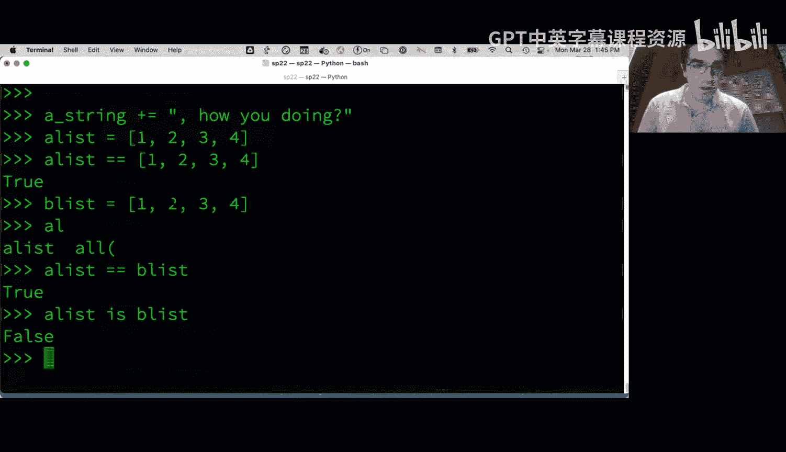

One way。To look at this。Is。

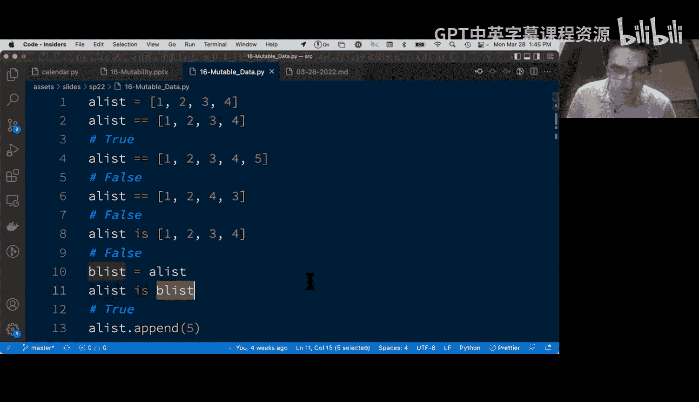

If I go over here to our Python tutor。And。We're just going to step all the way to the end here because there's not too much going on。

Okay， actually wait， let me， I skipped one step ahead。Because we don't want line 10 yet。

So in this case we have two sets of lists。Did I not， oh， I see what one second？

So let me do the example that we did in lecture first so B list。Is equal to。1。2， three，4。

Now we'll go to the very end in this case， the is operation is just going to tell us。

Are these two things pointing essentially at the same arrow is the thing on the left hand side of is the same thing as the right hand side of our I function？

And what this means is that if I modify a and I modify B in this case。

 i'm going to be modifying two different things now stuff gets kind of tricky when。

We start arriving at the fact that things can resolve to the same name。Yeah， so。So let's see。

 let's close that。😔。

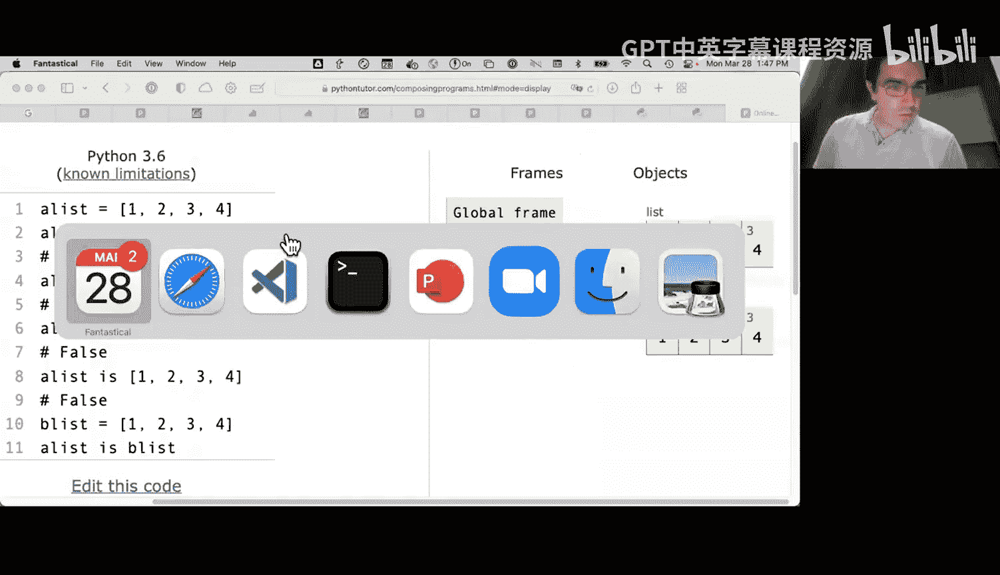

So one thing to note about lists in Python and this is something that。

It's just a little bit of a tricky。诶。Sort of peace to be careful about， but usually doesn't matter。

Or's something that you can usually avoid， I shouldn't say doesn't matter because it can matter。

 but this is something you can usually avoid， but is' worth being aware of lawyer practicing Python using the interpreter is that if I say a list is one。

 two， three，4 the result here can be a little bit unexpected is every time we have a new list in Python where I say。

You know， open square bracket close square bracket。

 this is a new type of a list object if I say something like X。

We can imagine this it's the same as something like x for x in range 1，5。Of course。

 you can't necessarily see that。That is the correct list， if we say。

Equals equals they should be the same and what we're doing here is we're always comparing if I modify one thing on the side do I modify this thing on the other side so yeah question zoom so is is the way to keep track or is equal way to keep track if something was mutated without making copy yeah this is a really good question is is there way to see has something been changed。

Without making copy and it turns out that in Python， can I， how do I know？

You know how do I know if a list is no longer one， two， three。

 four it turns out that if you look in the Python documentation， I don't remember offhand。

 every class keeps track of a bunch of attributes。And every class supports sort of customizing the methods。

 so you can in Python inspect the internals of an object like a list to determine。

Whether or not some method has been called， so I can write a function， I'm not going to do this now。

Right， but I can say a list that are 1 to five。A list now has value5 at the end I can conceivably have some other code running that checks whether or not this's append happen but in practice it's really tricky to do that。

 so it is most often easy to maintain a copy of the list if it's something that you really care about。

And as I do this in this case， now I've modified a list。I have。Our B list。

 because B list was equal to the list， one， two， three， four。Originally that hasn't changed now。

What we did mention before， right is。The line that is on the slide right here。

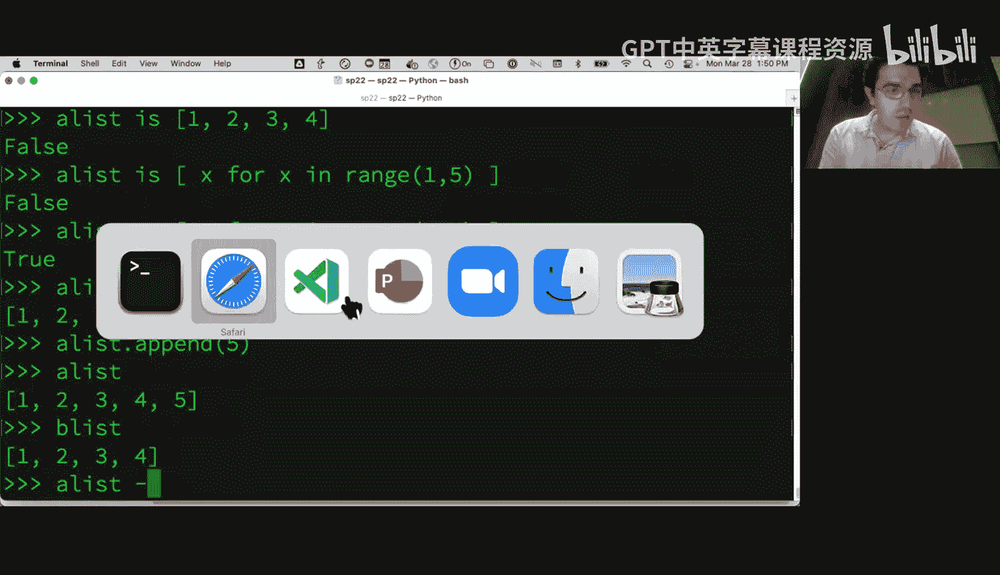

If I start to say。

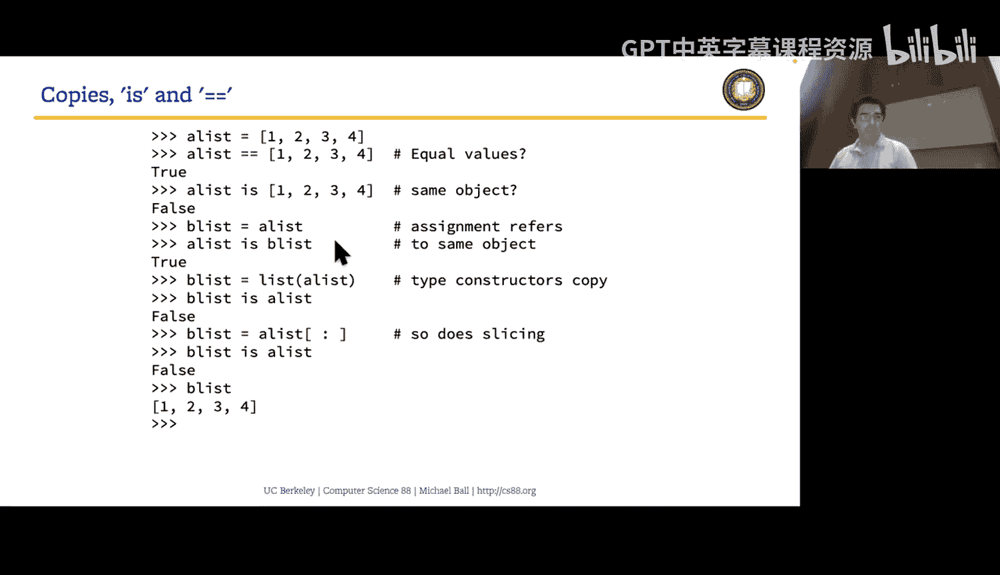

B list is equal to a list， so actually let me do it that this way B list is equal to a list。

Now B list and A list are the same value， but they're no longer a copy of one another they are they're the exact same object。

 so A list is B list right this is true。And what should happen is if I start to modify B list。

So let's say a pan6。I can inspect not just B list， but I can inspect a list and point out that those objects have changed together and so this is one of those challenges of。

Mutating lists and if mutability is that when we modify one thing， if we're not too careful。

 we will modify both。Both instances together。So。That's one thing to be aware of since the question was asked。

If you want to make sure that two lists have the same data。But do not share。

The same the same contents of memory that Python tutor resolves them to two different lists。

 the list function that we've used for our map and filter examples right。

 this thing just says giveive me a new list with those contents as the value。

And so list of a list is going to be。A list which looks exactly the same way， but is in fact。

 a different object。So B lists a list would now be false because they are copies of one another that means if I modify one I don't modify the other this is perhaps。

One of those things that takes a while to internalize。

But when you start recognizing patterns and code， it is really important to be able to distinguish am I modifying a list or am I working on a new version of the list and importantly for the most part of the semester。

 we've stuck to things that just return new lists because if you are always returning a new list you're doing a program where things are purely functional you've taken some input。

 you always return a new version of the output you can avoid a lot of really nasty bugs by sticking to habits where you don't modify list。

 but sometimes it is necessary to modify into mut data so that's why we illustrate it。

 but it is something where if you can avoid needing to do this you'll probably save yourself a few hours somewhere down the line before I go on to other examples questions about about sort of lists modification。

Pointing at each other。Any other questions on the zoom？

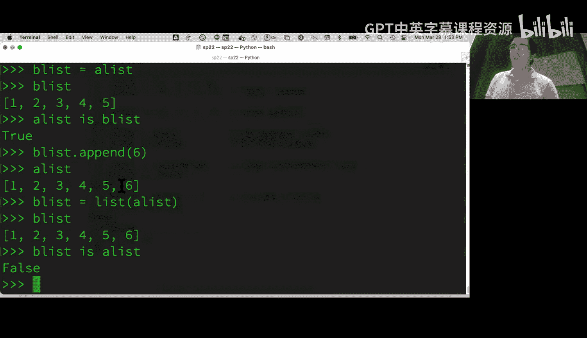

So。😊，To sort of formalize this， we use the word equality to give ourselves meaning when two objects have the same value。

 so the equal sign checks for equality and if the two things are equal。

 their values have the same meaning there is operation checks for identity， which says。

Are these two things the exact same object in memory。

 what is important to realize and sort of falls out of this right is two objects that are identical in memory are always equal to each other using the equal operation you can't have you can't have A is B return true and have B be logically different than a because that would mean you have some actual object and Python resolving to two different kinds of ideas and that wouldn't work necessarily pretty well so identical objects always have equal values but objects with equal values may not be identical。

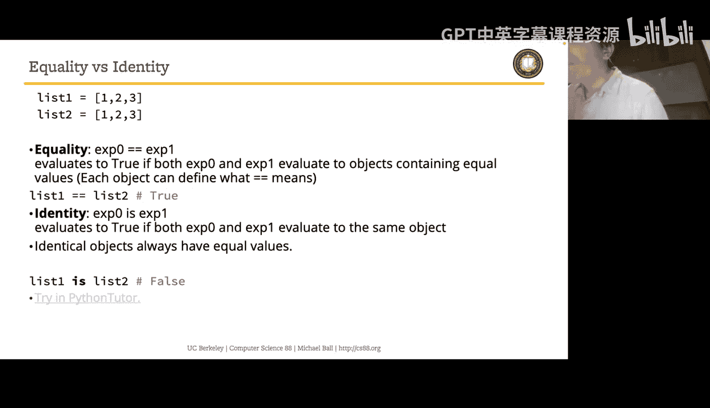

Yeah， okay。 yeah。 So the question Zoo chat。 So why， why is it when we say。

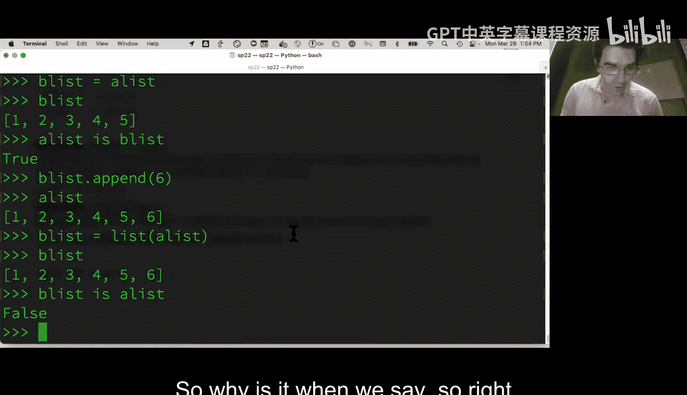

So right now。Let me go to back to Python tutor so the question chat is so why is it that when we say something like be list do aend do we edit both lists and in this case let's。

Delete our extra steps。And it'll say be list。Is equal to a list。Let me say B list dot。那。Beless pen。

Of five and at the very end， just to be sure。Will print alist。So。

Why is it that when we modify one we modify the other so in this case right we start off to normally a list is a list of  one。

 two， three，4。What's important to remember is that whenever we work with some kind of mutable data when we say B list is equal to a list。

 we are not making a copy of that data， but instead drawing an arrow at the exact same data that already exists and。

Whenever we do this， so this will be the case with lists with dictionaries with objects that you create in Python。

 so if you make your own object in the anNts project。

 you'll see this with an ant class if you were to put into Python tutor。

 but these two things are pointing at the same value on the right hand side。

So the next function that we run is it's almost invisible when we say but BLlist the append to five。

 we look at what BL is， BL is pointing at this thing on the right hand side。

 the five appears over here， and because A list is also pointing at that same list。

Then the values of the A list also change。And that's the one thing to be careful with when we have mutable data that or two variable names could be pointing at the same instance and this is a case where in environment diagrams when you pass in a list to a function you can still modify that list as well and so there's actually an example of that any additional questions on。

呃。On sort of modifying list in this example。Who。So。呃。One thing that we'll sort of wrap up with is。

We've been sort of glossing over exactly what Python does on your computer when you say a equals B or a equals5 and to get there is actually pretty complicated so there are a lot of details that you might find interesting and if you actually want to really understand what's going on into the hood would highly encourage you to take c6 to1 B and then take c6 to1C you do need to take B before C but what python does give us。

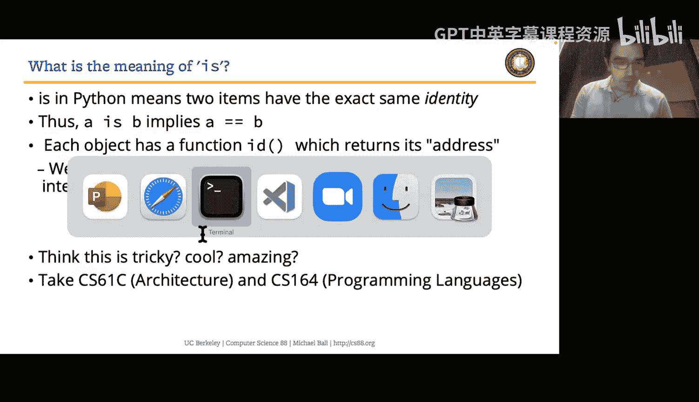

Is this function called ID？And the ID function gives us that same set of numbers roughly in a slightly different format that are at the end of if I say let's say math。

Well， I don't need a lambda to do anything。呃。Right if I say map。

 I got some map object at some number here， this is the ID of our object。

 in this case this is the ID of the map object， but every value in Python has this internal address or internal number。

 you can literally kind of think of it as a house address。And by using ID。

 we can sort of see are these two things？Does Python think these two things are identical and of course because B list is a list was false this means our idea of a list and our idea of B list should hopefully be different so under the hood Python is essentially just using a series of numbers to keep track of where things are。

And that's hopefully as much as you really need to know about mutating and modifying things。

 so we'll have one example on Wednesday and then we'll talk about the efficiency of programs and how we understand and modify or analyze the efficiency of programs。

All right， we'll see you all then。SoStop screen sharing。

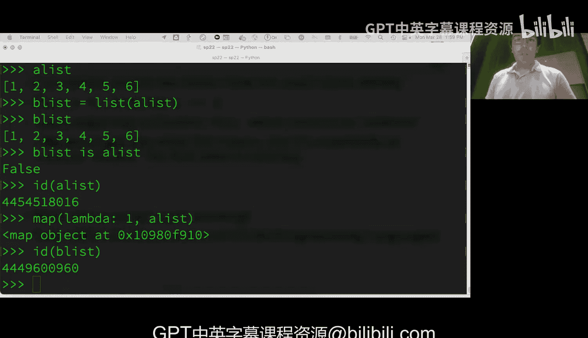

F。あ。