# UCB《数据科学中的计算结构｜CS 88 Computational Structures in Data Science 2022》中英字幕 p17 CS 88 Spring 2022 - Lecture 17 - 3_30_2022.zh_en [BV1516iBfEVY_p17]

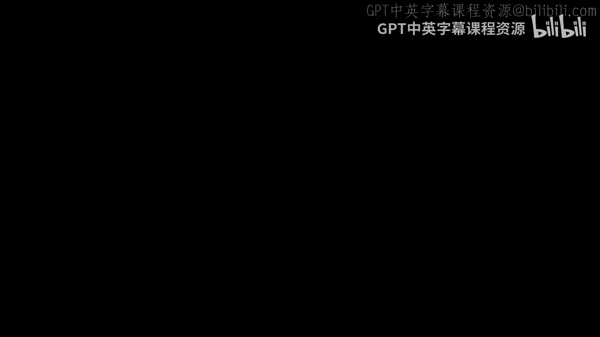

All right。不是。😔，天咩。O。是。Okay， so let's see that's all shared correctly。😔，And the final projector。Okay。

Okay， I think the middle screen， yep， there you。Right。So。Oh， that's thanks Powerpointint。

 We're going to hold on one sec。See if I can now。啊。Okay。哦。All right。

We're going to try this for today。So on Monday。I did mention that answert be out either this week or next week it's actually going to be I think two weeks you'll still have three weeks to work on it but I just got the timelines for I'm coming back from string breaks so if you don't see it out soon that's why but same project were just making some changes from last fall to reduce a couple things that were confusion that we confusing so otherwise today i'm going to finish up talking about mutability with one particular aspect of lists。

That's just a little bit messy and a little bit confusing and then we're going to go on to talk about efficiency。

😊，And。When we talk about efficiency， we're going to talk about sort of why and how we approach it in this particular way。

Before we get to that， just to wrap up the last example。On list that we didn't get to talk about is。

Something that again I think most of you have had experience with throughout the semester。

 but is worth just making explicit and clarifying so when we pass in data。😡，Into a function。

 if we're passing in a string or boolean value， we're just passing in a copy of that value。

 but if we're passing in a list， we can modify the list that's passed into a function so we'll look at an example of that when we declare a new variable inside a function。

When we say a equals some value， we are rebining that name and we're using that name only with inside a function。

 so again， we're following the rules of environment diagrams here， but。

What we sort of just need to be careful of is making sure that when we。

Pass in a value to a function that we're aware that if this is an object like a list if it's an object like one that we create。

 so in our project that could be an an object in some game right that could be some state of the game that we are modifying that actual object and if we reassignance name then we get a new version and this is a case where I'm not going to spend too much time on this one。

 but in。We'll go back to the very beginning here in Python tutor。

 we have a couple things we just have an add to list function and we have a function that returns a new list。

And。After each step， we just sort of print out the list so that we can see it as well and just to illustrate going through this right。

 if we have an add to list function here。Or we pass in my list as an argument。As we step through。

 it's just worth pointing out again that the arrow that Python tutor makes to the argument list is pointing at the same exact object on the right and in this case that means that when we modify that list within our function。

We are modifying that same object on the right hand side。

 so if I step through this go to the next line when I say a list on a pen of more。

What I get back is a list where I have modified that value if I go to the next thing and I。はい。

And now print this， we'll see that the list updates here。But and I can do this a couple more times。

To illustrate that we keep modifying this list。But the second that I have a function where I take that argument LST。

 and I say something again that says LST equals some new list。I have in Python Tutor。呃。🤢。

What I start off with is a name that points at that same object。And as I stepped through this。

I have now that last line， if you didn't catch it right over here。

 watch this arrow is I went from a list of two items。

To a new list where the arrow now points at something different。

Suchuch that I have now created a new object in Python that is no longer linked to my input argument and if you've gotten comfortable with environment diagrams。

 really what we're doing is just following sort of the same basic rules that whenever we say a equals some value right that is a new arrow pointing to something when we have a list that's passed into a function。

That initially those things are sharing the same the same actual list object and so really the point here is that when we talk about data structures that are mutable when we talk about classes that can be modified。

That we really just need to be a little bit careful about what data goes where and in this case。

 again， these rules that we have here are not anything different in the basic rules of environment diagrams with functions。

 but they are important to be aware of that one is I think relatively consistent。

One thing that is not so obvious about Python， and this is one of those cases where as you learn to program。

You'll。You hear lots of little misconceptions about something that will tell you to help make sense and one of those things that we initially tell you right is that a plus equals B is the same thing as saying A equals A plus B。

And it turns out that whether or not these things are different or the same is actually really dependent on the programming language right you can't necessarily assume that Python is the exact same thing as Java is the exact same thing as JavaScript or Ruby or C or C+ plus really any other programming language that individuals get to make their own decisions and in Python it turns out that these two things are different methods on objects。

And it's worth particularly mentioning with lists because。The list form of a plus equals B。

Modifies a list and does not red the name to a new value and so again here's a case where here's another let's go back to the first result of this Python tutor example。

呃。And。In this case， we have two functions I'm just going to show one of them。

 but they're both on the slide so you can。play around with what's happening is when we say a plus equals B。

 in some cases， what Python is doing is this is a different operation from a equals B。

 and so it's not going to red the name to a new value， step through define our two functions。

Our first list here。It's just a range of numbers。And when I call add data to object， again。

 our object is two arrows pointing out the same list。

This time our data is another list of four values， I don't know why I chose to skip the number 10。

 but so be it。As we step through， whoops， as we step through a function。

 we just print a couple things。We'll notice that we say object plus equals data。

 we append everything to that list。And then。We continue on with returning that value and this is just something to be aware of with lists in particular there are a couple other objects in python that have the similarly confusing behavior but。

It's list of the ones that that will sort of let you fall into a couple traps so it's perhaps not the most interesting aspect of Python。

 but it is something to be really be aware of if you're wondering why this happens and how this works we talked before spring break about the special methods that that python implements or that objects in python can implement and this one in particular the plus equals operation maps to the method I add which。

You can sort of think of as like incremental adding so objects and Python that are not lists can define their own IA methods to change the behavior of how plus equals works and in most cases right you combine the two items together but you just have to be aware of that you're not getting an entirely new object back so I'll stop there and see if there's any sort of questions on a mutation of list before we jump into an entirely new topic but just wanted to sort of round that out from Monday。

申请。😔，酷ol。So。Understanding mutability is super useful。But I'll be honest。

 I don't think it is necessarily the most exciting thing or the most sort of mind expanding when we talk about understanding the efficiency of our programs。

Here's one of those cases where I think what computer science is trying to do is actually really interesting and really neat and different from what we might expect。

 so we're going to spend the rest of the time together today trying to understand。

Why do we conceptualize efficiency of code in this kind of what might you might say isn't a little bit of an unexpected fashion。

 why do we care about counting lines of code and counting operations and not just using something like a stopwach or a clock to understand how fast our code takes to run？

And what I will say is that for what we're doing today is again we're going to stay at a pretty high level for CS88。

 this is not something where becoming an expert at analyzing the efficiency of your functions is something that we're going to do in this class it will come up a little bit in labs and discussions。

 but it will stay at a pretty high level， if you do enjoy this， CS62 andB。

Spends a bunch of time talking about and analyzing the efficiency of algorithms。

In multiple dimensions。And our goal here is before you walk away with the notion that like you should now write the fastest code possible in every circumstance。

 it is worth just st that everything that we're talking about here is a tradeoff is we're trading off how long it takes some function to run with how readable perhaps that that code is and how easy it is for us to understand we're going to take a tradeoff sometimes of how fast a code。

 a piece of code takes to run versus how much memory in our computer does it take to run that code for the examples that we're going to do today。

The trade offs between readability and memory and speed are all pretty manageable because we're looking at simple functions or working with reasonable sizes of data。

 but if you are to go， perhaps let's say，Work on some data analysis as part of a data 100 project or you're working on some research thing。

 you can't just necessarily take a data set of 50 or 100 gigabytes of data that's some experimental results and read that all into your computer's memory because your computer unless it's like a $10。

000 supercomputer probably doesn't have that much memory that it can use。

So any computation that we do inherently takes both time most of the time it's so fast that we don't recognize it and it takes space and again most of the time if we're adding two numbers together。

 the space that's required is so small that we don't think about that on our computer。

 but if we're calculating large amounts of data are reading really large files。

 those things could become a concern and so today we're going to think about。

How do we reason about that？Writing code that is particularly efficient is often not obvious and oftentimes can be convoluted and today we're going to at the end look at one example that is more efficient in a little bit easier of a way。

And before we get to really writing fast code， what we're going to spend the bulk of our time today on is understanding how we can determine whether or not a function is fast or slow or what does that mean？

😡，And so we're just going to focus on time and not space。

And so what does it mean that code is fast importantly for most of the things that we work on throughout you know not just classes but software projects if you're working on a startup and some website if you're working a research project。

 not everything needs to be that fast， so I would say that it is important in a lot of cases to recognize that。

What we're trying to do is solve a particular problem。

 but we're not trying to apply this framework to every single problem。

 but faster code generally saves battery power so if you're working on a mobile app and you're doing something like machine learning or image recognition that your phone does when it's trying to figure out what faces it picks when you're taking a picture or it's trying to analyze the scene to adjust the brightness and the sharpness of an image。

Some of those processes are pretty data intensive and engineers spend a lot of time optimizing them such that the work that they do is fast。

 not just because it's nice for that camera button to be responsive。

 but because that saves battery power saving battery power makes your phone run less hot and so on so in some environments speed can matter。

So your initial approach might be， well， how do I know how fast something is。

 why don't I just hit Python3， run my file， get a result back。

And see what happens and in some cases this can work this can give you a reasonable benchmark。

 but it turns out that if I am analyzing code on my computer my processor is probably different than the processor on your computer or on anyone else's random computer and so timing using a stopwatch is is not necessarily a reliable metric the time that it takes to run a program in real time on a computer is also affected by some of the other things that you're doing on that computer so。

You may if you're interested in trying this you can Google sort of how do I time a Python program and there's a whole bunch of examples online and you could try and do some slower computations while Zoom is running and while zoom is not running and you'll notice that like zoom actually takes a fair amount of processing power and so it'll actually make other programs on your computer slower while that's happening and you probably have some intuitive sense right that while things are happening in the background。

You know， some websites just or games or whatever else might just feel a little bit laggy。

And so our goal today is to not use a stop option to say。

Everything that I do in Python can be broken down into a series of really simple really discrete steps。

 so every time I say one plus one or one plus two， this is one one step or one operation every time。

I access an item in a list that's a single operation and when I make a function call what I need to understand is what is going inside that function to count the number of operations and so today what we're going to do is we're going to consider how we count the number of operations。

And this is going to give us a measure of efficiency。嗯。

One thing to note that when we talk about this。We need some value that we measure the efficiency of and so we're going to measure the efficiency based on the inputs to our functions。

 so the input could be the length of a function， it could be the number of items or the length of a list so like the number of items in a list we're going to look at the Fibonacci function again where the input size is just the value of n。

It could be many different things。But what we care about is。

What happens with respect to some input value？And just a reminder that for CSS88。

 our goal here is not necessary to care about or to have you necessarily write fast code and CS62 and B。

 that'll be the goal of some of the assignments， but today what we're going to do is just understand how do we analyze the efficiency。

So we call this the runtime of a function， even though it's not actually timed we call this process runtime analysis so how long does it take for this function to execute and one thing that you might think about is。

Well。If I'm trying to analyze the time that it takes Fibonacci to run， for example。

 I could have many different values of n， if I'm trying to analyze the time that it takes to find some value in a list。

 I can have many different values that I could be finding and I could have many different types of lists that I could find a particular object or a particular person right。

 you could figure out if I told you to look for a person in that crowd in this photo。

You know sort of wear's Waldo you could time yourself and you could say do we care about the average case or the worst case and in computer science there are bunches of different analyses where sometimes the average case just does matter。

 but in general for the types of analysis that we do。

 we really care about this worst case worst possible case that if I tell you I really should actually just find it where's Waldo picture but if I tell you do find Waldo is not in this picture。

 right the very worst possible case is that you could scan through manually every single individual person sort of row by row get to the very end the last person in the photo whichever way you start scanning through the photo and realize that there's no Waldo in this picture。

And so why do we care about the worst case， well it turns out that if we're trying to plan for the capacity of a system。

 right， if you're Amazon and you need to understand how long it takes for an order to be processed。

You need to have some sense of like what kind of servers do I need to have so that Amazon doesn't go down on something like Black Friday or prime day or whatever it is right because if your website goes down that's pretty bad。

 especially if your website is based on like selling stuff you don't need to people then you really don't want your website to go down it also turns out。

For。Interesting reasons that we're not really getting to get into。

 but things like the worst case happen more often than we expect right if we're searching for something and some value in a list that item not being present is a case that probably happens more often than we might expect。

And so we need to be aware of that if you run a really large website where you have millions or billions of users on your website a day。

Then one in a million events actually happen often enough that you have to， at some cases。

 write code that is really tolerant。Of of different kinds of of edge cases。

 So when we talk about this， we're going to talk about are what we call orders of growth and we often write these or we we talk about。

The the largest possible type of term in a function。

 so we're going to consider in CS88 five different possible orders of growth。

And what we're talking about is as the input size to our function grows how much longer does it take to compute to values so the fastest way that we could have or sort of our best order of growth is what we call constant time that as our inputs get larger the function doesn't take any more time to compute we could imagine。

For example， finding the first item of a list right。

 finding the first item of a list as an operation is instantly fast regardless of whether or not we have one item in our list or a million items in our list because saying list to zero is always one really quick operation。

😊，It doesn't take any more time to say one plus two。😡，hen it takes to execute 100，000 plus 200。

000 again， this is a tiny bit of a simplification because like when data gets very， very large。

 things break down。We'll talk about logarithmic growth。

 which means that basically as the inputs to our function double。

It only takes one additional step of time for a function to grow or to compute the result。

Linear time， we'll look at some examples of that is pretty simple to understand。

 which is something like a for loop。As we process some data。

 each additional step or increase in our input is one additional iteration of our for loop so there's a ton of linear time algorithms that you'll see which basically involve reading through a list of data。

Doing something with that data and as our list goes from 100 items to 101 items。

 we only make one additional iteration of a for loop。

And of course there's some other types in there as well。

 quadratic time follows sort of some n squared models and really slow functions which'll look at our exponential time where it could go from computing the 10th item let's say to the 11th item actually requires an exponential increase in the amount of time。

 so that could be going from something like 100 steps to 120 steps just by computing one more value。

In CS62 B you'll actually write potentially some more formal analysis where we could say the function is the time complexity of this function is n squared plus four times log n plus n and really in this case all we care about is just the largest term so we're just going to take things at a really high level and say if it's roughly squaring the number of steps that it takes。

 perhaps there are nested for loops， this would be quadratic。

 we don't care about finding a particularly precise answer。

 we're just trying to think about this in general terms。

So we're going to do work through just a couple of examples thinking about a an algorithm in this case in pseudocode。

That we can use to get a particular sort of analysis for this so our goal is to figure out how fast is this function of finding a student in a list by student ID so our possible values are constant logarithmic linear quadratic or exponential and our input is an unsorted list of students so we could say that these are student IDs。

And a value to find in this list。Our output is just true if the student is in our list and false if the student is not and our algorithm is as follows go through each item in the list。

One by one。And if that item in the list matches the student ID。

 we report true if we get all the way to the end of our list and we don't find the student our function reports false。

呃。We'll do this in two ways。Which is for the folks in Zoom， take 30 seconds and think about what。

You what the possible analysis is and then you could just write the number one through five that's on the slide in the chat box just to see where people are and in the room i'm going to ask how many people you could just raise your hands for a couple seconds think that this algorithm is a constant time algorithm that as the number of students in this list grows it doesn't take any longer to find results does anyone want to vote for this being a constant time algorithm。

So anyone in the room want to vote for this being a or logarithmic time algorithm？

Does anyone want to vote for this to be a linear time algorithm that for each operation we add a few okay cool some votes there。

 does anyone in the room want to vote for a quadratic time algorithm？

And does anyone want to vote for an exponential time algorithm cool so folks in zoom。

 if you want to put your your numbers in chat， you could private message or just type them publicly。

I got one vote。是。See， couple more。Awesome， cool， so yeah。

 zoom in the room pretty much agree that this is our standard linear time algorithm that if we add one more person to this list。

 we' have to complete one more step and one more additional item to check。

If you think about writing this in Python， I use the term for each person in this list。

 we would write this right as for item in some list。

A single four loop in a function is generally a good indication that there is some linear process within our function。

And yeah， so I think。Most people feel pretty good about that。嗯。

There are a lot of other cases to consider and building up an intuition for this takes a lot of time so that's what you'll spend plenty of time throughout the semester of CS61 be doing but there's a couple other things that you might sort of start to think about。

Is quadratic time if I say for each item in some list。

Let's say the list is five items right that's five steps a quadratic time algorithm tends to look like two nested for loop so I would say for each item in some list and within that for loop another for each item in some list again so perhaps I have a game board and i'm processing a game board of size 10 and it's a 10 by 10 board so it's 100 steps。

For 100 squares in our 10 by 10 game board， it's 121 steps for an 11 by 11 game board and so on so quadratic time algorithms are pretty common。

 whether or not an algorithm is fast or slow or that matters really can depend on your use case。

 but those are common things to look out for。Now， in our list， there are two potentially。

Trickier cases to look for。And we'll see some examples of these as well one of these is logarmmic time algorithms and logarmmic time algorithms are really awesome they show up in a lot of places in fact。

 if you really enjoy this idea of like optimizing code taking CS61b you'll spend some time working on them and CS186 the databases course has some examples of using really efficient searching techniques to make databases fast to use。

But what logarithmic time algorithms typically have in them is this idea of taking some input value and being able to cut it in half along the way。

 so being able to restrict the type of space that I'm looking for into only half of the input set and we'll talk about what that looks like on the opposite end we have exponential time algorithms。

And if you've taken some math classes， you might recognize that exponents and logs are inverses of each other and in our analysis they're also inverses of each other exponential time algorithms tend to lead to in every additional step a doubling of data。

 so I might say that an algorithm which is exponential if the input size is four。

It might take something like 16 steps that would be two to the four and if the input size goes to five。

 it would take two to the fifth or 32 steps so at each level。

The amount of computation it takes would double and you've actually seen a couple exponential time algorithms so far in CS88。

 but we haven't necessarily identified them that way so。We'll take a look at one of those。

So moving right along， we'll take a look at another algorithm。😊，In this case。

 our list of students that we're going to search for is sorted in。In order。Yeah， okay。

 there's a questions in that just popped up can I give an example of an exponential time algorithm hold that thought because we will come back to that in in a few minutes。

What we want to do for this case is we're still going to find a student。

 so our result is still are they true or false its a student in the list。

 but now our list of students is sorted in order， let's just say from lowest student ID to highest student ID。

And in this case， our algorithm is that we're going to start in the middle of our list and determine is the student ID that we're searching for larger or smaller than in the student ID in the middle of the list。

And if the student ID is smaller than the student ID in the middle of the list。

 we're going to go to the first half of the list， go to the middle of the first half of the list and search for the student ID there and keep repeating this process if our student ID is larger from the middle element。

 then we're going to take the second half of our list。

And then we're going to go find the middle of the second half。

And we're going to repeat this process until we either find the student ID or we get down to a one item list。

In which case， if they don't the genetics don't match we haven't found the result。

 so take a few seconds， think about how。How long that this algorithm might take？

So in people in lecture， does anyone want to vote for this being a constant time algorithm。

 but as we add more items， more students this list， it doesn't take any longer。Okay。

 so I don't want to vote for this being a logarithmic time algorithm。

 but as we add more students to the list， it only takes a little bit longer to run cool。

 is this a linear time algorithm？OsIs this a quadratic time algorithm， perhaps？

And does anyone want to vote for this being an exponential time algorithm？Cool。

 and on Zoom we've got a few votes come in， feel free to put more。But yeah， once again。

 taking a page from the previous example， I think most people。

Are getting the right answer that this is one of those logmic time algorithms that we can take advantage of knowing that our input。

Is in a particular order。To always keep dividing the space that we're searching in half。

This algorithm turns out to have a name called binary search where it gets that name from splitting the listen to binary search is one of these algorithms that you don't。

See every day like normal people have no reason to know how searching for items on your computer or in gmail or in other things work。

 but variations on this idea are one of the fundamental things that we can use as。

As computer scientists and as programmers to make searching for data fast and there's a whole bunch of different searching algorithms。

 you'll spend a bunch of time in CS62B talking about how to search data。

 how to sort data that that really take advantage of。Of the fact that。

On our computer we can have millions of files and we can start typing the name of like lecture 17 and our computer by having lists of files in a particular format can sort through all that data or search through all that data incredibly quickly such that if you have 10 files and if you have millions of files。

 it doesn't actually feel that much slower to find the particular type of thing that you're looking for。

Yeah， so here's a good question in chat does the algorithm。

Does it always mean that an algorithm is logarithmic if the list is sorted？Can we have？

Can we have like a logarithmic algorithm on an unsorted list so in this case。We。

We can't make a guarantee that sorted data always has a logarithmic approach。

 You could perhaps have a。A list of data where。The numbers are sorted。

 but what you're trying to do is sum every value in that list of data and summing every value in a list of data。

 if you just think about this as a for loop perhaps requires iterating over every item in the list so without knowing anything special about that data we might have to read every single value。

 so it depends on whether or not that something that we could actually leverage。

There are other logarithmic time algorithms that don't necessarily rely on our data being sorted。

 I don't have a good common one off the top of my head。Oh嗯。Actually， yes。

There there are different types of algorithms， if you're using a list of data。

 I don't have a good one， but the way that computers do calculate exponents。

 so calculating two to the third versus2 the 100th。

There's a couple versions of this algorithm to calculate exponents that are logarithmic in time so you can search for examples of logarithmic algorithms how they work can be a little bit more tricky。

 but calculating exponents in a fast way。😊，I relies on this trick that true to the 1100th is really true to the 50th times true to the 50th。

 and so you don't have to， you can calculate things a little bit more quickly by in this case splitting your exponent into two instead of splitting some listed data into two。

 but they usually have this pattern of splitting some function of the input into two values。

 but yeah that's a good question。Before we continue on questions about how binary search or any other sort of sets of algorithms that we've talked about today work。

Oh， was that a hand over the。Okay， cool so。I did mention that we've seen some algorithms before that are。

Exponential in nature。And one of those。We talked about a couple weeks ago was。The Fibonacci function。

And the Fibonacci function is deceptively simple and its implementation， we've got three lines here。

 it's it's recursion， so there's a little bit to think about there， but。

It's just a couple function calls。And。You know， it looks so nice and so simple。

But it turns out that this is like。A terrible， terrible implementation to actually try and calculate the。

The n Fibonacci number， so as our input end grows， this function takes quite a long time to complete it turns out that like I mentioned before。

The Fibonacci function。We can write it in an iterative approach where we pick our starting values x and y as0 and1。

 and we can set x to y， so that's n minus1 or the next n value and then we could do x plus y so incrementing two values at a time。

 so our Fibonacci function。This particular iterative version is kind of dense。

 the logic of what's happening is a little bit。I think is's a little bit more opaque。

 but you can write Fibonacci in iterative fashion， but we also have this recursive fashion and so。

This function， we mentioned it was slower a couple of weeks ago， but how slow is it？Well， it takes。

An exponential amount of time to compute a value and we could spot that change by recognizing that even in this simple thing。

 calculating Fb4， this is only nine function calls like Fb4。

 nine function calls doesn't necessarily seem like a big deal just because something has nine function calls for an input size of four that doesn't necessarily tell us much。

 but if we look at this graph here， we do see some signs that are kind of interesting right。

 calculating Fb of two over here is repeated and over here is repeated。

If I were to calculate fib of 5， I would have to recalculate this entire Fb of3 tree。

And so as our input size grows。Fib of one is pretty easy， right， that's one operation。

 we just return n。Fhiip four here is nine， so we start to see this growing。

 Fb of seven takes 41 function calls。Dip of eight takes 67 function calls。And Fb of 20 takes over 21。

000 function calls， so to go from one。To 20 and have things grow that quickly is is not so great we can actually demo this in Python。

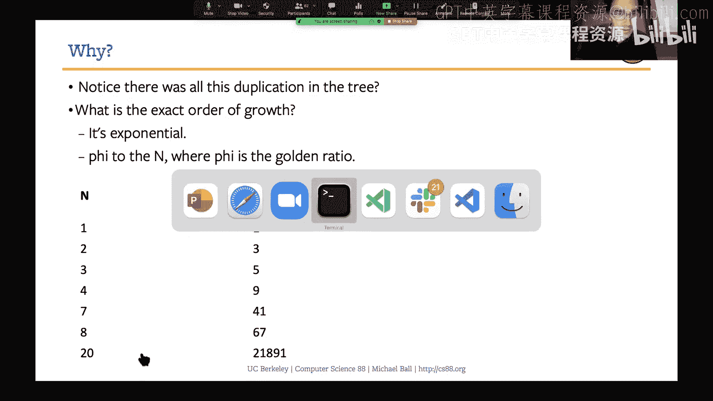

By the fact。Fact。嗯哎。嗯。Where did my。There we go。All right。

 so I'm going to run the lecture file for today。This is。17 and in this lecture file。I have Fb。

Which is our standard recursive definition。I can calculate Fb of 10 just fine。

I can even calculate tube of 20 and that's not too bad。But as I'm talking here。

 I can't even calculate fib of 50。系。Well， we can see exactly how many function calls this would take。

 but it turns out that Fibonacci， because of all this is。

An recursive Fibonacci takes exponential time to calculate。

Though I can just stand here and this is like not going to finish。So we're just going to exit that I。

 I have my interfacefi function。And because iterfib is implemented right in an iterative manner。

We should expect this to take about 50 operations。It does take about 50 operations so we get a nice large number back basically instantly and this is really the difference between in this case what's linear time and what's exponential the really cool thing about Fibonacci well if you like weird math facts I think it's awesome is that the order of growth of the Fibonacci function is the golden ratio so I didn't pull it up in the slides today but if you remember。

😊，From two weeks ago we sort of have the spiral that we can map and so this golden ratio fee is phi to the n is the order of growth of the Fibonacci function when implemented recursively so calculating Fb of 50 is I don't even know how many digits there are there。

 but it's a ridiculous number of steps to do something pretty simple so。In this case。

 recursive Fibonacci。

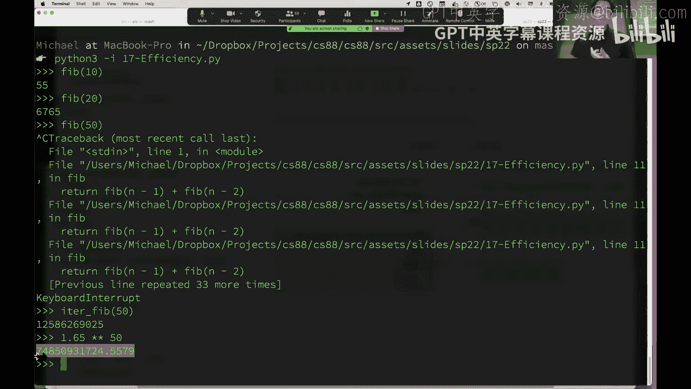

Really， really great demonstration of an algorithm。

 but a really terrible implementation if you actually need the value。

But it turns out that in computer science， we have a bunch of tools that we can use。

To to improve the results so someone actually asked this right after lecture when we talked about Fibonacci and it's a pretty simple idea。

 which is。Could we not just store the result of one of those function calls and instead of making an entirely new set of function calls。

 could we not just look up that value in some set and get the result back and it turns out that a lot of cases this is a fantastic way to improve the efficiency and the time that it takes to run a piece of code。

Without dramatically changing our implementation so this is this is sort of a naive version of thinking about how we might do this。

 I took a little bit of a hack here to just use a global dictionary but there's a few different ways that we could write that and all we're saying here is that I'm going to store some value n in our dictionary。

And if I've seen that value before， instead of making a function call。

 I'm going to return that value we call this process memorization no R just because someone 20 or 30 years ago decided they wanted to make things complicated。

Or we call this caching which is a general term for taking the result of something saving the value and using that later on。

 and so this is one way of writing it。嗯。And it is a a really useful tool so question zoom chat is global its's own function Global is a special keyword in Python that says let me use some value in the global frame without。

😊，Without having python give me errors that it's not within scope to be honest you might with a dictionary you might not even need it。

 but this is just a a fairly simple example， so I wrote it anyway let's see so where's my file。

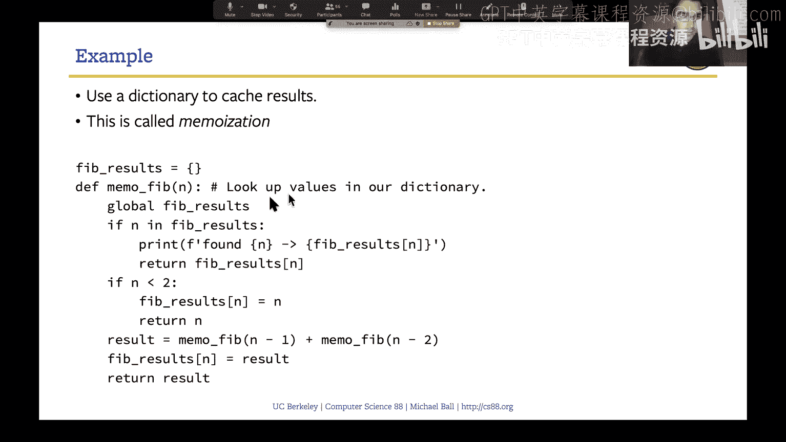

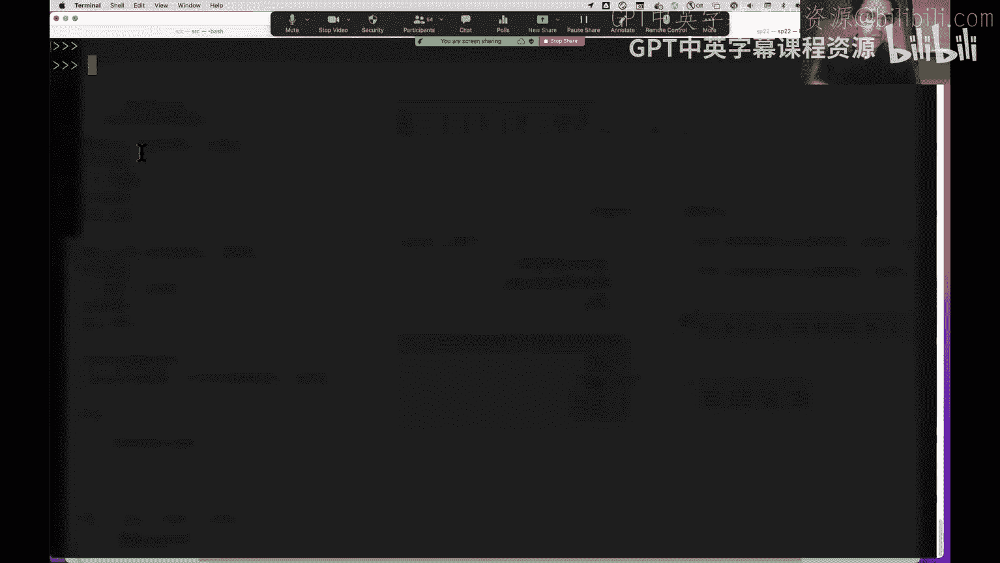

Appp here。So。Oh gosh， okay， so in in our memofib function。

 I wrote a print statement in here just to show us what's happening as as we compute each shbonacci sequence。

 but I called it memofib for memorization， we can see that if I try and compute Fb of 10。

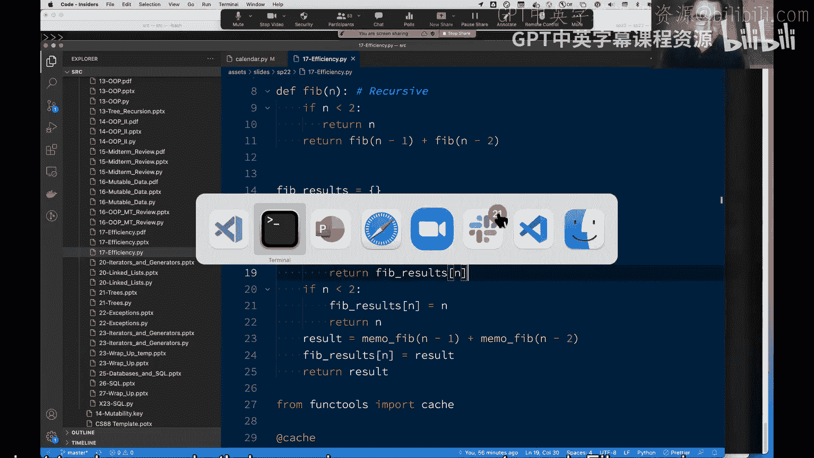

Before giving me the result。It looks up the value in the dictionary and if it finds it。

 it returns it， I can now。Look up FiA 50 and what I get is memofib doing all of the calculations。😊。

But looking them up in our dictionary and what's nice about this approach is that I still have。

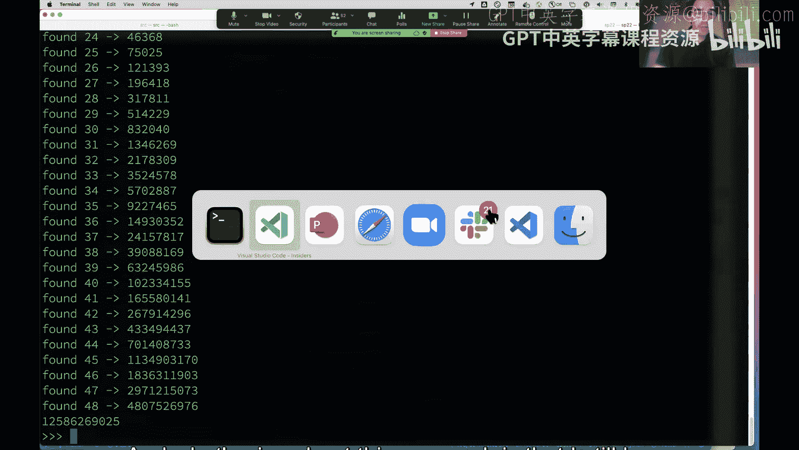

What is essentially my same recursive algorithm right here right those same three lines of code are almost identical to the basic recursive Fibonacci function。

 but I have the advantage is of this being able to run and compute the result in a reasonable amount of time and so memorization is a super useful technique。

That exists in Python and if you want to use it in your code you could do all this work that I did。

 but Python actually takes this idea because it's so popular it builds it into the funk tools library so remember we said from fun tools import reduce。

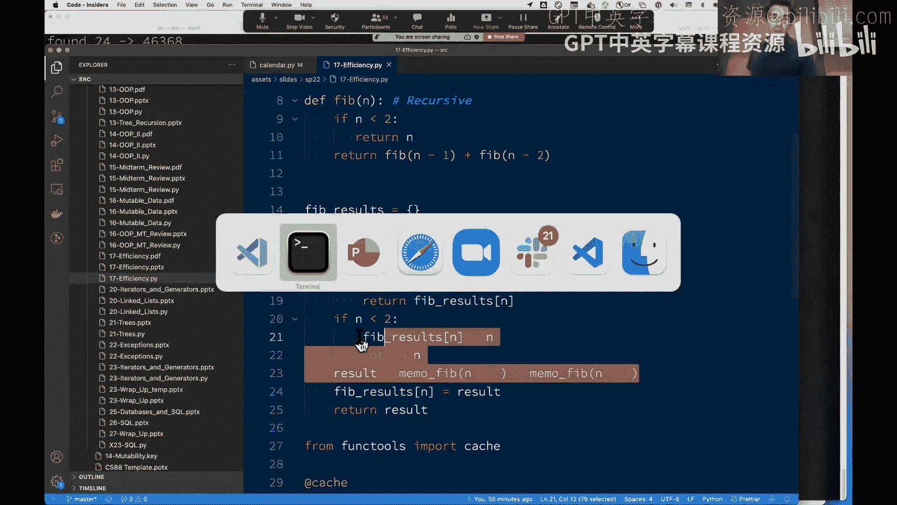

There's another function here called importm cash and we're not going to talk about how decorators work。

 they are mentioned in the Composing Program's textbook。

 but the last thing I'll just leave you with is that if you want to try this on your own code。

It only takes two lines because they from funk tools import cache and before your slow function you say at cache and what Python does is this is a special high order function essentially。

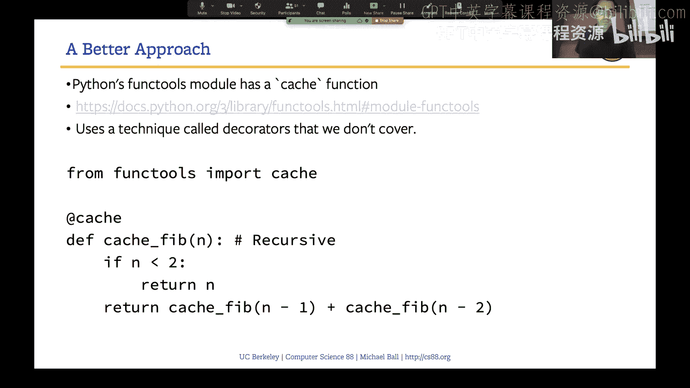

That takes the function below and it cachees the results so in the lecture file I don't know why this is being slow to scroll we have a function that we called cashfib all we said is import cash and we get the same exact benefits where we have a slow piece of code。

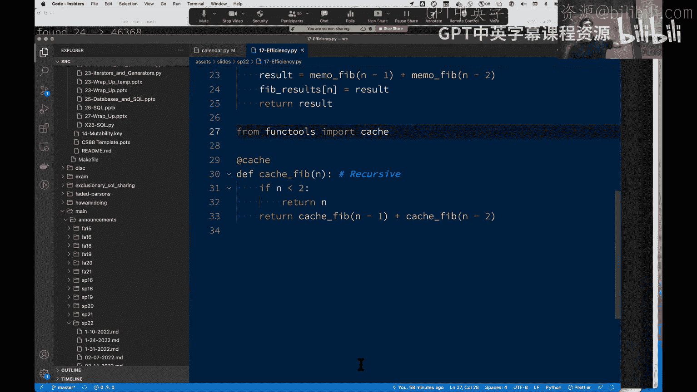

And I can still。Calculate cash Fb of 50 and basically an instantaneous amount of time and so we have the benefits of recursion。

Without the drawbacks of a bunch of function calls so that's where we' leave things for today。

 if you like this topic in particular I really would take that as a sign that taking CS62B continuing on with some of the computer science stuff is something that you should really consider if you're enjoying programming but don't enjoy this analysis。

 there's still plenty of fun things in CS62b but typically you know efficiency is one of those things that matters much more in computer science than data science so。

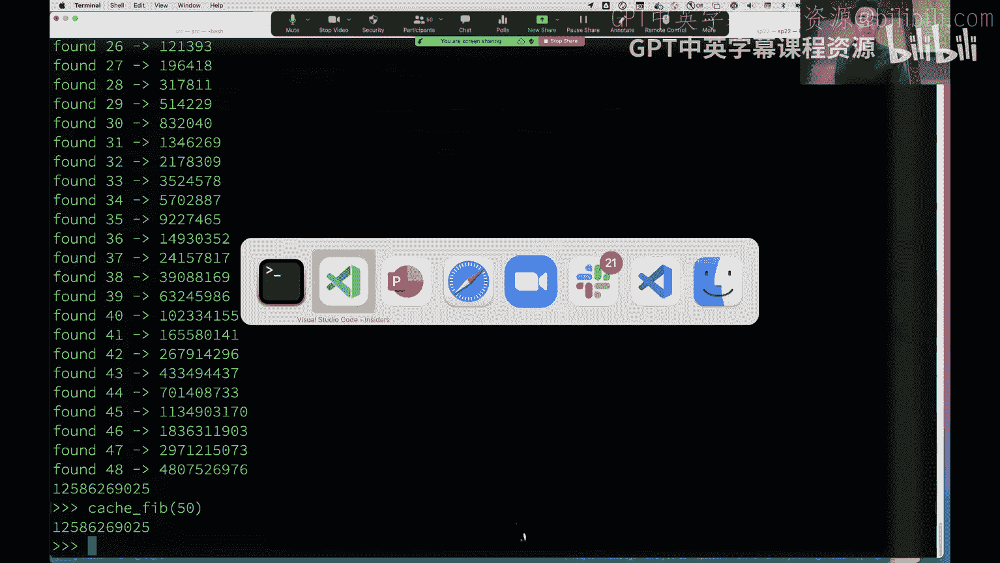

That's where we'll leave things for today， we'll pick back up next week with some additional object oriented programming techniques。

Any questions from Zoom？嗯。

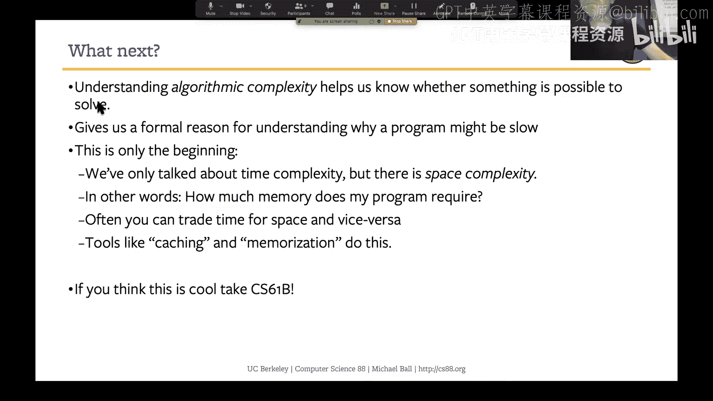