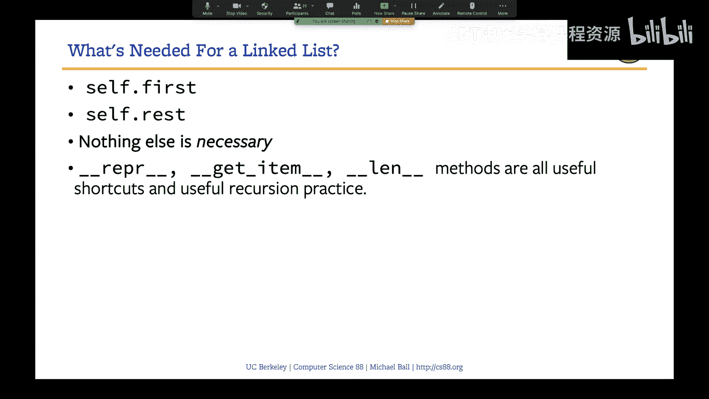

# UCB《数据科学中的计算结构｜CS 88 Computational Structures in Data Science 2022》中英字幕 p18 CS 88 Spring 2022 - Lecture 18 - 4_4_2022.zh_en [BV1516iBfEVY_p18]

嗯。

Okay， not sure。 that's not working。Yeah。All right。Okay。嗯。Next。Yeah。Okay。F。Yes。Com。Okay， there go。

Now I think Zoom is set up screen sharing。Thank you， enable lose。And if everything went well。

 the slides should now be on the website。Although it is possible they are not。

And if if the slides are not on the website， I'll make sure they're up after。After lecture today。No。

 PowerPoint。😔，嗯。Alrighty， so today what we're going to do is talk about this topic called linked Ls。

And what we're going to do for today， then as well as Wednesday and next Monday。And actually。

 I guess the next two weeks our talk about some object oriented design patterns。

 so these are tools that really make use of object or programming。That are pretty。

 in some sense common problems that you'll see in particular today when we talk about linked lists and next Monday when we talk about trees。

 these are two ideas that fall into this bucket of data structures。Now。

 if you have looked ahead at your class schedule， you might realize that data structures。

Is in fact sort of the main title of CS61b。And。That's to say if you enjoy this stuff。

 it's a good another good indicator to keep taking computer science courses to especially take CS61b。

Aside from the fact that it's you know a data science major requirement or a CS major requirement。

 but what these two tools let us do trees in the next week linked lists are they are tools which really leverage the object or to design that Python and other languages give us to allow us to structure programs and hopefully a more comprehensible a more readable way a way that you know just gives us some additional tools to。

The thing about how we build programs， some of the ideas are going to seem a little bit weird in sort of the way that we are intentionally structuring data。

It's definitely a different way of thinking again。But we'll hopefully you know sort of work through some of those weirdnesses and there's something that you can come away appreciating that and so。

The first topic that we're going to explore in this way is linked lists and linked lists are。

A data structure and we've used a bunch of data structures before。

 but we haven't necessarily called them data structures in this course。

A data structure is really just any sort of container。

That allows us to take individual pieces of data。And grouped them in a way that they're all sort of one single package and the most common form of these is definitely the list in Python that we have lists of data that are multiple pieces of data that are in one thing。

 it's a little bit different than a class as a whole like we don't typically call one instance of a class the data structure。

 but a list lets us have a list of scores or a list of courses that we're taking。

That's a pretty common type of data structure， a dictionary of course lets us map names to values so you might have a course a dictionary represented course which has a name。

 a number， perhaps the location， those kinds of things and tus again are just lists that we can't take that we can't modify that are immutable。

And so today's topic of linked lists will be a new kind of data structure。

 but this time instead of one that's built into Python， we're going to build it ourselves。嗯。

And all of these are really common patterns that when you go out and sort of build programs on your own you'll probably want to reach for some of them and so in pretty much every programming language Python calls them lists Java and CS6 B calls them arrays if they called dictionaries hashes they don't have an exact tuple analogy but some exist there are these patterns that you can rely on and so today we're going to build a new type of lists and this is called a linked list and。

Initially when we use a linked list the idea of a linked list is going to be pretty similar to that of any regular list。

 we're going to just represent a list of values that are stuck together sort of in in one sort of entity but in this case the linked list is a really really simple form of a list which has some advantages and that has some disadvantages but therere pretty useful topic。

 so a linked list is something that we sometimes call a recursive list or an our list you'll see examples of linked list sort of all throughout computer science because。

Their simplicity lends them。To show up in sort of unexpected places。

 the linked lists themselves are also going to be a really good introduction。

 hopefully next week to the topic of the trees， which are a little bit more complicated。

 but in this case this linked list。Has two properties， every linked list has a first value。

And a rest value。It's pretty interesting that with just those two things。

 we can simulate any kind of list， so in this case。We have a linked list。Three items。The number 12。

 99， and 37。And。Our first linked list item is the value 12， which is the first item of the list。

And the second part of our linked list you'll see that these are sort of two little boxes together is that this link of 12 has a first value of 12 and a second value called rest and what is rest rest is another linked list that has。

Well， the rest of the values of our list， it just happens to have， in this case， the value 99 and 37。

 and what is the value 99？It's a linked list with the first value of 99 and the rest value is。

Another linked list with the value of first of 37 and rest of this special empty linked list。

 which we'll talk about。 So when we think about linked lists。

It's a little bit sort of mind bending in how we work with them。

 and so we're going to spend most of the time today just working through a Jupyter notebook going through some examples but。

My key thing to think about is that when we tell you that something is recursive we're going to have this sort of similar structure so every time in my object I reference selfdot rest I'm going to be doing is looking we're thinking about this linked list as yet another linked list and typically this yet another linked list is my current list minus the first item and so if I take a linked list and I say self dot rest I get the rest of the list of these are the second two items instead of all three items。

From that second list。I can go from two items to self dot rest。

 which represents a list of one item eventually to the selfdot rest representing the idea of an empty list or nothing and if we think back to some of the recursion problems that we did where we had。

 you know if some value is equal to none or if some value is equal to zero。

 we have some kind of base case，And this tends to be what our our linkedless problems will look like。

 So that's the idea。 we're going to take a。A series of lists。

 a series of numbers and turn them into this linked list object and so for the most part what we're going to do。

It spend a bunch of time。In in a Python notebook。So let's refresh this to make sure we're all connected properly。

All right。Let's run this。And actually before I do that。乜咩啊。😔。

Go through and clear all of our outputs so that we're starting fresh。Co so。

Our linked list class is going to start with。Really it only needs two things。

 but we're going to have our wrapper method here just for the sake of the visual output。

 but our linked list is two really basic things it is。呃。Our self stop first。

And our self do rest in this linkless class， we have a little bit of syntax here that says rest equals empty。

This is something that we don't explicitly teach you how to use in CS88。

 but it comes up just because it makes a few things。A few things simpler。

This just says that if I don't pass in a value for rest， set it to the value empty and what is empty。

Empty is our base case， but it happens to be just the empty tool。

I can by having this saying rest is equal to empty。

 what it allows me to do is make a linked list using one argument。

Which is we're going to call this L1。It's a linked list of one item。Whose value is one？

And we could sort of think of this as。哎。L1。1 is going to be。The value one， this is equivalent to。

Perhaps if I make a list。Called LST。And I set it to。Just a list of one item right。

 I could access LST of zero。get the value one so when we have a list of numbers。

 we're pretty used to using that it's just a bunch of items in a set of square brackets。

 we index them using square brackets starting from zero。In this case， with our linked list。

 what we're going to say is L1 or list do first， whatever it happens to be。

And we'll get the value back。And using this， this is an object which has two properties are first and first always has the value of the item that we're trying to work with rest is always going to be some other kind of linked list in this case when I。

Look at so actually before I even compare the two， we could just verify that L1。Dot rest。

 if I evaluate that。Is I get this empty tuple and this is just because when I made my link list。

By having this line up here that says rest is equal to empty。

The default value for L1 dot rest becomes this empty tuple。And。No， I don't want one password。

 that would be weird。Oh come on right there you go and what I'll be able to do later on the code is say if some value is equal to length empty that's probably going to become my base case。

 but for now we won't worry about that too much so before I continue on questions about what i've done here with just a linked list of one item。

CoolAny questions on zoom on the okay？Like any other object right。

 we can print this and because I define my wrappper method。

 what I'm seeing in the notebook output and inside our print methods。

Or this nice formatting of an object。How like I've done before is I can access our first and arrest。

 come on。诶。But what I can also do is start to make longer linked lists and。

This is where linked lists start to mirror。Are regular list in Python， but you can also see why。

You're not going to use a linked list to replace every instance of a regular list。

 so we say linked list S is equal to link of three， that's the first argument。

Link of four as the second argument， which is itself herelinuless， which has two arguments for。

In five， which is the third item of our linked list。

 and notice importantly that when we're doing this right， each function calls two arguments。

The first argument is a number， this could be anything， it doesn't have to be a number。

 but that's going to be first and the second argument is another linked list or nothing that becomes the rest value。

 so if I look at S。Now what do I get back here I get link three， link four， link five。

 the nice thing again about this sort of wrap method that we've defined is you could actually paste this back into Python。

 evaluate it and get a new linked list in return。At least when we're working with sort of simple numbers。

 so in this case。S， do first。If I can write first correctly， that's going to be the value three。

If I say S。rest。t1t before I evaluate this， take， like let's say five or 10 seconds why it's jumping around and think about what is S dorest。

1 before I evaluate it。Does someone want to put a guess in the chat or shout out in the room what they think s。

rest。1st is？I want to give me a guess in the room what S do rest up first so you can just shout it out。

4 yes， awesome cool so a bunch of people in chat and in the room we've got four so yeah S do rest do first is four and all we're doing in this case。

😊，Is traversing the set of objects that we have linked together。

 which is why this was sort of called a linked list is each object in our list。

Is a set of different objects。What we might do is。Just look at how we can modify let's so actually this was a。

Okay， well， we already modified that one so with an object like a linked list。

Let me go through in print。So let me rewardder this code real quick。

Just because I don't know why that was there before。

 but here we go so if I say S2 is equal to S dot rest。

 I accidentally already modified s dot rest so let me go through one。Second here。

And we will reset this just so that we can get back to where so one thing to be aware of with linked list as an object and this is why。

Last week when we talk about mutable data and modifying things and objects showing memory。

 things can get a little bit messy， but is a pretty cool function that we can do is if I say S2 is equal to S do rest。

 it makes sense that I get everything but the first item right so I get items in this case four and five if this list were 10 or 100 items long。

 perhaps I would get all those items in a way that I could access。😊。

But because this is just equal to S dot rest， if I want to insert some item into S。

I can really nicely just say S dot rest is equal to， let's say， the link of 3。5。And we value S2。

 and if I run this now。What do I get back is I get back the list S。

 which has now not just three items， but four items and it's a list of three， 3。5， four， and five。

And this is one of the really nice properties of linked lists is that they allow us to really easily insert and remove items in the middle of lists。

 we can just start manipulating first and rest values。

And inserting items sort of wherever we need to。And so。

That's one of those things were and an example like this， why I needed to put 3。

5 in my list while there could be sort of any reason that way but。

This is a way that we could build lists that really efficiently let us insert items into list one of the things that's really hard to demonstrate in a course like CS88 is that in Python you have an insert method for a regular list like you could say list do insert some value at some position。

And。It's a really easy to use method it's hard to illustrate why that that's actually a lot slower in practice than you might think。

 so if we talk about computational complexity linked lists give us some really nice values where if you think about what this is doing。

This is just taking one variable。Assigning it to another value and keeping around the old list so while we won't get into sort of all the reasons for this。

 there is a really neat efficiency argument here with Li list Yeah。

 so here's a good question in the zoom chat which is yeah why in this case is is the first item excluded so。

嗯嗯。Let me add another line here。So whenever I evaluate S。

 what I get back is a linked list of three and now in this case， 3。5，4 and5。S is four values。

St stop first。Is just the number three？And。S dot rest。Is the value at 3。

54 and 5 so when I say S2 is equal to S do rest。essentiallyly what I'm doing is taking that linked list s with four values and just ignoring the first value。

 but every， let's see PowerPoint is up here， but every linked lists no don't want to do that。

 but every linked list sort of follows a structure or one value is first。

 rest is a reference or a variable。Pointing at the rest of the items in the list and this second sublist is another instance of our link list class and our linked list class here doesn't do anything to like enforce that rest and first are the right kinds of data it just lets us sho whatever we want into yeah yeah so here's another good question in our in zoom chat which is。

And we'll kind of skip ahead to talk about it so why why is this structure useful compared to a regular list that we've learned about there's a couple things so doing something like inserting an item in the middle of the linked list is much faster than it turns out to be to insert an item in the middle of a regular list in Python what makes lists in Python fast to use normally has tradeoffs where we want to do things like insert and delete items from the middle of listli and linked list make that process really efficient the math in the logic behind that is kind of beyond the scope of CS88 you'll see some of it in CS6 to1b。

But the other reason that linked lists are a really useful tool is that this idea where we're making a list of numbers actually shows up in quite a few different places in computer science so in our ants project。

The spec will be out I think next week now， but in our ants project we're going through it's a tower defense game so each player has a list of places where they're kind of in a line and each player moves from one place to the next and each of these places has an entrance and an exit and then sort of whatever its place is currently holding and this pattern of something having an entrance and or an exit being linked in sort of this line from one place to the next place the next place this is a linked list by a different form so places in a game tend to be a type of pattern where linked list as a pattern become really useful there's a lot of other types of mapping structures where you will link data from one value to the next either in sort of drawing out connections between things where linked list。

provide a nice metaphor next week we're going to actually talk about a data structure called trees and trees next week are an extension of this idea where instead of there being let's see if we go back to this slide a tree is going to be like a linked list。

 but instead of having one value for the rest we can have a list of lists and so。

We'll build up through a few different examples of where these are useful admittedly when we're talking about。

Structures like this where their lists of numbers arrays or regular python lists are easier to use。

 but they do have occasionally some drawbacks for for sort of larger problems that you'll see outside of CSAA but yeah that's a really good question it's one of those things that is harder to appreciate until you've perhaps had a few different chances to use linked lists in other projects before we continue on and we get to some of the recursion examples of linked lists any questions so far about what's been what's been shown。

Cool， so。Yeah。2。So so far， we've been just working with。And making some lists。

 and I actually want to take a step back。And just walk through。

This wrapper method and and how it works and and what's going on here because as we work through this。

And Python。We'll start to sort of think about destruction structure。呃。Again。

 if we never defined this re method。We could。呃。Our link list would work totally fine。

 but we wouldn't be able to see the items。If we walk through the wrappper method we can think about how this is implemented so in。

呃。はいはい。In areper method， if we start at the bottom， we can see that。ALi what we output is a string。

 this formatting just puts item zero as self。t first。And this curly brace is one。As the rest。

 So this is just。Python's basic string manipulation techniques。

 I'm not sure if we shown an example exactly like this， we could use the F format strings。

 we could write this any other way。But here we're just putting a string of self up first and our rester so the question is how do we compute the rest stir that gets put into the string and this is where we have something which looks。

Pretty much like the。The typical recursive design patterns that we saw a few weeks ago。

And this is where we have our base case， if this is if self dot rest， we could flip this around。

 so we could say if self dot rest is equal to linked empty， that would be this else case。

So in this case a recursion is happening at the top of the if statement， if we have something here。

 then our rest string is a comma。And the wrapper of self dot rest so remember that with object rendered programming and our magic methods。

 one thing that's a little bit。I challengingllenging sometimes that Python wants us to call the global wrappper method instead of the one on our class。

 but this would actually be the same as saying self。Oh man， I can't type self。Dot rest。在。Repper。

Like this。So。One thing to know with our linked list is that sometimes the recursion。

 when we work through our function calls might not look exactly like the same function。

 but because the way Python handles its magic methods。

The global Re method and our underscore Re method are the exact same function that get called and so this is a perfectly valid recursive solution we're calling the same method just we happen to be calling it on the rest of our linked list。

And so。We can even， I guess as we yeah。你给这说。Like if we visualize this。Let's a reper called。

And actually， let's。嗯嗯。Actually， not going I'm not going to make this potentially recursive on accident because that would be。

That would be bad。 So if I just visualize things this way。

 I could see that every time I now evaluate。Our list， let's make this。A longer one again。

 every time I print some data， this ends up calling a re method。All the all the way through。

Before we do a couple more examples with linked lists。Any questions on？

On on our repper method in the room。Questions on how this method works。Yeah。Yeah， yeah。

 so so in this case self was always an instance of a linked list and when we start off when we call this。

 this is equivalent to saying print Reper of L1 and L1 is just a linked list in this case right now of one value one an arrest which is an empty linked list when we go。

When I I print something like S here， which is a link list of three items。

 wrapper is at one point a list of link three with a rest of four and five actually know what I can print let me let me change this I don't want to print the whole thing because that would make a recursive wrapper called I can just print self dot first so that we could see that。

Okay， so now we have a slightly new reper method。So Reper called with the first value of one。

 this makes sense it's never called again because we have no other items in our linked list。

If I scroll back down to here。Where S is a linked list of three， four and five re called the first。

 the values is  three。Now it's called with links four and five and so on。

 and eventually when we get to our last linked list， our first value is five。

 our rest value is the empty linked list， and so our recursion stops at that point。诶。

Cool so let's see couple couple additional questions in in zoom yeah。

 so the question in zoom what does the Repper method do so we briefly showed this a few weeks ago and I think it showed up in lab but the Repper method is what Python calls whenever we evaluate an object so so the job of the Reper method is just to turn this variable now one。

Into。This nice output here link of one， so this is what Python gives us to show us what an object is and we implement this such that we have our object in in sort of a human readable form it's not necessary for a class to define a wrap method so I can comment this out。

And if I don't define a wrap method， what I get is Python's main link object at some memory address。

If that was always saw， this would be pretty difficult to debug and to understand what our link was doing so that's。

那。That's what our wrappper method is for a couple other questions。Yeah， so what does the format do。

 the format in this case？just replaces the zero with selfduct rest and the one with restster if I wrote it。

This is the problem with code that lives around for a long time。

I think this predates or what this example might have been predate the existence。Of format strings。

 but we could just go through live and write this right here， which is rest stir。So again。

 everything in the curly braces here is replaced with those values as long as we prefix our F at the beginning of our string。

If we run this again， now I get link of one， I think this might actually be a nicer way of writing that code。

But that's that's how that works any other I think I've gone through the questions。Yeah。

 if there are any other any other questions before we go on to some other examples of。诶。

Of working through a linked list type of problem。Any other questions on zoom。

 if I didn't answer one of those completely， let me know。啊。Okay。

 I'm not sure what the recent question is referring to if you want to type that。

 I can come back to it in a second。So。In。So let me make sure S is set correctly Okay so S right now。

Is four items。We're going to skip our range comparison。

If I try and ask for the length of our linked list S。This is something we might want to do with our。

With our linked list。Unfortunately。Python has no way of figuring out how to determine the length of our custom built an object。

My challenge is how do we write a function that determines the length of our linked list？嗯。

So if you're the type to do or to want to do lots of interview practice questions for internships。

 linked lists are a fantastic source of interview practice questions if you just search online because these are the types of problems that for whatever reason companies really like to ask because they test sort of some basic skills of managing what variables are。

 what data they reference， they test know some fundamental skills of recursion or iteration， so。

As we go through this， if you're thinking about like， okay， this seems like a little bit unnecessary。

😊，Sometimes admittedly it is， but these functions here do illustrate some pretty nice concepts。

We're going to do is going to implement the length function。ForFor a linked list。

And before we do that， I'm just going to return 100。So that。As I。Actually， let me。

Turn off or print statement。Just so that。嗯。We have a linked list of S。哎。So now if I implement。Okay。

So I implement a special method underscored Lane。This is what the global length method we call for our linked list。

This is again equivalent to calling S dot lane or double underscore lane double underscore these two things are the same。

 but this is another magic method that Python gives us。That we can implement。The question is。

How do we write our？Our length method in for length lists。

 so does anyone have a suggestion for what a good or what a good base case might be for our length method。

What's the simplest thing that we might know about the length of a linked list？If一。

So this is often the best starting point， so the suggestion was if the rest is empty。

 so if self thought rest is equal to not list link empty。

Not a function we can we can write link to empty I could just write the variable empty we could say if not self do rest is what our is another type of condition。

 but yeah so if the rest of our function。SoIf the rest of our link list is empty。

 what should I probably return？How long is an MP link list？It's not a trick question。

 how long is an imp linguist？Cool， got a couple votes， zero， sweet。嗯。And。Now。

 if this is our base case， our recursion becomes fairly fairly， fairly simple。

 it's a little bit implied but。If the rest of my linked list is empty。

Or if I have a linked list that's un that I know that I have one item plus however many items are in the rest of my linked list。

 and so I can write this as return one plus length of self do rest。

And that red highlight is useful telling me I messed up again， so let's try that out。

So what does this look like if self do rest is empty， return zero。

 otherwise we return one for my current value plus the length of the rest of my length list so we can kind of think about this。

We can verify that this is a new。Cant enter。I can write this now here， lane of L1。Why am I。Oh yes。

 okay， that is not quite the right condition so what did。What did we do here。

 we probably don't want to return zero because if if the rest of our list is empty。

 then that means that we have。Some value in our list right now。

 so there's a few things that we could do。But this。

I was getting ahead of myself earlier is that if we have no rest of our list and we have one item。

 our base case could be one， this is going to present an interesting case of， well。

 we're not going to deal in our case of if the first item is empty， but we could try this out。

So now let's build this again， now the length of our list is one。

Because we get down to the end of of our linked list， so there's a few different ways。

YeahI can't believe I counter rock。 So what we could say here is。If。

Oh I'm not going to handle our base case right now。Yeah。

 so this is a one item list that worked correctly。This is why it's always useful to double check。

What we're running with。So， S。What's啊。哎。Oh， I done not to finance2。系。嗯。

When did I mess up in my wrapper method？😔，喂喂。嗯。All right， hold on one second， what have I done here？

打同。Okay， this works。😔，This works。😔，This works。 That works。That that rest works here。😔，As to。

There we go Okay， I must have just ski over something that is a one cautionary tale of notebooks is that if you start evaluating things out of order。

Python gets super unhappy and the error messages get fairly incomprehensible。

 but now we're back in business we have S is our linked list of 3， 3。5。

4 and5 we ask for the length of S。What we get is we get four back so that all works correctly and if I run this again。

 we get four back this way so this case。In our in our method here。

 we don't actually handle the case where our linked list is just the empty linked list we assume that we always have something which has one value and that is a totally。

呃。I would say that's a totally acceptable restriction for a problem like this。

It turns out though that with a recursive case， if we comment this out。And we rerun our code。

It's a little bit hard to see， but when we write our link lists in such a way like this。

 this problem is actually a perfectly valid interpretation without the explicit base case。

we without our explicit base case， we can write a perfectly valid recursive function by just relying on the fact that eventually self do rest。

Is an empty tuple with the value of where length of empty is going to be zero。And so in that case。

 we can have a recursive function need which doesn't need an explicit base case。

 we can return just this value here and it works exactly the same way so thats。

Recursion on on a linked list so yeah here's a good question cha why okay so to them yeah so why can we call the length function as a global function and are these two functions down here lane and underscore lane the same thing yeah so。

The question。The last two questions in chat are good questions so why is it that we can say length of s inside our underscore lane function in this case it's because global function lane of some item and S dot underscore or self the underscore lane whatever it happens to be these two are always exactly the same functions that。

What Python is doing is the global function line corresponds to just calling the underscore method on the object。

 which is passed into it。 and in this case if we want to be really weird。

 this is the exact same thing as saying link。That lane。Of S。

All of these ways are all of these function calls are three different ways that Python lets us call the exact same function。

 of course， in object printed programming。We probably don't write something like this。

 Python's magic methods， the way that they're implemented lead us to write a style where this is perfectly valid oop。

 but Python wants us to write and use a global method called La。

 so those method calls are all the exact the exact same thing。

We're going to do one last example really quickly， but any questions on this example of computing the length of a linked list。

Again with the caveat that we ignore the condition where our linked list is completely zero items。

Anything。So our last example。Is going to。Work through all right。Yeah， so。

The last example that we're going to show is。A similar magic method that Python gives us this one corresponds to square brackets so so far in python when we have a list we get to say list index zero list index one。

2，3 and so on and what of course。We don't realize most of the time is that all of that functionality is built into a particular magic method that Python allows us to implement called get It。

And so for our linked lists。We'll start。With a new link list called S， where S is 3，4，5。

 this allows us to say s of zero gives us back the value3。S of2 new。

Will give us back to value five and this follows sort of one of the final patterns that that we'll see for recursion which is。

Keeping track in this case of some index， so our get item method。

 the way that Python works is that self is our object like always。The value。

Zero here is the first argument to our get item function。

And what we can do is if we're looking for item zero， we know that that's the first item of our list。

 whatever it happens to be。This is our base case。And a recursive case is get item called by the same square bracket notation and this is one of those things where how we implement recursion with objects and linked lists often doesn't look recursive but definitely is so in this case this is translating exactly to another get item call。

So this is self。Dot rest。Thatt。诶。That get or I it right this way。Get。Item。

With the value that's passed in。As I。Minus1。And。What's nice about Python is when we have these magic methods we can define this builtin behavior or this behavior that fills built in but customize it such that it works with our own objects。

 when we do it with recursion it means we have to sort of translate in our minds that every time we see square brackets inside a get item method we are actually making a recursive call to that same object so that's where we'll leave it for today is taking a linked list。

Practicing on this idea of going through and we have two key ideas here we have。呃。

We have a first and arrest and that's all that we need to implement pretty much every type of function that we would need to do on a linked list so we'll leave it there the lab this week will give you a lot more practice with it next week willll extend this idea to other additional objects which have values and not just a single value but multiple values for the rest element。

Yeah。And yeah， so there's a question in Zoom chat the last thing you can feel free to go， but yeah。

 so if they're underscore magic methods， if you use the right ones on Python。

 they correspond automatically to any of the built in ways that Python gives us for working on those objects。

So thanks everyone， sorry went a minute over， but we will see you all on Wednesday。Oh yeah。

 and if this website's not updated， the slides should be up probably in about 15 minutes or so。

