# UCB《数据科学中的计算结构｜CS 88 Computational Structures in Data Science 2022》中英字幕 p19 CS 88 Spring 2022 - Lecture 19 - 4_06_2022.zh_en [BV1516iBfEVY_p19]

不事。Yeah， just anyone that has USBC。 Yeah， that's perfect。呃。Yes， awesome。 Thanks very much。はい。

All right， we can。Okay。嗯。Yeah。All right， that looks better。

Lets move zoom， to the other screen。对。是。Its。是。嗯。Yep。Okay， cool， so。

Her point to cooperate with me today。Okay， that's。Maybe what I can do。没。嗯。Okay。All right， okay。

 so PowerPoint is。The setting that I normally use to make this thing work is it's not working today。

The slides should be up on the website now they took a bit of a second。

 but what we're going to cover today are talking about exceptions in Python and so。

Exceptions at this point are things that you've encountered， whether or not you realize it。

And what we're going to that now do is sort of look at the process of using them to debug our code to。

Meaningfully create and raise our own exceptions than to handle them。When we talk about exceptions。

 what we're really talking about is just dealing with errors in our code and so the question is sort of you know when can an error in our code happen and it turns out that like errors in our programs can happen。

Just about anywhere， right that。For whatever whatever reason we could have things like syntax errors which occur before we even run our code right that's just a typo that we've made and Python will tell us that we have this thing called a syntax error。

 which we then learn to recognize means that there's some piece of Python that can't be executor isn't correct for some reason。

 but insider programs。Arrors can happen all the time for lots of different reasons really one of the most common ways that we get errors is that。

We try and call a function with the wrong arguments so the wrong parameters that could be we don't have enough or we have too few arguments。

 it could be that we pass a number instead of some text value or it could be that we're using some object and we pass a dictionary instead of a list of a function doesn't know what to do with it all these things sort of raise。

Can lead to what we call errors or exceptions in the way that that code doesn't work， of course。

 outside of CS88， this probably doesn't happen。As much with the assignments that we give you。

But you might try and load a file to do some data processing and realize that that file is not on your computer or you're downloading some data from the network and the network connection dies and how does your program handle in respond to that and today where we're going to look at is sort of just the low-level mechanics of what it means to get an exception how to process that and how to handle that when you write your own code。

 especially if this is a research project or if you're going to work at some startup。

 the exact best practice for how you recover from those exceptions probably depends on what's what the product is and who the user is if you've ever tried writing a draft in something like Gmail right and you're on your computer。

You close it， you go somewhere to next class you open it back up and the at the top of Gmail you might see a little banner that says you know connection lost retrying in a few seconds and that's Gmail handling an error that you don't have wfi for some amount of time giving you a warning to let you know that you have no internet connection and you as the user should probably not try and write too much email or read too much email because Gmail won't be able to save whatever you're doing and hopefully in the case of that Gmail knows to handle that error to give you a warning to try to connect to the network again。

And in our own programs， we'll start to try and do similar more things just as a bit of fun historical context。

We call these things bugs in our code and that's because one of the first cases of a computer program being executed incorrectly dates all the way back to the mid-1940s。

Admiral Grace Hopper， who is widely recognized as one of the first programmers and consequently one of the first female programmers。

 she was working on this computer。The Harvard Mark I。

 which was largely used at the time for sort of doing military style computations。

And at the time computers took up really large rooms， instead of having microprocessors。

 it was largely physical connections that were doing the wiring。

 so you would do similar types of computation to some of the things we do today。

 but there wasn't anything like Python it so when some calculation was going wrong。

 they had to actually open the computer look inside and what they found is that a literal bug was causing an electrical connection between two nodes to fail。

And。And thus led to the term debugging a program because she was actually removing bugs from the inside of the computer that caused problems thankfully today there are hopefully no bugs inside her own computers but the process of figuring out what went wrong how to solve problems is definitely one that that continues so。

The goal for today is to just look at some of the things。

And the tools that Python gives us to understand how how to process that so in Python。

What I'm going to do。

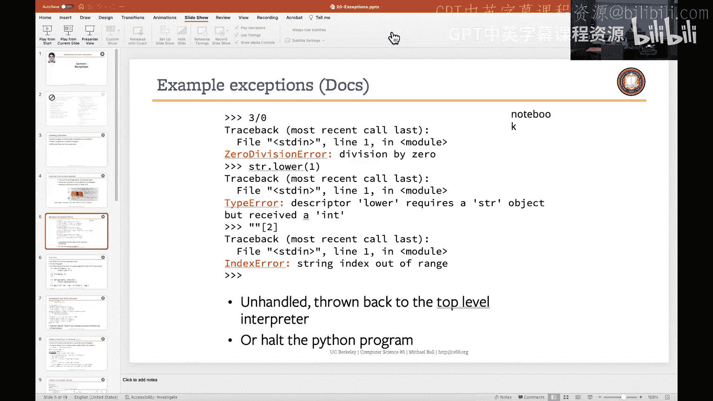

Is。Let's see。Actually， yeah， this one is fine。So earlier， we don't need anything here。😔，All right。

 so。We're just going to open Python3。And I'll demonstrate some of the errors that are on。

On the slide and so Python gives us。What we can call an error or an exception。

 the exact distinction between when someone uses error and when someone uses exception really doesn't matter if they're basically interchangeable。

People who like to argue online will give you distinctions。

 but to be honest I always forget what's what so we use errors and exceptions interchangeably。

 but what happens here is。Python is telling us we can't do something that we perhaps expected to do and what this usually means is that something occurred where whoever was writing the program in this case。

 you zero division error of the people who designed Python decided that something serious enough occurred that I don't know how to process or I don't know how to continue working with the information that was given in other programming languages。

Something divided by zero might give you a different value。

 but in this case Python says you're trying to divide by zero， that doesn't make sense。

 I'm going to essentially just shout into the void and say hey something went wrong。

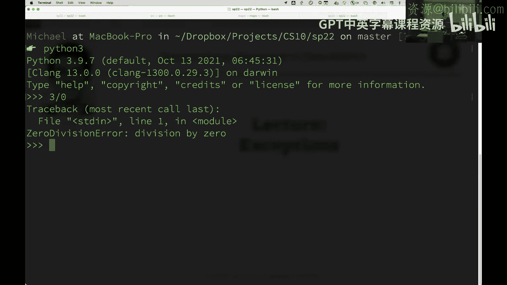

And in this case。Oh， no。The hectic PowerPoint is due slides are almost full screen all right we'll continue with that I guess。

What python is going to tell us is that I don't know how to divide by zero and importantly the first the first name here is this thing called zero division error and this follows a。

Part kind of format and we'll look into some of the details there。

 but there are two things that are really important here where is。

thats up there's my house so zero division error is a name of a particular type of error in Python and this is really useful because when you get an error message and there's by no means anyone who understands and memorizes all of the possible error messages that are in Python。

 but this at least gives us the start of a hint at what might have gone wrong。

It then tells us division by zero in this case， zero division error division by zero。

 pretty redundant， the message that we get back might not always be that much more different。

 but what follows is sort of a technical name and then a human ish formatted description of the error message。

嗯。We could。We could try a bunch of different things so the second error。Let's say if I said stir。

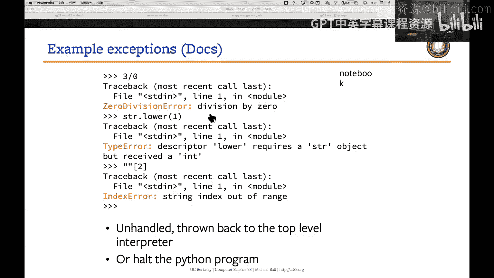

Equals 100。I tried to say stir。Dot lower。呃。Oh， I called this in a different way。Okay。

 this should actually be。Yeah， okay that example is actually not correct。

 but that's fine we'll go with it。In this case， we get an attribute error if I should fix the slide because I think a line of code went missing。

But。We get an attribute error that says some into object has no attribute lower and so this one is a little bit more helpful right this tells us there's some kind of attribute on some object。

 what is the object well some into object and what is the attribute something called lower so this says there's some error that went wrong and now this text gives me some kind of an information when we're writing code in the interpreter like this。

 it's usually easy to say okay attribute error just came from the line above。

 but when you're working on a project and in particular something more complicated like the answer maps project where there could be multiple files this error could occur somewhere deep down in in a longer list of functions so we'll take a look at some of those things as well。

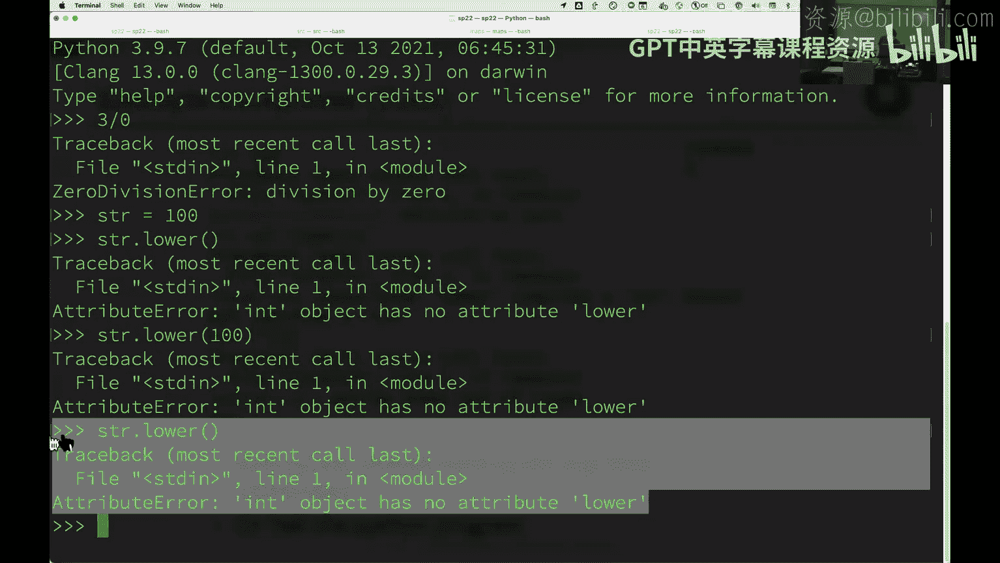

But most of the errors that you see in Python will fall under pretty common types of errors。

 so a type error just means that we gave some data a number when it should have been a string or a string when it should have been a number。

 a list instead of a dictionary or something like that。An index error， of course。

 is something that everyone has probably run into more than a few times。

That's when we try and access an index in a list or a string or something else that doesn't exist yet。

And of course there are all sorts of different kinds of additional errors that could occur。

 Python has a whole list of them online， but mostly what I would say is that when you recognize what an error is。

 you can then go through and actually start to Google for the particular kind of error message。

In this case， what's going on， right， is this error。

It happens it gets printed out to the interpreter。or to the terminal if you're just running a file and when that happens the rest of the execution of our file or our program stops and so one of the things that's important to realize is when we're working with errors how do we determine what should and shouldn't stop a program and do or do we not have a choice in that so。

嗯。So one of the things that we will look at for errors is figuring out。嗯。

Yeah we've said that functions should do one thing and they should do one thing well。

 that's sort of just any generic function， but what does a function do when it gets data？

That doesn't necessarily make sense。And in this case， there's not a single right answer。

 it will depend on the particular program that you're writing or that you the goals that you're trying to accomplish。

嗯。In this case。What happens is when a function gets an error that it doesn't know how to handle。

 when that exception is thrown， we never get to that return statement and so depending on the type of program that we're writing resolving this is an important。

Is a potentially important thing to handle So one of the things I'll look at a couple minutes is how do we take this exception and recover from it。

Before we do that， it's worth going through and actually we'll look at how we build a CS8D error。

 but it's just worth highlighting what happens。Inside inside an actual trace back that you get from from an error so if I run a file in this case。

 this is a file that will be or should be on the website now all it does is have a little prompt that asks for your age and tells you your age and days if it thinks you're less than 10 years old it asks if you should be taking CSC8 whatever reason。

And it just。But all it does in this case is it raises an error message and what this illustrates in just a couple lines of code。

Was that even though an actually I？Go ahead。嗯。Get rid of a few things here really quick。

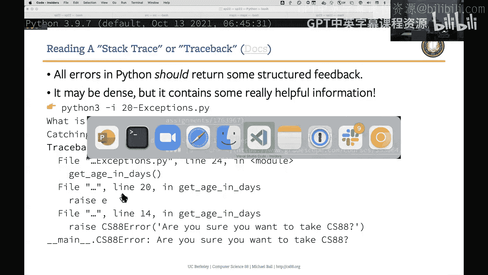

诶。If I go through， it looks like there's a little bit more code than there is just because this is going to demonstrate a few different things that we'll get to。

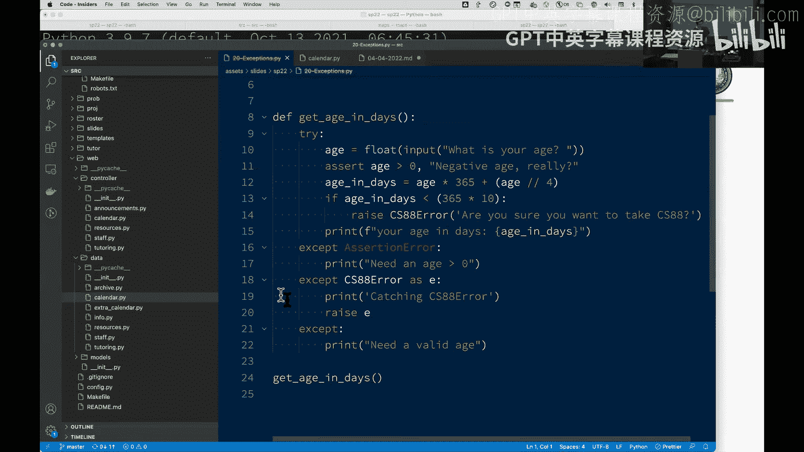

In just a couple let's say dozen lines of code the message that we can get back already contains a lot of valuable information。

 so in some file path this one I removed all the details just because a lot of text。

 but in some file named exceptions。 Pi at some line in if you just see this thing module。

 this is just sort of the basic global environment for Python。We call this function get age in days。

Then at line 20。In the side of this function， we had some line and we'll talk about what raise means in a moment。

 but this thing actually raised the error again。And then on line 14。

 it actually shows us where the error occurred。It's a little bit confusing in the real world when we go through。

A traceback like this notice we start it we start at line 24 we go to line 20 we go to line 14 and at the end it just reiterates we got some CS88 error are you sure you want to take CS88 and so in a traceback。

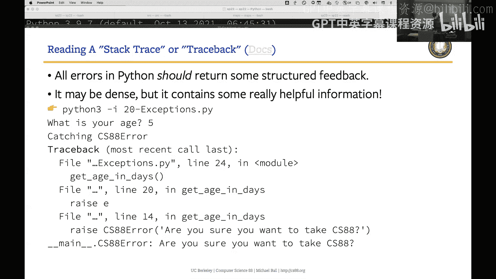

The hint that is always worth starting with is is at the top of the trace bucket it says most recent call last and what this means in this case is。

This code， it says Python is telling us so the error actually occurred on online line 14 and in this second we'll talk about what raising an error means。

But this is just telling us that when you start debugging your code。

The very first thing that you should do。Is go to that last line of your trace back find the file on the line number and start looking at that line of code。

 So this thing again we'll get to exactly how raising an error works。

 although it's not not too complicated but this is the line that caused the error and now we get to say what else in our program caused the error。

 So we'll talk about the rest of this code try and accept and how that works So that's why we went down a line here to。

To raising the error again， but ultimately it tells us that we're inside some function。

 so we'll come back to this example in a bit， but the important thing here is that。

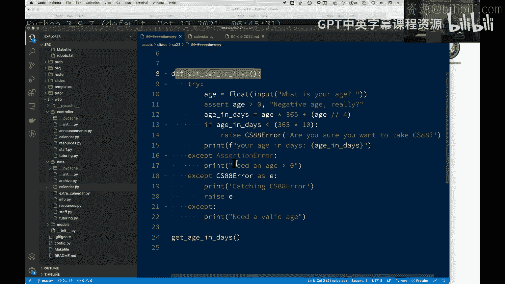

Despite the fact that there could be a wall of text。

 you start at the bottom and you work your way back up。

 tracing the lines of code through what's going on。

Tracebacks themselves can have a lot of additional information。

 so there are some documentation in Python that show us or that you can explore that sort of show how you can actually work with them or how you could pull out in a programmatic way any additional info but for the most part the important thing is start to start at the bottom here。

 recognize what function the error happens in what line called that function。

And potentially go through manually go through opening different files and looking at what's going on。

 hopefully for most of the code that you work on CS88。

The types of errors that you occur or that you see occur will only happen in one or two files。

 you won't have trace backs that are incredibly long in the ants project when you start that you might see three or four functions called that deal with different objects and what objects inherent from but you'll still hopefully just be dealing with a single file。

So。You can also go through in Python tutor and kind of see some examples depending on the format and the。

呃。The environment that you're in errors will be presented in a little bit different way。

 so in a in a Jupyter notebook you'll see。A little bit more of a verbose version of a stack trace where it shows a couple lines of code for each function call this is I think a really useful version。

 but it's also a lot to read through and it varies or differs a little bit from from the terminal output in。

In Python Tutor。It won't tell you it won't show you the full trace back but it will just show you an error message。

 so depending on the tool you'll interact with exceptions in a different way。

 but all of them work fundamentally in the same way that we typically start。

The thing closest to where this error occurs， the most low level sort of issue， so to speak。

 and then we work our way back up。The stack of error messages before continuing on。So。

Some things in particular that actually before I continue on。嗯。

Any questions so far on this idea of just an error message and tracing the code through the list of error messages？

Anything on the zoom doesn't look like it yet。Cool so。So in Python。

 I think some of the most important things asyphon ones mentioned to be aware of are type errors。

 name errors with dictionaries in particular， a key error is the equivalent of an index error in a list。

And you may also see in Python a runtime error and runtime errors are just sort of a catch all for。

In the process of running this program， something happened and Python didn't know what to do with the data。

We can also create。U。Our own exceptions， which。Alright。嗯。Yeah， actually we'll come back to yeah。

 we'll do this。2。We'll come back to creating our own exceptions。What is really helpful。Is。

Inside the process of working on code is to be able to handle we'll first talk about just how we handle and process exceptions and what to do with with some of these things。

 so let's say we have our function。In this case it's just called divides 24 it returns whether or not two numbers or a number safely divides into the value 24 I'm going to comment this out so that we can write。

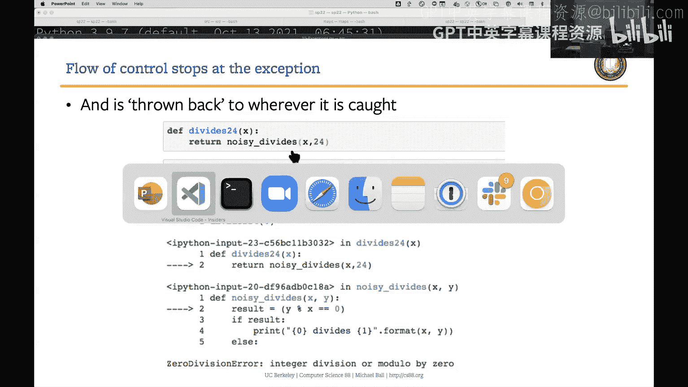

嗯。That we can write this live。So divides 24 as its function。And it's just going to return。Safely。

Divs。Which she' is going to call our。Divides function。With some argument 24。And。Oh。

 it's going oh sorry， it's going to call whoops。It's going to call this function safely divides with the values X and 24。

 and so the question is how do we write a function。That。We can。

Sort of determine whether or not something works in a safe manner。Yops。So。Ultimately。

 we want to know if。If some value， actually， this should be。X。And why。

So ultimately the question is if I have a function that I know can raise an error。

 how do I give myself a away to recover from from that error and what Python gives us and we'll come back to the code。

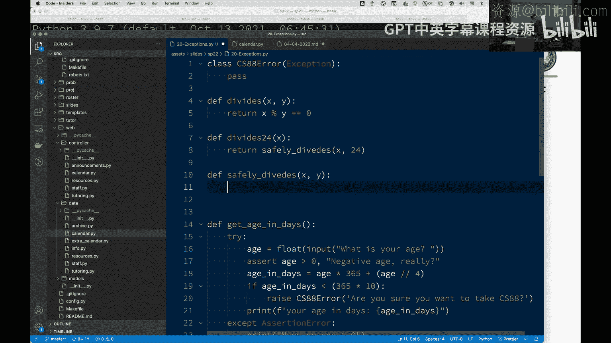

Is is that is this？Set up called try and accept and like any other structure in Python。

 the code that we deal with will be indented inside each block， but try allows us to say。

Try running some sequence of code and if an exception occurs in the process of running that code。

Do something else in particular， the the reason that we'll use a special word like try and accept is that we can't just say if this data doesn't make sense。

Handle that error because an error could occur and our if conditional or an error can occur in basically theoretically any kind of function。

嗯。In this case， what we're able to do is use this structure， and so we'll just try this out。

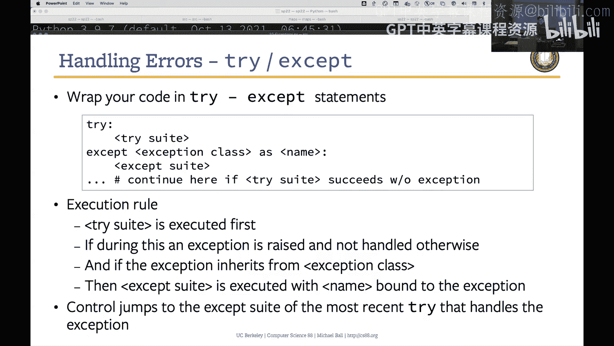

So we say try。And。And if this code works successfully。

 then we never have to run the accept block so I can say， oops。Return。It divides。In this case。

 we'll just say x and Y。 So we're going to use our very simple divide function that just returns true if x。

And why are divisible by each other？Otherwise， we can say accept。

And we'll come back to all the different ways that we can use except later on。

But accept allows us to say if any type of error occurs in this process。

Let me let me handle it in a particular way， so what what should we do to handle this error well this is just a very simple program so we might just say print。

And error。cururd。And if our function is still supposed to return a value。😊，We might just say。

Return zero， we could actually perhaps。Return none is a common thing that some programs will do。

 but if a function is supposed to return zero or some number and we return none。

 it's likely that some error will occur。Down the line。 So I'm just going to say。诶。Actually。

 what we should probably do is if this is going to return true or false。

 we should just return false and assume that。If we can't divide two numbers safely。

 then we just can't divide them at all。

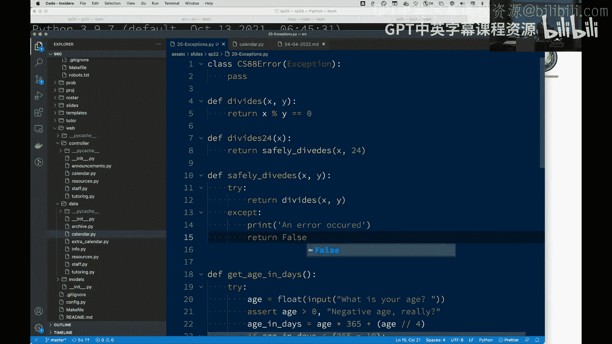

And so。I'm going to reload this file。Not 20， I renamed it now since this is lecture 19。Oh。

 I'm in the wrong， whoops。Wrong folder。I think。Yeah， there we go。All right， okay。

 now we're in the right place， Python 3 I。19 our exceptions file。No啊。

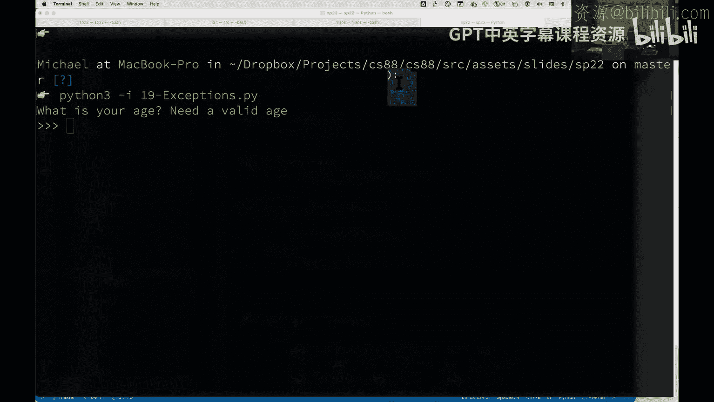

对 you啦。

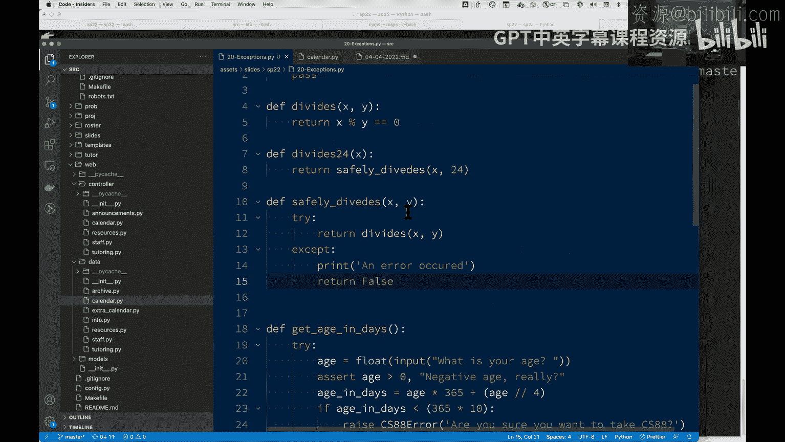

Oh， shoot。 I have two files。 Okay， that's why。Whoops， whoops。All right。

 I'm sure that this is the right number after lecture Okay， so right file Python 20 exceptions。

 so in here we have our function。We have divides。And we can ask if。You know。

10 and five divide that all works correctly。Of course， if we were to ask。

How many times does 10 divide into zero， this is where we get that zero division error from from earlier and。

This is one of those cases where。Again， in this program， it tends to make sense。嗯。But in this case。

 we we might want to。Protect ourselves from the possibility of a particular error so in this case we can say safely divides 10 and five。

When everything works， we should get the same result when something doesn't work。

 we can now handle a different kind of error so in this case。Our safety divides function。

We say we're going to try and do a division when when an error occurs。

 what Python allows us to do is hit the second body you can kind of think of try and accept as a special if else for if some error occurs do this special exception case。

 print what's there and return the value， importantly in this case， know。

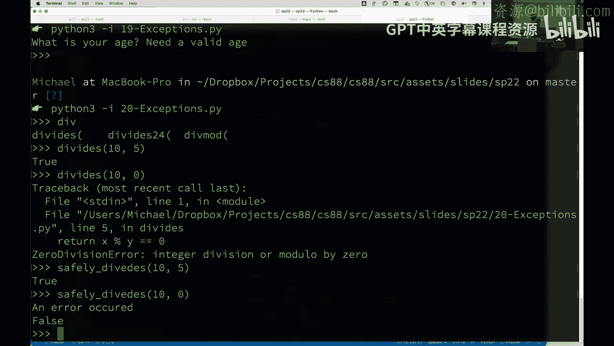

We get a return value from our function， we get some info back and our program continues on this is most noticeable like let's say if I say result is equal to divides。

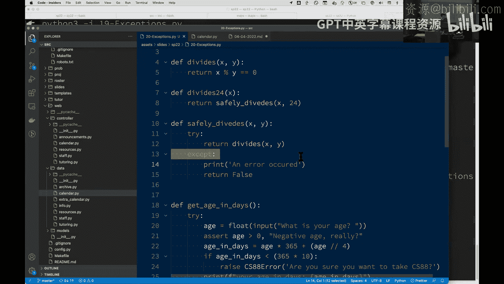

10 and zero。呃。If I say results is equal to divides 10 and zero。And I now ask the result， well。

 that assignment never happened because an error occurred in the process。

 and so one of the biggest reasons that we might use try and accept is that we can write code like saying result is equal to safely divides 10。

N zero。And because we assigned something， Python didn't show us the return value。

 but if I ask for results back。I can see that result was successfully assigned and my program continues on and so try and accept works in this way is that it gives us protections from errors that occur。

Oh yeah so someone' was just asking in the slides what do we mean by saying exception class name is name yeah so thats that's the next step of what what we're going to work on what try and accept so what I first wrote here is just try and accept with no additional information and in this mode accept catches and allows us to handle any possible exception。

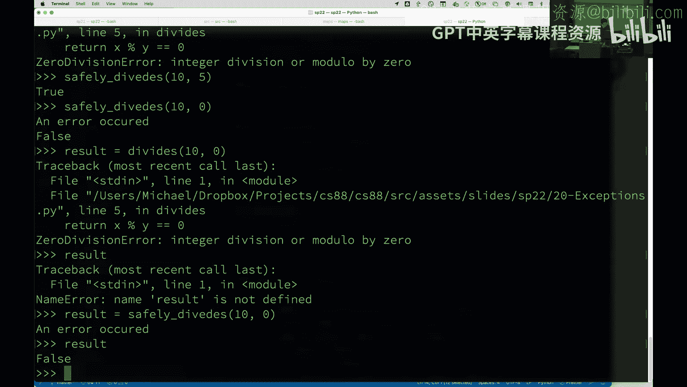

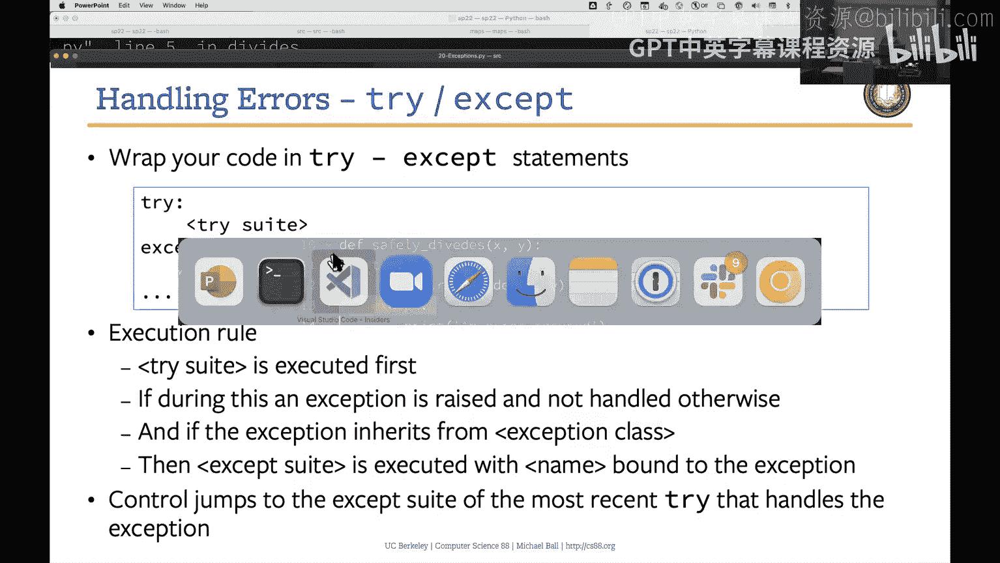

That can occur。However， what？What we might want to try。嗯。Is。Let's say。

Is allowing us to handle only a specific kind of exception， so in this case。

 I know that a divide function might raise an error about dividing by zero。But。

And I know that how I might handle that in this case that might be returning false。

 but some other error could potentially occur like some variable not being defined。

 perhaps or you know some， well this function is like one line of code。

 so I can't really think of too many other errors that could happen。

 but some other possible error could potentially occur。

And I might not want to handle that I might say that's an acceptable case for where things should stop running so I can say accept the name of some error and well and if you notice it's just the exact name of the error that was in our traceback as。

Some variable name， so I might just call this U and I can print。An error occurred。

And just for information。I can actually print that error back out。To our console。

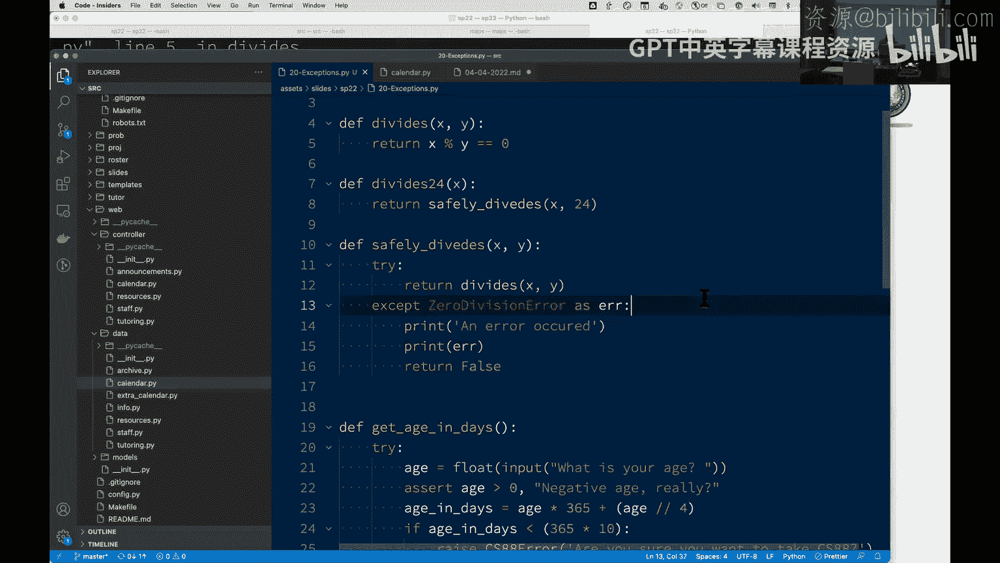

Let's try this again。Load our file。This time， when I execute our function， I do safely divides。

10 and zero again an error current says enter division or module or modo by zero and this is the message that comes from the zero division error each error if we just print it out will print out whatever message is defined。

There are ways in Python of getting back that entire trace back。

 but we're not necessarily going to go through that。

 but this allows us potentially to interact with an error in a more structured way。

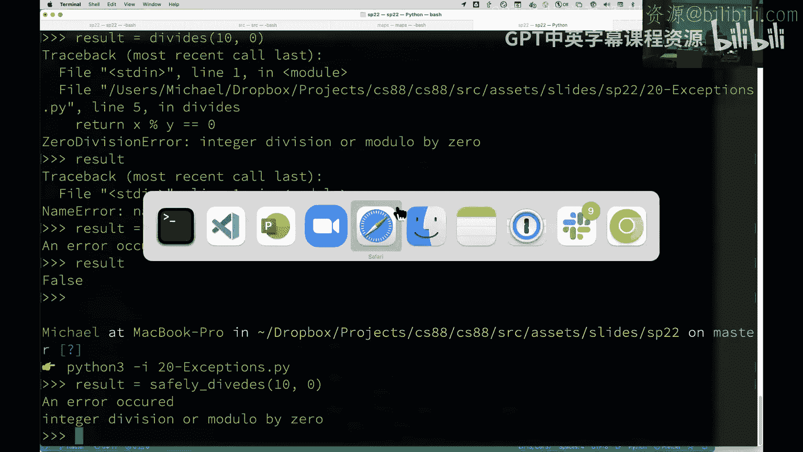

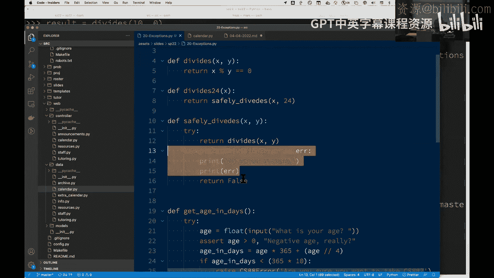

What doing zero division error though allows us to do now is if I say。

Let's say instead of divtiding by zero。We divide by something。And in this。In this case。

 the way that this works is there's nothing catching this name error。

 so it says name thing is not defined。And actually。

 technically this is the interpreter that's handling this error， not our function。

 but if I had another kind of error message that wouldn't be caught so accept。

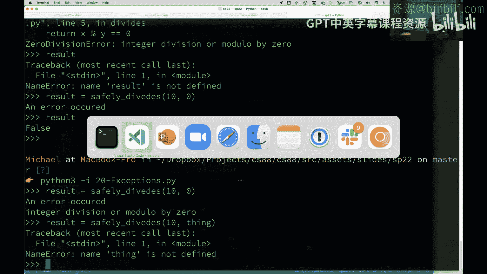

The exception syntax really has two things， we could leave off our error name or we can leave off the class name as some variable name if we want to。

But it's a really useful way of ensuring that we're handling the right kind of exceptions。

And now we'll go back and demo a couple additional things and questions on on this idea so far of taking some code。

 catching some exception and doing something hopefully useful with that for。

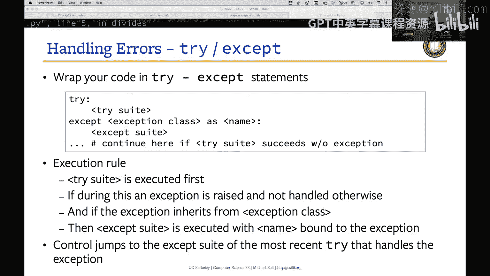

So not sure why I misored the slides here。

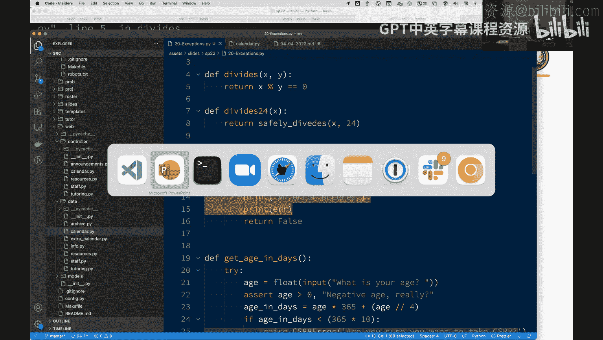

But。In our case。Sometimes what we want to do before we even get to the case that an error might happen is to use a statement in Python that you've seen a couple times before。

 but called an assertion an assertion says I want to ensure。That something。Is。Is going to be true。

 and I don't know why the x and Y arguments of the slide are flipped。

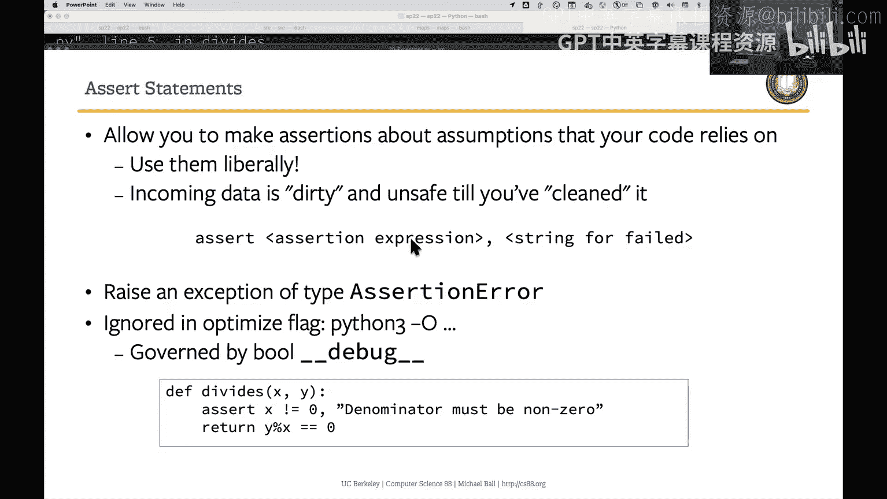

But。What we can demonstrate here is。So if I say assert。What assertRT takes in。

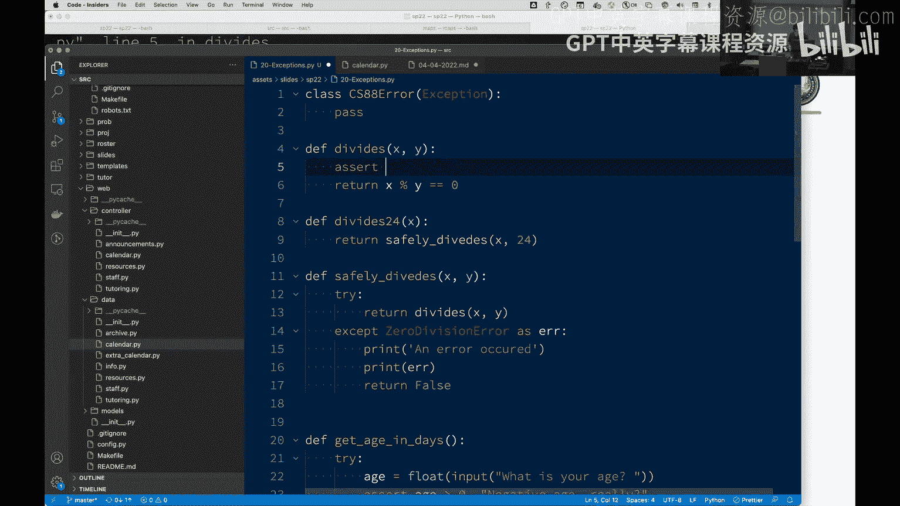

Are are two things an expression and some some text for when something when something fails and so the first way to demonstrate this is just to realize that we can always do something like assert false。

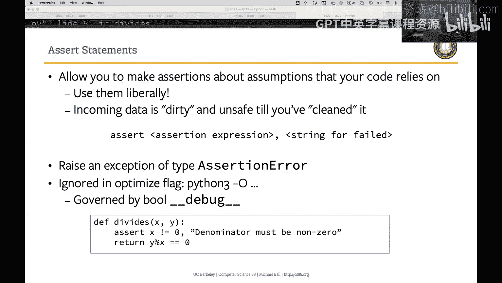

And we could say this。Is bad。And so when I run this code now。

 any time that I call our divides function for right now。

 we're always going to get this assertion error。

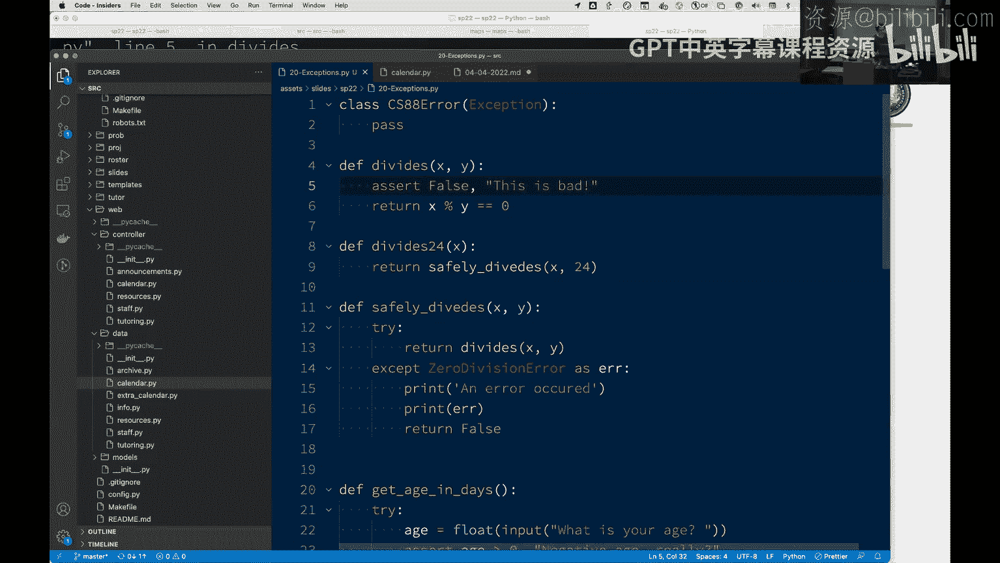

And so。What I'm going to do。Is。Exit out here。Rele our file。And。Does someone want to take a guess？

About what the value of result will be in this case or what's going to happen。

What do we think might happen when we say when we try and call this function？While you say an error。

 will the results still be false， what might happen here？Someone can shout it out or type into Zoom。

Cool， someone says we'll see this is bad。Yeah， we should see in this case somebody says an assertion error。

 this is bad now why why do we still get this trace back that's because in our accept case we haven't handled an assertion error。

So we might say something。

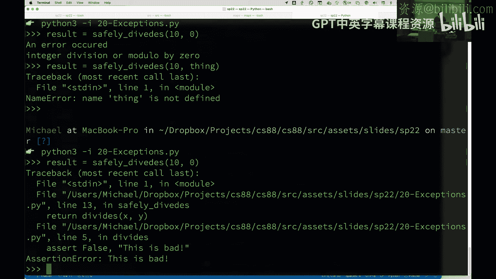

啊。Perhaps。呃。Well， a， we might actually write a useful assertion， right？Who might say why。

In this case。Not equals zero。嗯。D5 by zero but。In our our function safely divides here where we're catching or we were catching is zero a division error now our divides function can raise a different kind of error and so what we either need to do is figure out。

How do I change this？Im accept statement to address our assertion error or how do I handle multiple errors and this is just one of those tricks in Python that there's lots of different ways of potentially handling this so I whoops。

 I can just say I can change this now。To an assertion error， so if I try this。

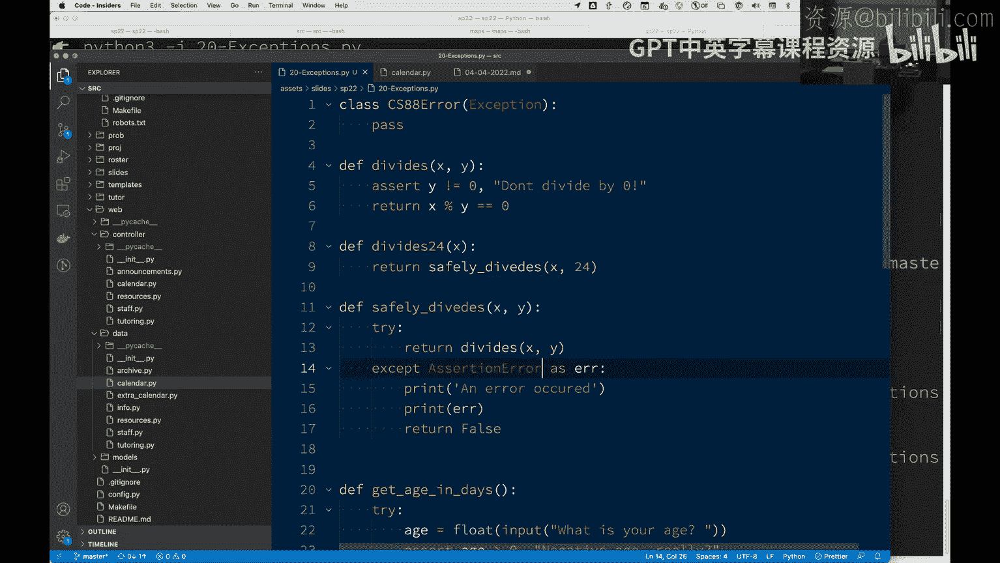

Again。So now if I try and say。A result is our safely divides function。

 what do I get back is result is now still false。Because we decide that's the case and the message that I see from our our error message is the message that we gave to the assertion error so assertions are really useful tool。

 they allow us to。😊，Ensure that some condition is set up about our about our function or about the state of our program before continuing on when you look in particular I would say if you're the type of person who's like taking CS88 to learn about writing Python code to use you know for some research project。

 assertions are a great way to in a very easy environment right something that says like assert that the number of values in my data that I'm being called on is still some reasonable number right perhaps you're filtering some data。

You want to say assert that the length of my data is greater than like 100 or 200 or something to make sure that you haven't filtered out all of your results or assert that some standard deviation calculation is within some range that you can reasonably expect。

Your your data calculations to be and this is really useful because it allows you and the next person。

To read through the code and ensure that as long as you write your assertions correctly that。

Those right conditions are going to be met。

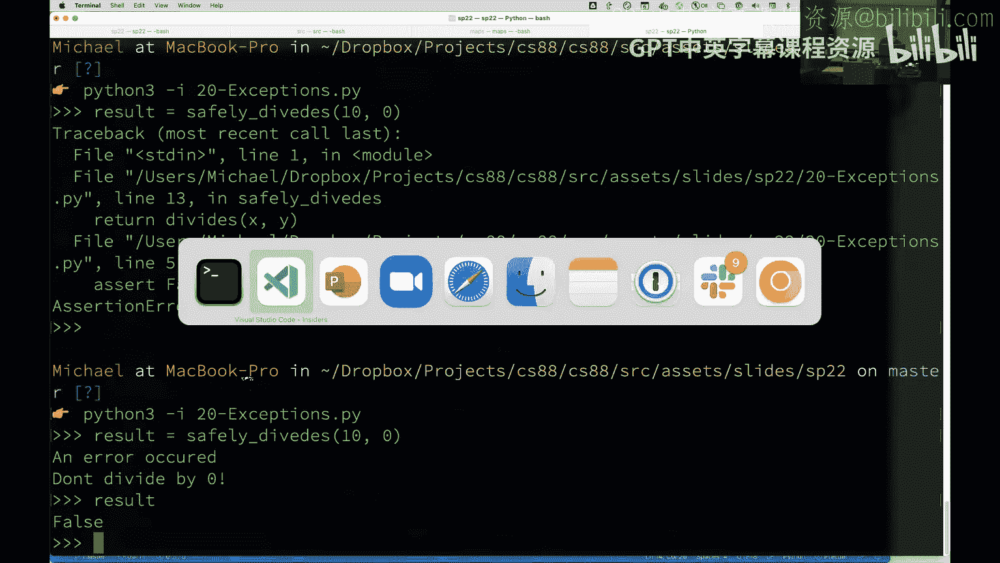

Assertions have this really cool property。It's a little bit hard to demonstrate and we don't really talk too much about N88。

 but you can dynamically turn them on and off by setting a special variable called underscore underscore debug。

 underscore or underscore， so again， a return to things that are built in and special to Python。

By turning this to false Python will actually ignore all of your assertions and just run your code or Python has this special thing called dash O for optimizing your code and that will skip all of the assertions in your code so sometimes you'll use assertions as a tool for debugging or for writing code and once you've proven that things are correct you don't want to just delete them from your code but instead you turn on a special mode that will run things a little bit more a little bit more quickly and so。

Assertions are a really useful tool that we can use to essentially ensure that different properties in our function are met any any questions about yeah。

 go ahead。

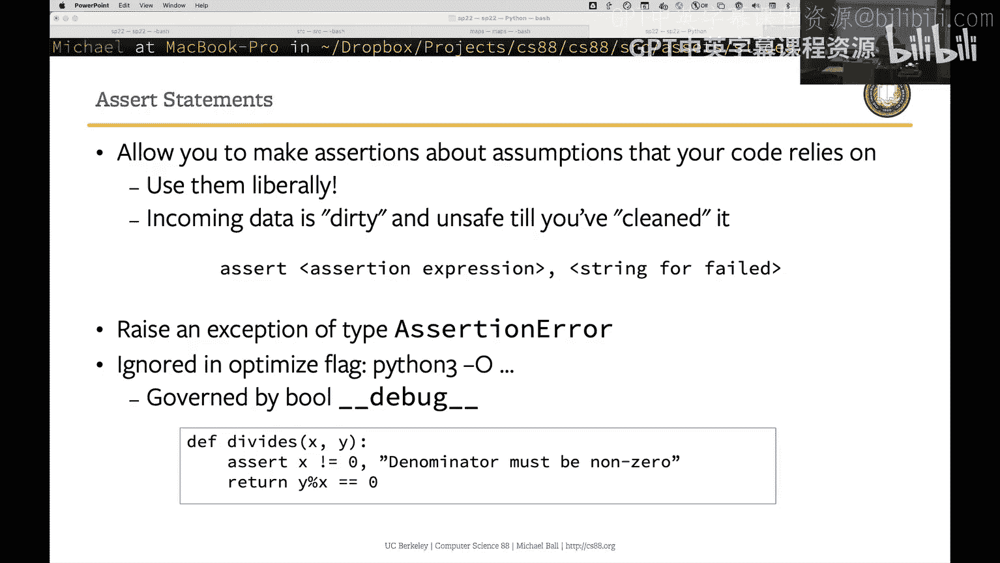

行。Yeah。

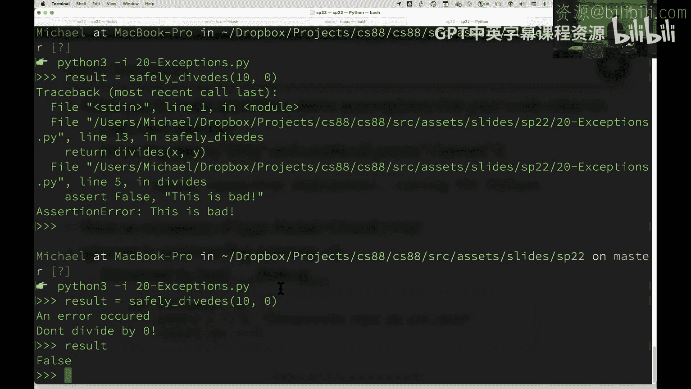

这我。Yes。Yeah， so， that's a good question， so what happens when we reach this assertion？At this point。

 when we reach an assertion here， the rest of the function stops executing and。

An error is now raised right here in our try block。

 so one thing to like let's actually perhaps show this。

 I'll just say some value is equal to the results of our function right and I could say。Print。Figurd。

Out。We could call this value。And now we can。Return our value。

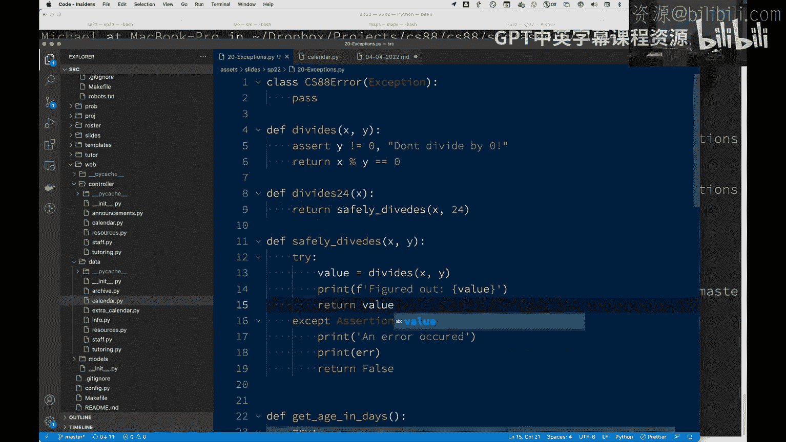

哎。So in this case， if I try and do something like see if。Two divides again into 10。

 or this will work out。But if I try and do something like dividing by zero again I'll get the error and what's happening is every time an assertion occurs。

 whatever is。After that error in our try block is no longer executed。

 we immediately sort of jump down to wherever our accept statement is and we can continue on there。

 So in our accept statement。This is just。

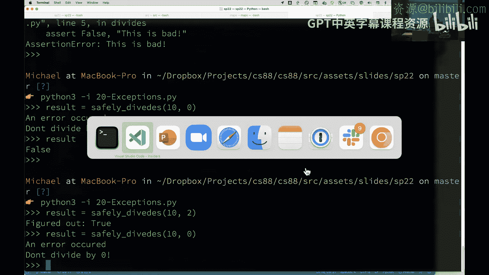

What we've done here is just handle this one assertion error， we've started now at。

 I guess technically line 27 we' run through this code and if all that runs successfully。

Our function will return false of course these are just print statements so there's not much else that could occur inside the handling of some assertion error another error could potentially occur and in that case our try accept wouldn't know hand to hand wouldn't know how to handle a second error in this case were just handling one error at a time errors that raise other errors don't necessarily get handled by Python yeah。

Yep。Yep。Yep， yep。Yeah， so anything yeah， that's so for those on Zoom and here yeah， the question is。

 so when we leave when we leave this or when we hit this assertion statement within our Tri block。

 we don't do we don't execute anything else after this。

We don't execute any of these lines and we immediately jump to the rest of our accept block now the reason this works is because again here we said I'm only going to catch an assertion error and if we have another kind of error。

Python will not handle that error for us because we didn't ask to handle it。

 but that is yeah that's a good question so the last two things that we'll demonstrate today。

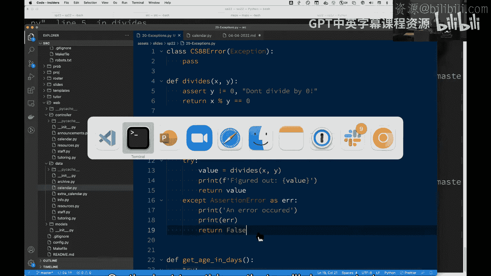

With try and accept our。嗯。or how if we want to we can raise our own exceptions。

 so sometimes an assertion error is nice， it's an easy way to have a piece of code。

 especially that's you know just sort of a short kind of statement。

 but every assertion error returns an assertion error， it is a specific type of error in Python。

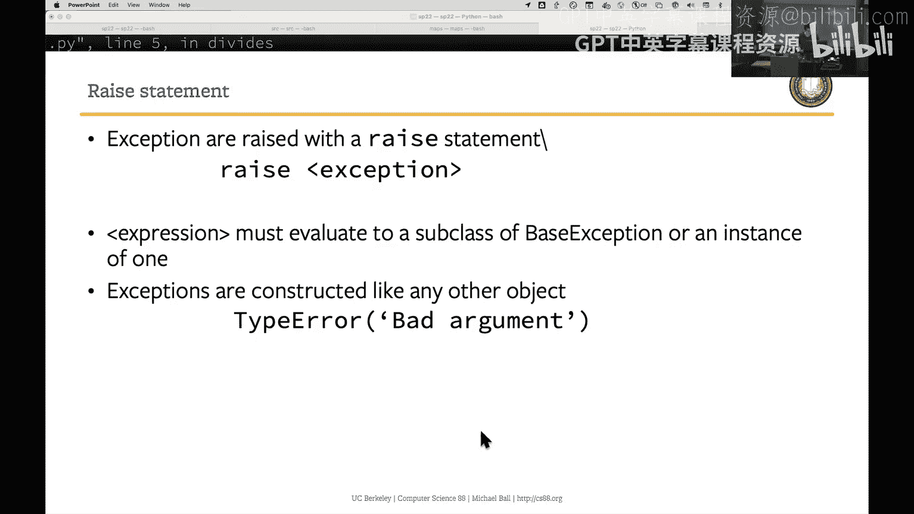

And what you might want to do in your code， and this is where we'll get to this kind of example today。

Is you might want to raise another kind of error or raise your own type errors to say that the type of data perhaps doesn't make sense。

 so in this case， what we've done we'll do the last two things together in the last few minutes is。

So one thing is that our function just for demonstration purposes mixes an assertion here that ensures that our age is not negative。

 but we also raise a CS88 error and raising our own errors is a really common thing to do you'll do it I believe in lab but you'll also do it once or twice in the ants project and this is a really clean way of giving a particular name to a particular kind of error message and they rely on the objectoriented programming design that Python has for exception so every error is at class so we say we give it a new class name。

Called CS8A error。And all of our errors inherit from what is their base class that Python calls exception。

 and when we do this， we don't have to define our own in method。

 we don't have to do really anything else， we just say pass so that our Python code has some sort of valid body。

And now we have a special kind of exception that we can raise so we could raise really any sort of valid exception here。

But in this model， what we'll do now is。

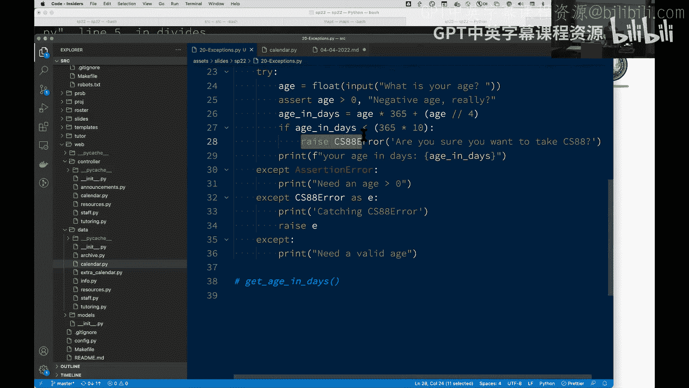

We'll just try and ask for some code， so this function is called get age in days it asks for age。

If I say I'm 19， it tells me that this is my age and days。If。I say。Whoops。

I am negative 19 or whatever matter。It will tell me that I need， of course， an age。

Greater than zero and this is because inside our code。😊。

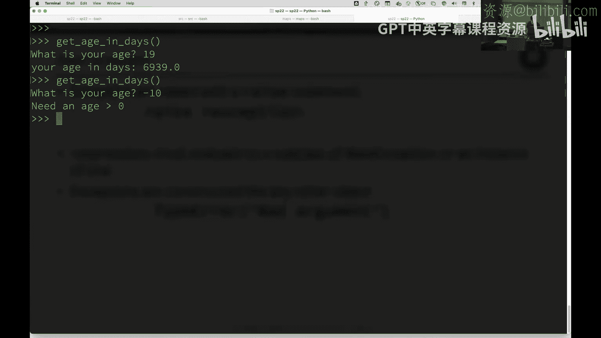

I've written a。An accept block here that again catches an assertion error。

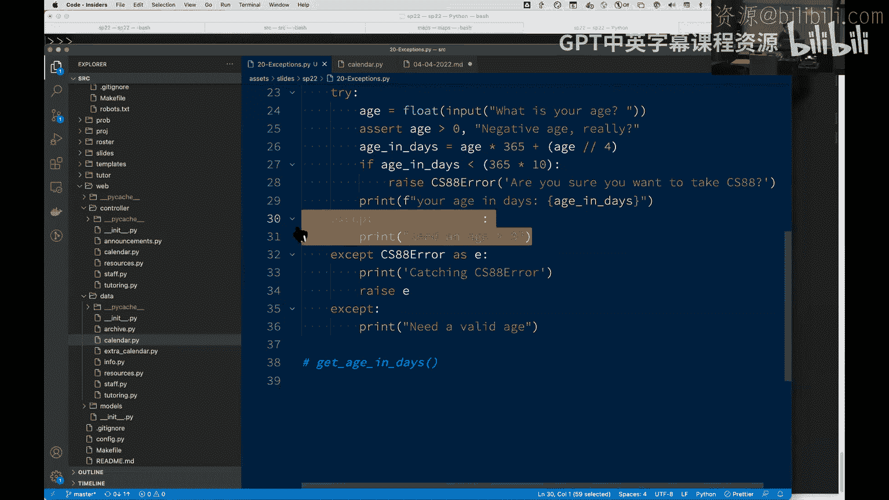

Of course。Another error can occur， so in our code here， if I say wasM。

 if you give anything less than 10 years old。It will catch our CS80 error and for demonstration purposes。

 it just blows up again by using rays error after telling us that we have。

Caught an error message and this shows us what can sometimes tap in our code where we raise an error。

 we catch it to do something and then that error gets raised again because we don't necessarily in our code know how to continue so this is this is how we get a stack trace that has multiple lines of code of the history and in this case all that we're really doing is just printing back an error message and and demonstrating that。

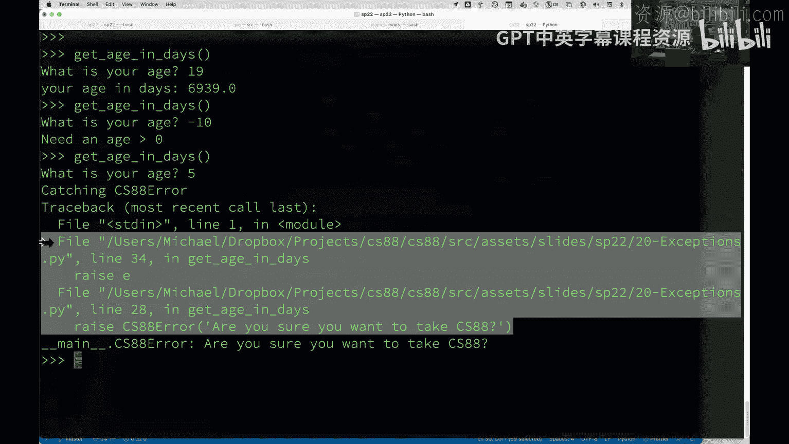

And perhaps if something else occurs， we can handle any exception seeing that we need a valid age。

 it turns out that getting。Getting this exception to occur is kind of difficult because the float method in Python handles just about any kind of data that you give to it so that's a little bit about working with exceptions most of the idea here is just to think carefully about when we get an error message how do we handle it when something goes wrong in our code。

What should we be doing to handle it so in lab this week you'll do a little bit of working for this and the project for ants towards the end you'll do a little bit of raising your own exceptions as part of the spec so with that we'll see you on Monday again yeah。

Thank you。

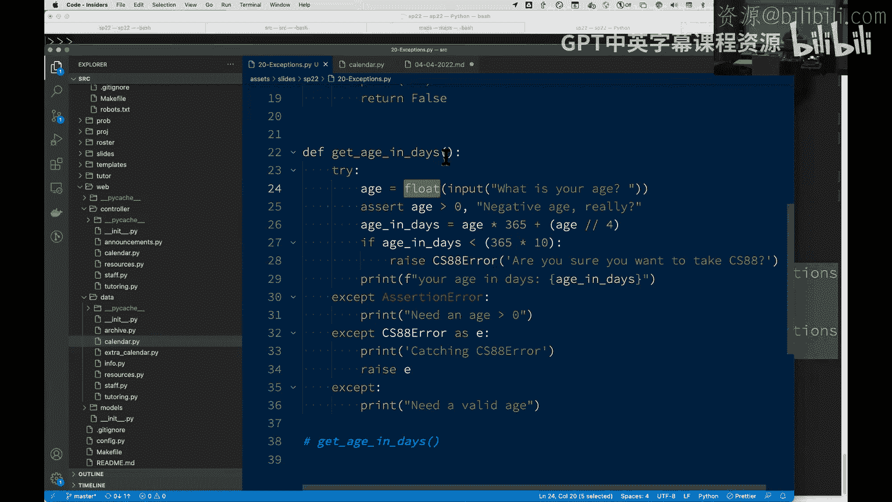

诶系。2呃1。yeah， I'll get to those impressions。I don不。就。我哋拍看。哦，哦安。That shouldnt work。然后。

It's possible that Python Twitter is using a different version of Python that's a little bit older that doesn't allow this。

But I thought okay， it does， okay。There may be something else， I'll have to look at the class。

If that's the case， that may be're relying on something that we're no longer teaching。Yeah。

 but that's。So yeah， the main point is that if we modify。The thing that is outside the function。

 you can still access it， so it should be free， but I'll take a look again and make sure that something else isn't perhaps missing。

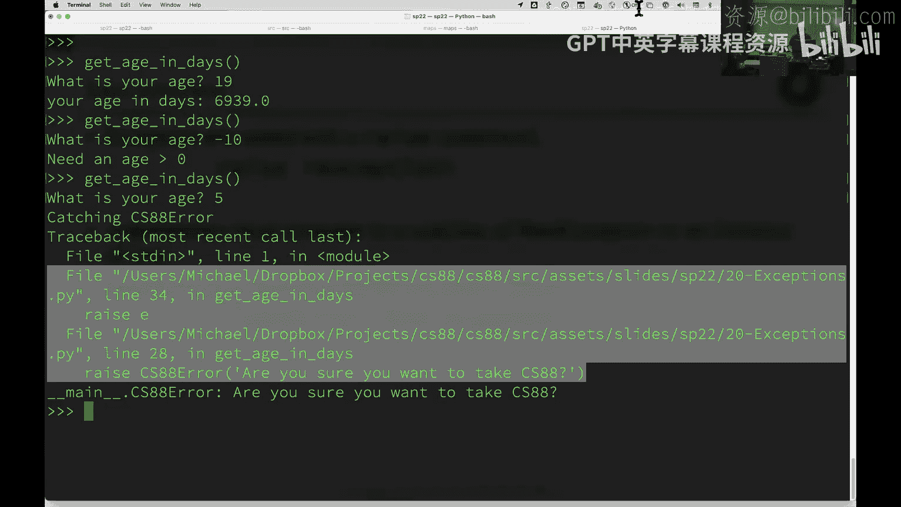

Yeah。