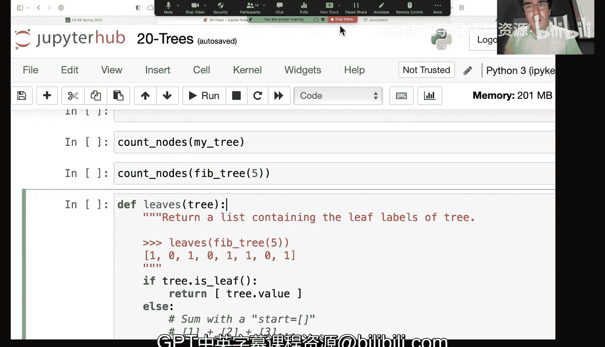

# UCB《数据科学中的计算结构｜CS 88 Computational Structures in Data Science 2022》中英字幕 p20 CS 88 Spring 2022 - Lecture 20 - 4_11_2022.zh_en [BV1516iBfEVY_p20]

嗯。Okay。嗯。嗯。Yeah。哦。Yeah。第一个。Sure。嗯。嗯。基本上。嗯。

嗯。

嗯。Al right。Testing， we go。Yeah。嗯。See as soon as some as。几嘢。Yeah。O。So the computer， that's better。还。

Okay。Thank you。Yeah。Oh。没。は。哎。All right， so today we're going to just continue with the topic that we started last week about linked list。

 today we're going to expand upon that with a variation called trees and let's see for folks on Zoom。

 let's see if the camera。It's cooperating。😔，嗯。Maybe not， all right。That I have to do。So。诶。

Trees today are of what I would say are one of the more fundamental tools that computer scientists have built in terms of being able to solve particular problems so last week we talked about linked lists。

And today， I think one of the most important things to think about is。

Maybeing this were a really useful。But they can be a little bit hard to see how we put them into place trees take linked lists and they show why they feel like that is useful because they are a generalized version of the linked lists and if you go to study other fields in computer science。

冇嘅。我怎么知道啊。系。嗯。Okay， that's。A little better Okay so。

So what we're going to do is think about how we did recursion last week， but instead。

But instead we're going to treat a linked list as a thing that can have multiple sublink lists essentially and again the point of today's lectures most of the examples that we're going to do are going to involve recursion and I think that's going to be one of the more simple ways of processing a tree in thinking about the data structure in the notebook for today there are some examples that don't involve recursion but they're a little bit more code and so they're listed as something that that's extra that you need to do so what we're going to do is instead of having a list which is。

Made up of linked list。We're going to have a tree which is made up of additional trees that we typically call brain shadeds。

And today essential we're going to do is model this algorithm called depth first search。

 which if you go to take CS61b， if you go to take other computer science classes。

We're not always searching for something， but we are going to be looking at every item in this thing called a tree in this order of going from the top to the very deepest item and then sort of back through the rest of the tree and we'll see what that looks like。

😔，So that's the goal for today。W do we use trees， well。

 trees as a data structure are a super useful tool for modeling just about anything that has some parent child type relationship。

If you're modeling a company， if you're trying to figure out who is at the top of this company。

 someone like a CEO or president， manager， whatever it might be。

 they have employees that report to them which might be other managers or retail employees or whatever it is。

 and those employees might have additional employees that report to them where you might imagine a family tree where you have parents and children in grandchildren。

 and these kind of relationships exist all over the world。

 on a campus like this we might model a university like Berkeley， as this thing at the top。

 and within Berkeley， there are departments like computer science and data science and sociology and political science and in those departments maybe they have subfields or maybe they just have courses。

 but these structures exist all over the world in biology right you have Kingdom final class order and so on on your computer or in Google Drive。

 you have files and folders。All sorts of things like this exist in the world and so our goal is essentially to be to define a structure that lets us model these relationships between one another。

So today what we're going to do is take this idea of linked list from last week where a linked list is an item with a series of sub items and expand that to be。

A。A data structure which allows us to model instead of one item having one child element to have multiple child elements or multiple relationships and so typically when we draw this what this looks like is some value at the top of a tree again most of our examples today。

 we're going to stick with numbers just because they're simple and they don't get in the way of anything。

 but you could imagine that instead of this value to at the top there's some value that represents a CEO or some value that represents Berkeley as a university or the United States as a country and a series of 50 states or whatever else you might want to bottle so。

In our link list， this would be our value and we'll have that same property when we get to the code。

But instead of pointing just to a rest of the linked list。

 what we're going to have now is a series of things that we call branches and each of these subbra or each of these things on below R two is a series of branches。

And each of these branches is itself a tree in the same way that the rest of a linked list is like the rest of a tree。

And so now the challenge is going to be we don't just have one rest of an element。

 we have as many rests of a tree or as many branches as we might as we might need。

 and so this will make a recursion a little bit more complicated and this will make our code a little bit more complicated it allow us to express ideas。

That we simply couldn't just express with olyus。This is the idea of a tree and what we're really going to do today is just practice with trees we're going to add branches。

 we're going to do things like count the number of nodes that are in a tree。

We call each of these things a variety of terms， but in general say each of these things can be a node in a tree if you take CS6 B you'll learn about other data structures what we call the nodes as well。

But we're going to do things like counting them and just getting you know some basic practice with working with a data structure like this。

 however， if you continue on outside of CS88 you'll find that trees as a tool are absolutely essential piece to doing things like making a database work they're absolutely essential to making it fast for you to type into the search field on your computer or into Gmail and to find the files that you need for some given query trees are。

The thing that basically enables。A whole bunch of subfields of machine learning to work there're sort of the basis for a lot of different kinds of data structures so we're not going to get into how all those work today。

 but they're a super useful tool for those things for those of you who might have taken some additional math courses there is a whole related theory of sort of bridging computer science of math called graph theory so trees are very specific version of this thing that we can call a graph let's which lets us just basically model even more kinds of relationships so if you're into that kind of thing again a good hint to take CS61 B but if you're into the theory of sort of math and modeling relationships。

Trees are good at introduction to some of those concepts。

 but again we're not going to get necessarily into you know all of the theoretical details。

 but what we will do today is just start。With and let me make this a little larger。Some stuff。

 what we're going through today is start with just looking through some code and defining what a tree is and practicing with a tree。

So。In the same way that we have our linked class。What we're going to do today is just practice with this class called tree and the like of our link classes a few different ways of defining this but。

A tree has a value。And it has this thing called branches。Now one thing to note here。

 in the same way that we'd like to introduce little bits of Python syntax throughout the course。

 this star here is really useful for the way that I have defined this this tree class so star branches has a very specific kind of meaning so we're actually going to scroll down here。

Before we get to that。So is a little bit out of order。

But what our star does in Python is star allows the last argument of a function to accept any number of additional arguments。

 so we call the sometimes star arcs or star arguments and it basically takes whatever is at the end of our list of arguments and turns them in this case into a twople in Python that we can iterate over or that we have access to in our function definition so。

The way that this works， we can define any arguments in our function。

 and if I pass in some data this case like hello， I get a one item tuple with the item hello。

 if I pass in no items， I get an empty tuple you。哎。So。

Star as are really useful because that allows us to sort of nicely build this tree that has as many branches as we need or has no branches。

This is just a handy shortcut for Python syntax， not something that you really need to memorize for CS88。

 but it does make some of the code today a little bit easier。

 it allows us to when we build a tree not have to turn everything into a list because Python does that for us。

2。Like like our link list， we have a slightly different model now。

 and this will be sort of key to some of the patterns that we see today。

 we say for branch in branches， so again， this value here is just a tuple of multiple items。

In this case we have a little bit of checking which says assert that each branch is an instance of a tree this is not strictly necessary but just gives us the idea that when I make a tree I want to make sure that every time I add something or work with a tree that that thing is is also an instance of our class and otherwise we say。

Self duck branches is equal to a list of branches。Now the reason that we choose to make this a list will become useful later on because it turns out that we want to modify that list of branches we have a record method if you remember back to the linked list method from last week this is almost exactly the same it。

It instead just calls Reper on self thought branches instead of self do rest。

 but that should be a list that we can call Reper on。啊。And now we have a couple additional methods。

 we'll get to some of them later， but one of them is a new thing for a tree。

And this is called Isleaf。And is leaf is just a method that allows us to tell whether or not a tree has any more branches。

It comes with the idea that at the end of a tree， if you think about a real sort of biological tree。

 you have branches that at the end of a branches is a leaf which has no more branches sping off of it。

 and so we call a true with no branches， a leaf or a leaf node。

 both terms are interchangeable and that is one of the official computer science terms for a tree object with no branches is that it is called a leaf。

So we have this method here， which just helps us。Write sort of more clearly that something doesn't have any branches。

 so we'll use we'll use that method before we go on to any examples and to start working with trees any questions so far about sort of the setup here or the Stars or anything。

 anything like that。TheQu on Zoom。We did try adjusting the mics。Still hard to hear， let me know。哎。So。

😊，The simplest tree that we have that we can work with， of course， is。Is this tree？

Which is a one item tree。Okay， this is a notebook， so let's run that。Good。All right， so my tree。

 it's a tree of one item， if we assign something for us the notebook doesn't give it back to us。So。

因为我听错嗯。Why is this good？All right， so if we put that back up， we evaluate it。

 we just get a tree of one。There's not too much going on， but this is a an object like any other。

 so I can say my。Tree is leaf。And this should report true so this tells us that my tree has no branches to it we can sort of verify that by the reper method that we that we built but this is a useful tool to be able to ask ourselves like does this tree。

Have have any branches and in this case it does not。

We can build larger trees so this one is what we're going to call the lecture tree and this is where trees get really fun and where when we're working with trees we can start to see how the complexity grows a little bit so I tried to format the code such that you can kind of see the nesting going on here。

But this lecture tree is the exact same tree。On on this slide here。

 so two is are very is a very top note we often call this。The root note of a tree。For some reason。

 computer scientists have decided that we shall have trees grow from the sky down to the ground。

 but so our root node is at the top of the tree and then everything else flows downward when we draw them through the root。

 but you can kind of think of it as the base of the tree。

 every tree in our case has one root node and there's always sort of one value in a tree。

That's going to be the case for CSD8。There are outside of this course。

Places where you could sort of break those rules， but for now every tree has a root node。

 it's the very first thing in the tree， there's always at least one of them。

And all the branches grow down。 So this tree here starts with two。It has some subtries which here。

If you sort of notice these are represented， come on。Yeah right。

But these things are represented as a list and what we're representing or what we're doing here is representation。

 which really just allows us to mess lists。Within nested lists。And so。

Unfortunately this is not the best view we'll work on a function that that allows us to。

To sort of view this in a nicer way later on， but for now we've got a couple trees and our goal today will be to just practice with a few different types of tasks that we might want to do so any questions so far before we start working with the values and the items that are in our trees。

CoolSo let's see how we all tell perfect so the very first thing that。We probably want to do。Is。

Is working on this what we call traversing a tree and when we traverse a tree just means that we're going to look at every single item in our tree and here's where we start to see the similarities of working with a linked list and the difference when we we talk about some recursion。

We're calling this Traverse recursive because it is recursive definition。

Let's see what do we have we have my tree is our。Oh， fine。W is my tree？Oh， I know why， never mind。

All right， hold on， we're just going to fix this。All right。I'm not sure how I missed that before。

 but so my train we can traverse it， we traverse a value of one item we just access that value and notice here that base case similar to our link is kind of implicit we say for branch。

In tree up branches。Or for be in tree duck branches。

The nice thing about a base case that works with lists and twos is that we can just write a for loop over an empty list we don't have to necessarily say if tree is leaf。

 we could just sort of leave that off in this case。

 so sometimes that's a really useful way to write our code but what we're doing here is we're just printing each value as we go through it。

And so now we can。嗯喂。All right， so now what we'll do。Is will traverse。Hour。A largerer tree。

And so this version of tra a tree actually goes in the order of everything that's on the slide。

 so we say saw2721，65。If we hop back over to the slides， over here we go two， seven2 10。

I did not want to click6，5， and so what we're doing here is for our first node。A two。

For B in tree do branches， so we have a branch that starts with seven。

 a branch that starts with five， we call our recursive function， so we say now our value is seven。

round four Arab branches in seven， let's call this symptom seven dot branches we have a we have a value two that has no more branches。

 the next branch has a value that starts with 10， then there's no more branches there the next thing is a tree has a value of six and has its own tree branches and we go all the way down。

 we go back up one level we go back all the way down。

 we go up one level we go back down then eventually to get to the end。

And then we go all the way back up and we go through the subre so this way of traversing a tree using recursion is incredibly short。

 incredibly simple。And the way that it works is it lets us go all the way down to the bottom of the tree and then go back up and then go all the way back down and then go back up and this is why it's called sort of depth first search is because we go to the very bottom of the tree or treat the leaves first before going to the rest of the notes so the code here。

I in some ways deceptively simple， but it's a super powerful idea that allows us to see every single value that's in our tree in a really generic way。

 so before we continue on， I want to check and see how people are feeling about this example about what's going on here。

Questions， comments。Concers。Folks on Zoom give me like a thumbs up。

 thumbs down reaction to see how and folks in their room like， we're good， not so good。

 how are you feeling so far。Okay， yeah， so cool kind a mix of reactions。

This is one of those things where。Intuitively， I would say seeing the order that we're going through is something that you'll sort of build up over time。

The one thing to recognize here again is that what we're doing is we're taking our current thing。

 which is always in this case our value， and then we're trying to decide how many。

How many branches do we need to process and the nice thing is by having a for loop。

We we can handle any number of branches in our tree。

 including zero branches very easily and our recursive function is always inside of our forwarding in this case。

 so if we were to plot these out， these are another form of tree recursive functions right each branch represents a new set of recursive calls。

The number of recursive calls that we have is sort of directly at tie to the number of branches that we have at each level。

 so the important thing to note is just that what we are recursing on at each level is this branch so I think hopefully this will start to sort of clear up as we think about that's just the code for reference。

When we do something like trying to count each node in our tree。

 so the first thing that we might ask right is。How many nodes in total are there？

In our inner tree and if we think about this， we'll start with a couple ideas right and then we'll go ahead and write this together so。

The root or top of our tree is a node of one item， every tree we said will always have something at the top。

A tree of one item has one noted so if we start thinking about that recursion that suggests a base case to us perhaps。

And so the question is， how do we count all the nodes in our tree？Well， for each subet。

 all we'll need to do is count the nodes。This sounds a little flippant right。

 but it kind of suggests the same way that we might think about about a problem in this recursive manner is that I start with a value of one and then I have a bunch of subtrees so I have a bunch of smaller trees that I also want to start counting the nodes on。

And so I'll probably try to do something recursively now the challenge here is that instead of just having one recursive call。

As we saw in our traverse function， we have a bunch of recursive calls。

 so getting to the right solution might be a little bit trickier than some of the other functions that we wrote。

 but it's nothing that we can't handle。So。So we have a function here， I started it for you。

 if you look at the lecture files， there's a version later on in the notes or in the notebook and the Python file。

That has a completed version so if you're following along don't look too far ahead but here's how we'll think about this again we've wrote a base case pretty explicitly is that if I am a leaf node or if T is a leaf node we have one value and every tree should end in a leaf node and that is a tree of size one。

Now what we need to figure out is what does our recursive case look like？For right now， actually。

 before we get to the lecture tree， we can say count。Count nodes of my tree。

So counting nodes of my tree that's one that works correctly right we have a tree which is just a leaf node it's got one value in it therefore its size is one so nothing。

Nothing too crazy going on here， but what about our lecture tree？那我たね。

I need to change that keyboardword short so our lecture key right now just says one because all we're doing is hitting at what should be a recursive case so。

In a recursive case here。嗯。What are some things that I might need to do？

Or how might I think about writing or solving this recursive case。

 what are some things that I'm going to need？To solve this reverse the case。Based on。Let's say。

U here here's sort of our template for acursive function this doesn't do anything other than print values。

 but this is this is sort of one template for accursive function so for branch into that branches。

We call our Traverse recursive function so what is something that I might need in in my else case you can shout out Python words or you can type them in the zoom chat or if anyone in the zoom actually wants to unmute yourself go right ahead。

 I think we can hear you。What are so let's make sure of that。

Yeah okay I think we can hear people who unmute themselves cool so we need yeah we need a call to count notes so once before I return anything。

We're going to have a call to count nodes and what should be our argument to count nodes。

 what's one thing that's going to go inside of the called to count nodes。

 but should we probably call this on that？So definitely need this it is recursive so we've got if this on an exam we've got at least one point。

 yeah tee do branch cool so。So this is a good start。

 of what might be the challenge it's calling count nodes this way？呃，我。呃。

What kind of data is TW branches here？So in this case teeD branches is going to be a list of branches and what we need here is a single branch because each tree is some branches。

 so what we want here is we can't just pass in a tree itself， what we need some branch here。嗯。

If I can type through our branch correctly， so what we need to do is we need to count we need to count the nodes one branch at a time because what our function takes in is a single tree。

 but each branch of our tree represents is one tree that's just a little bit smaller or maybe a lot smaller depending on the size of our tree。

So the trick is how do we count？嗯。How do we get all of our branches well？In the same way。Yep。

 for branch in T dot branches。So。What we have here is a forlot that we can go through all our branches and our recursive problems for most things in our tree。

That we're working they were going to have some kind of a pattern like this。

 and so we could say something like count。Is equal to the count nodes of each branch。

But why don't I just print？Count here。So we're going to try this。And see what happens。So。

What's going on here， well， we can count the nodes in each branch。But unfortunately。

If we just start counting the。The number of nos without storing or saving that value somewhere we going to run into into a real challenge。

 so what might I need to adapt this recursive case what else might I need to do here to make this function start to work aside from in fact eventually you know i'm going to need to return something so。

嗯。We'll start with a return case here。So。What might I start doing to adapt this to keep track of a whole bunch of value？

I want to shout out some possible suggestions。So this is definitely what I'd say is this is a tricky thing to think about with recursion and how we're doing that so。

We need to keep track of the count of each row branches as we go through and have and have each recursive call so we need some value that we're going to store and save and so the question is what should we start count in this case。

It's there's a couple different values that we can start our count as we're going to start our countdown one representing that in two scenarios right。

If if I am a leaf node， I have one value， if I'm not a leaf node。

 I have myself as the root of the tree is a node of size one。

 and what I'm not going to think about doing is adding the counts of all the nodes of each of the subtes。

So。Yeah， so essentially cool someone on zoom just suggests that we need we need a counter to keep track of things。

 so this is going to be a variable count。I'm going to instead of just getting the value for one tree a time。

 we're going to take that value， started at some account start at some value in this case one。

 and for each of our subranches， for each of our subtes。

 we're going to keep incrementing the count of our function。And then at the end of this。

 we're going to return。Our account。So let's comment that out for now。

 let's test our code and see how we did。Count of lecture tree does not reload。Not for some reason。

All right。Okay， cool now we get to now we get to 10 and if we hop back over。To PowerPoint。

 I should add our tree back a few places。Let's see one， two， three， four， five， six， seven。8ight。

 nine and 10 nodes exist in this tree and if you notice I actually went through and count them in the exact same order that our function is going to count the nodes in so again we can just do that so this is one。

Ted up branches， two， three， four， five， six， seven。Eight， nine， and 10 nodes are in this tree。

So if I go back over here， we can actually now start to。You know。

 let's let's just add some value here， so let's say print。诶天。え。So t dot value。And okay。

 so after each value then。We will print how they count changes， so again， the base case。

 no change there。So inside our for loop， we'll look at the value of。

Of each node and the recursion here gets a little bit complicated as this for loop goes through。

 but we start up with two is our root node we visit the the seventh branch so we can even you know maybe actually this will be a little bit more clear。

哦。呃。Soll make it more clear what we're counting。Oh， and you need a quote。

 why do I use double quotes there go。哎，就。We start with two。

So our count will be one we didn't print the count at the beginning of the for loop。

 but now our branch is seven we return from there our count is two and note that we're just printing the count。

Right after we re increment it。Actually， we could separate this code out a little bit if we wanted to sit account at the different times。

 perhaps this wasn't the best print place or the best place to put this print statement。

But we could start to go through and see that as we iterate through a branch。

 what happens is we have。This final branch of 11 here。

 and then our count really starts increasing by three， six， seven。We go down Ts5。

 we keep going down and what's happening here is you'll notice that count is actually increasing kind of an odd pace。

 that's because we're not getting a result。From count branches。

Until the recursion actually stops so this is one of those interesting things with recursion in trees that we never have a final value for the number of nodes in this tree and our recursive function never stops until we get all the way down to to the very end of our first branch so admittedly this is probably not in clearest place to。

To put the count statement or our print statement， but there there's a lot of different ways that we could start to visualize thecursion of what's happening here and what we're basically doing is at every level we increment the number of the count by one plus the sum essentially of the rest accounts of all the branches。

 so i'm going to rewrite this in another way but。Questions on how this counting function works with some trees。

Any questions so far on what's going on here？Anything on Zoom about how our counter method is working？

So if we're feeling all right about that， then what I will。

Also do is talk about another way that we might write our。

Our counting method you can ignore the Fb tree here we're not going to do this today there's an example there。

 but in this case here's another common way of visualizing our solution where the recursion is even a little bit more sort of implicit with counting minutes and that is。

The nodes in a tree are one plus the sum of the nodes of all of my branches and if we write this using either a map or list comprehension sort of same。

I mean just。But these are a little bit more aligned， but if we write it。In either of these ways。

 same deal one uses a map with count notes， the hard function， one uses the list comprehension。

And kind of get to the same idea with a little bit less code in that this sort of gives us the exact idea that that we're thinking about is we're using the sum of all of the nodes in each of our subrees to get the count so this version is a little bit more work to come up with on your own。

It takes sort of a few leaps at a time， but it's sort of more。

 I think conciseively captures what we're trying to think about is the number of nodes in a tree is the sum of all of the nodes of all of my branches。

Okay， so there's a question in Zoom about using。A for loop to do recursion can you I'm not sure I got the point of the question。

 but if you want to reword that I can try and answer。

 but yeah so each of at each level with our trees we generally want to use a for loop to ensure that we're that we are accessing all of our sub branchesches if we use a map over TDap branches this is essentially the same thing as a for loop just as a map expression instead of a for loop but we're still iterating over every single branch so these two are。

Are equivalent solutions。So the final bit of practice that I think we'll try and do today。呃， is。

Its to work on a function。Called print trees and this one is。

I think one of the trickier things to get across， but also captures the type of work that you might think about doing with trees and one of the things that helps us sort of visualize how we interact with recursion at different levels so the idea here is that。

As we print each level of a tree， we want to indent those nodes a little bit a little bit more。

 so a tree of one item， the root node will be on the very left of our line and then each level of the tree will be indented a little bit more so we would sort of visualize some sort of。

Of a structure that if we have a larger tree。What we might want to do is that we might want to visualize that relationship so in this case。

What I'm going to do is sort of just build this up。from。

From some existing code just so that we don't go through all of it from scratch。

 but I think it'll be interesting enough to see。What's going on here？嗯。

So one of the things that I think is interesting to see with some color like this in this case we're going to have some value color in depth。

 which just says how far do we push this value over to the S those case。

 we're calling ST on TD value instead some of a format string， but that works all the same。

And the way that we can sort of illustrate how this works is indent。Is。

An optional value which just controls at each level how many spaces essentially are there on on the left side。

 so this is this is just Python a shorthand for take some text and repeat that text a set number of times。

And once we have this trick， the rest of our recursion looks pretty similar。to。嗯。嗯。

I' would say to the rest of our recursive function that we've been working out。

 although before I complete this， this is the solution here。

 but we're actually going to ignore that for now。Is。De we did one too many characters。

I actually don't want to print that right now。So now if I print this。

 this works correctly and if I print。Our lecture treatment earlier。Oh， not print it。 I want to print。

Tree， that makes a little more sense， but to get back are all of our nodes or all of our values in this order。

 whether that we go from the root node all the way down。Back to the end。

 but I don't have this kind of indentation and so one of the tricks of using recursion that is a really nice and useful way of sort of problem solving here is that this value our indentation here that we call indent。

嗯。We can pass it in just as the second argument。What we're going to do is at each level。

Of our recccursion we're going to take our value for indentation and increase it by one so what what's going to happen here is every time we make a recursive call that value is going to get slightly and slightly larger so if we redefine our function I rerun this tree what we now see is that every time we make a recursive call that value increases just a little bit and if we wanted to we could even。

そ that。Add something to the end here。嗯。I cant see this。嗯。

So now as I make a recursive call what I could see is I stood off as2， our indentation is zero。

 we make a recursive call for our first branch， our indentation goes up by one。

 I make a recursive call from there over that set of branches the indentation keeps going up at each level of or sort as we traverse down the tree as the graph is drawn the slide。

 our indentation increases by one at each level and the thing here is that this pattern is super useful that when you go take a look at lab at home assignments。

 what you'll start to see is as we process the items in the tree， we sort of if we need。

 we have this information about how deep into the tree are we how many I can sort of keep track of if I go to the slides over here what is the maximum depth of the tree。

 how many levels are there in this case we could say this trees if we start from one this tree would be four levels。

Some people might count from zero and say it's three by the way it's fine what if the problem specifies。

 but this technique of using recursion plus a little bit of information that we keep track that each level will be super useful as we solve and work through trees so that's going to be the last problem that we work through today。

 but I will just highlight in the in the notebook here。

There's all sorts of variations on these problems that you'll find are really useful to practice with trees。

 so we have functions that can just return the leaves as a list that we might iterate on in some other way we can we're not going to do this but we can actually sort of count feacci in a different way and then there are methods of figuring out just how to search for items into trees。

And the final thing that I'll leave you with that is absolutely just extra content。

 but if you're interested in sort of how we translate between recursion and iteration。

 I really encourage you that if you're looking for like why we teach recursion I'm still not convinced this makes things easier go through these examples and write them without making recursive call and see if you can come up with different kinds of approaches and there is a variation on this approach which goes not all the way down but goes sort of across each level before processing the nodes and so this is called breadth for search it's another technique for looking through every item of a tree and if you're interested if you want additional practice either now or before 61 B I would highly encourage you to spend a little bit of time and look through those notes so that's where we'll leave it for today definitely one of the harder topics in CS8 but one of the more useful topics that you'll hopefully see。

Throughout your time practicing your science and with that well see you all on Wednesday。

Thanks everyone， and if there's any other questions。Happy to answer that。

Yeah。没。